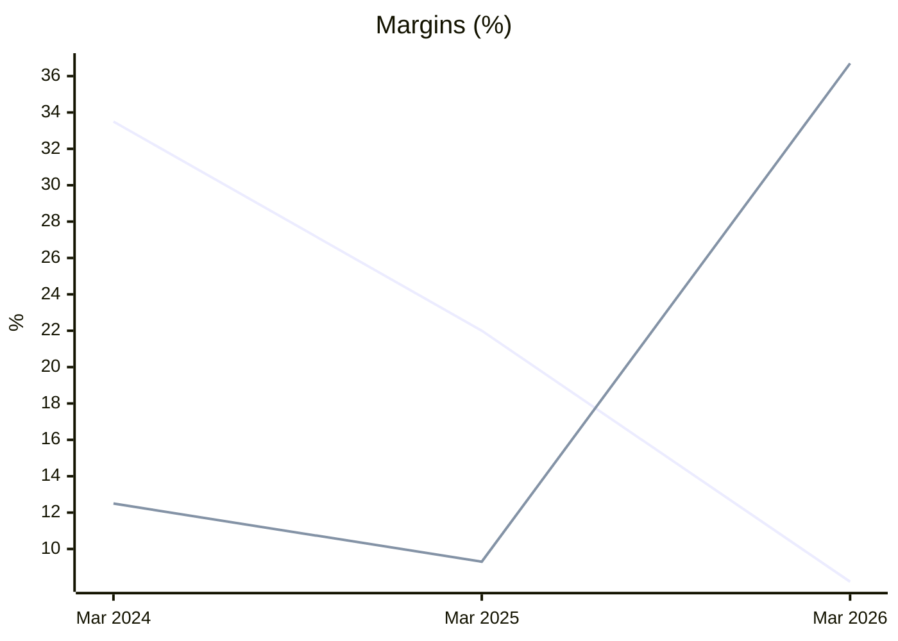

*Run 2026-11-24 · part of [SPINOFF_REPORT.md](../SPINOFF_REPORT.md) · the complete analysis of one company, with every management-call exchange in full.*

## INOXGREEN — Inox Green Energy Services Ltd.

### 1. Inox Green Energy Services Ltd. — CONFIRMED DEMERGER

**CONFIRMED** (a demerger scheme is on the exchange record) · **LISTED <1Y — selling-pressure window; the bargain forms here** · score 4.3/10 · spin-off · 24 filing(s) from CALLS, NSE, NSE-register · first 2025-11-01, latest 2026-08-24

**The separated entities — every one the documents name:**

| Entity | Scheme | Business | Listing | Who runs it |
|---|---|---|---|---|
| **Inox Renewable Solutions Limited** (earlier Resco Global Wind Services Limited) | 2024 demerger of Power Evacuation Business from Inox Green … | Power Evacuation Business Undertaking — all assets and liabilities of the Demerged Company pertaining to the … | to be listed — "Yes. The equity shares to be issued by Resc… | not stated (Mr. Heera Lal is the Authorized Signa… |

**The other parties to the scheme(s)** — not separated entities: Inox Wind Limited (INOXWIND) — the company this one was spun out of; Inox Clean Energy Limited — merged in — no shares for the parent's holders; Inox Neo Energies Private Limited — merged in — no shares for the parent's holders; Flurry Wind Energy Private Limited — merged in — no shares for the parent's holders; Flutter Wind Energy Private Limited — merged in — no shares for the parent's holders

**What is being separated, as the documents put it:** The Power Evacuation Business (substation/evacuation infrastructure undertaking) of Inox Green, demerged into Inox Renewable Solutions Limited — class `value_unlocking`.

### 2. Stages and dates

> **Listing:** RECORD DATE 2026-08-01 PASSED — Inox Renewable Solutions Limited not in NSE's equity list (complete to 2026-11-13): the new shares are allotted but not yet trading

| Date | Event | Source |
|---|---|---|
| 2024-08-09 | Other — Inox Green Energy Services Limited | as stated: Outcome of Board Meeting filing dated 9th August, 2024 — Audit Commit… |
| 2024-10-01 | Appointed date | as stated: Filing dated 4th May, 2026 and NCLT orders dated 08.09.2025 and 13.03… |
| 2024-11-13 | Stage reached: **announced** | [Demerger](https://nsearchives.nseindia.in/corporate/INOXGREEN_13112024183131_IGESL_BM_13112024_dsc.pdf) |
| 2024-11-13 | Board approval — Inox Green Energy Services Limited and Inox Renewable Solutions Limited (Board Resolutions dated 13.11.2024 of both petitioner companies) | as stated: Demerger intimation / Outcome of Board Meeting filing dated 13th Nove… |
| 2024-12-18 | Other — both petitioner companies | as stated: Statutory Auditors' certificates on accounting treatment, both dated … |
| 2025-03-28 | Filed with exchanges — Inox Green Energy Services Limited | as stated: NSE Observation Letter Ref: NSE/LIST/45661 dated July 18, 2025 — "Bas… |
| 2025-07-16 | SEBI observations | as stated: BSE and NSE observation letters dated July 18, 2025 — "SEBI vide its … |
| 2025-07-18 | Stage reached: **exchange noc** | [Scheme of Arrangement](https://nsearchives.nseindia.in/corporate/IGESL_18072025191419_IGESL_ObservationLetter18072025_dsc.pdf) |
| 2025-07-18 | Exchange no-objection — BSE Limited and National Stock Exchange of India Limited | as stated: Filing dated 18th July, 2025 — Observation Letters under Regulation 3… |
| 2025-09-03 | Other — both petitioner companies | as stated: NCLT order dated 08.09.2025 — joint Company Application CA(CAA)/43(AH… |
| 2025-09-08 | NCLT order — first motion order directing the meetings of equity shareholders, warrant holders, secured creditors and unsecured creditors | as stated: Filing dated 9th September, 2025 enclosing NCLT, Ahmedabad Bench orde… |
| 2025-09-29 | Other — Inox Green Energy Services Limited and Inox Renewable Solutions Limited | as stated: Notice dated September 29, 2025 convening the meetings, published on … |
| 2025-10-09 | NCLT order — modification order fixing meetings of IGESL on 01.11.2025 and of IRSL on 02.11.2025 | as stated: NCLT final order pronounced 13.03.2026 (Comp. App/38(AHM)2025) |
| 2025-11-01 | Stage reached: **meetings** | [Shareholders meeting](https://nsearchives.nseindia.in/corporate/IGESL_01112025183245_IGESL_CCM_Proceedings.pdf) |
| 2025-11-01 | Shareholders / creditors meeting — Inox Green Energy Services Limited — equity shareholders (10:30 A.M.), warrant holders (12:30 P.M.), secured creditors (02:30 P.M.), unsecured creditors (03:00 P.M.) | as stated: Filings dated 1st November, 2025 (proceedings) and 3rd November, 2025… |
| 2025-11-02 | Shareholders / creditors meeting — Inox Renewable Solutions Limited — equity shareholders, debenture holders, secured creditors and unsecured creditors | as stated: NCLT orders dated 08.09.2025 and 09.10.2025; NCLT final order pronoun… |
| 2025-11-05 | Other — Chairperson Dr. Binod Kumar Sinha | as stated: NCLT final order dated 13.03.2026 — Chairperson Report in Form No. CA… |
| 2026-03-13 | NCLT order — sanction of the Scheme — CP(CAA)/56(AHM)2025 in CA(CAA)/43(AHM)2025 | as stated: Filing dated 14th March, 2026 enclosing the order pronounced by the H… |
| 2026-03-14 | Stage reached: **nclt sanction** | [Scheme of Arrangement](https://nsearchives.nseindia.com/corporate/IGESL_14032026182453_IGESL_SE_intimation_regarding_NCLT_order.pdf) |
| 2026-04-27 | Other — Inox Green Energy Services Limited | as stated: Filing dated 28th April, 2026 — certified copy of the NCLT order rece… |
| 2026-05-04 | Stage reached: **effective** | [Scheme of Arrangement](https://nsearchives.nseindia.com/corporate/IGESL_04052026182821_IGESL_SE_intimation_regarding_NCLT_effective_date_dsc.pdf) |
| 2026-05-04 | Effective date — both companies filed the certified copy of the NCLT Order with the Registrar of Companies | as stated: Filing dated 4th May, 2026 — "Accordingly, the Scheme has become effe… |
| 2026-08-01 | **Record date** | NSE corporate-actions register |
| 2026-08-01 | Stage reached: **record date** | Record Date (corporate-actions register) |
| 2026-08-01 | Record date — Inox Green Energy Services Limited shareholders entitled to IRSL shares | as stated: Intimation regarding Record Date dated 22nd July, 2026 |
| 2026-08-24 | Allotment — Inox Renewable Solutions Limited — 4,89,82,030 fully paid-up equity shares of Rs. 10/- each | as stated: Intimation regarding allotment of equity shares pursuant to the Schem… |

**The stages, as filed:** announced (2024-11-13) → exchange noc (2025-07-18) → meetings (2025-11-01) → nclt sanction (2026-03-14) → effective (2026-05-04) → record date (2026-08-01)

**Stated in the filings:** resulting company **Inox Renewable Solutions Limited**; demerged undertaking: ) of Inox Green Energy Services; entitlement **122 for every 2,000**; record date 2026-08-01.

**When it lists, in the documents' words:** Feb 13, 2026 call: NCLT approval 'should come in a month or so' and 'Post receiving of the NCLT approval, it is 1 to 1-1/2 month process for the listing of the company... within 3-odd months, 2-3 months, it should get on the process' - 'but don't take it as a commitment'. May 29, 2026 call: 'IRSL will be automatically listed on the stock exchange post receipt of all the approvals.' Aug 24, 2026: after allotment of 4,89,82,030 shares, 'IRSL is taking necessary steps for crediting the aforesaid equity shares to the respective demat accounts... and for obtaining the listing and trading approvals for the said equity shares from the Stock Exchanges.' No completed listing date stated through the latest filing (Oct 7, 2026).

### 3. Size of the separated business beside the parent — is institutional selling likely?

**Reading: VERY LIKELY — the piece is under a tenth of the whole; index funds and large holders who receive it without choosing it tend to sell.**

| Entity | Stated turnover | Stated share of the whole | Segment revenue share | Market cap (₹ cr) | Share of combined market cap | Index member |
|---|---|---:|---:|---:|---:|---|
| Inox Renewable Solutions Limited | "Turnover* of Power Evacuation Business as on 31st March 20… | 6.19% | 5.2% (FY2026) | — | — | not listed |

*Stated figures are the documents' own (a turnover share, or the cost-of-acquisition split the company publishes for tax, which reflects relative value); the segment share is this business's revenue over the parent's sales, and the market-cap share is the entity's value over the entity plus the parent (parent ₹4,706 cr, NSE bhavcopy of 2026-11-13), both computed here.*

**In the documents' words:** “"Turnover* of Power Evacuation Business as on 31St March 2024 (Rs. in Crore) 14.93 | Percentage to the total turnover of IGESL as on 31st March 2024 6.19% | *On standalone basis"; and from the Q4 FY'26 call: "With this gross block of approximately INR1,000 crores has been eliminated from Inox Green's balance sheet. And subsequently, the annual depreciation of approximately INR50 crores to INR55 crores has been eliminated, thereby increasing the profitability."”

**The judge's read of selling pressure:** likely — Only 122 IRSL shares per 1,000 held - small odd-lot stakes; 4,89,82,030 shares spread to O&M holders; different industry (EPC/power evacuation), loss-making, heavily indebted

### 4. Insider ownership — share swap, promoters' holding, management incentives

**Share swap / entitlement, entity by entity:**

- **Inox Renewable Solutions Limited:** "122 equity shares of IRSL (face value Rs. 10/- each) shall be issued for every 1,000 equity shares (face value Rs. 10/- each) held in Inox Green Energy Services Limited." Also: "122 convertible warrants of IRSL having issue price of Rs. 205 each to be issued for every 1,000 convertible warrants of IGESL having issue price of Rs. 145 each"

**Promoters' holding, from the shareholding pattern:**

| Company | Promoters | FIIs | DIIs | Public | Quarter |
|---|---:|---:|---:|---:|---|
| Inox Green Energy Services Ltd. (INOXGREEN) | 53.7% | 8.17% | 1.93% | 36.18% | Sep 2026 |

*Source: screener.in shareholding pattern, stored under `ShareholdingPattern/NiftyTotalMarket/`. In a mirror demerger each shareholder holds the same proportion of the new company as of the parent on the record date.*

- **Promoters in the parent, per the documents:** Pre-Scheme (13th November, 2024 disclosure, on fully diluted basis): Promoter 23,28,61,497 equity shares, 56.92%; Public 17,62,24,254, 43.08%. "The Promoter and Promoter group holds 20,54,27,291 equity shares of the Company as on the Cut-off date" and "there are a total of 1,24,511 public shareholders holding 16,15,89,498 eq'uity shares of the Company constituting 44.03% of the total issued, subscribed and paid up equity share capital as on the Cut-off date" (Cut-off date Saturday, October 25, 2025).
- **What the promoters will hold in the separated entity:** 2024 demerger — mirror shareholding in IGESL, dilution in the resulting company: "Change in the shareholding of IGESL — Promoter: Pre-Scheme 23,28,61,497 / 56.92; Post Scheme 23,28,61,497 / 56.92; Public: Pre-Scheme 17,62,24,254 / 43.08; Post Scheme 17,62,24,254 / 43.08" and "Change in the shareholding of Resco — Promoter: Pre-Scheme 14,88,30,788 / 91.90; Post Scheme 17,72,39,891 / 83.66; Public: Pre-Scheme 1,31,10,468 / 8.10; Post Scheme 3,46,09,827 / 16.34" (both on fully diluted basis). For the 2024 intra-group divestments (Inox Clean Energy, Aliento, Flurry, Flutter): sold to related parties controlled and owned by significant beneficial owners of the Company; no shares issued to IGESL shareholders.
- **What a public shareholder receives:** 2024 Power Evacuation demerger: "122 equity shares of IRSL (face value Rs. 10/- each) shall be issued for every 1,000 equity shares (face value Rs. 10/- each) held in Inox Green Energy Services Limited." Warrant holders additionally receive "122 convertible warrants of Resco having issue price of Rs. 205 (rounded) each to be issued for every 1,000 convertible warrants of Inox Green having issue price of Rs. 145 each" and their IGESL warrants are substituted: "1,000 convertible warrants of Inox Green having issue price of Rs. 120 each to be issued and substituted for every 1,000 convertible warrants of Inox Green having issue price of Rs. 145 each." 2024 intra-group divestments: public shareholders of the parent receive nothing (cash/consideration to the Company only).
- **Management incentives:** Treatment of existing grants in the Scheme: not stated. Existing plan at the parent: "20,70,120 (Twenty Lakh Seventy Thousand One Hundred and Twenty) options granted to eligible employees of the Company as determined by Nomination and Remuneration Committee" under the 'Inox Green - Employee Stock Option Scheme 2024'; "Options have been granted @ 50% discount to closing market price of the Company's equity shares on NSE on Thursday, 8th August, 2024* i.e. Rs. 174/-" (*Closing price on the previous closing day at the Stock Exchange having the highest trading volume); "The aforesaid Options will vest after statutory minimum period of 1 (one) year as per SEBI Regulations and ma., period of 4 (four) years from the date of grant"; "The exercise period for vested Options shan be a maximum of 4 (four) years commencing from the relevant date of vesting of Options." Options vested: Nil; options exercised: Nil; money realized by exercise of Options: Nil. No new plan in the resulting entity is stated.
- **Insider actions around the separation:** Warrants: "The meeting was attended by 5 warrant holders holding 4,20,68,962 share warrants, representing 100% of the total outstanding warrants (Attendance Sheet on page 546 of the Petition), thereby constituting the requisite quorum. As per the Scrutinizer's Report, all the participating warrant holders voted in favour of the resolution approving the proposed Scheme of Arrangement and none voted against the same." Under the Scheme the IGESL warrants held by them are repriced/substituted from an issue price of Rs. 145 each to Rs. 120 each, with 122 IRSL warrants at Rs. 205 each per 1,000 IGESL warrants. Earlier group issuance: "the company has issued number of 2,89,85,503 equity shares and 4,48,27,582 convertible warrants having face value Rs.10/- each of the group at price of Rs. 138/- per equity share and Rs. 145/-per convertible warrants respectively (including premium Rs.128/-per share and Rs. 135/ per share respectively) fully paid up", and allotment of equity shares on conversion of 27,58,620 warrants into 27,58,620 equity shares at an issue price of Rs. 145/- per share. Intra-group sales: Inox Clean Energy Private Limited, Aliento Wind Energy Private Limited, Flurry Wind Energy Private Limited and Flutter Wind Energy Private Limited were sold to "a related party controlled and owned by significant beneficial owners of the Company". No promoter buying, selling or pledging of IGESL shares around the separation is stated.
- **Insiders, per the checklist read:** Inox Wind Limited, promoter and holding company, directly holds 51.13% of Inox Green; IRSL shares issued pro-rata to the same shareholders. Director/KMP stakes tiny (Bindu Saxena 12,640 shares). No separate incentive scheme stated. · *option pricing date:* not stated

### 5. Why the demerger — point by point

The separation is the demerger of Inox Green Energy Services Ltd's (IGESL) power evacuation / substation and common-infrastructure business into Inox Renewable Solutions Ltd (IRSL, formerly Resco Global Wind Services), leaving IGESL a pure-play renewable O&M company and consolidating all evacuation/EPC infrastructure in IRSL, which gets automatically listed. Management's core explanation is historical and structural: when IGESL was spun out of Inox Wind, the EPC business was slump-sold to Resco, but the already-commissioned substations and transmission lines could not be moved because, as Devansh Jain said in Aug 2024, shifting them 'would have entailed taking approval from over 200 customers and then arm twisting us in terms of renegotiating contracts and screwing the entire O&M business'; so IGESL's balance sheet stayed 'unnecessarily inflated' with assets on which it is 'actually the trustee', while all new substations were being built in Resco anyway ('no future CapEx under Inox Green at all', Feb 2024). The financial fix they repeatedly quantified: a gross block of ~INR 1,000 crore (net block ~INR 750 crore, Aug 2024) leaves IGESL, annual depreciation of ~INR 50-55 crore (~INR 13-17 crore a quarter) is eliminated, PBT rises by that amount, and only ~INR 3-5 crore a quarter (~INR 10 crore a year, Feb 2026) of revenue goes out with virtually no cost and no interest moving — Akhil Jindal put the benefit at '~INR 12-odd crore in the bottom line on a quarterly basis' (Nov 2024), turning reported PAT of ~INR 6 crore into ~INR 18-20 crore. They stressed the evacuation assets are not needed for O&M ('not required for O&M services per se... that is required for further providing a turnkey solution'), so IGESL becomes a zero-capex, asset-light annuity business where EBITDA equals PBT and cash PAT, helped by a ~INR 700 crore accumulated tax-loss shield that stays at company level, with 'significant improvement in ROE and ROCE' (Jun 2026). The Scheme's own rationale adds that risks, rewards, financial profile, competition and opportunities are 'separate and distinct' for O&M versus power evacuation, that the evacuation business 'is capable of attracting different set of investors, strategic partners, lenders and other stakeholders', that consolidating it into IRSL (which already does the same business) unlocks value and lends enhanced focus, and that the result is two listed entities each free to pursue its own strategy. On the IRSL side, management argued the infrastructure is itself a high-value platform — INR 175 crore raised at a ~INR 7,400 crore valuation (Sep 2025), ~10 GW of 'plug and play' evacuation infra made more valuable by the CERC hybridisation amendment — and that listing it 'will unlock substantial value for both Inox Wind and Inox Green' (Nov 2025). The push came from the promoters/board (valuers appointed Aug-Nov 2024, scheme approved 13 Nov 2024) with investors on calls repeatedly asking about rationalising subsidiaries and value unlocking; Akhil Jindal framed the purpose as giving shareholders optionality — 'a shareholder has got now a choice to hold any part of the business' — and shareholders, warrant holders, secured and unsecured creditors all approved it before NCLT Ahmedabad sanctioned it.

**Point by point, with the source:**

1. Pre-demerger baseline: management explained IGESL carries legacy substation gross block (4 GW capacity, 3 GW commissioned) with ~INR 13 crore quarterly depreciation, while all future common-infrastructure capex is being incurred in Resco Global, a 100% subsidiary of Inox Wind. “So, no future CapEx under Inox Green at all. So, whatever is the depreciation which is being incurred on a quarterly basis will continue until and unless our net block gets consumed.” — *[Feb 2024](https://inoxgreen.com/PDF/Transcription%20of%20INOX%20Green%20Energy%20-%20Q3%20FY24%20Earnings%20Conference%20Call.pdf)*
2. Board appointed consultants and registered valuers to evaluate the demerger; Mathusudhana framed it as producing a cleaner, asset-light balance sheet whose main benefit is eliminating depreciation. “The proposed demerger will significantly add value through depreciation elimination.” — *[Aug 2024](https://inoxgreen.com/PDF/MOSL-InoxGreenEnergy-Aug09-2024_IGESL.pdf)*
3. Devansh Jain gave the historical reason the assets were stranded in IGESL: at the time of the EPC slump sale to Resco, only uncommissioned assets moved, and commissioned substations could not be shifted without re-opening contracts with over 200 customers. “We could not shunt it out from this balance sheet into Resco because that would have entailed taking approval from over 200 customers and then arm twisting us in terms of renegotiating contracts and screwing the entire O&M business.” — *[Aug 2024](https://inoxgreen.com/PDF/MOSL-InoxGreenEnergy-Aug09-2024_IGESL.pdf)*
4. He added that IGESL's balance sheet was inflated by assets it merely holds as trustee (net block ~INR 750 crore), and that the remaining business is a zero-capex annuity with no land bank or future evacuation capex. “Inox Green's balance sheet is unnecessarily inflated thanks to these historical substations which are lying on its balance sheet of which we are actually the trustee.” — *[Aug 2024](https://inoxgreen.com/PDF/MOSL-InoxGreenEnergy-Aug09-2024_IGESL.pdf)*
5. Akhil Jindal quantified the P&L effect for Pritesh Chheda: the whole depreciation goes, only INR 3-4 crore of quarterly revenue leaves, and IGESL shareholders receive Resco shares in lieu, with valuation yet to be fixed. “Excluding the substation business, the revenue would be down by around Rs. 3 crores or Rs. 4 crores on a quarterly basis, and the whole depreciation will go away. So, broadly that will add around Rs. 12-odd crore in the bottom line on a quarterly basis.” — *[Nov 2024](https://www.inoxgreen.com/PDF/MOSL-InoxGreenEnergy-Oct25-2024.pdf)*
6. Mathusudhana answered Bhavik Shah's objection that the transferred assets would come back as opex: the evacuation and common infrastructure is not needed to run O&M at all, it belongs to the EPC/turnkey business, so margins are unaffected. “So as far as the power evacuation and the common infrastructure, we have developed is not required for O&M services per se. That is required for further providing a turnkey solution to the customers.” — *[Feb 2025](https://www.bseindia.com/stockinfo/AnnPdfOpen.aspx?Pname=a6149a06-42db-4b82-ae77-0dc15e5abe49.pdf)*
7. Jindal described the post-demerger entity as an asset-light balance sheet with no depreciation, so EBITDA is the benchmark for PAT; the ~INR 700 crore accumulated tax losses stay with IGESL because they sit at company, not asset, level. “So when you're looking into the next year's balance sheet of Inox Green, it would be an asset-light balance sheet. And it would also have no depreciation charges as a continued item. What it means is that our profitability will be far more stronger.” — *[Feb 2025](https://www.bseindia.com/stockinfo/AnnPdfOpen.aspx?Pname=a6149a06-42db-4b82-ae77-0dc15e5abe49.pdf)*
8. Asked by Hansal Thakkar whether the subsidiaries would be rationalised into IWL shareholders' hands, Jindal said the whole intent of separating the businesses was shareholder optionality, and that no further corporate action is needed. “And I think from a shareholder's perspective, a shareholder has got now a choice to hold any part of the business. He can hold the O&M business, he can hold the infrastructure business, he can hold the entire value chain together under Inox Wind.” — *[Sep 2025](https://www.bseindia.com/stockinfo/AnnPdfOpen.aspx?Pname=ac349021-05a3-4a4e-84a8-edb5f23d90bd.pdf)*
9. Mathusudhana restated the balance-sheet numbers (INR 1,000 crore gross block off, INR 50-55 crore annual depreciation eliminated, PBT up by that amount, ROE/ROCE up), with exchange no-objections received and the scheme filed at NCLT Ahmedabad. “Once the scheme is approved by the NCLT, the gross block of around INR1,000 crore will be off our balance sheet and subsequently the depreciation of approximately INR50 crores to INR55 crores annually will be eliminated, thereby increasing the PBT by that amount.” — *[Sep 2025](https://www.bseindia.com/stockinfo/AnnPdfOpen.aspx?Pname=ac349021-05a3-4a4e-84a8-edb5f23d90bd.pdf)*
10. Sanjeev Agarwal gave the value case for the receiving entity: IRSL had just raised INR 175 crore at a ~INR 7,400 crore valuation, and the new CERC hybridisation rules multiply the value of its site infrastructure (Devansh: ~10 GW of plug-and-play infra). “We have recently raised INR175 crores at Inox Renewable Solutions at a valuation of approximately INR7,400 crores.” — *[Sep 2025](https://www.bseindia.com/stockinfo/AnnPdfOpen.aspx?Pname=ac349021-05a3-4a4e-84a8-edb5f23d90bd.pdf)*
11. With shareholder and creditor approval obtained, Devansh Jain framed the separation as a value-unlocking event for both the parent and IGESL, with IRSL listing as Inox Wind's EPC arm. “I believe that the de-merger and subsequent listing of Inox Renewable Solutions will unlock substantial value for both Inox Wind and Inox Green.” — *[Nov 2025](https://www.bseindia.com/stockinfo/AnnPdfOpen.aspx?Pname=12a9f200-8091-44c1-a30e-eb06b0e51134.pdf)*
12. Answering Prit Nagersheth on how much revenue comes off, management sized the revenue leakage at only ~INR 10 crore against ~INR 50 crore of depreciation removed, i.e. no material impact on the INR 600 crore FY27 EBITDA math. “So post the demerger, as we have clarified on the multiple cores, there would be a very limited amount of revenue in the range of INR 10 odd crore will get out of the balance sheet. And around INR 50 odd crores of depreciation will go out from the balance sheet.” — *[Feb 2026](https://www.bseindia.com/stockinfo/AnnPdfOpen.aspx?Pname=d934a5d2-25cf-4a13-92c1-68d279362ad8.pdf)*
13. Mathusudhana confirmed NCLT Ahmedabad approval and booked the benefits as realised: INR 1,000 crore gross block and INR 50-55 crore annual depreciation eliminated, profitability and returns up; Devansh said remaining steps were administrative, 1-2 months. “It has also led to significant improvement in ROE and ROCE of Inox Green.” — *[Jun 2026](https://www.bseindia.com/stockinfo/AnnPdfOpen.aspx?Pname=78c64939-3c62-49ac-9827-562fd6465a1b.pdf)*
14. Management declined to disclose IRSL's top line or EBITDA profile until the demerger dates are announced, and tied the post-demerger IGESL story to ~INR 600 crore FY27 EBITDA converting almost fully to cash with no depreciation, no finance cost and a INR 700 crore tax shield. “We cannot say at this point in time. I think once that demerged, we'll elucidate more plans. At this point in time, it's part and parcel of Inox Wind.” — *[Jun 2026](https://www.bseindia.com/stockinfo/AnnPdfOpen.aspx?Pname=78c64939-3c62-49ac-9827-562fd6465a1b.pdf)*
15. The Scheme's stated rationale is segregation of two verticals whose risk-reward and financial profiles differ, consolidation of the evacuation business into IRSL which already runs it, and establishing IGESL as a pure-play O&M player, producing two listed entities. “Further, the Power Evacuation Business is capable of attracting different set of investors, strategic partners, lenders and other stakeholders.” — *Scheme*
16. Consideration to IGESL shareholders was fixed by registered valuer Finvox Analytics (fairness opinion from Marwadi Chandarana) at 122 IRSL shares per 1,000 IGESL shares; appointed date 1 Oct 2024, NCLT sanction 13 Mar 2026, effective 4 May 2026, record date 1 Aug 2026, 4,89,82,030 IRSL shares allotted 24 Aug 2026. “122 equity shares of Resco of face value of INR 10 each fully paid up to be issued for every 1,000 equity shares of Inox Green of face value of INR 10 each fully paid up” — *Scheme*

**How it evolved:** On the Feb 2024 call the idea did not exist yet; management only explained that all future common-infra capex would sit in Resco, not Inox Green, while legacy depreciation ran on. By the Aug 2024 and Nov 2024 (Oct 25, 2024) calls the board had appointed consultants and registered valuers to evaluate demerging the power evacuation business, pitched as a 'cleaner and asset-light balance sheet' worth ~INR 12 crore a quarter to the bottom line, and the board approved the Scheme on 13 Nov 2024; in Feb 2025 (Jan 31, 2025) Akhil Jindal said exchange approvals were due in February and NCLT would take 6-9 months, with IGESL holders getting ~20% of the renamed Inox Renewable Solutions. By Sep 2025 (Sep 1, 2025) stock-exchange no-objections were in and the scheme filed at NCLT Ahmedabad (approval expected in 2-3 quarters), IRSL had raised INR 175 crore at a ~INR 7,400 crore valuation, and the CERC hybridisation ruling made its infra far more valuable; Nov 2025 (Nov 14, 2025) reported shareholder and creditor approval, and Feb 2026 (Feb 13, 2026) said hearings were in final stages with listing 2-3 months out. NCLT sanctioned the scheme on 13 Mar 2026, it became effective 4 May 2026, and on the Jun 2026 (May 29, 2026) call management confirmed approval and booked the benefits as done — INR 1,000 crore gross block and INR 50-55 crore depreciation gone, ROE/ROCE improved — while refusing to give IRSL's standalone top line or EBITDA until listing; the record date was 1 Aug 2026 and 4,89,82,030 IRSL shares were allotted on 24 Aug 2026.

**What management expects from it:** Inox Green: asset-light pure-play O&M — Rs 1,000 crore gross block and Rs 50-55 crore depreciation gone, only ~Rs 10 crore revenue lost, EBITDA≈PBT≈cash PAT, better ROE/ROCE. IRSL: separately listed EPC/evacuation arm with its own investors, lenders and ~10 GW plug-and-play infra; IGESL holders get 122 IRSL shares per 1,000.

*Not explained on the calls:* Never quantified IRSL's evacuation revenue/EBITDA, who pays IGESL's common-infrastructure contract revenue post-transfer, lender/customer consent mechanics, or whether IGESL now rents the substations back.

- *Stated reason, in one line:* Segregation of distinct business verticals with separate risks, rewards and investors; consolidation of Power Evacuation Business into IRSL to unlock value and lend enhanced focus; establishing IGESL as a pure-play O&M player, creating two listed entities
- *What it reveals:* Removing ~Rs 1,000 crore gross block and Rs 50-55 crore annual depreciation leaves Inox Green a pure-play O&M business with ~50% EBITDA margins, tax shield and FY27 EBITDA guidance above Rs 600 crore; IRSL holds the capital-heavy, leveraged evacuation assets, losses and a Rs 96.8 crore tax demand
- *Parent or spin:* parent · *Read next:* IRSL listing/trading approval intimation and its standalone financials - secured/unsecured debt and the Rs 96.80 crore AY2023-24 tax demand
- *In their words:* “Such consolidation in a single entity will lend enhanced focus to the Power Evacuation business.”

### 6. On the calls, verbatim

8 call(s), oldest first: **21 question-and-answer exchange(s)** given in full — the question and every answer to it, nothing trimmed — and 15 passage(s) from management's prepared remarks (the complete sentences about it; the whole remarks are in the linked transcript). Text is as the transcript prints it.

#### Nov 2023 — [transcript](https://www.bseindia.com/stockinfo/AnnPdfOpen.aspx?Pname=78c2f017-6d71-4c74-bb9e-44b23bfca78e.pdf)

**Question and answer**

> **Jatin Chawla:** I am looking at only EBITDA from O&M. Management: No, you won't be able to find that out because we could not apportion the profit margin on the traded goods in that. So , when you see it on the presentation on slide three, you can't make out from that. So , there are about INR 7 crores to INR 8 crores because under related party, there have to be related party compliances. So , while we are not in the business of making profit on traded goods, historically there have been traded goods. Plus, there were various other charges given that this entity had not been demerged from the EPC perspective plus the charges for the IPO. Now all those items cannot be put on this presentation. You can get on a call with our finance team. They will be more than happy to take you through micro details of one time charges, the IPO expenses, etcetera. Having said t hat, if you look at H1 this year, our EBITDA from operations will be close to INR62 crores. Not from this presentation because this presentation is only showing you 30th September. If you look at the balance sheet, it's INR 62 crores. INOX Green Energy Services Limited October 27, 2023

#### Aug 2024 — [transcript](https://inoxgreen.com/PDF/MOSL-InoxGreenEnergy-Aug09-2024_IGESL.pdf)

**From the prepared remarks** *(the passage about it; the whole turn runs to 3,865 characters in the transcript)*

> **S.K Mathusudhana:** Inox Green has a robust internal valuation framework and due diligence methodology to assess and choose right targets to create value. While we are assess ing multiple targets, the valuation multiples and the IRR threshold are defined by a prudent capital allocation policy of the company. The objective is that the deal should be mutually beneficial for Inox Green and the target company resulting in immediate and long -term value creation. The board of Inox Green has appointed consultants and registered valuers for evaluating the demerger of power evacuation business from Inox Green. Post valuation of reports and subject to board approval, the demerger process will be initiated. Demerger of power infrastructure facilities currently on the balance sheet of Inox Green will result in a cleaner and asset light balance sheet. The proposed demerger will significantly add value through depreciation elimination. Looking into the rising market demands and scaling up of operations, we have launched a program named Vayuveer to create highly trained skilful manpower with six months of technical and on -job training. This will create us sustainable business operations with mor e effectiveness and cost control to achieve the desired results. Inox Green Energy Services Limited August 09, 202 4 This will also create job opportunities to local youth and meeting our social commitments.

**Question and answer**

> **Hiral Nandu:** Okay. And just any tentative timeline for this demerger? Management : So currently, as we have told that we are currently -- the Board is currently seeing the…
>
> **Devansh Jain:** So I think we have appointed valuers and consultants to advise us on the demerger. And post evaluation of reports and subject to the Board approval, the demerger would take place, which would lead to consequential listing of Resco, along with the power evacuation infrastructure of Inox Green. The process should be taking about six to ni ne months with Board approval.

**Question and answer**

> **Bhavya Shah:** Thanks for the opportunity. First of all, I would like to congratulate Devansh and team for a successful fundraise of INR1,000 crores. In an era where a lot of promoters are selling the stake in the company, it's very encouraging to see promoters pumping in INR400 crores. So m y first question is relating to the demerger of the power evacuation infra. In the presentation, you have mentioned that the depreciation which is appearing right now will g o away. So I just wan ted to ask that with the demerger , will only the depreciation go from the P&L or there will be an impact on revenue and interest cost as well?
>
> **Manish Garg:** So Bhavya, to be very precise, there would be no impact on the interest cost as such, but a little bit of the revenue will go away, which is a very miniscule number.

**Question and answer**

> **Bhavya Shah:** Okay. Devansh, in the presentation, we have mentioned that there's an opportunity of 10 gigawatts of such inactive players, but one of the peers who made an equation right now in a TV interview said that the opportunity size is of 50 gigawatt s. So, can you just reconcile what would it be? Does the 50 gigawatt include solar?
>
> **Devansh Jain:** So, Bhavya, Mathu, you add to it, but I think, Bhavya, what he mentioned, the peer was, currently we have a 46 gigawatt installed base, and in the next three to four years, they see the wind base expanding to 100 gigawatt. So, effectively, the O&M service opportunity is a 54 gigawatt opportunity. Now, naturally, the OEM who controls common infrastructure and the OEM who survives is doing O&M himself. No IPP wo uld ideally go out and give O&M to a live and kicking solid OEM, because the headaches are just too much. And the proprietary information and supply chain and spare parts are very complex. What we say when we say 10 gigawatts are the assets which are avail able in the domain, in the public domain where OEMs have either gone bust, or which are currently being serviced by unorganized, small, so -called ISPs. That is what we are talking about. Otherwise, it's like saying, by 2032, Modiji has targeted 175 gigawa tts of renewable energy. We are currently at 46 gigawatts of wind. So, actually, it's a 129 gigawatt opportunity in the next eight years.
>
> **Bhavya Shah:** Okay, okay, got it. Thanks for answering. Thank you.
>
> **Devansh Jain:** Thank you.

**Question and answer**

> **Avishek Datta:** Okay. And you want to separate out t he green also has some power evacuation ass ets which you want to separate and bring it to?
>
> **Devansh Jain:** If you go back to Inox Green, Inox Green was effectively the company which owned the EPC arm and the O&M arm. Prior to the listing of Inox Green were shunted out or deemed or slump sold the EPC business to a 100% subsidiary of Inox wind called Resco. At that point in time the assets which were uncommissioned or which were being built is what went out. What was already commissioned or which were only a trustee, we have already been paid for by customers but it still resides on our balance sheet. We could not shunt it out from this balance sheet into Resco because that would have entailed taking approval from over 200 customers and then arm twisting us in terms of renegotiating contracts and scre wing the entire O&M business. What's happening now is going forward, all the substations transmission lines are anyways being built under Resco. Inox Green Energy Services Limited August 09, 202 4 Inox Green's balance sheet is unnecessarily inflated thanks to these historical substations which are lying on its balance sheet of which we are actually the trustee. So, we are now demerging this from our balance sheet and merging it into Resco. That's what we are doing. Otherwise, there are no land banks and there is no future power evacuation under Inox Green. It's a zero - capex model business. It's an annuity service business.

#### Nov 2024 — [transcript](https://www.inoxgreen.com/PDF/MOSL-InoxGreenEnergy-Oct25-2024.pdf)

**From the prepared remarks** *(the passage about it; the whole turn runs to 4,225 characters in the transcript)*

> **S K Mathusudhana:** At INOX Green, motivated by the philosophy of the INOX GFL Group, we are constantly working on ways and means for cost and quality control. We have indigenized several critical spare parts and equipment s, including control system, gearbox , etc., by developing in -house capabilities and tying up with local ized v endors . This significantly reduces the supply chain r isk and timelines for maintenance activities, resulting in significant cost savings. The Board of INOX Green has appointed consultants and registered value rs for valuating demerger of power evacuation business from INOX Green. Post valuation of reports and subject to Board approval , the demerger process will be initiated . The demerger of power infra facilities currently on the balance sheet of INOX Green will result in a cleaner and asset -light balance sheet. The proposed demerger will significantly add value through depreciation elimination. Our Vayuveer program launched recently to create highly trained, skillful manpower with six months of dedicated technical and on -job training, has b een a success. After the successful completion of the first batch of Vayuveers , we are in the process to induct the second b atch. This will further help the Company to create sustainable business operations and control costs to achieve our desired results . As we are significantly and rapidly scaling up our operations across several locations, the program helps in creating job opportunities for local youth and also meeting our social commitments. INOX Green remains strongly committed to almost doubling its O&M portfolio in revenue terms from current levels to 6 gigawatts by FY ‘ 26 and 10 gigawatts in the next three to four years. The macro outlook for the renewable sector, especially wind power, continues to be very strong . In FY ‘25 , around 12 gigawatts of hybrid FDRE wind capacities have already been awarded . And we expect the pace of awarding and subsequent commissioning of wind capacities to continue strongly. This will provide large multi -decadal opportunities for O&M service providers like us.

#### Feb 2025 — [transcript](https://www.bseindia.com/stockinfo/AnnPdfOpen.aspx?Pname=a6149a06-42db-4b82-ae77-0dc15e5abe49.pdf)

**From the prepared remarks** *(the passage about it; the whole turn runs to 5,431 characters in the transcript)*

> **Akhil Jindal:** And obviously, we are continuously evaluating multiple opportunities for acquisitions of such businesses, either through NCLT route or the direct acquisition and also the portfolio of the existing ISPs. The financial position of the company, as you would have noticed, has improved significantly. It is in terms of the higher cash b ack, in terms of the EBITDA, which is a true profitability reflection of the Inox Green business. As you would know, at this juncture, the Resco demerger has not taken place, it's in the process. There is a significant amount of depreciation charges that is being reflected in our current numbers, which would be transferred to Resco as assets get transferred. So practically, whatever number you are seeing, you should look at our EBITDA number as a benchmark for our PAT numbers, because in absence of de preciation, everything will flow back to the profitability, to the bottom line. And that's where I guess the cash flow is a very important number for you to analyze as our company -- and Mathu said that our cash side is roughly INR23 crores on a quarter -to-quarter basis. And that is growing significantly as we are acquiring new businesses. The scheme for the demerger is also under process. The Resco, which my colleague mentioned in my previous call also, so we are awaiting the regulatory approvals the BSE, NSE approvals are likely to be available to us in the first week to 15 days of February. Once the regulatory approval comes in, the demerger will be done through NCLT and that would take, say, another 6 to 9 months as the case may be. We are hopeful that within this calendar year we will have the demerger of the business. And to that extent, the Resco will also be merged -- will be listed. So when you're looking into the next year's balance sheet of Inox Green, it would be an asset - light balance sheet. A nd it would also have no depreciation charges as a continued item. What it INOX Green Energy Services Limited January 31, 202 5 means is that our profitability will be far more stronger. Post the demerger, the shareholders of Inox Green will also receive the shares of Resco, which is renamed as Inox Renewa ble Solutions Limited. And where the -- so as a shareholder, they would also be a partner in the growth of the substation business, which is also getting merged through the same scheme. I would just reflect on the inorganic growth initiative s of the company, as I mentioned in the beginning, we are looking at a number of possibilities in this sector. There are many companies which are going through the bankruptcy route, and we are evaluating many of them.

**Question and answer**

> **Deepak Sharma:** Okay, and then my second question is how the Resco demerger will help the company in terms of revenue and EBITDA going ah ead?
>
> **S.K. Mathusudhana:** So in terms of the Resco demerger, obviously -- yes, the demerger of substation business and merger with Resco Global, Inox Green shareholders will be benefit by in two ways. One, they will get the shares of Resco, broadly 10%. Broadly 20% of the Resco would be owned by the Inox Green shareholders. That is one. Secondly, after this merger, demerger will get completed, the complete depreciation will be go away from the financial numbers, and our EBITDA would be as Mr. Akhil has said will translate to PAT and P BT.

**Question and answer**

> **Akhilesh:** Okay. And second question is on this demerger of the substation from Inox Green. So while it will take away depreciation from our books, will it also take away any of the tax losses that we have accumu lated.
>
> **S.K. Mathusudhana:** No. So the tax losses would be on a company level, not on an asset level. So the tax losses will remain in this company.
>
> **Akhilesh:** Okay. And what is the current accumulated tax loss.

**Question and answer**

> **Anuj Upadhyay:** Just one clarification on how much of cranes are expected to be operationalized in the next quarter? And also, you mentioned that the transformer capacity would be operational. So what capacity would begin, let's say, Q4. And I do understand that the Resco is targeted to be demerged from the Inox Green and it's capacity, my understanding is it would come on the Resco, but would it still have any kind of a margin impact on Inox Green for FY '26 numbers?
>
> **Anshuman Ashit:** So on your first question on the cranes, obviously, it is unrelated to Inox Green related to Inox Wind because Resco is a subsidiary of Inox Wind. But still two cra nes will become operational, and we are starting with that and then additional claims will come in the subsequent months. INOX Green Energy Services Limited January 31, 202 5 And there will be no impact on the transfer of the business -- the substation business from Inox Green in terms of the EBITDA margins. We don't see -- feel that there'll be any impact.

#### Sep 2025 — [transcript](https://www.bseindia.com/stockinfo/AnnPdfOpen.aspx?Pname=ac349021-05a3-4a4e-84a8-edb5f23d90bd.pdf)

**From the prepared remarks** *(the passage about it; the whole turn runs to 5,361 characters in the transcript)*

> **Sanjeev Agarwal:** We executed 146 megawatt during this quarter. We have very well diversified order book of 3.1 gigawatt , comprising of marquee clients across the spectrum, and a healthy mix of turnkey and equipment supply contracts. Our endeavour over the past year has been to build on our existing relationship to get more repeated orders, and in case of new customers, to get our first orders , however small or large it may be, as it is important to break through to build a long -term relationship and ensure repeat orders in the future. We expect to gain a fair share out of the opportunities coming in from our existing and potential customers, most of whom have very ambitious renewable additional plans. Currently we have a multi -gigawatt order pipeline and expect to convert a substantial portion into firm orders over the coming months. Inox Wind Limited and Inox Green Energy Services Limited September 01, 202 5 To achieve our target both in terms of execution and margins, we are continuously ramping up in the critical areas. We have recently operationalized our new 1200 megawatt capacity nacelle and Hub manufacturing unit near Ahmedabad, Gujarat. We have also deployed the first few set of cranes at our project sites and have commenced our transformer manufacturing facility as well, all under Inox Renewable Solutions. We are confident that these initiatives will aid faster execution and deliver higher than industry average margins. With that we are raising our margin guidance to 18% to 19% for the full year FY '26 from 17% to 18% earlier. Further we are strategically expanding our blade manufacturing capacity and are in process of setting up another facility in south part of India. This will improve our access to the sites in the southern states of Karnataka, Tamil Nadu and Andhra Pradesh. We have recently raised INR175 crores at Inox Renewable Solutions at a valuation of approximately INR7,400 crores. Further the scheme of demerger of substation business from Inox Green and subsequent merger into Inox Renewable Solutions has received no objections from the stock exchanges and we have filed the scheme in NCLT as well. We expect the approval to happen within next two to thr ee quarters. On the macro side, the outlook remains strong. I believe the government continues to stand firmly behind the wind industry. This is not just desirable but a necessity given the thrust to replace conventional fossil fuel based power with renewable sources. While solar will continue to lead this space, wind will continue to play a significant role in giving its complementar ity to solar and generation during non -solar hours and wind role in grid balancing and making efficient usage of the transmission network . There is also some sort of a myth that solar plus B ESS will completely replace the conventional power without much role of wind. However, this is not right understanding as B ESS is only a storage resource and not a generating resource. 16 hours of B ESS is still not financially viable which is why wind ’s role in RTC set up is critical and will remain critical.

**From the prepared remarks** *(the passage about it; the whole turn runs to 2,984 characters in the transcript)*

> **S.K. Mathu Sudhana:** During the quarter, the machine availability for entire portfolio averaged around 95.6 %. Inox Green added approximately 1.6 gigawatt peak of solar O &M contracts to its portfolio in the month of April to May 2025. Our move into solar O&M has been strategic given that one of our group companies has recently commenced solar module manufacturing and the imminent large scale opportunities for hybrid, RTC, FDRE projects. Our total renewable O &M portfolio stands at approximately 5.1 gigawatt. Additionally, we signed an agreement for the comprehensive O &M of 182 megawatt of wind projects of one of India's largest diversified conglomerates as well. Inox Green is rapidly expanding its portfolio through both organic and inorganic means. On acquisitions, we are continuously working with multiple parties on large scale opportunities. We have made investments in an entity around 2 gigawatt of O &M assets and shall keep on looking for such opportunities to expand our portfolio inorganically as well. Further, we are participatin g in multi -gigawatt scale wind and solar O &M tenders of IPPs as many of the large companies have now changed their strategies and are now moving out of capital O &M to outsourcing model where we believe Inox Green has an edge given its strong credentials. Finally, with a scheme of demerger of substation business from Inox Green, its subsequent merger into Inox Renewable Solutions receiving no objection from the stock exchanges, we have now filed the scheme in NCLT Ahmedabad. Once the scheme is approved by the NCLT, the gross block of around INR1,000 crores will be off our balance sheet and subsequently the depreciation of approximately INR50 crores to INR55 crores annually will be eliminated , thereby increasing the PBT by that amount. It will also lead to significant improvement in the ROE and ROCE of Inox Green. We expect the approval in the next 2 to 3 quarters.

**From the prepared remarks** *(the passage about it; the whole turn runs to 3,000 characters in the transcript)*

> **Devansh Jain:** While wind manufacturing is on a very solid growth platform built over the years, Inox Green is where I am extremely bullish on in terms of exponential growth which should start kicking in from this financial year as we ramp up our portfolio multiple times from 5 gigawatt currently to about 17 gigawatts over the next two years. While 17 gigawatts will have a mix of both solar and wind assets, wind will form the majority of the pie. As promoters, our motivation is to create and enhance value across our group companies and always be mindful of all our minority shareholders, case in point being the merger of IWEL with IWL. Our IPP arm and the solar manufacturing business under Inox Clean are also shaping up very well and the synergies between Inox Clean 's businesses with Inox Wind, Inox Green and Inox Renewable Solutions are quite unique and beneficial for all. Backed by the large capacity targets of Inox Clean , we expect further orders for Inox Wind, EPC opportunities for Inox Renewable Solutions and long -term O&M service opportunities for Inox Green, both across wind and solar. Today I can proudly say INOX GFL Group is one of the deepest and most integrated energy transition groups in the country with a presence across wind, solar, EVs, energy storage and a large IPP play now. Our renewable arm is extremely solid, capitalizing on opportunities and capable to withstand any challenges, regulatory or macro, if they were to come. I believe our group's renewable arm , and particularly Inox Wind , continues to be strongly positioned to capture the mega opportunities which lie ahead of us and will continue to create enormous value for all our stakeholders. Given that the industry is moving towards round -the-clock RE projects, at INOX GFL Group , we have strongly positioned ourselves to be a one -stop-shop for all our customers, offering solutions right from plain vanilla to the most complex projects across wind, solar, desk, infrastructure development and O&M services. We can now open the floor for Q&A.

**Question and answer**

> **Hansal Thakkar:** First of all, congratulations on the successful completion of the merger of IWEL into IWL and a very successful rights issue. It is also very encouraging to note that the recent demerger of the evacuation business from IGESL into IRSL has seen no objection s. And given that our company has experienced so many corporate actions, I have a specific query regarding our subsidiaries, which are Inox Green Energy Services and Inox Renewable Solutions , formerly Resco. Sir, as I recall, Mr. Jindal had mentioned in the past that the management will demerge these two subsidiaries, albeit those proposals were at a nascent stage. So my question is, on a longer term strategic view, what is the management's stance on the possibility of rationalizing these subsidiaries via demergers into the hands of the IWL shareholders? So Inox Wind Limited shareholders will likely get IGESL and IRSL via demerger. I wanted to know the management's view on this. And what circumstances would thi s step be considered?
>
> **Akhil Jindal:** Thank you for firstly recogni sing and understanding the achievements of the company so far. As I mentioned to you last time, the attempt was to de -merge the substation business and the connectivity and common infrastructure from INOX Green into Inox Resco. As we call it now, INOX Renewable Solutions Limited. Under that, there would have been an automatic listing of Resco . And to that extent, the shareholders of INOX Green would be getting the shares of INOX Resco also. So when we mentioned about the de -merger of the businesses, it was de -merger of the infrastructure assets and getting into that INOX Resco. And that Resco in turn will get listed. That's the attempt and which is what now we have got all the necessary approvals. The NCLT process has started and we hope that within two to three quarters, this all will be achieved and the shares could be issued for INOX Resco also.

**Question and answer**

> **Ketan Gandhi:** Sir, in opening remark s you said about , there is some notification from CERC . Can you throw some light on that amendment with respect to the industry, how it would be helpful to the industry and our company ? Management: So it just came out yesterday in which they allowed the hybridization of the existing transmission beyond 50 megawatt at a particular location. How it helps us as a company is across all Inox Wind , Green, Inox Renewable Solutions as well as one of our companies under Inox Clean , which is Inox Solar , everyone benefits due to this because a large part of the project infrastructure which we have built is currently evacuating only wind power. Now we can hybridize it and this gives us multiple times evacuation ready plug and play infra to set up the upcoming projects. So the execution then expedites because we don't have to build new infra. Infra is already there. It's now hybridized. So it's very good. I would say it has been Inox Wind Limited and Inox Green Energy Services Limited September 01, 202 5 coming. Some of the states had already declared it , the likes of Gujarat and Rajasthan . But now that it has come on a pan -India basis , it helps us expedite the project execution much faster.
>
> **Devansh Jain:** I think it -- also just to add , I think it gives us access to almost 10 gigawatts of plug and play infrastructure across wind and solar , which is huge. I don't think anybody in India , barring maybe one or two massive PSUs and a large Indian conglomerate , have access to this kind of plug and play common infrastructure. It should be game changing for us. Kailash?
>
> **Kailash Tarachandani:** I just wanted to add on what Anshuman said that this is -- other way also that there are a lot of solar -alone projects and people will look for wind along with that. So that is another boost for Inox Wind.
>
> **Ketan Gandhi:** I think it will be fantastic for us and the whole industry.
>
> **Devansh Jain:** I mean certainly for us given our common infrastructure , the industry . Those who control infrastructure will certainly benefit out of it.

**Question and answer**

> **Nandan:** Yes, Yes. Hi, congratulations on a great set of numbers. Just two questions from my end. Number one, I understand that we are sold out for the next 2 years, which is a great thing. But is there some sort of opportunity loss in terms of loss of customers to a competitor? Second question is in the lines of GST. So there is a lot of news going around about the GST rates in the renewable sector being cut from 12% to 5%. I understand the meeting is going to happen sometime this week. So, do we see any sort of tailwinds due to the rate cuts, GST rate cuts?
>
> **Devansh Jain:** Look, with respect to your first question, with respect to our saluting orders, I think Sanjeev reiterated it multiple times. Kailash reiterated it. I think we are growing it both horizontally and vertically where we are building on our existing relationships and we are diversifying to newer customers. And that's true across NTPC, CESC, Ampless, Multiple Orders, First Energy, Hero, Continuum, NLC. So that will continue to be the strategy. Some orders, I mean we cannot be the sole supplier to any one customer. So some orders we take, some competitors take. In certain new accounts, customers, existing suppliers lose and we enter. And I think that's how it is. As I mentioned, we have a very diversified book today of 10 -12 large customers whom we are supplying to. The team continues to work on newer names. So I think we are very, very solid on that. With respect to the GST rates being cut, yes of course it's a tailwind because your capital costs will go down. As a result, investment costs will go down. So returns could go higher or the cost of energy could go lower. Whichever way it is, it benefits the nation.

#### Nov 2025 — [transcript](https://www.bseindia.com/stockinfo/AnnPdfOpen.aspx?Pname=12a9f200-8091-44c1-a30e-eb06b0e51134.pdf)

**From the prepared remarks** *(the passage about it; the whole turn runs to 4,605 characters in the transcript)*

> **Sanjeev Agarwal:** Our manufacturing facility, including the recently commissioned nacelle and hub unit at Kalyangar h, Gujar at, are operating at high utilization levels, and EPC activities on multiple sites are on full swing for the monsoons. Further, we are expanding our manufacturing presence in South India by setting up a new blade and tower manufacturing facility, giving us quicker access to large sites across Karnataka, Andhra Pradesh, and Tamil Nadu. While my colleague, Madhu, we'll brief you in greater detail , we are elated with achievements and prospects of our subsidiary, Inox Green, where Inox Wind holds 56% currently. Inox Green has 12.5 gigawatt of renewable portfolio, directly or through investments made for multi - gigawatt portfolio acquisition. The group IPP with ambitious plan of setting up multi -gigawatt renewable energy capacity annually, provides a strong portfo lio additional visibility. Further, with the organic and inorganic growth prospects of the company, we believe Inox Green is on track to become the largest renewable O&M player in India. Another positive development is the scheme of demerger of the substa tion business from Inox Green and its subsequent margin into Inox Renewable, receiving approval from shareholders and creditors. This will add value for both Inox Wind, with subsequent listing of Inox Renewable solution as an EPC arm of Inox Wind, and Inox Green with elimination of depreciation on demergers of the asset blocks With a global shift towards greener power, India has also set ambitious plan for the complete transition to renewable energy. Hy brid projects are gaining pace to achieve this transition. Wind along with solar is an important role in this hybrid projects. Wind complementing to solar and Indian conditions make it as an important source of power for grid stabilization as well as highe r grid utilization.

**From the prepared remarks** *(the passage about it; the whole turn runs to 2,113 characters in the transcript)*

> **Mathu Sudhana:** Inox Green's portfolio stands at 12.5 gigawatts, including the investment which we have made to acquire 6.5 gigawatts of operational wind of asset of two companies. With the financial expected to consolidate into Inox Green's books in FY '27 post -statutory approvals. We expect our profitability to grow manifold in FY '27 over FY '26. The scheme of demerger of the substation business from Inox Green and its subsequent merger into Inox renewable solutions h as received approvals from shareholders and creditors. Once this scheme receives final approval from NCLT, gross block of around Rs. 1,000 crores will be eliminated from Inox Green's balance sheet and subsequently the annual depreciation of Rs. 50 crores to Rs. 55 crores will be eliminated, thereby increasing the profitability. It will also lead to significant improvement in the ROE and RO CE of Inox Green. Inox Green has rapid growth plans on both organic and inorganic fronts. We will continue to be benefic iaries of our parent company, Inox Wind's rapid execution growth, a dditionally, large - scale plans of our group IPP company and solar module vertical will also benefit us going ahead. I be lieve Inox Green is well on track to become India's largest renewable O&M company in the very near future. I will now hand over to our Executive Director, Mr. Devan sh Jain , for his remarks, after which we will open up the floor for the Q&A. Thank you.

**From the prepared remarks** *(the passage about it; the whole turn runs to 2,169 characters in the transcript)*

> **Devansh Jain:** Hi, good evening everybody. While Sanjeev and Mathu have taken you through the brief financial and operational performance of their respective companies, let me just touch upon some of the strategic initiatives that we have undertaken across the renewables vertical of the INOXGFL Group. At the outset, I am pleased with what we have been able to achieve so far, building one of the most integrated groups in the energy transition space. Today we are present across the value chain in renewables, right from manu facturing of wind turbines and solar modules, project development, EPC and commissioning, to O&M services and now renewable power generation. At the same time, our group companies are also large consumers of energy. Our IPP venture, I believe, is the most strategic fit in the group, as it enhances the value of all existing businesses. While Inox Wind stands to gain through recurring turnkey orders over the next several years, Inox Green also gains through the constant addition of capacities to its O&M portf olio. […] Further, Inox Green has acquired multi -gigawatt O&M portfolios through investments, which takes our current O&M portfolio to 12.5 gigawatts and sets us on course to make Inox Green the lar gest renewables O&M company in India. This has been done in one of the shortest times globally ever. There has been a substantial progress in the substation de - merger scheme, which has now received approval from shareholders and creditors. I believe that Inox Wind Limited and Inox Green Energy Services Limited November 14, 2025 the de -merger and subsequent listing of Inox Renewable Solutions will unlock substantial value for both Inox Wind and Inox Green. I thank all our shareholders and creditors for their continued and unwavering support for all of our group companies. Thank you and now we can open the floor for Q&A.

**Question and answer**

> **Prit Nagersheth:** Yes, hi. So I just wanted to first of all congratulate everybody here. Especially on Inox G reen side to achieve a 12.5 gigawatt portfolio. That's just amazing. My question is that given that the assets that could have been acquired have been acquired. And I remember in the last call being said that there is also a chance to add more asset s via taking o ver the O& M portfolios of existing players. So is that a strategy that we still are on? If you could shed some light on that, that would help us underst anding the road ahead from here e specially on the wind asset side ?
>
> **Devansh Jain:** Look, so when we set out at Inox G reen, if you recall the overall ambition was to eventually make it a 10 gigawatt company o ver the next 2-3 years ahead of where we are today, frankly speaking, we've already become 12.5 gigawatt. We've acquired two large a ssets directly, indirectly, whichever way you want to put it. There are limited opportunities now, but there are a lot of opportunities coming in from some of the aggregators who now think there is no value creation for them being standalone. There are cer tain IPPs who are considering declassifying these O&M assets and outsourcing it to large players like us. And I think that could lead to large numbers being added as we move forward. Moreover, besides Inox Wind's own organic group, we also have Inox S olar on the group which would add to further capacity. And Inox C lean, the group IPP company which is adding capacity. So I think it's hard to give out numbers, but all I can say is I think they are very near a point where we would, over the next few months, be India's largest renewable O&M services company, which would continue to grow at a very, very healthy pace.

#### Feb 2026 — [transcript](https://www.bseindia.com/stockinfo/AnnPdfOpen.aspx?Pname=d934a5d2-25cf-4a13-92c1-68d279362ad8.pdf)

**From the prepared remarks** *(the passage about it; the whole turn runs to 768 characters in the transcript)*

> **Sudhanshu Bansal:** Thank you. Good evening , everybody. On behalf of JM Financial, I welcome you all to the Q3 FY '26 Earnings Conference Call of Inox Wind and Inox Green Energy Services. For today's call, we have with us the leadership team of both th e companies led by Mr. Kailash Tarachandani - Group CEO, Renewable Business ; Mr. Akhil Jindal - Group CFO, Inox GFL Group and Mr. S K Ma dhusudana - CEO, Inox Green along with the senior management team. I will now hand over the call to the management for their initial remarks after which we will open the floor for the Q&A session. Thank you so much , sir for your kind presence and giving us the opportunity to host the call. With this, I would like to hand over to Anshuman for taking it forward. Over to you Anshuman. Thank you.

**From the prepared remarks** *(the passage about it; the whole turn runs to 5,772 characters in the transcript)*

> **Kailash Tarachandani:** We are confident of closing FY '26 with a strong net order book which will provide execution visibility for the subsequent 18 -24 months. We are progressing well on the launch of our ne w 4X, 4.45 MW turbine and expect to receive all approvals and subsequently commercial ly launch the product within this calendar year. Our O&M subsidiary, Inox Green , continues its strong growth trajectory reaching 13.3 GW p of wind and solar portfolio diversified across India. With its strong growth prospects, Inox Green is on course to become India's largest renewable O&M company. Further, the scheme of de - merger of Inox Green substation business and its merger into Inox Renewable Solutions is in the final stages of hearing at Hon'ble NCLT Ahmedabad post receipt of approval from NCLT and the merger of the asset IRSL which is Inox Renewable Solutions will be automatically listed on the stock exchanges. Additionally, I believe both Inox Wind and Inox Green will be the beneficiaries of the rapid growth across IPP and solar manufacturing businesses under Inox Clean Energy, our group company which has large scale expansion plan across India and has recently announced its joint venture foray in Africa as well. Inox Clean has ambitious plan to set up 3 GW of Hybrid Renewable IPP projects annually which provides large recurring annual order visibility for IWL, Inox Wind Limited and strong portfolio addition for Inox Green . As we near the close of FY '26, we are recalibrating our guidance for both FY '26 and FY '27. Going ahead, we will be providing revenue and EBITDA margin figures and growth thereof, resulting in more certainty for investors and analysts on the annual numbers instead of the megawatt numbers. For FY '26, we expect to achieve a consolidated revenue of over INR 5,000 crore, translating to over 35% Y-o-Y growth. […] Our order book has changed substantially over the past year from being largely tu rnkey to 50 -50 tu rnkey and equipment supply currently. Consequently, delays at the customer end on equi pment supply projects are tough to make up with increase in turnkey execution during the year, as tu rnkey involves a lot of advanced planning. However, we have been able to make up for the lower off -take by undertaking certain other activities, thereby ensuring that we deliver on our annual business plan. Wind continues to be integral to India's renewable growth story. With India's power sector poised to deliver its best -ever annual capacity addition figure in Financial Year ‘26 and moving towards 10 gigaw att annual capacity addition in the coming years, Inox Wind is well placed to deliver tailor -made wind solutions for the ever -evolving customer re quirements. I would now hand over to Mr. S K Madhusudana - CEO of Inox Green , for his remarks, after which we will open the floor for Q&A.

**From the prepared remarks** *(the passage about it; the whole turn runs to 2,855 characters in the transcript)*

> **S K Madhusudana:** We have recently seen success in offering WTG overhauling packages to cus tomers which will aid in increasing the life of the turbines and enhancing output. This business stream has substantial potential for growth going ahead. At Inox Green , as part of our digital initiatives, we are also exploring the development and deploymen t of specific agent AIs across low -value ad job profiles to enhance the speed of execution and increasing margins and reducing the manual dependencies. Finally, I would like to inform our investors that the scheme of demerger of substation business from Inox Green and its subsequent merger into Inox Renewable Solutions is in the final stages of hearing at Hon ’ble NCLT Ahmedabad. Once this scheme receives the final approval from the NCLT, gross block of around INR 1,000 crores will be eliminated from Inox Green 's balance sheet and subsequently , the annual depreciation of around INR 50-INR 55 crores will be eliminated thereby increasing the profitability. It will also lead to significant improvement in the ROE and ROCE of Inox Green . We will now open the flo or for the Q&A.

**Question and answer**

> **Utkarsh Somaiya:** Yes. And since we will have zero depreciation post demerger, and your finance cost is virtually nil, your PBT should be equal to your EBITDA , give or take? Management : So, our PBT would be equivalent to EBITDA. Further, as we have mentioned in the earlier call as well, there is a tax shield. So there would be no tax outflo w in the upcoming years as well, though there would be a deferred tax liability, but there will be no tax outgo. In terms of the cash profit, my EBITDA would be eq uivalent to my cash profit as well.

**Question and answer**

> **Prit Nagersheth:** Yes. Hi. S ir, I want to understand, again on Inox Green , post the demerger, how much revenue will come off? Management : So post the demerger, as we have clarified on the multiple cores, there would be a very limited amount of revenue in the range of INR 10 odd crore will get out of the balance sheet. And around INR 50 odd crore s of depreciation will go out from the balance sheet.

**Question and answer**

> **Ketan Jain:** Thank you. The next question is from the line of Pradyumna Ch uudhary from JM Financial Group Investments. Please proceed.
>
> **Pradyumna Choudhary:** Yes. Hi. Just on Inox Renewable Solutions, d o we have any specific timeline in terms of the demerger? When are we expecting the same? Any update on that? Like I know you mentioned that it is in the final stages and all, but any particular timeline you are looking at internally? Manag ement : So Pradyumna, it is very difficult to comment on the particular timelines, but as we have explained that it is in the final stages , NCLT approval should come in a month or so. But we cannot comment on the specific timelines. Post receiving of the NCLT approval, it is 1 to 1-1/2 month process for the listing of the company. So ye s, in all likelihood, if everything goes well, within 3-odd months, 2-3 months, it should get on the process . Management : But don't take it as a commitment from our end because things are not there in our control, its at NCLT which we are expecting the order to come through.
>
> **Pradyumna Choudhary:** Understood. Thank you. Inox Wind and Inox Green Energy Services Limited February 13, 2026

**Question and answer**

> **Deepak Motwani:** Got your point. Thank you so much. Mode rator : Thank you. Ladies and gentlemen, that was the last question for today. I now hand over the conference to the management for closing comments. Over to you, sir. Management : Thank you. Thank you to all the investors. And I assume that you should appreciate the renewable behemoth that we have created at INOX GFL Group. Today, we are the largest integrated energy transition company. We have taken all steps to ensure that Inox Win d stands tall and have ensured massive growth and profitability for the company. We are now massively ramping up Inox Green to become one of the largest O&M companies growing manifold over the next 2 years. Also, the latest venture Inox Clean , what we beli eve will be one of the largest companies from the stable. And it i s very strategic to the entire group, providing a minimum 500 megawatt orders for Inox Wind and also large portfolio addition for Inox Green . With that, I would like to thank all the investo rs. Thank you.

#### Jun 2026 — [transcript](https://www.bseindia.com/stockinfo/AnnPdfOpen.aspx?Pname=78c64939-3c62-49ac-9827-562fd6465a1b.pdf)

**From the prepared remarks** *(the passage about it; the whole turn runs to 7,609 characters in the transcript)*

> **Kailash Tarachandani:** Thanks, Sweta. Good evening, everyone, and thank you fo r joining the Q4 FY '26 earnings conference call of Inox Wind Limited and Inox Green Energy Services Limited. As you are aware, FY '26 saw the highest ever wind power generation capacity addition of 6 GW. Going forward, we expect to see strong annual wind capacity addition of 8 to 10 GW over the next few years driven by RTC, FDRE and hybrid capacity additions , as we see renewable power generation move structurally from being a source of infirm power to firm power. The ongoing geopolitical tensions have provided further tailwinds to the entire ecosystem for the renewable energy sector, right from equipment manufacturing to renewable power generation capacity. As you are aware, there is a strong push from the government to increase domestic manufacturing and reduce import dependencies. Inox Wind and Inox Green Energy Services Limited May 2 9, 202 6 INOXGFL is extremely well placed to benefit from and contribute towards achieving these goals. We are one of the most integrated players in energy transition in the country toda y. Given our strong presence in the entire value chain right from manufacturing of wind turbines, solar cells and modules and transformers, EPC, including development of evacuation infrastructure, RE IPP and renewable energy O&M, we are also further backwa rd integrating into power electronics in a big way. INOXGFL Renewable adopts ‘ONE INTEGRATED ’ strategy where a virtuous cycle of interplay within group entities will add execution and revenues and the group synergies and business es would help secure large growth and insulate from market cycles. We are pivoting Inox Wind to a new avatar that would address the challenges as well as put us on a path for a major transformation that 2/3 of the annual execution for the next 4 to 5 years will be from Inox Clean a nd CESC, and the remaining 1/ 3 from other marquee customers. This would address the twin challenges of working capital cycle and revenue certainty . Our Group Company, Inox Clean Energy , has large capacity addition plan with a targeted capacity addition of 14 GW by FY'29. It plans to add almost 3 GW plus capacity annually over the next few years. Out of this, about 20% to 30% is expected to be wind. This is expected to provide a virtuous cycle of continuous order inflows to the entire value chain of Inox Wi nd, IRSL and Inox Green over the next few years in addition to order flows in the regular course of business. We believe INOXGFL Group's renewable business is on the cusp of multiyear multifold growth with the benefit of group synergies and businesses that secure large growth and insulate from market cycles. I would like to take a pause here and hand over to Sanjeev to take you through the updates of Inox Wind Limited. Sanje ev Agarwal: Thanks, Kailash. Good evening, everyone. […] However, we expect the receivables cycle to see significant improvement going forward, given our s trategic pivot towards equipment supply orders going forward , as well as from an increase in the proportion of orders from group companies in the overall order book. Our order book has changed substantially over the past few years from being largely turnke y to now 50 :50 turnkey and equipment supply currently, which we plan to further increase to 75% going forward. On Inox Green, our O&M subsidiary continues its strong growth trajectory, reaching more than 13+ GWp of wind and solar portfolio pan-India. With this strong growth prospects, Inox Green will be the largest renewable O&M company in India in the near future and is well placed to become one of the largest , globally by 2030. Further, the scheme of demerger of Inox Green , evacuation infrastructure business and its merger into Inox Renewable Solutions has been approved by the Honorable NCLT , Ahmedabad. IRSL will be automatically listed on the stock exchange post receipt of all the approvals. Inox Wind and Inox Green Energy Services Limited May 2 9, 202 6 Additionally, as discussed earlier in the call, we expect Inox Green to be a huge beneficiary from the rapid growth across the RE IPP and solar manufacturing under Inox Clean Energy, our group company, which has a large -scale expansion plan. In terms of the guidance for FY26 -27, we expect our consolidated revenue to grow by around 75% over FY26 with EBITDA margin to be 20% to 20%.

**From the prepared remarks** *(the passage about it; the whole turn runs to 3,379 characters in the transcript)*

> **S. K. Mathusudhana:** This also includes the investment made to acquire 6.5 gigawatts of operational wind O&M assets of 2 companies. We expect to complete the acquisition soon, consequent to which the consolidation of financi als into Inox Green will result in a multifold increase in consol EBITDA and PAT for FY27 over FY 26. We believe Inox Green will be one of the biggest beneficiaries of the multidimensional growth coming from the annual capacity additions of 3 GW+ at our gr oup company, Inox Clean , external projects executed by Inox Wind along with inorganic growth. This is expected to establish Inox Green into one of the largest renewable O&M companies globally. With all our investments formally folding into Inox Green's ba lance sheet, along with organic growth, we maintain our FY27 EBITDA guidance to be upwards of INR600 crores. We have recently seen success in offering WTG wind turbine overalls -- we are offering life extension packages to customers, which will aid in incr easing the life of the turbines and enhancing output. This business team has substantial potential for growth going ahead. […] At Inox Green as part of our digital initiatives, we are also e xploring the deployment of Agent AI across low value -added job profiles to enhance speed of execution and increase the margins and reduce manual dependencies. As part of the people strategy, our Vayuveer program at Inox Learning Academy, currently, we are generating almost highly skilled team of professionals of 600 annually to fuel our growth. We are also actively looking to hire Agniveer who are highly talented with strong passion to contribute to this. Inox Wind and Inox Green Energy Services Limited May 2 9, 202 6 Finally, I am pleased to inform our investors that the scheme of demerger of the evacuation infrastructure business from Inox Green and its subsequent merger into Inox Renewable Solutions has been approv ed by Honorable NCLT Ahmedabad. With this gross block of approximately INR1,000 crores has been elimin ated from Inox Green's balance sheet. And subsequently, the annual depreciation of approximately INR50 crores to INR55 crores has been eliminated, thereby increasing the profitability. It has also led to significant improvement in ROE and ROCE of Inox Gree n.

**From the prepared remarks** *(the passage about it; the whole turn runs to 2,095 characters in the transcript)*

> **Devansh Jain:** At the outset, I am pleased with what we have been able to achieve so far, building one of the most integrated groups in the energy transition space. With a strong focus on execution of all our growth plans, I feel very confident that we are now on the cus p of a massive transformation. The interplay of group synergies would be our next engine of growth. The group's strategic foray into renewable IPP power generation and solar cell and module manufacturing under Inox Clean with a three -continent play is a b ig game changer and expected to create huge value across the group with our 10 ^3 GW portfolio : basically 10 GW of IPP, 10 GW of solar cell and 10 GW of solar module over the next 15 months. Our latest venture, Inox Clean, which houses both our solar manufacturing and renewable IPP businesses is shaping up well and is the fastest in India to achieve about 2 GW of installed capacity and also the fastest to reach 6 GW of solar module along with 3 GW of cell manufacturing capacity. This, I believe, is the most strategic fit in the group as it enhances the value of all our existing businesses. While Inox Wind stands to gain through recurring orders over the next several years, Inox Green also gain s through the constant addition of capacities to its O&M portfolio. At Inox Wind, all our strategic decisions related to backward and forward integration and the new avatar to reflect a higher mix of equipment suppl y has started to yield results.

**Question and answer**

> **Vikas Agarwal:** The assets whi ch have been taken over by Inox Green as an investment, can the management guide on the EBITDA profile or the margin profile on the same? Secondly, one of our peers in the wind segment, they are diverting from equipment to more of a turnkey. So I would like to ask for management why is the management -- what is the view of the management in shifting their view fr om majorly turnkey to equipment supply? As in we understand that our management had a view and they had a large land bank and -- which can be translated as a -- more for the EPC business, I guess. So any guidance for the Inox Green for FY27? Also, if the management would highlight as in the wind segment strength against solar plus BE SS in view of the bat tery prices and now that the FDRE projects are more focused on getting battery online? Thank you.
>
> **S. K. Mathusudhana:** Let me -- this is Ma thu, let me answer for Inox Green first. So your questions on the two acquisitions, which will roughly contribute a 50 % EBITDA margin, because both are all the previous OEMs with the substations and all those evacuation systems. So this gives a similar EBITDA margin, which is roughly 50%. Second, for the projection of FY27, we have already guided it will be north of INR600 crores. And let me hand over to Mr. Sanjeev for the question related to Inox Clean.
>
> **Sanjeev Agarwal:** Thank you so much. And probably Kailash can complement me. So you asked this question to say why are we moving? So let me put it right. We are not moving out. One-third of our capacity is now being built up by our own group company, Inox Clean . I mentioned that 3 + GW is coming from our own INOX Green -- sorry, INOX Clean, anyway, we will continue to do EPC for them. So with that large capacity being filled from Clean and some select few customers that we will decide, we will make a decision of EPC, but predominantly, predominantly, the strategy going forward would be to do an equipment supplier with majority of our capacity being reserved or available for e ither the jobs which are under execution or to INOX Clean, which gives us almost one-third of the capacity. Management: Yes. Just to add to Sanjeev, I think we still believe that we are still quite capable and can do a lot of EPC projects. But it is just a s a part of the strategy, what we see lots of IPPs are doing and it's part of risk mitigation . We focus more on selected EPC project and less IPPs, a lot of customers are there who are doing their own IPPs, their own project, and we continue to limit our s cope to equipment supply.
>
> **Sanjeev Agarwal:** I just wanted to add, I think -- look, I think what is very important, we've been in wind now for literally 18 years. And historically, it was imperative to do turnkey EPC. Over the past several years, we've reali zed the biggest pain point or the biggest working capital blockage happens by doing EPC and turnkey. Inox Wind and Inox Green Energy Services Limited May 2 9, 202 6 And from our perspective, given the scale, size and might of the entire energy transition play at the group, we wanted to eliminate the area which caused m aximum pain. And to that extent, we have now pivoted towards almost 75% to 80% of our order book now being equipment supply. It sounds easier than the actual effort which was put on the ground over the past 24 months. 24 months ago, 100% of our order book was turnkey. And over the past 24 months, we've completely turned this to now 75% to 80% being equipment supply. And mind you, these are very, very capable strong parties. We also recognize that some of them may face challenges at some sites where we will come in and support them. In case of delays in sites, we already have such a large portfolio that we have the ability to interplay within those customers. But the fact of the matter remains that for us now, we basically wanted to ensure that we focus on large free cash flows just like Inox Green rather than spend too much time and effort of the entire management team on implementing 100, 200 turbines where people delay payments and so on and so forth. Also, what we are doing is from the perspective of Inox Renewable Solutions, the larger EPC arm where we have multi -gigawatts of project infrastructure and capabilities, we are moving into high value -added services and high -value margin products. So for example, cranes have moved in -house. Half of them ar e in-house. Another couple of cranes will come in over the course of this year, where all crane businesses will be literally in -house. Second, we started with our power transformers last year. We have ramped that up to a certain capacity. Over the course o f this year, we will elucidate further plans because we're looking at expanding into power electronics in a major way given the massive requirement of transformers, large transformers, small transformers, solar transformers, inverters, power electronics, E CS systems across the entire ecosystem. Of course, we will share more details on that in the months to come, but that's how we are focusing on higher margin and assets which can generate far more liquidity with no blockage of working capital.

**Question and answer**

> **Prit Nagersheth:** Got you. My second question was regarding -- could we get a sense of the top line and the EBITDA profile for the Inox Renewable business given that the demerger dates will be announced pretty soon. Management: We cannot say at this point in time. I think once that demerged, we'll elucidate more plans. At this point in time, it's part and parcel of Inox Wind. Once its demerge d, we'll elucidate our plan s on that.

**Question and answer**

> **Prateek Giri:** Got it. My last question is to Devansh. Devansh, I'm sure you have looked at the company's state affairs for the past many years. And I'm sure the kind of value destruction that has happened in last 1 year is concern able. So I am sure, Devansh, the strategy which you are alluding now and your team, which is alluding now I think would certainly work in the favor of minority shareholders.
>
> **Devansh Jain:** Yes, I'm happy to hear your comment, but I hope you do recognize that over the past 4 years, we've got a virtually zero value company to massive value. We've spun off Inox Green, which has created tremendous value. We're on the verge of demerging Inox Renewable Solutions, which we hope will create tremendous value. Inox Wind and Inox Green Energy Services Limited May 2 9, 202 6 I am not too bothered about short -term aberrations in stock markets. We are here to create long - term value. We are here to create long -term businesses. Market cap going up down is not something which bothers me, worries me as long as we are doing our best. And I think the value creation we are doing at Inox Clean, where we've raised close to $750 million at a couple o f billion dollars of valuation. Plus the might of Inox Clean, both on the IPP side and the solar side and GFCL EV in the BESS side. I think the play that we now have in which Inox Wind and Inox G reen are part of the INOXGFL Renewabl e One strategy. I think it's I think we're probably on track to be amongst the top three energy transition conglomerates in the country. And that value, my friend, would be in billions. So short -term value is not someth ing which I'm worried about.

**Question and answer**

> **Prateek Giri:** No, certainly, Devansh, there are arguments from both sides. I don't want to sound argumentative, but I hope what you're saying will come out true. This billions of dollars we have seen in the last 2 years probabl y has not materialized for sha reholders. But I get your point. Thank you. Good luck.
>
> **Devansh Jain:** I beg to disagree. I think our entire renewable arm today is valued north of 10 billion. So I'm not sure what you're talking about. But like I said, I'm not bothered about short -term aberrations in terms of market cap. Again, shareholders across Inox Wind Energy Limited have been rewarded tremendously. That was something which as promoters, we would have avoided because we have better control and more contro l on Inox Wind, but it was our commitment to take care of minority shareholders that we went ahead with the merger of IWEL into IWL. So across investors that I met, people have tremendously gained across our group. Having said that, I reiterate short -term aberrations or short -term challenges do not deter us from achieving the larger ambition and vision of the group.

**Question and answer**

> **Pradeep Motwani:** I wanted to know approximately how long the upcoming demerger of Inox Green Energy will take; in the last quarter, you mentioned that it would be completed in about three to four months ? Will it create the unlocking value for shareholders, minor shareholders sir?
>
> **Devansh Jain:** So, demerger has already been approved by the NCLT. Now you know the kind of administrative process is going forwar d. So, demerger has been approved. Now the NCLT has an administrative process that is going on. So broadly in the next 1 -2 months , it will get completed. It should get completed depending upon the administrative approvals if required.

### 7. The parent's financial statements

**The parent, last three fiscal years (consolidated)**

| | Mar 2024 | Mar 2025 | Mar 2026 |
|---|---:|---:|---:|
| Sales (₹ cr) | 224 | 236 | 281 |
| Sales growth (%) | -11.8% | +5.4% | +19.1% |
| Operating profit (₹ cr) | 75.0 | 52.0 | 23.0 |
| Operating profit growth (%) | +31.6% | -30.7% | -55.8% |
| Operating margin (%) | 33.5 | 22.0 | 8.2 |
| PAT (₹ cr) | 28.0 | 22.0 | 103 |
| PAT growth (%) | +240.0% | -21.4% | +368.2% |
| PAT margin (%) | 12.5 | 9.3 | 36.7 |
| EPS (₹) | 0.9 | 0.5 | 2.5 |

*Source: ProfitStatement/NiftyTotalMarket/INOXGREEN.csv (consolidated, screener.in); growth and margins computed here.*

```mermaid
xychart-beta
    title "Sales, operating profit and PAT (₹ cr)"
    x-axis ["Mar 2024", "Mar 2025", "Mar 2026"]
    y-axis "₹ crore"
    bar [224, 236, 281]
    bar [75, 52, 23]
    bar [28, 22, 103]
```

*Series in order: Sales, Operating profit, PAT.*

*Series in order: Operating margin, PAT margin.*

**P/E:** 62.4 — close 2026-10-01 ÷ EPS 2.55 (Mar 2026) (price ₹159.00 as of 2026-10-01).

**Cash flows (₹ cr):**

| | Mar 2024 | Mar 2025 | Mar 2026 |
|---|---:|---:|---:|
| Cash from operations (₹ cr) | -8.0 | 60.0 | 67.0 |
| Cash from investing (₹ cr) | -63.0 | -637 | -293 |
| Cash from financing (₹ cr) | 79.0 | 572 | 307 |
| Net cash flow (₹ cr) | 8.0 | -5.0 | 81.0 |
| Free cash flow (₹ cr) | -8.0 | 56.0 | 65.0 |

*Source: CashFlow/NiftyTotalMarket/INOXGREEN.csv (consolidated, screener.in).*

### 8. The separated business's financial statements

**The business being separated — its own numbers**, entity by entity: its reported statements once it is listed and on file, and the segment numbers the annual reports and presentations carry for it before that.

**Power Evacuation (the Power Evacuation Business / substation / evacuation infrastructure business — the "Demerged Undertaking") → Inox Renewable Solutions Limited (earlier Resco Global Wind Services Limited) — IRSL** · unit ₹ Lakh · Operating_profit = 'Segment Result' from the consolidated Ind AS 108 segment note (EBIT-type, before un-allocable other income, finance cost and tax). Segment revenue shown is total segment revenue (the note reports nil inter-segment revenue for FY26/FY25); it is also disclosed as 'External Revenue - Discontinuing Operations-Power Evacuation'. FY2026 pat is the consolidated 'Net Profit/(Loss) After Tax - Discontinued Operations', which in FY2026 is the power evacuation division alone (it qualifies as a discontinued operation under Ind AS 105). Segment assets/liabilities/depreciation are nil as at 31 March 2026 because the undertaking was transferred under the Scheme; the standalone note instead lists the assets transferred pursuant to the Scheme: PPE 65,078.17, CWIP 119.65 (non-current 65,197.82), current assets 37,892.97, total assets 1,03,090.79 (Annual Report 2026 — page 263).

| | FY2024 | FY2025 | FY2026 |
|---|---:|---:|---:|
| Revenue (₹ Lakh) | — | 1,536 | 1,456 |
| Revenue growth (%) | — | — | -5.2% |
| Operating profit (₹ Lakh) | — | -3,691 | -2,397 |
| Operating profit growth (%) | — | — | +35.1% |
| Operating margin (%) | — | -240 | -165 |
| PAT (₹ Lakh) | — | — | -91.0 |
| PAT growth (%) | — | — | — |
| Segment assets (₹ Lakh) | — | 113,806 | 0.0 |
| Segment liabilities (₹ Lakh) | — | 31,645 | 0.0 |
| Capital employed (₹ Lakh) | — | 82,161 | 0.0 |
| Return on capital employed (%) | — | -4.5 | — |
| Segment assets / revenue (x) | — | 74.1 | 0.0 |
| Capex (₹ Lakh) | — | — | — |

*Sources:* Annual Report 2024 — pages 285-286 (no separate Power Evacuation segment; FY2024 segments were O&M, EPC, Trading, Power generation); Annual Report 2026 — pages 344-345 (FY2025 comparatives, restated to show Power Evacuation separately); Annual Report 2026 — pages 344-345

*Not in the pages read:* No capex, no segment PAT for FY2025 (FY2025 discontinued-ops PAT of -1,413.41 combines power evacuation and power generation), and no quarterly power-evacuation break-up in the presentations.

*Businesses with no numbers in the pages read (3 annual report(s) and 13 presentation(s) on file):* No standalone financials for Inox Renewable Solutions Ltd / Resco Global Wind Services itself — only the Power Evacuation segment/demerged-undertaking numbers; the other listed names are aliases of that same business.

*Documents on file:* [Annual Report 2026](https://www.bseindia.com/xml-data/corpfiling/AttachHis/b54324c2-71c9-4edd-a91c-ca985b6eb13e.pdf); [Annual Report 2025](https://www.bseindia.com/xml-data/corpfiling/AttachHis/85f16bfa-48d0-4325-a4ae-7e6d538ba643.pdf); [Annual Report 2024](https://www.bseindia.com/xml-data/corpfiling/AttachHis/714f8dd4-518a-4c3b-82a9-7836faf8692b.pdf); [Presentation Nov 2026](https://www.bseindia.com/stockinfo/AnnPdfOpen.aspx?Pname=4214db18-1b5c-447d-a67e-ebd83e2a8e3e.pdf); [Presentation Aug 2026](https://www.bseindia.com/stockinfo/AnnPdfOpen.aspx?Pname=bc5ad076-2009-4694-8c90-5c78a8263f6d.pdf); [Presentation Jun 2026](https://www.bseindia.com/stockinfo/AnnPdfOpen.aspx?Pname=bef648e1-b8b3-4d3c-b02e-ac8659ffc1ba.pdf); [Presentation Feb 2026](https://www.bseindia.com/stockinfo/AnnPdfOpen.aspx?Pname=45b52aa0-41fe-4807-88bc-61e699d7e467.pdf); [Presentation Nov 2025](https://www.bseindia.com/stockinfo/AnnPdfOpen.aspx?Pname=8cf60d96-04b6-4952-8ca4-40aab6e94cfb.pdf); [Presentation Sep 2025](https://www.bseindia.com/stockinfo/AnnPdfOpen.aspx?Pname=f224a1bc-8628-47b2-849b-5638feb03175.pdf)

### 9. Other financial differences — working capital, margins, returns, debt

| Metric (latest year) | Parent (INOXGREEN) | Inox Renewable Solutions Limited |
|---|---:|---:|
| *Basis* | *reported, consolidated* | *segment numbers (Power Evacuation (the Power …* |
| Sales (₹ cr) | 281 (Mar 2026) | — |
| Sales growth (%) | 19.1 (Mar 2026) | -5.2 (FY2026) |
| Operating margin (%) | 8.2 (Mar 2026) | -164.6 (FY2026) |
| Operating profit growth (%) | -55.8 (Mar 2026) | 35.1 (FY2026) |
| PAT margin (%) | 36.7 (Mar 2026) | — |
| ROCE % | 8 (Mar 2025) | -4.5 (FY2025) |
| Debtor Days | 216 (Mar 2026) | — |
| Inventory Days | 215 (Mar 2020) | — |
| Days Payable | 758 (Mar 2020) | — |
| Cash Conversion Cycle | 216 (Mar 2026) | — |
| Working Capital Days | 225 (Mar 2026) | — |
| Debt / equity (x) | 0.1 (Mar 2026) | — |
| Borrowings (₹ cr) | 88 (Mar 2026) | — |
| Segment assets / revenue (x) | — | 0 (FY2026) |
| Sales (₹ Lakh) | — | 1,455.8 (FY2026) |

*Each figure is the latest on file, with its year. Working-capital days and ROCE come from the stored working-capital file; segment figures from the pages cited in part 8. A dash means the documents do not carry it.*

**What stays with the parent — its segments, from the same pages:**

| Remaining segment | Revenue | Operating margin | ROCE | Segment assets / revenue | Unit | Year |
|---|---:|---:|---:|---:|---|---|
| Operation & Maintenance (O&M) – O&M services for wind and solar projects and common infrastructure facilities | 24,337 | -6.7% | -4.8% | 3.02x | ₹ Lakh | FY2026 |
| Consultancy Income | 3,764 | 100.0% | — | — | ₹ Lakh | FY2026 |
| Power generation | 0 | 64.2% | 52.2% | 0.0x | ₹ Lakh | FY2026 |

**What the documents themselves say about the differences:**

- **capex and capital intensity** — parent / remaining: Asset-light O&M business after the demerger; gross block of approximately INR1,000 crores (the evacuation infrastructure/substation assets) removed from Inox Green's balance sheet; separated business: Holds the power evacuation / substation asset block of approximately INR1,000 crores gross block; around 84 substations across India referred to on the calls “With this gross block of approximately INR1,000 crores has been eliminated from Inox Green's balance sheet.”
- **other** — parent / remaining: Annual depreciation of approximately INR50 crores to INR55 crores eliminated, increasing profitability; separated business: Carries that depreciation going forward in Inox Renewable Solutions Limited “And subsequently, the annual depreciation of approximately INR50 crores to INR55 crores has been eliminated, thereby increasing the profitability.”
- **return on capital** — parent / remaining: Significant improvement in ROE and ROCE of Inox Green after the demerger; separated business: not stated “It has also led to significant improvement in ROE and ROCE of Inox Green.”
- **debt and leverage** — parent / remaining: As on 31.07.2025: 2 Secured Creditors with secured debt of Rs. 24,71,43,000/- and 874 Unsecured Creditors with unsecured debt of Rs. 83,33,72,966 in the Demerged Company; separated business: As on 31.07.2025: 6 Secured Creditors with secured debt of Rs. 435,32,69,366, 977 Unsecured Creditors with unsecured debt of Rs. 906,67,34,252 and 1 Debenture Holder of Rs. 100,00,00,000 in the Resulting Company; its non-convertible debentures are listed on the debt segment of BSE “As on 31.07.2025, there are 6 secured creditors in the Resulting Company and the value of secured debt is Rs. 435,32,69,366.”
- **growth** — parent / remaining: Continuing operations (O&M): standalone revenue from operations Rs. 2,952 Lakh and PAT Rs. 1,547 Lakh for the quarter ended 30-06-2026; consolidated total income Rs. 10,118 Lakh and PAT Rs. 4,079 Lakh for the same quarter; FY27 EBITDA guided upwards of INR600 crores; separated business: Discontinued operations (Power Evacuation): revenue from operations Rs. 304 Lakh and profit after tax Rs. (33) Lakh for the quarter ended 30-06-2026, against revenue of Rs. 1,456 Lakh for the year ended 31-03-2026 “With all our investments formally folding into Inox Green's balance sheet, along with organic growth, we maintain our FY27 EBITDA guidance to be upwards of INR600 crores.”
- **tax** — parent / remaining: No tax outflow expected in the upcoming years on account of a tax shield of up to INR700 crore of losses; deferred tax (25% corporate tax rate) is an accounting entry only; separated business: not stated “Out of INR600 crore fees, broadly everything will be converted into the operating cash flow. As such, there will be no depreciation, no finance cost, and we have a tax shield up to INR700 crore of losses.”
- **operating margin** — parent / remaining: Wind O&M around 50% EBITDA margin and solar around 15%-20%; FY26 consolidated turnover INR426 crores with INR210 crores of EBITDA (around 50%); separated business: not stated separately (the two acquired O&M portfolios, which include substations and evacuation systems, are stated to carry roughly 50% EBITDA margin) “So basically, it is not low. As far as the EBITDA margin is concerned, we are always 50 %-odd which we have guided.”

**The checklist:**

| Item | Status | Evidence |
|---|---|---|
| Why the spin-off | yes | unrelated businesses separated; value unlocking for shareholders; attracting different investors / capital — “…2025 in CA(CAA)/43(AHh()2025 Inox Green Energy Services Limited & Anr. Page 11 of 46 and opportunities are separate and distinct for the 0&M services business and the Power Evacuation Business. Further, the Power Evacua” |
| Institutional selling likely (small / different business) | partly | the businesses are described as distinct |
| Insider ownership and incentives aligned | unknown | no promoter-continuity or option-pricing language found *(next: the date the management options are priced; promoter holding in the resulting company)* |
| A hidden value revealed (pro-forma, leverage, comparables) | unknown | no pro-forma or market data on file *(next: pro-forma P&L of each piece × the peer P/E of its own industry)* |
| Parent before the spin (clean parent, takeover prelude) | no | stage record_date — the pieces trade separately now |
| Timing (first year sells, second year gains) | partly | 115 days since listing/record date; first year since listing — the selling-pressure window; watch, size the entry |
| Management discussing it on the calls | yes | 14 mention(s) in the last 12 months of calls — “…e past 4 years, we've got a virtually zero value company to massive value. We've spun off Inox Green, which has created tremendous value. We're on the verge of demerging Inox Renewable Solutions, which we hope will crea” |

**On the calls (last 12 months):**

- *Nov 2025* (forward) — “…prospects of the company, we believe Inox Green is on track to become the largest renewable O&M player in India. Another positive development is the scheme of demerger of the substa tion business from Inox Green and its subsequent margin into Inox Renewable, receiving approval from shareholders and creditors. This will add va…”
- *Nov 2025* (neutral) — “…add value for both Inox Wind, with subsequent listing of Inox Renewable solution as an EPC arm of Inox Wind, and Inox Green with elimination of depreciation on demergers of the asset blocks With a global shift towards greener power, India has also set ambitious plan for the complete transition to renewable energy. Hy brid proje…”
- *Nov 2025* (neutral) — “…d to consolidate into Inox Green's books in FY '27 post -statutory approvals. We expect our profitability to grow manifold in FY '27 over FY '26. The scheme of demerger of the substation business from Inox Green and its subsequent merger into Inox renewable solutions h as received approvals from shareholders and creditors. Onc…”
- *Feb 2026* (forward) — “…to enhance the speed of execution and increasing margins and reducing the manual dependencies. Finally, I would like to inform our investors that the scheme of demerger of substation business from Inox Green and its subsequent merger into Inox Renewable Solutions is in the final stages of hearing at Hon ’ble NCLT Ahmedabad. On…”
- *Feb 2026* (neutral) — “…ng? Kailash Tarachandani : Yes. And there is a possibility to get north of INR 600 crores. Utkarsh Somaiya : Yes. And since we will have zero depreciation post demerger, and your finance cost is virtually nil, your PBT should be equal to your EBITDA , give or take? Management : So, our PBT would be equivalent to EBITDA. Furthe…”

The filings

| Date | Category | Headline | Attachment |
|---|---|---|---|
| 2025-11-01 | Shareholders meeting | Inox Green Energy Services Limited has informed the Exchange regarding Proceedings of Court Convened General Meeting (Equity Shareholders, Warrant Holders, Secu | [pdf](https://nsearchives.nseindia.in/corporate/IGESL_01112025183245_IGESL_CCM_Proceedings.pdf) |
| 2025-11-01 | Scheme of Arrangement | Inox Green Energy Services Limited has informed the Exchange about Scheme of Arrangement - Summary of Proceedings of the Meeting of the Equity Shareholders, War | [pdf](https://nsearchives.nseindia.in/corporate/IGESL_01112025183430_IGESL_CCM_Proceedings.pdf) |
| 2025-11-01 | Earnings call Nov 2025 | …prospects of the company, we believe Inox Green is on track to become the largest renewable O&M player in India. Another positive development is the scheme of  | [pdf](https://www.bseindia.com/stockinfo/AnnPdfOpen.aspx?Pname=12a9f200-8091-44c1-a30e-eb06b0e51134.pdf) |
| 2025-11-03 | Shareholders meeting | Inox Green Energy Services Limited has submitted the Exchange a copy Srutinizers report of Court Convened General Meeting held on November 01, 2025. Further, th | [pdf](https://nsearchives.nseindia.com/corporate/IGESL_03112025193247_IGESL_Scrutinizer_Report_VR_F_DSC.pdf) |
| 2025-11-03 | Scheme of Arrangement | Inox Green Energy Services Limited has informed the Exchange about Scheme of Arrangement- Details of voting results along with scrutinizer reports with respect  | [pdf](https://nsearchives.nseindia.com/corporate/IGESL_03112025193704_IGESL_Scrutinizer_Report_VR_F_DSC.pdf) |
| 2026-02-01 | Earnings call Feb 2026 | …to enhance the speed of execution and increasing margins and reducing the manual dependencies. Finally, I would like to inform our investors that the scheme of | [pdf](https://www.bseindia.com/stockinfo/AnnPdfOpen.aspx?Pname=d934a5d2-25cf-4a13-92c1-68d279362ad8.pdf) |
| 2026-02-01 | Earnings call Feb 2026 | …oceed. Prit Nagersheth : Yes. Hi. S ir, I want to understand, again on Inox Green , post the demerger, how much revenue will come off? Management : So post the | [pdf](https://www.bseindia.com/stockinfo/AnnPdfOpen.aspx?Pname=d934a5d2-25cf-4a13-92c1-68d279362ad8.pdf) |
| 2026-02-01 | Earnings call Feb 2026 | …Financial Group Investments. Please proceed. Pradyumna Choudhary : Yes. Hi. Just on Inox Renewable Solutions, d o we have any specific timeline in terms of the | [pdf](https://www.bseindia.com/stockinfo/AnnPdfOpen.aspx?Pname=d934a5d2-25cf-4a13-92c1-68d279362ad8.pdf) |
| 2026-03-14 | Scheme of Arrangement | Update on the Scheme of Arrangement between Inox Green Energy Services Limited and Inox Renewable Solutions Limited and their respective shareholders ( Scheme ) | [pdf](https://nsearchives.nseindia.com/corporate/IGESL_14032026182453_IGESL_SE_intimation_regarding_NCLT_order.pdf) |
| 2026-04-28 | Demerger | Inox Green Energy Services Limited has informed the Exchange about the Certified true copy of the final order of Hon'ble NCLT, Ahmedabad Bench. | [pdf](https://nsearchives.nseindia.com/corporate/IGESL_28042026183435_IGESL_SE_Intimation_NCLT_CTC_28042026.pdf) |
| 2026-05-04 | Scheme of Arrangement | Inox Green Energy Services Limited has informed the Exchange about Scheme of Arrangement-Intimation of effective date of Scheme of Arrangement/ Demerger. | [pdf](https://nsearchives.nseindia.com/corporate/IGESL_04052026182821_IGESL_SE_intimation_regarding_NCLT_effective_date_dsc.pdf) |
| 2026-06-01 | Earnings call Jun 2026 | …ill be the largest renewable O&M company in India in the near future and is well placed to become one of the largest , globally by 2030. Further, the scheme of | [pdf](https://www.bseindia.com/stockinfo/AnnPdfOpen.aspx?Pname=78c64939-3c62-49ac-9827-562fd6465a1b.pdf) |
| 2026-06-01 | Earnings call Jun 2026 | …rsheth: Got you. My second question was regarding -- could we get a sense of the top line and the EBITDA profile for the Inox Renewable business given that the | [pdf](https://www.bseindia.com/stockinfo/AnnPdfOpen.aspx?Pname=78c64939-3c62-49ac-9827-562fd6465a1b.pdf) |
| 2026-06-01 | Earnings call Jun 2026 | …for the Inox Renewable business given that the demerger dates will be announced pretty soon. Management: We cannot say at this point in time. I think once that | [pdf](https://www.bseindia.com/stockinfo/AnnPdfOpen.aspx?Pname=78c64939-3c62-49ac-9827-562fd6465a1b.pdf) |
| 2026-06-01 | Earnings call Jun 2026 | …We cannot say at this point in time. I think once that demerged, we'll elucidate more plans. At this point in time, it's part and parcel of Inox Wind. Once its | [pdf](https://www.bseindia.com/stockinfo/AnnPdfOpen.aspx?Pname=78c64939-3c62-49ac-9827-562fd6465a1b.pdf) |
| 2026-06-01 | Earnings call Jun 2026 | …e past 4 years, we've got a virtually zero value company to massive value. We've spun off Inox Green, which has created tremendous value. We're on the verge of | [pdf](https://www.bseindia.com/stockinfo/AnnPdfOpen.aspx?Pname=78c64939-3c62-49ac-9827-562fd6465a1b.pdf) |
| 2026-06-01 | Earnings call Jun 2026 | …se proceed. Inox Wind and Inox Green Energy Services Limited May 2 9, 202 6 Page 17 of 19 Pradeep Motwani: I wanted to know approximately how long the upcoming | [pdf](https://www.bseindia.com/stockinfo/AnnPdfOpen.aspx?Pname=78c64939-3c62-49ac-9827-562fd6465a1b.pdf) |
| 2026-06-01 | Earnings call Jun 2026 | …oned that it would be completed in about three to four months ? Will it create the unlocking value for shareholders, minor shareholders sir? Devansh Jain : So, | [pdf](https://www.bseindia.com/stockinfo/AnnPdfOpen.aspx?Pname=78c64939-3c62-49ac-9827-562fd6465a1b.pdf) |
| 2026-07-22 | Scheme of Arrangement | Inox Green Energy Services Limited has informed the Exchange about fixation of Record Date pursuant to scheme of Arrangement. | [pdf](https://nsearchives.nseindia.com/corporate/IGESL_22072026195858_IGESL_SE_intimation_regarding_NCLT_Record_date_dsc.pdf) |
| 2026-07-22 | Record Date | Inox Green Energy Services Limited has informed the Exchange that Record date pursuant to Scheme of Arrangement. is 01-Aug-2026. | [pdf](https://nsearchives.nseindia.com/corporate/IGESL_22072026222526_IGESL_Record_Date_Scheme.pdf) |
| 2026-08-01 | Record Date (corporate-actions register) | Record date 2026-08-01 for Demerger — NSE corporate-actions register |  |
| 2026-08-07 | Outcome of Board Meeting | Inox Green Energy Services Limited has submitted to the Exchange, the financial results for the period ended Jun 30, 2026. | [pdf](https://nsearchives.nseindia.com/corporate/IGESL_07082026155358_1IGESL_BoardMeeting_outcome_07082026_dsc.pdf) |
| 2026-08-07 | General Updates | Out come of board meeting held on 7th August, 2026 | [pdf](https://nsearchives.nseindia.com/corporate/IGESL_07082026160549_1IGESL_BoardMeeting_outcome_07082026_dsc.pdf) |
| 2026-08-24 | Scheme of Arrangement | Intimation regarding allotment of equity shares pursuant to the Scheme of Arrangement between Inox Green Energy Services Limited and Inox Renewable Solutions Li | [pdf](https://nsearchives.nseindia.com/corporate/IGESL_24082026202300_IGESL_SE_intimation_Allotment_IRSL_24082026.pdf) |

