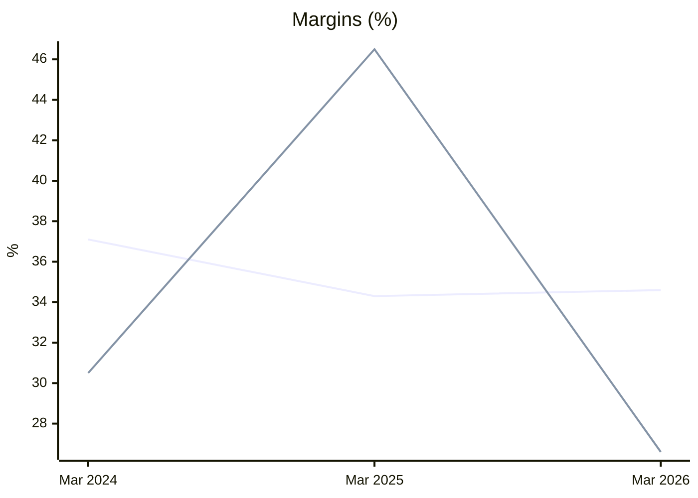

*Run 2026-11-24 · part of [SPINOFF_REPORT.md](../SPINOFF_REPORT.md) · the complete analysis of one company, with every management-call exchange in full.*

## ITC — ITC Ltd.

### 1. ITC Ltd. — CONFIRMED DEMERGER

**CONFIRMED** (a demerger scheme is on the exchange record) · **LISTED 1–2Y — the second-year window** · score 3.3/10 · spin-off · 6 filing(s) from NSE, NSE-register · first 2025-01-06, latest 2026-05-21

**The separated entities — every one the documents name:**

| Entity | Business | Listing | Who runs it |
|---|---|---|---|
| **ITC Hotels Limited** | Hotels Business (Demerged Undertaking) of ITC, excluding ITC Grand Central, Mumbai; includes investments in h… | listed 2025-01-29 as ITCHOTELS (NSE) | not stated |

**What is being separated, as the documents put it:** ITC's Hotels business, distributed to shareholders under a Scheme of Demerger into separately listed ITC Hotels Limited — class `not stated`.

### 2. Stages and dates

> **Listing:** LISTED — ITC Hotels Limited (ITCHOTELS) since 2025-01-29 (NSE equity list); record date 2025-01-06

| Date | Event | Source |
|---|---|---|
| 2024-05-28 | Other — Competition Commission of India approval to the proposed combination | as stated: Filing dated 29th May, 2024 - Updates, 'Demerger of the Hotels Busine… |
| 2024-06-06 | Stage reached: **meetings** | [Shareholders meeting](https://nsearchives.nseindia.in/corporate/ITC_06062024151222_SE_votingresults_.pdf) |
| 2024-06-06 | Shareholders / creditors meeting — ITC Limited (Ordinary Shareholders) | as stated: Filing dated 24th April, 2024 - General Updates (pursuant to Hon'ble … |
| 2024-10-04 | NCLT order — ITC Limited and ITC Hotels Limited | as stated: Filing dated 27th January, 2025 - General guidance on apportionment o… |
| 2024-10-24 | Stage reached: **nclt sanction** | [Outcome of Board Meeting](https://nsearchives.nseindia.in/corporate/ITC_24102024191526_Results.pdf) |
| 2024-12-16 | Other — Certified copy of the NCLT Order received by the Company (at 5.26 p.m.) | as stated: Filing dated 17th December, 2024 - General Updates |
| 2025-01-01 | Appointed date — Scheme of Arrangement (ITC Limited and ITC Hotels Limited) | as stated: Filing dated 17th December, 2024 - General Updates; confirmed in fili… |
| 2025-01-01 | Effective date — Scheme of Arrangement (ITC Limited and ITC Hotels Limited) | as stated: Filing dated 17th December, 2024 - General Updates; confirmed in fili… |
| 2025-01-06 | **Record date** | NSE corporate-actions register |
| 2025-01-06 | Stage reached: **record date** | Record Date (corporate-actions register) |
| 2025-01-06 | Record date — ITC Limited shareholders entitled to ITC Hotels Limited shares | as stated: Filing dated 18th December, 2024 - General Updates (Record Date) |
| 2025-01-11 | Allotment — ITC Hotels Limited (125,11,71,040 equity shares of ` 1/- each) | as stated: Filing dated 11th January, 2025 - General Updates |
| 2025-01-27 | Stage reached: **effective** | [General Updates](https://nsearchives.nseindia.in/corporate/ITC_27012025172900_SE_listing_of_ITCHL_.pdf) |
| 2025-01-27 | Other — ITC Hotels Limited received NSE and BSE approval for listing and trading | as stated: Filing dated 27th January, 2025 - 'Listing of equity shares of ITC Ho… |
| 2025-01-29 | **ITC Hotels Limited** listed (ITCHOTELS) | NSE equity list |
| 2025-01-29 | Listing and trading — ITC Hotels Limited | as stated: Filing dated 27th January, 2025 - 'Listing of equity shares of ITC Ho… |

**The stages, as filed:** meetings (2024-06-06) → nclt sanction (2024-10-24) → record date (2025-01-06) → effective (2025-01-27)

**Stated in the filings:** record date 2025-01-06; appointed date 2025-04-01.

### 3. Size of the separated business beside the parent — is institutional selling likely?

**Reading: VERY LIKELY — the piece is under a tenth of the whole; index funds and large holders who receive it without choosing it tend to sell.**

| Entity | Stated turnover | Stated share of the whole | Segment revenue share | Market cap (₹ cr) | Share of combined market cap | Index member |
|---|---|---:|---:|---:|---:|---|
| ITC Hotels Limited | Discontinued Operations (Hotels Business excluding ITC Gran… | — | 3.0% (FY2025) | 36,161 | 9.2% | yes |

*Stated figures are the documents' own (a turnover share, or the cost-of-acquisition split the company publishes for tax, which reflects relative value); the segment share is this business's revenue over the parent's sales, and the market-cap share is the entity's value over the entity plus the parent (parent ₹357,120 cr, NSE bhavcopy of 2026-11-13), both computed here.*

**In the documents' words:** “Stated only as the apportionment of cost of acquisition between the two entities: "For the purpose of determining post demerger cost of acquisition of the Ordinary Shares of ITC and the Equity Shares of ITCHL, shareholders may apportion their total cost of acquisition of ITC shares in the following manner:" — "% of Total Cost of Acquisition of Ordinary Shares of ITC Limited": "1 ITC Limited 86.49", "2 ITC Hotels Limited 13.51"”

**The judge's read of selling pressure:** likely — Hotels sits outside ITC's three stated business groups (FMCG, Paperboards/Paper & Packaging, Agri); documents disclose no index or shareholder-base detail.

### 4. Insider ownership — share swap, promoters' holding, management incentives

**Share swap / entitlement, entity by entity:**

- **ITC Hotels Limited:** "in the ratio of 1 (One) fully paid-up Equity Share of ` 1/- (Rupee One) each for every 10 (Ten) fully paid-up Ordinary Shares of ` 1/- (Rupee One) each held in ITC ('Share Entitlement Ratio')"; ITCHL allotted 125,11,71,040 Equity Shares of ` 1/- each

**Promoters' holding, from the shareholding pattern:**

| Company | Promoters | FIIs | DIIs | Public | Quarter |
|---|---:|---:|---:|---:|---|
| ITC Ltd. (ITC) | — | 33.22% | 49.81% | 16.93% |  |
| ITC Hotels Limited (ITCHOTELS) | 39.85% | 11.63% | 23.56% | 24.95% | Sep 2026 |

*Source: screener.in shareholding pattern, stored under `ShareholdingPattern/NiftyTotalMarket/`. In a mirror demerger each shareholder holds the same proportion of the new company as of the parent on the record date.*

- **Promoters in the parent, per the documents:** not stated in the documents on file.
- **What the promoters will hold in the separated entity:** Promoter / promoter group holding: not stated. The parent's own retained stake is stated: "The Company's shareholding in ITCHL stands at 39.88% of its paid-up share capital and consequently, ITCHL has become an Associate of the Company." and "ITC Hotels to issue equity shares directly to the shareholders of ITC in a manner that about 60% stake is held directly by ITC shareholders proportionate to their shareholding in ITC and remaining about 40% stake to continue with ITC"
- **What a public shareholder receives:** "ITCHL has allotted 125,11,71,040 Equity Shares of ` 1/- each to the shareholders of ITC whose names were recorded in the Register of Members of ITC or in the Register of Beneficial Owners maintained by the Depositories as on the Record Date (i.e., January 6, 2025) in the ratio of 1 (One) fully paid-up Equity Share of ` 1/- (Rupee One) each for every 10 (Ten) fully paid-up Ordinary Shares of ` 1/- (Rupee One) each held in ITC"; "Overall, existing ITC shareholders will hold 100% of ITC Hotels, i.e. about 60% directly and balance of about 40% through their shareholding in ITC"
- **Management incentives:** Treatment of existing grants in the Scheme, any new plan in ITC Hotels Limited, exercise price / pricing date and management or insider shareholding: not stated. The filings state only: "18,29,340 Ordinary Shares of , 1/-each were issued and allotted under the Company's Employee Stock Option Schemes during the quarter ended 31st December, 2025. Consequently, the issued and paid-up Share Capital of the Company stands increased to , 1252,89,59,771/- as on 31st December, 2025." and "As stock options and stock appreciation linked reward units are granted to align the interests of employees with those of shareholders and also to attract and retain talent for the enterprise as a whole, the charge thereof do not form part of the segment performance reviewed by the Corporate Management Committee."
- **Insider actions around the separation:** not stated in the documents on file.
- **Insiders, per the checklist read:** Documents state ITC Limited has no promoter/promoter group; post-demerger ITC Hotels Limited appears among ITC's associates, i.e. a retained equity-method stake. No management shareholding or incentives in the new entity stated. · *option pricing date:* not stated

### 5. Why the demerger — point by point

On the documents supplied, the business being separated is ITC's IT services arm, ITC Infotech India Limited (ITCI), a wholly owned subsidiary that is to be carved out of the unlisted group structure and listed on BSE and NSE through a strategic combination with listed Happiest Minds Technologies Limited (31 Aug 2026 filing). The mechanics are two-step: ITCI buys 3,36,61,700 shares (22.106% fully diluted) from promoters Ashok Soota and Ashok Soota Medical Research LLP for ~Rs 1,330 crores cash in two tranches (11.00% at Rs 390/share, 11.106% at Rs 400/share), funded by a Rights Issue of Rs 1,330 crores, after which Happiest Minds amalgamates into ITCI at 25 ITCI shares per 81 Happiest Minds shares (1:3.24) — implying Rs 405/share or Rs 6,167 crores for Happiest Minds and Rs 1,312/share or Rs 11,920 crores for ITCI pre-rights — leaving ITC with ~73.4% and Happiest Minds holders ~26.6%, and ITCI listed. The stated problem it solves is sub-scale: management says '> $1Bn revenue puts provider on the vendor management office radar' and gives the 'Right to Hunt' and 'Right to Win' large deals, so the combination targets US$1 billion revenue by FY28 on a pro-forma basis versus ITCI's FY26 IT services revenue of Rs 4,718 crores (PAT Rs 510 crores adjusted, 18.5% adj. EBITDA margin, 13,000+ employees, 5-yr CAGR 14%) and Happiest Minds' FY26 Rs 2,315.11 crores (FY25 Rs 2,060.84 crores, FY24 Rs 1,624.66 crores, 6,500+ employees, 5-yr CAGR 25%). It also fixes portfolio gaps: Americas mix rises from 27% to 38%, BFSI from 12% to 20%, Build:Run moves to 50:50, and Hi-Tech, EdTech and Healthcare verticals plus 800+ clients and 19,000+ professionals are added, against an industry backdrop of a ~$400 Bn AI-driven TAM by 2030, compression of ~$350 Bn of legacy services, cost-takeout deals at 30-40% savings and vendor consolidation. For ITC shareholders the explicitly stated benefit of separation itself is that it 'Creates a listed IT services platform, enabling independent value discovery and strategic flexibility', alongside ~10% revenue synergies, ~100 bps margin expansion and EPS accretion in the first full year. Nobody is recorded as having demanded it: ITCI's board moved under its own 'Orbit Next' strategy, ITC's board merely 'endorsed' it, and the only external party is the counterparty-seller Ashok Soota, who frames it as Happiest Minds finding 'a welcoming new home'; approvals needed are CCI/anti-trust, stock exchanges/SEBI, shareholders, creditors and NCLT, over ~15 months.

**Point by point, with the source:**

1. The separation vehicle is disclosed in the 31 August 2026 filing: ITC Infotech acquires 22.106% of Happiest Minds for cash and then amalgamates it, with ITCI's own shares to be listed on both Indian exchanges. “The shares of ITC Infotech are proposed to be listed on BSE Limited and the National Stock Exchange of India Limited.” — *Scheme*
2. Transaction summary states the listing is the consequence of the merger, not an IPO or a demerger to ITC shareholders; ITC retains ~73.4% and Happiest Minds holders get ~26.6%. “Thereafter, Happiest Minds to merge with ITC Infotech pursuant to which ITC Infotech will be listed” — *Scheme*
3. The value-creation case for ITC shareholders names independent price discovery as a benefit of having the IT business separately listed. “Creates a listed IT services platform, enabling independent value discovery and strategic flexibility” — *Scheme*
4. Regulation 30 disclosure frames the deal as the execution of ITCI's existing standalone expansion strategy, aimed at a step change in revenue scale and competitiveness. “ITC Infotech's 'Orbit Next' strategy envisages rapid global expansion through capability led strategic partnerships.” — *Scheme*
5. The industry slide gives the explicit scale threshold problem the separation-and-combination is meant to clear — being below US$1bn keeps ITCI off large buyers' vendor lists. “> $1Bn revenue puts provider on the vendor management  office radar” — *Scheme*
6. Media statement sets the quantified target for the combined, listed entity: US$1 billion revenue by FY28 on a pro-forma basis, AI-first, with 19,000+ professionals. “ITC Infotech (ITCI), a wholly owned subsidiary of ITC Limited and a leading global technology services player, today announced the proposed strategic combination with Happiest Minds Technologies Limited (Happiest Minds) to create a scaled, future-ready, AI-first global technology services enterprise.” — *Scheme*
7. Synergy slide quantifies what the combination is expected to deliver financially: roughly 10% revenue synergies, about 100 bps of margin expansion, and EPS accretion in year one. “Expected to be EPS accretive in first full year of combined entity operations” — *Scheme*
8. ITC's Chairman Sanjiv Puri justifies it on complementarity of capability and culture rather than on any investor, lender or partner demand. “The coming together of our complementary strengths, deep domain expertise and future-ready capabilities will further enhance our ability to deliver cutting-edge solutions across geographies.” — *Scheme*
9. The only external party pressing for a change of ownership is the Happiest Minds promoter selling the 22.106% stake, who wanted a larger home for his company. “We believe that ITC Infotech is the best partner for Happiest Minds to fulfil its destiny and we are pleased that our team will have a welcoming new home .” — *Scheme*
10. ITCI's CEO Manas Chakraborty positions the rationale as capability completeness — full-stack AI-led transformation — rather than financial engineering. “Integrating Happiest Minds' Digital Engineering, Data, AI, and Cybersecurity capabilities with our deep domain expertise, cloud and engineering capabilities will enable us to serve as a full stack AI-led transformation partner.” — *Scheme*
11. At the parent level ITC is simultaneously simplifying in the opposite direction, absorbing wholly owned Sproutlife Foods (Yoga Bar; FY26 turnover Rs 451.71 crores, total assets Rs 150.07 crores) on 2 November 2026. “Result in reduction of the number of operating entities to simplify the corporate holding structure.” — *Scheme*
12. The 1 September 2026 filing shows pre-listing entity cleanup: step-down subsidiaries Blazeclan and Cloudlytics were merged into ITC Infotech with appointed date 1 October 2024. “Accordingly, with effect from 1st September , 2026, BTPL and CTPL stand  dissolved without winding up and have cease d to be subsidiaries of the Company.” — *Scheme*
13. Completion is conditional and long-dated — about 15 months — with CCI, exchange/SEBI, shareholder, creditor and NCLT approvals, and the two firms operating independently until then. “The compani es expect the transaction to be completed within the next                     15 months and will continue to operate independently until all approvals have been obtained.” — *Scheme*

**How it evolved:** No earnings-call transcripts were provided, so the idea is traceable only through filings: ITC had already demerged its Hotels business (visible as discontinued operations with Rs 15,163.06 crores of exceptional items in FY2024-25 and ITC Hotels Limited now an associate), establishing the separation template. The IT separation surfaces fully formed on 31 August 2026, when ITCI's board approved both the 22.106% promoter-stake purchase and the Happiest Minds amalgamation that will list ITCI, endorsed the same day by ITC's board. Housekeeping then followed in the opposite, consolidating direction: on 1 September 2026 step-down subsidiaries Blazeclan Technologies and Cloudlytics were dissolved into ITC Infotech (appointed date 1 October 2024), tidying the entity to be listed, while on 2 November 2026 ITC moved the other way at the parent by absorbing wholly owned Sproutlife Foods (Yoga Bar) to 'reduce the number of operating entities'. The plan's indicative sequencing was set at board approval in Aug'26, Tranche 1 and exchange/SEBI no-objection around Q3FY27-early Q4FY27, shareholder/creditor meetings Mar-Apr'27 and ITCI listing in Q2-Q3 FY28.

**What management expects from it:** ITC Infotech: step change to ~US$1bn revenue by FY28 (from Rs 4,718 crores FY26), Americas mix 27%→38%, BFSI 12%→20%, Build:Run 50:50, ~10% revenue synergies, ~100 bps margin expansion, EPS accretive in year one, 19,000+ people, 800+ clients. ITC: a separately listed IT platform giving independent value discovery and strategic flexibility, while retaining ~73.4%.

*Not explained on the calls:* No earnings-call transcripts supplied; filings never explain ITC's intent for its 73.4% stake, any ITC-shareholder entitlement, carve-out/dis-synergy costs, valuation basis, or the earlier hotels demerger's rationale.

- *Stated reason, in one line:* not stated
- *What it reveals:* Separation revealed hotel assets carried far below fair value: FY2025 exceptional items of ₹15,179.43 crores (standalone discontinued operations) and a ₹15,617.37 crores gain on fair valuation of net assets distributed, against only ₹572.52 crores pre-exceptional PBT from hotels; parent retains cash-generative cigarettes.
- *Parent or spin:* unclear · *Read next:* The Scheme of Demerger of Hotels business, plus ITC Hotels Limited's own results behind ITC's ₹5,288.24 crores equity-method investment.
- *In their words:* “The Company is currently focused on three business groups : FMCG, Paperboards, Paper & Packaging and Agri Business.”

### 6. On the calls, verbatim

No call in the last 36 months carries a statement about it (or no transcript is on file).

### 7. The parent's financial statements

**The parent, last three fiscal years (consolidated)**

| | Mar 2024 | Mar 2025 | Mar 2026 |
|---|---:|---:|---:|
| Sales (₹ cr) | 67,932 | 75,323 | 78,868 |
| Sales growth (%) | -4.2% | +10.9% | +4.7% |
| Operating profit (₹ cr) | 25,188 | 25,832 | 27,306 |
| Operating profit growth (%) | -2.0% | +2.6% | +5.7% |
| Operating margin (%) | 37.1 | 34.3 | 34.6 |
| PAT (₹ cr) | 20,751 | 35,052 | 21,018 |
| PAT growth (%) | +6.5% | +68.9% | -40.0% |
| PAT margin (%) | 30.5 | 46.5 | 26.6 |
| EPS (₹) | 16.4 | 27.8 | 16.5 |

*Source: ProfitStatement/NiftyTotalMarket/ITC.csv (consolidated, screener.in); growth and margins computed here.*

```mermaid
xychart-beta
    title "Sales, operating profit and PAT (₹ cr)"
    x-axis ["Mar 2024", "Mar 2025", "Mar 2026"]
    y-axis "₹ crore"
    bar [67932, 75323, 78868]
    bar [25188, 25832, 27306]
    bar [20751, 35052, 21018]
```

*Series in order: Sales, Operating profit, PAT.*

*Series in order: Operating margin, PAT margin.*

**P/E:** 17.8 — live market file (screener.in), trailing (price ₹281.00 as of 2026-08-02).

**Cash flows (₹ cr):**

| | Mar 2024 | Mar 2025 | Mar 2026 |
|---|---:|---:|---:|
| Cash from operations (₹ cr) | 17,179 | 17,627 | 18,464 |
| Cash from investing (₹ cr) | 1,563 | -564 | -2,321 |
| Cash from financing (₹ cr) | -18,551 | -17,037 | -16,147 |
| Net cash flow (₹ cr) | 191 | 26.0 | -4.0 |
| Free cash flow (₹ cr) | 13,724 | 15,524 | 16,332 |

*Source: CashFlow/NiftyTotalMarket/ITC.csv (consolidated, screener.in).*

### 8. The separated business's financial statements

**The business being separated — its own numbers**, entity by entity: its reported statements once it is listed and on file, and the segment numbers the annual reports and presentations carry for it before that.

**ITC Hotels Limited (ITCHOTELS) — as reported since listing**

| | Mar 2024 | Mar 2025 | Mar 2026 |
|---|---:|---:|---:|
| Sales (₹ cr) | 2,224 | 3,560 | 4,139 |
| Sales growth (%) | — | +60.1% | +16.3% |
| Operating profit (₹ cr) | 771 | 1,253 | 1,480 |
| Operating profit growth (%) | — | +62.5% | +18.1% |
| Operating margin (%) | 34.7 | 35.2 | 35.8 |
| PAT (₹ cr) | 424 | 638 | 821 |
| PAT growth (%) | — | +50.5% | +28.7% |
| PAT margin (%) | 19.1 | 17.9 | 19.8 |
| EPS (₹) | 3.0 | 3.9 | 4.2 |

*Source: ProfitStatement/NiftyTotalMarket/ITCHOTELS.csv (consolidated, screener.in); growth and margins computed here.*

**Hotels (reported as 'Discontinued operations' / Hotels Business transferred to ITC Hotels Limited under the Scheme of Demerger; excludes ITC Grand Central, Mumbai which stayed with ITC)** · unit ₹ crore · Standalone basis. FY2024 revenue = external segment revenue (gross, excl. inter-segment ₹15.76 cr) and operating_profit = 'Segment Results' (segment EBIT, pre-interest/tax) from the Hotels reportable segment in AR2024 p255. FY2025 revenue = 'Revenue from Operations' of Discontinued Operations and operating_profit = 'Profit Before Exceptional Items and Tax' (PBT), per Presentation May 2025 p47 — these cover only the 9 months to 31.12.2024 (demerger effective 01.01.2025), so they are not a full year. PAT for both years is Profit from Discontinued Operations; FY2025 PAT of 15103.76 is dominated by an exceptional gain of 15163.06 cr on the demerger. Segment assets/liabilities and capex/depreciation for FY2024 are the Hotels segment (AR2024 p255-256, incl. Grand Central); AR2025 p217 shows the FY2024 discontinued-operations split as assets 6548.66 / liabilities 1128.07 and capex 312.60 / depreciation 290.62. Nil assets/liabilities at 31.03.2025 as the business had left the Company.

| | FY2024 | FY2025 | FY2026 |
|---|---:|---:|---:|
| Revenue (₹ crore) | 2,974 | 2,278 | — |
| Revenue growth (%) | — | -23.4% | — |
| Operating profit (₹ crore) | 754 | 573 | — |
| Operating profit growth (%) | — | -24.0% | — |
| Operating margin (%) | 25.3 | 25.1 | — |
| PAT (₹ crore) | 512 | 15,104 | — |
| PAT growth (%) | — | +2851.5% | — |
| Segment assets (₹ crore) | 6,684 | 0.0 | — |
| Segment liabilities (₹ crore) | 1,157 | 0.0 | — |
| Capital employed (₹ crore) | 5,526 | 0.0 | — |
| Return on capital employed (%) | 13.6 | — | — |
| Segment assets / revenue (x) | 2.2 | 0.0 | — |
| Capex (₹ crore) | 321 | 171 | — |

*Sources:* Annual Report 2024 — page 255; Annual Report 2024 — page 256; PAT from Annual Report 2025 — page 217 / Presentation May 2025 — page 47; Presentation May 2025 — page 47; Annual Report 2025 — page 217; Annual Report 2025 — page 218; Annual Report 2026 — page 219 (discontinued operations nil; business out of ITC for the whole year)

*Latest quarter (Q3 FY25 (3 months ended 31.12.2024 — last quarter inside ITC)):* revenue 931.29, operating profit 301.5 — Presentation May 2025 — page 47

*Not in the pages read:* No post-demerger (FY2026) figures; no standalone ITC Hotels Ltd. financials; FY2025 revenue/profit cover 9 months only; FY2025 assets/liabilities nil.

*Businesses with no numbers in the pages read (3 annual report(s) and 11 presentation(s) on file):* All named separated entities/businesses refer to the single Hotels business demerged into ITC Hotels Limited, which the pages do carry numbers for. No standalone ITC Hotels Limited post-demerger financials appear.

*Documents on file:* [Annual Report 2026](https://www.bseindia.com/xml-data/corpfiling/AttachHis/590b42ae-15c9-44cf-be69-e58053128a6b.pdf); [Annual Report 2025](https://www.bseindia.com/xml-data/corpfiling/AttachHis/8ba4a189-5fd2-4851-af6f-ec365f7edea2.pdf); [Annual Report 2024](https://www.bseindia.com/xml-data/corpfiling/AttachHis/f0d1e906-3c13-4993-ad06-e04ad1d3edf9.pdf); [Presentation Jul 2026](https://www.bseindia.com/stockinfo/AnnPdfOpen.aspx?Pname=20b685f4-2aec-4887-bb2a-eaf9fd999da2.pdf); [Presentation May 2026](https://www.bseindia.com/stockinfo/AnnPdfOpen.aspx?Pname=7ed30323-0ded-4685-b1b4-fd441908505c.pdf); [Presentation Jan 2026](https://www.bseindia.com/stockinfo/AnnPdfOpen.aspx?Pname=9f154edb-b1e2-43fa-98af-04d0a1c49062.pdf); [Presentation Oct 2025](https://www.bseindia.com/stockinfo/AnnPdfOpen.aspx?Pname=5822a588-ec86-4294-909b-875e4062acea.pdf); [Presentation Aug 2025](https://www.bseindia.com/stockinfo/AnnPdfOpen.aspx?Pname=0c251f7d-9278-4673-a72a-b44867704934.pdf); [Presentation May 2025](https://www.bseindia.com/stockinfo/AnnPdfOpen.aspx?Pname=3f080690-3c12-43b7-81b5-49b477522dca.pdf)

### 9. Other financial differences — working capital, margins, returns, debt

| Metric (latest year) | Parent (ITC) | ITC Hotels Limited (ITCHOTELS) |
|---|---:|---:|
| *Basis* | *reported, consolidated* | *its own reported statements* |
| Sales (₹ cr) | 78,868 (Mar 2026) | 4,139 (Mar 2026) |
| Sales growth (%) | 4.7 (Mar 2026) | 16.3 (Mar 2026) |
| Operating margin (%) | 34.6 (Mar 2026) | 35.8 (Mar 2026) |
| Operating profit growth (%) | 5.7 (Mar 2026) | 18.1 (Mar 2026) |
| PAT margin (%) | 26.6 (Mar 2026) | 19.8 (Mar 2026) |
| ROCE % | 39 (Mar 2026) | 11 (Mar 2025) |
| Debtor Days | 18 (Mar 2026) | 20 (Mar 2026) |
| Inventory Days | 209 (Mar 2026) | — |
| Days Payable | 63 (Mar 2026) | — |
| Cash Conversion Cycle | 164 (Mar 2026) | 20 (Mar 2026) |
| Working Capital Days | 47 (Mar 2026) | 43 (Mar 2026) |
| Debt / equity (x) | 0 (Mar 2026) | 0 (Mar 2026) |
| Borrowings (₹ cr) | 2,399 (Mar 2026) | 74 (Mar 2026) |

*Each figure is the latest on file, with its year. Working-capital days and ROCE come from the stored working-capital file; segment figures from the pages cited in part 8. A dash means the documents do not carry it.*

**What stays with the parent — its segments, from the same pages:**

| Remaining segment | Revenue | Operating margin | ROCE | Segment assets / revenue | Unit | Year |
|---|---:|---:|---:|---:|---|---|
| FMCG - Cigarettes | 37,100 | 56.7% | 271.6% | 0.36x | ₹ crore | FY2026 |
| FMCG - Others | 24,204 | 7.4% | 17.9% | 0.54x | ₹ crore | FY2026 |
| Agri Business | 12,296 | 12.2% | 30.1% | 0.54x | ₹ crore | FY2026 |
| Paperboards, Paper and Packaging | 6,927 | 11.5% | 9.5% | 1.41x | ₹ crore | FY2026 |
| Others (ITC Grand Central Hotel, Mumbai — retained under the Scheme of Demerger; Fresh Food / FoodTech from FY2026) | 341 | -2.4% | -5.0% | 0.61x | ₹ crore | FY2026 |

**What the documents themselves say about the differences:**

- **growth** — parent / remaining: FY25 continuing operations: Gross Revenue up 10.2% YoY and EBITDA up 2.3% YoY (ex-Paper, up 4.4% YoY); described as a resilient performance amidst a subdued demand environment and sharp escalation in input costs; separated business: Hotels Business posted its highest ever revenue and operating profits in the 9 months ended 31st December, 2024, on the back of strong growth in RevPar “In the 9 months ended 31st December, 2024, the Hotels Business posted its highest ever revenue and operating profits.”
- **operating margin** — parent / remaining: For FY25, Gross Revenue and EBITDA from Continuing Operations stood at Rs. 73464.55 crores and Rs. 24024.83 crores respectively; Profit Before Exceptional items and Tax stood at Rs. 26000.86 crores; separated business: Hotels Business Profit Before Exceptional items and Tax of Rs. 573 crores for the 9 months ended 31st December, 2024 (Rs. 445 crores in the same period of the previous year; Rs. 691 crores for FY24); pro forma EBITDA Rs. 1004 cr. (FY24), Rs. 808 cr. (FY23), Rs. 71 cr. (FY22), Rs. 413 cr. (H1 FY25) “Profit Before Exceptional items and Tax stood at Rs. 573 crores (Rs. 445 crores for the same period in previous year; Rs. 691 crores for FY24).”
- **debt and leverage** — parent / remaining: not stated; separated business: ITC Hotels is presented as having a zero debt balance sheet and cash generation to accelerate growth “Strong Zero Debt Balance Sheet & Cash Generation to accelerate growth”
- **cash** — parent / remaining: not stated; separated business: Cash transferred to ITC Hotels as part of the transaction perimeter “Cash & cash equivalents of Rs. 1500 cr. to cater to planned growth & contingency requirements”
- **capex and capital intensity** — parent / remaining: "As we continue to scale new horizons, ITC plans to invest Rs 20,000 crores across businesses in the medium term."; separated business: ITC Hotels: capital investments for renovations, on-going projects, new greenfields and others estimated at c.8-10% of Revenue cumulatively; asset-right strategy targeting 2/3rd managed portfolio share in next 5 years “Capital Investments →Renovations | on -going Projects | new Greenfields & others -Estimated at c.8-10% of Revenue cumulatively”
- **tax** — parent / remaining: Demerger effected in accordance with Section 2(19AA) of the Income-tax Act, 1961; cost of acquisition apportioned 86.49% to ITC Limited; separated business: Issue of ITCHL shares not regarded as a transfer; date of acquisition of ITC shares deemed the date of acquisition of ITCHL shares; 13.51% of cost of acquisition apportioned to ITC Hotels Limited “It may be noted that as per Section 47(vid) of the Act, the aforesaid issue of Equity Shares by ITCHL pursuant to the Scheme will not be regarded as transfer ; further , in terms of Explanation 1 (i)(g) to Section 2(42A) of the Act, the date of acquisition of the Ordinary Shares of ITC will be deemed to be the date of acquisition for the Equity Shares of ITCHL.”

**The checklist:**

| Item | Status | Evidence |
|---|---|---|
| Why the spin-off | unknown | no stated rationale in the filings on file *(next: read the scheme's rationale section / the board's press release)* |
| Institutional selling likely (small / different business) | unknown | size of the demerged piece not stated *(next: pro-forma statements: revenue / assets of the demerged undertaking vs the parent)* |
| Insider ownership and incentives aligned | unknown | no promoter-continuity or option-pricing language found *(next: the date the management options are priced; promoter holding in the resulting company)* |
| A hidden value revealed (pro-forma, leverage, comparables) | yes | borrowings 2,399 cr (Mar 2026) = 0.01× market cap; P/E 16.8 on Mar 2026 profit vs industry median 51.5 (27 peers) |
| Parent before the spin (clean parent, takeover prelude) | no | stage record_date — the pieces trade separately now |
| Timing (first year sells, second year gains) | yes | 687 days since listing/record date; second year since listing — where the notes found the largest gains |

The filings

| Date | Category | Headline | Attachment |
|---|---|---|---|
| 2025-01-06 | Record Date (corporate-actions register) | Record date 2025-01-06 for Demerger — NSE corporate-actions register |  |
| 2026-01-29 | Outcome of Board Meeting | ITC Limited has submitted to the Exchange, the financial results for the period ended December 31, 2025. | [pdf](https://nsearchives.nseindia.com/corporate/ITC_29012026183500_SE_Results_.pdf) |
| 2026-01-29 | Outcome of Board Meeting | ITC Limited has informed the Exchange regarding Board meeting held on January 29, 2026. | [pdf](https://nsearchives.nseindia.com/corporate/ITC_29012026183810_SE_Results_.pdf) |
| 2026-05-21 | Outcome of Board Meeting | ITC Limited has submitted to the Exchange, the financial results for the period ended March 31, 2026. | [pdf](https://nsearchives.nseindia.com/corporate/ITC_21052026152029_Results.pdf) |
| 2026-05-21 | General Updates | ITC Limited has informed the Exchange about Financial Results | [pdf](https://nsearchives.nseindia.com/corporate/ITC_21052026154027_Results.pdf) |
| 2026-05-21 | Updates | ITC Limited has informed the Exchange regarding 'Financial Results'. | [pdf](https://nsearchives.nseindia.com/corporate/ITC_21052026155432_Results.pdf) |

