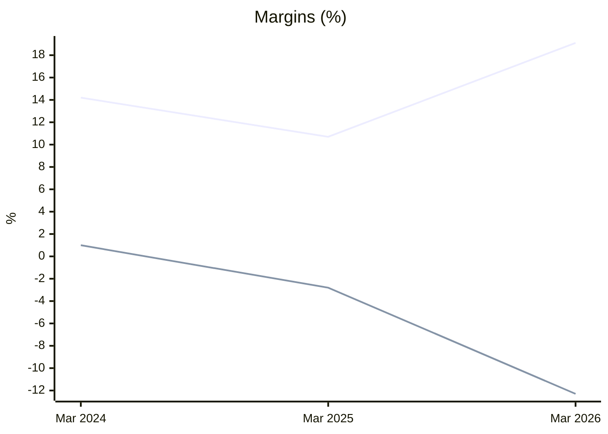

*Run 2026-11-24 · part of [SPINOFF_REPORT.md](../SPINOFF_REPORT.md) · the complete analysis of one company, with every management-call exchange in full.*

## JSWCEMENT — JSW Cement Ltd.

### 1. JSW Cement Ltd. — PARTIAL SPIN-OFF (subsidiary IPO)

**CONFIRMED** (partial spin-off — the IPO of JSW One Platforms Limited is in motion (board approval)) · **PARTIAL SPIN-OFF, IPO IN MOTION — the parent's stub is priced once the piece trades** · score 4.3/10 · partial spin-off (subsidiary IPO) · 10 filing(s) from BSE-screener, NSE, NSE-deep · first 2025-11-17, latest 2026-10-27

**The separated entities — every one the documents name:**

| Entity | Scheme | Business | Listing | Who runs it |
|---|---|---|---|---|
| **JSW One Platforms Limited** | 2026 proposed initial public offering of JSW One Platforms … | "India's leading tech-led, full-stack B2B e-commerce platform, serving manufacturing and construction MSMEs w… | to be listed | not stated |

**The other parties to the scheme(s)** — not separated entities: Shiva Cement Limited (SHIVACEM) — merged in — no shares for the parent's holders

**What is being separated, as the documents put it:** Nothing separated — Shiva Cement, the listed clinker subsidiary, is amalgamated into parent JSW Cement — class `value_unlocking`.

### 2. Stages and dates

> **Listing:** PARTIAL SPIN-OFF, IPO BOARD APPROVAL — JSW One Platforms Limited; Per the August 13, 2026 filing: "Completion date of the proposed IPO is not available as on date."

| Date | Event | Source |
|---|---|---|
| 2025-07-24 | Other — JSW Cement Limited (pre-IPO conversion of 160,000,000 CCPS into 235,662,477 equity shares) | as stated: Press release dated May 21, 2026; Investor Presentation February 2026 |
| 2025-08-14 | Listing and trading — JSW Cement Limited (own IPO) | as stated: Press release dated May 21, 2026 on Q4 FY26 and FY2026 results |
| 2025-11-07 | Other — Algebra Endeavour Private Limited (earlier intimation preceding the Securities Purchase Agreement) | as stated: General Updates filing dated November 17, 2025 |
| 2025-11-17 | Other — Algebra Endeavour Private Limited (Securities Purchase Agreement signed; "date on which the agreement for sale has been entered into 17.11.2025") | as stated: General Updates filing dated November 17, 2025 |
| 2026-04-01 | Appointed date — Shiva Cement Limited / JSW Cement Limited (amalgamation) | as stated: Annexure 1 to Outcome of Board Meeting, filing dated September 29, 20… |
| 2026-07-17 | Board approval — JSW Steel Limited (participation in JSW One Platforms Limited IPO as Promoter Selling Shareholder, up to Rs. 811 Crores) | as stated: JSW Steel letter JSWSL: MUM: SEC: SE: 2026-27/07/17 dated July 17, 20… |
| 2026-08-13 | Board approval — JSW Cement Limited (participation in JSW One Platforms Limited IPO as Promoter Selling Shareholder, up to Rs. 123.00 Crores) | as stated: Disclosure of material issue / Regulation 30 intimation dated August … |
| 2026-09-29 | Stage reached: **nclt sanction** | [Outcome of Board Meeting](https://nsearchives.nseindia.com/corporate/JSWCL_29092026191654_JCL_Post_BM_Intimation_signed.pdf) |
| 2026-09-29 | Board approval — JSW Cement Limited and Shiva Cement Limited (Scheme of Arrangement — amalgamation) | as stated: Outcome of Board Meeting, filing dated September 29, 2026; press rele… |
| 2026-10-27 | Other — JSW Cement Limited (Scheme reiterated as a Key Business Update; completion expected within 12-14 months subject to approvals) | as stated: Press release dated October 27, 2026 on Q2 FY27 & H1 FY27 results |

**The stages, as filed:** nclt sanction (2026-09-29)

**The partial spin-off:** **JSW One Platforms Limited** (joint venture); IPO stage: board approval; timeline: Per the August 13, 2026 filing: "Completion date of the proposed IPO is not available as on date.".

> “Pursuant to the Regulation 30 read with Schedule III of SEBI Listing Regulations, this is to inform you that the Board of Directors of the Company at its meeting held today i.e. August 13, 2026, inter”

**Stated in the filings:** entitlement **5 for every 41**.

**When it lists, in the documents' words:** No new listing; Shiva ceases to exist. "The transaction is expected to be completed within 12-14 months, subject to timely receipt of regulatory approvals" (said September 29, 2026 and repeated October 27, 2026)

### 3. Size of the separated business beside the parent — is institutional selling likely?

**Reading: not determinable — the documents on file give no size for the separated piece.**

| Entity | Stated turnover | Stated share of the whole | Segment revenue share | Market cap (₹ cr) | Share of combined market cap | Index member |
|---|---|---:|---:|---:|---:|---|
| JSW One Platforms Limited | Per JSW Cement's disclosure, the turnover / revenue / incom… | — | — | — | — | not listed |

*Stated figures are the documents' own (a turnover share, or the cost-of-acquisition split the company publishes for tax, which reflects relative value); the segment share is this business's revenue over the parent's sales, and the market-cap share is the entity's value over the entity plus the parent (parent ₹17,052 cr, NSE bhavcopy of 2026-11-13), both computed here.*

**In the documents' words:** “2026 amalgamation of Shiva Cement — "The paid-up share capital, net worth and turnover / revenue of the companies involved in the Scheme are as follows: INR in Crores — Company / Paid-up Equity Share Capital / Turnover (FY 2025-26) / Net Worth (as on March 31, 2026): Transferee Company (Standalone) 1,363.36, 5,995.28, 7,029.47; Transferor Company (Standalone) 159.00, 435.17, (30.08)"; and "JCL holds 66.23% of the paid-up equity share capital of SCL." 2026 JSW One Platforms IPO — "amount and percentage of the turnover or revenue or income and net worth contributed by such unit or division or undertaking or subsidiary or associate company of the listed entity during the last financial year; Nil". 2025 Algebra Endeavour sale — "The division / undertaking does not contribute to the turnover / net worth or income of the Company".”

**The judge's read of selling pressure:** unlikely — Only ~1.21 crore new shares on a 136.34 crore base; same industry, larger and more liquid entity, no index exit

### 4. Insider ownership — share swap, promoters' holding, management incentives

**Share swap / entitlement, entity by entity:**

- **JSW One Platforms Limited:** Offer for sale: JSW Cement offering for sale equity shares of face value of Rs. 10 each of JOPL "aggregating up to Rs. 123.00 Crores (Rupees One Hundred and Three Crores Only)"; JSW Steel offering for sale shares "aggregating up to Rs. 811 Crores (Rupees Eight Hundred Eleven Crores Only)"; price and other details to be determined in due course

**Promoters' holding, from the shareholding pattern:**

| Company | Promoters | FIIs | DIIs | Public | Quarter |
|---|---:|---:|---:|---:|---|
| JSW Cement Ltd. (JSWCEMENT) | 72.02% | 4.59% | 12.27% | 10.32% | Sep 2026 |

*Source: screener.in shareholding pattern, stored under `ShareholdingPattern/NiftyTotalMarket/`. In a mirror demerger each shareholder holds the same proportion of the new company as of the parent on the record date.*

- **Promoters in the parent, per the documents:** JSW Cement Limited, Pre-Arrangement (as disclosed with the September 29, 2026 board approval): "Promoter/ Promoter Group 98,18,46,640 (72.02%)" of total 1,36,33,64,936 shares. Shiva Cement Limited, Pre-Arrangement: "Promoter / Promoter Group 19,61,75,708 (66.50%)" of total 29,50,00,000 shares.
- **What the promoters will hold in the separated entity:** 2026 amalgamation of Shiva Cement into JSW Cement — "Promoter/ Promoter Group 98,18,46,640 (72.02%) [Pre-Arrangement] ... 98,19,43,497 (71.39%) [Post-Arrangement]"; and "Public Shareholding 36,84,98,380 (27.03%) ... 38,05,50,123 (27.67%)"; "Non Promotor-Non Public 1,30,19,916 (0.95%) ... 1,30,19,917* (0.95%)", total 1,36,33,64,936 to 1,37,55,13,537, with the note "*Note: Includes one equity share towards fractional entitlement. Actual number of equity shares to be issued towards fractional entitlement will be determined based on the shareholding pattern as on the record date." 2026 JSW One Platforms IPO — promoter holding after the IPO: not stated.
- **What a public shareholder receives:** 2026 amalgamation of Shiva Cement — a public shareholder of Shiva Cement receives "5 (Five) Equity Shares of the face value of INR 10 (Indian Rupees Ten only) each fully paid-up, for every 41 (Forty One) equity shares of the face value of INR 2 (Indian Rupees Two only) each fully paid-up held by such member in the Transferor Company", and "The public shareholders of the Transferor Company would become shareholders in the Transferee Company, which has a higher traded equity share base, greater market liquidity, and a diversified institutional investor base, thereby providing shareholders with enhanced liquidity, broader market participation, and improved opportunities for value realization." A public shareholder of JSW Cement (the parent) receives no new securities; "Shareholders in the Transferee Company get direct access to the economics of the Transferor Company." 2026 JSW One Platforms IPO — nothing is distributed to shareholders; "the transaction is an offer for sale in the proposed IPO" by JSW Cement as Promoter Selling Shareholder; what public shareholders of JSW Cement receive: not stated. 2025 Algebra Endeavour sale — cash consideration to the Company; "There is no scheme of arrangement, hence the same is not applicable."
- **Management incentives:** Treatment of existing stock options / RSUs / SARs in the Scheme: not stated; no new plan in a new entity is stated. ESOP cost disclosure only: "Employee costs included ESOP expense of Rs. 6.9 crore, Rs. 3.4 crore and Rs5.2 crore in Q3 FY25, Q2 FY26 and Q3 FY26 respectively". Pre-IPO conversion of preference capital: "On 24 July 2025, prior to the IPO of the Company, 160,000,000 CCPS of face value Rs. 100 each were converted into 235,662,477 equity share of face value Rs. 10 each". Management or insider shareholding: not stated. Exercise price or pricing date: not stated.
- **Insider actions around the separation:** 2026 JSW One Platforms IPO — JSW Cement Limited's Board "considered and approved the participation of the Company in the proposed initial public offering ("IPO") of JSW One Platforms Limited ("JOPL") as a Promoter Selling Shareholder by offering for sale, such number of equity shares of face value of Rs. 10 each of JOPL aggregating up to Rs. 123.00 Crores ... held by the Company"; JSW Steel Limited's Board approved the same for shares "aggregating up to Rs. 811 Crores ... held by the Company"; both "subject to applicable law, market conditions, receipt of necessary approvals/ regulatory clearances and other considerations." 2026 amalgamation — "Further, the Equity Shares held by the Transferee Company in the Transferor Company shall stand cancelled and extinguished and no Equity Shares of the Transferee Company shall be allotted in lieu or in exchange of the same", and on the reserve reorganizations "There shall be no consideration involved ... Thus, there will be no benefit to any promoter/ promoter group/ group companies". 2025 Algebra Endeavour sale — "None of the buyers belong to the promoter / promoter group companies." No promoter or management buying, selling or pledging of JSW Cement shares is stated.
- **Insiders, per the checklist read:** JCL holds 66.23% of SCL equity and all its OCCRPS; JSW Cement promoter group goes 72.02% to 71.39% post-merger; Shiva promoter group held 66.50% · *option pricing date:* not stated

### 5. Why the demerger — point by point

These texts announce no separation: the only board-approved reorganisation is the opposite — a consolidation. On 29 September 2026 the boards of JSW Cement Limited (JCL) and its 66.23%-owned listed subsidiary Shiva Cement Limited (SCL) approved a Scheme of Arrangement under Sections 230-232 read with Sections 52 and 66, amalgamating SCL into JCL with appointed date 1 April 2026, no cash consideration, and a swap of 5 JCL shares of ₹10 for every 41 SCL shares of ₹2 (JCL's own SCL equity cancelled; the ₹100 crore of 1% OCCRPS it holds also cancelled). The problems management says it solves are: dependence on third-party clinker — SCL's 1.32 mtpa Sundargarh (Odisha) clinker plant becomes backward integration, 'avoiding third-party purchases and associated mark-ups'; split funding — a single entity can raise funds on 'more favorable terms' and inter-company guarantees disappear; two listed entities' duplicated administration, record-keeping, consolidation effort and legal/regulatory compliance; a broken balance sheet at SCL (FY26 turnover ₹435.17 crore, net worth negative ₹30.08 crore versus JCL's ₹5,995.28 crore and ₹7,029.47 crore), whose ₹133.92 crore accumulated losses are written off against its securities premium, while JCL's amalgamation adjustment deficit is set against its own premium account (left at ₹4,335.67 crore) — described as 'right sizing' the financial statements; and SCL's illiquid minority float, whose 33.50% public holders move into a larger, institutionally-held stock. Structurally it is tiny and non-dilutive: shares rise from 1,36,33,64,936 to 1,37,55,13,537, promoters from 72.02% to 71.39%, public from 27.03% to 27.67%. No investor, lender or JV partner is said to have asked for the Shiva merger; valuation was by PwC Business Consulting and BDO Valuation, with fairness opinions from SBI Capital Markets (JCL) and DAM Capital (SCL), JM Financial as exclusive financial advisor and Price Waterhouse & Co as tax adviser; closing is guided at 12-14 months subject to stock exchanges, SEBI, NCLT Mumbai and Odisha Industrial Infrastructure Development Corporation. The genuine separations in these texts are different and smaller: the ₹191.63 crore cash sale of Algebra Endeavour / Vadraj Energy Gujarat Ltd (a Gujarat power plant) to Nuvoco Vistas (SPA 17 November 2025), and JCL selling up to ₹123 crore of JSW One Platforms shares as Promoter Selling Shareholder in that company's IPO (board 13 August 2026, alongside JSW Steel's up to ₹811 crore).

**Point by point, with the source:**

1. The transaction is an amalgamation of the listed 66.23%-owned subsidiary Shiva Cement into JSW Cement, appointed date 1 April 2026, explicitly to create one unified platform rather than to separate anything. “Creating a consolidated cement platform supports Transferee Company's strategy, enabling category leadership, increased competitiveness, enhanced market share and efficient resource utilization.” — *Scheme*
2. Core industrial logic is backward integration: Shiva's 1.32 mtpa clinker plant at Sundargarh, Odisha stops being a third-party-style supply and becomes internal, cutting external procurement and mark-ups. “The proposed amalgamation will result in backward integration of clinker manufacturing with the Transferee Company's cement manufacturing business.” — *Scheme*
3. Financial rationale is single-entity borrowing capacity and the removal of inter-company guarantees between parent and subsidiary. “The proposed amalgamation will lead to greater ability of the consolidated entity to access and raise funds within a single entity on more favorable terms, leading to elimination of inter company guarantees and facilitate more efficient funding arrangements.” — *Scheme*
4. Running two listed companies is called out as duplicated cost and compliance — two sets of records, two consolidations, two regulatory burdens. “The proposed amalgamation will result in a simplification of the existing corporate structure and eliminate administrative functions and duplications, reducing regulatory and legal compliances of two listed entities, eliminating multiple record keeping and reducing time and efforts for consolidation of financials at the group level,  consequently reducing the administrative costs of maintaining separate companies, while reducing the multiple legal and regulatory compliances.” — *Scheme*
5. Shiva is financially impaired: paid-up equity ₹159.00 crore, FY26 turnover ₹435.17 crore and net worth negative ₹30.08 crore at 31 March 2026, against JSW Cement standalone turnover ₹5,995.28 crore and net worth ₹7,029.47 crore; ₹133.92 crore of accumulated losses are extinguished against its securities premium. “With effect from the Appointed Date, and upon coming into effect of the Scheme, the debit balance of Retained Earnings and SPA in the books of Transferor Company is likely to be  INR (133.92) crore and Nil respectively.” — *Scheme*
6. The parent's amalgamation deficit is absorbed into its own securities premium, which is left at ₹4,335.67 crore — the 'right sizing' of both balance sheets. “With effect from the Appointed Date, and upon coming into effect of the Scheme, the balance of Amalgamation Adjustment Deficit Account is likely to be Nil. The balance of SPA in books of Transferee Company is likely to be INR 4,335.67 crore.” — *Scheme*
7. Shiva's 33.50% public float is given liquidity: 5 JSW Cement shares of ₹10 per 41 Shiva shares of ₹2, lifting JSW Cement's count from 1,36,33,64,936 to 1,37,55,13,537 and promoters from 72.02% to 71.39%. “The public shareholders of the Transferor Company would become shareholders in the Transferee Company, which has a higher traded equity share base, greater market liquidity, and a diversified institutional investor base, thereby providing shareholders with enhanced liquidity, broader market participation, and improved opportunities for value realization.” — *Scheme*
8. CEO Nilesh Narwekar framed it as integration and simplification, with completion guided at 12-14 months subject to exchanges, SEBI, NCLT Mumbai and Odisha Industrial Infrastructure Development Corporation. “The proposed merger is a strategic step towards creating a more integrated and efficient business.” — *Scheme*
9. The only consolidation pressure voiced by investors concerned the UAE clinker JV, not Shiva — Kamlesh Bagmar of Lotus Asset Managers argued holding Fujairah through a JV was poor for shareholders; the CFO said the financial investors would exit and it would become a full subsidiary, timeline undecided. “So lastly, like, doesn't it make a bigger sense to have, like, say, clinker capacity of Fuj airah under our own hold entirely?” — *CALL Sep 2025*
10. Asked again about folding the Fujairah JV in, management deferred it to 2-3 years because a financial investor must first be given an exit — while the new 1.65 MTPA UAE grinding unit was put in a wholly owned subsidiary (USD 39 million) that consolidates into the parent, with the JV selling clinker to it at arm's length. “Not as of now. Probably going forward in next 2 -3 years, we will have a look because there is a financial investor sitting there, we'll have to provide exit to him.” — *CALL May 2026*
11. The actual disposal in the period was non-core: Algebra Endeavour / Vadraj Energy Gujarat Ltd, owning a Gujarat power plant, sold to Nuvoco Vistas for cash; the November 2025 filing confirms the division contributed nothing to turnover, income or net worth. “Entered into a Share Purchase Agreement with Nuvoco Vistas Corp. Ltd. for the transfer of Vadraj Energy Gujarat Ltd. (owning a power plant in Gujarat), for a consideration of Rs. 191.63 crore” — *CALL Feb 2026*
12. Because Shiva is a subsidiary, the deal is a related-party transaction under LODR; arm's length rests on independent registered valuers (PwC Business Consulting, BDO Valuation) and a category 1 merchant banker fairness opinion, with no cash moving. “Additionally, the consideration to be discharged for the Scheme of amalgamation is determined by independent registered valuers on which a fairness opinion has been issued by an independent category 1 merchant banker, the transaction therefore is at arm's length.” — *Scheme*

**How it evolved:** The Shiva amalgamation never appears in any of the four earnings calls supplied — the consolidation theme surfaces only around the UAE clinker JV: on the 3 September 2025 Q1 FY26 call Kamlesh Bagmar (Lotus Asset Managers) argued holding Fujairah clinker through a JV 'don't make much sense for the shareholders', and CFO Narinder Singh replied the financial investors would exit over time and it would become a full subsidiary; on the 21 May 2026 Q4 FY26 call Raghav Maheshwari (Equirus) asked directly about merging the JV and was told 'not as of now', maybe in 2-3 years once the financial investor is given an exit, while the new 1.65 MTPA Fujairah grinding unit was instead placed in a wholly owned subsidiary at USD 39 million. The 13 February 2026 investor presentation disclosed the only completed carve-out — the Nuvoco SPA for Vadraj Energy Gujarat at ₹191.63 crore — and footnoted Shiva's 1.0 MTPA Sambalpur grinding unit built under a commercial arrangement with Bhushan Power and Steel. The Shiva merger then arrives fully formed in the 29 September 2026 board outcome and press release, and is restated as a 'Key Business Update' in the 27 October 2026 Q2 FY27 press release; the November 2025 call transcript is unreadable, so any discussion there cannot be checked.

**What management expects from it:** For JSW Cement: in-house clinker (1.32 mtpa) replacing third-party purchases and mark-ups, lower costs, single-entity funding on better terms, no inter-company guarantees, simpler compliance, category leadership and market share; securities premium of ₹4,335.67 crore absorbs the amalgamation deficit. For Shiva holders: shares in a larger, more liquid, institutionally-held entity; ₹133.92 crore of losses written off.

*Not explained on the calls:* No quantified synergy, cost-saving or clinker-volume numbers; no EPS or margin impact; no analyst Q&A on the merger (Nov 2025 transcript unreadable); Fujairah JV buyout timing unexplained.

- *Stated reason, in one line:* Business, raw-material and financial synergies: backward integration of clinker, unified cement platform, enhanced shareholder value and liquidity, simplified structure and fewer compliances
- *What it reveals:* Shiva is a loss-maker: standalone net worth (30.08) crore, retained-earnings debit (133.92) crore written off against securities premium; its 1.32 mtpa clinker becomes captive raw material, cutting third-party purchases and mark-ups
- *Parent or spin:* parent · *Read next:* The valuation/share exchange ratio report and fairness opinions supporting the 5:41 ratio
- *In their words:* “Transferor Company shall cease to exist upon effectiveness of the Scheme without being wound up.”

### 6. On the calls, verbatim

No call in the last 36 months carries a statement about it (or no transcript is on file).

### 7. The parent's financial statements

**The parent, last three fiscal years (consolidated)**

| | Mar 2024 | Mar 2025 | Mar 2026 |
|---|---:|---:|---:|
| Sales (₹ cr) | 6,002 | 5,785 | 6,501 |
| Sales growth (%) | +3.3% | -3.6% | +12.4% |
| Operating profit (₹ cr) | 853 | 617 | 1,242 |
| Operating profit growth (%) | +28.7% | -27.7% | +101.3% |
| Operating margin (%) | 14.2 | 10.7 | 19.1 |
| PAT (₹ cr) | 62.0 | -164 | -799 |
| PAT growth (%) | -40.4% | -364.5% | -387.2% |
| PAT margin (%) | 1.0 | -2.8 | -12.3 |
| EPS (₹) | 0.9 | -1.1 | -5.5 |

*Source: ProfitStatement/NiftyTotalMarket/JSWCEMENT.csv (consolidated, screener.in); growth and margins computed here.*

```mermaid
xychart-beta
    title "Sales, operating profit and PAT (₹ cr)"
    x-axis ["Mar 2024", "Mar 2025", "Mar 2026"]
    y-axis "₹ crore"
    bar [6002, 5785, 6501]
    bar [853, 617, 1242]
    bar [62, -164, -799]
```

*Series in order: Sales, Operating profit, PAT.*

*Series in order: Operating margin, PAT margin.*

**P/E:** 27.8 — live market file (screener.in), trailing (price ₹133.00 as of 2026-08-02).

**Cash flows (₹ cr):**

| | Mar 2024 | Mar 2025 | Mar 2026 |
|---|---:|---:|---:|
| Cash from operations (₹ cr) | 1,408 | 737 | 1,170 |
| Cash from investing (₹ cr) | -1,120 | -558 | -1,649 |
| Cash from financing (₹ cr) | -221 | -232 | 861 |
| Net cash flow (₹ cr) | 67.0 | -53.0 | 382 |
| Free cash flow (₹ cr) | 476 | -409 | -791 |

*Source: CashFlow/NiftyTotalMarket/JSWCEMENT.csv (consolidated, screener.in).*

### 8. The separated business's financial statements

**The business being separated — its own numbers**, entity by entity: its reported statements once it is listed and on file, and the segment numbers the annual reports and presentations carry for it before that.

*Businesses with no numbers in the pages read (1 annual report(s) and 7 presentation(s) on file):* Pages carry no separation/demerger scheme at all. No own financials for Shiva Cement Limited, the "Transferor Company", Shiva Cement's clinker unit, or the Sambalpur grinding unit (1.0 MTPA). JSW One Platforms Limited appears only as an equity-method joint venture (13.56% stake), not a separated business; its standalone JV figures (Annual Report 2026 — page 208) are FY2026 revenue 5,743.39 and loss (106.49); FY2025 revenue 3,962.80 and loss (217.03) ₹ crore.

The segment pages read (1 annual report(s) and 7 presentation(s) on file) do not carry this business's own revenue or profit.

*Documents on file:* [Annual Report 2026](https://www.bseindia.com/xml-data/corpfiling/AttachHis/bdde0cc8-8003-4624-8d25-371985d916bc.pdf); [Presentation Nov 2026](https://www.bseindia.com/stockinfo/AnnPdfOpen.aspx?Pname=deea16ec-a9dd-43fb-9e00-8c7c816ca943.pdf); [Presentation Oct 2026](https://www.bseindia.com/stockinfo/AnnPdfOpen.aspx?Pname=7affadb2-f88f-4531-a46a-77184f1a43b5.pdf); [Presentation Aug 2026](https://www.bseindia.com/stockinfo/AnnPdfOpen.aspx?Pname=68e46cd0-76e0-45ba-97f1-7ef52762e7e3.pdf); [Presentation May 2026](https://www.bseindia.com/stockinfo/AnnPdfOpen.aspx?Pname=cddd21f6-db5e-4270-a384-979fa03bb1ce.pdf); [Presentation Feb 2026](https://www.bseindia.com/stockinfo/AnnPdfOpen.aspx?Pname=45cf2e4a-da6a-448c-8a0d-0c1e8f0cf16e.pdf); [Presentation Nov 2025](https://www.bseindia.com/stockinfo/AnnPdfOpen.aspx?Pname=a435c58a-3391-428f-af29-9e070ae9d3e2.pdf)

### 9. Other financial differences — working capital, margins, returns, debt

Only the parent's figures are on file: Sales (₹ cr) 6,501 (Mar 2026); Sales growth (%) 12.4 (Mar 2026); Operating margin (%) 19.1 (Mar 2026); PAT margin (%) -12.3 (Mar 2026); Operating profit growth (%) 101.3 (Mar 2026); Debtor Days 48 (Mar 2026); Inventory Days 132 (Mar 2026); Days Payable 317 (Mar 2026); Cash Conversion Cycle -136 (Mar 2026); Working Capital Days -90 (Mar 2026); ROCE % 11 (Mar 2025); Debt / equity (x) 0.7 (Mar 2026); Borrowings (₹ cr) 4,464 (Mar 2026). The separated business has no comparable numbers in the documents read.

**What stays with the parent — its segments, from the same pages:**

| Remaining segment | Revenue | Operating margin | ROCE | Segment assets / revenue | Unit | Year |
|---|---:|---:|---:|---:|---|---|
| Cement and cement related products — single reportable segment (consolidated); "The Group is primarily in the business of manufacturing and sale of cement and cement related product... there are no other reportable business applicable to the Group" | 6,512 | 19.0% | — | — | ₹ crore | FY2026 |

**What the documents themselves say about the differences:**

- **other** — parent / remaining: JSW Cement (Transferee Company, standalone): paid-up equity share capital INR 1,363.36 crore, turnover INR 5,995.28 crore (FY 2025-26), net worth INR 7,029.47 crore as on March 31, 2026; separated business: Shiva Cement (Transferor Company, standalone): paid-up equity share capital INR 159.00 crore, turnover INR 435.17 crore (FY 2025-26), net worth INR (30.08) crore as on March 31, 2026; JSW Cement holds 66.23% “JCL holds 66.23% of the paid-up equity share capital of SCL.”
- **other** — parent / remaining: Post-amalgamation, the Amalgamation Adjustment Deficit Account in JSW Cement's books is to be adjusted against its Securities Premium Account, leaving SPA of INR 4,335.67 crore; separated business: Shiva Cement carries accumulated losses: opening debit balance of Retained Earnings is to be adjusted against its Securities Premium Account, leaving Retained Earnings of INR (133.92) crore and SPA of Nil “With effect from the Appointed Date, and upon coming into effect of the Scheme, the debit balance of Retained Earnings and SPA in the books of Transferor Company is likely to be INR (133.92) crore and Nil respectively.”
- **debt and leverage** — parent / remaining: JSW Cement consolidated net debt ₹3,635 Crore as at March 31, 2026 and ₹4,287 Crore as at September 30, 2026; Net Debt/EBITDA 2.90x and Net Debt/Equity 0.58 as at Dec 31, 2025; separated business: The amalgamation is expected to improve funding terms and remove inter-company guarantees between JSW Cement and Shiva Cement “Financial Synergies: The proposed amalgamation will lead to greater ability of the consolidated entity to access and raise funds within a single entity on more favorable terms, leading to elimination of inter company guarantees and facilitate more efficient funding arrangements.”
- **operating margin** — parent / remaining: JSW Cement consolidated operating EBITDA ₹1,240.3 Crore in FY2026 with a margin of 19.0% (Q4 FY26 margin 19.3%, ₹916 per ton); Q2 FY27 operating EBITDA ₹277.8 Crore, ₹708/MT; separated business: Operating margin of Shiva Cement: not stated “Operating EBITDA: ₹1,240.3 Crore, representing a substantial increase of 44% YoY, with an operating EBITDA margin of 19.0%”
- **growth** — parent / remaining: JSW Cement consolidated revenue grew 33% YoY to ₹1,912 Crore in Q2 FY27 and 12% YoY to ₹6,512 Crore in FY2026; guidance of mid-teens to high-teens volume growth in FY27 excluding the North; separated business: Shiva Cement commissioned a 1.0 MTPA grinding unit at Sambalpur, Odisha in FY26 / October 2025; its own growth rates are not stated “In FY26, Shiva Cement commissioned a state-of-the-art 1.0 MTPA cement grinding unit at Sambalpur in Odisha, vide a commercial arrangement with Bhushan Power and Steel Limited, with an objective of meeting the growing cement demand in the region.”
- **capex and capital intensity** — parent / remaining: JSW Cement incurred capex of ₹506 Crore in Q4 FY26 and ₹1,962 Crore in FY2026, with guidance of about ₹2,300 crore in FY27 and about ₹2,200 crore in FY28; expansion to 46.00 MTPA grinding and 13.04 MTPA clinker capacity; separated business: Shiva Cement's clinker facility at Sundargarh, Odisha has a capacity of 1.32 mtpa, to be backward-integrated into JSW Cement; separate capex for it is not stated “The Transferor Company has a clinker manufacturing facility at Sundargarh, Odisha, having a capacity of 1.32 mtpa.”
- **tax** — parent / remaining: JSW Cement recognised a ₹211.21 crore reduction in net deferred tax liabilities in Q4 FY26 on electing the new tax regime under Section 115BAA from FY2026-27, with a ~25% tax rate thereafter; separated business: Tax position of the separated / merging business: not stated “In view of the same, the resultant reduction in net deferred tax liabilities, consequent to the reduced tax rate in the New tax regime, of ₹ 211.21 crore has been recognised in Q4 FY26 and FY2026.”
- **other** — parent / remaining: JSW Cement remains listed with a larger, more liquid share base; simplification removes the costs of maintaining two listed entities; separated business: Shiva Cement's public shareholders move into the larger listed entity and Shiva Cement ceases to exist “Simplified structure and management efficiency: The proposed amalgamation will result in a simplification of the existing corporate structure and eliminate administrative functions and duplications, reducing regulatory and legal compliances of two listed entities, eliminating multiple record keeping and reducing time and efforts for consolidation of financials at the group level, consequently reducing the administrative costs of maintaining separate companies, while reducing the multiple legal and regulatory compliances.”

**The checklist:**

| Item | Status | Evidence |
|---|---|---|
| Why the spin-off | yes | attracting different investors / capital — “…pany, which has a higher traded equity share base, greater market liquidity, and a diversified institutional investor base, thereby providing shareholders with enhanced liquidity, broader market participation, and impro” |
| Institutional selling likely (small / different business) | unknown | size of the demerged piece not stated *(next: pro-forma statements: revenue / assets of the demerged undertaking vs the parent)* |
| Insider ownership and incentives aligned | unknown | no promoter-continuity or option-pricing language found *(next: the date the management options are priced; promoter holding in the resulting company)* |
| A hidden value revealed (pro-forma, leverage, comparables) | partly | borrowings 4,464 cr (Mar 2026) = 0.25× market cap *(next: pro-forma P&L of each piece × the peer P/E of its own industry)* |
| Parent before the spin (clean parent, takeover prelude) | partly | stage nclt_sanction — the spin has not happened; the parent can still be bought whole |
| Partial spin-off: price the stub from the listed piece | partly | a subsidiary is being listed; once it trades, stub = parent price − (stake value ÷ parent shares) *(next: stub_value(parent price, parent shares, [(sub price, shares held)]))* |
| Timing (first year sells, second year gains) | partly | not yet listed — 372 days since the first filing, stage nclt_sanction |

The filings

| Date | Category | Headline | Attachment |
|---|---|---|---|
| 2025-11-17 | General Updates | This is in furtherance to the intimation done by the Company on 7th November, 2025. This is to inform you that the Company has today signed a Securities Purchas | [pdf](https://nsearchives.nseindia.com/corporate/JSWCL_17112025235832_SEIntimationVadrajSIgn.pdf) |
| 2026-05-21 | Press Release | Please find attached the Press Release. | [pdf](https://nsearchives.nseindia.com/corporate/JSWCL_21052026130017_upload.pdf) |
| 2026-07-17 | General Updates | Please find enclosed herewith intimation under Regulation 30 of the Securities Exchange Board Of India (Listing Obligations And Disclosure Requirements) Regulat | [pdf](https://nsearchives.nseindia.com/corporate/JSWCL_17072026195210_Stock_Exchange_Intimation.pdf) |
| 2026-08-13 | Disclosure of material issue | The Board has approved participation in the Company in the proposed initial public offering of JSW One Platforms Limited as a Promoter Selling Shareholder by of | [pdf](https://nsearchives.nseindia.com/corporate/JSWCL_13082026193636_JSW_One_Platforms_dsc.pdf) |
| 2026-09-29 | Outcome of Board Meeting | Outcome of the Board Meeting of JSW Cement held on September 29, 2026 - Approving | [pdf](https://nsearchives.nseindia.com/corporate/JSWCL_29092026191654_JCL_Post_BM_Intimation_signed.pdf) |
| 2026-09-29 | Outcome of Board Meeting | JSW Cement Limited has informed the Exchange regarding Outcome of Board Meeting held on September 29, 2026. | [pdf](https://nsearchives.nseindia.com/corporate/JSWCL_29092026191654_JCL_Post_BM_Intimation_signed.pdf) |
| 2026-09-29 | Scheme of Arrangement | JSW Cement Limited (the "Company") at its meeting held on September 29, 2026, has ,inter alia, subject to approval of the shareholders of the Company, considere | [pdf](https://nsearchives.nseindia.com/corporate/JSWCL_29092026192108_JCL_Post_BM_Intimation_signed.pdf) |
| 2026-09-29 | Press Release | In continuation of our disclosure dated September 29, 2026, we submit herewith a Press Release on the Outcome of the Board Meeting of JSW Cement held on Septemb | [pdf](https://nsearchives.nseindia.com/corporate/JSWCL_29092026210016_Press_Release_Upload.pdf) |
| 2026-09-29 | Announcement under Regulation 30 (LODR)- | Board approved merger of Shiva Cement into JSW Cement; 5:41 share swap, subject to shareholder and NCLT approvals. | [pdf](https://www.bseindia.com/xml-data/corpfiling/AttachLive/c683658f-e10d-47ea-948e-4599b15073bd.pdf) |
| 2026-10-27 | Press Release | JSW Cement Limited has informed the Exchange regarding a press release dated October 27, 2026, titled "Please find attached Press Release dated 27th October, 20 | [pdf](https://nsearchives.nseindia.com/corporate/JSWCL_27102026195531_Press_Release.pdf) |

