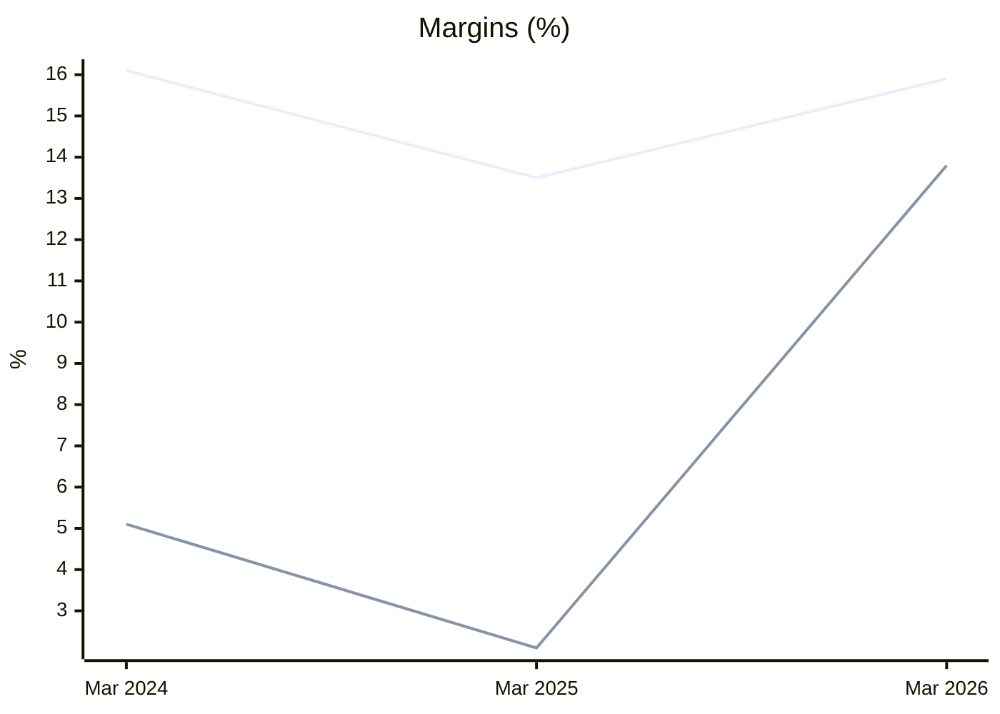

*Run 2026-11-24 · part of [SPINOFF_REPORT.md](../SPINOFF_REPORT.md) · the complete analysis of one company, with every management-call exchange in full.*

## JSWSTEEL — JSW Steel Ltd.

### 1. JSW Steel Ltd. — PARTIAL SPIN-OFF (subsidiary IPO)

**CONFIRMED** (partial spin-off — the IPO of JSW One Platforms Limited is in motion (board approval)) · **PARTIAL SPIN-OFF, IPO IN MOTION — the parent's stub is priced once the piece trades** · score 5.6/10 · partial spin-off (subsidiary IPO) · 7 filing(s) from NSE · first 2026-04-17, latest 2026-10-17

**The separated entities — every one the documents name:**

| Entity | Business | Listing | Who runs it |
|---|---|---|---|
| **JSW One Platforms Limited** | Not described in the filing; the Q4 FY26 call calls it "The JSW online platform", with steel volumes, GMV and… | to be listed | not stated |

**What is being separated, as the documents put it:** JSW One Platforms Limited, the group's online platform in which JSW Steel holds ~61%, partly sold via IPO — class `not stated`.

### 2. Stages and dates

> **Listing:** PARTIAL SPIN-OFF, IPO BOARD APPROVAL — JSW One Platforms Limited; Completion date of the proposed IPO is not available as on date. (filing dated July 17, 2026)

| Date | Event | Source |
|---|---|---|
| 2026-07-03 | Stage reached: **nclt sanction** | [Amalgamation/Merger](https://nsearchives.nseindia.com/corporate/jessydenny_03072026104440_Merger_approval.pdf) |
| 2026-07-17 | Board approval — JSW Steel Limited (approving its participation in the proposed IPO of JSW One Platforms Limited as Promoter Selling Shareholder) | as stated: Regulation 30 intimation "Disclosure of material issue" filed with NS… |

**The stages, as filed:** nclt sanction (2026-07-03)

**The partial spin-off:** **JSW One Platforms Limited** (joint venture); parent's stake about 61% equity stake on a fully diluted basis (stated in the May 2026 earnings call for "The JSW online platform"); IPO stage: board approval; timeline: Completion date of the proposed IPO is not available as on date. (filing dated July 17, 2026).

> “Pursuant to the Regulation 30 read with Schedule III of SEBI Listing Regulations, this is to inform you that the Board of Directors of the Company at its meeting held today i.e. July 17, 2026, inter a”

**When it lists, in the documents' words:** Said on July 17, 2026: "Completion date of the proposed IPO is not available as on date."

### 3. Size of the separated business beside the parent — is institutional selling likely?

**Reading: VERY LIKELY — the piece is under a tenth of the whole; index funds and large holders who receive it without choosing it tend to sell.**

| Entity | Stated turnover | Stated share of the whole | Segment revenue share | Market cap (₹ cr) | Share of combined market cap | Index member |
|---|---|---:|---:|---:|---:|---|
| JSW One Platforms Limited | not stated (the filing gives instead "Share of profit of JO… | 0.35% | — | — | — | not listed |

*Stated figures are the documents' own (a turnover share, or the cost-of-acquisition split the company publishes for tax, which reflects relative value); the segment share is this business's revenue over the parent's sales, and the market-cap share is the entity's value over the entity plus the parent (parent ₹329,647 cr, NSE bhavcopy of 2026-11-13), both computed here.*

**In the documents' words:** “"Share of profit of JOPL for FY 2025-26: (Rs. 90 crores) [(0.35%) of the consolidated net profit after tax of JSW Steel Limited] Net worth impact of investment in JOPL as at 31 March 2026: Rs. 68 crores [0.06% of the consolidated net worth of JSW Steel Limited]"”

**The judge's read of selling pressure:** unlikely — Offer for sale into an IPO to new buyers, not a distribution to JSW Steel shareholders; no index exclusion stated.

### 4. Insider ownership — share swap, promoters' holding, management incentives

**Share swap / entitlement, entity by entity:**

- **JSW One Platforms Limited:** Offer for sale by the parent as Promoter Selling Shareholder: "offering for sale, such number of equity shares of face value of Rs. 10 each of JOPL aggregating up to Rs. 811 Crores (Rupees Eight Hundred Eleven Crores Only) held by the Company ("Sale Shares") in JOPL (subject to any revisions to such amount as may be permissible under applicable law)"; any fresh issue component not stated; "The price and other details of the proposed IPO will be determined in due course by the competent body"

**Promoters' holding, from the shareholding pattern:**

| Company | Promoters | FIIs | DIIs | Public | Quarter |
|---|---:|---:|---:|---:|---|
| JSW Steel Ltd. (JSWSTEEL) | 44.29% | 26.23% | 11.34% | 17.5% | Sep 2026 |

*Source: screener.in shareholding pattern, stored under `ShareholdingPattern/NiftyTotalMarket/`. In a mirror demerger each shareholder holds the same proportion of the new company as of the parent on the record date.*

- **Promoters in the parent, per the documents:** Promoters 110,82,03,750 equity shares, 45.32% of equity shares, "Before Scheme (as on May 12, 2026)" (shareholding table in the May 14, 2026 BMM Ispat scheme filing)
- **What the promoters will hold in the separated entity:** not stated for the post-IPO position; the documents state only that the Company participates "as a Promoter Selling Shareholder by offering for sale, such number of equity shares of face value of Rs. 10 each of JOPL aggregating up to Rs. 811 Crores", and the Q4 FY26 call states "The JSW online platform in which we have about 61% equity stake on a fully diluted basis"
- **What a public shareholder receives:** not stated in the documents on file.
- **Management incentives:** not stated in the documents on file.
- **Insider actions around the separation:** The parent is selling into the IPO: the Board "considered and approved the participation of the Company in the proposed initial public offering ("IPO") of JSW One Platforms Limited ("JOPL") as a Promoter Selling Shareholder by offering for sale, such number of equity shares of face value of Rs. 10 each of JOPL aggregating up to Rs. 811 Crores (Rupees Eight Hundred Eleven Crores Only) held by the Company ("Sale Shares") in JOPL"; no promoter or management buying, pledging or other action stated.
- **Insiders, per the checklist read:** JSW Steel participates as Promoter Selling Shareholder offering shares up to Rs 811 crores; it holds about 61% equity stake in JOPL on a fully diluted basis. · *option pricing date:* not stated

### 5. Why the demerger — point by point

The business being separated is the steel business undertaking of Bhushan Power and Steel Limited (BPSL) — the ~4.5 MTPA integrated plant at Jharsuguda/Sambalpur, Odisha, which JSW acquired out of IBC in 2021 at 2.75 MTPA and then expanded to 4.5 MTPA. The mechanics, approved by the Board on December 3, 2025, were a slump sale of BPSL's steel undertaking on a going-concern basis to JSW Sambalpur Steel Limited for Rs. 24,483 crores cash (subject to closing adjustments), with JFE Steel Corporation of Japan subscribing 50% of JSW Sambalpur's holding company JSW Kalinga Steel Limited for Rs. 15,750 crores in two equal tranches of Rs. 7,875 crores — giving a 50:50 JV at an equity value of Rs. 31,500 crores and enterprise value of Rs. 53,000 crores. Management's stated problem was funding growth without stressing the balance sheet: JSW had a 50 MTPA India target by FY31 (raised in May 2026 to 62 MTPA by FY32, plus 16 MTPA across the JFE and POSCO JVs, ~78-80 MTPA in all), and the transaction was 'aimed at securing the Company's growth in a financially prudent manner to enable it to pursue its aspirations across business cycles,' producing a Rs. 32,000 crore cash inflow and ~Rs. 37,000 crores of deleveraging. The second stated problem was capability: BPSL 'has significant growth potential' and the JV would 'enable acceleration of its capacity with best-in-class technology and enable production of high-end value-added steel products,' building on JFE's partnership with JSW since 2009. A third, separate problem was structure — BPSL sat under Piombino Steel Limited, 82.65% JSW Steel and 17.35% JSW Shipping & Logistics (a promoter group entity) — so a parallel scheme amalgamated Piombino into JSW Steel (10 JSW shares of Re. 1 for every 156 Piombino shares of Rs. 10) so JSW could 'directly hold the investment in BPSL,' giving 'a platform to facilitate any transactions and investments related to BPSL's business, thereby enhancing strategic focus without minority shareholders' involvement,' plus 'additional cash to pursue its growth aspirations in a financially prudent manner' and fewer entities/compliances. By May 14, 2026 management reported the JV entity formed by end-March, JFE's first tranche in, ~Rs. 30,000 crores of the Rs. 37,000 crore deleveraging done, net debt Rs. 54,000 crores, leverage down to 1.81x and gearing 0.51x, a credit-rating outlook uplift, a Rs. 18,051 crore exceptional gain on the slump sale (largely sheltered by BPSL's carry-forward losses and unabsorbed depreciation), and BPSL deconsolidated into equity accounting. No text in the filings or the one readable call says investors, lenders or partners demanded the separation; JFE is the counterparty and already had a nominee, Mr. Hiroyuki Ogawa, on JSW Steel's board.

**Point by point, with the source:**

1. Board approval of December 3, 2025 set out the structure: slump sale of BPSL's steel undertaking to JSW Sambalpur for Rs. 24,483 crores cash, with JFE buying 50% of JSW Kalinga for Rs. 15,750 crores in two equal tranches. “Transfer of BPSL Steel business undertaking, by way of slump sale on a going concern basis to JSW Sambalpur Steel Limited (“JSW Sambalpur”) for a cash consideration of Rs 24,483 crores, subject to customary closing adjustments as agreed in the transaction documents.” — *Scheme*
2. The stated justification to shareholders was funding a 50 MTPA-by-FY31 growth plan without balance-sheet strain, across cycles. “The present transaction is aimed at securing the Company’s growth in a financially prudent manner to enable it to pursue its aspirations across business cycles.” — *Scheme*
3. The second rationale was technology and product mix: JFE, a partner since 2009, would accelerate BPSL's capacity and push it into high-end value-added steel. “JFE has been a long-term strategic partner of JSW Steel since 2009. The BPSL Steel business has significant growth potential and this joint venture will enable acceleration of its capacity with best-in-class technology and enable production of high-end value-added steel products” — *Scheme*
4. Q3 FY26 press release quantified the deal: 50% of BPSL steel at Rs. 31,500 crore equity value and Rs. 53,000 crore EV, with Rs. 32,000 crores of cash in and Rs. 37,000 crores of deleveraging. “With this transaction, JFE will take a 50% stake in the BPSL Steel business at an equity value of Rs. 31,500 crores and enterprise value of Rs. 53,000 crores. This transaction will enable a cash inflow of Rs. 32,000 crores, and a substantial deleveraging of Rs. 37,000 crores for JSW Steel.” — *Scheme*
5. Accounting treatment: BPSL's steel assets and liabilities were moved to held-for-sale under Ind AS 105 at December 31, 2025, but the company insisted it was not a discontinued operation. “The Group has also assessed and concluded that transfer of BPSL’s steel business undertaking does not qualify as “discontinued operation” as it is not a separate major line of business and forms part of overall steel operations of the Group.” — *Scheme*
6. A Rs. 1,439 crore deferred tax asset was recognised on BPSL's brought-forward unabsorbed depreciation because capital gains on the slump sale made recovery probable. “Further, based on the reassessment of unrecognised deferred tax assets, the Group has recognised deferred tax assets (net) amounting to Rs. 1,439 crores as it is probable that carried forward unabsorbed depreciation will be recovered against the likely capital gains on the above mentioned transaction .” — *Scheme*
7. The parallel Piombino Steel merger was justified as removing the 17.35% promoter-group minority above BPSL so JSW Steel could hold and transact on BPSL directly, and would hand JSW extra cash. “The merger ensures better alignment of the Transferee Company’s long-term strategic interests by enabling it to directly hold the investment in Bhushan Power and Steel Limited (‘BPSL’). This consolidation provides a platform to facilitate any transactions and investments related to BPSL’s business, thereby enhancing strategic focus without minority shareholders' involvement;” — *Scheme*
8. Acharya opened FY26 by framing the BPSL carve-out as the year's defining strategic step and the source of structural deleveraging, with ~Rs. 30,000 of the Rs. 37,000 crores done by March-end. “This transaction entails a deleveraging of approximately Rs.37,000 crores for JSW Steel, out of which about Rs.30,000 crores has been completed at March end.” — *CALL May 2026*
9. Balance-sheet outcome cited: leverage 1.81x, gearing 0.51x, net debt ~Rs. 54,000 crores, rating outlook uplift, plus a further Rs. 7,900 crores of deleveraging from JFE's second tranche by end-June. “The second tranche of equity investment in JFE is expected by end -June, which will dr ive further deleveraging of Rs.7,900 crores approximately.” — *CALL May 2026*
10. Asked by Amit Murarka (Axis Capital) whether multiple simultaneous projects were the new normal, Acharya said the JV's purpose was dual: faster growth plus deleveraging, run as two balance sheets. “So , as we had given you an indication earlier that the idea of the JV was to strategically grow faster in the country, while it helped us to deleverage as well.” — *CALL May 2026*
11. The separation was booked as a Rs. 18,051 crore exceptional gain on the slump sale, inside a Q4 exceptional gain of Rs. 17,888 crores; normalised PAT was Rs. 3,475 crores. “This incl udes a gain of Rs.18,051 crores on slump sale of BPSL steel undertaking and Rs.163 crores exceptional charge on implementation of new labor code.” — *CALL May 2026*
12. Swayam Saurabh told Indrajit Agarwal (CLSA) that BPSL's carry-forward losses and unabsorbed depreciation made the tax cost of the transaction negligible, including in JSW's own books. “So BPSL has had carry forward losses, unabsorbed depreciation. So , the effective tax on this transaction is significantly lower.” — *CALL May 2026*
13. Ashwin Bajaj clarified the reporting consequence: BPSL leaves revenue and EBITDA entirely and appears only as income from associates and joint ventures. “BPSL has been deconsolidated at March - end. And the n umbers for BPSL will not be part of financials of EBITDA. It would be equity accounting, and there is a line in the P&L, which says income from associates and joint ventures.” — *CALL May 2026*
14. The carve-out also carried a raw-material asset into the JV: the 2 MTPA Netrabanda iron ore mine was commissioned in Q4 inside BPSL and now sits with the joint venture. “The 2 mill ion tonnes iron ore mine at Netrabanda, which is now with the joint venture is now part of BPSL is being commissioned in the Quarter 4, increasing the ir on ore availability for the joint venture.” — *CALL May 2026*
15. Management used the freed balance sheet to raise targets to 62 MTPA by FY32 for JSW Steel alone plus 16 MTPA across the JFE and POSCO JVs, and to tighten leverage caps from 3.75x to 3.00x and gearing from 1.75x to 1.25x. “So , we'll have a double engine of growth, one which JSW Steel will grow on and the other which the joint venture will grow on.” — *CALL May 2026*
16. Sumangal Nevatia (Kotak) pressed on why a second partner (POSCO) was needed given the already-strong post-JFE balance sheet; Acharya cited technology access plus POSCO's wish to backward-integrate its 2 MTPA Maharashtra cold-rolling plant. “I just want to understand better what is the rationale and wha t value does the new JV par tner brings given that we already have a very strong balance sheet after the JFE deal.” — *CALL May 2026*

**How it evolved:** Nine of the ten supplied transcripts (Jan 2024 through Jan 2026) contain no extractable text, so the call-by-call germination of the idea cannot be traced from these materials; the paper trail starts with the Board approval and signed JV/business-transfer/share-subscription agreements on December 3, 2025, alongside the separate Piombino merger scheme approved the same day. CCI cleared it on January 20, 2026, and the Q3 FY26 results of January 23, 2026 first quantified it (equity value Rs. 31,500 crores, EV Rs. 53,000 crores, Rs. 32,000 crore inflow, Rs. 37,000 crore deleveraging), classified the undertaking as held for sale under Ind AS 105, booked a Rs. 1,439 crore deferred tax asset against likely capital gains, and explicitly concluded it was not a 'discontinued operation.' The slump sale completed on March 27, 2026, and on the May 14, 2026 call management reframed it as the foundation of a 'double engine of growth' — JSW Steel to 62 MTPA by FY32 with 16 MTPA more in the JFE and POSCO JVs — while tightening its own leverage caps (3.75x to 3.00x) and gearing caps (1.75x to 1.25x). The Piombino amalgamation then ran its course: shareholder meeting August 21, 2026 (94.86% of valid votes, 97.20% of public votes), NCLT sanction October 16, 2026, effective October 31, 2026 from an appointed date of January 1, 2026.

**What management expects from it:** For JSW Steel: Rs. 32,000 crore inflow, ~Rs. 37,000 crore deleveraging, leverage 1.81x and gearing 0.51x, rating uplift, tighter caps (3.00x/1.25x), funding 62 MTPA by FY32 and a Rs. 2,26,000 crore capex programme. For the BPSL JV: faster capacity growth to ~10 MTPA with JFE's best-in-class technology, high-end value-added products, Netrabanda iron ore, equity-accounted. Piombino merger: direct BPSL ownership, extra cash, fewer entities, lower overheads.

*Not explained on the calls:* No BPSL-specific margin, ROCE or valuation basis; no stated originator or investor/lender pressure; no dividend or exit path; nine transcripts unreadable, so pre-Dec-2025 discussion is absent.

- *Stated reason, in one line:* not stated
- *What it reveals:* Platform turned profitable for the first time in Q4 FY26; steel volumes +50% YoY, GMV Rs 6,200 crores (+57% YoY). Yet FY26 share of profit was (Rs 90 crores) and investment is 0.06% of consolidated net worth.
- *Parent or spin:* parent · *Read next:* The JOPL IPO price and offer details, to be determined in due course by the competent body.
- *In their words:* “The price and other details of the proposed IPO will be determined in due course by the competent body, in compliance with applicable law including the Securities and Exchange Board of India (Issue of Capital and Disclosure Requirements) Regulations, 2018, as amended.”

### 6. On the calls, verbatim

No call in the last 36 months carries a statement about it (or no transcript is on file).

### 7. The parent's financial statements

**The parent, last three fiscal years (consolidated)**

| | Mar 2024 | Mar 2025 | Mar 2026 |
|---|---:|---:|---:|
| Sales (₹ cr) | 175,006 | 168,824 | 185,470 |
| Sales growth (%) | +5.5% | -3.5% | +9.9% |
| Operating profit (₹ cr) | 28,157 | 22,725 | 29,464 |
| Operating profit growth (%) | +52.4% | -19.3% | +29.7% |
| Operating margin (%) | 16.1 | 13.5 | 15.9 |
| PAT (₹ cr) | 8,973 | 3,491 | 25,508 |
| PAT growth (%) | +116.8% | -61.1% | +630.7% |
| PAT margin (%) | 5.1 | 2.1 | 13.8 |
| EPS (₹) | 36.0 | 14.3 | 91.3 |

*Source: ProfitStatement/NiftyTotalMarket/JSWSTEEL.csv (consolidated, screener.in); growth and margins computed here.*

```mermaid
xychart-beta
    title "Sales, operating profit and PAT (₹ cr)"
    x-axis ["Mar 2024", "Mar 2025", "Mar 2026"]
    y-axis "₹ crore"
    bar [175006, 168824, 185470]
    bar [28157, 22725, 29464]
    bar [8973, 3491, 25508]
```

*Series in order: Sales, Operating profit, PAT.*

*Series in order: Operating margin, PAT margin.*

**P/E:** 25.8 — live market file (screener.in), trailing (price ₹1,270.00 as of 2026-08-02).

**Cash flows (₹ cr):**

| | Mar 2024 | Mar 2025 | Mar 2026 |
|---|---:|---:|---:|
| Cash from operations (₹ cr) | 12,078 | 20,899 | 25,152 |
| Cash from investing (₹ cr) | -14,467 | -17,012 | 18,560 |
| Cash from financing (₹ cr) | -5,005 | -262 | -16,111 |
| Net cash flow (₹ cr) | -7,394 | 3,625 | 27,601 |
| Free cash flow (₹ cr) | -3,469 | 8,264 | 10,610 |

*Source: CashFlow/NiftyTotalMarket/JSWSTEEL.csv (consolidated, screener.in).*

### 8. The separated business's financial statements

**The business being separated — its own numbers**, entity by entity: its reported statements once it is listed and on file, and the segment numbers the annual reports and presentations carry for it before that.

*Businesses with no numbers in the pages read (3 annual report(s) and 12 presentation(s) on file):* All named entities (JSW One Platforms Limited, JOPL, JSW One, the JSW online platform) are the same business, covered in one entry; 'Not described in' is not an entity.

The segment pages read (3 annual report(s) and 12 presentation(s) on file) do not carry this business's own revenue or profit.

*Documents on file:* [Annual Report 2026](https://www.bseindia.com/xml-data/corpfiling/AttachHis/e44105ed-fc16-4d0a-a1a1-4521dc30b148.pdf); [Annual Report 2025](https://www.bseindia.com/xml-data/corpfiling/AttachHis/41ae1634-a35c-4d8d-871e-664c79fac0bd.pdf); [Annual Report 2024](https://www.bseindia.com/xml-data/corpfiling/AttachHis/b5fea484-29c2-448d-9799-749e51d6527a.pdf); [Presentation Oct 2026](https://www.bseindia.com/stockinfo/AnnPdfOpen.aspx?Pname=c23ff1d1-4e97-43a3-86e9-e639e4240ff1.pdf); [Presentation Jul 2026](https://www.bseindia.com/stockinfo/AnnPdfOpen.aspx?Pname=5e49903a-7ac2-419c-bc58-d243cd6f2cd2.pdf); [Presentation May 2026](https://www.bseindia.com/stockinfo/AnnPdfOpen.aspx?Pname=d50b1505-d75b-4c06-9538-889ba47106dc.pdf); [Presentation Jan 2026](https://www.bseindia.com/stockinfo/AnnPdfOpen.aspx?Pname=f740d774-bf25-44aa-b0f1-ee942aed74cc.pdf); [Presentation Oct 2025](https://www.bseindia.com/stockinfo/AnnPdfOpen.aspx?Pname=7ec449b9-3630-44bf-a6fd-07b9a6c4d7fe.pdf); [Presentation Jul 2025](https://www.bseindia.com/stockinfo/AnnPdfOpen.aspx?Pname=6b4d13b6-8935-48c1-8f23-b57cbdd5c65a.pdf)

### 9. Other financial differences — working capital, margins, returns, debt

Only the parent's figures are on file: Sales (₹ cr) 185,470 (Mar 2026); Sales growth (%) 9.9 (Mar 2026); Operating margin (%) 15.9 (Mar 2026); PAT margin (%) 13.8 (Mar 2026); Operating profit growth (%) 29.7 (Mar 2026); Debtor Days 22 (Mar 2026); Inventory Days 124 (Mar 2026); Days Payable 130 (Mar 2026); Cash Conversion Cycle 16 (Mar 2026); Working Capital Days -15 (Mar 2026); ROCE % 11 (Mar 2026); Debt / equity (x) 1 (Mar 2026); Borrowings (₹ cr) 99,310 (Mar 2026). The separated business has no comparable numbers in the documents read.

**What stays with the parent — its segments, from the same pages:**

| Remaining segment | Revenue | Operating margin | ROCE | Segment assets / revenue | Unit | Year |
|---|---:|---:|---:|---:|---|---|
| Manufacturing of steel products — single reportable segment (consolidated) | 185,470 | — | — | — | ₹ crore | FY2026 |

**What the documents themselves say about the differences:**

- **growth** — parent / remaining: "Steel sales stood at around 8 million tonnes for Quarter 4 and around 30 million tonnes for FY26"; "domestic steel demand is expected to grow at a healthy rate of 7% to 9% in FY27"; FY27 guidance of 29.75 million tonnes production and 28.6 million tonnes sales; separated business: JSW One: steel volumes up 50% YoY, GMV Rs.6,200 crores, up 57% YoY, of which over Rs.2,000 crores driven by its credit offerings “The steel volumes grew by 50% YoY and the GMV reached Rs.6,200 crores, a 57% YoY increase.”
- **other** — parent / remaining: "In FY26, the adjusted EBITDA stood at Rs.32,048 crores and the normalised PAT, excluding exceptionals, was ~Rs.8,700 crores."; separated business: JOPL contributed a negative share of profit of Rs. 90 crores in FY 2025-26, i.e. (0.35%) of consolidated PAT; the call says it "turned profitable for the first time" in Q4 FY26 “Share of profit of JOPL for FY 2025-26: (Rs. 90 crores) [(0.35%) of the consolidated net profit after tax of JSW Steel Limited]”
- **debt and leverage** — parent / remaining: "Our leverage has fallen to 1.81x as on 31st March, and net debt stands at Rs.54,000 crores."; gearing 0.51x; stated caps revised to gearing 1.25x and leverage 3.00x, with comfort below 2.5x; separated business: not stated “Our leverage has fallen to 1.81x as on 31st March, and net debt stands at Rs.54,000 crores.”
- **capex and capital intensity** — parent / remaining: "During the quarter, we incurred capex of Rs.4,612 crores and Rs.15,600 crores for FY26. The capex for our approved growth plan is Rs.1,26,000 crores, which will be spent over the next 4 to 5 years. We expect to spend about Rs.22,000 crores to Rs.24,000 crores in FY27."; separated business: not stated “The capex for our approved growth plan is Rs.1,26,000 crores, which will be spent over the next 4 to 5 years.”

**The checklist:**

| Item | Status | Evidence |
|---|---|---|
| Why the spin-off | yes | regulatory / strategic knot — “…ties between the two steel producers. An association with POSCO Co., Ltd will enable the Company to form a strategic partnership for access to technology and manufacturing of high-grade steel products for automotive and” |
| Institutional selling likely (small / different business) | unknown | size of the demerged piece not stated *(next: pro-forma statements: revenue / assets of the demerged undertaking vs the parent)* |
| Insider ownership and incentives aligned | unknown | no promoter-continuity or option-pricing language found *(next: the date the management options are priced; promoter holding in the resulting company)* |
| A hidden value revealed (pro-forma, leverage, comparables) | yes | borrowings 99,310 cr (Mar 2026) = 0.32× market cap; P/E 12.2 on Mar 2026 profit vs industry median 19.4 (16 peers) |
| Parent before the spin (clean parent, takeover prelude) | partly | stage nclt_sanction — the spin has not happened; the parent can still be bought whole |
| Partial spin-off: price the stub from the listed piece | partly | a subsidiary is being listed; once it trades, stub = parent price − (stake value ÷ parent shares) *(next: stub_value(parent price, parent shares, [(sub price, shares held)]))* |
| Timing (first year sells, second year gains) | partly | not yet listed — 221 days since the first filing, stage nclt_sanction |
| Management discussing it on the calls | yes | 1 mention(s) in the last 12 months of calls — “…at Rs.19,243 crores. It is important to note that there was an exceptional gai n of Rs.17,888 crores in Quarter 4. This incl udes a gain of Rs.18,051 crores on slump sale of BPSL steel undertaking and Rs.163 crores exce” |

**On the calls (last 12 months):**

- *May 2026* (backward) — “…at Rs.19,243 crores. It is important to note that there was an exceptional gai n of Rs.17,888 crores in Quarter 4. This incl udes a gain of Rs.18,051 crores on slump sale of BPSL steel undertaking and Rs.163 crores exceptional charge on implementation of new labor code. The normali sed PAT, excluding exceptionals for the quarter…”

The filings

| Date | Category | Headline | Attachment |
|---|---|---|---|
| 2026-04-17 | Arrangements for strategic, technical, m | JSW Steel Limited has informed the Exchange about Joint Venture Agreement between JSW Steel Limited and POSCO Group through which Saffron Resources Private Limi | [pdf](https://nsearchives.nseindia.com/corporate/Supriya_17042026135142_Stock_Exchange_Intimation.pdf) |
| 2026-04-17 | Sale or disposal | JSW Steel Limited has informed the Exchange about Sale or disposal - Joint Venture Agreement between JSW Steel Limited and POSCO Group through whichSaffron Reso | [pdf](https://nsearchives.nseindia.com/corporate/Supriya_17042026135325_Stock_Exchange_Intimation.pdf) |
| 2026-05-14 | Scheme of Arrangement | JSW Steel Limited has informed the Exchange about Scheme of Arrangement | [pdf](https://nsearchives.nseindia.com/corporate/Snigdha_14052026153825_Scheme.pdf) |
| 2026-07-03 | Amalgamation/Merger | Receipt of final order issued by Hon ble National Company Law Tribunal in respect of Scheme of Amalgamation of ARCL and MCL and JRDL with JSW Steel Limited. | [pdf](https://nsearchives.nseindia.com/corporate/jessydenny_03072026104440_Merger_approval.pdf) |
| 2026-07-17 | Disclosure of material issue | The Board has approved participation in the Company in the proposed initial public offering of JSW One Platforms Limited as a Promoter Selling Shareholder by of | [pdf](https://nsearchives.nseindia.com/corporate/jessydenny_17072026144838_Offering_for_Sale.pdf) |
| 2026-08-01 | General Updates | Effectiveness of the Scheme of Amalgamation of Amba River Coke Limited and Monnet Cement Limited and JSW Retail and Distribution Limited with JSW Steel Limited  | [pdf](https://nsearchives.nseindia.com/corporate/jessydenny_01082026141540_SE_Intimation_merger.pdf) |
| 2026-10-17 | Amalgamation/Merger | JSW Steel Limited has informed the Exchange about Order ofHon ble National Company Law Tribunal sanctioning the Scheme of Amalgamation of Piombino Steel Limited | [pdf](https://nsearchives.nseindia.com/corporate/DivyaMascarenhas_17102026105940_JSWSLSEIntimationforOrdersanctioningPSLMergerOct2026.pdf) |

