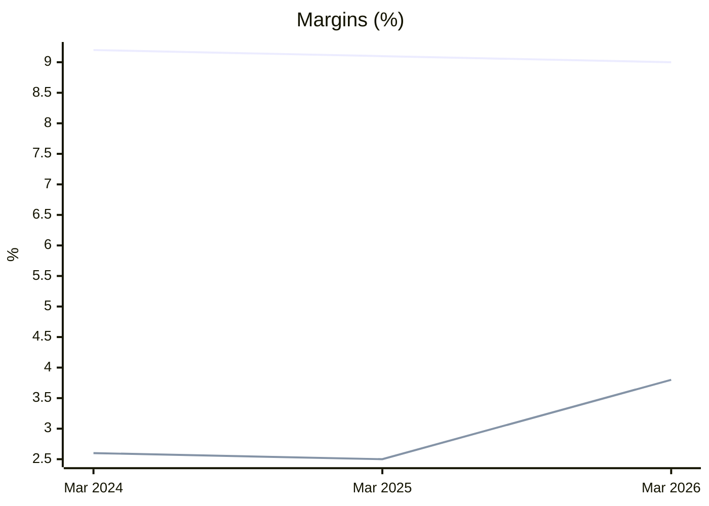

*Run 2026-11-24 · part of [SPINOFF_REPORT.md](../SPINOFF_REPORT.md) · the complete analysis of one company, with every management-call exchange in full.*

## KPIL — Kalpataru Projects International Ltd.

### 1. Kalpataru Projects International Ltd. — PARTIAL SPIN-OFF (subsidiary IPO)

**CONFIRMED** (partial spin-off — Linjemontage i Grästorp Aktiebolag is listed since 2026-09-25) · **PARTIAL SPIN-OFF, LISTED <1Y — price the parent's stub against the listed piece** · score 5.0/10 · partial spin-off (subsidiary IPO) · 5 filing(s) from NSE · first 2026-01-16, latest 2026-10-24

**The separated entities — every one the documents name:**

| Entity | Scheme | Business | Listing | Who runs it |
|---|---|---|---|---|
| **Linjemontage i Grästorp Aktiebolag** | 2026 initial public offering and listing of Linjemontage on… | Swedish pure-play EPC provider in power infrastructure: substations and transmission and distribution network… | listed on 2026-09-25 | Anders Åkerberg, CEO of Linjemontage; Ramesh Bhoo… |

**What is being separated, as the documents put it:** Linjemontage (LMG), KPIL's Swedish pure-play power-infrastructure EPC step-down subsidiary, partly sold and listed via IPO on Nasdaq Stockholm — class `value_unlocking`.

### 2. Stages and dates

> **Listing:** PARTIAL SPIN-OFF, LISTED — Linjemontage i Grästorp Aktiebolag trades since 2026-09-25 (per the filings); the parent keeps 66.45%, comprising 34,042,919 shares

| Date | Event | Source |
|---|---|---|
| 2025-05-16 | Other — Linjemontage i Grästorp Aktiebolag | as stated: Intimation dated 16th May, 2025 "intimating strategic proposal to inc… |
| 2025-08-05 | Other — Linjemontage i Grästorp Aktiebolag / Kalpataru Power Transmission Sweden AB | as stated: KPIL filing 05th August, 2025 (Sale or disposal) — definitive agreeme… |
| 2026-09-09 | Board approval — Kalpataru Power Transmission Sweden AB | as stated: KPIL filing 09th September, 2026: "the Board of Directors of Kalpatar… |
| 2026-09-09 | Other — Linjemontage i Grästorp Aktiebolag | as stated: Press release annexed to KPIL filing 09th September, 2026 — announcem… |
| 2026-09-16 | Other — Linjemontage i Grästorp Aktiebolag | as stated: KPIL filing 16th September, 2026 — LMG Board approved the Prospectus … |
| 2026-09-17 | IPO opened — Linjemontage i Grästorp Aktiebolag | as stated: Press release 16 September 2026 (Annexure 2 to KPIL filing 16th Septe… |
| 2026-09-24 | Other — Linjemontage i Grästorp Aktiebolag | as stated: KPIL filing 25th September, 2026: "the Board of Directors of LMG on 2… |
| 2026-09-25 | **Linjemontage i Grästorp Aktiebolag** listed | per the filings |
| 2026-09-25 | Listing and trading — Linjemontage i Grästorp Aktiebolag | as stated: KPIL filing 25th September, 2026 — admission for trading on Nasdaq St… |
| 2026-09-29 | Other — Linjemontage i Grästorp Aktiebolag | as stated: Press release 16 September 2026 preliminary timetable: "Settlement da… |
| 2026-10-23 | Other — Linjemontage i Grästorp Aktiebolag / Kalpataru Power Transmission Sweden AB | as stated: KPIL filing 24th October, 2026 with LMG press release dated 23 Octobe… |

**The partial spin-off:** **Linjemontage i Grästorp Aktiebolag** (subsidiary); parent's stake 96.12% (49,240,500 shares) held by Kalpataru Power Transmission Sweden AB → 66.45%, comprising 34,042,919 shares; IPO stage: listed; exchange: Nasdaq Stockholm; timeline: "The first day of trading on Nasdaq Stockholm is expected to commence on 25 September 2026 and the shares will trade under the trading symbol "LMGAB"." (press r.

> “In accordance with Regulation 30 and other applicable provisions of the Securities and Exchange Board of India (Listing Obligations and Disclosure Requirements) Regulations, 2015 ("LODR Regulations"),”

**Stated in the filings:** size hint: 0.43% of net worth.

**When it lists, in the documents' words:** On 09 September 2026: "the Listing on Nasdaq Stockholm is expected to be completed by the end of September 2026"; on 16 September 2026: "The first day of trading on Nasdaq Stockholm is expected to commence on 25 September 2026"; on 25 September 2026 KPIL confirmed admission for trading "effective today, 25th September, 2026"

### 3. Size of the separated business beside the parent — is institutional selling likely?

**Reading: NO FORCED SELLING ON SIZE — an IPO distributes no shares to the parent's shareholders, so nobody receives a piece they did not choose. Size matters here for the stub: how much of the parent's market value the listed piece accounts for.**

| Entity | Stated turnover | Market cap (₹ cr) | Its market value beside the parent's | Index member |
|---|---|---:|---:|---|
| Linjemontage i Grästorp Aktiebolag | "Gross Consolidated Turnover of LMG for F.Y. ended 31-03-2026: Approx… | — | — | not listed |

*The last column is the subsidiary's whole market value over the parent's (parent ₹23,046 cr, NSE bhavcopy of 2026-11-13), computed here; the parent's own value already contains the stake it keeps, so the stub is the parent's value less that stake.*

**In the documents' words:** “"Gross Consolidated Turnover of LMG for F.Y. ended 31-03-2026: Approx. SEK 3,225.11 Million (~USD 341.16 Million)* % of Consolidated Revenue of KPIL for F.Y. ended 31-03-2026: ~11.14% Consolidated Net worth of LMG as on 31-03-2026: Approx. SEK 334.25 Million (~USD 35.36 Million)* % of Consolidated Net worth of KPIL as on 31-03-2026: ~ 4.5% *Exchange rate used for conversion 1 USD = SEK 9.45" (For the VEPL disinvestment: "Revenue for F.Y. ended 31-03-2024: ~Rs. 85.07 Crores % of Consolidated Revenue for F.Y. ended 31-03-2024: ~0.43% Net worth as on 31-03-2024: ~Rs. 144.55 Crores % of Consolidated Net worth as on 31-03-2024: ~2.81%")”

**The judge's read of selling pressure:** unlikely — No distribution to KPIL shareholders; IPO buyers chose the shares, cornerstone investors took SEK 290m, insiders locked up 360 days

### 4. Insider ownership — share swap, promoters' holding, management incentives

**Share swap / entitlement, entity by entity:**

- **Linjemontage i Grästorp Aktiebolag:** Offer for sale only, no fresh issue: "Total Size: Up to 16,458,363 equity shares at SEK 46 per share (quota value SEK 0.50 each), representing up to ~32.1% of LMG's total shares, comprising 14,311,620 shares in the base offering and up to 2,146,743 additional shares subject to the exercise of the over-allotment / green shoe option"; "Selling Shareholders: 13,319,670 shares by Kalpataru Power Transmission Sweden AB ("KPTS") in the base offering, plus up to 2,146,743 additional shares by KPTS, subject to the exercise of the over-allotment / green shoe option, and 991,950 shares by employee/director shareholders."; "The Offering consists only of existing shares and the Company will therefore not receive any proceeds from the Offering."; "The final price in the Offering has been set to SEK 46 per share (the "Offer Price"), equivalent to a valuation of SEK 2,356,557,000 (representing the total market value of all shares in the Company)."; over-allotment finally "exercised corresponding to 1,877,911 shares"

**Promoters' holding, from the shareholding pattern:**

| Company | Promoters | FIIs | DIIs | Public | Quarter |
|---|---:|---:|---:|---:|---|
| Kalpataru Projects International Ltd. (KPIL) | 33.58% | 10.75% | 44.85% | 10.82% | Sep 2026 |

*Source: screener.in shareholding pattern, stored under `ShareholdingPattern/NiftyTotalMarket/`. In a mirror demerger each shareholder holds the same proportion of the new company as of the parent on the record date.*

- **Promoters in the parent, per the documents:** not stated in the documents on file.
- **What the promoters will hold in the separated entity:** 2026 LMG IPO: the KPIL promoters hold nothing directly; the holding company's stake falls — "Upon full subscription and assuming full exercise of the over-allotment / green shoe option, the stake held by KPTS, in LMG will decrease from current 96.12% (49,240,500 shares) to 65.93% (33,774,087 shares), and KPTS will receive gross proceeds of SEK ~711.45 million, subject to customary adjustments, issue expenses, and set-offs." After partial exercise: "Pursuant thereto, shareholding of KPTS in LMG will stand at 66.45%, comprising 34,042,919 shares." Also: "None of the buyers belong to the promoter/promoter group/group companies." 2024-2026 VEPL sale: "The said buyer does not belong to the promoter/ promoter group/group companies."; "Consequent upon completion of the said transaction, the Company's shareholding in VEPL has become Nil"
- **What a public shareholder receives:** not stated in the documents on file.
- **Management incentives:** Pre-IPO scheme (filing 05th August, 2025, in furtherance of the intimation dated 16th May, 2025 "intimating strategic proposal to incentivize the employee(s) and director(s) of Linjemontage I Grastorp AB ("LMG"), wholly owned step down subsidiary, by way of share based benefit scheme covering stock options or otherwise, aggregating upto 5% of equity share capital of LMG"): "i) Kalpataru Power Transmission Sweden AB ("KPTS"), wholly owned subsidiary of the Company, has entered into definitive agreement(s) (subject to necessary approvals regarding split of shares) to sell 6,900 equity shares, each with a quota value of SEK 1 (post-split) of LMG representing 3.45% of the equity share capital of LMG by way of share sale to the identified employee(s) and director(s) of LMG... ii) LMG has approved granting of a maximum of 900 stock options (subject to necessary approvals regarding split of shares) which entitles the participant to subscribe for one new share with a quota value of SEK 1 (post-split) for each of the option vested, representing 0.45% of the equity share capital of LMG to identified beneficiaries of LMG"; "The shares have been sold at a price of SEK 5,190.48 per share with a quota value of SEK 1 each (post-split), entailing an aggregate consideration of SEK 35.81 Mn. The consideration shall be received in tranches, on or before, 30th March, 2027."; "Further, the exercise price of the stock options granted is SEK 5,190.48 per share with a quota value of SEK 1 (post-split) and the subscription price will be received based on the vesting of the options."; "Further, the options granted shall vest on or before 30th June, 2026."; "Since the shares being sold or options being granted also include certain director(s) of LMG, the same will be a related party transaction. The same is being done at arms' length." In the IPO: "991,950 shares by employee/director shareholders" were sold by the Selling Shareholders, who "Includes members of management, the Board of Directors and employees"; "All individual Selling Shareholders other than Kalpataru Sweden are selling shares in the Offering primarily to repay financing arrangements relating to their respective acquisitions of shares in the Company."; "The lock-up period will be 360 days from the first day of trading for the Selling Shareholders, the members of the Board of Directors and Group Management." No new plan in KPIL and no treatment of existing KPIL grants is stated.
- **Insider actions around the separation:** Selling: KPTS (KPIL's wholly owned subsidiary) sold 13,319,670 LMG shares in the base offering plus 1,877,911 shares under the over-allotment option, cutting its holding from 96.12% to 66.45%, and "Kalpataru Sweden has indicated an intention to remain a long-term major shareholder and to continue supporting the Company's strategic development following completion of the Offering." Lock-up: "The Selling Shareholders, as well as the members of the Board of Directors and Group Management, will commit to, subject to certain exceptions, not to sell their respective holdings (or otherwise make certain transactions with similar effect) for a certain period after the date of the Listing. The lock-up period will be 360 days from the date of listing for Kalpataru Sweden, the members of the Board of Directors and Group Management." Buying by insiders of LMG: the pre-IPO sale of 6,900 shares (3.45%) and grant of up to 900 options (0.45%) to identified employees and directors of LMG at SEK 5,190.48 per share, part-financed by "financing arrangements relating to their respective acquisitions of shares in the Company." Pledging in the parent (Q4 FY26 call): "But we have always said that pledge will continue to come down. That's what is the comfort given by promoters. And we've seen that over the last 6 quarters, every quarter pledge has come down. I think the promoters from whatever discussion I've had with them, continue to be on the track of bringing down pledge." Stated intent before the IPO (Q3 FY26 call): "we have appointed bankers to advise us on fundraising at Sweden, which is also progressing well. We do not know which options and what timing it exactly is, but we have appointed bankers to look at exploring fund option raising at Sweden also, which I'm expecting in FY26-27 should give us further cash flows."
- **Insiders, per the checklist read:** KPTS (KPIL wholly owned subsidiary) retains 66.45% / 34,042,919 shares, down from 96.12%; 360-day lock-up for Kalpataru Sweden, board and group management; employee/director shareholders sold 991,950 shares mainly to repay acquisition financing · *option pricing date:* not stated

### 5. Why the listing — point by point

The business being separated is Linjemontage i Grästorp AB (LMG), KPIL's Swedish power-grid EPC subsidiary held through Kalpataru Power Transmission Sweden AB (KPTS) — separated not by demerger but by an offer-for-sale IPO on Nasdaq Stockholm (listed 25 September 2026), in which KPTS sold down from 96.12% to 66.45% rather than giving LMG new capital. The trigger management cited on the calls was value crystallisation and cash: LMG had compounded from ~INR1,000 crores revenue in FY24 to INR1,800+ crores in FY25 (PBT INR21 crores to INR70+ crores) to ~INR3,000 crores in FY26 with EBITDA ~INR200 crores and PBT ~INR170 crores (both up over 100%), i.e. SEK1.3bn to SEK3.2bn net sales at a 56.6% CAGR with adjusted EBITA margin rising from 4.4% to 7.6%, net cash of SEK172.1m, ROCE of 48.1% and an order book of SEK4,349m — yet it was only ~11.14% of KPIL's consolidated revenue and ~4.5% of consolidated net worth. Mohnot repeatedly placed the Sweden 'fundraise' inside the same bucket as the noncore exits (Vindhyachal road asset sold January 2026 for ~INR799 crores EV / INR600+ crores net, Indore real estate, Shree Shubham Logistics), i.e. as a source of 'further cash flows' to cut leverage and fund the INR800-900 crores/year capex programme and lift ROCE; the IPO delivered KPTS gross proceeds of ~SEK711.45m at SEK46/share, valuing LMG at SEK2,356.6m (~INR2,324 crores). The second problem it solves is that LMG's economics are structurally different from KPIL's: management argued a 6%-7% PBT in a 'mature market' is fine there because 'the ROCE numbers are very, very high and they are cash positive always' — a profile the consolidated KPIL multiple was not reflecting. LMG's own filings justify the separation on strategic grounds: visibility, credibility and brand recognition with customers, partners and employees, transparency, a platform for long-term value creation, a broadened shareholder base, and support for its ambition to lead Nordic power-infrastructure EPC in a Swedish serviceable market growing from ~SEK19bn (2025) to ~SEK31bn (2030) at 11% CAGR (transmission 17%), with ~80% of Sweden's transmission grid over 40 years old and Statnett planning NOK150-200bn of 2025-2034 investment. Pressure came from investors and analysts, not lenders: Carnelian and DAM Capital pushed management on why a T&D business sitting inside a T&D company needed its own listing, while cornerstone demand from Tredje AP-fonden and Unionen (SEK290m) anchored the book; LMG's management/employee shareholders (991,950 shares) sold mainly to repay the financing they had used to buy their shares. KPIL stressed continuity, not exit: KPTS 'indicated an intention to remain a long-term major shareholder', is locked up for 360 days, and LMG remains a step-down subsidiary.

**Point by point, with the source:**

1. Baseline: no separation plan existed; LMG was simply presented as a record performer, with revenue doubling and an all-time-high order book of INR3,143 crores. “LMG's order book is at a all time high of INR3,143 crores.” — *[Feb 2025](https://kalpataruprojects.com/api/view-file/KPIL_Q3_FY25_Transcript.pdf)*
2. First disclosure of the separation idea — the Board approved bankers and intermediaries to study fundraising options at Linjemontage, mentioned in the same breath as LMG's PBT rising from ~INR21 crores to ~INR70+ crores. “the Board has also approved appointment of bankers as well as intermediaries to look at fund options, fundraising options in Sweden Linjemontage in the last Board meeting, which we have declared to everyone.” — *[May 2025](https://kalpataruprojects.com/api/view-file/KPIL_Q4_FY25_Transcript.pdf)*
3. Formalised as a disclosed 'strategic overview' with an IPO explicitly named as one of the options, and merchant bankers and advisers appointed; LMG had already begun preparatory steps. “We have initiated a strategic overview on LMG where various options are being evaluated, including options related to IPO, subject to market conditions.” — *[Aug 2025](https://kalpataruprojects.com/api/view-file/KPIL_Q1FY26_transcript.pdf)*
4. An investor (Mihir Manohar, Carnelian Capital) pressed on exactly the question management never answered — why carve out a T&D business that already sits inside a T&D company; Mohnot declined to comment. “I just wanted to understand the thought process because I mean, it is also T&D business similarly sitting in KPIL.” — *[Aug 2025](https://kalpataruprojects.com/api/view-file/KPIL_Q1FY26_transcript.pdf)*
5. Management explained LMG's different economic profile — lower PBT than KPIL's core but very high ROCE and permanently cash positive — the implicit valuation argument for separating it, with bankers still mandated and the path undecided. “As far as margins are concerned, I think that those are mature markets where a PBT of 6% to 7% is very reasonably good because the ROCE numbers are very, very high and they are cash positive always.” — *[Oct 2025](https://kalpataruprojects.com/api/view-file/KPIL_Q2_FY26_Transcript.pdf)*
6. The Sweden transaction was placed squarely in the monetisation/debt-reduction bucket alongside transmission assets, the last road asset and Shree Shubham Logistics, with cash expected in FY26-27. “We do not know which options and what timing it exactly is, but we have appointed bankers to look at exploring fund option raising at Sweden also, which I'm expecting in FY26-27 should give us further cash flows.” — *[Feb 2026](https://kalpataruprojects.com/api/view-file/KPIL_Q3_FY26_Earnings_Call_Transcript-5th_feb_2026.pdf)*
7. Final pre-IPO framing: a 'strategic investment' into the Swedish subsidiary grouped with remaining divestments as free-cash-flow events to strengthen the balance sheet, set against INR800+ crores of annual capex and net debt already down 50% to INR915 crores. “We also have some events of free cash flows coming in next year, whether it is through a few more divestments which are left, which might happen either next year or a year after that or whether it is through some strategic investment coming into our Swedish subsidiary in whatever form it comes.” — *[May 2026](https://kalpataruprojects.com/api/view-file/KPILQ4_FY26_Earnings_Call_Transcript_final.pdf)*
8. The 9 September 2026 filing/press release gives the official rationale — standalone visibility, credibility, brand and Nordic leadership ambition — and discloses LMG's scale: SEK3,225m FY26 revenue (~11.14% of KPIL consolidated revenue) but only SEK334m net worth (~4.5% of KPIL's). “The Listing is expected to enhance the Company's visibility, credibility and brand recognition among customers, partners and employees, and to support Linjemontage's long-term ambition to strengthen its position in the Nordics as one of the leading EPC providers within power infrastructure.” — *Scheme*
9. Transparency, long-term value creation and a diversified shareholder base are the stated second leg, with KPTS committing to stay a long-term major shareholder (360-day lock-up) and LMG remaining a step-down subsidiary. “Becoming a publicly listed company will also provide greater transparency and a platform for long-term value creation, while diversifying the shareholder base.” — *Scheme*
10. Structurally this is a pure sell-down, not a capital raise for LMG: 14,311,620 base shares plus a 2,146,743-share greenshoe at SEK46, ~32.1% of LMG, giving KPTS gross proceeds of ~SEK711.45m at a SEK2,356.6m (~INR2,324 crores) valuation and taking KPTS from 96.12% to 66.45% after the partial greenshoe exercise of 1,877,911 shares. “The Offering consists only of existing shares and the Company will therefore not receive any proceeds from the Offering.” — *Scheme*
11. Demand was investor-led: Tredje AP-fonden and Unionen cornerstoned SEK290m, while LMG's own management/director/employee holders sold 991,950 shares chiefly to repay the borrowings used to buy them. “All individual Selling Shareholders other than Kalpataru Sweden are selling shares in the Offering primarily to repay financing arrangements relating to their respective acquisitions of shares in the Company.” — *Scheme*
12. LMG's standalone financial targets quantify what separation is meant to unlock — revenue above SEK5bn, adjusted EBITA margin above 8% (from 7.6%), net debt/adj EBITDA below 1.0x and a 25% dividend payout — in a market growing 11% CAGR to SEK31bn by 2030. “Profitability : Linjemontage aims to reach an adjusted EBITA margin exceeding 8 per cent in the medium term.” — *Scheme*

**How it evolved:** The idea surfaced on the 19 May 2025 Q4 FY25 call, where Mohnot disclosed that the Board had approved appointing bankers and intermediaries to examine 'fundraising options' at Linjemontage — framed alongside the noncore clean-up (VEPL, Indore, Shubham); the 14 Feb 2025 call had contained no such plan, only LMG's record order book of INR3,143 crores. By 8 August 2025 (Q1 FY26) it had hardened into a disclosed 'strategic overview… including options related to IPO, subject to market conditions', and management refused to explain the logic when Carnelian asked why a T&D business inside a T&D company needed a separate listing, even withdrawing LMG margin guidance because the process had started. On 31 October 2025 Mohnot said the path was still undecided but expected 'some light' on valuation in FY26-27, and on 5 February 2026 he said the Sweden mandate was 'progressing well' and should throw off cash in FY26-27; by 15 May 2026 he described it only as 'some strategic investment coming into our Swedish subsidiary in whatever form it comes'. The form was fixed in the filings: KPTS board approval on 9 September 2026, prospectus and SEK46 price on 16 September, listing and ~32.1% offer on 25 September, and partial greenshoe exercise on 23-24 October 2026 leaving KPIL at 66.45%.

**What management expects from it:** For LMG: standalone visibility, credibility and brand with customers and employees; transparency; a growth platform and broadened shareholder base; revenue above SEK5bn, adjusted EBITA margin above 8%, net debt/EBITDA under 1.0x, 25% payout. For KPIL: ~SEK711m cash to cut debt and fund capex, value crystallised at SEK2.36bn, retained 66.45% control, higher ROCE and a cleaner noncore-free core EPC portfolio.

*Not explained on the calls:* Calls never explained why a listing over a trade sale, the valuation sought, use of proceeds, dilution to consolidated EPS, or minority/governance terms; management explicitly refused to give the rationale.

- *Stated reason, in one line:* Board and majority shareholder Kalpataru Sweden consider the listing a strategic next step: enhancing visibility, credibility and brand recognition, greater transparency, a platform for long-term value creation, while diversifying the shareholder base
- *What it reveals:* A high-return asset-light business priced publicly: FY25/26 net sales SEK 3,225m, adjusted EBITA SEK 245m (7.6%), R.O.C.E. 48.1%, net cash SEK 172.1m, order book SEK 4,349m, valued at SEK 2,356,557,000 — yet only ~11.14% of KPIL revenue and ~4.5% of its net worth
- *Parent or spin:* — · *Read next:* LMG's prospectus on linjemontage.com (Q1 26/27 figures, Selling Shareholders) and LMG's traded price versus the SEK 46 offer
- *In their words:* “Linjemontage's Board of Directors and its majority shareholder, Kalpataru Sweden, a wholly-owned subsidiary of Kalpataru Projects International Limited ("Kalpataru India"), consider the Listing to be a strategic next step in Linjemontage's development.”

### 6. On the calls, verbatim

7 call(s), oldest first: **18 question-and-answer exchange(s)** given in full — the question and every answer to it, nothing trimmed — and 1 passage(s) from management's prepared remarks (the complete sentences about it; the whole remarks are in the linked transcript). Text is as the transcript prints it.

#### May 2024 — [transcript](https://kalpataruprojects.com/api/view-file/KPIL_Q4_FY24_Earnings_Call_Transcript.pdf)

**Question and answer**

> **Manish Mohnot:** So, at Linjemontage level, we did revenue of around INR 1,000 crores in the current year, with EBITDA in the range of 3.5%. At the Fasttel level, we did revenue of around INR 700 crores and at EBITDA level, they were negative INR 16 crores. Both the organizations have got both the subsidiaries have got very good orders in Q4, very good profitable orders in Q4. So we expect Linjemontage to grow by at least 25%, with EBITDA margins more in the range of 5% to 6%. And we expect Fast tel to grow again at 20% plus for the current year. And they will definitely be positive at both EBITDA and PBT levels.
>
> **Parikshit Kandpal:** The PBT margins will also be similar, like at 5% to 6% in Linjemontage ?

**Question and answer**

> **Manish Mohnot:** Yes, Linjemontage hardly has any interest cost, so EBITDA will be equivalent to PBT. Maybe a difference of less than 50 basis points.
>
> **Parikshit Kandpal:** Okay. And just lastly, sir, on this oil & gas pipeline disorder , so what is the execution time period given there is a large order? So, if you can help us on that.

**Question and answer**

> **Manish Mohnot:** I think I had spoken about it, but I'll speak again. In terms of Linjemontage we've seen very good traction coming in from October till March, winning some significant orders on the substation side, including orders on 200 kV substation, where we just got qualified in Sweden last year. The entire opportunity in Sweden has multiplied to 2x in the last two y ears, given the mindset of the Swedish as a country to move to fossil fuel free by 2040. So our order book has closer to doubled in the last five months. We have already bid for three, four large contracts for which we will have clarity maybe by June. With the current visibility, we expect that business to grow at 35% in the next year, 30 to 35% in the next year. And margins coming back to those levels of 5 % to 6% at EBITDA level where they were prior to 2023. As far as Fasttel Brazil is concerned we had di fficulties the last 2 years were very difficult to exit Kalpataru Project s International Limited May 09, 202 4 the existing projects which we had and close all the old projects. We are nearly out of all the old projects except for maybe a couple of them. And the new order book is at a healthy margin with EBITD A in the range of 9 to 10% and PBT in the range of 6 to 7%. We definitely expect them to turn around in terms of profitability. Although growth there will not be significant in terms of top line, but on EBITDA and PBT we see them completely turning around and being positive on both the metrics.
>
> **Saif Sohrab Gujar:** Okay, thanks sir.

#### Aug 2024 — [transcript](https://kalpataruprojects.com/api/view-file/Q1FY25_Transcript.pdf)

**Question and answer**

> **Bharat Sheth:** Sir, in your opening remarks you stated about the LMG, we are looking for aggressive growth as well as in Fasttel your breakeven. So if you can give a little more color on both those companies?
>
> **Manish Mohnot:** Sure. So I think on Linjemontage, our last 6 years journey has been very good. The business itself has become 3x over the last 6 years after we have acquired and they have paid us a significant amount of our investment back as dividend as far as Linjemontage is concerned. Today, when we look at where Linjemontage is in terms of our order book. If you look at the Kalpataru Projects International Limited July 30, 2024 revenue for the Q1, we did around INR449 crores growth of 84% as compared to INR244 crores in the previous year. And also their order book visibility is so good that we believe that growing at a good double- digit should not be a challenge for Linjemontage. They have an order book visibility of around INR3,000 crores while we speak, which is closer to double in the last 1 year. And the markets continue to be bullish as far as the entire Sweden, Norway, Denmark is concerned, and we believe that's an opportunity, which we will be focused on capitalizing on. We are today among the top 3 EPC contractors in that country on the transmission side with a strong team and a presence across transmission and substation, both in Sweden as well as Norway. So -- and even on balance sheet, that business has free cash available on balance sheet. So it's like a debt-free business. So EBITDA is equal to PBT as far as that business is concerned. On Fasttel, it was a strainful journey over the last 3 years because of COVID, Brazil, all of that and historical orders, but we are now out of all historical orders. Our revenue for Q1 '25 is around INR230 crores, a growth of around 40% compared to what Q1 '24 we did. Fasttel order book has also doubled. We are sitt ing at around INR1,200 crores as of now. We believe that the business will get into profitable mode getting into Q2, Q3 itself, right, and going into a high growth and margin mode into the next year. So both the businesses today, I believe that growth is visible. The team is good. The ma rkets look good, and we are conservative at least on what not to do in both the businesses. So from a perspective direction, I think we stand committed to those businesses, the opportunity looks good and growth is visible. For the current quarter, fairly, we had a small setback of FX coming into the Fasttel business, which I just explained in the earlier call, which to me is more a timing issue. It was a net INR17 crores impact. Otherwise, if you look at Linjemontage for the current quarter, they have done an EBITDA closer to 4% or closer to 5% and even Fasttel has done EBITDA at the range of 8% to 9%, which is what we believe will continue to improve.

**Question and answer**

> **Bharat Sheth:** So even, sir, in Linjemontage, we expect -- do we expect improvement in the margins from 4% earlier we were doing 6% kind of EBITDA margin? And kind of a potentially next 3 years, where do you see this Linjem ontage as well as Fasttel?
>
> **Manish Mohnot:** So on Linjemontage, we definitely expect margin s to improve getting into Q3, Q4 itself, right, not even next year. And getting into next year, we definitely should be at 6%, if not higher than that. On Fasttel, our EBITDA has been closer to now it's at around 8.5% to 9%, and we see that going forward because that's a business where -- that's a market where 10% to 12% EBITDA is common in terms of T&D projects. So yes, EBITDA margins should go up on these businesses going forward. And next year, fo r sure, Fasttel will be 6% plus.

#### Oct 2024 — [transcript](https://kalpataruprojects.com/api/view-file/KPIL_Q2%20FY25%20Transcript.pdf)

**From the prepared remarks** *(the passage about it; the whole turn runs to 7,263 characters in the transcript)*

> **Manish Mohnot:** So far, we've secured orders worth approximately INR6,000 crores in the current fiscal year in T&D with an additional L1 position of approx.. INR5,500 crores. On the international front, performance in Sweden and Brazil saw significant improvement compared to the same quarter last year. At Linjemontage Sweden Q2 revenue reached INR380 crores, up by more than 100% compared to similar quarter last year. Our order book Linjemontage stood at record high INR2,958 crores as on September '24. In Brazil, Fasttel reported INR285 crores in Q2 revenue reflecting a 48% Y- o-Y increase. The order book at Fasttel stood at INR828 crores at the end of September '24. Our overall T&D order book including international subsidiaries stands at INR22,269 crores as of September 30, 2024.

**Question and answer**

> **Amit Anwani:** Sure. And lastly, on international T&D, you said th ere's been a pretty strong development there. Any specific geographies where you are sensing this because we are seeing geopolitically, things have been unstable. So just wanted to understa nd which geographies in in ternational market for T&D and other businesses are really becoming fruitful now?
>
> **Manish Mohnot:** For KPIL, I think our opportunities on the intern ational front, primarily a lot more in our 2 subsidiaries, which are Linjemontage and Fasttel, which are doing extremely well, driven by Sweden, driven by the Nordic and the Brazilian ma rket. We continue to stay bullish on the CIS and Americas mark et also where we today have leadersh ip position with projects across Chile, Guyana, Suriname, all of that. Finally, we are seeing good traction in Africa and Middle East also, although we are not so much bullish on Middle East in the T&D business driven by profitability constraints, but we are seeing good opportunities coming up there also. So if you ask me priority-wise, Europe continues to be the first. Latin America continues to be the second, driven by Africa and then Middle East.
>
> **Amit Anwani:** Thanks for taking my question and all the best.

#### Feb 2025 — [transcript](https://kalpataruprojects.com/api/view-file/KPIL_Q3_FY25_Transcript.pdf)

**Question and answer**

> **Mihir Manohar:** Understood. My second question was on the profitability for the subsidiary, when we see profitability for the subsidiary for this quarter, now this number is like consolidated minus parent. When I do the balance num ber, which is subsidiary as well as JVs, the EBITDA margin Kalpataru Projects International Limited February 14, 202 5 for 3Q FY '25 was at 8.5% versus 10.7% on Y -o-Y basis even for 9 M basis like 9.1% versus 10.3% on a Y -o-Y basis. And this is like consol minus parent. So I mean just wanted -- broadly wanted to understand how should we see the profitability of our subsidiaries improving from here on. And why should that happen? Some color around that?
>
> **Manish Mohnot:** Sure. The standalone to consol has 4 or 5 critical components, right? And I'll first give you the macro picture and then get into specifics. One is Linjemontage which is Sweden, I think they have done very well both on revenue as well as profitability. Second is our road assets where we have had a dent in profitability in Q3 primarily because our f ocus on O&M in a big way given that it's more scientific in nature and given that we also have plans to divest few of them. Third is Fasttel Brazil where we had losses coming in primarily due to the devaluation of the currency on the USD loans given by Ex im India. This does not have an overall impact in the long run because on an overall basis, at an organization level we are net export surplus, so it's more a timing issue. Shubham has been more at a breakeven level because we have not had an impact there. So what has had a dent in the Q3 is only by 2, primary dent, when the Brazil devaluation in currency and lost it on the road assets, primarily on O&M. Going forward, we believe that the losses on road assets should come down given that collections have a lso improved, and we are divesting the largest road asset in the next few quarters itself. Going forward, we also include -- I expect Brazil losses to be coming down because currency has come back from 6.2 levels on 31st December, it's already back to 5.7 levels while we s peak now. So we believe that it's more a timing issue. So I won't believe that going forward to the next year, the consol should only be better than stand -alone and not be worse in any form.

**Question and answer**

> **Manish Mohnot:** So you if you look at our Linjemontage business, it has been a very focused business in terms of EBITDA margin, always in the range of 4% to 6% and EBITDA is typically is equal to PBT because they hardly have any interest cost. So if you look at our numbers from a 9M perspective on Linjemontage, our revenue has been around INR1,300 crores, which is double in terms of from INR664 cro res to INR1,337 crores. EBITDA has gone up from INR22 crores to INR64 crores in the same period. So EBITDA is around 4.8% as far as Linjemontage is concerned. If you look at Fasttel, our revenue has gone up from INR560 crores to INR755 crores in 9M, and our EBITDA has gone up from INR6 crores to INR56 crores in the same 9M. PBT is negative. We are a negative INR43.5 crores last year, it's only INR16 crores negative this year. But the INR16 crores negative is primarily due to the currency devaluation which we believe is having impact.
>
> **Bharat Sheth:** Okay. And sir, on -- one bookkeeping question. In this quarter, particularly our other expenses have shoot up Q -on-Q substantially. So any one -off there or...

**Question and answer**

> **Manish Mohnot:** So I believe on the guidance front going into the next year, Linjemontage margins should definitely reach towards -- more towards 5.5% plus from 4.8% at EBITDA level in the current year. And as far as Fasttel is coming, our aim is to -- we have improved the EBITDA margins from as low as 1% to 7% in the cu rrent year, and we believe it will stay at this levels of 7% to 8% going forward also.
>
> **Bharat Sheth:** PBT margin will be approximately...

**Question and answer**

> **Manish Mohnot:** PBT margin as far as Linjemontage is concerned, it could be more in the range of 3.5% to 4% and Fasttel we will try at breakeven because -- so more range of 1% to 2% because the interest cost is much higher. Kalpataru Projects International Limited February 14, 202 5
>
> **Bharat Sheth:** And Water will also start making money. Is that fair understanding?

**Question and answer**

> **Bhoomika Nair:** Okay. Okay. Got it. So the other thing is on Fasttel, the order intake has been fairly muted in the 9M period, are we being cautious a little bit on our end to kind of not take too many orders? What is the outlook in terms of growth there? Because as you mentioned that the working capital and thereby interest is high, which is where the profitability is getting impacted. So how are we seeing that both revenues, margins expanding and thereby a turnaround where you spo ke about Fasttel that from next year, we should see a breakeven to 1% to 2% PBT margin. What will drive that? And how do we see that progressing thereafter? Kalpataru Projects International Limited February 14, 202 5
>
> **Manish Mohnot:** Bhoomika, you got that right. While we're very bullish on Linjemontage in terms of both revenue gr owth and margin, we continue to be cautious as far as Fasttel is concerned, both from a political perspective, the country zone plans perspective and our ability to take that order book to a different level. So we will be cautiously optimis tic on bidding for projects there. We do not expect huge revenue growth coming in Fasttel in the next year because we have seen good growth in the current year, but our intend would be slowly to improve margins and get back to the standard levels of the organization level. So yes, you're right, we will be cautiously optimistic and the focus would be not revenue but margin improvement getting into the next year.

#### May 2025 — [transcript](https://kalpataruprojects.com/api/view-file/KPIL_Q4_FY25_Transcript.pdf)

**Question and answer**

> **Bharat Sheth:** And last 2, I mean, this LMG, we had a ve ry high hope. So how do we see LMG over the next 2 -3 years from this INR1,000 crore revenue to earlier, you had guided much higher growth. And so from here, do we stick and further there is a room to improve order book ?
>
> **Manish Mohnot:** So Bharat, just to g ive you a perspective, our Linjemontage revenue for the previous year was INR1,800 -plus crores. It was INR1,000 crores in FY'23-'24. In FY '24-'25 is INR1,800 crores plus. We expect that business to grow at a 20 %-25% at least for the next 2 to 3 years, given the order book visibility. Even on margins, they have done exceptionally well. So from , if you look at FY'23-'24, their PBT was around INR 21 crores, which has gone up to around INR 70-plus crores in the FY’24 -25. That's a big number. While we say t he Board has Kalpataru Projects International Limited May 19 , 202 5 also approved appointment of bankers as well as intermediaries to look at fund options, fundraising options in Sweden Linjemontage in the last Board meeting, which we have declared to everyone. So we'll be exploring whatever options are avail able in terms of fundraising and coming back to all of you all over the next 6 to 9 months in terms of what our plans are. As far as the market is concerned, we continue to stay very bullish in that market, given the huge opportunity in Sweden, Norway and the neighboring countries and with limited players, which gives an advantage on both top line as well as profitability going forward.

**Question and answer**

> **Vaibhav Shah:** Okay. Okay. Sir, secondly, what were the EBITDA margin s in Fasttel and LMG for FY '25? And what is the guidance for FY '27 -- for '26?
>
> **Manish Mohnot:** So if you look at -- the easier one is Linjemontage, where we did an EBITDA of closer to 5% in FY '25. We expect this to only improve, so maybe in the range of 5 to 6% in that range. It's not going to go much higher than maybe from 5%, it might go to 6 %-6.25%. As far as Fasttel is concerned, our EBITDA margin was closer to 2.9% in FY '25. We definitely expect this to go up to levels of 4% to 5% in the next 2 year s, might not be immediate, but over the next 2 years, we expect these numbers to go to number closer to 5%.

#### Aug 2025 — [transcript](https://kalpataruprojects.com/api/view-file/KPIL_Q1FY26_transcript.pdf)

**Question and answer**

> **Mihir Manohar:** Understood, sir. Second question is on the LMG side. I mean we are exploring options for either raising capital over there or a separate listing. I just wanted to understand the thought process because I mean, it is also T&D business similarly sitting in KPIL. So what is the strategy and thought process of getting it a separate subsidiary listing in subsidiary?
>
> **Manish Mohnot:** As I said earlier, we cannot comment much as we're looking at various options, and we're exploring that, and we've appointed banker s and advisers for that.

**Question and answer**

> **Bharat Sheth:** Yes. Congratulations Manish -ji and team for excellent performance. Sir, my question is, one is, how do we see opportunity in European region? What was a year back and now? And how do we see it changing?
>
> **Manish Mohnot:** Bharat -bhai, we, as KPIL, I have always been very bullish on the European segments on a few specific sectors. One of the sectors where we're very bullish is T&D. And I think we continue to stay bullish whether it is in the Nordic market or whether it is Ge rmany or whether it's the neighboring markets. As of today, if you look at it at Sweden, we are among the leading player through Linjemontage. So from a 2 - to 3-year perspective, we continue to stay very bullish. And personally, if you ask me, even from a 5-year perspective because majority of the European states now have becoming clean in terms of energy by 2035, which requires them to build a very strong grid. Given that, I think we continue to stay bullish in this market, at least from a 3 -year, 3 - to 5-year perspective.

#### Oct 2025 — [transcript](https://kalpataruprojects.com/api/view-file/KPIL_Q2_FY26_Transcript.pdf)

**Question and answer**

> **Sumit Kishore:** My first question is on the T&D business. When I look at your disclosed orders so far this fiscal, it appears that a fairly small portion has come domestically and mos tly it's overseas. And you mentioned that in your mature L1 positions pipeline, also international T&D is quite strong. What we are noticing is that award of interstate TBCB projects on a year -on-year basis has been much lower so far this fiscal. So I jus t want to understand that in this backdrop, is it possible that second half also would largely be dominated by international and T&D? And what percentage of your T&D order book is international right now?
>
> **Manish Mohnot:** So Ravi, just so that we have clarity on the domestic front also, we have got orders in excess of ■ 2,500 crores plus in the first 6 months, which is around 30% higher than what it was in the previous year. We are L1 also in a few projects. On the internat ional front, obviously, including Linjemontage, we've got orders in excess of ■ 4,000 crores in the first 6 months -- in Q2. Now my point is I do not see orders coming down because a lot of tenders, which Power Grid has not taken, but some private sector players have taken would get into that award stage maybe Q3, Q4. So some of the large TBCBs have not been necessarily been taken by Power Grid and that also would come up for tendering soon or have already the tendering process started, but the award would happen later part of the year. So I personally stay confident from a long -term perspective on getting very good orders coming in. Now from a timing perspective, maybe Q3, maybe Q4, maybe it could be 1 quarter here and there. But the reality is that both the businesses, whether it is TLD and TLI, are sitting on very good order books right now, right? They are sitting on order book, which is closer to 2.5, 3 years, even if I assume a 20% growth. So I'm not desperate in that sense to go and take an order ju st for the sake of getting an order book because they have good visibility, the opportunity is good, and there are limited players of the size and scale who can deliver this kind of projects. So I am very optimistic about it. I believe the next 6 to 12 upto 18 to 24 months, there will be good orders, both domestic and international. One quarter here and there could happen depending upon when the tenders happen.

**Question and answer**

> **Parikshit Kandpal:** Okay. So waiting the conver sion, all owing to come in. Just on Linjemontage and L MG and Fasttel. So you can help us understand on the revenues which you have disclosed. So what has been the EBITDA and the PBT margins on these 2 entities?
>
> **Manish Mohnot:** So on Linjemontage, we have seen a very healthy growth in this quarter, which we have expected to be very good. So if you look at Linjemontage number in terms of revenue, we have touched in revenue of closer to ■ 1,500 crores in H1, a growth of more than 5 0%. On EBITDA margin in H1, Linjemontage has done in excess of 7.5% and PBT margin closer to 7%. As far as Fasttel is concerned, the quarter saw revenue of approx.. and first half saw a revenue of ■ 370 crores. It's much lower than what we had projected. And on an EBITDA and PBT, Fasttel continues to be negative. We have had some hits coming on some projects, and it continues to be negative.

**Question and answer**

> **Vaibhav Shah:** In terms of margins, what could be the stable margins for the LMG business, say, in next 2 to 3 years, given the strong growth?
>
> **Manish Mohnot:** So I think a t a PBT level, that business looks like easily, we should be doing anywhere between 6.5% to 7.5% in the Linjemontage at a PBT level.

### 7. The parent's financial statements

**The parent, last three fiscal years (consolidated)**

| | Mar 2024 | Mar 2025 | Mar 2026 |
|---|---:|---:|---:|
| Sales (₹ cr) | 19,626 | 22,316 | 27,143 |
| Sales growth (%) | +20.0% | +13.7% | +21.6% |
| Operating profit (₹ cr) | 1,814 | 2,031 | 2,432 |
| Operating profit growth (%) | +21.7% | +12.0% | +19.7% |
| Operating margin (%) | 9.2 | 9.1 | 9.0 |
| PAT (₹ cr) | 516 | 567 | 1,031 |
| PAT growth (%) | +18.6% | +9.9% | +81.8% |
| PAT margin (%) | 2.6 | 2.5 | 3.8 |
| EPS (₹) | 31.4 | 34.3 | 60.9 |

*Source: ProfitStatement/NiftyTotalMarket/KPIL.csv (consolidated, screener.in); growth and margins computed here.*

```mermaid
xychart-beta
    title "Sales, operating profit and PAT (₹ cr)"
    x-axis ["Mar 2024", "Mar 2025", "Mar 2026"]
    y-axis "₹ crore"
    bar [19626, 22316, 27143]
    bar [1814, 2031, 2432]
    bar [516, 567, 1031]
```

*Series in order: Sales, Operating profit, PAT.*

*Series in order: Operating margin, PAT margin.*

**P/E:** 22.5 — live market file (screener.in), trailing (price ₹1,290.00 as of 2026-08-02).

**Cash flows (₹ cr):**

| | Mar 2024 | Mar 2025 | Mar 2026 |
|---|---:|---:|---:|
| Cash from operations (₹ cr) | 843 | 914 | 1,534 |
| Cash from investing (₹ cr) | -266 | -718 | 8.0 |
| Cash from financing (₹ cr) | -524 | 400 | -1,636 |
| Net cash flow (₹ cr) | 53.0 | 595 | -94.0 |
| Free cash flow (₹ cr) | 524 | 402 | 840 |

*Source: CashFlow/NiftyTotalMarket/KPIL.csv (consolidated, screener.in).*

### 8. The separated business's financial statements

**The business being separated — its own numbers**, entity by entity: its reported statements once it is listed and on file, and the segment numbers the annual reports and presentations carry for it before that.

**Linjemontage i Grästorp Aktiebolag ("Linjemontage (Sweden)" / LMG) — Swedish pure-play T&D EPC step-down subsidiary, listed on Nasdaq Stockholm in September 2026** · unit ₹ crore · Profit line is the entity's share in consolidated Profit or (Loss) (i.e. PAT) per the Schedule III additional-information disclosure (AR2026 p.210); 4.35% of group net assets = ₹338.04 crore net assets (total assets minus total liabilities, NOT segment assets); share in OCI ₹31.01 crore and total comprehensive income ₹107.40 crore. No revenue, EBITDA/EBIT, segment asset/liability, capex or depreciation line is given for the entity in any annual-report page supplied. H1 FY27 revenue from the quarterly presentation is a reported business-line figure (₹ crore, consolidated basis).

| | FY2024 | FY2025 | FY2026 |
|---|---:|---:|---:|
| Revenue (₹ crore) | — | — | — |
| Revenue growth (%) | — | — | — |
| Operating profit (₹ crore) | — | — | — |
| Operating profit growth (%) | — | — | — |
| Operating margin (%) | — | — | — |
| PAT (₹ crore) | — | — | 76.4 |
| PAT growth (%) | — | — | — |

*Sources:* Annual Report 2024 — page 259 (entity listed as 100% step-down subsidiary; no entity financials on the pages supplied); Annual Report 2025 — page 243 (entity listed as 100% step-down subsidiary; no entity financials on the pages supplied); Annual Report 2026 — page 210

*Latest quarter (H1 FY27 (half-year ended 30 September 2026, not a quarter)):* revenue 1472, operating profit None — Presentation Nov 2026 — page 15

*Not in the pages read:* No revenue, EBITDA/EBIT, assets, liabilities, capex or depreciation for FY2024–FY2026; no standalone quarterly revenue or any profit figure for Q1/Q2 FY27.

**Linjemontage AS (Norway) — step-down entity within the Linjemontage (LMG) group, shown as a separate line in Schedule III additional information → Linjemontage i Grästorp Aktiebolag** · unit ₹ crore · Profit line is share in consolidated Profit or (Loss) (PAT) per Schedule III (AR2026 p.210); net assets 0.15% of group = ₹11.71 crore (total assets minus total liabilities, not segment assets); share in OCI ₹0.51 crore, total comprehensive income ₹8.21 crore. Holding fell from 100% to 96.55% in FY2026 alongside LMG. Reported separately from the LMG line, so not additive-safe with it if the group figure is sought.

| | FY2024 | FY2025 | FY2026 |
|---|---:|---:|---:|
| Revenue (₹ crore) | — | — | — |
| Revenue growth (%) | — | — | — |
| Operating profit (₹ crore) | — | — | — |
| Operating profit growth (%) | — | — | — |
| Operating margin (%) | — | — | — |
| PAT (₹ crore) | — | — | 7.7 |
| PAT growth (%) | — | — | — |

*Sources:* Annual Report 2024 — page 259 (listed as subsidiary only; no financials); Annual Report 2025 — page 243 (listed as subsidiary only; no financials); Annual Report 2026 — page 210

*Not in the pages read:* No revenue, operating profit, assets, liabilities, capex, depreciation for any year; no quarterly figures.

*Businesses with no numbers in the pages read (3 annual report(s) and 12 presentation(s) on file):* Swedish pure-play EPC / LMGAB / Linjemontage (LMG) are alternative names for Linjemontage i Grästorp Aktiebolag, covered above. 'Kalpataru Power Transmission' refers to the parent's former name, not a separate separated business.

*Documents on file:* [Annual Report 2026](https://www.bseindia.com/xml-data/corpfiling/AttachHis/ad107720-1b1a-4f01-8fee-05acba286eb0.pdf); [Annual Report 2025](https://www.bseindia.com/xml-data/corpfiling/AttachHis/f77f5b9f-5b27-43c4-bf3a-fda10a2f9429.pdf); [Annual Report 2024](https://www.bseindia.com/xml-data/corpfiling/AttachHis/51584083-fd91-4a18-93c7-169f2369d06e.pdf); [Presentation Nov 2026](https://www.bseindia.com/stockinfo/AnnPdfOpen.aspx?Pname=aa471fd5-764a-4c79-9732-96785b3ad1cc.pdf); [Presentation Aug 2026](https://www.bseindia.com/stockinfo/AnnPdfOpen.aspx?Pname=efbddab6-059b-4666-aa31-f64a556a2980.pdf); [Presentation May 2026](https://www.bseindia.com/stockinfo/AnnPdfOpen.aspx?Pname=ebb2a415-981e-4a00-835c-ef95028c4bd5.pdf); [Presentation Feb 2026](https://www.bseindia.com/stockinfo/AnnPdfOpen.aspx?Pname=d18248f1-7b1d-4662-a69e-dff6d34f22d0.pdf); [Presentation Oct 2025](https://www.bseindia.com/stockinfo/AnnPdfOpen.aspx?Pname=2e602a1b-fbe4-497f-baaa-b14108567de7.pdf); [Presentation Aug 2025](https://www.bseindia.com/stockinfo/AnnPdfOpen.aspx?Pname=4ba2aa57-184a-4ea1-81a0-bcb6522abfbf.pdf)

### 9. Other financial differences — working capital, margins, returns, debt

Only the parent's figures are on file: Sales (₹ cr) 27,143 (Mar 2026); Sales growth (%) 21.6 (Mar 2026); Operating margin (%) 9 (Mar 2026); PAT margin (%) 3.8 (Mar 2026); Operating profit growth (%) 19.7 (Mar 2026); Debtor Days 113 (Mar 2026); Inventory Days 69 (Mar 2026); Days Payable 276 (Mar 2026); Cash Conversion Cycle -94 (Mar 2026); Working Capital Days 38 (Mar 2026); ROCE % 18 (Mar 2026); Debt / equity (x) 0.5 (Mar 2026); Borrowings (₹ cr) 3,543 (Mar 2026). The separated business has no comparable numbers in the documents read.

**What stays with the parent — its segments, from the same pages:**

| Remaining segment | Revenue | Operating margin | ROCE | Segment assets / revenue | Unit | Year |
|---|---:|---:|---:|---:|---|---|
| Engineering, Procurement and Construction (EPC) | 26,649 | 6.1% | 22.9% | 0.99x | ₹ crore | FY2026 |
| Developmental Projects (development, operation and maintenance of infrastructure projects — road BOT SPVs) | 309 | 67.6% | 62.7% | 2.54x | ₹ crore | FY2026 |
| Others (mainly agri-logistics and Bio-Mass business) | 255 | -3.9% | -2.8% | 1.86x | ₹ crore | FY2026 |

**What the documents themselves say about the differences:**

- **growth** — parent / remaining: KPIL consol revenue grew 22% Y-o-Y in FY26 to INR 27,143 crores (standalone 23%); FY27 guidance "around 15% plus top line growth"; separated business: LMG net sales grew from ~SEK 1.3 billion (FY 2023/2024) to SEK 3.2 billion (FY 2025/2026), a CAGR of 56.6 per cent; Q1 26/27 net sales fell 5.8%; target of more than SEK 5 billion revenue in the medium term “The Company has demonstrated strong financial performance, with net sales growing from approximately SEK 1.3 billion in the financial year 2023/2024 to SEK 3.2 billion in the financial year 2025/2026, representing a CAGR of 56.6 per cent.”
- **operating margin** — parent / remaining: KPIL consol PBT margin expanded 120 bps to 4.9% in FY26 and consol/standalone EBITDA margins were 8.3% and 8.4% for 9M FY26; FY27 guidance of 75 bps consol PBT margin expansion; separated business: LMG adjusted EBITA margin 7.6% in FY 25/26 (4.4% in FY 24/25, 10.8% in Q1 26/27); on the FY26 call LMG EBITDA was ~6.7%–6.8% and PBT ~5.6%–5.7%; target of adjusted EBITA margin exceeding 8 per cent in the medium term “For the financial year ended 31 March 2026, Linjemontage's net sales amounted to SEK 3,225 million, with an adjusted EBITA of SEK 245 million, corresponding to an adjusted EBITA margin of 7.6 per cent.”
- **debt and leverage** — parent / remaining: KPIL cut consol net debt by over 50% to INR 915 crores in FY26, with consol and standalone net debt to equity at "a multiyear historic low of 0.1x" and finance cost to sales down 80 bps to 1.8%; separated business: LMG is in net cash: net cash SEK 172.1 million at Q1 26/27 (SEK 164.7 million at FY 25/26); "they hardly have interest cost"; target net debt to adjusted EBITDA below 1.0x “Linjemontage benefits from a strong balance sheet with a net cash position of SEK 172.1 million, providing financial flexibility to invest in organic and inorganic growth initiatives or return capital to shareholders through dividends.”
- **return on capital** — parent / remaining: KPIL consol ROCE improved to exceed 21% in FY26, with ROCE up more than 500 basis points over the last 5 years; separated business: LMG R.O.C.E. of 48.1% in FY 25/26 (33.9% in FY 24/25; 41.7% in Q1 26/27), attributed to its asset-light model “The adjusted EBITA margin has increased to approximately 7.6 per cent in the financial year 2025/2026, while the Company's asset-light business model contributed to a R.O.C.E. of 48.1 per cent.”
- **working capital** — parent / remaining: KPIL optimised its consol working capital cycle to 75 days in FY26 (standalone 90 days), with INR ~1,600 crores of Water receivables outstanding; separated business: LMG operates with low net working capital relative to sales and consistently generates solid operating cash flows “The Company operates with low net working capital relative to sales and minimal capital expenditure requirements as a percentage of sales, consistently generating solid operating cash flows.”
- **capex and capital intensity** — parent / remaining: KPIL invested nearly INR 900 crores of capex in FY26 (nearly INR 3,000 crores over 5 years) and budgets INR 800-plus crores for FY27 on plants, shuttering, equipment and TBMs; separated business: LMG's business model is asset-light and scalable with minimal capex requirements as a percentage of sales “What makes this balance sheet performance truly remarkable is that we delivered it while continuing to invest nearly INR 900 crores in capex and pursued a strong top line growth of 22% in FY26.”
- **other** — parent / remaining: No dividend policy for KPIL is stated in these documents; KPIL consol PAT INR 1,031 crores and consol EPS INR 61 per share in FY26; separated business: LMG has adopted a stated dividend policy of distributing 25 per cent of net profit after tax as annual dividends over time “Dividend policy: Linjemontage intends to distribute 25 per cent of its net profit after tax as annual dividends over time, subject to the Company's financial position, investment needs and general economic conditions.”
- **tax** — parent / remaining: KPIL expects a tax rate of 26% to 28% standalone and 28% to 30% consolidated; separated business: not stated “Standalone, 26% to 28%, consol 28% to 30%.”

**The checklist:**

| Item | Status | Evidence |
|---|---|---|
| Why the spin-off | yes | value unlocking for shareholders — “…ure. Becoming a publicly listed company will also provide greater transparency and a platform for long -term value creation, while 1 Engineering, procurement and construction 2 Includes members of management, the Board ” |
| Institutional selling likely (small / different business) | partly | the demerged piece is 0.43% of net worth |
| Insider ownership and incentives aligned | unknown | no promoter-continuity or option-pricing language found *(next: the date the management options are priced; promoter holding in the resulting company)* |
| A hidden value revealed (pro-forma, leverage, comparables) | partly | borrowings 3,543 cr (Mar 2026) = 0.16× market cap; P/E 21.4 on Mar 2026 profit vs industry median 25.2 (12 peers) *(next: pro-forma P&L of each piece × the peer P/E of its own industry)* |
| Parent before the spin (clean parent, takeover prelude) | partly | stage announced — the spin has not happened; the parent can still be bought whole |
| Partial spin-off: price the stub from the listed piece | partly | a subsidiary is being listed; once it trades, stub = parent price − (stake value ÷ parent shares) *(next: stub_value(parent price, parent shares, [(sub price, shares held)]))* |
| Timing (first year sells, second year gains) | partly | not yet listed — 312 days since the first filing, stage announced |

The filings

| Date | Category | Headline | Attachment |
|---|---|---|---|
| 2026-01-16 | Diversification/Disinvestment | Kalpataru Projects International Limited has informed the Exchange about Diversification/Disinvestment | [pdf](https://nsearchives.nseindia.com/corporate/KALPATPOWR_16012026195629_DisclosureSEVEPL16012026.pdf) |
| 2026-09-09 | General Updates | Kalpataru Projects International Limited has informed the Exchange about Disclosure under Regulation 30 of the Securities and Exchange Board of India (Listing O | [pdf](https://nsearchives.nseindia.com/corporate/KALPATPOWR_09092026113613_SEIntimationReg30LMG092026_892026.pdf) |
| 2026-09-16 | General Updates | Kalpataru Projects International Limited has informed the Exchange about Initial public offering of equity shares of Linjemontage I Grastorp AB, a (96.12%) firs | [pdf](https://nsearchives.nseindia.com/corporate/KALPATPOWR_16092026165446_SEIntimationReg30LMG16092026mergedFINAL.pdf) |
| 2026-09-25 | General Updates | Kalpataru Projects International Limited has informed the Exchange about Initial public offering of equity shares of Linjemontage i Grästorp AB, a first level s | [pdf](https://nsearchives.nseindia.com/corporate/KALPATPOWR_25092026085505_KPILSEIntimation25092026.pdf) |
| 2026-10-24 | General Updates | Kalpataru Projects International Limited has informed the Exchange about Initial public offering of equity shares of Linjemontage i Grastorp AB, a first level s | [pdf](https://nsearchives.nseindia.com/corporate/KALPATPOWR_24102026134331_SEIntimationLMG24102026.pdf) |

