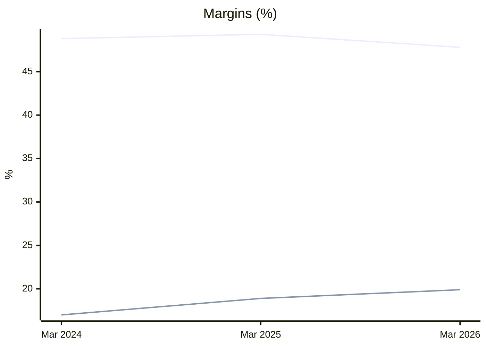

*Run 2026-11-24 · part of [SPINOFF_REPORT.md](../SPINOFF_REPORT.md) · the complete analysis of one company, with every management-call exchange in full.*

## LEMONTREE — Lemon Tree Hotels Ltd.

### 1. Lemon Tree Hotels Ltd. — CONFIRMED DEMERGER

**CONFIRMED** (a demerger scheme is on the exchange record) · **PRE-SPIN — study the parent; the pieces do not trade yet** · score 6.4/10 · spin-off · 29 filing(s) from CALLS, NSE · first 2026-01-10, latest 2026-09-22

**The separated entities — every one the documents name:**

| Entity | Scheme | Business | Listing | Who runs it |
|---|---|---|---|---|
| **Fleur Hotels Limited** (earlier Fleur Hotels Private Limited) | 2026 Composite Scheme of Arrangement (Transferee Company — … | Demerged Undertaking: 12 hotels (11 operating, 1 under construction at Shimla), development capabilities, inv… | to be listed — "Whether listing would be sought for the res… | Saurabh Shatdal, Managing Director and Chief Exec… |

**The other parties to the scheme(s)** — not separated entities: Carnation Hotels Private Limited — merged in — no shares for the parent's holders; Hamstede Living Private Limited — merged in — no shares for the parent's holders; Oriole Dr. Fresh Hotels Private Limited — merged in — no shares for the parent's holders; Canary Hotels Private Limited — merged in — no shares for the parent's holders; Sukhsagar Complexes Private Limited — merged in — no shares for the parent's holders; Manakin Resorts Private Limited — merged in — no shares for the parent's holders

**What is being separated, as the documents put it:** Asset-heavy hotel ownership and development undertaking: 12 hotels (11 operating, 1 under construction) plus development capabilities, demerged into Fleur Hotels — class `value_unlocking`.

### 2. Stages and dates

> **Listing:** NOT YET — scheme at 'nclt_sanction' stage; Fleur Hotels Limited will list only after NCLT sanction, effectiveness and a record date; indicated timeline: Press release of 9 January 2026: "The entire process to listing of Fleur is expected to be completed within 12 to 15 months"; on the 29 May 2026 call Keswani said 12 months from then if NCLT is quick, otherwise 18 months; NSE observation letter of 22 September 2026 requires trading to commence within sixty days of the NCLT order

| Date | Event | Source |
|---|---|---|
| 2026-01-09 | Board approval — Lemon Tree Hotels Limited (and Fleur Hotels Limited) | as stated: Scheme of Arrangement intimation dated January 09, 2026 (filed 2026-0… |
| 2026-01-09 | Other — Implementation Agreement, Share Purchase Agreement and Shareholders' Agreement approved for execution | as stated: Scheme of Arrangement intimation dated January 09, 2026, Annexures II… |
| 2026-01-10 | Stage reached: **nclt sanction** | [Scheme of Arrangement](https://nsearchives.nseindia.com/corporate/LEMONTREE_10012026000104_LTHL_Outcome.pdf) |
| 2026-02-02 | Filed with exchanges — Lemon Tree Hotels Limited | as stated: Intimation dated September 22, 2026: "The Company had also filed an a… |
| 2026-04-01 | Other — all companies involved — Appointed Date | as stated: Scheme intimation dated January 09, 2026 ("commencement of business h… |
| 2026-04-01 | Appointed date — Composite Scheme of Arrangement | as stated: Press release dated January 09, 2026: "Appointed date: 1 April 2026" |
| 2026-04-07 | Other — Competition Commission of India approval under Section 31(1) of the Competition Act, 2002 | as stated: Updates filing dated April 7, 2026 |
| 2026-05-22 | Other — Receipt of the detailed CCI order | as stated: Filing dated May 23, 2026 on grant of CCI approval |
| 2026-07-09 | Other — NSE submission of the draft scheme to SEBI (letter ref. NSE/LIST/53241) | as stated: NSE Observation Letter dated September 22, 2026 |
| 2026-09-14 | Other — Arum Hotels Private Limited — Joint Venture Agreement executed between Carnation Hotels Private Limited and RJ Corp Limited | as stated: Agreements filing dated September 14, 2026 |
| 2026-09-22 | Stage reached: **exchange noc** | [Scheme of Arrangement](https://nsearchives.nseindia.com/corporate/LEMONTREE_22092026213712_Intimation_signed.pdf) |
| 2026-09-22 | SEBI observations — SEBI comments on the draft scheme | as stated: NSE Observation Letter dated September 22, 2026: "SEBI vide its lette… |
| 2026-09-22 | Exchange no-objection — NSE 'no objection' and BSE 'no adverse observations' Observation Letters (valid six months, within which the Scheme must be submitted to NCLT) | as stated: Scheme of Arrangement intimation dated September 22, 2026 |

**The stages, as filed:** nclt sanction (2026-01-10) → exchange noc (2026-09-22)

**Stated in the filings:** resulting company **Fleur Hotels Limited**; demerged undertaking: ), w ill be demerged into Fleur Hotels; appointed date 2026-04-01; pro-forma statements referenced.

**When it lists, in the documents' words:** Press release of 9 January 2026: "The entire process to listing of Fleur is expected to be completed within 12 to 15 months"; on the 29 May 2026 call Keswani said 12 months from then if NCLT is quick, otherwise 18 months; NSE observation letter of 22 September 2026 requires trading to commence within sixty days of the NCLT order

### 3. Size of the separated business beside the parent — is institutional selling likely?

**Reading: LESS LIKELY on size alone — the piece is the larger part of the business.**

| Entity | Stated turnover | Stated share of the whole | Market cap (₹ cr) | Share of the whole by market cap | Segment revenue share | Index member | Selling on size |
|---|---|---:|---:|---:|---:|---|---|
| Fleur Hotels Limited | Turnover (Standalone) as on March 31, 2025: Rs. 46,423.84 L… | 59.9% (share of turnover) | — | — | — | not listed | less likely |

*Stated figures are the documents' own (a turnover share, or the cost-of-acquisition split the company publishes for tax, which reflects relative value). The market-cap share is the entity's value over the whole — the parent plus every separated entity that trades (parent ₹9,662 cr, whole ₹9,662 cr, NSE bhavcopy of 2026-11-13); the segment share is the business's revenue over the parent's reported sales of that year. Both are computed here. The reading uses the market-cap share when the entity trades, else the stated share, else the segment share.*

**In the documents' words:** “Turnover of demerged division for financials year ended March 31, 2025 is Rs. 23,037.34 Lakhs — Percentage to the total turnover - 59.90%. Also: "Post the Proposed Transaction Fleur will become one of the largest owners of hospitality assets in India. Its owned portfolio will expand significantly, increasing from 3,993 keys and 24 operating hotels to 5,813 keys across 41 hotels." and "In summary, the following are moving from Lemon Tree to Fleur Hotels: 1,563 operating rooms (in 15 hotels); Investment in one under construction hotel in Aurika, Shillong (165 rooms); One under-construction hotel Aurika, Shimla (91 rooms); Exclusivity of all future Development / Ownership / Leasing on hotel assets and transfer of Development Capability / Team"”

**The judge's read of selling pressure:** likely — Odd-lot entitlement (20 Fleur shares per 311 LTH shares) in a newly listed asset-heavy company whose investor base differs from asset-light Lemon Tree

### 4. Insider ownership — share swap, promoters' holding, management incentives

**Share swap / entitlement, entity by entity:**

- **Fleur Hotels Limited:** Demerger: "20 (Twenty only) fully paid-up equity shares of Transferee Company of INR 10 (Indian Rupees Ten) each, for every 311 (Three Hundred Eleven only) equity shares of the Company, of INR 10 (Indian Rupees Ten)"; Amalgamation 2: 10,000 Fleur shares for every 49,872 shares of Oriole Dr. Fresh, 29,87,754 of Canary, 53,118 of Sukhsagar and 1,01,077 of Manakin

**Promoters' holding, from the shareholding pattern:**

| Company | Promoters | FIIs | DIIs | Public | Quarter |
|---|---:|---:|---:|---:|---|
| Lemon Tree Hotels Ltd. (LEMONTREE) | 22.32% | 18.27% | 14.8% | 44.58% | Sep 2026 |

*Source: screener.in shareholding pattern, stored under `ShareholdingPattern/NiftyTotalMarket/`. In a mirror demerger each shareholder holds the same proportion of the new company as of the parent on the record date.*

- **Promoters in the parent, per the documents:** Promoter Group 22.28% of Lemon Tree Hotels Limited, per the "Current shareholding structure of Lemon Tree Group" in the investor presentation on the Composite Scheme of Arrangement dated 9th January 2026 (Public Shareholders 62.73%, Promoter Group 22.28%, APG 14.99%). Promoters are "Mr. Patanjali Govind Keswani and Spank Management Services Private Limited".
- **What the promoters will hold in the separated entity:** In the parent: "There will be no change in the shareholding pattern of the Company on account of the Scheme." In the resulting company, mirror shareholding of the parent's 32.96% direct stake — the presentation's "Shareholding structure post implementation of scheme (Excluding primary investment of up to INR 960 crores by Warburg Pincus)" shows Fleur Hotels held: Promoter Group 7.34%, Public Shareholders 25.62% (Notes: "Including APG's stake of 4.94%"), Warburg Pincus 26.01%, Lemon Tree 41.03%. Press release: "Upon the Scheme becoming effective, the shareholders of Lemon Tree (as on the record date) will own 32.96% of Fleur, Lemon Tree will directly own 41.03% with the balance 26.01% to be owned by Warburg Pincus (shareholding figures exclude any dilution from primary investment by Warburg Pincus in Fleur)." Also: "The shareholding of the Company in FHL will stand at 41.03% with the remaining 58.97% held by existing Shareholders of FHL and the Shareholder of the Company allotted shares pursuant to the Scheme." For the Arum joint venture: "Carnation shall hold 51% of the equity share capital of Arum, and RJ Corp shall hold the remaining 49% of the equity share capital of Arum."
- **What a public shareholder receives:** Under the 2026 Composite Scheme of Arrangement (Demerger): "as consideration for the demerger and transfer of the Demerged Undertaking, Transferee Company shall, without any further act or deed, issue and allot 20 (Twenty only) fully paid-up equity shares of INR 10 (Indian Rupees Ten) each, for every 311 (Three Hundred Eleven only) equity shares of the Company, of INR 10 (Indian Rupees Ten) to the equity shareholders of the Company whose names appear in the register of members / records of the depository on the record date. (which may be further diluted in the event of the Proposed Preferential Issue to the Investor by the Transferee Company)." Also: "Upon the Scheme becoming effective, the Transferee Company shall issue equity shares to the shareholders of the Company in consideration for the Demerger. As a result, all shareholders of the Company will obtain a direct shareholding in the Transferee Company and thereby directly participate in the economic value and growth of the hotel-ownership and development undertaking." Under Amalgamation 1 and Amalgamation 2 the Company's public shareholders receive nothing directly (no shares issued to them; Amalgamation 2 shares go to the Company itself).
- **Management incentives:** Treatment of existing stock options / RSUs / SARs under the Scheme and any new plan in the resulting entity: not stated. The documents state only: "The paid up share capital of the Company excludes 398,841 (March 31, 2025: 398,841) equity shares held by the ESOP Trust which has been consolidated in accordance with the requirement of IND AS 110 'Consolidated Financial Statements'." (the trust is the "Krizm Hotels Private Limited Employee Welfare Trust"). On management roles and holdings: "Mr. Patanjali Govind Keswani, Founder of Lemon Tree Hotels, will serve as the Executive Chairman of Fleur Hotels and will eventually transition to a Non-Executive role at Lemon Tree."; "Today, as Executive Chairman, I continue to chair both companies with direct ownership in each. My primary focus will be on delivering the Fleur pipeline and growth as its Executive Chair. In Lemon Tree, I will cease to hold an executive role March 2027 onwards and transition to non-Executive Chair."; "From the Effective Date, the Board of the FHL will comprise of up to 10 directors, including up to 3 LTHL Directors (with Mr. Keswani as non-retiring executive chairman), up to 3 Investor Directors (all non-executive), and the balance as independent directors, with a Board reconstitution mechanism to ensure compliance with SEBI LODR post-listing."; "To establish separate management teams and governance frameworks for the Company and the Transferee Company, promoting accountability, agility, and strategic oversight at both the operational and asset levels." Exercise price or pricing date: not stated.
- **Insider actions around the separation:** APG Strategic Real Estate Pool N.V., an existing shareholder of Fleur and a public shareholder of Lemon Tree, is selling out of Fleur: "The sale of the Seller's entire shareholding of 41.09% (Forty One Point Zero Nine Percent) in FHL to the Investor"; in the Q4/FY26 call (May 29, 2026) management said "Warburg has completed the purchase of APG's stake in Fleur." On APG's ~14.99% stake in the listed parent, the Chairman said: "They have told me they do not plan to sell, but I do not want to comment. If they do sell, I am sure they will do it in an orderly way... But they have told me right now they do not have any intention to sell." The promoters, Mr. Patanjali Govind Keswani and Spank Management Services Private Limited, are parties to the Implementation Agreement and the Shareholders' Agreement; "Transfer of shares of the FHL by LTHL is subject to customary restrictions including lock-in provisions." NSE condition: "There shall be no change in the shareholding pattern or control in Fleur Hotels Limited between the record date and the listing which may affect the status of this approval." No promoter or management buying, selling or pledging of the parent's shares is stated.
- **Insiders, per the checklist read:** Promoters Patanjali Govind Keswani and Spank Management hold 22.28% of LTH, 7.34% directly in Fleur post-scheme; Keswani non-retiring Executive Chairman of Fleur, turns non-executive at Lemon Tree March 2027 · *option pricing date:* not stated

### 5. Why the demerger — point by point

Management framed the demerger as splitting one company that had been doing two businesses with two different investor bases: an asset-heavy business that designs, develops, finances and owns hotels (pension funds, insurance companies betting on inflation, repricing and annuity yield) and an asset-light business that monetises brand, management, loyalty, distribution and technology with almost no capital intensity. Keswani said Lemon Tree had only built hotels in 2004-2007 because owners would not hand their hotels to an unknown brand, and that with the brand now widely recognised (MakeMyTrip's CEO told him 20-25% of occupancy comes from them the moment a Lemon Tree opens) there was no reason to keep owning assets rather than monetise the brand — explicitly the Marriott/Host Hotels and Hilton/Park Hotels playbook. Mechanically (Composite Scheme approved 9 Jan 2026, appointed date 1 April 2026): Carnation Hotels and Hamstede Living merge into LTH; Oriole Dr. Fresh, Canary, Sukhsagar and Manakin merge into Fleur against shares to LTH; and the Demerged Undertaking — 11 operating hotels plus Aurika Shimla under construction, the investment in Arum (Aurika Shillong, 165 rooms) and the entire development capability/team with exclusivity on all future ownership, leasing and development — demerges into Fleur, with 20 Fleur shares for every 311 LTH shares (demerged division turnover Rs 23,037.34 lakh, 59.90% of LTH standalone turnover; 1,563 operating rooms across 15 hotels per the presentation, 1,820 keys/17 hotels per the press release). A second stated problem was conflict of interest: development capability was moved to Fleur with 'Chinese firewalls' so Fleur shareholders could never feel Lemon Tree was cherry-picking the best assets for itself, and Lemon Tree must refer new acquisition/development opportunities to Fleur. All group debt (about Rs 1,300 crore at demerger, Rs 1,500 crore total borrowings at FY26-end, cost of debt 7.42%) goes to Fleur, leaving Lemon Tree debt-free with only technology and marketing spend, forcing the Board to frame a dividend/shareholder-reward policy. Warburg Pincus (Coastal Cedar Investments B.V.) bought APG's entire 41.09% of Fleur and committed up to Rs 960 crore of primary equity, giving Fleur roughly Rs 3,000 crore of deployable capital at 1:1 debt-equity against 2,500+ rooms under active discussion and Aurika Nehru Place (572 rooms, ~Rs 700 crore); post-scheme LTH shareholders own ~74% of Fleur (32.96% direct plus ~41% through LTH) versus the 59% LTH owns today, and Fleur lists separately for 'transparent price discovery and market-driven valuation of the asset-heavy business'.

**Point by point, with the source:**

1. Asked directly by Kunal Lakhan (CLSA) what was wrong with the old structure, Keswani said the hotel business has two subsets with two different investor types — developers/owners wanting chunky yield and inflation-linked annuity returns versus asset-light investors betting on brand and management — and Lemon Tree was a combination of both. “We have actually separated 2 types of businesses. One is asset heavy, long -term appreciating asset, capital intensive. It has a different kind of investor, and this business has a very different kind of investor, and we wanted to actually attract both types of investors.” — *[Jan 2026](https://www.bseindia.com/stockinfo/AnnPdfOpen.aspx?Pname=098527b9-fd65-4aa9-9c6d-1ac184b2eda0.pdf)*
2. He explained the historical accident being corrected: hotels were built only to establish the brand, and with the brand now established the company should monetise it instead of owning assets. “We were forced to build hotels to build our brand. But once we build our brand, technically, we do not need hotels because now it is time for Lemon Tree to monetize its brand, which is enormous recall.” — *[Jan 2026](https://www.bseindia.com/stockinfo/AnnPdfOpen.aspx?Pname=098527b9-fd65-4aa9-9c6d-1ac184b2eda0.pdf)*
3. The transfer of the development capability and exclusive development mandate to Fleur was driven by a conflict-of-interest problem — Fleur minorities fearing Lemon Tree would keep the best projects for itself — and was solved with firewalls. “Development capability was an issue which was raised in order to maximize Fleur's growth, we did not want shareholders of Fleur to ever feel that Lemon Tree when it recommends any assets was cherry -picking, which means Lemon Tree would say, I have got this very nice asset in Delhi, why should I offer it to Fleur.” — *[Jan 2026](https://www.bseindia.com/stockinfo/AnnPdfOpen.aspx?Pname=098527b9-fd65-4aa9-9c6d-1ac184b2eda0.pdf)*
4. All of Lemon Tree's debt moves to Fleur: Fleur carries roughly Rs 1,300 crore of debt against a ~Rs 900 crore net EBITDA and can borrow another ~Rs 1,300 crore, while Lemon Tree goes to zero debt. “Firstly, when this demerger happens, all the debt, including the Lemon Tree's debt, after adjustment is being transferred to Fleur. Fleur will have 100% of our debt and Lemon Tree will have zero debt.” — *[Jan 2026](https://www.bseindia.com/stockinfo/AnnPdfOpen.aspx?Pname=098527b9-fd65-4aa9-9c6d-1ac184b2eda0.pdf)*
5. Keswani justified keeping a ~41% indirect stake in Fleur (challenged by Jinesh Joshi on hold-co discount) as Lemon Tree retaining 'skin in the game' as Fleur's manager, with natural dilution as Fleur raises capital; he quantified that Rs 1,000 crore deployed by Fleur generates ~Rs 350 crore of turnover, Rs 170-180 crore EBITDA and ~Rs 30 crore of fees for Lemon Tree. “We felt it was prudent to have significant skin in the game at this stage, which means that going forward, it is very possible that Lemon Tree may dilute or even increase its stake over time; this will obviously be a Board decision .” — *[Jan 2026](https://www.bseindia.com/stockinfo/AnnPdfOpen.aspx?Pname=098527b9-fd65-4aa9-9c6d-1ac184b2eda0.pdf)*
6. Warburg's Rs 960 crore primary commitment plus Fleur's own cash and 1:1 debt gives roughly Rs 3,000 crore to deploy pre-listing against 2,500 rooms in active discussion; Keswani guided Fleur to over Rs 1,000 crore net EBITDA by FY28 and Lemon Tree to 80% EBITDA margin / 60% PAT margin. “We have potentially about Rs 3,000 crores available to deploy in this growth before we list.” — *[Jan 2026](https://www.bseindia.com/stockinfo/AnnPdfOpen.aspx?Pname=098527b9-fd65-4aa9-9c6d-1ac184b2eda0.pdf)*
7. Opening the call with pro forma financials for both entities, Keswani described the transaction as simple — Warburg has bought APG's Fleur stake, Lemon Tree transfers 17 hotels and development capabilities in exchange for Fleur shares to LTH shareholders, and Fleur lists. “This scheme will result in 2 distinct financially sound businesses.” — *[Jun 2026](https://www.bseindia.com/stockinfo/AnnPdfOpen.aspx?Pname=a03e8364-4037-407c-8929-d956c0976b96.pdf)*
8. He restated the economic outcome for each entity: Lemon Tree debt-free, high-margin, high-ROCE and fee/brand-driven; Fleur the consolidated owner of a fully renovated portfolio, post-scheme India's largest hotel platform by inventory at 5,600 rooms and 39 operational hotels. “Post the reorganization , Lemon Tree will emerge as a debt -free, high-margin, high ROCE company generating strong free cash flows from fees and brand -related income.” — *[Jun 2026](https://www.bseindia.com/stockinfo/AnnPdfOpen.aspx?Pname=a03e8364-4037-407c-8929-d956c0976b96.pdf)*
9. Shareholder arithmetic: LTH shareholders end up with close to 74% of Fleur (33% direct, ~41% through Lemon Tree) versus the 59% Lemon Tree directly owns in Fleur today, before Warburg's primary infusion; Keswani also said he will cease to be executive at Lemon Tree from March 2027 and focus on Fleur as Executive Chair. “Post reorganization , Lemon Tree shareholders will effectively own close to 74% of Fleur Hotels, 33% directly and about 41% indirectly through Lemon Tree.” — *[Jun 2026](https://www.bseindia.com/stockinfo/AnnPdfOpen.aspx?Pname=a03e8364-4037-407c-8929-d956c0976b96.pdf)*
10. Answering Achal Kumar, Keswani confirmed Fleur will be brand-agnostic post-demerger and may hand assets to other operators — Lemon Tree has no automatic right to Fleur's hotels and must earn them on results. “Yes. But Lemon Tree must be able to deliver best results to get it . Just because Lemon Tree has skin in the game with Fleur does not mean that it has an automatic right to any asset that Fleur develops.” — *[Jun 2026](https://www.bseindia.com/stockinfo/AnnPdfOpen.aspx?Pname=a03e8364-4037-407c-8929-d956c0976b96.pdf)*
11. On capital allocation after the split, Lemon Tree is expected to need almost no capital and move to distributing profits, while Fleur will retain capital for growth rather than pay dividends. “Lemon Tree will not need any significant capital other than potentially investments in technology or in marketing and so on. It will be essentially a zero -debt cash accretive company.” — *[Jun 2026](https://www.bseindia.com/stockinfo/AnnPdfOpen.aspx?Pname=a03e8364-4037-407c-8929-d956c0976b96.pdf)*
12. Keswani confirmed the scheme is effective from 1 April and that Lemon Tree becomes debt-free from next year, with all assets and debt going to Fleur and fee income becoming free cash; the Board must decide a dividend policy within six months. “What will happen is in the scheme of demerger, all the assets of Lemon Tree, including its debt will be transferred to Fleur. Lemon Tree will immediately effectively be a debt -free company from next year.” — *[Feb 2026](https://www.bseindia.com/stockinfo/AnnPdfOpen.aspx?Pname=b0215f7f-3372-4231-8b2f-7f433eb77faf.pdf)*
13. Investors pushed for separate reporting: Ashish Kumar of Infinity Alternatives asked for pro forma financials of both businesses while awaiting the listing, and management agreed to publish them from the next quarter. “Now that we have decided on the split of the 2 businesses, what might be helpful is if we can add pro forma financials for both of the assets as they look like so that while we are waiting for the l isting, we do get a good sense of what the numbers are looking like.” — *[Feb 2026](https://www.bseindia.com/stockinfo/AnnPdfOpen.aspx?Pname=b0215f7f-3372-4231-8b2f-7f433eb77faf.pdf)*
14. Keswani positioned the asset-light entity as a first in India, with fee income from hotels signed three years earlier only now flowing, and Fleur guided to ~Rs 1,000 crore EBITDA by FY28, its first year as a listed company. “And keep in mind that Lemon Tree will be the first fully asset -light brand owning tech and distribution and management company in India, the first.” — *[Feb 2026](https://www.bseindia.com/stockinfo/AnnPdfOpen.aspx?Pname=b0215f7f-3372-4231-8b2f-7f433eb77faf.pdf)*
15. The demerger was still with Board subcommittees of both Lemon Tree and Fleur, with management hinting that more than the demerger was being negotiated (the Warburg/APG transactions announced two months later). “It is not only the demerger of Fleur, but some other even more exciting stuff, but we will talk about it when the time is right.” — *[Nov 2025](https://www.bseindia.com/stockinfo/AnnPdfOpen.aspx?Pname=5a3cfc96-c662-414a-bc34-4635bef2415b.pdf)*
16. First formal disclosure of the structure: committees of directors in both companies to evaluate transferring LTH's assets into Fleur via demerger and then list Fleur, with Lemon Tree becoming asset-light and focused on management, brand and technology — described as the global trend in the space. “You may have also seen that we have said that a committee of directors has been set up in Lemon Tree and in Fleur to evaluate how we can possibly look at a transfer of assets from Lemon Tree into Fleur through a demerger scheme and then automatically look at how we can list Fleur.” — *[Aug 2025](https://www.bseindia.com/stockinfo/AnnPdfOpen.aspx?Pname=c30ba016-9c4b-4e13-8b0d-a5fb02eb43b7.pdf)*
17. The separation of management was done first and explicitly for this purpose — Neelendra Singh to run asset-light Lemon Tree from 1 October and Saurabh Shatdal to drive Fleur's asset-heavy growth, with Keswani handholding and moving to strategic oversight. “The intent of the leadership change was to get 2 very good people who would then run these two companies independently on a day -to-day basis.” — *[Aug 2025](https://www.bseindia.com/stockinfo/AnnPdfOpen.aspx?Pname=c30ba016-9c4b-4e13-8b0d-a5fb02eb43b7.pdf)*
18. Keswani drew a hard line on mandates — Fleur builds, buys and leases, Lemon Tree only manages or franchises — and noted that the more Fleur dilutes and raises capital, the more Lemon Tree's economic interest rises via fees (Rs 100+ crore this year, potentially Rs 300-400 crore from Fleur in three years). “Fleur's mandate will be to focus on, at the right value, building, buying, or leasing hotels. Lemon Tree's will only be to manage or franchise. Lemon Tree will not lease hotels once the Fleur demerger happens.” — *[Aug 2025](https://www.bseindia.com/stockinfo/AnnPdfOpen.aspx?Pname=c30ba016-9c4b-4e13-8b0d-a5fb02eb43b7.pdf)*
19. The earliest trace in these calls: a Fleur listing was already seen as the accelerator of deleveraging, with Keswani putting an IPO within 2-3 years at most when asked by Prashant Biyani. “I think we are sticking to our guidance that in the next 3 - 3.5 years, we should be debt free , but if we list Fleur before that then we will be debt free that much earlier.” — *[Nov 2024](https://www.bseindia.com/stockinfo/AnnPdfOpen.aspx?Pname=3c895122-81f1-4b3e-be92-d1bf92b7945a.pdf)*
20. The 9 Jan 2026 filing states the Board reviewed the business with a view to segregating the asset-heavy ownership/development undertaking from the asset-light management/brand platform, and that the demerged business is self-sustaining and better housed in Fleur; the demerged division's turnover was Rs 23,037.34 lakh, 59.90% of LTH standalone turnover. “Therefore, to achieve operational focus, greater flexibility for capital deployment, and clearer alignment of business objectives, it is proposed under this Scheme to (i) amalgamate Transferor Company 3, Transferor Company 4, Transferor Company 5 and Transferor Company 6 with the Transferee Company; and (ii) demerge and vest the Demerged Undertaking (comprising the Demerged Hotel Properties and the Development Capabilities together with the related undertakings, as defined hereinafter) into the Transferee C ompany, while the Company will continue to focus on the asset -light hotel management support, brand and operations including management support of the hotels transferred to the Transferee Company and other properties.” — *Scheme*
21. A stated purpose is market-driven valuation: Fleur ceases to be LTH's subsidiary and lists, so LTH shareholders participate directly in the asset-heavy business through listed shares rather than through a subsidiary. “Following the implementation of the Scheme, the Transferee Company will cease to be a subsidiary of the Company , and its shares will be listed on the Stock Exchanges, enabling transparent price discovery and market -driven valuation of the asset -heavy business.” — *Scheme*
22. The filing also sets out structural clean-up and partner-flexibility objectives: merging two wholly owned subsidiaries into LTH to remove layering and cost, and creating a structure that lets Fleur bring in investors or co-development partners per project without touching LTH's brand operations. “To create a flexible structure enabling the Transferee Company to attract investors or co -development partners for specific hotel projects, without affecting Company's brand operations or control over strategic decisions.” — *Scheme*
23. Continuity is contractually locked: every hotel amalgamated into or demerged to Fleur stays under Lemon Tree Hotel Operating Agreements (existing ones amended/restated and extended from the Appointed Date), and LTH must refer new acquisition/development opportunities to Fleur and drop them if Fleur declines. “Further, all the hotels amalgamated with or demerged into the Transferee Company will continue to be managed and operated by the Company under Hotel Operating Agreements and, the existing Hotel Operating Agreements with the Transferee Company and its subsidiaries shall be amended and/or restated, inter alia, to reflect the revised terms as detailed in the Scheme, and the Company shall refer new hotel acquisition or development opportunities to the Transferee Company and shall not pursue them if declined, except for hotel operations/franchise arran gements through third parties.” — *Scheme*
24. The Shareholders' Agreement with Warburg gives Fleur the exclusive global right to own, lease and develop hospitality assets, Investor/LTH affirmative consent on reserved matters, up to 3 Investor and 3 LTH directors with Keswani as non-retiring executive chairman, and the right to inject up to Rs 960 crore of primary capital. “The Agreement provides Fleur t he exclusive right to own, lease and develop hospitality assets globally, with LTHL being entitled to undertake key money arrangements, in the manner as mutually agreed.” — *Scheme*
25. The 22 Sept 2026 filing records receipt of NSE 'no objection' and BSE 'no adverse observation' letters under Regulation 37, valid six months, with NCLT, shareholder and creditor approvals still pending — the gating item management had flagged as the timing risk. “In this regard, we wish to inform you that the Company has received the Observation Letter s with 'no objection ' from the NSE and 'no adverse observations' from the BSE on September 22, 2026 vide their respective letters , pursuant to Regulation 37 of the Listing Regulations , in relation to the Scheme .” — *Scheme*

**How it evolved:** The idea was first visible as a Fleur listing aspiration in the Nov 2024 call, where Keswani said debt-freedom would come sooner 'if we list Fleur before that' and put an IPO 'within the next 2-3 years at most'; in the Aug 2025 call he disclosed that committees of directors had been set up in both Lemon Tree and Fleur to evaluate transferring LTH's assets into Fleur via a demerger and listing it, alongside splitting the management teams (Neelendra Singh for LTH from 1 October, Saurabh Shatdal for Fleur), with listing hoped for end-CY2026. In the Nov 2025 call it was 'in process' with a Board subcommittee and a promise of 'some other even more exciting stuff' within three months; the scheme, the Warburg/APG transactions and the 74%/26% shareholding math were announced in the Jan 2026 (15 January) dedicated call with a 12-15 month path to listing. By the Feb 2026 call Keswani confirmed the scheme was effective from 1 April and, responding to Ashish Kumar's request, promised pro forma financials for both entities; those pro formas appeared with the Jun 2026 (29 May) results, where CCI approval (April 2026), Warburg's completed purchase of APG's stake and a longer 12-18 month NCLT-dependent timeline were given, followed by NSE/BSE observation letters on 22 September 2026.

**What management expects from it:** Lemon Tree: debt-free, fee/brand/tech-only, EBITDA margin from ~60% pro forma to 70-80% steady state, ~60% PAT margin, high ROCE, free cash funding dividends. Fleur: India's largest owner (5,600 rooms, 39 hotels), net EBITDA Rs 850 crore FY27 and Rs 1,000+ crore FY28, ~48%+ post-fee margins, Warburg-backed capital for 2,500+ rooms, capital growth not dividends, and separately listed for market valuation.

*Not explained on the calls:* Absolute valuation of the demerged undertaking and Warburg's price for APG's stake, Fleur's issue price, hold-co discount size, post-demerger ROE, and fate of the two retained leases.

- *Stated reason, in one line:* Segregate asset-heavy hotel ownership/development from the asset-light hotel management and brand platform, to achieve operational focus, greater flexibility for capital deployment, clearer alignment of business objectives and unlock long-term shareholder value
- *What it reveals:* Fleur becomes India's largest hotel owner by rooms (5,556 rooms, 39 hotels; FY25 revenue Rs 1,189 cr, net EBITDA Rs 509 cr), carries all group debt, and gets Warburg's Rs 960 crore; Lemon Tree is left debt-free, 80% EBITDA-margin fee business
- *Parent or spin:* both · *Read next:* Fleur's pro-forma financials in the Q4 FY26 presentation (FY27 net EBITDA ~Rs 850 crore) and Fleur's Information Memorandum
- *In their words:* “This structure ensures that the shareholders of the Company directly participate in the economic value of the hotel-ownership and development undertaking through listed shares of the Transferee Company.”

### 6. On the calls, verbatim

12 call(s), oldest first: **79 question-and-answer exchange(s)** given in full — the question and every answer to it, nothing trimmed — and 18 passage(s) from management's prepared remarks (the complete sentences about it; the whole remarks are in the linked transcript). Text is as the transcript prints it.

#### Feb 2024

**From the prepared remarks** *(the passage about it; the whole turn runs to 3,189 characters in the transcript)*

> **Patanjali G. Keswani:** The renovation expense for the portfolio increased by Rs. 5.5 crore Y- o-Y and by Rs. 4.8 crore Q-o-Q, which translated into a reduction in EBITDA margin by about 2% points. The Keys portfolio EBITDA margin percentage decreased by 9 % points Q-o-Q due to an increase in renovation expenses of about Rs. 1.8 crore over the previous quarter . Fees from managed and franchise contracts for third-party -owned hotels stood at Rs. 15 crore in Q3, up 50% from Rs. 9.8 crore in Q3 FY23. Total management fees for Lemon Tree , including fees from Fleur hotels were up 25% Y-o-Y at Rs. 32.3 crore compared to Rs. 25.8 crore in the last year same quarter . Hotel level revenue from the own ed portfolio increased by 18% Y-o-Y and network revenue for Lemon Tree th at is the total system revenue of own ed hotels including Aurika MIAL and managed & franchise hotels also increased by 18% Y-o-Y. Total network revenues stood at Rs. 1,128 crore for 9M FY24 as compared to Rs. 950 crore in 9M FY23. During the quarter, we signed 9 new management and franchise contracts, which added 621 rooms to our pipeline and operationalize 6 hotels which added 967 rooms to our portfolio.

**Question and answer**

> **Parth Agrawal:** Actually I wanted to understand your arrangement with Fleur Hotels . Lemon Tree standalone actually gets management free from Fleur Hotels and so the inventory that the Fleur Hotels own, is it part of the management contract inventory or is it part of the own property?
>
> **Patanjali G. Keswani:** What happens is that this year, we will earn 100 crore of fees as a standalone Lemon Tree from Fleur . Now because we report consolidated results, it is netted off. Hypothetically, if our ownership of Fleur , I'm just speaking aloud , suppose we raised an enormous amount of capital in Fleur and we listed it . Fleur, next year will do maybe over 600 crore of EBITDA . We list it and we bring our shareholding down to say 40% something like I think some companies have done which is they have de consolidated it . #1 is we will be able to raise a very large amount of capital in Fleur . #2 is our management fee income of Fleur will then become visible, which it is not currently visible . And #3 is the capital that we raise in Fleur will enable us to go into the next phase of growth of owned assets. And really if I look at it strategically from the long term, we should actually keep growing the Fleur portfolio and reducing our stake in it , obviously have a meaningful skin in the game , and simply build hotels there and manage them on behalf of that portfolio, which means real ly at some point in time, Lemon Tree will morph into a pure management brand and digital services supplier company.

**Question and answer**

> **Parth Agrawal:** But I'm just not clear. Currently whatever ownership of your hotels are there , is it part of own hotels or it is part of management inventory which is 4 ,000 inventory that we have ?
>
> **Patanjali G. Keswani:** It is owned . It is consolidated. We own 59% of Fleur . Think of it this way , we own 1,700 -1,800 rooms in Lemon Tree and I think over 4 ,000 rooms in Fleur where we own a 59% stake.

**Question and answer**

> **Kunal Lakhan:** My second question was on expansion what you responded to the earlier question. I have always had this question around like in an upcycle why are we not adding owned capacity just management contract, right ? What you said about Fleur earlier is that something that you would look at pursuing in terms of getting it listed and then look at that entity as an asset -heavy entity and what could be the timeline of something like that?
>
> **Patanjali G. Keswani:** I think you have 3 questions. Let me answer them one after the other. We are not yet in an upcycle , no matter what people tell you. Occupancies in India are still in the 60 s. Do not go by one or two companies that might report 75% . Even the Lemon Tree portfolio excluding Aurika, Bombay and excluding what is it called Keys is in the mid -70s. I don't consider this an upcycle. It has not yet happened because an upcycle is where the entire market crosses 70 %-75% and that has not happened yet. What do I think will happen? See, I think India is at a very interesting point as far as its consuming classes go. If we continue on this path of 6 %-7% growth , then in the next 3 years , a very, very large percentage of the population in India which is a ), aspirational , b), young , c) fueled by credit , will move into what we consider will be non -discretionary consumption of branded mid -market hotel rooms. Now I know everybody is tired of comparisons with Malaysia and China and so on . But that's what happened at about $3,500 per capita. That is not actually an upcycle or a downcycle , that is a structural shift from treating for a very large cohort of the consumer, a structural shift in treating consumption of that kind of earlier discretionary item into a non -discretionary. Really if you ask me , should we build supply, I totally agree with you because I think this structural shift in consumption where instead of it being optional , it becomes default and that you can already see by the way in the airline sector. I think it's going to happen in the next 3-4 years in India. Keeping that in mind rather than cycles, I would say there is a strong case to create or acquire supply. Now , the only question is how much risk should we take on the balance sheet ? Obviously , we need a company whose main job is to be an asset owner, which is why strategically it may make sense to spin Fleur into a separate listed entity. Have a smaller stake in it , raise fresh capital, which is why your stake comes down and a ), raise this capital, b), have a totally separate set of investors there because obviously these are the investors who will be looking at Fleur more as an asset owning comp any. And Lemon Tree continues as a brand owner, manager and digital services provider. Long-term we have to do that in my opinion.

**Question and answer**

> **Jinesh Joshi:** Sir, if my understanding is right , I believe Aurika, Mumbai resides in Fl eur, but if I look at the management fee received from Fleur hotels in this quarter, it is up by just 8% despite our Mumbai Hotel starting operations and registering an occupa ncy of 40%. Is there anything which I'm missing out over here in this 8% growth number?
>
> **Patanjali G. Keswani:** The first thing is that our fees from Bangalore came down because a large part of our fees with Fleur comes because of what is called Incentive Fees, incentive fees is we get paid based on the EBITDA of the hotel . We had a drop in fees from Bangalore , we had a small drop in fees from Pun e and Aurika did not give us any significant fees because it did not do 40% , it did under 40% . But we only got fees from Aurika, Bombay on the fixed side and the fixed fees is a function of revenue. The revenue was much less obviously because it was the first quarter. These fees, you are absolutely right. The minute A urika, Bombay picks up , like it has already picked up to some level this quarter, you will see a significant hike in fees. Similarly , when Bangalore picks up and Pun e picks up, you will see another hike in fees because those will be the variable fees whereas in Aurika, Bombay the re will be higher fees because the revenue increases and hopefully the EBITDA increases. Do I make sense?

**Question and answer**

> **Meet Jain:** Q1 FY26. Okay. And next is on e clarification on the management fees from Fleur . You mentioned that our Fleur arrangement is partly based on revenue and partly on the operating performance, right?
>
> **Kapil Sharma:** That’s right.

**Question and answer**

> **Meet Jain:** And is there any threshold like as you mentioned Aurika , we didn ’t reach the 40% kind of margin , so we booked like fixed fees on revenues and as the margins improve, we will start getting fees from Fleur on that as well ?
>
> **Patanjali G. Keswani:** Well, think of it this way, that if A urika today in Q3 gave me a revenue of Rs. 25, then my fees from that will be say Rs. 2. If Aurika gives me Rs. 50, then my fees will not double , they will become Rs. 5-5.5, they will nearly triple. And when Aurika stabilizes at Rs. 100, then I will take Rs. 10 or Rs. 11. 40% will come from the revenue, 60% will come from the EBITDA , and that EBITDA as it grows as the hotel stabilizes , I think I mentioned that the EBITDA will be in the range of 60 %, at which point our fees will become disproportionate ly hig her.

#### Jun 2024 — [transcript](https://www.bseindia.com/stockinfo/AnnPdfOpen.aspx?Pname=888228e9-35bd-4429-a0d4-ac4f72829aaf.pdf)

**Question and answer**

> **Kunal Lakhan:** My second question was on the debt side. And I think this will be the peak debt levels.
>
> **Patanjali Keswani:** That's right. So , debt reduction will start from this year. And there are 2 views, as I have said earlier. We are very confident that our debt will be 0 within the next 4 years, we will be net debt 0 but should we list Fleur before that, which is something we're thinking about then obviously we will be debt free much earlier because Fleur has roughly 75% of the total debt of the company and while it is consolidated, we own 60% of that company. So , we are looking at various options, and it is at the very latest that we will do debt free in 4 years, but we could very well go debt free in the next -- in shortly.

#### Aug 2024

**Question and answer**

> **Anuj Upadhyay:** Can you elaborate on our debt repayment plan schedule going ahead based on the anticipated future cash flow, considering the fact we will be having significant expenses towards the renovations over next 2 years?
>
> **Patanjali Keswani:** See, I'll give you a simple example. Our free cash flow is, say, Rs. 50 crore every quarter, at least Rs. 50 crore in the summer. That, as I said, is going into renovation. In winter, it is normally 2x -2.5x. Last year, if I remember right, our free cash flow was Rs. 300 crore and I think the summer was less than Rs. 100 crore , the rest was in winter. What I said earlier was, Anuj, that the winter free cash flow will all go to paid debt. Next year, summer, again, we will invest in renovation. Hopefully, our income will be higher because Aurika will be stable. We should have something left over next summer to write down debt. Following winter , it will all go towards debt write down. The broad statement I had given was that in the next 4 years, and I said it last year, we should be close to debt being 0, which means , really , we are in a position, we feel to write down our debt over 4 years. What I also mentioned is that if we take Fleur public, 80% of our debt resides in Fleur . As and when we take Fleur public, should it be earlier than this, then naturally, our debt will become zero in six years .

**Question and answer**

> **Jayesh Shah:** Right, I thought 50% of this was supposed to be ownership. So you would still be looking to build a hotel for, say, 5,000 rooms.
>
> **Patanjali Keswani:** No, What I said is 30% owned 70% managed, which means 6,000 owned 14,000 managed. That if tomorrow Fleur list as a growth development asset -owning platform, then it is entirely possible that it may get into developing new hotels and acquiring hotels. This was as is when we gave this 5 -year vision plan , 1 year ago.

**Question and answer**

> **Jayesh Shah:** Right. And sir, the last question is what you've actually talked about. Instead of i f, can I ask when Fleur list for DRHP ?
>
> **Patanjali Keswani:** That's a decision for the Board and for our partner, APG but I would expect it to be sooner rather than later.

**Question and answer**

> **Sanjay Kohli:** Question on the capital structure, any plans for a rights issue?
>
> **Patanjali Keswani:** No. We are cash positive, and we can see that we can write down our debt. In fact, the big question for us will be as and when we list Fleur , we will be a debt -free cash accretive company, and so how will we deploy that cash. will we start the dividend process? Will we redeploy. I don't think there is any need for rights in Lemon Tree. If there was, it would have been during COVID, but we mana ged to avoid that.

#### Nov 2024 — [transcript](https://www.bseindia.com/stockinfo/AnnPdfOpen.aspx?Pname=3c895122-81f1-4b3e-be92-d1bf92b7945a.pdf)

**From the prepared remarks** *(the passage about it; the whole turn runs to 29,689 characters in the transcript)*

> **M. No.:** In Q2 our net EBITDA margin would be around 49%, 340 bps increase YoY with demand growth expected to exceed supply growth in the n ext few years accompanied by the structural tailwinds in discretionary consumption of branded hotel rooms that India is now starting to witness. Our increased investment and renovation will allow us to better position our hotels going forward to capture better pricing and position Lemon Tree as the preferred brand of choice in the mid-market segment. Fees from managed and franchise contracts for third-party-owned hotels stood at Rs. 13.4 crore in Q2 FY25, which increased 28% YoY. Fees from Fleur Hotels stood at Rs. 18.4 crore in Q2, which increased 35% YoY. Total management fees for Le mon Tree stood at Rs. 31.8 crore in Q2 FY25 which increased 32% YoY . Our debt decreased by Rs. 90 crores from Rs. 1,912 crores as of 30th September 2023 to Rs. 1 ,822.6 crore as of 30th September 2024 . Cash profit for the Company stood at Rs. 69.8 crore in Q2 FY25 whic h increased 43% YoY. […] As I said, in 3 years, we will spend Rs. 250 - Rs. 300 crore instead of what would normally have been say, Rs. 20 crore a year, instead of Rs. 60 - Rs. 70 crore, we will be spending 3 .5x that. So, that will anyway get over next year and I think you will start see ing the results from ARR jumps from Q3 onwards. Once that happens, free cash flow will be enormous in Lemon Tree. I think we are sticking to our guidance that in the next 3 - 3.5 years, we should be debt free , but if we list Fleur before that then we will be debt free that much earlier. Moderator Thank you. Next question is from the line of Jinesh Joshi from PL Capital. Please go ahead. […] Patanjali Keswani From this quarter, yes, Q3. Prashant Biyani Sir, at the portfolio level, in FY27, when all rooms are renova ted, how much ARR increase do you anticipate? Patanjali Keswani Impossible to tell, but I do not know what the future holds, but I would reckon that 15% - 20% growth in revenue every year is the minimum we would expect and once renovation slows down and cost flat and then this will be mostly operating leverag e. Prashant Biyani Sir, lastly, by when are we planning to come up with the IPO for Fleur? Patanjali Keswani Sometime, in the near future, hopefully. Prashant Biyani Any outer timeline for that? Patanjali Keswani Well, I would reckon within the next 2-3 years at most.

#### Nov 2024 — [transcript](https://www.bseindia.com/stockinfo/AnnPdfOpen.aspx?Pname=3c895122-81f1-4b3e-be92-d1bf92b7945a.pdf)

**From the prepared remarks** *(the passage about it; the whole turn runs to 29,689 characters in the transcript)*

> **M. No.:** In Q2 our net EBITDA margin would be around 49%, 340 bps increase YoY with demand growth expected to exceed supply growth in the n ext few years accompanied by the structural tailwinds in discretionary consumption of branded hotel rooms that India is now starting to witness. Our increased investment and renovation will allow us to better position our hotels going forward to capture better pricing and position Lemon Tree as the preferred brand of choice in the mid-market segment. Fees from managed and franchise contracts for third-party-owned hotels stood at Rs. 13.4 crore in Q2 FY25, which increased 28% YoY. Fees from Fleur Hotels stood at Rs. 18.4 crore in Q2, which increased 35% YoY. Total management fees for Le mon Tree stood at Rs. 31.8 crore in Q2 FY25 which increased 32% YoY . Our debt decreased by Rs. 90 crores from Rs. 1,912 crores as of 30th September 2023 to Rs. 1 ,822.6 crore as of 30th September 2024 . Cash profit for the Company stood at Rs. 69.8 crore in Q2 FY25 whic h increased 43% YoY. […] As I said, in 3 years, we will spend Rs. 250 - Rs. 300 crore instead of what would normally have been say, Rs. 20 crore a year, instead of Rs. 60 - Rs. 70 crore, we will be spending 3 .5x that. So, that will anyway get over next year and I think you will start see ing the results from ARR jumps from Q3 onwards. Once that happens, free cash flow will be enormous in Lemon Tree. I think we are sticking to our guidance that in the next 3 - 3.5 years, we should be debt free , but if we list Fleur before that then we will be debt free that much earlier. Moderator Thank you. Next question is from the line of Jinesh Joshi from PL Capital. Please go ahead. […] Patanjali Keswani From this quarter, yes, Q3. Prashant Biyani Sir, at the portfolio level, in FY27, when all rooms are renova ted, how much ARR increase do you anticipate? Patanjali Keswani Impossible to tell, but I do not know what the future holds, but I would reckon that 15% - 20% growth in revenue every year is the minimum we would expect and once renovation slows down and cost flat and then this will be mostly operating leverag e. Prashant Biyani Sir, lastly, by when are we planning to come up with the IPO for Fleur? Patanjali Keswani Sometime, in the near future, hopefully. Prashant Biyani Any outer timeline for that? Patanjali Keswani Well, I would reckon within the next 2-3 years at most.

#### Feb 2025 — [transcript](https://www.bseindia.com/stockinfo/AnnPdfOpen.aspx?Pname=0a9bc603-d4ba-4c45-a5e2-792c2bd21080.pdf)

**From the prepared remarks** *(the passage about it; the whole turn runs to 16,265 characters in the transcript)*

> **M.No:** The occupancy for the quarter stood at 74.2% , an increase of 826 bps YoY. This is translated into a RevPAR of Rs. 5,018 which increased 21% YoY. Fees from third party -owned hotels for management and franchise contracts stood Rs. 18.4 crore in Q3 FY25, an increase of 24% YoY. Fees from Fleur hotels stood at Rs. 25.3 crore in Q3 FY25, an increase of 45% YoY. Total management fees for Lemon Tree stood at Rs. 43.7 crore in Q3, an increase of 35% YoY. The Company 's profit after tax stood at Rs. 79.9 crore in Q3, an increase of 82% YoY. Cash profit for the Company stood at Rs. 114.9 crore , an increase of 49% YoY. […] Apparently , it seems like the standalone business wherein we have, if I am not mistaken, about 1 ,800 rooms faced some kind of challenges in this quarter. So, if you can just talk a bit about that ? Patanjali Keswani No, there is no challenge. You see, Lemon Tree has an agreement to charge a fair amount of money from Fleur for what is called Development Fees. And we got a very large sum when we developed Aurika , Mumbai . If I remove that, actually we did better, significantly better this year than last year. You can say it was part of the project management fees that Lemon Tree charged and it is our agreement with Fleur that every time we put up assets there , we take about 10%-12% of the investment as our fees. Jinesh Joshi One last bookkeeping question from my side. Can you share what is the operating cash flow generated so far in 9 months after interest and what is your debt repayment target for the next couple of years given no major CAPEX is lined up? Patanjali Keswani Our cash profit for the nine months is Rs. 240 crore s and we paid back Rs. 150 odd crore s of debt which is reflecting in our gross debt fall and we had another Rs. 40 odd crore s of cash. Jinesh Joshi For the next 2 years, I mean just in case if you have any number in mind in terms of repayment? Patanjali Keswani See, what I had said is that we will be debt free in three years. Now the point I am trying to make is that we will be probably debt free earlier the minute we list Fleur . That is very much on the plan, we are unable to right now brief the market in detail about it, but I can say with certainty it will happen in the next 1.5-2 years max. If that happens - automatically we go debt free. In the absence of that when we look at the cash flow generation, l et me give you an example.

#### Jun 2025 — [transcript](https://www.bseindia.com/stockinfo/AnnPdfOpen.aspx?Pname=fbeefd57-0c11-4583-8e8c-77a17d966f1c.pdf)

**From the prepared remarks** *(the passage about it; the whole turn runs to 891 characters in the transcript)*

> **Anoop Poojari:** Thank you. Good afternoon, everyone and thank you for joining us on Lemon Tree Hotels Q 4 and FY25 earnings conference call. We have with us, Mr. Patanjali Keswani , Chairman and Managing Director, Mr. Kapil Sharma , Chief Financial Officer , Mr. Sanjay Rai, Chief Revenue Officer , Mr. Mayank Sharma , CFO , Fleur Hotels , Mr. Prashant Malhotra , Chief Operating Officer and Mr. Niket Sood , Vice President, Commercial Strategy of the company. We would like to begin the call by opening remarks from the Management following which we will have the forum open for an interactive question and answer session. Before we start, I would like to point out that some statements made in today's call may be forward looking in nature and a disclaimer to this effect has been included in the earning s presentation shared with you earlier. I would now request Mr. Keswani to make his opening remarks.

**From the prepared remarks** *(the passage about it; the whole turn runs to 3,583 characters in the transcript)*

> **Patanjali Keswani:** This is translated into a RevPAR of Rs. 5,462 which increased 15% YoY. The total revenue for the year stood at Rs. 1,288 crore which was an increase of 20% over FY24 and the EBITDA stood at Rs. 637 crore for the full year, which also increased by 20% over FY24. Fees from management and franchise contracts for third-party owned hotels stood at Rs. 16 crore in Q4, an increase of 11% YoY. Fees from Fleur Hotels stood at Rs. 28.3 crore in Q4 FY25, an increase of 19% YoY. Total management fees for Lemon Tree stood at Rs. 44.4 crore in Q4, an increase of 16% over YoY and 149 crore for the full year, an increase of 22% over FY24. The company's profit after tax stood at Rs. 108.1 crore in Q4 FY25 an increase of 29% YoY. Cash profit for the company stood at Rs. 143 crore in Q4 FY25 , an increase of 22% YoY.

**Question and answer**

> **Vaibhav Muley:** Understood sir. Just last bit on the Fleur Hotels, any update on the potential listing and asset recycling of standalone entity to own rooms to Fleur books?
>
> **Patanjali Keswani:** See this is all under informal discussions. I think what we will do is , by the next board meeting we will try and come up with a very definite plan - what we are going to do with the listing of Fleur and how Fleur will be the vehicle that does asset development assets . Let's put it this way , where to go, what to develop, how to finance it and they will own all the assets. So, there will be a development cum asset owning company with a large pipeline which we have already identified. And Lemon Tree will become more asset light and will be a brand /technology /management platform.

**Question and answer**

> **Jinesh Joshi:** Thanks for the opportunity, sir. I just have one bookkeeping question on debt reduction which was at about Rs. 190 crore in this year. However, if I look at our standalone debt , the reduction is about Rs. 70 odd crore whereas our standalone PAT number is relatively flat on a YOY basis. Just wanted to understand how the apportionment of repayment happens between the standalone and the consolidate entity, g iven the fact that Aurika resides in Fleur and considerable cash flow generation will happen at the consol level. So just wanted some clarity on this.
>
> **Patanjali Keswani:** Let me summarize this. Most of our old hotels are in Lemon Tree, the newer hotels are in Fleur . There is Rs. 300 – Rs. 350 crore of debt in Lemon Tree. I am giving you very illustratively, it's around that number . We would be repaying Rs. 70 – Rs. 80 crore of that . We take 15-year debt, first 3 years is a moratorium, next 4 years is like 15% repayment of principal, next 4 years is like 35 % and the last 4 years that is year 11 onwards is the las t 50%. Are you with me so far? So, it is ballooned out. And the reason we do this is one is we want a long tenure because these are capital heavy projects. And number two is the asset inflation of a hotel after 11 years is significant enough to drive a much higher repayment by generating much higher free cash , assuming you are repricing at the rate o f asset of inflationary growth. Lemon Tree has a much higher repayment compare to capital deployed in Fleur . Are you getting me?
>
> **Jinesh Joshi:** Yes.
>
> **Patanjali Keswani:** Think of it this way. Lemon Tree, if we did nothing between Lemon Tree and Fleur , Lemon Tree would get debt free much before Fleur would , number one. Number two is that , I think Vaibhav asked this question of the listing of Fleur . Once Fleur lists basically, we will have zero to very limited Gross Debt. In fact, one of the questions the board will ask is what is an ideal Debt to EBITDA ratio to carry forward to optimize return on equity. And that could be 2:1. We are already at 2.57. So, I think this is an inflection point for our company , both from tailwinds which is structural change from asset deployment, asset upgrade, technology upgrade so on and so forth. So, the way the balance sheet looks will start looking somewhere substantially different and better year by year in the next 2 years.

**Question and answer**

> **Jinesh Joshi:** Sir, just to clarify this a bit better. I just wanted to know whether the cash flow generated from old hotels in Lemon Tree is that only used to repay the debt at the standalone level or whatever we generate at the consol level is fungible and can be used to make payment at the standalone level ?
>
> **Patanjali Keswani:** Absolutely not fungible . At Fleur , the shareholders of Lemon Tree only own s 60%, 40% is with the Dutch pension fund. So, there is no question of moving money from Lemon Tree to Fleur .

**Question and answer**

> **Prashant Kothari:** Good afternoon, everyone. Just wanted to ask about the IPO for Fleur Hotels. We are retaining a majority. We are intending to retain a majority even after post listings for Fleur . So right now, what are the plans to deploy the unlocked capital that we will be having from the listing?
>
> **Patanjali Keswani:** I am not sure we will have a majority or not firstly, that is a function of board and discussions. We may deconsolidate to show a very high management fee income growth in that portfolio. Let me talk about it, see there are three points , there is a midpoint and two extremes of return in the hotel industry. If I do pure franchise, any income I earn is 99% flow through , if I do management contract , income flow through is 80 %-85%. And here the deployment of capital is practically zero. So, this is one extreme that is say one s igma , franchise is two sigma and there is zero risk other than reputational risk if you don't perform. At the other extreme is asset ownership where the EBITDA is very chunky. Risk is 100%, capital dep loyed is 100%. Risk is 100% . In a JV like ours with APG we own 60% of the company but our effective economic share is 6 5%. Plus, we take 15% of the revenue , between 10 %-15% of the revenue as management fee. So effectively our economic interest is 65 % to 70%. Am I making sense to you?
>
> **Prashant Kothari:** Yes.
>
> **Patanjali Keswani:** Suppose hypothetically we owned only 30% of Fleur . Then our economic interest would be we would get 30% of the EBITDA . So, suppose the EBITDA was Rs. 100 and we took Rs. 20 of it as fees. Then our economic interest would be 30% of the balance Rs. 80 which is Rs. 24 plus Rs. 20, which is our fees. So, our economic interest is Rs. 44, but the investment is Rs. 30. So, the lower the ownership and skin in the game and it should ideally be at least 25% in my opinion. But this is as I said, subject to discussion. The much higher return on capital in equity we give to the shareholders of Lemon Tree. The other funny thing is that the multiple on management fee income is a higher multiple than on asset if you look at the Indian market, it is literally double. So, if I take an asset of which gives me Rs. 100 crore EBITDA in Fleur and let me assume the multiple is, I am just taking it illustratively is 18. The valuation is Rs. 1,800 crore of enterprise. But suppose out of that 1 00, 20 is management fee that is multiplied at 2 x and the balance is multiplied at 18. So, this is a global standard on average. Of course it varies from country to country. But broadly these are the rules. For the shareholders of Lemon Tree, we want to give very high growth in profit , we want the market to value it , we want high growth, we don't want asset heaviness, we just want skin in the game. The other advantage of that is that if we create Fleur as a growth vehicle, then every asset it adds, we will have a good shot to get it to manage. From every perspective, segreg ation of risk segregation of return , it makes sens e for us to list Fleur .

**Question and answer**

> **Prashant Kothari:** That I understood. But whatever money we will be getting from the IPO, what Lemon Tree will be getting from the IPO, is there any plan for that , how that will be utilized?
>
> **Patanjali Keswani:** How would we utilize? It doesn't make sense for us to get money. It makes sense for us to go debt free. And if you ask me and this is not discussed to the board, I would expect Lemon Tree to become very asset light, very high in profit and a dividend distributing company within the next 1-2 year. It would need no capital. The only capital it would need would be perhaps in marketing spend and in technology investments and in distribution to very rapidly expand the network. And Fleur would need capital for growth, for strategic growth and for growing that portfolio which would be by the way from a governance perspective we are very clear , it will be completely firewalled from Lemon Tree.

#### Aug 2025 — [transcript](https://www.bseindia.com/stockinfo/AnnPdfOpen.aspx?Pname=c30ba016-9c4b-4e13-8b0d-a5fb02eb43b7.pdf)

**From the prepared remarks** *(the passage about it; the whole turn runs to 891 characters in the transcript)*

> **Anoop Poojari:** Thank you. Good afternoon, everyone and thank you for joining us on Lemon Tree Hotel's Q1 FY26 earnings conference call. We have with us Mr. Patanjali Govind Keswani - CMD, Mr. Kapil Sharma - CFO, Mr. Vishvapreet Singh Cheema - President, Mr. Sanjay Rai - Chief Revenue Officer, Mr. Saurabh Shatdal - CEO, Fleur Hotels, Mr. Mayank Sharma - CFO, Fleur Hotels Limited, and Mr. Niket Sood - Vice President , Commercial Strategy of the Company. We would like to begin the call by opening remarks from the management , following which we will have the forum open for an interactive question -and-answer session . Before we start, I would like to point out that some statements made in today's call may be forward -looking in nature and a disclaimer to this effect has been included in the earnings presentation shared with you earlier. I would now request Mr. Keswani to make his opening remarks.

**From the prepared remarks** *(the passage about it; the whole turn runs to 3,928 characters in the transcript)*

> **Patanjali G. Keswani:** On the asset -light side, in Q1, we signed 14 new management and franchise contracts, adding 1,273 new rooms to our pipeline and operationalized 5 hotels, adding about 400 rooms to our operational portfolio. As of June 30, 2025, the total inventory for the group stands at 226 hotels and 18,430 rooms, divided into 10,660 rooms and 116 hotels being operational and the rest in pipeline. Fees from management and franchise contracts for third -party hotels stood at Rs. 16.1 crore in Q1, an increase of 29% YoY. Fees from Fleur Hotels stood at Rs. 21.3 crore, also an increase of 29% YoY. Total management fees for Lemon Tree stood at Rs. 37.4 crore in Q1 FY26. Although there have been delays in scheduled openings of managed and franchise hotels due to factors beyond our control, we are very confident of accelerated growth in our management fees going forward. With this, I come to the end of my opening remarks and would ask the moderator to open the forum for any questions.

**Question and answer**

> **Karan Khanna:** Yes, hi. Good afternoon and thank you for the opportunity and congrats on the strong RevPAR outperformance during the quarter despite external headwinds. Firstly, congrats on strengthening the senior management team. If you can just start with some though ts on the recent senior management appointments and how this will change the growth orbit for Lemon Tree moving forward? And also, if you can share some thoughts on your long -term aspirations for the company and as Executive Chairman, how would you be looking to work closely with Neelendra and Saurabh in helping Lemon Tree move in that direction?
>
> **Patanjali G. Keswani:** Hi, Karan. Let me explain. You may have also seen that we have said that a committee of directors has been set up in Lemon Tree and in Fleur to evaluate how we can possibly look at a transfer of assets from Lemon Tree into Fleur through a demerger scheme and then auto matically look at how we can list Fleur. So, the intent is that Lemon Tree will then become asset light, a significant shareholder in Fleur and will focus on management, brand and technology as a company, which is, I think , quite common to what have been global trends in this space. Fleur will become an independent asset company, a PropCo . And the intent of the leadership change was to get 2 very good people who would then run these two companies independently on a day -to-day basis. If you observe my role in Lemon Tree, since Neelendra will be taking over from October 1st, I have just taken an 18 - month extension beyond that as an Executive Director. The reason is, I obviously want to settle in Neelendra. It is a listed company. And although he has run a very large operation, Adidas, he has been with Adidas for over 20-years. And his experience is, interestingly, just the kind of experience we need for growing Lemon Tree. However, he needs, I am sure, some level of handholding , which is my job, so that he settles in quickly and understands, firstly, the industry, which is quite different from the shoe industry or the athletic shoe industry. And number two is to help him navigate how a listed company in India operates, what are the compliances, the regulatory oversights required and so on. Really, my focus is transitioning over the executive role to Neelendra and then focusing on strengthening Lemon Tree's expansion in asset -light growth and providing just generally a high -level strategic oversight and governance through the board. Now, coming to Fleur, since the committee of directors has been set up in both companies, Fleur, we hope too will become a listed company by the end of next calendar. Saurabh, who has worked extensively in transactions and in structuring of real estate acr oss multiple asset classes and has great experience in that. Saurabh's role will be driving the asset -heavy growth once Fleur lists, or even before. And my job then in that is besides of course strategic oversight and long -term governance, is to also ensur e a smooth transition and to guide and strengthen Fleur Hotels expansion plans through a very structured capital allocation strategy, using technology to identify high -demand areas where there is less risk and potentially high returns. We will be focusing there on asset development or asset acquisition, leases with a very disciplined risk management framework. So, that is the overview. Then to support, Neelendra, we have got an outstanding set of 3 colleagues. There is Vishvapreet, who was running Intercontinental Hotels in India and he is there as President to run the operations and the revenue function . To support him, there is Sanjay Rai, who was formerly Executive Vice President Sales and Marketing of Oberoi Hotels, who is the Chief Revenue Officer, and his deputy, Niket Sood, who was running revenue for Accor Hotels. And I am confident with these four supported by existing teams, specifically Kapil Sharma, who is now also becoming an Executive Director, I think we will position Lemon Tree for its Version 2. And while we said we want to have 20,000 rooms in our 5-year plan , that is absolutely going to be exceeded . And I am very pleased that there is this team in place to take this company forward. As far as this Fleur is concerned, with the proposed listing hopefully end of next year, we also have Mayank Sharma, who has worked with Lemon Tree for over 10 yea rs. And he is the CFO working with Saurabh and with Sanjeev Jain, who has great experience in development and in projects. I think we are positioning both companies for, as I said, a very, very accelerated growth.

**Question and answer**

> **Karan Khanna:** Sure, this is quite helpful. Just a follow -up on this. If we talk about the pipeline of assets, most of the hotels are asset -light currently with just 2 pipeline hotels on your balance sheet in S himla and the one in Shillong . How should one think about, let us say, future expansion within Fleur? Do we see those announcements coming, let us say, after 18 months or whenever Fleur gets listed independently? Where is the right time to think about more announcements on the asset -heavy front?
>
> **Patanjali G. Keswani:** No, once we are g o through this scheme, I think you will get a very clear idea of how we intend Fleur to be as a standalone listed company with investors who will be focused. We are actually even offering 2 options for any potential investo rs. One is the asset -light side of the business, the brand business, which is Lemon Tree, and the asset -heavy side of the business, which is Fleur. I do not think you need to wait another 16 months. I think we will be making enough interesting announcements i n the next 1 year, which will give a very clear idea of where we think Fleur will go and really look at how we can increase its inventory enormously in the next 3 years.

**Question and answer**

> **Sameet Sinha:** Okay. Got it. Okay. Neelendra hiring was interesting. Can you talk about how his experience with retail and footwear, athletic footwear, fits in with your thought about Lemon Tree . Are we talking about more branding? I am just going to stop there and let you answer that question.
>
> **Patanjali G. Keswani:** Okay, good. Sameet, let me go back for a minute. Lemon Tree is basically morphing into an asset -light company, of course, with a significant shareholding in Fleur. But it will be basically focusing on brand, management, technology as an enabler, and of course, business development to grow this portfolio. One of the biggest markets, in fact, not one, in my best guess, it is probably the single biggest market today in the world, it is the 2-3-star market of unbranded hotels in India. Let me give you some numbe rs. If I go to MakeMyTrip and look at their platform, there are roughly 14 or 15 lakh rooms in the platform. If I look at the cities where most of these hotels are, they are in about 180 -190 cities in India, where abou t 85% of personal consumption expenditure occu rs. These are the cities of typically 5 lakh or more population. And while some of them are not so well connected, if you look at the plans for Vande Bharat trains, you look at the plans for the growth in airports in India, which we have a list of, and then if you look at the connections through highways, and I was delighted to read that Mr. Gadkari says that our target is now to build 100 kilometers of highways every day. If you put all these together, India is going to be super well connected. And I think we are at the early stages of a structural shift of demand into discretionary. Now, Neelendra has been in this specific area of branding, franchising. He was earlier the Senior Vice President Franchise globally in Germany for Adidas. He has run own ed stores; he has run franchise stores. He has a very structured way of looking at managing scale. So, if Lemon Tree is to scale up in an area which is currently totally unstructured, which is about 1.2 million rooms, which are completely unbranded, we need somebody with that kind of a mindset and experience. While he may not specifically have hotel experience, he certainly has the competencies required to lead Lemon Tree to its next phase.

**Question and answer**

> **Vaibhav Mule:** Hi, team. First of all, congratulations on a very strong set of numbe rs. My first question was on our management contracts pipeline. We have a very strong pipeline. And as just mentioned, there is potential to reach 30,000 to 40,000 rooms in the long term. Do you think there can be an execution challenge while adding such aggressive amount of inventory, especially given many industry par ticipants are highlighting that there are challenges on the manpower front, so do you think that can pose a challenge in future, and would that affect the flow through to EBITDA? That is my first question.
>
> **Patanjali G. Keswani:** Vaibhav, let me go back. Challenges are always there when you are talking hyper growth, and we want hyper growth. If you notice, the rate of signings is much more than the rate of openings currently. But surely, in the next couple of years, the openings are going to also accelerate because about 70 -75% of the hotels we are signing are Brownfields or Greenfields. We are very keenly aware that we need trained staff for this. We are trying to combine an approach which is both technology - oriented and identifying the future leaders of all these new hotels within our system. So, that process is ongoing. We have multiple learning and development programs for general managers, for heads of department, and so on and so forth. While there will be challenges, based on our rate of growth, we have also grown I think more than 30% a year for the last 10 -15 yea rs. Keep in mind that we were 1,000 rooms 12-13 years ago. I think we are quite fa miliar with that challenge. Now, as far as the flow-through goes, there is no risk to the flow -through. Management fees will keep accelerating. I think we specified in our Lemon Tree Version 2.0 we will be 20,000 rooms, including pipeline by 2028 . We will achieve that in the next 6 months by the way. That question that I was asked earlier, I think by Karan or Sameet, 30,000 - 40,000 , could be any of these numbe rs. I hope, of course, it is much more than what we have targeted. We are quite sure we will be able to manage the growth. There will be hiccups. But I think our entire approach was first, let us finish with our old portfolio, let us get it cleaned out, renov ated, fully staffed, improve the occupancies, as you can see it is happening, improve the ARR, still more once the renovation is over, and then our entire focus will be on the asset -light growth. And once Fleur lists, also on the asset -heavy growth, where Fleur will raise capital and also go debt -free I am sure in the next 1 - 1.5 years. So, basically, the way I see it is Lemon Tree will be more or less debt -free as a group in the next 18 months. I am pretty sure Fleur will raise a large amount of capital. It will expand in the asset -heavy side, and we will focus on managing hotels across the spectrum in Lemon Tree.

**Question and answer**

> **Vaibhav Mule:** Got it, sir. My second question was on your tie -up with BCG for revamping your technology, website and your loyalty program. So, has that exercise been completed and have you started seeing any material benefit in terms of higher bookings from your website or benefit of your loyalty program? If you can share some color on that?
>
> **Patanjali G. Keswani:** The BCG assignment was towards digital transformation and it was building a foundation of using technology to enable hyper growth. Once BCG finished, it was more of a strategic level intervention. They moved on and then we had actually moved this entire IP we created into a 100% subsidiary of Lemon Tree called Totally Foxed Solutions, which is now fully manned. We have got data scienti sts, we have got user experience engineers, including 2 people amusingly from BCG themsel ves. We also have Ernst & Young working with us in this, and we have crea ted a bunch of products. They are what we call MVP, means Minimum Viable Products. Some of them have been launched in revenue management, some have been launched at early stage in loyalty, but it is an ongoing process. My best estimate is that the fruits of these entire investments in technology, which will include customization, personalization, loyalty program, predictive revenue management rather than prescriptive revenue management , using chatbots, agentic AI, so on and so forth, which will help also reduce staffing and reduce training costs. All these will start rolling out I think I am told from October this year going forward into September next year. The MVPs have been prepared. We are piloting it at multiple hotels. In fact, at any given time, 2-3 hotels have one MVP in place. So, we are refining it, and I am pretty sure that in the next 12 months as far as our loyalty program goes and our revenue management, we will be best -in-class. Now, loyalty, I think we have already increased the number of membe rs. We are enrolling them very fast. I think we have about 2.1 million members already in the loyalty program. Our repeat usage is about 43%-44%. So, that is very encouraging for us because what it really means is that if we open a new hotel, we are very rapi dly able to move customers there who are repeat members and make that hotel breakeven very quickly and that I think is an attractive proposition for any hotel owner from the asset -lite side. All this is work -in progress, and I think you will see a completely new Lemon Tree and Fleur in the next 15 months .

**Question and answer**

> **Prashant Biyani:** Right. You have announced key management changes. What could be the flow - through of events for the parent entity as well as for Fleur, which can happen between now and listing of Fleur? One thing which you highlighted was slew of signings of Fleur. Apart from that, anything else?
>
> **Patanjali G. Keswani:** See, the thinking is ver y simple. Prashant, but let us assume we own 60% of Fleur. But our management fee income is typically 17% - 20% of EBITDA. When we own 60% of Fleur, it means we really get about 66% - 68% of the economic return. The 7% - 8% more we get is the management fees from the other owners, so to speak. Or to put it another way, we earn 100 bucks of EBITDA, we take fees of 17 bucks, the remaining 83 is distributed to the shareholders, which is 60 Lemon Tree and 40 to APG. Now, the larger the amount of capital we raise in Fleur, while our shareholding may come down, our economic interest increases disproportionately. It is really a return on equity that we get through management fee contracts in Fleur itself. Our fees, by the way, are very standard. I mean, whether it is Lemon Tree or any other management company, the fees are generally at the same level. It is not that we charge disproportionate fees. But our view is that the more we dilute in Fleur, and the larger the capital raise, and assuming it is deployed successfully, the management fees of Lemon Tree from Fleur will explode. It will be Rs. 100+ crore this year. But there will be a time if we do what we want to do, then it could be Rs. 300 – Rs. 400 crore, just from Fleur in the next 3 years.

**Question and answer**

> **Sumant Kumar:** My question, when we see the growth, we are adding rooms through management contract. Do you plan for adding rooms through lease and rental basis also?
>
> **Patanjali G. Keswani:** See, that is going to be a part of the Fleur mandate. Let me go back for a minute. See, when we manage a hotel, we take 17% of EBITDA. If we franchise a hotel, we take 10% of EBITDA. If we lease a hotel, we typically put in 10 % - 20% of the capital value, and we take 50 % - 60% of EBITDA. And when we own a hotel 100%, then obviously, we take 100% of EBITDA with 100% of the risk. Fleur's mandate will be to focus on, at the right value, building, buying, or leasing hotels. Lemon Tree's will only be to manage or franchise. Lemon Tree will not lease hotels once the Fleur demerger happens.

**Question and answer**

> **Sumant Kumar:** Currently, whatever the pipeline we have, are we going to excel or increase our lease and rental model in coming years under Fleur? And what is the mix currently?
>
> **Patanjali G. Keswani:** Yes, 100%. I noticed that some analysts were saying our debt -to-EBITDA is some very large number. And I think they were just blindly adding the lease liability. Actually, the real number one should look at is our free cash flow and the fact is that our debt, only 60% or 65% of our debt is bank debt, the other is lease liability. And if we go forward and keep leasing hotels, then under the new accounting standards Ind AS 116, you will see a big increase in our lease liability, the depreciation and interest that will also be applied on it, but this is all non -cash. This will go to Fleur. The advantage of a lease I have personally found since we have a few leased hotels is the capital risk we take is anywhere from 5% - 20%. In some cases, if we lease a building, which is a shell, then the capital risk we take is 50%. Whatever the amount of capital we put, our share of EBITDA is disproportionately higher. We have hotels, I can tell you in our system, where we have put in Rs. 1 crore or Rs. 2 crore, like Lemon Tree Banjara Hills, I think we put Rs. 2 crore totally, and we get Rs. 5 crore a year out of it. It makes Rs. 10 crore, we take Rs. 5 or 6 crore, I think. And it is obviously a very attractive model for us. What we try and negotiate is the least possible minimum guarantee and we are happy to share the upside of revenue share. This is the way we see leases. We are going more and more aggressively towards revenue share and less and less towards minimum guarantee, because as I said, it adds to our liabilities or appears to add to our liabilities. That is how Fleur will go forward and in fact, that is one of Saurabh's strengths is the leasi ng transactions he has done across India.

**Question and answer**

> **Nikhil Poptani:** Hi, sir. Thank you for giving me the opportunity and congratulations on a good set of numbe rs. Sir, my first question is, like, how much debt are we targeting to reduce this year?
>
> **Patanjali G. Keswani:** If we list Fleur , we will be debt free. Otherwise, we reduce by Rs. 50 crore a quarter.

**Question and answer**

> **Nikhil Poptani:** Okay, sir. That is great to hear. And so, when we are transferring our assets to Fleur, will there be any kind of consideration on cash basis or any kind of stock, our percentage of shareholding increases in Fleur?
>
> **Patanjali G. Keswani:** That is subject to the committee of directo rs. There is one committee of directors in Lemon Tree, one committee of directors in Fleur. If you are patient like I am being, then you will get to know I think in a few months, perhaps by the next call.

**Question and answer**

> **Vikram:** Hello, namaste. Congratulations on the great set of numbe rs. Just curious about how the shareholding will look after the demerger is done. How much of the Fleur will Lemon Tree hold? And what is the plan on the listing? Will you demerge it first? Or will we get a one -on-one stock for each share? I think the last time we have spoken about this. You had said there will be massive value unlocking. But I am just curious on how the shareholding will look like .
>
> **Patanjali G. Keswani:** Again, Vikram, that is why we have set up two committees of directors in Lemon Tree and in Fleur. I think clarit y will come once they come back with their recommendations. We have said a potential demerger. How will the demerger work is something that they have to come back with their recommendations to the board too. And once it is approved by the board, and we find such a scheme, then I think everybody will be aware of it and this will answer your question t hen.

**Question and answer**

> **Vikram:** Fabulous. And lastly, sir, what will Fleur, the asset -heavy business maximize out in terms of rooms? Will they ever keep expanding or will they top out at 4,000 - 3,000 rooms?
>
> **Patanjali G. Keswani:** Fleur already has 4,000 rooms . And our intent is obviously to cross 10,000 - 15,000. If it happens, you will see it.

**Question and answer**

> **Bharat Gianani:** Thanks for the opportunity. Just one clarification. Before the Fleur listing happens, any property that we start to acquire on the own or lease basis, that will be under wholly owned Lemon Tree subsidiary or the 60 % - 40% on Lemon Tree and Fleur? So, just one clarification on that.
>
> **Patanjali G. Keswani:** It is subject to obviously discussions with boards, but I would expect it would all be in Fleur.

#### Nov 2025 — [transcript](https://www.bseindia.com/stockinfo/AnnPdfOpen.aspx?Pname=5a3cfc96-c662-414a-bc34-4635bef2415b.pdf)

**From the prepared remarks** *(the passage about it; the whole turn runs to 4,339 characters in the transcript)*

> **Patanjali Keswani:** This will give Lemon Tree a long -term strategic advantag e with a very large, high revenue -generating hotel in a prime location with minimal anticipated supply growth in the foreseeable future. As of September 30, 2025, the total inventory for the group stands at 242 hotels and 20,074 rooms with 10,956 rooms and 121 hotels being operational and the rest in pipeline. Keeping with the muted demand environment, in H1, specifically in Q2, fees from management and franchise contracts from third-party owned hotels stood at Rs. 14.3 crore in Q2 this year, an increase of 7% YoY. Fees from Fleur Hotels stood at Rs. 19.9 crore in Q2, an increase of 8% YoY. Total management fees for Lemon Tree stood at Rs. 34.3 crore in Q2 FY26 . Although there have been a few delays in the scheduled openings of managed and franchise hotels, we are very confident of accelerated growth in our management fees going forward. While Q2 posed headwinds, our outlook for H2 remains extremely positive with our continued investments in renovation and technology, showing material increase in occupancy and ARR across the portfolio in Q3 and onwards.

**Question and answer**

> **Karan Khanna:** Yes, hi and thanks for the opportunity. My first question is on Aurika, Nehru Place. If you can help us understand because it appears that the total lease payments are at about Rs. 10,000 crore over a 55 -year tenure. What kind of margins are you expecting in this pr oject in the next 5 -7 years? And more importantly, what kind of IRRs have you penciled in while finalizing this project? And as a follow -up, are there any other nonnegotiable parameters that you maintain when considering a greenfiel d development on your own balance sheet?
>
> **Patanjali Keswani:** Firstly, this is on the balance sheet of Fleur and as you know, we are looking at listing it. The IRR that we expect is north of 15% but let me explain how this works. This is a headline number you are reading. Our lease rent is going to be Rs. 27 crore , and it will escalate at 5% a year over a 55 -year period. So if you look now we are talking inflation. Basically, this will escalate at a rate of inflation. And on a cycle basis with the repricing of this asset and its specific location. You see if they had sold this plot, our best guess is it would have gone for Rs. 600 crore . So really, we are paying something like a 6% rate on the value of the land and that value of the land will be captured in the ARR. Let me give you an example. Lemon Tree Premier, Delhi nowadays is now doing north of Rs. 10,000. We have done an IRR, assuming this hotel is ready 4 years later based on Rs. 12,500 ARR which is therefore, an IRR on a very conservative basis. Our best guess is that this hotel, once i t is stable, like many of our existing hotels like Lemon Tree Premier, Delhi, for example, currently does about Rs. 24 lakhs to Rs. 23 lakhs EBITDA per room . If you take this at a 550 -room hotel and the current EBITDA of Lemon Tree Premier, Delhi, and this is a Aurika, not a Lemon Tree Premier, then we are talking of Rs. 150 crore , of which we will give roughly 1/6 to DDA. I would not worry about my headline number. That was to make it sound sexy. For us, i t is a very, very good project.

**Question and answer**

> **Abhay Khaitan:** Understood. That is very helpful. My second question is that if you have any updates on the Fleur demerger, any update that you can provide on what is the process and what is the timeline that we are working with right now on this?
>
> **Patanjali Keswani:** It is in process. There are a subcommittee of the Board and the full Board, which is in discussions, both boards, Lemon Tree and Fleur. And I think we will have a bunch of interesting things to tell the market, I think, in the next 3 months. Would that be right, Kapil?
>
> **Kapil Sharma:** Yes.
>
> **Patanjali Keswani:** It is not only the demerger of Fleur, but some other even more exciting stuff, but we will talk about it when the time is right.

**Question and answer**

> **Vikram Shah:** May I quote you, sir, on an interview you gave on YouTube recently with the Innside Scoop and where we spoke about Rs. 1,000 crore EBITDA target next year, I suspect. And then there is a road map towards gaining a lot of market share and hitting a Rs. 1 lakh crore valuation at some point. Is this possible after the delisting or the relisting of Fleur v/s Lemon Tree, where Lemon Tree continues to capture a lot of the franchisees and managed hotels and Fleur continues to capture market share in l arger cities?
>
> **Patanjali Keswani:** Yes, we do want to target Rs. 1,000 crore , but I want to be very specific. This is for both Lemon Tree and Fleur put together . So I was talking of us as a group. What is the vision? I t is very simple. At some point in time, any company has to take a view on the future. When Lemon Tree start ed, it was totally asset heavy. Roughly 10 years ago, we started focusing on the asset -light side when we felt we should start looking at monetizing our brand and expanding our network. We are a young c ompany. We are really from the first hotel to today, that first 50 rooms to the 11,000 rooms we have. It has happened in the last 20 years. Now that our brand is monetizable and very widely recognized, our view is very simple. In the mid -market space, we do think we are dominant. And ultimately, there will be 1, 2 or 3 players in this space. And it is traditionally worldwide, the single larges t space in the hospitality sector and the one where you have maximum scale. I joke with a couple of my friends in the hotel industry that all the large hotel companies started in the mid -market and they acquired 5 -star brands. In India, for whatever reaso n, we have been more 5 -star driven and less mid -market driven. But like in China between 2006, where we are today in household income and so on and 2013, this grew 6x - 7x. And I expect the same thing will happen in India, and we have to take a view on it with appropriate risk adjustment. So wha t is our view? Our view is we list Fleur as a pure asset corp. It will have its own set of investors. It will raise capital. It will build hotels. We will support it. Obviously, it may have other brands, but we hope with our performance that we will be the preferred provider of management and brand services. Lemon Tree will continue growing with third -party hotels and will n ow start focusing on franchise. Now one very important element of the Indian market is that individuals who own small hotels do not want us to manage their hotels because i t is like a family business or some nephew or niece or daughter runs it. We want to provide them technology/distribution support and that is the traditional model globally when the market has expanded from where we think it is today to where we think it will go in 2033. So tha t is our view. I t is very simple. We are trying to make it sexy. We are trying to say we will help you with ESG. We will show you how to use renewable energy. We will lower your cost. We will demonstrate to you that every buck you pay us in fees, we will improve your revenue/EBITDA by 4x. We want to be an attractive provider of these services and basically monetize our brand and management capability and use Fleur to grow in those markets where we think they will generate the hurdle rates of IRR we look at because that is a massive opportuni ty for Fleur too.

**Question and answer**

> **Vikram Shah:** Noted, sir. Of this Rs. 1,000 crore expectation, my last question is which normalized after a year, will you expect what percentage to be Fleur and what percentage to be Lemon Tree?
>
> **Patanjali Keswani:** Friend, I cannot give you so much guidance, Vikram. One day when you are in Delhi come over for a coffee, and without it being UPS I, I will show you how we are looking at it as a vision.

**Question and answer**

> **Dipak Saha:** Sir, one last question. I mean, Indigo has already announced 18 flights operating on a daily basis from that particular airport. Now given we have a meaningful chunk of business coming from crew business, anything you want to share from that point of view? Or do you think i t is going to be offset by incremental demand that we are seeing in the current portfolio?
>
> **Patanjali Keswani:** I actually do not have a clear idea how this will play out. My broader thesis or I think I should say a broader investment thesis is where it is opportunistic and there are hotels available to manage, obviously, where there is no capital deployed other than some effort by us, we are ready to go anywhere and build our network. When we talk about the Fleur perspective of deploying capital, then we want certainty of demand. And then the only risk we look at is, will we get our fair share or more than our fair share of the RevPAR in that market. So that is a very simple way we look at it. I t is no complicated way. I t is simple. Is there demand? Can we capture our share of that demand? Can we give a return if we invest capital there? Will we meet our hurdle rates, and then we go for it.

**Question and answer**

> **Shivam Singh:** Okay, sir. And sir, are we lagging on the Shillong and Shimla hotel openings because the construction does not seem to be in pace with our timeline ?
>
> **Patanjali Keswani:** No, Shillong, we are very much in our timeline . We will open it in 2027, mid. Shimla, we deliberately delayed for 2 reasons. We did not have much capital, frankly. It was a capital allocation decision since it resides in Lemon Tree and not in Fleur. We started it before COVID. During COVID, everything stopped, as you can imagine and post-COVID, we were busy repairing the balance sheet first year after that. Second year after that, we were deploying capital in the operating hotels for reno vation. Now you will find that we have enough cash surplus that we will start accelerating Shimla. And I think we will open half the hotel by next year. We will do a soft opening next year. So basically, Shillong will open in 2027 and Shimla , half of it will open next year.

#### Jan 2026 — [transcript](https://www.bseindia.com/stockinfo/AnnPdfOpen.aspx?Pname=098527b9-fd65-4aa9-9c6d-1ac184b2eda0.pdf)

**From the prepared remarks** *(the passage about it; the whole turn runs to 655 characters in the transcript)*

> **BSE Scrip Code:** 541233 Subject: Disclosure under Regulation 30 of SEBI (Listing Obligations and Disclosure Requirements) Regulations, 2015 Ref: Transcript of Investors & Analysts Conference Ca ll Dear Sir/ Madam, Pursuant to Regulation 30 of the Securities and Exchange Board of India (Listing Obligations and Disclosure Requirements) Regulations, 2015, transcript of the Investors & Analysts Conference Call held on January 15, 2026, w.r.t. announced of the Composite Scheme of Arrangement is enclosed. You are requested to take the above information in your record . Thanking you, For Lemon Tree Hotels Limited Pawan Kumar Kumawat Company Secretary & Compliance Officer

**From the prepared remarks** *(the passage about it; the whole turn runs to 809 characters in the transcript)*

> **Anoop Poojari:** Thank you. Good evening, everyone, and thank you for joining us on Lemon Tree Hotels conference call to discuss the announced Composite Scheme of Arrangement. We have with us Mr. Patanjali Keswani Executive Chairman; Mr. Kapil Sharma, Executive Director and CFO , Mr. Neelendra Singh , Mana ging Director and CEO, and Mr. Saurabh Shatdal , CEO Fleur Hotels. We would like to begin the call with opening remarks from the management, following which we will have the forum open for an interactive question -and-answer session. Before we start, I would like to point out that some statements made in today's call may be forward -looking in nature, and a disclaimer to this effect has been included in the presentation that was shared with you earlier. I would now request Mr. Keswani to make his opening remarks.

**From the prepared remarks** *(the passage about it; the whole turn runs to 4,457 characters in the transcript)*

> **Patanjali Keswani:** Thank you. Good afternoon, everybody, and welcome to this conference call. Thank you for joining us, and I wish you all a belated Happy New Year. The purpose of this call is really to explain the rationale of the timing and logic for this Composite Scheme of Arrangement, which has just been announced. To begin with, I would like to give some context. So please bear with me. As you know, the hospitality sector in India is currently at the start of a structural upcycle, which has been marked by sustained demand, healthy repricing and a favourable long-term travel outlook. […] So today, we operate about 130 hotels with approximately 11,700 rooms with another 130 hotels and about 10,000 rooms in the pipeline. In addition, over these past 2 years, we have also undertaken other initiatives, including very significant investments in extensive renovations across our own ed portfolio as well as digital / technology capability building. These will have an enormous impact on our pricing, revenue and margins going forward. Alongside our network expansion, product impr ovement and digital initiatives, we have also strengthened our organizational foundation by transitioning to independent professionally led management teams for both Lemon Tree Hotels and Fleur Hotels, including separate Managing Directors for the 2 entities. This structure will provide clarity on accountability and sharper strategic focus as both these entities scale going forward. Against this backdrop, the corporate scheme of arrangement represents a logical and value accretive next step. The proposed reorganization will result in 2 distinct well-capitalized businesses, Lemon Tree Hotels as a pure -play asset -light company focused on offering hotel management, brand , loyalty distribution and digital services. Fleur Hotels will operate as a large -scale growth -oriented hotel ownership/leasing platform, with end -to-end in -house development capabilities and potentially a very large pipeline with a significant pool of available capital. Each entity will have its own management team, capital structure and growth priorities while continuing to benefit from long -term operating arrangements and strategic alignment. Post the reorganization in about 12 -15 months, Lemon Tree will emerge as a debt - free high -margin, high ROC E company generating strong free cash flows from fees and brand -related income. Fleur Hotels will consolidate ownership of our group's existing hotels, all of which will be fully renovated, including assets like airport hotels in Mumbai and Delhi, flagship resorts like Aurika Udaipur and premium urban hotels in high moat key Indian markets. Its growth will be driven by completing ongoing construction of 3 hotels with 750 -plus rooms and acquiring much of the current 2,500 -plus rooms, which are under active discussions and pursuing other selective acquisitions/portfolio opportunities, which come up over time, as well as actively enhancing asset level performance. From a shareholder perspective, the scheme is designed to unlock value while preserving continuity. Post reorganization, Lemon Tree shareholders will effectively own close to 74% of Fleur Hotels , 33% directly and about 41% indirectly through Lemon Tree , this is of course before any primary infusion by Warburg Pincus and this is v/s the 59% which Lemon Tree directly owns in Fleur today. In addition, the primary capital commitment of about Rs. 960 crores by Warburg significantly strengthens Fleur's balance sheet and provides flexibility to pursue growth at scale. This structure allows each business to access capital aligned with its risk return profile, while remaining tax efficient and operationally integrated. As Executive Chairman, I will continue to chair both companies with direct ownership in each. Our core values, including our commitment to being an employer of choice and fostering an inclusive diverse culture, will remain central to how both platforms operate as we enter this next phase of accelerat ed growth.

**Question and answer**

> **Jinesh Joshi:** Thanks for the opportunity. S ir, my first question is on the ownership structure of Lemon Tree in Fleur. Now any specific reason to design the structure in a way whereby Lemon Tree continues to own an indirect stake in Fleur. I mean was it not possible to design the structure whereby shareholders of Lemon Tree directly get shares in Fleur as a consideration for the transfer of room?
>
> **Patanjali Keswani:** Let me explain this in a slightly different way. Curren tly, there i s obviously a case to be made that all 74% of Lemon Tree shareholding in Fleur should be distributed to all shareholders of Lemon Tree. When the Board debate d this, and so did, I think, Warburg , the conversation was along, how does Lemon Tree show it still has s kin in the game wh en it manages hotels for Fleur. We felt it was prudent to have significant skin in the game at this stage, which means that going forward, it is very possible that Lemon Tree may dilute or even increase its stake over time; this will obviously be a Board decision . But the intent is to show skin in the game and going forward, as Fleur keeps raising capital Lemon Tree would naturally get progressively diluted.
>
> **Jinesh Joshi:** Understood.
>
> **Patanjali Keswani:** Sorry, I would like to explain one thing. Since you asked this question, now look, this sounds a little bit like guidance but let me give some idea of what dilution means when Fleur gets diluted , I mean, Lemon Tree gets diluted in Fleur. Let u s assume Fleur, just as a number Rs. 1,000 crores of capital after listing in some form, say, a QIP. If this Rs. 1,000 crore is deployed, it should typically lead to an asset turn of about 30 %-35% of the capital deployed, which means that Rs. 1,000 crore deployment of capital will lead to roughly Rs. 350 crores . This is through development, Rs. 350 crores of turnover, which means based on our performance, about Rs. 170 crores to Rs. 180 crores of EBITDA, which means that Lemon Tree will also get fees of about Rs. 30 crores . So just to put it in perspective, a Rs. 1,000 crore deployment with Fleur in development will lead to a Rs. 30 crore fee stream for Lemon Tree. You can put your multiples on it but let me put it this way. this value alone, if it is deployed at scale, this kind of capital in a structural upcycle, which I think will continue for the next 10 - 20 years means enormous fee streams for Lemon Tree. So, I am just giving you some rationale on how we thought about this.

**Question and answer**

> **Jinesh Joshi:** Got that. Sir, the reason I asked this question is because a direct stake warrant hold-co discount, where as an in direct stake Fleur does not. so, I was just kind of intrigued as to why we kind of devised this structure. Yes. So that that was the reason. And secondly, I think the hotel assets that are going to be transferred to Fleur all of these assets, basically what we have stated in the PPT is that a new hotel operating agreement will be signed from 1st of April. So just wanted to say whether Lemon Tree will get a higher fee income from Fleur, given the fact that there is a transfer of development capability that happens from Lemon Tree to Fleur. If you can just clarify on that part?
>
> **Patanjali Keswani:** Okay. The fees that we charge, rest assured are completely transparent and completely in keeping with norms of other management companies of our size. It is not that Lemon Tree being a 40% shareholder of Fleur will take out a disproportionate share of money as fees, because that would be very unfair to the shareholders of Fleur and long -term to the value that Fleur will unlock for the Fleur shareholders. So that is an assurance and a commitment. By me as actually the Chairman of Fleur. Number two, the transfer of assets and development capabilities , the valuation has been done by a credible third -party. It is roughly along the lines of what we expected. It is obviously based on, I think, what was it Kapil , a discounted cash flows, so on an d so forth , so it was done as it would have been done even if this was 2 separate companies with no ties with each other. And I am in this amusing situation where I am Chairman of both companies, and I was certainly very interested that it should be completely transparent and not open to any debate. And I think I can commit that it has been done from that perspective. Development capability was an issue which was raised in order to maximize Fleur's growth, we did not want shareholders of Fleur to ever feel that Lemon Tree when it recommends any assets was cherry -picking, which means Lemon Tree would say, I have got this very nice asset in Delhi, why should I offer it to Fleur. It has a very assured return. So, we will develop it ourselves. In order to have Chinese firewalls, we said development capability and exclusive right to develop hotels would be Fleur's mandate. And it made sense from even an earlier commitment we have been making that we want to transform ourselves into an asset -light, high growth, high ROCE business with a focus on brand management and digital. I think from every perspective, we looked at all the pros and cons and try to make it transparent, fair to both shareholders with as far as possible zero conflict of interest.

**Question and answer**

> **Jinesh Joshi:** Sure. One last question from my side. I mean do we expect to renew the lease of 202 rooms that are not getting transferred to Fleur or will it be that these rooms will no longer be a part of our portfolio once the lease term expires?
>
> **Patanjali Keswani:** See, the deal was for, I think, a certain number of years. This was signed very early in Lemon Tree's life. I think the leases get over in the next 5 -6 years. In which case, I cannot comment whether the owners will be okay to extend the lease, in which case they may ask for different terms or whether it will simply move into a management contract for Lemon Tree or simply the owners take the assets back and run it themselves will give it to some other brand. Keeping in view this uncertainty we decided not to transfer. It was very difficult to value these two assets.

**Question and answer**

> **Abhay Khaitan:** Hi, thank you for the opportunity. My question is more on how will both Fleur and Lemon Tree like after the transaction is completed. In a sense that, firstly, for Fleur, I know that you have mentioned that there is a Rs. 960 crores of capital that is committed from Warburg Pincus side. But just wanted to understand how will this be expanded and in future, will we see Fleur also going for other brands apart from Lemon Tree as well? Or will it be now continuing to be an exclusive tie -up? And how will the future of Fleur look like after this is completed?
>
> **Patanjali Keswani:** Let us put it first is how do we look at this capital raise with Warburg . Warburg has made close to Rs. 1,000 crores available to Fleur. Obviously, this will be leading to some level of, how would one say dilution, for say for Lemon Tree and Fleur. What we understand is Fleur itself will have a few hundred crores of cash available, maybe Rs. 300 crore - Rs. 350 crores of equity cash available in the next 1.5 years to deploy. Obviously, our first choice is to deploy Fleur's free cash into acquisition/development. Warburg Rs. 1,000 crore is also available. So, we will look at what makes best sense for Fleur in terms of how much capital we deploy internally and from Warburg, how much debt we take in order to grow this portfolio. If I look at all the negotiations/discussions we are having, and I think I mentioned it in my talk that we are in active conversations for 2,500 rooms. A lot of them are operating assets and a lot of them are going to be development assets. It depends on what fructifies now and what fructifies in the next 12 months. But this is the kind of capital we have available, which means if we go for a prudent 1:1 debt equity. We have potentially about Rs. 3,000 crores available to deploy in this growth before we list. And of course, after we list, then we have an ability to access public markets. How will Fleur operate? Our hope is that speaking from the Lemon Tree operating company perspective, if we continue to generate very good ROCE for the mid-market segment and for the upscale segment. Then we see no reason why we should not continue to be in the preferred operator of choice for Fleur. However, if there are assets ava ilable, which have a different operator, and the operator is doing a good job, and the assets are available for a good price, and we feel that bringing it into Lemon Tree will improve its performance. Then obviously, we will keep that operator. It could be a multi -brand platform. We are not saying it is exclusively for Lemon Tree, but that depends on availability and opportunity.

**Question and answer**

> **Abhay Khaitan:** Got it. That is very useful. My second again, on the Lemon Tree side now that given that it will be a pure brand manager, what would it do differently now compared to what it has been doing over the past few years . And in terms of will be looking more acceleration in terms of managed contracts or will be looking at expansion of number of brands that we have. So, what is the sort of vision there once it transitions to your brand company?
>
> **Patanjali Keswani:** We currently have about nearly 12,000 rooms in 130 hotels in the next 3 -4 years, it will be as of today, 260 hotels, about 22,000 rooms. We typically add 4,000 - 5,000 rooms a year, and Fleur, I hope will add 1,000 or 2,000 rooms a year, of which we will get a share. We think if I did some crystal gazing, and this is not guidance, I am making guesses. In the next 3 -4 years, we would certainly like to be 30,000 - 40,000 rooms, a large , in fact, the largest operator in this space with very significant fee income. And in fact, internally in the Board, the question then was what we do with this cash flow because we are going to be nearly 100% asset - light. And that would require, in fact, the Board to define a dividend policy or a shareholder reward policy, which I have no doubt we will be coming out with in the next few months. And therefore, Lemon Tree will morph into a rewarding shareholders company. And Fleur will be continu ing to be an asset -heavy asset - owning company and with its own risk/reward profile.

**Question and answer**

> **Kaustubh Pawaskar:** Good afternoon, sir. Thanks for giving an opportunity. Sir, my first question is on debt. So now on Fleur's balance sheet, there will be around Rs. 1,300 crores of debt. As you said that you are expecting 1:1 debt -to-equity ratio. We should be comfortable with debt remaining at this level and there should not be any significant increase unless there is any good acquisition. Is it the right understanding?
>
> **Patanjali Keswani:** No. See, debt , here is our thought. The way we look at risk mitigation and management on the asset -heavy side of the businesses. I am talking now about Fleur. Firstly, when this demerger happens, all the debt, including the Lemon Tree's debt, after adjustment is being transferred to Fleur. Fleur will have 100% of our debt and Lemon Tree will have zero debt. Okay. So, what will Fleur's debt be on an ongoing basis by end of next year, by the time of this demerger would be around Rs. 1,300 c rore including Lemon Tree’s debt which will be transferred. What will Fleur's EBITDA be after paying all fees and expenses, would be $100 million next year. So, what are we talking? We are talking that you have a Rs. 900 crore EBITDA and a Rs. 1,300 crore debt. This is now the question for debate that we are going to deploy another up to Rs. 1,300 crore - Rs. 1,400 crores , maybe more of equity then I think in order to maximize return for Fleur shareholders within acceptable risk levels, we should be able to borrow another Rs. 1,300 crores . Which is what? Which means that with a Rs. 900 crore net EBITDA and a debt of maybe Rs. 2,500 crores , we should be quite safe because this deployment of capital will lead to acquisition of some EBITDA because we will acquire hotels and some future EBITDA, which is the pipeline. This is the mix and match we are looking at. And I think our EBITDA levels, at least in our modelling, look so sustainable and large that I think it will be a little bit of a surprise to the market when you look at the net EBITDA of Fleur in 1 year from now.

**Question and answer**

> **Kaustubh Pawaskar:** My second question is on the portfolio mix. Under Fleur, will it be more towards Aurika and Lemon Tree as you are tapping to the premium and mid -premium kind of a segment or it will be a mix of everything?
>
> **Patanjali Keswani:** It will be more Lemon Tree and Aurika. The asset -light side of our business, especially in the economy and lower mid segments will be driven by Keys or Red Fox.

**Question and answer**

> **Kaustubh Pawaskar:** And sir, my last question is on the margin front. Fleur , we have seen that margins over the past 2 years have reduced mainly because of the fact that a lot of renovation has happened. Now we are at the end of that renovation phase and from here we should start seeing benefits of those renovations coming in. So, should we expect Fleur to achieve EBITDA margins of around 44% - 45% over the next 2 years, and there is a scope of further improvement considering the fact that you are focusing on at the premium end of the segment?
>
> **Patanjali Keswani:** Actually, I did not explain. These 2,500 rooms, we are under active discussion. I think we will make some very interesting announcements of a very large portion of this in the next 3 months. Would you agree , Kapil and Saurabh ?
>
> **Kapil Sharma:** Yes.
>
> **Saurabh Shatdal:** Yes
>
> **Patanjali Keswani:** Okay. So that will be something interesting for the market to see. And it will be significant. Let me assure you. Now we come back to short -term pain and long - term gain. The Indian stock markets whip you for a quarter performance without seeing the upside on the long term. Let me actually just put this on the table. In this year, besides everything you mentioned, what is the other hit to Lemon Tree and Fleur. There were two regulatory interventions , one in GST and second in Labour Code. GST meant that any hotel where we do not charge Rs. 7,500, we no longer were entitled to input credit, and that would hurt us fairly significantly. We were starting to focus on taking more and more rooms, at a price above Rs. 7,500 obviously subject to market accepting it. Labour code will hit us one -off quite significantly. I think it will be close to Rs. 16 crores to Rs. 20 crore this quarter. Then if I put everything together, what you said and what I am seeing, which is what are the one -offs. The one -offs are the massive full-scale renovations we have undertaken last year, this year and next year . The impact of labo ur code onetime and the impact on an ongoing basis going forward. The ex-gratia of about Rs. 20 crore that we have paid this year, which is OPEX . The technology and digital investments which we are making, the onetime property tax that we were asked to pay at Delhi Airport suddenly, which is close to Rs. 8 crores to Rs. 10 crores . If we put all this together, the incremental impact on our EBITDA margins will be 5% of revenue for FY26 and FY27. And then it will revert to norm by FY28. So let me explain this. Our all these costs, excluding the one -offs, put together should be 3% -4% of revenue. But this year, it will be 9% of revenue. Obviously, the EBITDA margins will be 5% below what they should be this year and next year. The renovations will only be over by H1 next year, after which the EBITDA margins of Fleur will be north of 48%.

**Question and answer**

> **Sameet Sinha:** Got it. Okay. Perfect. Second question is what is with this transfer of these rooms from Lemon Tree to Fleur, I think it was 1,565 rooms or so. What was the implied valuation that you used to get at to issue those 5 crore odd shares?
>
> **Patanjali Keswani:** There were 2 valuations. One was discounted cash flow, which was done by a third-party valuer. And one was the giving up of development capability and transfer of 2 hotels, which is Shillong and Shimla. I would say, if you look at it, it was roughly for every 100 shares with Fleur, 58 new shares were issued. The new share capital of Fleur would be 158 shares, of which Lemon Tree directly has 59 plus . Warburg is buying APG ’s 41, which on 158 is 26 and the balance, 52 , 52 out of 158 is going to Lemon Tree shareholders, including me. And that will how Fleur will automatically be a listed entity.

**Question and answer**

> **Sameet Sinha:** Got it. As you were doing the due diligence on this event, Lemon Tree becomes a unique asset, right, with really high margins, high growth rate, high ROCE, which is probably not seen in the hospitality industry globally. What sort of comparable company analysis that you do undertake to kind of arrive at the valuation for that?
>
> **Patanjali Keswani:** Very good question. I was hoping you would answer it, Sameet, or our transaction adviser Morgan Stanley. But here is what we see. Typically, obviously, asset -light capital non -intensive businesses with high growth have much higher multiples than asset heavy. But asset heavy businesses with high growth also command higher multiples, as you can see in the Indian asset companies, than those asset companies that are not growing quite so fast. Basically, the difference in multiple is the implied growth premium. What I see happening is Fleur will 100% have a net EBITDA north of Rs. 1,000 crores within by FY28, without doubt. Okay. Now the question is how many of these 2,500 rooms we get, how many more do we add on? What will the EBITDA of Fleur look like in FY28, which is, by the way, what will be valued when we list next year. And what will it look like going forward, which is the pipeline, which will derive the multiple. I do not know. Obviously, we are hopeful it will be something quite large. As far as Lemon Tree goes, when we look at the numbers, we are talking about EBITDAs, which are very significant, purely from fee income without our 41% share of Fleur Hotels PAT and the implied hold -co discount. After all, I do not feel there should be a significant hold -co discount like HDFC with its subsidiaries, because this is a concentrated portfolio. We are not a conglomerate. It is our business. So, whatever the value of this 41% is in Fleur. I hope it will not be a large discount . Yes, there will be some hold -co discount, but not a very significant discount. So, when we looked at this and we looked at our likely fee stream and the numbers look fantastic for FY28 . And we have used comparables here. We have used Indian comparables. Now getting into specific means guidance. But let me just say it is enormously value accretive to where we are today.

**Question and answer**

> **Sameet Sinha:** Got it. Okay. One final question. Just wanted to understand how the GST, ITC dynamics work. So, in the case, if the hotel room is less than Rs. 7,500, you do not get the credit. Yes, in a hotel, which is, let us say, your rooms, which are different parts of the spectrum, is it proportionate in some way? I am just trying to understand the dynamics .
>
> **Patanjali Keswani:** It is proportiona te. Let me give you an example. If I take last year roughly half of it is above Rs. 7,500 and half is below Rs. 7,500. But if you take our rate increase that happened now, it may be 60 -40, which means that if 40% of our revenue, these rooms, which are selling at below Rs. 7,500 then the GST input credit we get is only 60% of the total, which means we lose 40%, it can be a significant impact. Last year, if we work backwards, it would have been about Rs. 35 crore - Rs. 40 crores , is that correct Kapil?
>
> **Kapil Sharma:** Roughly 3 %-3.5% of the revenue . But this is going to reduce, actually. This will be going to be in the range of 1.5% -2% of the revenue .
>
> **Patanjali Keswani:** But 2% of next year ’s revenue of Rs. 1,800 crore - Rs. 1,900 crore is still Rs. 36 crores .
>
> **Kapil Sharma:** Yes.
>
> **Patanjali Keswani:** It will have an impact. When I gave that, which I should not have given that guidance of Fleur hotels at 48%, it was after adjusting by the way. This I think I had said earlier, our expectation is Fleur on a gross EBITDA before fees and everything else, would have an EBITDA margin of 60%. This is what our expectation is for FY28. And then there are these incremental impacts, but the very large impacts, one-offs will obviously not apply, which is property tax at Delhi Airport, ex gratia and labour code put together, that was what Rs. 60 crores . That will not apply. The incremental spend on renovation, which is another Rs. 60 crore a year, will no longer apply from FY28. All these costs will go out. The only incremental cost that will come will be the ongoing Labour Code, which is just a couple of crores , and the GST impact and put together, it will be about 2% of revenue.

**Question and answer**

> **Samarth Agrawal:** Yes, sir very clear. And just one question on the profitability front. We are looking at different Marriott, all the Hiltons of the world. And what I understand is you are doing higher margins than most of them at around 65 %-70% EBITDA margin. So firstly, despite the scale of a Marriott or Hilton, what is that difference which is through which you are able to drive the superior margin and what would the PAT margin look like for the Lemon Tree standalone entity ex of any contribution from its holding in Fleur?
>
> **Patanjali Keswani:** Let us work backwards for a minute. We expect that our underwriting is that within 2 years, which is by FY28, our EBITDA margin should be North of 80%. If it is 80% and there is hardly any depreciation, there is no finance cost , there is some small depreciation because of the lease of those two hotels. If I take 80% and take out 25% is my tax because there is no write -off on tax. Frankly, my PAT should be 60% of my revenue simple.

**Question and answer**

> **Patanjali Keswani:** I gave it to you can work ba ckwards. We own 59 today, and A PG owns 41. We issued 58 new shares for every 100 shares, which means in that 58, Lemon Tree got, I think, 5 or 6 more for this, which is how it went up to 41 into 158 means, it was 5.5 shares more, roughly. So out of the 58, 10%, that is 5.5 shares went to Lemon Tree because of those 4 companies’ merger, and the rest, which was our asset transfer of those 11 hotels and those hotels under construction. They accounted for 53%, which went to the shareholders of Lemon Tree. Does that answer the point?
>
> **Kunal Lakhan:** Partly because essentially, I still need to the valuations of Fleur , that you calculated in this .

**Question and answer**

> **Patanjali Keswani:** No. I will repeat. I will explain again. Just write this down. Fleur today, 59 Lemon Tree, 41 APG.
>
> **Kunal Lakhan:** Yes.

**Question and answer**

> **Patanjali Keswani:** Lemon Tree gets 59 today plus 6. That is 65. Warburg buys APG's 41 and 52 shares go to Lemon Tree shareholders.
>
> **Kunal Lakhan:** Okay.
>
> **Patanjali Keswani:** Does the math work out for you.
>
> **Kunal Lakhan:** Let me just work on it and I will come back to you.
>
> **Patanjali Keswani:** Okay.
>
> **Kunal Lakhan:** Okay. And my last question is I know it is very difficult to comment, but APG held about 15% stake in Lemon Tree as well in parent entity which obviously included Fleur also in the earlier structure. Now that they are out of Fleur, any outlook on the 15% stake that they hold at.

**Question and answer**

> **Prashant Biyani:** Sir, can we get the pro forma top line EBITDA and PAT for Lemon Tree and Fleur in the ir new avatar for the trailing 12 months?
>
> **Patanjali Keswani:** So, if you go to Page 13 of our presentation.
>
> **Prashant Biyani:** Yes.
>
> **Patanjali Keswani:** This shows Lemon Tree but last year. It is, I think, quite different this year, know.
>
> **Kapil Sharma:** For 9 months also.
>
> **Patanjali Keswani:** This year, it is a little different because now I give you a number, you will be able to work out Q4, which is guidance and Q3. Fleur is Page 22. If you look at Fleur.

**Question and answer**

> **Prashant Biyani:** Sir, would Warburg have ROFO on APG stake in Lemon Tree?
>
> **Patanjali Keswani:** No. But there would not be a ROFO, Prashant, because it is a public company. It is a listed company. You cannot have a ROFO on it. And I do not think , Warburg seeing a big upside now in Fleur. So, this is why they want to take a large stake in Fleur, put in 100 ’s and 100’s million dollars for a chunky return. So as far as I know, there is no such a deal between Warburg and APG on Lemon Tree.

**Question and answer**

> **Sumant Kumar:** My question is for Warburg commitment of Rs. 960 crores going forward. What is the timeline, number 1, number 2 are they going to increase their stake at the level of what APG has in Fleur currently?
>
> **Patanjali Keswani:** See, currently, when you do the full demerger, Sumant, it is 26% on a fully diluted basis. The Rs. 960 crores if it comes in, will obviously increase their stake and dilute Lemon Tree. Lemon Tree today is 41% they are 26%. If they put in more money there, 26% will go up and this Lemon Tree's 41% will come down. So that is the understanding, but they can only deploy this Rs. 960 crores in the next 12 months. Because once we list Fleur, then if we want to raise capital, and I am sure Fleur will keep raising capital to keep growing. It will be through either through its internal accruals or it will be through QI Ps.

**Question and answer**

> **Sumant Kumar:** 26%, I understand that, but the kind of investment they are going to do in the future. They kind of can go to that level with more in future.
>
> **Patanjali Keswani:** 41% no. They might go up a little , a few percentage points. It is nowhere nearby . It is no way. We will always be much larger shareholders than Warburg.
>
> **Sumant Kumar:** Okay. Got it.
>
> **Patanjali Keswani:** I know you are trying to find out at what value, and I am trying to make sure I do not tell you. But it is fair to Fleur, it is fair to the Lemon Tree shareholders in terms of dilution, and it will be accretive to Fleur shareholders, actually, and they will never cross or come close to Lemon Tree shareholding, even after dilution.

**Question and answer**

> **Naresh Naiker:** Yes. Good evening, sir. Thank you for the opportunity. Sir, as it is mentioned on investor presentation, you know, Warburg will acquire 41% stake and a primary investment of Rs. 960 crores . Just wa nt to know this investment will come in what form, like QIP , preferential and it will index to Fleur's performance or eventual the listing of the Fleur shares?
>
> **Patanjali Keswani:** It will come as pure equity on a fair valuation, and this is not QIP. This is a committed line of capital equity. This will lead to growth for Fleur. As I said, Fleur itself will have a few hundred crores of equity, we can take debt on top of it. We can take as much as we want of this Rs. 960 crores . So up to maybe Rs. 3,000 crores of capital with our working, we can deploy in the next 12 months. This is not a QIP. This is a prelisting investment. Once we list, if there is any balance left of the Rs. 960 crores , we will not take that. We will then, as a public company, go to public markets and raise at public market valuations. Obviously, here, Warburg will not invest in Fleur at a public market valuation 2 years out. It will be obviously at a discount to that, but it will still be a fair value as of today. Does that make sense?
>
> **Naresh Naiker:** Understood. Yes. Thank you, sir.
>
> **Patanjali Keswani:** Thank you.

**Question and answer**

> **Rajiv Bharati:** And this includes inorganic also? Or this is your all organic from the current portfolio, sir?
>
> **Patanjali Keswani:** See, we have a couple of sure shots, we have added that. We have not added , for example, Shimla, we have not kind of really taken into account other than in a very small way. Shillong may open earlier we have just guessed it. So let us put it this way. If I just go current basis, demerger, as I said, in FY26, it is Rs. 620 crores , in FY27, it is Rs. 850 crores . And this includes one or two things we are doing, but most of the capital has not been deployed. So, there is Rs. 3,000 crore we are talking about potentially. I would say 95% of it is not giving any additional EBITDA here. If we acquire those 2,500 rooms, plus some other stuff we are looking at because those 2,500 are active, there are many more in the pipeline, then this EBITDA number could change based on how many of these are operating assets v/s how many of them are under development assets. I am giving you a broad range. I am saying we are very sure we will do Rs. 850 crore or more in FY27, net EBITDA, and we are very sure we will cross very, very sure we will cross Rs. 1,000 -plus crore by FY28.

**Question and answer**

> **Manoj Kumar Pal:** Thank you for giving me this opportunity. In fact, the majority of the questions have already been addressed. And one question is sir, as of now as a consolidated level, our ROE is at 18 -odd percentage. My question is that after the demerger, what will be the ROE or any guidance on that?
>
> **Patanjali Keswani:** Actually, I have not even evaluated that. Good point, Manoj. Can you wait till the next concall? We will actually study this. And I am sorry, I do not have a number, but obviously, it has to be superior to where we are today.
>
> **Kapil Sharma:** But actually, if you look at from the Lemon Tree standalone perspective, which will be an asset -light company, it will have a very high ROCE because there is hardly any capital investment into that, except for technology. The ROE will be very high in the Lemon Tree asset -light space. And I think Fleur as it grows further and adds to its new portfolio, there would be better margins and better ROI on that also. But exact number, obviously, we will have to see .
>
> **Patanjali Keswani:** Actually, we should know that.
>
> **Kapil Sharma:** Yes.
>
> **Patanjali Keswani:** Thank you, Manoj. If you are in the next concall, we will try and answer that.

**Question and answer**

> **Jay Kalra:** Yes. Thanks. And congratulations on taking a great leap forward. I would like to ask as to whether the brands , I believe the brands will be now housed with Lemon Tree. Would you possibly get a royalty or a fee for the brand per se? That is one. And secondly, we are a regional player, let us say, of 2, 3, 5 properties and his own brand come to you and say, could you manage this property for us and onboard us onto your technical systems? Would you do at in Lemon Tree?
>
> **Patanjali Keswani:** Thank you, Mr. Kalra. I must now go back for a moment. Let me explain what is the global model? In some ways, what Lemon Tree has done now or plans to do through this demerger is follow what Marriott and Hilton did earlier, which is remove all their asset -heavy businesses, and I gave the rationale and put it into a separate company. Marriott did it with Host hotels. And I think these Hilton guys did it with Park Hotels . Now if you talk to Marriott or Hilton, and I have talked to many of these large global players, if they charge fees, typically, their fees range from 10% to 15% even more of revenue. How do they break their fees up? In their minds, I find if they do a pure franchise, and by the way, Marriott does a lot of franchise. In the United States, 70% of their business is franchise, which means they do not even manage hotels. Typically, their franchise fees are 2/3rd of the fees they charge in a management contract, which means that if they charge $3, $2 is towards the brand and $1 is towards management. In our model, the way we are looking at growing our franchise business, we also want to capture 2/3rd of the fees that should come if we do pure franchise. Therefore, I am not sure we want to do management because it is not a value - added kind of business for us. The opportunity to franchise 1.5 million rooms in India, in my opinion, is the biggest hospitality opportunity in the world today. Because India is at a structural point, there will be more and more cohorts of customers who want branded hotels, who are aspirational, who are earning more income, who move into the magic Rs. 36 lakhs or more per year of household income. These are the consumers of midmarket hotels. We may franchise, but I do not think we will manage without our brands. I do not think we would like to do that. However, if there is an opportunity for co -branding and we manage and the opportunity is relevant enough and large enough and strategic enough, then we would be very open to that.

**Question and answer**

> **Jay Kalra:** Okay. And my second question is after the fresh infusion of capital of, say, about Rs. 960 crores , which is what you refer to, would one say that Warburg would get to own about 1/3 of the Fleur Hotels?
>
> **Patanjali Keswani:** We have not worked that, but it would be less of that, less of that than that.

**Question and answer**

> **Anuj Upadhyay:** Hi sir. Thanks for the detailed explanation of the restructuring. Sorry on my part, if I am repeating this question, but you mentioned that the margin across the Lemon Tree could go up from 70% - 80% over a period of time, and so as to do with Fleur which can fail at around 50% plus. I believe by the time this restructuring would happen, all our renovation exercise would have been done across Keys. So that would take scale on the margin for Keys. But how exactly the Lemon Tree margin would improve from 70% - 80%? And would there be any further scope for margin expansion across Fleur considering the fact, that rate hike could not be as steep as what we have seen in the past 2 or 3 years?
>
> **Patanjali Keswani:** I am not going to get into specific numbers. We just looked at our management fee of Lemon Tree from Fleur and from third -party hotels this year, next year and the following year based on what we know for sure will happen and we asked ourselves, what are the expenses? The only expenses, frankly, are corporate expenses and technology expenses. If we look at that, and overlay what we expect to spend there, then our margins are already 76% - 77%. So that if goes to 80% is no-brainer, because once we add some more hotels, the corporate staff nor technology expenses will go up, but the Fee income will go up. So, when I said 80%, I am assuming a very small number of that, 2,500 rooms coming in. Because it is an asset -light business, it is just monetization of your brand because all your other expenses are distributed with the owners. As far as Fleur goes, you are absolutely right, I keep saying markets w hipped Lemon Tree saying the margins have dropped to 42 %-43%. But that is actually incorrect, we have spent 9% of revenue in these one -offs and this what is called renovations, above normal, 9% above normal. So, minute we go to normal the margin will expand by 9%. It is simple and this is post fees. So, it 42%-43%, I am saying we will be over 50%. But to play sa fe, assuming there will be expenses, there will be many other things, we have said that we will definitely be 48% of our revenue will be net EBITDA after all expenses.

#### Feb 2026 — [transcript](https://www.bseindia.com/stockinfo/AnnPdfOpen.aspx?Pname=b0215f7f-3372-4231-8b2f-7f433eb77faf.pdf)

**From the prepared remarks** *(the passage about it; the whole turn runs to 3,520 characters in the transcript)*

> **Patanjali Keswani:** On the asset -light side, in Q3, we signed 17 new management and franchise contracts, adding 1,855 rooms to our pipeline and operationalized 9 hotels, adding 816 rooms to our operational portfolio. As of December 31, 2025, the total inventory for the group stands at 259 hotels and 21,942 rooms with 11,772 rooms and 130 hotels being operational and the rest in pipeline. Fees from management and franchise contracts for third -party owned hotels stood at Rs. 22.9 crore in Q3 FY26, an increase of 24% YoY. Fees from Fleur Hotels stood at Rs. 25.3 crore in Q3 FY26, which stayed flat YoY due to the impact of GST change and accelerated renovation in the Fleur portfolio. Total management fees for Lemon Tree stood at Rs. 48.2 crore in Q3 FY26. Now briefly touching upon our other initiatives. We have finalized the designs for Aurika, Nehru Place, a glimpse of which you can see in the Annexure section of the investor presentation.

**Question and answer**

> **Karan Khanna:** Sure. And then lastly, on Aurika, given that now even the demerger process is underway, how should one think about growth for both Lemon Tree standalone and for Fleur? And in your post -demerger call, you also spoke about Rs. 1,000 crore EBITDA for Fleur. You were mentioning that you are looking to close a few opportunities as far as Aurika is concerned. By when do you expect to close more announcements on this front?
>
> **Patanjali Keswani:** You saw we did a small deal closure - the one we just closed, which was Aurika in Varanasi . It is equivalent of 150 -room Aurika because its ARR will be 3x of what the other Aurikas will be. Hopefully, in the next 2 -3 months, we will start construction of the Aurika, Delhi, which we hope we will complete in 3 -3.5 years. Going forward, I hope you will hear a bunch of announcements from us on acquisition/greenfield opportunities. I do not want to give guidance as to how many and where they are, but as I mentioned last time, there are roughly 2,500 rooms we are looking at, and we are pretty sure we will be able to add that level of inventory to our company in the next 1 year. Tha t is point one. Point two, I said EBITDA of Rs. 1,000 crore , I mean, by FY28.

**Question and answer**

> **Achal Kumar:** First, I just want to understand now given that you have already done sort of or draw a line in terms of your structuring and all. What is your key priority for the next 1 year or until you list your Fleur? I mean, where do you want to see Lemon Tree and Fleur at the time of listing in terms of size of the busi ness, margins in ROCE? And if you could please give a bit of a colo ur on that?
>
> **Patanjali Keswani:** Achal, you are asking me to give guidance, which is not something I rea lly want to do because you will come and stick it down my throat 1 year later. But let me tell you broadly how we are looking at this. You may have seen that our fee income did not grow dramatically this year although we added I think, 1,600 rooms to our portfolio. Here is the deal about a management company. Suppose you sign 5,000 rooms, I explained this earlier, 5,000 rooms this year. Typically, the full impact of the revenue stream or fee income from those rooms comes after 3 -3.5 years because some of those hotels are being built, some are being converted, some are being renovated. And then once they open, they must all stabilize and the full impact of the fee income takes, 3 -3.5 years. Really, what you are seeing of Lemon Tree is the fee income of hotels we signed 3 years or, in fact, pre-COVID. Now if you look at those 1,600 rooms, we signed this year, half of them we opened this year, half of them opened in H1. And the impact is already showing at 24% growth in fee income. We opened another 800 rooms in this quarter, that is Q3. There was nearly 0 impact o f those 800 rooms. I would urge you to look at it this way - we earn a certain amount of fees per room. It is easy , and tha t is why I do not want to give guidance. I t is easy to say we are going to have 22,000 rooms as of today within the next 3 years. It is very easy to work out what the fee stream will be. Now as far as Fleur goes, because we are going public, I have given some form of guidance, that is by FY28, which will be the first year we think it will be public ly listed , we should do an EBITDA of about Rs. 1,000 crore . I am very confident we will achieve that number. And this is after our fees, and we will charge significant fees out o f a company of that size. If you add Fleur fees, you add our 15,000 - 16,000 rooms beyond Fleur that we are going to be on a stable basis operating in the next 3 years. And excluding any new hotels we sign, which may or may not be operational 3 years out, the numbers are substantial . And i t is not difficult to calculate them. I do not want to give a number, but I will say, clearly, it is substantial. And keep in mind that Lemon Tree will be the first fully asset -light brand owning tech and distribution and management company in India, the first. I think it will be an interesting split, and you will have to wait until that moment for us to show you the actual numbers.

**Question and answer**

> **Abhay Khaitan:** A couple of questions. Firstly, a quick clarification on the management fees growth that we have seen. In terms of operational rooms, we can see around 32% growth in terms of managed rooms, but the fees have only grown by 10% in aggregate and from third party only 24%. Is there any reason why is there a discrepancy? Because one would assume that the growth would be at least the number of room growth and then there will be some RevPAR growth on top of it. Any reason for this discrepancy?
>
> **Patanjali Keswani:** Yes. If I looked at it really, we added 1,600 rooms in the 9 months of this year. 800 rooms were added in H1, and 800 rooms were added in Q3. Now really, fee income becomes meaningful with new hotels only after they stabilize because a large portion of it is the kind of business you are pushing in there, the revenue that you generate and the incentive fees that you earn. When I look at these 1,600 rooms, I would say they have generated a return only that of 1/4th of what their potential is. But it will take a year more for them to really give a return because many of them are new, many of them are in the undergoing stabilization. Do you get me Abhay? It is not like they will immediately start giving the full set of fees that we require or intend to earn. As far as Fleur goes, there was an impact of GST changes and accelerated renovation. I think you will have to wait because when the renovation intensity at Fleur moderates and the full renovated inventory ramps up, then fee income growth will reaccelerate, and it will be aligned with the new income that we earn per room from this fully renovated portfolio.

**Question and answer**

> **Abhay Khaitan:** Understood. That was very clear. My second question is mostly more on the strategy bit in the sense that I understand that there is a strategic restructuring that is going to happen on the Fleur side. But in terms of your own room addition, right now, I th ink it is completely focused on a few Aurikas. But would it be fair for us to assume that all the other own room addition that is going to happen from Fleur end will only happen after the demerger is completed? Or can we expect some announce ment even before that as well for other brands like Lemon Tree or Lemon Tree Premier?
>
> **Patanjali Keswani:** See, we would certainly like to show a good growth pipeline. And I am pretty sure that in the next 12 months, we will show a bunch of additions. Some may be greenfield, some may be brownfield and some may be outright acquisitions. We are looking at all kin ds of opportunities. And I think you will have to wait over this next 1 year to hear what and how we intend to grow the portfolio. But it will be quite exciting.

**Question and answer**

> **Ashish Kumar:** Okay. But effectively, if you have announced, if you can maybe guide us to what those numbers look like for this quarter or maybe subsequent to the call. Second question was, as far as Fleur is concerned, when you are showing the fee income, this is actually what we are earning from the existing Fleur Hotels. It is more a clarification. The new hotels that are being transferred or proposed to be transferred in the scheme, is the fee income of that also included in the fee income from Fleur Hotels or tha t that will be additional income?
>
> **Patanjali Keswani:** No, tha t is not included. That is Lemon Tree standalone. It will be included from next year.

**Question and answer**

> **Ashish Kumar:** Okay. No, I am just looking at from a proforma perspective. Would it be fair to assume a similar percentage as what we get as a percentage of Fleur revenues as incremental fees revenues? There is a fixed and a variable component. So net of that, I am saying. I am just trying to understand.
>
> **Patanjali Keswani:** It will be the same. Actually, management fee income of Fleur will start shooting up. One of the big contributors is Aurika Bombay. And it is still, in my opinion, doing 75% of what it should be doing in terms of RevPAR. I am expecting that it will have a significant impact once it stabilizes. Number 2 is that the Lemon Tree portfolio is an older portfolio of fully stable hotels. Though they are not in similar markets. They are in secondary markets, but the fee income will be in terms of percentage terms, identical.

**Question and answer**

> **Vaibhav Muley:** My quick follow -up on the potential acquisition that we are planning to do with 2,500 Keys. Assuming this is a branded chain, would we be open to have additional brands in our portfolio? Or would that be a rebranding that will happen across that acquired chain? Tha t is the first question. And secondly, if you can just guide on the overall CAPEX for next 2 -3 years. And since we mentioned during the Fleur demerger call that Lemon Tree would be a net cash company. When do you expect the entire debt repayment to happen? Tha t is it from my side.
>
> **Patanjali Keswani:** Firstly, that 2,500 rooms are multiple acquisition opportunities and anything we acquire, we will not look at adding more brands. We would look at rebranding them, whatever be the current brand. That is the first point. The second point is our CAPEX was very significant starting from last year, this year and next year because the main point is the renovation happening. Well, this is OPEX . OPEX would be over Rs. 100 crore . CAPEX would be another Rs. 70 crore - Rs. 80 crore . It is significant numbers, which will all shrink dramatically after FY27. What will happen is in the scheme of demerger, all the assets of Lemon Tree, including its debt will be transferred to Fleur. Lemon Tree will immediately effectively be a debt -free company from next year. And all the fee income that it earns, which will be fairly significant, will therefore be not redeployed in capital, but will rather be available as free cash. Then obviously, one of the things we want to come out with is what is the dividend policy of Lemon Tree going to be? How are we going to reward shareholders, so on and so forth? And tha t is something really the Board has to decide in the next 6 months. But we will come out with clarity on how we are looking at the free cash flow that Lemon Tree generates, considering that the only requirement going forward will be in technology and investmen ts in marketing, branding, and so on. And those would not be anywhere near the kind of cash we generate. That is a call we have to take in the next 6 months. I t is a good problem to have.

#### Jun 2026 — [transcript](https://www.bseindia.com/stockinfo/AnnPdfOpen.aspx?Pname=a03e8364-4037-407c-8929-d956c0976b96.pdf)

**From the prepared remarks** *(the passage about it; the whole turn runs to 857 characters in the transcript)*

> **Anoop Poojari:** Thank you. Good afternoon, everyone, and thank you for joining us on Lemon Tree Hotels Q4 and FY26 Earnings Conference Call. We have with us Mr. Patanjali Keswani, Executive Chairman of the company , Mr. Neelendra Singh, Managing Director , Mr. Kapil Sharma, Executive Director and CFO , Mr. Saurabh Shatdal, Managing Director and CEO of Fleur Hotels , and Mr. Mayank Sharma, CFO of Fleur Hotels. We would like to begin the call with opening remarks from the management, following which we will have the forum open for an interactive question -and-answer session. Before we start, I would like to point out that some statements made in today's call may be forward -looking in nature, and a disclaimer to this effect has been included in the earnings presentation that was shared with you earlier. I would now request Mr. Keswani to make his opening remarks.

**From the prepared remarks** *(the passage about it; the whole turn runs to 584 characters in the transcript)*

> **Patanjali Keswani:** Thank you very much. Good afternoon, everyone, and thank you for joining us today. Neelendra , the new Managing Director of Lemon Tree Hotels will be covering the business highlights and financial performance for Q4 and FY26. Post which, Saurabh, the Managing Director of Fleur Hotels, who will share an update on Fleur's business development. And lastly, I will then share an update on the demerger scheme, which we have also included in the earnings presentation this time. Po st which, of course, we will open the forum for your questions and suggestions. Over to you, Neel endra .

**From the prepared remarks** *(the passage about it; the whole turn runs to 3,064 characters in the transcript)*

> **Neelendra Singh:** Our combined operational and signed pipeline inventory now stands at 22,581 rooms across 268 hotels, of which 131 hotels and 11,811 rooms are already operational. In FY26, on the asset -light side, we opened 20 managed and franchised hotels with 1,523 rooms and signed 55 managed and franchised hotels with 4,912 rooms. Fees from management and franchised contracts for third -party owned hotels stood at Rs. 73.9 crore in FY26, an increase of 23% YoY. Fees from Fleur Hotels stood at Rs. 95.8 crore in FY26, an increase of 8% YoY, which is partially subdued due to the impact of GST change and accelerated renovation in the Fleur portfolio. Total management fees for Lemon Tree stood at Rs. 169.7 crore in FY26, an increase of 14% YoY. Lastly, the Indian hospitality market continues to be in favo urable structural position, demand is consistently outpacing supply in the mid -market segment , and which is where exactly we operate. Now I will hand over to Saurabh to give an update on Fleur.

**From the prepared remarks** *(the passage about it; the whole turn runs to 2,557 characters in the transcript)*

> **Saurabh Shatdal:** Thank you, Neel endra . Thank you, everyone, for joining us on the call. I want to spend a few minutes on Fleur's business and pipeline. Post -scheme, Fleur will be India's largest hotel platform by inventory with 5,600 rooms and 39 operational hotels. While we operate pan -India , our economics are concentrated in top 6 cities that have structurally high barriers to entry and growing demand. We currently have 4 hotels with 875 rooms in our confirmed pipeline of which 572 rooms at Nehru Place, which is going to be the North India's largest hotel are under the final approval stage before we commence construction. We have finalized the design for Aurika, Nehru Place, a glimpse of which you can see in the annexure section of the investor presentation. […] Combined with Warburg Pincus primary investment commitment and strong internal accruals, we now have the capital structure and the institutional backing to expand our top line even further. We are focused on urban markets with structurally deep demand, lei sure markets, and international destinations that Indian travellers visit frequently. On the pipeline, I can tell you that we were evaluating a healthy and growing number of opportunities. We work across deal types, whether that is acquiring an asset, existing asset or development of new hotel, Fleur's peer -leading margins and in - house development capabilities are key differentiators that compress the time and risk in underwriting new opportunities. We are not very rigid on structures, but we are very disciplined on returns. There are only a few players in the market that can build hotels at th is scale and efficiency as Fleur. This is a genuine competitive advantage in the market where good assets do not always come packaged neatly. Now I hand over the forum to Pat anjali to give an update on composite scheme of demerger.

**From the prepared remarks** *(the passage about it; the whole turn runs to 2,968 characters in the transcript)*

> **Patanjali Keswani:** I want to take this opportunity to continue the conversation on the demerger scheme. This time with the results we have shared pro forma financials for both Lemon Tree Hotels Limited and Fleur Hotels Limited as they would appear upon the demerger scheme be coming effective. The transaction itself is very simple. Warburg has completed the purchase of APG's stake in Fleur. Next, Lemon Tree will transfer 17 hotels and development capabilities in exchange for which Lemon Tree shareholders will get Fleur shares, leading to Fleur's listing as a separate entity. This scheme will result in 2 distinct financially sound businesses. Lemon Tree Hotels as a pure -play, asset -light company focused on offering hotel management, brand loyalty distribution and digital services. Fleur Hotels will operate as a large -scale growth -oriented hotel ownership/leasing platform with end -to-end in-hous e development capabilities and potentially, as Saurabh mentioned, a very large pipeline with a significant pool of available capital. Each entity will have its own management team, capital structure and growth priorities while continuing to benefit from long -term operating agreements and arrangements and strategic alignment. Post the reorganization, Lemon Tree will emerge as a debt -free, high-margin, high ROCE company generating strong free cash flows from fees and brand -related income. Fleur Hotels will consolidate ownership of our group's existing hotels, all of which will be fully renovated by the time of the demerger. From a shareholder perspective, the scheme is designed to unlock value while preserving continuity. Post reorganization , Lemon Tree shareholders will effectively own close to 74% of Fleur Hotels, 33% directly and about 41% indirectly through Lemon Tree. This is, of course, before any primary infusion by Warburg Pincus, and this is versus the 59%, which Lemon Tree directly owns in Fleur today. Post scheme , Lemon Tree and Fleur will continue to enjoy synergistic benefits. Long - term management contracts give Lemon Tree stable and growing fee income from Fleur and Fleur can also under write new opportunities with certainty and speed with Lemon Tree as the management partner, while retaining strategic flexibility where the opportunity warrants for the other brands. Today, as Executive Chairman, I continue to chair both companies with direct ownership in each. My primary focus will be on delivering the Fleur pipeline and growth as its Executive Chair. In Lemon Tree , I will cease to hold an executive role March 2027 onwards and transition to non -Executive Chair. Our core values, including our commitment to being an employer of choice and foster ing an inclusive diverse culture will remain central to how both platforms operate as we enter this next phase of accelerated growth. With this, we come to the end of our opening remarks, and I would like to ask the moderator to open the forum for any questio ns that you may have.

**Question and answer**

> **Achal Kumar:** I have 2 simple questions . So first, tomorrow after demerger, if Fleur believes that its inventory can be managed by some other operator and not Lemon Tree, how would that happen? Is it goes beyond arm's length basis, or can you please give a bit of colour on that?
>
> **Patanjali Keswani:** Okay. First point, Achal, is that when Warburg came in, one of the things they did was check the quality and the economics of our management contracts and compare it to other similar operators and I think they were quite happy with the fact that we were very much in sync with that. Now the point is that if a new asset comes under development or acquisition, and it makes more sense for some other brand to operate it, then I can assure you as the F leur Chairman, that we will make sure that happens. However, having said that, there is a long relationship between Fleur and Lemon Tree and if we continue to deliver the results that we do in the mid -market segment, especially in the upscale segment, then there is also no reason why Lemon Tree will also be considered. And if the economics make sense, then Fleur will go with Lemon Tree. Short answer, brand agnostic but with one caveat that obviously Lemon Tree should not be discriminated against when opportunities arise.

**Question and answer**

> **Achal Kumar:** But then, is not that the loss of a management fees for Lemon Tree?
>
> **Patanjali Keswani:** Yes. But Lemon Tree must be able to deliver best results to get it . Just because Lemon Tree has skin in the game with Fleur does not mean that it has an automatic right to any asset that Fleur develops. Let me give you an example. It will I think answer your question. We bid recently for a 5 -star hotel. The economics were compelling. It was through NCLT. Unfortunately, we did not get it. It was run by another international brand and run very successfully by t hat international brand. The reason it was under NCLT , it was basically a financial structuring problem, and the owner had obviously gone bust. We did what would be a fair price for Fleur to buy it, assuming the same management contract. Unfortunately, it did not happen because we had an ultra -high net worth individual who outbid us. But my point here being that if we had bought it, we would have kept the contract with the existing operator.

**Question and answer**

> **Abhay Khaitan:** That is very helpful. My second question is on Fleur. So, regarding the expansion to the 2,500 extra rooms that is supposed to be added. I just wanted to understand the thought, are we going to more Aurika, more Premier within that or is it going to be more evenly spread between Lemon Tree, Lemon Tree business a s well? And even across markets, are we looking at more metros, are we looking at non - leisure markets? Any thought process? And, if it will be going to be greenfield investments or are you also looking at expansion strategies? And what will be the timeline for that? Just a broad thought on that would be very helpful?
>
> **Patanjali Keswani:** I will ask Saurabh, as the CEO of Fleur to answer that.
>
> **Saurabh Shatdal:** The rooms which we are talking about 2,500, they are under various stages of discussions. And we are very sure that the capital coming in from Warburg Pincus and the strength of the balance sheet as well as our entire project teams sitting on the Fleur sid e. So, it is a combination which I would say, none of the any peers have. Given that, we are confident that we will be able to add that many rooms from a strategy of investment locations, we are, like we said, around a large amount of Fleur's revenue comes from the top 6 cities in India. And this remains a core city and will invest into u pscale and upper upscale, which is between Aurika and Lemon Tree Premium and from a location perspective, we would like to be more in the top 6 cities. And from the kind of investment, we are looking at greenfield, we are looking at operating hotels, we are looking at brown fields all kind of assets. However, it must be core micro market within those 6 -7 cities and some international destinations where Indians are traveling and very selective leisure markets.

**Question and answer**

> **Vaibhav Muley:** My first question was on our Fleur demerger timeline . Earlier, we had mentioned that merger will be completed 12 months in Jan. Now the slide mentions that it will take another 12 to 15 months for SEBI and other approvals. Can you just highlight the new timeline for the demerger?
>
> **Patanjali Keswani:** The CCI approval came in April. We are still awaiting. Kapil, can you give some flavour on this? You and Mayank?
>
> **Kapil Sharma:** Yes. So, we are current at the stage of shareholders and the SEBI approval. That is the normal process before we file with the NCLT. There is 1 month delay only from that perspective. Generally, it takes 3 months for stock exchange. I would say 1 month delay . This estimate, which has been given a little conservative estimate because there are certain things which are procedural and especially, I would talk about the NCLT, which is a process depends on many factors . It could be shorter also; we will try our best to how fast it could be done. But looking at the procedural of first motion order, second motion, in between, there would be shareholder approval and creditors approval as well. So that is why we are taking that much time, but it does not mean that it would go into end of CY27. That is not the case. So, we would not be far away from what we said earlier.
>
> **Patanjali Keswani:** Actually, the real issue is NCLT. Will it take 6 months? Will it take 9 months? Will it take 12 months? We have been given multiple possible timelines by experts in this. If that happens earlier, then it will be 12 months from now. If it happens later, then it will be 18 months. So, I am giving you an outer limit.

**Question and answer**

> **Jinesh Joshi:** Just one small observation. Our management fee income from third party was up by about 29%, which was a very healthy growth but the same from Fleur was up by only 3%. Does it imply that the managed portfolio was relatively less insulated from the Middle Ea st crisis as compared to Fleur, or is there something more to read into this?
>
> **Patanjali Keswani:** No. You see a large part of our fees comes from incentive fee, which is delivery of EBITDA at different slabs. Our incentive fees can go from 1% of revenue to 5% of revenue based on which slab of GOP or hotel level EBITDA we are at. Now what happened was t hat during this year, we aggressively renovated a lot of the owned portfolio, with a lot, obviously, Fleur hotels in that portfolio. GST impact and the elevated renovation impact dropped the EBITDA margins. As a result, our incentive fees were significantly affected. That is, again, linked to our delivery of EBITDA. Now if it picks up, as I am hoping it will, then obviously our fee will pick up proportionately.
>
> **Saurabh Shatdal:** Plus, Jinesh, the only other thing to add apart from what Patanjali was saying is that when you look at the management of third franchise hotels, I will give you the full year picture now. The full year fee growth was 23% in the third -party hotels and Fleur was 8%. 8% broadly because the same reason as Patanjali said, and the reason is 23% is because it is both same -store and scale revenue. There were net additions in the third -party owner, let us say, base of hotels and therefore, it is a 23% increase on a base -to-base. For Fleur hotels, the 8% full year number is based on a same - store basis, because there was no additional rooms added in that base. Making sense?

**Question and answer**

> **Anuj Upadhyay:** Just one question from my side. Have we set aside any total CAPEX or capital outlay, specifically for this proposed addition of 2,500 Keys across Fleur going ahead, which I believe is over the next 2 -3 years' time?
>
> **Patanjali Keswani:** If you look at acquisitions today, depending on sellers' need and buyers' need, it is available anywhere from 8x of EBITDA to 16x of EBITDA. In some trophy assets, which we are not interested in, it could be even higher. The capital we put aside is 2. One is if we are buying an existing asset, we obviously will have to pay a higher price for it, because it is an operating asset, it has EBITDA upfront and the maximum investment we would make would be in renovation, if required, which obvio usly we adjust in our acquisition price. If we build ourselves, then it is naturally much cheaper, but there is time to market in that case. If I look at the committed capital from Warburg, this is entirely contingent upon availability of the right deals and that 2,500 active discussions are many of them right deals. If I take Fleur and Warburg's investment into account, we have the potential to deploy up to Rs. 3,000 crore in the next 12 -18 months. Now will we deploy it? If all the 2,500 come plus everything that we are doing, then yes, we will deploy it. If it does not happen, we will deploy less. That is one. Point number 2 is our current assets like Nehru Place. Nehru Place will, best guess, require Rs. 700 crore. As Saurabh had mentioned earlier, it is the single largest asset in North India. The next largest is a neighbour of ours here called Andaz, which is 525 rooms. This hotel, the cash flow will be over the next 3.5 years with 60% in the last 18 months, because that is when real money goes into finishing a hotel so we feel that we can build through our internal accruals . So the cash that we have available, which is from Warburg and our own likely free cash flow in this financial year plus debt, should safely enable us to buy these 2,500 rooms, if all fructify and any other opportunistic acquisitions which align with the strategy of core markets, high leisure demand markets or international markets where millions of Indians travel.

**Question and answer**

> **Nikhil Poptani:** My first question is on margin side, like for the Lemon Tree Hotels and the Fleur Hotels, so when I look at our cost savings that we are estimating is going forward, so most of the cost saving is coming from the renovation expense coming down. All the flow through in the margins will go to Fleur Hotels. Is that understanding, correct? Sir, how much steady -state margi n in FY27 - FY28 margin, how much are we thinking for the Fleur Hotels?
>
> **Patanjali Keswani:** Margin . Well, pre -fees, these same stores should be in the late 50s, pre -fees.

**Question and answer**

> **Nikhil Poptani:** During the January call for the demerger announcement, we said that Lemon Tree Hotels' PAT margin would be around 60% .
>
> **Patanjali Keswani:** PAT margins? No, not PAT margin. I assume you are talking EBITDA margins.
>
> **Nikhil Poptani:** In the January call, you stated that, sir. That is why.
>
> **Patanjali Keswani:** No, I only talk EBITDA. PAT I never talk about. I think review what I said. It would be EBITDA. Anyway, let us assume it is EBITDA. What is the question please ask?

**Question and answer**

> **Vikram Shah:** Congratulations on a great set of numbers. My question was towards 2,500 room deals and with or without it, what sort of peak debt number are you comfortable with?
>
> **Patanjali Keswani:** You look at our debt -to-EBITDA today, it is about 2.25 . See, in a high -growth company with stable earnings, you can technically go 4x debt -to-EBITDA. But we are, I think, much more conservative. If we deploy Rs. 1,500 crore of capital and we would probably borrow and our debt would go to mid Rs. 2,500 crore to Rs. 3,000 crore as a consolidated entity of Fleur, which means that our debt -to-EBITDA would temporarily go up till the EBITDA started flowing in. Now this is, of course, also a question of how much of these 2,500 rooms have existing EBITDA and how many will give EBITDA after a year or 2 years? It would be a mix and match. I cannot comment. It depends on which of these 2,500 rooms we finalize. I thin k this question you could perhaps ask us 12 months from now or earlier, if possible.

**Question and answer**

> **Vikram Shah:** It was just directionally more than anything, but I will just squeeze in a quick last one, if you do not mind. For the next 5 years, again, directionally, could you give us an understanding where you foresee like CAGR growth for Lemon Tree, the platform owner, the asset -light over the next 5 years no w that you have freed up , it is a very asset -light company, it is a lot of capital deployed and so much opportunity. How do you see the next 5 years?
>
> **Patanjali Keswani:** See, let us go back for a minute. I do not want to give guidance, but I can give you a direction. We are signing 5,000 rooms a year. I think that will accelerate. One of the key resources we have hired or Neel endra has hired, is a top line business development head who has aggressively gone with his team to go and get more hotels. Remember, 2.5 million rooms in India unbranded. We have strong strengths to convert most of them because they are in our sweet spot, which is the mid -market to upper mid -scale segment. We have grown our fees at only 23%, I am using the word only. That is with about 6,000 branded rooms under the manageme nt contract side, keep Fleur aside for a moment. If Fleur adds that 2,500 plus the 1,000 rooms under construction or 800 rooms under construction, then Fleur site will increase 60% in the next 3 years, in terms of operating assets. Those fees will come directly to Lemon Tree. Hopefully, unless there are some hotels which go to some other brand. As far as the managed portfolio goes, we are talking about maybe 2,000 rooms opening in FY27. In FY23, I do not know the number but certainly by FY another 2, 3 years from now, we will be opening 5,000 rooms a year, because that is what we are signing now. You can do the math then. You say FY27, we will open 2,000 rooms and we have 11,000 rooms. In FY28, Fleur will start contributing more. We will open maybe 3,000 rooms. In FY29, maybe we will open 4,000 rooms . One can have a range. How many rooms we open , and you have a simple number, which is the following and this is where I would be very careful about assessment. In the first 1 or 2 years of opening a hotel, normally 1 year, the income is not stable. Our fees are subdued. The minute the hotel gets stable, then our fees start kicking in on a full basis. Really, the fees can increase by 50 % - 60% on a stable hotel. One must compensate for that and say, okay, I am opening 2,000 rooms this year. Mainly I will earn Rs. 100 a room. But next year, these 2,000 rooms will give me Rs. 150 a room. Then it will be Rs. 150 going forward. Therefore, you must do this adjustment also in the fee income for the first 12 to 18 months, depending on lower fees till stability. Okay. If you look at FY23 to FY26, our fee income of the managed portfolio grew at 27% a year. I would obviously expect it to be larger, although the base has become larger, this fee income should also grow much faster. I mean, we have projections, but I am not going to share it with you.

**Question and answer**

> **Patanjali Keswani:** My apologies, we just referred to the transcript. You were talking about what I said about Lemon Tree steady state that when it becomes a pure play brand and asset owner on a steady state when our EBITDA hits 75 %-80% and taxes 22 %-25%, then you are right. There is no depreciation. There is no interest. Our PAT will be 60% of the revenue. Thank you. You said something correct and I was incorrect.
>
> **Nikhil Poptani:** Thank you, sir for the clarification. Sir, let us say, now my second follow -up question would be on that only. Now coming to the PAT margins, in our recent quarter that we have reported, our PAT margins are coming out to be 40%. For the FY25, it was 45%. How are we planning to increase those t o 60%? Because most of the margin flow-through is going to go to Fleur rather than Lemon Tree. Because of technological expenses are going to be staying at 0.7% or 0.9% of the revenue. Can you help us understand a bit more on how the margins will increase and because all the technical expense will go to Lemon Tree, if I am not wrong?

**Question and answer**

> **Sriram R:** Post restructuring, Lemon Tree is expected to generate substantial free cash flow over the coming years, right? How are you thinking about capital allocation? Like would the priority be to reinvest in adjacent growth opportunities or return the excess capital to shareholders through buybacks or dividends?
>
> **Patanjali Keswani:** Lemon Tree will not need any significant capital other than potentially investments in technology or in marketing and so on. It will be essentially a zero -debt cash accretive company. What we will do is, I think we will sit down as a Board and decide what our dividend distribution or give back to shareholder policy yet. Lemon Tree will effectively move into distribution of profit to shareholders. As far as Fleur goes, Fleur is not currently seen as a dividend distributing company, at least, currently, we would like to deploy capital because we see we can really add to shareholder value by growing the business. It will be more focused towards capit al growth or share capital growth and share value growth rather than distribution to shareholders because we think we can give a better return to shareholders simply by growing the business.

### 7. The parent's financial statements

**The parent, last three fiscal years (consolidated)**

| | Mar 2024 | Mar 2025 | Mar 2026 |
|---|---:|---:|---:|
| Sales (₹ cr) | 1,071 | 1,286 | 1,444 |
| Sales growth (%) | +22.4% | +20.1% | +12.3% |
| Operating profit (₹ cr) | 523 | 634 | 690 |
| Operating profit growth (%) | +16.7% | +21.2% | +8.8% |
| Operating margin (%) | 48.8 | 49.3 | 47.8 |
| PAT (₹ cr) | 182 | 243 | 288 |
| PAT growth (%) | +29.1% | +33.5% | +18.5% |
| PAT margin (%) | 17.0 | 18.9 | 19.9 |
| EPS (₹) | 1.9 | 2.5 | 2.9 |

*Source: ProfitStatement/NiftyTotalMarket/LEMONTREE.csv (consolidated, screener.in); growth and margins computed here.*

```mermaid
xychart-beta
    title "Sales, operating profit and PAT (₹ cr)"
    x-axis ["Mar 2024", "Mar 2025", "Mar 2026"]
    y-axis "₹ crore"
    bar [1071, 1286, 1444]
    bar [523, 634, 690]
    bar [182, 243, 288]
```

*Series in order: Sales, Operating profit, PAT.*

*Series in order: Operating margin, PAT margin.*

**P/E:** 34.9 — live market file (screener.in), trailing (price ₹109.00 as of 2026-08-02).

**Cash flows (₹ cr):**

| | Mar 2024 | Mar 2025 | Mar 2026 |
|---|---:|---:|---:|
| Cash from operations (₹ cr) | 465 | 542 | 542 |
| Cash from investing (₹ cr) | -397 | -127 | -169 |
| Cash from financing (₹ cr) | -59.0 | -392 | -370 |
| Net cash flow (₹ cr) | 10.0 | 22.0 | 3.0 |
| Free cash flow (₹ cr) | 134 | 448 | 406 |

*Source: CashFlow/NiftyTotalMarket/LEMONTREE.csv (consolidated, screener.in).*

### 8. The separated business's financial statements

**The business being separated — its own numbers**, entity by entity: its reported statements once it is listed and on file, and the segment numbers the annual reports and presentations carry for it before that.

*Businesses with no numbers in the pages read (3 annual report(s) and 12 presentation(s) on file):* No numbers at all for: Fleur Hotels' own entity financials, "Demerged Undertaking: 12", Development Capabilities, Transferee Company (Lemon Tree itself, 2024 amalgamation note only). All annual reports report a single segment.

The segment pages read (3 annual report(s) and 12 presentation(s) on file) do not carry this business's own revenue or profit.

*Documents on file:* [Annual Report 2026](https://www.bseindia.com/xml-data/corpfiling/AttachHis/be00cd57-2cf4-4cb8-ae86-25abf6514c44.pdf); [Annual Report 2025](https://www.bseindia.com/xml-data/corpfiling/AttachHis/c1ba19b8-e632-41bd-95da-996e7ec68b05.pdf); [Annual Report 2024](https://www.bseindia.com/xml-data/corpfiling/AttachHis/909f5daf-1ec8-43b7-a52e-36925fa72a1f.pdf); [Presentation Nov 2026](https://www.bseindia.com/stockinfo/AnnPdfOpen.aspx?Pname=1ac80a6c-afd8-4045-851e-e859aac57105.pdf); [Presentation Aug 2026](https://www.bseindia.com/stockinfo/AnnPdfOpen.aspx?Pname=03179e31-3670-48bd-97ad-621254b02e82.pdf); [Presentation Jun 2026](https://www.bseindia.com/stockinfo/AnnPdfOpen.aspx?Pname=48d6e84e-033d-477d-a9c4-37a041824e1d.pdf); [Presentation Feb 2026](https://www.bseindia.com/stockinfo/AnnPdfOpen.aspx?Pname=e55682f6-ab5d-43b2-9e3c-63f601797da3.pdf); [Presentation Jan 2026](https://www.bseindia.com/stockinfo/AnnPdfOpen.aspx?Pname=d182318c-0477-403a-a9d2-38e4f41be0d6.pdf); [Presentation Nov 2025](https://www.bseindia.com/stockinfo/AnnPdfOpen.aspx?Pname=ac49f71d-a895-4efd-b414-5c14334553c9.pdf)

### 9. Other financial differences — working capital, margins, returns, debt

Only the parent's figures are on file: Sales (₹ cr) 1,444 (Mar 2026); Sales growth (%) 12.3 (Mar 2026); Operating margin (%) 47.8 (Mar 2026); PAT margin (%) 19.9 (Mar 2026); Operating profit growth (%) 8.8 (Mar 2026); Debtor Days 29 (Mar 2026); Inventory Days 59 (Mar 2023); Days Payable 289 (Mar 2023); Cash Conversion Cycle -200 (Mar 2026); Working Capital Days -6 (Mar 2026); ROCE % 14 (Mar 2025); Debt / equity (x) 1.4 (Mar 2026); Borrowings (₹ cr) 2,004 (Mar 2026). The separated business has no comparable numbers in the documents read.

**What stays with the parent — its segments, from the same pages:**

| Remaining segment | Revenue | Operating margin | ROCE | Segment assets / revenue | Unit | Year |
|---|---:|---:|---:|---:|---|---|
| Fee-based business — management & franchise (asset-light; rooms managed for third-party owners including Fleur Hotels and 2 leased hotels) | 247 | 60.3% | — | — | ₹ crore | FY2026 |
| Lemon Tree Consolidated (whole group — single hoteliering segment, Ind AS 108) | 1,453 | 48.1% | — | — | ₹ crore | FY2026 |

**What the documents themselves say about the differences:**

- **operating margin** — parent / remaining: Pro forma Lemon Tree EBITDA margin of 60% currently, guided to a 70%+ steady-state flow-through (hopefully 75%, possibly 75%-80%); "70%+ EBITDA margins" shown for the fee business; PAT then ~60% of revenue after 22%-25% tax.; separated business: Fleur net EBITDA post renovation and management fees of Rs. 359 cr (44.4%) FY2023, Rs. 423 cr (42.7%) FY2024, Rs. 509 cr (42.8%) FY2025; guided to "north of 48%" of revenue post-renovation, with pre-fees same-store margins "in the late 50s" and gross EBITDA margin expectation of 60% for FY28. “Our expectation is what we have said as guidance is that our steady state flow-through will be 70% +. We are currently at 60% for a very simple reason.”
- **debt and leverage** — parent / remaining: Becomes debt-free: all of the Company's debt is transferred to Fleur under the Scheme; "Debt Free" and "zero-debt company" in the investor presentation.; separated business: Carries the entire group debt — about Rs. 1,300 crore at demerger against ~Rs. 900 crore net EBITDA; could borrow a further ~Rs. 1,300 crore, taking debt to roughly Rs. 2,500-3,000 crore; group debt-to-EBITDA ~2.25x at the time of the FY26 call, total borrowings Rs. 1,500 crore versus Rs. 1,699 crore a year ago at a 7.42% cost of debt. “What will happen is in the scheme of demerger, all the assets of Lemon Tree, including its debt will be transferred to Fleur. Lemon Tree will immediately effectively be a debt-free company from next year.”
- **capex and capital intensity** — parent / remaining: Asset-light with minimal capital required for growth; only technology, marketing and branding spend; renovation/GST/tech cost heads falling from 5.8% of revenue in FY26 to 4.8% in FY27 and 3.7% in FY28; normal renovation 1.2%-1.4% of revenue.; separated business: Capital intensive: holds all owned/leased hotels and the development pipeline; up to ~Rs. 3,000 crore deployable in 12-18 months, Aurika Nehru Place alone requiring about Rs. 700 crore, Aurika Shillong about Rs. 200 crore, and ~Rs. 1 crore a room for the 2,500 rooms under discussion. “Rapidly growing and highly capital efficient business model – ~11,700 rooms operationalised in 20+ years, 70%+ EBITDA margins , and minimal capital required for growth”
- **growth** — parent / remaining: Fee income (Total Income, assuming all assets pay fees) Rs. 112 cr FY2023, Rs. 144 cr FY2024, Rs. 171 cr FY2025 — 23.5% CAGR; inventory 8,382 → 11,769 rooms FY2023 to 9M FY2026 (1.4x); FY26 total management fees Rs. 169.7 cr, up 14%, with third-party fees up 23% to Rs. 73.9 cr and Fleur fees up 8% to Rs. 95.8 cr; managed/franchised pipeline of 9,414 rooms.; separated business: Fleur total revenue Rs. 810 cr FY2023, Rs. 991 cr FY2024, Rs. 1,189 cr FY2025 — 21.2% CAGR; net EBITDA Rs. 359 → 509 cr (19.1% CAGR); net EBITDA guided to Rs. 850 crore or more in FY27 and above Rs. 1,000 crore by FY28; owned portfolio from 3,993 keys / 24 hotels to 5,813 keys / 41 hotels. “Okay. If you look at FY23 to FY26, our fee income of the managed portfolio grew at 27% a year.”
- **cash** — parent / remaining: "Lemon Tree will not need any significant capital other than potentially investments in technology or in marketing and so on. It will be essentially a zero-debt cash accretive company."; post-approval Lemon Tree will define a dividend distribution policy to reward shareholders annually.; separated business: Receives primary equity capital of up to INR 960 crore from Warburg Pincus in tranches, plus a few hundred crore (Rs. 300-350 crore) of its own equity cash; "Fleur is not currently seen as a dividend distributing company". “Fleur Hotels will receive primary investment of up to INR 960 crores of equity capital (in tranches when required) which will provide further capital to fast track its growth”
- **return on capital** — parent / remaining: High RoCE, zero debt, high cash-flow conversion — "Leading to High RoCE"; "Post the reorganization, Lemon Tree will emerge as a debt-free, high-margin, high ROCE company generating strong free cash flows from fees and brand-related income."; separated business: Asset-heavy platform underwritten to hurdle rates — IRR expectation "north of 15%" on the Nehru Place project; acquisitions available "anywhere from 8x of EBITDA to 16x of EBITDA"; "We are not very rigid on structures, but we are very disciplined on returns." “Unlocking intrinsic value of the asset-light hotel management business housed in Lemon Tree; distinct visibility of high quality and rapidly growing fee income. High growth , high RoCE and zero-debt company leading to likely re-rating”
- **tax** — parent / remaining: On a steady-state basis an ~75%-80% EBITDA margin with no depreciation and no interest, taxed at 22%-25%, giving a PAT of about 60% of revenue.; separated business: not stated “This is including technology . Then 75% flow -through means that if you take tax at 22%, then you have a 60% PAT.”
- **other** — parent / remaining: Keeps only two owned/leased hotels with 202 rooms (Indore and Aurangabad, not transferred due to limited remaining lease tenure), and manages/franchises 89 operational hotels with 6,011 rooms plus 127 hotels and 9,414 rooms in the pipeline owned by third parties.; separated business: Owns/leases 39 hotels with 5,556 rooms and 2 under-construction hotels with 256 rooms; highest number of operational rooms among all asset owners (5,556 vs SAMHI 4,862, Chalet 3,359, Ventive 2,140, Juniper 2,130). “Owns/leases and operates 2 hotels with 202 rooms (not transferred due to limited remaining lease tenure)”

**The checklist:**

| Item | Status | Evidence |
|---|---|---|
| Why the spin-off | yes | regulatory / strategic knot; attracting different investors / capital; value unlocking for shareholders; unrelated businesses separated — “…approval of, in ter alia, the Scheme (including Amalgamation 1, the Amalgamation 2 and the Demerger) by the Competition Commission of India (if and to the extent required); (d) sanction of the Scheme by the NCLT under S” |
| Institutional selling likely (small / different business) | partly | the businesses are described as distinct |
| Insider ownership and incentives aligned | unknown | no promoter-continuity or option-pricing language found *(next: the date the management options are priced; promoter holding in the resulting company)* |
| A hidden value revealed (pro-forma, leverage, comparables) | yes | pro-forma statements are referenced in the filings; borrowings 2,004 cr (Mar 2026) = 0.23× market cap; P/E 30.1 on Mar 2026 profit vs industry median 54.1 (17 peers) |
| Parent before the spin (clean parent, takeover prelude) | partly | stage nclt_sanction — the spin has not happened; the parent can still be bought whole |
| Timing (first year sells, second year gains) | partly | not yet listed — 318 days since the first filing, stage nclt_sanction |
| Management discussing it on the calls | yes | 19 mention(s) in the last 12 months of calls — “…s that you may have. Moderator: The first question is from the line of Achal Kumar with HSBC. Achal Kumar: I have 2 simple questions . So first, tomorrow after demerger, if Fleur believes that its inventory can be manag” |

**On the calls (last 12 months):**

- *Nov 2025* (forward) — “…I expect we will hit Rs. 12,000. Page 9 of 26 Abhay Khaitan: Understood. That is very helpful. My second question is that if you have any updates on the Fleur demerger, any update that you can provide on what is the process and what is the timeline that we are working with right now on this? Patanjali Keswani: It is in proces…”
- *Nov 2025* (forward) — “…h of interesting things to tell the market, I think, in the next 3 months. Would that be right, Kapil? Kapil Sharma: Yes. Patanjali Keswani: It is not only the demerger of Fleur, but some other even more exciting stuff, but we will talk about it when the time is right. Moderator: Thank you. Next question comes from the line of…”
- *Jan 2026* (forward) — “…Disclosure Requirements) Regulations, 2015, transcript of the Investors & Analysts Conference Call held on January 15, 2026, w.r.t. announced of the Composite Scheme of Arrangement is enclosed. You are requested to take the above information in your record . Thanking you, For Lemon Tree Hotels Limited Pawan Kumar Kumawat Company Secretary…”
- *Jan 2026* (forward) — “…joining us, and I wish you all a belated Happy New Year. The purpose of this call is really to explain the rationale of the timing and logic for this Composite Scheme of Arrangement, which has just been announced. To begin with, I would like to give some context. So please bear with me. As you know, the hospitality sector in India is curre…”
- *Jan 2026* (forward) — “…s structure will provide clarity on accountability and sharper strategic focus as both these entities scale going forward. Against this backdrop, the corporate scheme of arrangement represents a logical and value accretive next step. The proposed reorganization will result in 2 distinct well-capitalized businesses, Lemon Tree Hotels as a p…”

The filings

| Date | Category | Headline | Attachment |
|---|---|---|---|
| 2025-11-01 | Earnings call Nov 2025 | …I expect we will hit Rs. 12,000. Page 9 of 26 Abhay Khaitan: Understood. That is very helpful. My second question is that if you have any updates on the Fleur  | [pdf](https://www.bseindia.com/stockinfo/AnnPdfOpen.aspx?Pname=5a3cfc96-c662-414a-bc34-4635bef2415b.pdf) |
| 2025-11-01 | Earnings call Nov 2025 | …h of interesting things to tell the market, I think, in the next 3 months. Would that be right, Kapil? Kapil Sharma: Yes. Patanjali Keswani: It is not only the | [pdf](https://www.bseindia.com/stockinfo/AnnPdfOpen.aspx?Pname=5a3cfc96-c662-414a-bc34-4635bef2415b.pdf) |
| 2026-01-01 | Earnings call Jan 2026 | …Disclosure Requirements) Regulations, 2015, transcript of the Investors & Analysts Conference Call held on January 15, 2026, w.r.t. announced of the Composite  | [pdf](https://www.bseindia.com/stockinfo/AnnPdfOpen.aspx?Pname=098527b9-fd65-4aa9-9c6d-1ac184b2eda0.pdf) |
| 2026-01-01 | Earnings call Jan 2026 | …joining us, and I wish you all a belated Happy New Year. The purpose of this call is really to explain the rationale of the timing and logic for this Composite | [pdf](https://www.bseindia.com/stockinfo/AnnPdfOpen.aspx?Pname=098527b9-fd65-4aa9-9c6d-1ac184b2eda0.pdf) |
| 2026-01-01 | Earnings call Jan 2026 | …s structure will provide clarity on accountability and sharper strategic focus as both these entities scale going forward. Against this backdrop, the corporate | [pdf](https://www.bseindia.com/stockinfo/AnnPdfOpen.aspx?Pname=098527b9-fd65-4aa9-9c6d-1ac184b2eda0.pdf) |
| 2026-01-01 | Earnings call Jan 2026 | …is our thought. The way we look at risk mitigation and management on the asset -heavy side of the businesses. I am talking now about Fleur. Firstly, when this  | [pdf](https://www.bseindia.com/stockinfo/AnnPdfOpen.aspx?Pname=098527b9-fd65-4aa9-9c6d-1ac184b2eda0.pdf) |
| 2026-01-01 | Earnings call Jan 2026 | …will have 100% of our debt and Lemon Tree will have zero debt. Okay. So, what will Fleur's debt be on an ongoing basis by end of next year, by the time of this | [pdf](https://www.bseindia.com/stockinfo/AnnPdfOpen.aspx?Pname=098527b9-fd65-4aa9-9c6d-1ac184b2eda0.pdf) |
| 2026-01-01 | Earnings call Jan 2026 | …ber 1, number 2 are they going to increase their stake at the level of what APG has in Fleur currently? Patanjali Keswani: See, currently, when you do the full | [pdf](https://www.bseindia.com/stockinfo/AnnPdfOpen.aspx?Pname=098527b9-fd65-4aa9-9c6d-1ac184b2eda0.pdf) |
| 2026-01-01 | Earnings call Jan 2026 | …stions have already been addressed. And one question is sir, as of now as a consolidated level, our ROE is at 18 -odd percentage. My question is that after the | [pdf](https://www.bseindia.com/stockinfo/AnnPdfOpen.aspx?Pname=098527b9-fd65-4aa9-9c6d-1ac184b2eda0.pdf) |
| 2026-01-10 | Scheme of Arrangement | Lemon Tree Hotels Limited has informed the Exchange about Scheme of Arrangement | [pdf](https://nsearchives.nseindia.com/corporate/LEMONTREE_10012026000104_LTHL_Outcome.pdf) |
| 2026-01-10 | Press Release | Lemon Tree Hotels Limited has informed the Exchange regarding a press release dated January 09, 2026, titled "Press Release ". | [pdf](https://nsearchives.nseindia.com/corporate/LEMONTREE_10012026000942_Press_Release.pdf) |
| 2026-01-10 | Memorandum of Understanding/Agreements | Lemon Tree Hotels Limited has informed the Exchange about Agreements | [pdf](https://nsearchives.nseindia.com/corporate/LEMONTREE_10012026001744_LTHL_Outcome.pdf) |
| 2026-01-10 | Updates | Lemon Tree Hotels Limited has informed the Exchange regarding 'Investor Presentation'. | [pdf](https://nsearchives.nseindia.com/corporate/LEMONTREE_10012026023213_Investor_Presentation.pdf) |
| 2026-02-01 | Earnings call Feb 2026 | …on a few Aurikas. But would it be fair for us to assume that all the other own room addition that is going to happen from Fleur end will only happen after the  | [pdf](https://www.bseindia.com/stockinfo/AnnPdfOpen.aspx?Pname=b0215f7f-3372-4231-8b2f-7f433eb77faf.pdf) |
| 2026-02-01 | Earnings call Feb 2026 | …uired chain? Tha t is the first question. And secondly, if you can just guide on the overall CAPEX for next 2 -3 years. And since we mentioned during the Fleur | [pdf](https://www.bseindia.com/stockinfo/AnnPdfOpen.aspx?Pname=b0215f7f-3372-4231-8b2f-7f433eb77faf.pdf) |
| 2026-02-01 | Earnings call Feb 2026 | …ther Rs. 70 crore - Rs. 80 crore . It is significant numbers, which will all shrink dramatically after FY27. Page 20 of 20 What will happen is in the scheme of | [pdf](https://www.bseindia.com/stockinfo/AnnPdfOpen.aspx?Pname=b0215f7f-3372-4231-8b2f-7f433eb77faf.pdf) |
| 2026-02-06 | Outcome of Board Meeting | Lemon Tree Hotels Limited has submitted to the Exchange, the financial results for the period ended December 31, 2025. | [pdf](https://nsearchives.nseindia.com/corporate/LEMONTREE_06022026221032_Outcome.pdf) |
| 2026-04-07 | Updates | Lemon Tree Hotels Limited has informed the Exchange regarding 'Approval of Competition Commission of India for the acquisition of certain equity shares of Fleur | [pdf](https://nsearchives.nseindia.com/corporate/LEMONTREE_07042026204840_Stock_Exchange_Intimation_CCI.pdf) |
| 2026-05-23 | Granting/withdrawal/surrender/cancellati | Lemon Tree Hotels Limited has informed the Exchange about the approval of Competition Commission of India | [pdf](https://nsearchives.nseindia.com/corporate/LEMONTREE_23052026131309_Intimation.pdf) |
| 2026-06-01 | Earnings call Jun 2026 | …which, Saurabh, the Managing Director of Fleur Hotels, who will share an update on Fleur's business development. And lastly, I will then share an update on the | [pdf](https://www.bseindia.com/stockinfo/AnnPdfOpen.aspx?Pname=a03e8364-4037-407c-8929-d956c0976b96.pdf) |
| 2026-06-01 | Earnings call Jun 2026 | …advantage in the market where good assets do not always come packaged neatly. Now I hand over the forum to Pat anjali to give an update on composite scheme of  | [pdf](https://www.bseindia.com/stockinfo/AnnPdfOpen.aspx?Pname=a03e8364-4037-407c-8929-d956c0976b96.pdf) |
| 2026-06-01 | Earnings call Jun 2026 | …e forum to Pat anjali to give an update on composite scheme of demerger. Patanjali Keswani: I want to take this opportunity to continue the conversation on the | [pdf](https://www.bseindia.com/stockinfo/AnnPdfOpen.aspx?Pname=a03e8364-4037-407c-8929-d956c0976b96.pdf) |
| 2026-06-01 | Earnings call Jun 2026 | …cheme. This time with the results we have shared pro forma financials for both Lemon Tree Hotels Limited and Fleur Hotels Limited as they would appear upon the | [pdf](https://www.bseindia.com/stockinfo/AnnPdfOpen.aspx?Pname=a03e8364-4037-407c-8929-d956c0976b96.pdf) |
| 2026-06-01 | Earnings call Jun 2026 | …fees and brand -related income. Fleur Hotels will consolidate ownership of our group's existing hotels, all of which will be fully renovated by the time of the | [pdf](https://www.bseindia.com/stockinfo/AnnPdfOpen.aspx?Pname=a03e8364-4037-407c-8929-d956c0976b96.pdf) |
| 2026-06-01 | Earnings call Jun 2026 | …2 months in Jan. Now the slide mentions that it will take another 12 to 15 months for SEBI and other approvals. Can you just highlight the new timeline for the | [pdf](https://www.bseindia.com/stockinfo/AnnPdfOpen.aspx?Pname=a03e8364-4037-407c-8929-d956c0976b96.pdf) |
| 2026-06-01 | Earnings call Jun 2026 | …20 of 25 Patanjali Keswani: Margin . Well, pre -fees, these same stores should be in the late 50s, pre -fees. Nikhil Poptani : During the January call for the  | [pdf](https://www.bseindia.com/stockinfo/AnnPdfOpen.aspx?Pname=a03e8364-4037-407c-8929-d956c0976b96.pdf) |
| 2026-09-14 | Agreements | Lemon Tree Hotels Limited has informed the Exchange about Joint Venture Agreement has been executed between Carnation Hotels Private Limited, a wholly owned sub | [pdf](https://nsearchives.nseindia.com/corporate/LEMONTREE_14092026205917_Stock_Exchange_Intimation_JV_Agreement.pdf) |
| 2026-09-14 | General Updates | Lemon Tree Hotels Limited has informed the Exchange about Sale or disposal of subsidiary. Pursuant to the execution of the Joint Venture Agreement (JVA), RJ Cor | [pdf](https://nsearchives.nseindia.com/corporate/LEMONTREE_14092026211842_Stock_Exchange_Intimation_JV_Agreement.pdf) |
| 2026-09-22 | Scheme of Arrangement | Lemon Tree Hotels Limited has informed that the Company has received the Observation Letters with no objection from the NSE and no adverse observations from the | [pdf](https://nsearchives.nseindia.com/corporate/LEMONTREE_22092026213712_Intimation_signed.pdf) |

