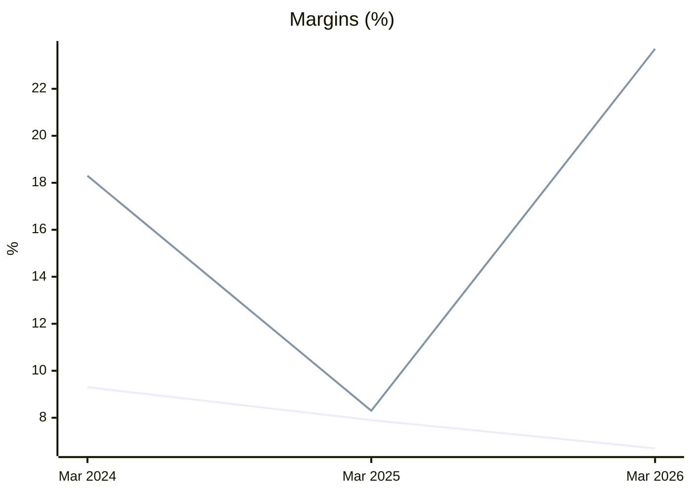

*Run 2026-11-24 · part of [SPINOFF_REPORT.md](../SPINOFF_REPORT.md) · the complete analysis of one company, with every management-call exchange in full.*

## LLOYDSENT — Lloyds Enterprises Ltd.

### 1. Lloyds Enterprises Ltd. — CONFIRMED DEMERGER

**CONFIRMED** (a demerger scheme is on the exchange record) · **PRE-SPIN — study the parent; the pieces do not trade yet** · score 4.2/10 · spin-off · 6 filing(s) from NSE · first 2025-11-11, latest 2026-05-19

**The separated entities — every one the documents name:**

| Entity | Business | Listing | Who runs it |
|---|---|---|---|
| **Lloyds Realty Limited** | Real Estate Business Undertaking demerged out of Lloyds Enterprises Limited; real estate development across M… | to be listed — "the listing of shares of Lloyds Realty Limi… | not stated |
| **Lloyds Realty Developers Limited** | Transferor Company 1 — real estate subsidiary of Lloyds Enterprises Limited being merged into Lloyds Enterpri… | not stated | not stated |
| **Indrajit Properties Private Limited** | Transferor Company 2 — step-down subsidiary (properties) being merged into Lloyds Enterprises Limited under t… | not stated | not stated |

**What is being separated, as the documents put it:** The Real Estate Business Undertaking of Lloyds Enterprises Limited, demerged into Lloyds Realty Limited, a new unlisted resulting company — class `value_unlocking`.

### 2. Stages and dates

> **Listing:** NOT YET — scheme at 'exchange_noc' stage; the resulting company will list only after NCLT sanction, effectiveness and a record date; indicated timeline: NSE letter dated May 15, 2026: "Lloyds Realty Limited shall ensure that steps for listing of specified securities are completed and trading in securities commences within sixty days of receipt of the order of the Hon'ble High Court/NCLT"; listing "is at the discretion of the Exchange" and subject to SEBI approval. Chairman, 9 July 2026: "our real estate business will be listed". Scheme still pending NCLT (applications filed; Observation Letters received 15 May 2026, valid six months).

| Date | Event | Source |
|---|---|---|
| 2025-12-22 | Board approval — Lloyds Enterprises Limited (Composite Scheme of Arrangement — LRDL and IPPL into LEL; demerger of Real Estate Business Undertaking into Lloyds Realty Limited) | as stated: Notes to the Unaudited Standalone and Consolidated Financial Results … |
| 2025-12-22 | Filed with exchanges — Lloyds Enterprises Limited (filed with BSE and NSE) | as stated: Notes to the Unaudited Financial Results for the quarter and nine mon… |
| 2026-03-16 | Other — NSE submission of the draft Composite Scheme to SEBI (letter reference no. NSE/LIST/52937) | as stated: NSE Observation Letter Ref: NSE/LIST/52937 dated May 15, 2026, enclos… |
| 2026-05-15 | SEBI approval — SEBI letter giving comments on the draft Composite Scheme of Arrangement | as stated: NSE Observation Letter Ref: NSE/LIST/52937 dated May 15, 2026 and BSE… |
| 2026-05-15 | Exchange no-objection — Lloyds Enterprises Limited — Observation Letter with "No Adverse Observations" from BSE Limited and Observation Letter conveying "No objection" from NSE | as stated: Company intimation under Regulation 30 dated 16th May, 2026: "the Com… |
| 2026-05-16 | Stage reached: **exchange noc** | [Scheme of Arrangement](https://nsearchives.nseindia.com/corporate/SGTL2008_16052026122256_IntimationMerger.pdf) |

**The stages, as filed:** exchange noc (2026-05-16)

**Stated in the filings:** demerged undertaking: as defined in the Scheme) of the; entitlement **1 for every 2**.

**When it lists, in the documents' words:** NSE letter dated May 15, 2026: "Lloyds Realty Limited shall ensure that steps for listing of specified securities are completed and trading in securities commences within sixty days of receipt of the order of the Hon'ble High Court/NCLT"; listing "is at the discretion of the Exchange" and subject to SEBI approval. Chairman, 9 July 2026: "our real estate business will be listed". Scheme still pending NCLT (applications filed; Observation Letters received 15 May 2026, valid six months).

### 3. Size of the separated business beside the parent — is institutional selling likely?

**Reading: VERY LIKELY — the piece is under a tenth of the whole; index funds and large holders who receive it without choosing it tend to sell.**

| Entity | Stated turnover | Stated share of the whole | Segment revenue share | Market cap (₹ cr) | Share of combined market cap | Index member |
|---|---|---:|---:|---:|---:|---|
| Lloyds Realty Limited | not stated | — | 3.8% (FY2026) | — | — | not listed |
| Lloyds Realty Developers Limited | "total revenues of ₹53.30" crore for the year to date from … | — | 3.8% (FY2026) | — | — | not listed |
| Indrajit Properties Private Limited | not stated | — | 3.8% (FY2026) | — | — | not listed |

*Stated figures are the documents' own (a turnover share, or the cost-of-acquisition split the company publishes for tax, which reflects relative value); the segment share is this business's revenue over the parent's sales, and the market-cap share is the entity's value over the entity plus the parent (parent ₹10,184 cr, NSE bhavcopy of 2026-11-13), both computed here.*

**The judge's read of selling pressure:** likely — Small real-estate entity split from a trading/engineering-and-investment holding company; newly listed, in no index; shares frozen until listing permission

### 4. Insider ownership — share swap, promoters' holding, management incentives

**Share swap / entitlement:** 1 for every 2

**Promoters' holding, from the shareholding pattern:**

| Company | Promoters | FIIs | DIIs | Public | Quarter |
|---|---:|---:|---:|---:|---|
| Lloyds Enterprises Ltd. (LLOYDSENT) | 62.71% | 0.71% | 0.14% | 36.42% | Sep 2026 |

*Source: screener.in shareholding pattern, stored under `ShareholdingPattern/NiftyTotalMarket/`. In a mirror demerger each shareholder holds the same proportion of the new company as of the parent on the record date.*

- **Promoters in the parent, per the documents:** not stated in the documents on file.
- **What the promoters will hold in the separated entity:** not stated in the documents on file.
- **What a public shareholder receives:** not stated in the documents on file.
- **Management incentives:** "Further, the Company introduced an Employee Stock Option Plan (ESOP) for employees and its subsidiaries/associates. This initiative reflects our focus on building a performance-driven culture and aligning employee growth with the long-term success of the Company." Treatment of existing grants in the Scheme, any plan in Lloyds Realty Limited, exercise price and pricing date: not stated. For the separate Lloyds Engineering Works Limited merger scheme: "Post-merger, Mr. B Prabhakaran and Family & along with his controlled entities will hold a significant stake of 21.03% in the expanded LEWL entity, reinforcing their long-term commitment to the company's growth trajectory."
- **Insider actions around the separation:** No promoter or management purchase, sale or pledge of Lloyds Enterprises Limited shares around the separation is stated. The Company itself sold shares of its material subsidiary: "On February 9 2026, the Company sold its stake in its subsidiary, Lloyds Engineering Works Limited, comprising 60,34,299 shares at ₹49.65 per share, through a block deal" — i.e. "0.41% of Equity Share capital of LEWL to Thriveni Earthmovers Private Limited, Investment arm of Mr. Balasubramanian Prabhakaran through 'Block Deal'", and "Buyers does not belong to the promoter/ promoter group/group companies." The Company also "during the year subscribed to 75,00,002 share warrants" of Lloyds Metals and Energy Limited, "which were converted into equity shares", funded by ₹361 crore of borrowings. On 2026-06-18 the Company agreed to acquire 73,00,000 equity shares (17.98%) of Steel Infra Solutions Company Limited for about Rs. 219 Cr in cash.
- **Insiders, per the checklist read:** Not stated — no promoter/management stake in Lloyds Realty Limited disclosed; all holders, promoters included, receive 1 LRL share of Rs. 1 for every 2 LEL shares held · *option pricing date:* not stated

### 5. Why the demerger — point by point

The separation at issue is the demerger of Lloyds Enterprises Limited's (LEL) Real Estate Business Undertaking into a new, separately listed vehicle, Lloyds Realty Limited (LRL), carried out inside a Composite Scheme of Arrangement under Sections 230–232 read with Section 66 of the Companies Act, 2013 that the Board approved on 22 December 2025; the same scheme first merges Lloyds Realty Developers Limited (LRDL, Transferor 1) and Indrajit Properties Private Limited (IPPL, Transferor 2) into LEL, so that all realty assets sit in one place before being carved out into LRL. The only rationale management itself states is in the Chairman's speech at the 40th AGM (9 July 2026): the merger-and-demerger scheme means 'our real estate business will be listed, unlocking its true potential and delivering greater value to shareholders', set against a realty platform spread across the Mumbai Metropolitan Region, Panvel, Khopoli, Dadar and Thane with 'nearly 14 million square feet of upcoming projects under development' — i.e. a capital-hungry pipeline that needs its own currency and price discovery. For the parallel group merger the Chairman gives the generic benefits: 'enhance operational efficiencies, optimize resource utilization, strengthen the overall business structure, and create sustainable long-term value for shareholders'. The filings show why real estate sat awkwardly inside LEL: for 9M FY26 the Real Estate segment did only ₹53.30 crore of revenue and ₹0.88 crore of segment result (down from ₹11.26 crore) on ₹993.09 crore of segment assets and ₹553.40 crore of segment liabilities, while Steel (₹492.80 crore revenue, ₹255.60 crore result) and Engineering (₹795.75 crore, ₹151.08 crore) carried the group, and subsidiary LRDL itself ran a ₹1.26 crore net loss; consolidated FY26 total income was ~₹2,200 crore against ~₹800 crore standalone, with LEL otherwise functioning as a holding/trading company (stakes of ~4.13% in Lloyds Metals and Energy, ~31% in Geomysore, and material subsidiary Lloyds Engineering Works with a group order book of ~₹8,000 crore and 44% PBT growth). No investor, lender or partner is named as having asked for the separation; the only parties on record demanding anything are the regulators — SEBI, NSE and BSE required LEL to disclose to shareholders the 'Need for the merger/demerger, rationale of the scheme and swap ratio', synergies, minority impact and a cost-benefit analysis, plus lender NOCs and 'Conditions imposed by lenders, if any'. The same unlock-by-listing logic recurs twice more in the group: LEWL's absorption of Lloyds Infra, Metalfab and Techno Industries to end 'silos' and create a ₹6,150 crore-order-book design-to-execution entity, and the SISCOL acquisition (88.12% for ~₹1,073.40 crore), where a DRHP within 30 months is meant to 'facilitate independent price discovery', market visibility and access to capital.

**Point by point, with the source:**

1. Board approval on 22 December 2025 of the Composite Scheme: LRDL and IPPL merge into LEL, and LEL's Real Estate Business Undertaking is demerged into Lloyds Realty Limited; filed with BSE and NSE the same day. “The Scheme is filed with Bombay Stock Exchange (BSE) & National Stock Exchange (NSE) on December 22, 2025.” — *Scheme*
2. The only explicit purpose management gives for the demerger, in the Chairman's speech at the 40th AGM (9 July 2026): a separate listing of the real estate business to unlock value, against a pipeline of nearly 14 million sq ft across MMR, Panvel, Khopoli, Dadar and Thane. “Importantly, as a result of the merger and demerger scheme approved during the year, our real estate business will be listed, unlocking its true potential and delivering greater value to shareholders.” — *Scheme*
3. For the group merger leg, the Chairman offers only structural benefits, noting approvals from NSE, BSE and SEBI and an application filed with the NCLT. “This strategic merger is expected to enhance operational efficiencies, optimize resource utilization, strengthen the overall business structure, and create sustainable long-term value for shareholders.” — *Scheme*
4. NSE's 15 May 2026 observation letter confirms the demerger is a route to a new listed realty entity, but conditions it on an Information Memorandum, newspaper advertisement, frozen shares until trading permission, and listing within 60 days of the NCLT order. “However, the listing of shares of Lloyds Realty Limited  is at the discretion of the Exchange.” — *Scheme*
5. The parties actually demanding an articulated rationale are the regulators: SEBI and both exchanges ordered LEL to put the need, rationale, swap ratio, synergies, minority impact and cost-benefit analysis in the shareholder explanatory statement. “Need for the merger/demerger, rationale of the scheme and swap ratio, synergies of business of the entities involved in the scheme, impact of the scheme on the minority shareholders and cost benefit analysis of the scheme.” — *Scheme*
6. Lenders are referenced only as a consent/disclosure requirement imposed by SEBI — NOCs from lending banks, FIs and debenture trustees, plus any lender-imposed conditions — not as instigators of the separation. “Conditions imposed by lenders, if any, may be disclosed to the public shareholders along with the impact of same on the scheme.” — *Scheme*
7. The mirror-image transaction at material subsidiary LEWL (announced 29 December 2025) consolidates LICL, Metalfab and Techno Industries into one vertically integrated design-to-execution entity with a ~₹6,150 crore combined order book, ~38.1 crore new shares and equity rising from 147.42 to 185.52 crore shares, appointed date 1 April 2025. “By bringing Lloyds Infra, Metalfab, and Techno Industries under one banner, we are eliminating silos.” — *Scheme*
8. The same unlock-by-separate-listing logic is applied to the June 2026 SISCOL acquisition (88.12% for ~₹1,073.40 crore; FY26 turnover ₹816.87 crore, net profit ₹43.42 crore), with a DRHP promised within 30 months of Stage 1. “The proposed listing of SISCOL is expected to facilitate independent price discovery of its business, enhance its market visibility and access to capital, and unlock value for all its stakeholders, including the Company as a significant shareholder.” — *Scheme*
9. The filings' own numbers show the real-estate leg was the group's weakest earner before separation: 9M FY26 segment revenue of ₹53.30 crore and segment result of ₹0.88 crore (vs ₹11.26 crore a year earlier) on ₹993.09 crore of segment assets and ₹553.40 crore of segment liabilities, with LRDL itself loss-making. “We have not conducted a review of the Subsidiary (Lloyds Realty Developers Limited) included in the unaudited consolidated financial results. whose financial information reflects total revenues of <53.30 and total Net Loss after tax of t1.26. crores.” — *Scheme*

**How it evolved:** No earnings-call transcripts are on file, so the idea is traceable only through filings. It surfaces fully formed on 22 December 2025, when the Board approved the Composite Scheme (LRDL + IPPL into LEL, real-estate undertaking out into LRL) and filed it with BSE and NSE the same day; a week later (29 December 2025) the group announced the separate LEWL merger of LICL, Metalfab and Techno Industries, and the 9 February 2026 results notes restated the Scheme verbatim alongside a ₹500 crore NCD approval, the ₹361 crore Tata Capital/Bajaj Finance/Jio Credit borrowings and the block-deal sale of LEWL shares to Thriveni Earthmovers. On 15–16 May 2026 LEL received NSE's 'No objection' and BSE's 'no adverse observations' (with LRL's listing left to exchange discretion, an Information Memorandum, frozen shares and a 60-day post-NCLT listing timetable), followed on 18–19 May 2026 by exchange NOCs and CCI clearance for the LEWL merger; by the 9 July 2026 AGM the Chairman described the scheme as approved, an NCLT application filed, and the realty business as one that 'will be listed'.

**What management expects from it:** For the realty entity: a separate listing of the ~14 mn sq ft Mumbai-region pipeline, 'unlocking its true potential' and greater shareholder value. For the retained LEL group: enhanced operational efficiencies, optimised resource utilisation, a stronger business structure and sustainable long-term value, leaving a holding/trading company around LEWL (~₹8,000 crore order book, 44% PBT growth), Lloyds Metals, Geomysore and SISCOL.

*Not explained on the calls:* No earnings-call transcripts on file; no swap ratio, valuation, debt or asset split for LRL, no margin or capital targets, no timeline, no named investor or lender demand.

- *Stated reason, in one line:* Chairman: "as a result of the merger and demerger scheme approved during the year, our real estate business will be listed, unlocking its true potential and delivering greater value to shareholders"
- *What it reveals:* Real estate segment assets Rs. 993.09 cr vs liabilities Rs. 553.40 cr, 9M FY26 sales Rs. 53.30 cr and segment result Rs. 0.88 cr, yet "nearly 14 million square feet of upcoming projects under development" across MMR, Panvel, Khopoli, Dadar, Thane
- *Parent or spin:* spin · *Read next:* Lloyds Realty Limited's Information Memorandum and the scheme's valuation report — assets, liabilities and debt transferred to LRL
- *In their words:* “Importantly, as a result of the merger and demerger scheme approved during the year, our real estate business will be listed, unlocking its true potential and delivering greater value to shareholders.”

### 6. On the calls, verbatim

No call in the last 36 months carries a statement about it (or no transcript is on file).

### 7. The parent's financial statements

**The parent, last three fiscal years (consolidated)**

| | Mar 2024 | Mar 2025 | Mar 2026 |
|---|---:|---:|---:|
| Sales (₹ cr) | 958 | 1,488 | 1,756 |
| Sales growth (%) | +152.1% | +55.3% | +18.0% |
| Operating profit (₹ cr) | 89.0 | 118 | 117 |
| Operating profit growth (%) | +74.5% | +32.6% | -0.8% |
| Operating margin (%) | 9.3 | 7.9 | 6.7 |
| PAT (₹ cr) | 175 | 123 | 417 |
| PAT growth (%) | +157.4% | -29.7% | +239.0% |
| PAT margin (%) | 18.3 | 8.3 | 23.7 |
| EPS (₹) | 0.8 | 0.4 | 1.9 |

*Source: ProfitStatement/NiftyTotalMarket/LLOYDSENT.csv (consolidated, screener.in); growth and margins computed here.*

```mermaid
xychart-beta
    title "Sales, operating profit and PAT (₹ cr)"
    x-axis ["Mar 2024", "Mar 2025", "Mar 2026"]
    y-axis "₹ crore"
    bar [958, 1488, 1756]
    bar [89, 118, 117]
    bar [175, 123, 417]
```

*Series in order: Sales, Operating profit, PAT.*

*Series in order: Operating margin, PAT margin.*

**P/E:** 41.0 — close 2026-10-01 ÷ EPS 1.9 (Mar 2026) (price ₹77.95 as of 2026-10-01).

**Cash flows (₹ cr):**

| | Mar 2024 | Mar 2025 | Mar 2026 |
|---|---:|---:|---:|
| Cash from operations (₹ cr) | -20.0 | 145 | -361 |
| Cash from investing (₹ cr) | -212 | -294 | -1,582 |
| Cash from financing (₹ cr) | 261 | 140 | 2,489 |
| Net cash flow (₹ cr) | 29.0 | -9.0 | 546 |
| Free cash flow (₹ cr) | -2.0 | 76.0 | -294 |

*Source: CashFlow/NiftyTotalMarket/LLOYDSENT.csv (consolidated, screener.in).*

### 8. The separated business's financial statements

**The business being separated — its own numbers**, entity by entity: its reported statements once it is listed and on file, and the segment numbers the annual reports and presentations carry for it before that.

**Real Estate (reportable segment) — the Real Estate Business Undertaking of Lloyds Enterprises Ltd., comprising Lloyds Realty Developers Limited and Indrajit Properties Private Limited, to be demerged into the separately listed Lloyds Realty Limited** · unit ₹ crore · Consolidated IND AS-108 segment disclosure. Revenue is EXTERNAL sales (no inter-division/inter-company transfer shown for Real Estate in any year). operating_profit = segment 'Operating Net Profit' (segment result BEFORE finance cost and, in FY26, before an exceptional item). Segment PBT after finance cost is separately shown on the pages: FY2024 (1.31), FY2025 13.30, FY2026 0.83. No segment-level PAT, capex or depreciation is disclosed. UNIT NOTE: the FY2024 and FY2025 source pages print these figures in ₹ lakhs (FY24 revenue 1,748.32 lakhs; FY25 revenue 8,387.52 lakhs); they are stated here in ₹ crore (÷100) so the business carries one unit, matching the FY2026 page which is printed in ₹ crore.

| | FY2024 | FY2025 | FY2026 |
|---|---:|---:|---:|
| Revenue (₹ crore) | 17.5 | 83.9 | 66.9 |
| Revenue growth (%) | — | +379.7% | -20.2% |
| Operating profit (₹ crore) | -1.7 | 15.4 | 5.7 |
| Operating profit growth (%) | — | +1009.8% | -62.9% |
| Operating margin (%) | -9.7 | 18.3 | 8.5 |
| PAT (₹ crore) | — | — | — |
| PAT growth (%) | — | — | — |
| Segment assets (₹ crore) | 548 | 720 | 1,293 |
| Segment liabilities (₹ crore) | 507 | 278 | 854 |
| Capital employed (₹ crore) | 41.3 | 442 | 439 |
| Return on capital employed (%) | -4.1 | 3.5 | 1.3 |
| Segment assets / revenue (x) | 31.4 | 8.6 | 19.3 |
| Capex (₹ crore) | — | — | — |

*Sources:* Annual Report 2024 — page 169; Annual Report 2025 — page 230; Annual Report 2026 — page 300

*Not in the pages read:* No segment PAT, capex or depreciation any year. Q1/Q2 FY27 presentations give LRDL only operational data (~1.75 cr sq ft pipeline, ₹3,500 cr value delivered to date), no quarterly revenue or profit.

*Businesses with no numbers in the pages read (3 annual report(s) and 5 presentation(s) on file):* No own financials for Lloyds Realty Limited, Lloyds Realty Developers Limited or Indrajit Properties Private Limited as entities; pages carry only the consolidated Real Estate segment. Transferor/Transferee company figures and Scheme appointed-date numbers absent.

*Documents on file:* [Annual Report 2026](https://www.bseindia.com/xml-data/corpfiling/AttachHis/82f67229-7245-4268-a22b-49994f6ffe86.pdf); [Annual Report 2025](https://www.bseindia.com/xml-data/corpfiling/AttachHis/5408c4f6-594d-400d-aadf-28e17b39561e.pdf); [Annual Report 2024](https://www.bseindia.com/xml-data/corpfiling/AttachHis/a7a8ca2e-3583-4f27-aebb-5b7d1f551745.pdf); [Presentation Nov 2026](https://www.bseindia.com/stockinfo/AnnPdfOpen.aspx?Pname=fdabd7ba-7d33-4b1c-a882-21e996f77334.pdf); [Presentation Aug 2026](https://www.bseindia.com/stockinfo/AnnPdfOpen.aspx?Pname=0f5d58a2-e1d3-465f-adc5-9ae67e65228e.pdf); [Presentation May 2026](https://www.bseindia.com/stockinfo/AnnPdfOpen.aspx?Pname=1ab3a8e5-a800-4b69-b625-35fe1fc04a32.pdf); [Presentation Feb 2026](https://www.bseindia.com/stockinfo/AnnPdfOpen.aspx?Pname=4ab99cba-2335-421f-95ed-9aed16902edd.pdf); [Presentation Nov 2025](https://www.bseindia.com/stockinfo/AnnPdfOpen.aspx?Pname=66a44a24-9f87-4f73-b5b6-0a3bbb213a59.pdf)

### 9. Other financial differences — working capital, margins, returns, debt

| Metric (latest year) | Parent (LLOYDSENT) | Lloyds Realty Limited | Lloyds Realty Developers Limited | Indrajit Properties Private Limited |
|---|---:|---:|---:|---:|
| *Basis* | *reported, consolidated* | *segment numbers (Real Estate (reportable segm…* | *segment numbers (Real Estate (reportable segm…* | *segment numbers (Real Estate (reportable segm…* |
| Sales (₹ cr) | 1,756 (Mar 2026) | — | — | — |
| Sales growth (%) | 18 (Mar 2026) | -20.2 (FY2026) | -20.2 (FY2026) | -20.2 (FY2026) |
| Operating margin (%) | 6.7 (Mar 2026) | 8.5 (FY2026) | 8.5 (FY2026) | 8.5 (FY2026) |
| Operating profit growth (%) | -0.8 (Mar 2026) | -62.9 (FY2026) | -62.9 (FY2026) | -62.9 (FY2026) |
| PAT margin (%) | 23.7 (Mar 2026) | — | — | — |
| ROCE % | 4 (Mar 2025) | 1.3 (FY2026) | 1.3 (FY2026) | 1.3 (FY2026) |
| Debtor Days | 56 (Mar 2026) | — | — | — |
| Inventory Days | 188 (Mar 2026) | — | — | — |
| Days Payable | 74 (Mar 2019) | — | — | — |
| Cash Conversion Cycle | 170 (Mar 2026) | — | — | — |
| Working Capital Days | 198 (Mar 2026) | — | — | — |
| Debt / equity (x) | 0.2 (Mar 2026) | — | — | — |
| Borrowings (₹ cr) | 798 (Mar 2026) | — | — | — |
| Segment assets / revenue (x) | — | 19.3 (FY2026) | 19.3 (FY2026) | 19.3 (FY2026) |
| Sales (₹ crore) | — | 66.9 (FY2026) | 66.9 (FY2026) | 66.9 (FY2026) |
| Sales (₹ crore) | — | 66.9 (FY2026) | 66.9 (FY2026) | 66.9 (FY2026) |
| Sales (₹ crore) | — | 66.9 (FY2026) | 66.9 (FY2026) | 66.9 (FY2026) |

*Each figure is the latest on file, with its year. Working-capital days and ROCE come from the stored working-capital file; segment figures from the pages cited in part 8. A dash means the documents do not carry it.*

**What stays with the parent — its segments, from the same pages:**

| Remaining segment | Revenue | Operating margin | ROCE | Segment assets / revenue | Unit | Year |
|---|---:|---:|---:|---:|---|---|
| Steel | 766 | 38.9% | 9.0% | 4.59x | ₹ crore | FY2026 |
| Engineering (Lloyds Engineering Works Limited, LEWL) | 1,267 | 14.0% | 12.2% | 1.7x | ₹ crore | FY2026 |
| Electrical | 84 | 16.2% | 16.5% | 2.88x | ₹ crore | FY2026 |
| Steel and Engineering Products (combined segment, FY2024 only) | 941 | 9.7% | 8.5% | 1.96x | ₹ crore | FY2024 |
| Metals Trading (standalone trading business of LEL — steel, allied products and iron ore pellets) | 463 | — | — | — | ₹ crore | FY2026 |

**What the documents themselves say about the differences:**

- **growth** — parent / remaining: Material subsidiary Lloyds Engineering Works Limited reported its highest-ever revenue and PAT in FY26, with group order book of approximately ₹8,000 crores and profit before tax growth of 44% during the year; consolidated Total Income of approximately ₹2,200 crores in FY26; separated business: Real estate business expanding across the Mumbai Metropolitan Region and nearby areas including Panvel, Khopoli, Dadar and Thane, with nearly 14 million square feet of upcoming projects under development “With nearly 14 million square feet of upcoming projects under development, the Company has strong growth visibility for the future.”
- **operating margin** — parent / remaining: Nine months ended 31-Dec-2025 segment result (profit before finance costs and tax): Engineering ₹151.08 crore on sales of ₹795.75 crore; Steel ₹255.60 crore on sales of ₹492.80 crore; Electrical ₹2.73 crore on sales of ₹117.41 crore; separated business: Real Estate segment result of ₹0.88 crore on sales of ₹53.30 crore for the nine months ended 31-Dec-2025; Lloyds Realty Developers Limited reported a Net Loss after tax of ₹1.26 crore for the same period “We have not conducted a review of the Subsidiary (Lloyds Realty Developers Limited) included in the unaudited consolidated financial results, whose financial information reflects total revenues of ₹53.30 and total Net Loss after tax of ₹1.26. crores, and total Net Loss after comprehensive income of ₹1.81 crores for the year to date from 1st April, 2025 to 31st December, 2025, as considered in the respective unaudited financial results of the entity included in the Group.”
- **debt and leverage** — parent / remaining: Lloyds Enterprises Limited availed ₹361 crore of loans (Tata Capital ₹211 crore, Bajaj Finance ₹75 crore, Jio Credit ₹75 crore) used for the balance consideration of 75,00,002 Lloyds Metals and Energy Limited share warrants; Board approved issuance of NCDs on private placement basis not exceeding Rs. 500 crores; consolidated finance costs ₹30.54 crore for nine months ended 31-Dec-2025; separated business: Real Estate segment liabilities of ₹553.40 crore against Real Estate segment assets of ₹993.09 crore as at 31-Dec-2025 (segment disclosure; no separate statement for the demerged undertaking) “Lloyds Enterprises Limited has entered into loan agreements with Tata Capital Limited, Bajaj Finance Limited, and Jio Credit Limited to avail financial assistance aggregating to ₹361 crore, comprising ₹211 crore from Tata Capital Limited, ₹75 crore from Bajaj Finance Limited, and ₹75 crore from Jio Credit Limited.”

**The checklist:**

| Item | Status | Evidence |
|---|---|---|
| Why the spin-off | yes | unrelated businesses separated; value unlocking for shareholders; regulatory / strategic knot — “…h its subsidiaries, in addi Ɵon to holding strategic investments in other group companies. In order to have focused management on each business ac Ɵvity and value unlocking, it is proposed to re -organize / restructure ” |
| Institutional selling likely (small / different business) | partly | the businesses are described as distinct |
| Insider ownership and incentives aligned | unknown | no promoter-continuity or option-pricing language found *(next: the date the management options are priced; promoter holding in the resulting company)* |
| A hidden value revealed (pro-forma, leverage, comparables) | unknown | no pro-forma or market data on file *(next: pro-forma P&L of each piece × the peer P/E of its own industry)* |
| Parent before the spin (clean parent, takeover prelude) | partly | stage exchange_noc — the spin has not happened; the parent can still be bought whole |
| Timing (first year sells, second year gains) | partly | not yet listed — 378 days since the first filing, stage exchange_noc |

The filings

| Date | Category | Headline | Attachment |
|---|---|---|---|
| 2025-11-11 | Updates | Lloyds Enterprises Limited has informed the Exchange regarding 'Amendment to the Code of Practices and Procedures for Fair Disclosure of Unpublished Price Sensi | [pdf](https://nsearchives.nseindia.com/corporate/SGTL2008_11112025150844_AmendmentofCodeofFairDisclosure_11112025.pdf) |
| 2025-12-22 | Outcome of Board Meeting | Lloyds Enterprises Limited has informed the Exchange regarding Board meeting held on December 22, 2025. | [pdf](https://nsearchives.nseindia.com/corporate/SGTL2008_22122025202343_OutcomeofBoardMeeting.pdf) |
| 2025-12-22 | Scheme of Arrangement | Lloyds Enterprises Limited has informed the Exchange about Scheme of Arrangement | [pdf](https://nsearchives.nseindia.com/corporate/SGTL2008_22122025202542_OutcomeofBoardMeeting.pdf) |
| 2025-12-22 | Updates | Lloyds Enterprises Limited has informed the Exchange Release regarding Strategic Restructuring to unlock shareholders value in its Real Estate Business'. | [pdf](https://nsearchives.nseindia.com/corporate/SGTL2008_22122025204336_Release.pdf) |
| 2026-05-16 | Scheme of Arrangement | Lloyds Enterprises Limited has informed the Exchange about receipt of Observation Letter with No Adverse Observation Letter from BSE Limited and Observation Let | [pdf](https://nsearchives.nseindia.com/corporate/SGTL2008_16052026122256_IntimationMerger.pdf) |
| 2026-05-19 | General Updates | Lloyds Enterprises Limited has informed the Exchange Regarding No Objection Certificate From National Stock Exchange Of India Limited And BSE Limited To Lloyds  | [pdf](https://nsearchives.nseindia.com/corporate/SGTL2008_19052026174536_IntimationofNOC_LEWL.pdf) |

