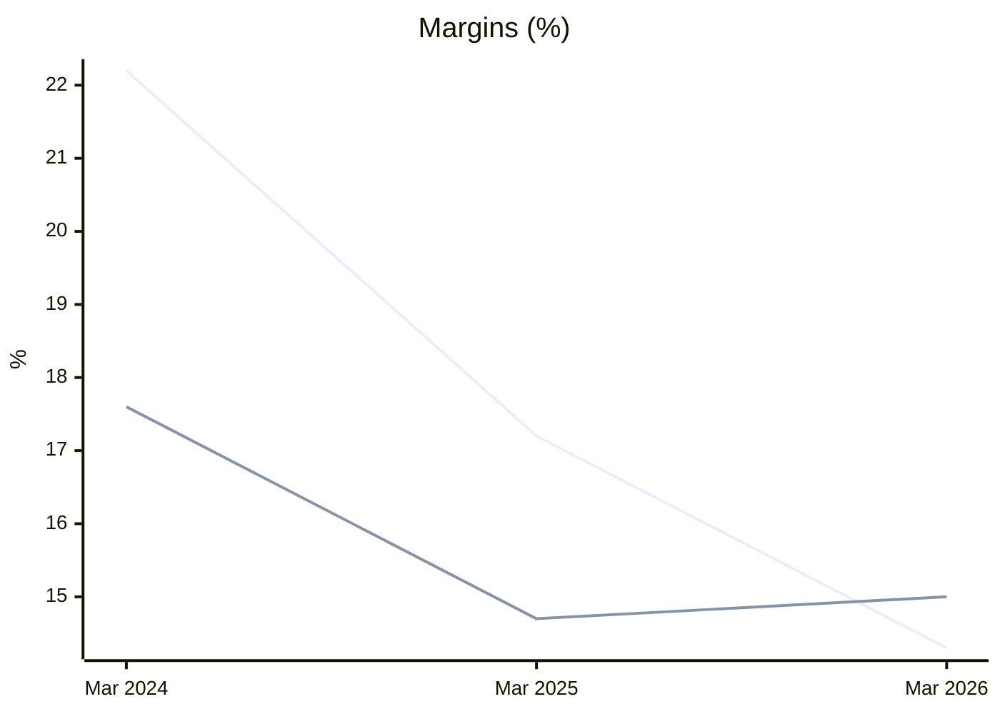

*Run 2026-11-24 · part of [SPINOFF_REPORT.md](../SPINOFF_REPORT.md) · the complete analysis of one company, with every management-call exchange in full.*

## MAHSEAMLES — Maharashtra Seamless Ltd.

### 1. Maharashtra Seamless Ltd. — CONFIRMED DEMERGER

**CONFIRMED** (a demerger scheme is on the exchange record) · **PRE-SPIN — study the parent; the pieces do not trade yet** · score 4.2/10 · spin-off · 4 filing(s) from BSE-screener, NSE · first 2026-05-22, latest 2026-10-07

**The separated entities — every one the documents name:**

| Entity | Scheme | Business | Listing | Who runs it |
|---|---|---|---|---|
| **MSL Seamless Tubes Limited** | 2026 scheme of arrangement demerging two undertakings into … | Seamless pipe manufacturing business at Mangaon, Maharashtra (125,000 MTPA), captive solar power plant at Bee… | to be listed | not stated |
| **United Seamless Limited** | 2026 scheme of arrangement demerging two undertakings into … | Seamless pipe facility at Narketpally, Telangana (200,000 MTPA), solar power plants at Khetusar (20 MW) and P… | to be listed | not stated |

**The other parties to the scheme(s)** — not separated entities: United Seamless Tubulaar Private Limited — merged in — no shares for the parent's holders

**What is being separated, as the documents put it:** Two seamless pipe plants: Mangaon (125,000 MTPA) with Beed solar; Narketpally Telangana (200,000 MTPA) with Rajasthan solar and rig — class `value_unlocking`.

### 2. Stages and dates

> **Listing:** NOT YET — scheme at 'announced' stage; MSL Seamless Tubes Limited will list only after NCLT sanction, effectiveness and a record date; indicated timeline: On 07 October 2026 (and earlier 22 May 2026): "Yes. The equity shares of MSTL and USL shall be listed and admitted to trading on BSE and NSE pursuant to the Scheme subject to receipt of requisite approvals from statutory and regulatory authorities." No expected listing date stated; Appointed Date 01st October 2026, NCLT approval pending.

| Date | Event | Source |
|---|---|---|
| 2026-05-22 | Board approval — Maharashtra Seamless Limited | as stated: Scheme of Arrangement filing MSL/SEC/SE/2026-27 dated 22 May 2026 |
| 2026-06-15 | Other — Maharashtra Seamless Limited | as stated: General Updates filing dated 15 June 2026: "the said Scheme is under … |
| 2026-10-01 | Appointed date — Maharashtra Seamless Limited, MSL Seamless Tubes Limited, United Seamless Limited | as stated: Scheme of Arrangement filings dated 22 May 2026 and 07 October 2026 |
| 2026-10-07 | Stage reached: **announced** | [Scheme of Arrangement](https://nsearchives.nseindia.com/corporate/MAHSEAMLES_07102026172556_MSLIntimationDemerger.pdf) |
| 2026-10-07 | Board approval — Maharashtra Seamless Limited | as stated: Scheme of Arrangement filing MSL/SEC/SE/2026-27 dated 07 October 2026… |

**The stages, as filed:** announced (2026-10-07)

**Stated in the filings:** resulting company **MSL Seamless Tubes Limited**; demerged undertaking: 1 into MSL Seamless Tubes Limited; entitlement **1 for every 5**; appointed date 2026-10-01.

**When it lists, in the documents' words:** On 07 October 2026 (and earlier 22 May 2026): "Yes. The equity shares of MSTL and USL shall be listed and admitted to trading on BSE and NSE pursuant to the Scheme subject to receipt of requisite approvals from statutory and regulatory authorities." No expected listing date stated; Appointed Date 01st October 2026, NCLT approval pending.

### 3. Size of the separated business beside the parent — is institutional selling likely?

**Reading: LIKELY — the piece is small beside the parent; mandates with size limits tend to sell.**

| Entity | Stated turnover | Stated share of the whole | Segment revenue share | Market cap (₹ cr) | Share of combined market cap | Index member |
|---|---|---:|---:|---:|---:|---|
| MSL Seamless Tubes Limited | Demerged Undertaking 1: 793 (Operational Turnover for FY 20… | 16.98% | 1.7% (FY2026) | — | — | not listed |
| United Seamless Limited | Demerged Undertaking 2: 693 (Operational Turnover for FY 20… | 14.84% | 1.7% (FY2026) | — | — | not listed |

*Stated figures are the documents' own (a turnover share, or the cost-of-acquisition split the company publishes for tax, which reflects relative value); the segment share is this business's revenue over the parent's sales, and the market-cap share is the entity's value over the entity plus the parent (parent ₹7,248 cr, NSE bhavcopy of 2026-11-13), both computed here.*

**In the documents' words:** “Particulars / Operational Turnover for FY 2025 - 26 (Rs. crores) / Percentage (%): Demerged Undertaking 1 793 16.98%; Demerged Undertaking 2 693 14.84%; Remaining 3185 68.18%; Total 4671 100.00%”

**The judge's read of selling pressure:** likely — Each spin tiny: ~15-17% of turnover, only 2,67,99,850 shares, 1 share per 5 held; rig/solar assets differ from pipes.

### 4. Insider ownership — share swap, promoters' holding, management incentives

**Share swap / entitlement, entity by entity:**

- **MSL Seamless Tubes Limited:** 1 equity share of Resulting Company 1 of INR 5 each fully paid-up for every 5 equity shares of the Demerged Company of INR 5 each fully paid-up
- **United Seamless Limited:** 1 equity share of Resulting Company 2 of INR 5 each fully paid-up for every 5 equity shares of the Demerged Company of INR 5 each fully paid-up

**Promoters' holding, from the shareholding pattern:**

| Company | Promoters | FIIs | DIIs | Public | Quarter |
|---|---:|---:|---:|---:|---|
| Maharashtra Seamless Ltd. (MAHSEAMLES) | 70.3% | 9.93% | 3.87% | 15.9% | Sep 2026 |

*Source: screener.in shareholding pattern, stored under `ShareholdingPattern/NiftyTotalMarket/`. In a mirror demerger each shareholder holds the same proportion of the new company as of the parent on the record date.*

- **Promoters in the parent, per the documents:** not stated in the documents on file.
- **What the promoters will hold in the separated entity:** 2026 scheme, 07 October 2026 filing — MSTL post Scheme (Indicative): Promoter & Promoter Group 1,88,40,507 shares, 70.3008 %, Public 79,59,343, 29.6992 %; USL post Scheme (Indicative): Promoter & Promoter Group 1,88,40,507 shares, 70.3008 %, Public 79,59,343, 29.6992 %. In the 22 May 2026 filing the same tables read: Promoter & Promoter Group 1,88,34,506, 70.2784%; Public 79,65,344, 29.7216% for both MSTL and USL. "The above share exchange ratios shall ensure same proportionate shareholding structure of Resulting Company 1 and Resulting Company 2 with Demerged Company and hence Scheme shall be value neutral to the Demerged Company's shareholders." (22 May 2026 filing: "shall ensure mirror shareholding structure of Resulting Company 1 and Resulting Company 2 with Demerged Company.")
- **What a public shareholder receives:** 2026 scheme: "(i) 1 equity share of Resulting Company 1 of INR 5 each fully paid-up for every 5 equity shares of the Demerged Company of INR 5 each fully paid-up; and (ii) 1 equity share of Resulting Company 2 of INR 5 each fully paid-up for every 5 equity shares of the Demerged Company of INR 5 each fully paid-up." "There is no cash consideration being discharged under the Scheme."
- **Management incentives:** not stated in the documents on file.
- **Insider actions around the separation:** not stated in the documents on file.
- **Insiders, per the checklist read:** Promoter & Promoter Group get 70.3008% of each resulting company (1,88,40,507 of 2,67,99,850 shares), mirroring their MSL stake; no cash consideration; no other incentive disclosed. · *option pricing date:* not stated

### 5. Why the demerger — point by point

This is not a sale but a three-way split by demerger: a Scheme of Arrangement approved by MSL's board (first on 22 May 2026, then re-approved 7 October 2026 with an Appointed Date of 1 October 2026) carves two 'Demerged Undertakings' out of Maharashtra Seamless into two wholly owned subsidiaries that will themselves be listed on BSE and NSE. Demerged Undertaking 1 — the Mangaon, Maharashtra seamless pipe plant (125,000 MTPA) plus the 10 MW captive solar plant at Beed — goes to MSL Seamless Tubes Limited (MSTL); Demerged Undertaking 2 — the Narketpally, Telangana seamless mill (200,000 MTPA), the Khetusar (20 MW) and Pokhran (5 MW) solar plants in Rajasthan, and the rig Jindal Explorer — goes to United Seamless Limited (USL), i.e. the asset base MSL bought out of IBC as United Seamless Tubulaar for INR477 crores plus INR73 crores of reactivation capex. On FY2025-26 operational turnover the split is Undertaking 1 INR793 crores (16.98%), Undertaking 2 INR693 crores (14.84%) and the residual company (Nagothane pipes, ERW, treasury) INR3,185 crores (68.18%) of INR4,671 crores. The board's stated reasons are that the undertakings have 'distinct geographies, product profiles, technologies used, operational requirements, customer profile and base, market focus, logistics consideration' — specifically three different mill technologies, CPE at Nagothane, MPM at Mangaon and FQM at Telangana, each needing its own modernization and technical expertise — so each should run as a focused, independently reported vertical. It also says manufacturing, drilling and renewable energy have 'different capital intensity and funding requirements', so splitting them allows better assessment of capital needs and more flexibility for expansion; the renewable plants are attached to the mills they can power; and the rig business, long described on calls as outside the core, is segregated because it has 'distinct operational and commercial characteristics as compared to the pipe manufacturing business'. No cash changes hands: shareholders get 1 share of INR5 in each resulting company for every 5 MSL shares, producing the same proportionate holding (promoter ~70.30%, public ~29.70%, 2,67,99,850 shares in each), which the filing calls 'value neutral'; creditor liabilities are neither reduced nor extinguished and travel with each undertaking. Notably, the nine earnings calls supplied — including Feb 2026, three months before the first board approval — contain no mention of a demerger at all; the only antecedents are repeated investor pressure to exit the rig and one shareholder's demand to split the company, and management's standing answer that it would continue 'in the steel pipe segment only' and that exit was 'for the Board to decide'.

**Point by point, with the source:**

1. Two undertakings are carved out into two wholly owned subsidiaries, MSL Seamless Tubes Limited and United Seamless Limited, both to be listed, with an Appointed Date of 1 October 2026; the Mangaon 125,000 MTPA mill and the 10 MW Beed captive solar plant form Undertaking 1. “Demerged Undertaking 1: Seamless pipe manufacturing business of the Demerged Company located at Mangaon, Maharashtra (125,000 MTPA), captive solar power plant at Beed, Maharashtra (10 MW), along with the specified assets and liabilities of Demerged Undertaking 1.” — *Scheme*
2. Undertaking 2 bundles the Telangana (Narketpally) 200,000 MTPA mill with the Rajasthan solar plants and the rig Jindal Explorer into United Seamless Limited — effectively re-separating the ex-United Seamless Tubulaar asset base and the rig in one entity. “Demerged Undertaking 2: Seamless pipe manufacturing facility of the Demerged Company located at Narketpally, Telangana (200,000 MTPA), solar power plants at Khetusar (20 MW) & Pokhran (5MW) in Rajasthan, rig Jindal Explorer along with the specified assets and liabilities of Demerged Undertaking 2.” — *Scheme*
3. The headline justification is that one company holds businesses with nothing in common operationally — different geographies, products, technologies, customers and logistics — so each should be managed separately. “The said undertakings having distinct geographies, product profiles, technologies used, operational requirements, customer profile and base, market focus, logistics consideration, commercial considerations and growth opportunities.” — *Scheme*
4. The most concrete operating reason given is that the three mills run on three different pipe-making technologies, each needing its own specialised management and modernization programme — which maps exactly onto the three-way split. “The manufacturing facilities operate on different technological platforms, including CPE technology at Nagothane, MPM technology at Mangaon and FQM technology at Telangana, each requiring specialized operational management, modernization initiatives and technical expertise.” — *Scheme*
5. Capital allocation is cited: pipes, drilling and renewables have different capital intensity, so separation is meant to let each assess and fund its own needs — relevant given the stalled INR852 crore capex plan and the INR350 crore Nagothane hot-mill upgrade never started. “Efficient Capital Allocation: The manufacturing, drilling and renewable energy businesses have different capital intensity and funding requirements.” — *Scheme*
6. The rig is singled out for segregation on the grounds that it is commercially unlike pipe manufacturing — the same objection investors had raised on calls for two years. “Focused Development of Rig Operations: The rig business has distinct operational and commercial characteristics as compared to the pipe manufacturing business.” — *Scheme*
7. The renewable plants are deliberately attached to the mills they sit beside rather than kept central, framed as energy-management efficiency and sustainability support for each business. “The renewable power assets proposed to be transferred along with the respective undertakings are expected to provide better operational alignment, energy management efficiencies and support sustainability initiatives of the corresponding businesses.” — *Scheme*
8. Separate financial and operational reporting per entity is itself presented as a benefit — transparency and performance evaluation — which speaks to the calls where management refused to give product-wise or mill-wise margins. “Improved Transparency and Value Creation: The proposed demerger would result in creation of focused business entities with independent financial and operational reporting, thereby enhancing transparency, improving performance evaluation and facilitating long-term value creation for stakeholders.” — *Scheme*
9. No cash is paid; shareholders receive 1 INR5 share in each resulting company per 5 MSL shares, giving identical proportionate ownership (promoter 70.3008%, public 29.6992%, 2,67,99,850 shares each) and, the board says, value neutrality. “The above share exchange ratios shall ensure same proportionate shareholding structure of Resulting Company 1 and Resulting Company 2 with Demerged Company and hence Scheme shall be value neutral to the Demerged Company's shareholders.” — *Scheme*
10. Lenders are explicitly left untouched: no arrangement or compromise with creditors, liabilities travelling with each undertaking — i.e. the split is not presented as lender-driven or a debt restructuring. “The liabilities towards the creditors of the Demerged Company and/or the Resulting Companies under the Scheme are neither being reduced nor being extinguished and the liabilities pertaining to the respective undertakings shall be assumed and discharged by the respective Resulting Companies in the ordinary course of business.” — *Scheme*
11. The plan was not stable: approved 22 May 2026, pulled back for review on 15 June 2026, and re-approved only on 7 October 2026 with tightened wording ('specified' rather than 'related' assets, 'same proportionate' rather than 'mirror' shareholding) and slightly revised indicative share counts (promoter 70.2784% to 70.3008%). “This is further to the intimation dated 22nd May, 2026, about the approval of the Scheme of Arrangement by the Board of Directors of the Company, we have to inform you that the said Scheme is under further review and would be placed before any subsequent Board Meeting for its approval and would be submitted to Stock Exchanges thereafter.” — *Scheme*
12. The first hint of any separation was about the rig: asked whether MSL would keep two verticals, the Chairman declined to commit, while noting day rates had risen (~$40,000/day, expecting a new contract above $80,000). “Well, we have to take the appropriate decision at the right time.” — *[Feb 2024](https://www.bseindia.com/stockinfo/AnnPdfOpen.aspx?Pname=b72c7b85-4c69-46c2-a090-5ef0d9c829bd.pdf)*
13. An investor asked outright about demerging or selling the rig business post-May 2025; management confirmed intent but no board discussion and no valuation expectation. “It is something which we want to do, but it is subject to Board approval.” — *[Nov 2024](https://www.bseindia.com/stockinfo/AnnPdfOpen.aspx?Pname=527a8802-c766-46b3-bf40-c501d9bde473.pdf)*
14. After an investor said the rig arrangement (MSL renting the rig to group company Jindal Drilling, which sub-contracts to ONGC) looked out of line with MSL's governance clean-up, management personally agreed and promised a communication once board approvals came. “You are right, and I personally agree with you, but once suitable decisions and Board approvals are received, we will send communication on this.” — *[Feb 2025](https://www.bseindia.com/stockinfo/AnnPdfOpen.aspx?Pname=daab9f9c-f377-44ab-81ff-c957deffd107.pdf)*
15. Management confirmed a rig exit had been contemplated but that the board had given no update, while re-committing to pipes only — the rig had just been recontracted to Jindal Drilling at ~$35,000/day L1, with MSL to get ~$17,000-18,000/day. “There was a view of getting out of the rig business, but we've not received any update from the Board in the Board meeting, which concluded yesterday.” — *[Jun 2025](https://www.bseindia.com/stockinfo/AnnPdfOpen.aspx?Pname=e6cad32a-cb31-4ae1-8cd1-8c8bd7df377b.pdf)*
16. A five-year shareholder explicitly demanded the company be split so investors could choose the pipe business over the treasury/holding activity, arguing the merged picture was unclear; management offered no response. “Either divide the company in two parts. One should be a holding company, one should be a seamless company.” — *[Aug 2025](https://www.bseindia.com/stockinfo/AnnPdfOpen.aspx?Pname=9f4e9de0-b4a6-4b5e-9282-3cedd1bc0c79.pdf)*
17. Six months before board approval, an analyst asked specifically about getting the Jindal Explorer rig off the books and was told there was no update, with the rig about to start a new ONGC contract. “There is no update on the proposal that you mentioned.” — *[Nov 2025](https://www.bseindia.com/stockinfo/AnnPdfOpen.aspx?Pname=92cac794-00b8-4e60-be7b-2e45526b6464.pdf)*
18. On the last call before the first board approval, management described the future as cash conservation and opportunistic distressed acquisitions, with no mention of any restructuring, while defending the INR3,500 crore treasury against shareholders noting ~50% of market cap was cash. “We are conserving cash as of now and we are on the lookout for any inorganic opportunity that may arise, but that inorganic opportunity should be at a cost level at which we are comfortable.” — *[Feb 2026](https://www.bseindia.com/stockinfo/AnnPdfOpen.aspx?Pname=f71803d8-c20b-4934-a1c6-184365d050a4.pdf)*
19. The same call set out the economics of the Telangana asset that now forms United Seamless Limited: INR477 crores purchase plus INR73 crores reactivation, INR100-200 crores of EBITDA a year, and ~INR375 crores of tax saved from USTPL's INR1,500 crore-plus accumulated losses and unabsorbed depreciation. “We acquired it for INR477 crores, and we invested an additional INR73 crores to reactivate the mill.” — *[Feb 2026](https://www.bseindia.com/stockinfo/AnnPdfOpen.aspx?Pname=f71803d8-c20b-4934-a1c6-184365d050a4.pdf)*

**How it evolved:** The idea surfaced only as a rig exit: on the Feb 2024 call (30 Jan 2024) Chairman D.P. Jindal said of staying in rigs 'we have to take the appropriate decision at the right time', and on the Nov 2024 call (29 Oct 2024) an investor asked directly about demerging or selling the rig, to which management said it was something 'we want to do, but it is subject to Board approval'. Pressure widened over the next year: on the Feb 2025 call (28 Jan 2025) management personally agreed the rig-to-Jindal-Drilling structure 'doesn't look in line' with its governance clean-up, on the Jun 2025 call (27 May 2025) it confirmed 'there was a view of getting out of the rig business' with no board update, and on the Aug 2025 call (31 July 2025) a shareholder explicitly asked management to 'divide the company in two parts' — a holding company and a seamless company — and got only 'I don't have anything to add'. By the Nov 2025 call (5 Nov 2025) there was still 'no update on the proposal', and the Feb 2026 call (29 Jan 2026) discussed only cash conservation, treasury and a hunt for distressed acquisitions. The actual plan then appeared without any call commentary: board approval 22 May 2026, a 15 June 2026 notice that the Scheme was 'under further review', and a revised, re-approved Scheme on 7 October 2026 that widened it from a rig/holding split into a full three-way break-up of the three mills by technology, with 'related assets and liabilities' tightened to 'specified assets and liabilities' and 'mirror shareholding' restated as 'same proportionate shareholding'.

**What management expects from it:** Per the Scheme only: each mill run as a focused vertical with dedicated management and technology-specific modernization; sharper assessment and deployment of capital across pipes, drilling and renewables, with more flexibility for expansion; solar assets aligned to the mills they serve; the rig managed on its own terms; independent reporting improving transparency and performance evaluation; identical proportionate shareholding, so value-neutral. No margin, cost, ROCE or valuation figures were given.

*Not explained on the calls:* No call ever mentioned it. Silent on where the ~INR3,500 crore treasury, debt, ERW and premium-connections subsidiary sit, on margins, valuation, lost shared overheads, and NCLT timing.

- *Stated reason, in one line:* Undertakings have distinct geographies, product profiles, technologies (CPE/MPM/FQM), customers and capital needs; demerger gives focused management, efficient capital allocation, transparency and long-term value creation, with mirror shareholding keeping it value neutral.
- *What it reveals:* Separate reporting prices each plant's economics: UD1 Rs 793 crore turnover (16.98%), UD2 Rs 693 crore (14.84%), remaining Rs 3,185 crore (68.18%). Parent retains Nagothane plus Rs 3,115 crore treasury management said to back ~50% of market cap.
- *Parent or spin:* parent · *Read next:* The full Scheme filed with NCLT: which specified assets, liabilities and the Rs 3,115 crore treasury stay with MSL.
- *In their words:* “The above share exchange ratios shall ensure same proportionate shareholding structure of Resulting Company 1 and Resulting Company 2 with Demerged Company and hence Scheme shall be value neutral to the Demerged Company's shareholders.”

### 6. On the calls, verbatim

8 call(s), oldest first: **13 question-and-answer exchange(s)** given in full — the question and every answer to it, nothing trimmed — and 0 passage(s) from management's prepared remarks (the complete sentences about it; the whole remarks are in the linked transcript). Text is as the transcript prints it.

#### Nov 2023 — [transcript](https://www.bseindia.com/stockinfo/AnnPdfOpen.aspx?Pname=132dfb4c-b880-4f4e-8e84-430872794cb3.pdf)

**Question and answer**

> **Vikash Singh:** Sir, just one last question . We have also indicated long back that , eventually , Maharashtra Seamless is holding one rig , and we may look to sell this rig off basically . So, any, since the oil prices are already good at a good level , so any progress on that regard or given our cash flows are very strong , so we have dropped this plan ?
>
> **D.P. Jindal:** No, we have not dropped , but we are looking for the right time to hive off.

#### Feb 2024 — [transcript](https://www.bseindia.com/stockinfo/AnnPdfOpen.aspx?Pname=b72c7b85-4c69-46c2-a090-5ef0d9c829bd.pdf)

**Question and answer**

> **Vignesh Iyer:** My question again comes on the total liquid cash that we have in our hand. Since there is no serious kind -- look out for a company to -- outright purchase. And secondly, with so much cash, our ROEs are getting impacted and dividen d -- paying dividend eventually, the investor has to pay tax at 30%, right? And also the promoter is quite interested in increasing the stake. So you can, at current cash level, easily go for a 5% of your total float as a buyback. I mean with promoter not participating, automatically, their stake will increase to almost 70%, 71%. So why is management, as of Maharashtra Seamless Limited 30 January 2024 now, not considering it? I mean it is helpful in every way, right? All your attributes are going to improve on the financial point of.
>
> **Kaushal Bengani:** So when you make the statement that there is no serious effort in place, I take issue with that statement. That is not the case. We are actively on the lookout for opportunity. But we cannot create opportunity out of thin air just because one doesn't exist . When we make that statement, please note that United Seamless was an acquisition which we identified and that generated significant benefit for the company. We have also put in a lot of efforts to look at other assets such as ISMT and OCTL, but they did not materialize for no fault of the company because there are other factors in place which are beyond our control. As of now, we have enough cash for such an opportunity, and we want to conserve that cash going forward because we are taking a long -term vi ew rather than a short -term view of just trying to improve market capitalization. What we believe is if we take a long -term view, and we are able to set up more manufacturing units at a price that is comfortable for us and is inherent of our competitive ad vantage, then we'll be able to generate long -term sustainable shareholder value creation.

**Question and answer**

> **Vignesh Iyer:** Yes, surely, United Seamless was one of the very brilliant acquisitions, I would say, because the EBITDA per ton, etcetera, that generates on the product is quite high. Also, sir, on this 1 lakh capex -- 1 lakh ton capex that is going to kick in by Decembe r, is the product anything different from -- nature of the product different from what we are doing right now?
>
> **Kaushal Bengani:** No. It is the same product.
>
> **D.P. Jindal:** Some facilities will be there.
>
> **Kaushal Bengani:** Additional products will also be there in addition to our existing product.

#### May 2024 — [transcript](https://www.bseindia.com/stockinfo/AnnPdfOpen.aspx?Pname=8ebeeee1-81f4-4ab3-904d-3248814b9a6c.pdf)

**Question and answer**

> **Pradeep Rawat:** Okay. Okay. And with respect to the ISMT turnaround as well as increasing our own utilization at United Seamless, sir do you see these ramp -ups to create a situation of oversupply in the industry? Kaush al Bengani: No, no, no.

**Question and answer**

> **Rakesh Roy:** Okay. And sir, just you said you have the INR 1,800 -plus crores cash and you have INR 800 crores capex plus dividend increase. And you said you are looking for inorganic growth acquisition. In which geography you're looking for acquisition or any company that -- which geography you are mostly focused?
>
> **Kaushal Bengani:** Earlier, we were looking within India. We were looking to acquire one of our competitors, but that did not happen. We were looking at United Seamless, and that happened successfully. We can look at any geography as long as the equipment is as per our requirement and t he cost of the equipment is also as per our requirement. Geography is not so important for us because we have the ability to dismantle equipment overseas, pack them into boxes, ship them to India and assemble them and commission them within India. Moderato r: We have our next question from the line of Afzal -- is fro m the line of Richa from Equitym aster.
>
> **Richa:** My question is...

#### Nov 2024 — [transcript](https://www.bseindia.com/stockinfo/AnnPdfOpen.aspx?Pname=527a8802-c766-46b3-bf40-c501d9bde473.pdf)

**Question and answer**

> **Rishabh:** All right. Also on the rig business that you have, I understand that you are planning to demerge or sell it post May '25. So what is the kind of expectation that you have in the terms of realization from that sale of business? And how long will this process actually take like once you start it in May '25?
>
> **Kaushal Bengani:** We don't have an expectation figure right now because that matter has not yet been discussed at Board level. It is something which we want to do, but it is subject to Board approval. When we reach that stage, suitable communication will be given.

#### Feb 2025 — [transcript](https://www.bseindia.com/stockinfo/AnnPdfOpen.aspx?Pname=daab9f9c-f377-44ab-81ff-c957deffd107.pdf)

**Question and answer**

> **Gargi:** So, how much is exports in the order book? And is there a delta between domestic and exports margin in the United States?
>
> **Kaushal Bengani:** As of now, exports is less than 10% of the total order book , and there is definitely a delta because if there is no d elta on the exports front, then the Maharashtra Seamless Limited 28 Januar y 2025 risk we are carrying is the risk of anti -dumping duties being imposed upon us on pe tition by the domestic manufacturers of the country in which we are exporting because then they would petition their government that we are selling our product at lower margins in the export market.

**Question and answer**

> **Saket Kapoor:** And lastly, sir, when we have merged the United Seamless in our Company at that time we were receiving some tax in cidence advantages of carry forward losses and all so have we got all the benefits of tax outgo of that and if we could share the number of how much the advance tax has paid of the last nine months ?
>
> **Kaushal Bengani:** That number I cannot share right now immediately but whatever tax benefits we had everything has been utilized by March 2024. After that whatever tax provision we have almost that amount of advance tax has been paid.

#### Aug 2025 — [transcript](https://www.bseindia.com/stockinfo/AnnPdfOpen.aspx?Pname=9f4e9de0-b4a6-4b5e-9282-3cedd1bc0c79.pdf)

**Question and answer**

> **Mohammed Farooq:** Sir, as you mentioned now, some of the competitors have gone bankrupt , is there any opportunity for acquisitions , one of them ? And second, is any of your competitors adding any capacity as of now?
>
> **Kaushal Bengani:** Yes to both questions. We acquired United Seamless Tubula ar Private Limited from the IBC process in 2020 and amalgamated that entity with our company. So that was one competitor which we had taken over. There aren't any other opportunities right now in India. On the capacity expansion front, like the way we are going ahead with ca pacity expansion, one of our competitors is also doing so.

#### Nov 2025 — [transcript](https://www.bseindia.com/stockinfo/AnnPdfOpen.aspx?Pname=92cac794-00b8-4e60-be7b-2e45526b6464.pdf)

**Question and answer**

> **Radha:** Okay. Sir, secondly, according to the Seamless Tubes Manufacturers Association of India, the seamless capacity in India is currently 1.9 milli on tons, whereas the demand is 1.3 million tons. So if we say 20% to 25% of the industry size, so is it the right number if you take 20% to 25% of the 1.3 million ton demand that they have stated recently? Maharashtra Seamless Limited 05 N ovember 2025
>
> **Kaushal Bengani:** Those numbers are not correct because they refer to nameplate capacity, which is different from actual capacity. Actual production of seamless pipes in India is around 9 lakh tons. So the 20%, 25% is linked to the actual production of 9 lakh tons annually.

#### Feb 2026 — [transcript](https://www.bseindia.com/stockinfo/AnnPdfOpen.aspx?Pname=f71803d8-c20b-4934-a1c6-184365d050a4.pdf)

**Question and answer**

> **Ritesh:** Sir, in recent IIP numbers, the base metal sector has seen a good growth. And in the press release also written that ste el tubes market is -- growth has been encouraging. So what are your comments on that and how that impacts our company?
>
> **Kaushal Bengani:** Who has given this view? I couldn't...

**Question and answer**

> **Yogesh Mittal:** I have a question regarding as we are hearing and seeing the reports like the shale gas and the oil, and the peak oil output has ju st passed and now more means more drilling is required to get the same amount of oil and gas. Sir, can you please throw some light on your acquisition about the United Seamless Tubulaar that was done some time back? And how are you getting the feelers in t he market? Or do you see that capex is coming by large global conglomerates in this space?
>
> **Kaushal Bengani:** Regarding United Seamless Tubulaar, what is it that you would like to know?

**Question and answer**

> **Yogesh Mittal:** Sir, I would like to understand the means -- like we acqu ired it on some basis. Is the thesis playing out? Are we getting some traction in North American or the European market where we wanted to compete with the other large players? Maharashtra Seamless Limited 29 January 2026
>
> **Kaushal Bengani:** I am confused. We never said that we want to compete in Europe an and North American markets from our mill in United Seamless Tubulaar. That mill is working very well. We acquired it for INR477 crores, and we invested an additional INR73 crores to reactivate the mill. So against a total capital expenditure of INR550 c rores, that mill generates between INR100 crores to INR200 crores of EBITDA every year depending on the margin profile. In addition to that, there were accumulated losses and unabsorbed depreciation in excess of INR1,500 crores in United Seamless Tubulaar Private Limited. Subsequent to merger of that company with Maharashtra Seamless, we were able to set off the profits of Maharashtra Seamless with the unabsorbed depreciation and accumulated losses of United Seamless Tubulaar, thereby saving tax of around INR375 crores. So the entire project was paid back in maybe two years. So yes, the thesis did play out, and that is the position today.

### 7. The parent's financial statements

**The parent, last three fiscal years (consolidated)**

| | Mar 2024 | Mar 2025 | Mar 2026 |
|---|---:|---:|---:|
| Sales (₹ cr) | 5,404 | 5,269 | 4,674 |
| Sales growth (%) | -5.5% | -2.5% | -11.3% |
| Operating profit (₹ cr) | 1,199 | 908 | 668 |
| Operating profit growth (%) | +18.6% | -24.3% | -26.4% |
| Operating margin (%) | 22.2 | 17.2 | 14.3 |
| PAT (₹ cr) | 952 | 777 | 701 |
| PAT growth (%) | +24.0% | -18.4% | -9.8% |
| PAT margin (%) | 17.6 | 14.7 | 15.0 |
| EPS (₹) | 71.0 | 58.0 | 52.3 |

*Source: ProfitStatement/NiftyTotalMarket/MAHSEAMLES.csv (consolidated, screener.in); growth and margins computed here.*

```mermaid
xychart-beta
    title "Sales, operating profit and PAT (₹ cr)"
    x-axis ["Mar 2024", "Mar 2025", "Mar 2026"]
    y-axis "₹ crore"
    bar [5404, 5269, 4674]
    bar [1199, 908, 668]
    bar [952, 777, 701]
```

*Series in order: Sales, Operating profit, PAT.*

*Series in order: Operating margin, PAT margin.*

**P/E:** 13.4 — close 2026-10-01 ÷ EPS 52.34 (Mar 2026) (price ₹698.75 as of 2026-10-01).

**Cash flows (₹ cr):**

| | Mar 2024 | Mar 2025 | Mar 2026 |
|---|---:|---:|---:|
| Cash from operations (₹ cr) | 1,041 | 610 | 933 |
| Cash from investing (₹ cr) | -722 | -486 | -775 |
| Cash from financing (₹ cr) | -320 | -136 | -123 |
| Net cash flow (₹ cr) | 0.0 | -13.0 | 36.0 |
| Free cash flow (₹ cr) | 1,009 | 586 | 765 |

*Source: CashFlow/NiftyTotalMarket/MAHSEAMLES.csv (consolidated, screener.in).*

### 8. The separated business's financial statements

**The business being separated — its own numbers**, entity by entity: its reported statements once it is listed and on file, and the segment numbers the annual reports and presentations carry for it before that.

**Seamless → MSL Seamless Tubes Limited and United Seamless Limited (combined — the pages do not split the seamless business between the two demerged undertakings)** · unit ₹ crore · Operating profit = EBITDA as disclosed in the quarterly presentation 'Operational & Financial Performance' table and 'EBIDTA Mix' slide. No revenue line is given for Seamless alone (only production/sales volumes: FY24 sales 399 kMT, FY25 442 kMT, FY26 419 kMT); seamless revenue is inside the Steel Pipes & Tubes segment together with ERW.

| | FY2024 | FY2025 | FY2026 |
|---|---:|---:|---:|
| Revenue (₹ crore) | — | — | — |
| Revenue growth (%) | — | — | — |
| Operating profit (₹ crore) | 1,035 | 720 | 527 |
| Operating profit growth (%) | — | -30.4% | -26.8% |
| Operating margin (%) | — | — | — |
| PAT (₹ crore) | — | — | — |
| PAT growth (%) | — | — | — |

*Sources:* Presentation Aug 2025 — page 9; Presentation Nov 2026 — page 9

*Latest quarter (Q2 FY27):* revenue None, operating profit 95 — Presentation Nov 2026 — page 9

*Not in the pages read:* Revenue, PAT, assets, liabilities, capex, depreciation for Seamless alone; no split of these EBITDA figures between Maharashtra and Telangana plants.

**Power - Electricity (called 'Renewable Energy' in the presentations) → MSL Seamless Tubes Limited (captive solar power with Demerged Undertaking 1) and United Seamless Limited (solar power plants with Demerged Undertaking 2) — the pages do not split the power segment between them** · unit ₹ crore · Operating profit = Segment Results (EBIT) from standalone segment reporting; PBT equals segment result (no finance cost allocated). Revenue shown is total revenue from operations INCLUDING inter-segment sales (inter-segment 49.58 FY24, 50.42 FY25, 55.12 FY26; external revenue 27.83 FY24, 27.59 FY25, 25.22 FY26). Presentation 'Renewable Energy' EBITDA: FY25 67, FY26 70.

| | FY2024 | FY2025 | FY2026 |
|---|---:|---:|---:|
| Revenue (₹ crore) | 77.4 | 78.0 | 80.3 |
| Revenue growth (%) | — | +0.8% | +3.0% |
| Operating profit (₹ crore) | 54.9 | 54.5 | 57.9 |
| Operating profit growth (%) | — | -0.6% | +6.1% |
| Operating margin (%) | 70.9 | 69.9 | 72.0 |
| PAT (₹ crore) | — | — | — |
| PAT growth (%) | — | — | — |
| Segment assets (₹ crore) | 262 | 251 | 238 |
| Segment liabilities (₹ crore) | 2.1 | 2.0 | 0.9 |
| Capital employed (₹ crore) | 260 | 249 | 237 |
| Return on capital employed (%) | 21.1 | 21.9 | 24.4 |
| Segment assets / revenue (x) | 3.4 | 3.2 | 3.0 |
| Capex (₹ crore) | — | — | — |

*Sources:* Annual Report 2024 — page 108; Annual Report 2025 — page 110; Annual Report 2026 — page 112

*Latest quarter (Q2 FY27):* revenue None, operating profit 18 — Presentation Nov 2026 — page 10

*Not in the pages read:* Segment PAT, capex and depreciation; quarterly revenue. Planned solar capex of ₹80 cr (Narketpally) is forward-looking, not spend incurred.

**RIG → Not stated on these pages which resulting company receives it (named among the separating businesses as 'rig Jindal Explorer')** · unit ₹ crore · Operating profit = Segment Results (EBIT) from standalone segment reporting. PBT after allocated finance cost: FY24 15.15 (finance cost 6.22), FY25 23.11, FY26 -9.13. Presentation 'Rig' EBITDA: FY25 46, FY26 25. Revenue is external (no inter-segment sales in this segment).

| | FY2024 | FY2025 | FY2026 |
|---|---:|---:|---:|
| Revenue (₹ crore) | 69.3 | 70.7 | 30.7 |
| Revenue growth (%) | — | +2.0% | -56.5% |
| Operating profit (₹ crore) | 21.4 | 23.1 | -9.1 |
| Operating profit growth (%) | — | +8.1% | -139.5% |
| Operating margin (%) | 30.8 | 32.7 | -29.7 |
| PAT (₹ crore) | — | — | — |
| PAT growth (%) | — | — | — |
| Segment assets (₹ crore) | 690 | 633 | 683 |
| Segment liabilities (₹ crore) | 0.3 | 0.3 | 9.0 |
| Capital employed (₹ crore) | 689 | 632 | 674 |
| Return on capital employed (%) | 3.1 | 3.7 | -1.4 |
| Segment assets / revenue (x) | 9.9 | 8.9 | 22.2 |
| Capex (₹ crore) | — | — | — |

*Sources:* Annual Report 2024 — page 108; Annual Report 2025 — page 110; Annual Report 2026 — page 112

*Latest quarter (Q2 FY27):* revenue None, operating profit 15 — Presentation Nov 2026 — page 10

*Not in the pages read:* Segment PAT, capex, depreciation; quarterly revenue; which resulting entity the rig goes to.

*Businesses with no numbers in the pages read (3 annual report(s) and 12 presentation(s) on file):* No page gives undertaking- or plant-level financials, so MSL Seamless Tubes Limited and United Seamless Limited have no own numbers; seamless appears only combined. No segment PAT, capex or depreciation anywhere; the ₹852 cr capex table is a forward plan.

*Documents on file:* [Annual Report 2026](https://www.bseindia.com/xml-data/corpfiling/AttachHis/1b4ef7e1-b24f-45e6-b22d-8159746a06c7.pdf); [Annual Report 2025](https://www.bseindia.com/xml-data/corpfiling/AttachHis/8748b566-f758-4f1b-b0bc-95ffca7105c2.pdf); [Annual Report 2024](https://www.bseindia.com/xml-data/corpfiling/AttachHis/c3486d1d-ab32-4b78-ba0b-24c555a4ec6f.pdf); [Presentation Nov 2026](https://www.bseindia.com/stockinfo/AnnPdfOpen.aspx?Pname=722e0c4e-4cc4-4bad-83d1-5cd9aa367da9.pdf); [Presentation Aug 2026](https://www.bseindia.com/stockinfo/AnnPdfOpen.aspx?Pname=8ac4acd4-52bb-45d1-bb95-34cf0f832dda.pdf); [Presentation Feb 2026](https://www.bseindia.com/stockinfo/AnnPdfOpen.aspx?Pname=ba3e4355-0976-4c02-9218-a6dded8df284.pdf); [Presentation Nov 2025](https://www.bseindia.com/stockinfo/AnnPdfOpen.aspx?Pname=c5f5e262-bcdb-408d-9b5c-2be042f288a4.pdf); [Presentation Aug 2025](https://www.bseindia.com/stockinfo/AnnPdfOpen.aspx?Pname=2c8087a8-67a4-4cfa-9d98-cffa71a58f59.pdf); [Presentation Jun 2025](https://www.bseindia.com/stockinfo/AnnPdfOpen.aspx?Pname=ff950d29-37ba-4646-b351-de172d63ce50.pdf)

### 9. Other financial differences — working capital, margins, returns, debt

| Metric (latest year) | Parent (MAHSEAMLES) | MSL Seamless Tubes Limited | United Seamless Limited |
|---|---:|---:|---:|
| *Basis* | *reported, consolidated* | *segment numbers (Seamless)* | *segment numbers (Seamless)* |
| Sales (₹ cr) | 4,674 (Mar 2026) | — | — |
| Sales growth (%) | -11.3 (Mar 2026) | — | — |
| Operating margin (%) | 14.3 (Mar 2026) | — | — |
| Operating profit growth (%) | -26.4 (Mar 2026) | -26.8 (FY2026) | -26.8 (FY2026) |
| PAT margin (%) | 15 (Mar 2026) | — | — |
| ROCE % | 14 (Mar 2026) | — | — |
| Debtor Days | 44 (Mar 2026) | — | — |
| Inventory Days | 140 (Mar 2026) | — | — |
| Days Payable | 31 (Mar 2026) | — | — |
| Cash Conversion Cycle | 153 (Mar 2026) | — | — |
| Working Capital Days | 397 (Mar 2026) | — | — |
| Debt / equity (x) | 0 (Mar 2026) | — | — |
| Borrowings (₹ cr) | 13 (Mar 2026) | — | — |

*Each figure is the latest on file, with its year. Working-capital days and ROCE come from the stored working-capital file; segment figures from the pages cited in part 8. A dash means the documents do not carry it.*

**What stays with the parent — its segments, from the same pages:**

| Remaining segment | Revenue | Operating margin | ROCE | Segment assets / revenue | Unit | Year |
|---|---:|---:|---:|---:|---|---|
| ERW | — | — | — | — | ₹ crore |  |
| Steel Pipes & Tubes | 4,615 | 11.4% | 21.5% | 0.63x | ₹ crore | FY2026 |
| Others (unallocable / other income and assets, as labelled in segment reporting) | 387 | 100.0% | 11.1% | 10.08x | ₹ crore | FY2026 |

**What the documents themselves say about the differences:**

- **capex and capital intensity** — parent / remaining: Manufacturing business retained at Nagothane; capital expenditure plan of INR852 crores, of which the Telangana finishing line (purchase orders of INR90 crores) and the cold drawn pipes project were started, with other items deferred pending reassessment; separated business: The manufacturing, drilling and renewable energy businesses being transferred are stated to have different capital intensity and funding requirements “Efficient Capital Allocation: The manufacturing, drilling and renewable energy businesses have different capital intensity and funding requirements.”
- **other** — parent / remaining: Nagothane operates on CPE technology; separated business: Mangaon (Demerged Undertaking 1) operates on MPM technology and Telangana (Demerged Undertaking 2) on FQM technology “Technology-Specific Operational Focus: The manufacturing facilities operate on different technological platforms, including CPE technology at Nagothane, MPM technology at Mangaon and FQM technology at Telangana, each requiring specialized operational management, modernization initiatives and technical expertise.”
- **other** — parent / remaining: Pipe manufacturing business; separated business: Rig business (rig Jindal Explorer) transferred with Demerged Undertaking 2, stated to have distinct operational and commercial characteristics “Focused Development of Rig Operations: The rig business has distinct operational and commercial characteristics as compared to the pipe manufacturing business.”
- **cash** — parent / remaining: Treasury of INR 3,115 crores as on 30 September 2025; liquid investments of about INR3,500 crores of which close to INR2,957 crores in mutual funds; total portfolio return in excess of 24% for the nine months ending December 2025; separated business: not stated “The second point is the treasury, which is at INR 3,115 crores as on 30th September '25.”
- **operating margin** — parent / remaining: Q2 FY '26 revenue declined by 5% to INR 1,234 crores, EBITDA declined by 27% to INR 123 crores, PAT declined by 44% to INR 130 crores, EPS INR 10 per share; management expects margins in the range of INR10,000 to INR15,000 per ton; separated business: not stated “We do not give out guidance specifically, but the only thing that I can tell you from some experience is that we don't see margins to decline materially from here. I think it will remain in the range of INR10,000 to INR15,000 per ton.”
- **growth** — parent / remaining: Order book at INR1,302 crores as of 20th January, of which 33% comprises ONGC and Oil India orders; project awards declining; dispatches of 1,03,000 tons in Q2 and 1,01,000 tons in Q3; separated business: not stated “It says that project awards have declined 27% year-on-year and 13% in quarter 2 FY '26.”
- **tax** — parent / remaining: Accumulated losses and unabsorbed depreciation in excess of INR1,500 crores in United Seamless Tubulaar Private Limited were set off against Maharashtra Seamless profits after the merger; separated business: not stated “Subsequent to merger of that company with Maharashtra Seamless, we were able to set off the profits of Maharashtra Seamless with the unabsorbed depreciation and accumulated losses of United Seamless Tubulaar, thereby saving tax of around INR375 crores.”
- **debt and leverage** — parent / remaining: Credit rating remains at AA+, the highest credit rating the company has received in the past 11 to 12 years; separated business: Liabilities pertaining to the respective undertakings shall be assumed and discharged by the respective Resulting Companies in the ordinary course of business “The liabilities towards the creditors of the Demerged Company and/or the Resulting Companies under the Scheme are neither being reduced nor being extinguished and the liabilities pertaining to the respective undertakings shall be assumed and discharged by the respective Resulting Companies in the ordinary course of business.”
- **other** — parent / remaining: Total renewable energy capacity of 59.5 megawatt, out of which 1 wind and 2 solar plants are in Maharashtra and 2 solar plants are in Rajasthan, earning EBITDA of approximately INR60 crores every year; separated business: Beed solar (10 MW) goes with Demerged Undertaking 1; Khetusar (20 MW) and Pokhran (5 MW) solar plants in Rajasthan go with Demerged Undertaking 2 “We already have 59.5 megawatt of renewable energy capacity, out of which 1 wind and 2 solar plants are in Maharashtra and 2 solar plants are in Rajasthan.”

**The checklist:**

| Item | Status | Evidence |
|---|---|---|
| Why the spin-off | yes | unrelated businesses separated; value unlocking for shareholders — “…businesses through the proposed demerger and transfer of identified operational business undertakings into separate focused companies with mirror shareholding. The proposed restructuring is intended to enable each under” |
| Institutional selling likely (small / different business) | partly | the businesses are described as distinct |
| Insider ownership and incentives aligned | unknown | no promoter-continuity or option-pricing language found *(next: the date the management options are priced; promoter holding in the resulting company)* |
| A hidden value revealed (pro-forma, leverage, comparables) | unknown | no pro-forma or market data on file *(next: pro-forma P&L of each piece × the peer P/E of its own industry)* |
| Parent before the spin (clean parent, takeover prelude) | partly | stage announced — the spin has not happened; the parent can still be bought whole |
| Timing (first year sells, second year gains) | partly | not yet listed — 186 days since the first filing, stage announced |

The filings

| Date | Category | Headline | Attachment |
|---|---|---|---|
| 2026-05-22 | Scheme of Arrangement | Maharashtra Seamless Limited has informed the Exchange about Scheme of Arrangement | [pdf](https://nsearchives.nseindia.com/corporate/MAHSEAMLES_22052026193239_StockExchangeIntimationDemerger.pdf) |
| 2026-06-15 | General Updates | Maharashtra Seamless Limited has informed the Exchange about update on Scheme of Arrangement | [pdf](https://nsearchives.nseindia.com/corporate/MAHSEAMLES_15062026171330_MSLIntimation.pdf) |
| 2026-10-07 | Scheme of Arrangement | Maharashtra Seamless Limited has informed the Exchange about Scheme of Arrangement | [pdf](https://nsearchives.nseindia.com/corporate/MAHSEAMLES_07102026172556_MSLIntimationDemerger.pdf) |
| 2026-10-07 | Announcement under Regulation 30 (LODR)- | Board approved demerger of two undertakings into MSTL and USL; appointed date 1 Oct 2026. | [pdf](https://www.bseindia.com/xml-data/corpfiling/AttachLive/627a4417-07de-4efe-bd9e-ea6a236cc447.pdf) |

