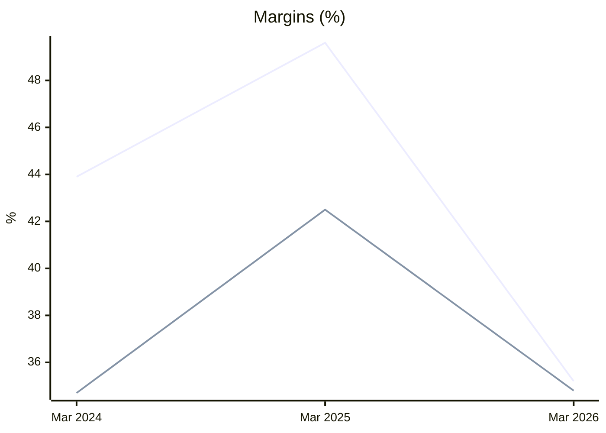

*Run 2026-11-24 · part of [SPINOFF_REPORT.md](../SPINOFF_REPORT.md) · the complete analysis of one company, with every management-call exchange in full.*

## NATCOPHARM — NATCO Pharma Ltd.

### 1. NATCO Pharma Ltd. — CONFIRMED DEMERGER

**CONFIRMED** (a demerger scheme is on the exchange record) · **PRE-SPIN — study the parent; the pieces do not trade yet** · score 6.4/10 · spin-off · 20 filing(s) from CALLS, NSE, NSE-BM, NSE-deep · first 2025-11-14, latest 2026-09-09

**The separated entities — every one the documents name:**

| Entity | Scheme | Business | Listing | Who runs it |
|---|---|---|---|---|
| **Natco Crop Health Sciences Limited** | 2026 demerger of the Agrochemicals Undertaking of NATCO Pha… | Agrochemicals Undertaking: research, development, manufacturing and marketing of pesticides, insecticides, he… | to be listed ("the Resulting Company is proposed to be list… | not stated (Sri P.S.R.K. Prasad, Director & Execu… |

**What is being separated, as the documents put it:** Agrochemicals (Crop Health Sciences) division — pesticides, insecticides, herbicides, biostimulants — demerged into Natco Crop Health Sciences Limited — class `value_unlocking`.

### 2. Stages and dates

> **Listing:** NOT YET — scheme at 'exchange_noc' stage; Natco Crop Health Sciences Limited will list only after NCLT sanction, effectiveness and a record date; no listing timeline stated

| Date | Event | Source |
|---|---|---|
| 2025-09-25 | Board approval — NATCO Pharma Limited | as stated: Board meeting of 25 September 2025 — "The Board of Directors, at its … |
| 2025-11-14 | Other — Natco Crop Health Sciences Limited | as stated: Outcome of Board Meeting, 14 November 2025 — "the Board has approved … |
| 2025-12-31 | Other — Natco Crop Health Sciences Limited | as stated: Outcome of Board Meeting, 14 November 2025, Annexure — "Indicative ti… |
| 2026-03-24 | Stage reached: **announced** | [Outcome of Board Meeting](https://nsearchives.nseindia.com/corporate/NATCOPHARM_24032026171413_OutcomeOfBoardMeeting_24032026.pdf) |
| 2026-03-24 | Board approval — NATCO Pharma Limited and Natco Crop Health Sciences Limited | as stated: Outcome of Board Meeting, 24 March 2026 — Board approved the Scheme o… |
| 2026-09-09 | Stage reached: **exchange noc** | [Outcome of Board Meeting](https://nsearchives.nseindia.com/corporate/NATCOPHARM_09092026115332_BoardOutcome09092026.pdf) |
| 2026-09-09 | Other — NATCO Pharma Limited | as stated: Outcome of Board Meeting, 9 September 2026 — Board "decided to conseq… |
| 2026-10 | Other — Natco Crop Health Sciences Limited | as stated: Q3 FY26 earnings call, 12 February 2026 (management target) — "I thin… |
| 2026-10-01 | Appointed date — Natco Crop Health Sciences Limited | as stated: Outcome of Board Meeting, 24 March 2026 — "The Appointed Date under t… |

**The stages, as filed:** announced (2026-03-24) → exchange noc (2026-09-09)

**Stated in the filings:** resulting company **Natco Crop Health Sciences Limited**.

### 3. Size of the separated business beside the parent — is institutional selling likely?

**Reading: VERY LIKELY — the piece is under a tenth of the whole; index funds and large holders who receive it without choosing it tend to sell.**

| Entity | Stated turnover | Stated share of the whole | Market cap (₹ cr) | Share of the whole by market cap | Segment revenue share | Index member | Selling on size |
|---|---|---:|---:|---:|---:|---|---|
| Natco Crop Health Sciences Limited | "The turnover of the Demerged Undertaking i.e., Agrochemica… | 1.48% (share of turnover) | — | — | 3.4% (FY2026) | not listed | very likely |

*Stated figures are the documents' own (a turnover share, or the cost-of-acquisition split the company publishes for tax, which reflects relative value). The market-cap share is the entity's value over the whole — the parent plus every separated entity that trades (parent ₹15,898 cr, whole ₹15,898 cr, NSE bhavcopy of 2026-11-13); the segment share is the business's revenue over the parent's reported sales of that year. Both are computed here. The reading uses the market-cap share when the entity trades, else the stated share, else the segment share.*

**In the documents' words:** “The turnover of the Demerged Undertaking i.e., Agrochemicals Business division as on 31st March, 2025 was ₹ 60,62,03,918 /-. The turnover of the Demerged Undertaking is 1.48% to the total turnover of the Company in the financial year ending 31st March, 2025.”

**The judge's read of selling pressure:** likely — Tiny (1.48% of turnover), loss-making, different industry; 4,22,879 pharma shareholders receive 1:1 agrochemical shares, with parent holding 20%.

### 4. Insider ownership — share swap, promoters' holding, management incentives

**Share swap / entitlement, entity by entity:**

- **Natco Crop Health Sciences Limited:** "1 (One) fully paid up Equity Share of INR 2/- (Rupee Two only) each of the Resulting Company shall be issued and allotted for every 1 (One) fully paid up equity share of INR 2/- (Rupee Two only) each held in the Demerged Company". The Board decided on 9 September 2026 "to maintain the share swap ratio in the revised Scheme the same as the one proposed in the Scheme" after the Rights Issue.

**Promoters' holding, from the shareholding pattern:**

| Company | Promoters | FIIs | DIIs | Public | Quarter |
|---|---:|---:|---:|---:|---|
| NATCO Pharma Ltd. (NATCOPHARM) | 46.22% | 15.37% | 10.82% | 27.59% | Oct 2026 |

*Source: screener.in shareholding pattern, stored under `ShareholdingPattern/NiftyTotalMarket/`. In a mirror demerger each shareholder holds the same proportion of the new company as of the parent on the record date.*

- **Promoters in the parent, per the documents:** not stated as a percentage. The 43rd AGM voting results show "Promoter and Promoter Group" holding 88,465,126 shares out of 179,109,870 total shares as on the cut-off date of 25th September, 2026.
- **What the promoters will hold in the separated entity:** 2026 demerger — mirror holding, verbatim: "Post the implementation of the Scheme, the shareholders of the Demerged Company will directly hold about 80% in the Resulting Company, proportionate to their shareholding in the Demerged Company; the balance stake of about 20% in the Resulting Company will be held by the Demerged Company." And: "Overall, the shareholders of the Demerged Company will hold 100% of the ultimate beneficial economic interest in the Agrochemicals Undertaking (direct holding of about 80% and indirect holding of about 20% through the Demerged Company)." Promoter holding in the Resulting Company is not separately stated as a percentage.
- **What a public shareholder receives:** Under the 2026 demerger: "1 (One) fully paid up Equity Share of INR 2/- (Rupee Two only) each of the Resulting Company shall be issued and allotted for every 1 (One) fully paid up equity share of INR 2/- (Rupee Two only) each held in the Demerged Company", issued "to all the members of the Demerged Company, holding fully paid-up equity shares on the Record Date". "No cash consideration is payable under the Scheme." Shareholders keep their existing NATCO Pharma Limited shares: "There will be no change in the shareholding pattern of the Demerged Company."
- **Management incentives:** No stock options, RSUs or SARs are stated anywhere in these documents; basic and diluted EPS are identical in all periods shown. Insider shareholding disclosed for the director seeking re-appointment, Sri P.S.R.K. Prasad: "Percentage of shares held 0.02%" and "Remuneration drawn by the Director(s) for Financial Year 2025-26: H 21.73 million". Treatment of existing grants in the Scheme and any new plan in the Resulting Company: not stated.
- **Insider actions around the separation:** No promoter or management buying, selling or pledging is stated. Trading windows were closed around the separation and the fund raising: "TRADING WINDOW for dealing in the securities of the Company by the Employee(s) , connected persons and their immediate relatives will be closed from 19th March , 2026 to 26th March , 2026 (both days inclusive)" ahead of the Scheme approval, and "closed from 23rd September, 2026 till 48 hours after the intimation of the Outcome of the Board Meeting" ahead of the Rights Issue terms. Promoter and Promoter Group voted 87,079,540 of 88,465,126 shares (98.43%) at the 43rd AGM, all in favour. Promoter subscription intent in the Rights Issue: not stated. Management on buybacks: "buyback can also be considered at the right time. But at this point, my thinking is that let's spend money on it."
- **Insiders, per the checklist read:** Promoter and Promoter Group hold 8,84,65,126 of 17,91,09,870 shares (~49%); 1:1 entitlement carries that stake into the Resulting Company. Demerged Company retains 20% post-listing; director P.S.R.K. Prasad sits on Natco Crop Health Sciences' board. · *option pricing date:* not stated

### 5. Why the demerger — point by point

NATCO is demerging its Crop Health Sciences (Agrochemicals) division into Natco Crop Health Sciences Limited, leaving the listed parent as a pure pharmaceutical company (FDFs, APIs, oncology-led branded/complex generics). Management's stated reason is that the two verticals carry different risk-reward profiles and serve entirely different customers — Rajesh Chebiyam said the demerger "gives a more focused approach because the business, ultimately, the customers are quite different" — so a dedicated management, channel and product strategy (differentiated, patent-controlled, limited-competition molecules like the fungicide GLANZ and CTPR combinations) can be run without competing for attention inside a much larger pharma P&L. The second reason is valuation and capital: agro turnover was only INR 60.62 crore in FY25, i.e. 1.48% of total turnover, against FY25 group revenue of INR 4,784 crore and PAT of INR 1,883.4 crore, and Rajeev Nannapaneni said shareholders "will get another business which is not being valued in our system because it is of a very tiny business and a very large business in pharma"; separately listed, "it can raise its own capital and grow by itself." The timing was deliberately set after the division approached breakeven — segment loss of about INR 150 crore in FY25 (including a INR 50 crore non-cash PP&E impairment taken in Q4 FY25), narrowing to a INR 3.2 crore loss in Q1 FY26 on INR 34.7 crore of sales, EBITDA-positive at INR 52.4 crore of sales in Q2 FY26, and roughly INR 140 crore of FY26 sales versus INR 60 crore the prior year, against the INR 150–170 crore management had said was needed for EBITDA breakeven. The Scheme adds the corporate-finance logic: focused growth, operational rationalisation, optimum use of resources, and the ability for each business to "address independent business opportunities, pursue efficient capital allocation and attract different sets of investors, strategic partners, lenders and other stakeholders," plus unlocking the value of the verticals. Shareholders get 1 share of the resulting company for every 1 NATCO share, with NATCO retaining 20% of the post-listing equity to keep supporting a business "still at its early growth stages" — so holders retain 100% of the ultimate economic interest (80% direct, 20% through NATCO). The push came from public-market shareholders, not lenders or partners: an investor on the Nov 14, 2025 call asked directly about "value unlocking for the shareholders," and management separately cited shareholder feedback that NATCO's profit base was too concentrated. Agro is almost entirely domestic ("predominantly domestic" sales, with 25–30% input cost inflation flagged in 2026), which management contrasts with the export-weighted pharma business.

**Point by point, with the source:**

1. First public confirmation of the plan: demerge Crop Health Sciences out of the parent and list it separately, targeted for 2026, disclosed alongside the division reaching roughly EBITDA breakeven at INR 52.4 crore of quarterly sales. “I think we have announced earlier that we will demerge this business from the main company and list it separately and we are targeting that for the year 2026.” — *[Nov 2025](https://www.bseindia.com/stockinfo/AnnPdfOpen.aspx?Pname=ac8f848f-8703-4403-9ae3-cb2d420d47da.pdf)*
2. Rajeev defines the value-unlock logic in response to an investor question: separate listing gives the business special focus and the ability to raise its own capital and grow independently, now that it is breaking even. “Value unlocking means I think what we see is this business now is about breaking even now. So, we will list it separately and then we will have special focus on this and it can raise its own capital and grow by itself.” — *[Nov 2025](https://www.bseindia.com/stockinfo/AnnPdfOpen.aspx?Pname=ac8f848f-8703-4403-9ae3-cb2d420d47da.pdf)*
3. The core valuation argument: the agro business is too small to be valued inside a pharma company of NATCO's size, and shareholders will get a complete see-through into both businesses. “I think you will get another business which is not being valued in our system because it is of a very tiny business and a very large business in pharma.” — *[Nov 2025](https://www.bseindia.com/stockinfo/AnnPdfOpen.aspx?Pname=ac8f848f-8703-4403-9ae3-cb2d420d47da.pdf)*
4. Timeline guidance: the process has started, with an internal goal of completing in the next 8–9 months (around October–November 2026), but no firm date committed. “I think we have started the process. So , I think roughly, we're thinking by October, November, but I don't want to say any definite time lines, but this is our, what should I say, goal to do.” — *[Feb 2026](https://www.bseindia.com/stockinfo/AnnPdfOpen.aspx?Pname=7ea4dc21-a77e-4e6d-967e-2da2d51bc890.pdf)*
5. Management's clearest operating rationale, from the head of Crop Health Sciences: a focused approach is needed because the agro customer base is entirely different from pharma, with FY26 agro sales of about INR 140 crore versus INR 60 crore the year before. “So, as you're aware, so we're in the process of demerging the business. And one of the primary reasons we felt also it gives a more focused approach because the business, ultimately, the customers are quite different.” — *[Jun 2026](https://www.bseindia.com/stockinfo/AnnPdfOpen.aspx?Pname=230327e4-9a77-4095-b46d-b9c836cc9b96.pdf)*
6. Growth plans — new differentiated, patent-controlled, limited-competition products, more channel partners and more people — are tied directly back to the demerger as the reason for sharper focus. “So I think we're fairly confident going forward. And that's also one of the main reasons for demerging and having more focus on the business.” — *[Jun 2026](https://www.bseindia.com/stockinfo/AnnPdfOpen.aspx?Pname=230327e4-9a77-4095-b46d-b9c836cc9b96.pdf)*
7. The Mar 24, 2026 Scheme of Arrangement grounds the demerger in differing risk-reward profiles of the pharmaceutical and agrochemicals verticals; agro turnover was INR 60.62 crore in FY25, 1.48% of total company turnover. “The Board of Directors of the Demerged Company believe that the risk and reward associated with each of the aforesaid business verticals are different.” — *Scheme*
8. The Scheme's capital-markets rationale: each business can chase its own opportunities, allocate capital efficiently and attract its own investor and lender base, alongside focused growth, operational rationalisation and value unlocking. “Each business would be able to address independent business opportunities, pursue efficient capital allocation and attract different sets of investors, strategic partners, lenders and other stakeholders.” — *Scheme*
9. NATCO keeps 20% of the post-listing equity of the resulting company so it can keep funding and strategically supporting an early-stage business; shareholders get 1 new share for every 1 NATCO share, retaining 100% of the ultimate economic interest (80% direct plus 20% indirect). “Further, the Demerged Company intends to retain the current shareholding in the Resulting Company (20% of post listing shareholding) in order to continue to offer support to the Agrochemicals Business which is still at its early growth stages and help in monitoring the progress and providing strategic support.” — *Scheme*
10. The Nov 14, 2025 board filing states the purpose as unlocking value in the core pharmaceutical business while giving each entity operational flexibility, dedicated management and separate brand positioning. “To demerge the Agro business of the Company into a separate entity, the move shall enable value unlocking of the core business (pharmaceuticals) and enhance long -term growth.” — *Scheme*
11. Pre-demerger baseline for why the division was a drag: a INR 50 crore non-cash impairment on agro property, plant and machinery in Q4 FY25, FY25 agro revenue of about INR 60 crore, and INR 160–170 crore needed just to be EBITDA positive. “So, I think this year, we feel we are going to hit that critical mass where we'll start breaking even. We are doing about INR60 crores net revenue last year. So, I think we need to hit about INR160 crores to INR170 crores at least to have that EBITDA positive.” — *[Jun 2025](https://www.bseindia.com/stockinfo/AnnPdfOpen.aspx?Pname=d43e2593-6819-4d99-b9a6-c3019c901490.pdf)*
12. The Sep 9, 2026 board update: the Scheme had received observation letters from both exchanges but was not filed with the NCLT because the INR 1,300 crore rights issue changes the capital structure, so the Scheme will be amended and re-filed post-issue with the swap ratio unchanged. “The fund raising by way of a Rights Issue proposed at the meeting of the board of directors held on September 09, 2026 is expected to result in change to the Company's capital structure and shareholding pattern and consequently would require necessary changes to the Scheme.” — *Scheme*

**How it evolved:** On the Feb 13, 2025 and May 29, 2025 calls there was no demerger talk — only agro losses, the INR 50 crore impairment and a INR 120–170 crore breakeven target; the Aug 13, 2025 call reported the loss down to INR 3.2 crore with still no mention. The board gave in-principle approval to evaluate the demerger on Sep 25, 2025, and Rajeev first discussed it publicly on the Nov 14, 2025 call ("demerge this business from the main company and list it separately... targeting that for the year 2026"), framing it as value unlocking plus the ability to raise its own capital; the board approved incorporating the wholly-owned resulting company on Nov 14, 2025. On Feb 12, 2026 the timeline was guided to "October, November" 2026 (8–9 months), and the Scheme itself was approved on Mar 24, 2026 with a 1:1 share entitlement, appointed date Oct 1, 2026 and 20% retained by NATCO; the May 29, 2026 call reiterated focus and different customers as the primary reason. By Sep 9, 2026 the Scheme had stock-exchange observation letters but had not been filed with the NCLT, because the INR 1,279.36 crore rights issue at INR 750/share (allotted Oct 23, 2026) changes the capital structure — the board decided to re-cut and re-file the Scheme after the rights issue while keeping the same swap ratio.

**What management expects from it:** Agro: dedicated management focus, its own capital raising, differentiated limited-competition products, growth past breakeven from roughly INR 140 crore sales. Pharma: a cleaner, focused oncology/complex-generics entity. For shareholders: value unlocked in a business "not being valued in our system," a complete see-through into both, operational efficiency, efficient capital allocation, and distinct investor/lender bases.

*Not explained on the calls:* No standalone agro financials, debt/asset split, valuation or swap-ratio basis; no post-demerger profitability, capital needs, board/management, listing date, or revised Scheme terms.

- *Stated reason, in one line:* Risk and reward of the pharmaceutical and agrochemicals verticals differ; segregation enables focused growth, operational efficiency, independent capital allocation, different investor sets, and is expected to unlock the value of the business verticals.
- *What it reveals:* Demerged turnover was only ₹60.62 crore, 1.48% of total; FY25 agro segment result was a ₹1,458 million loss. Management says it reached ~₹140 crore sales and roughly EBITDA breakeven. Separation removes a loss-maker from pharma and exposes an early-growth agro business.
- *Parent or spin:* parent · *Read next:* The revised Scheme to be filed with Stock Exchanges post Rights Issue — check the share swap ratio and agro segment numbers.
- *In their words:* “The segregation is also expected to unlock the value of the business verticals of the Demerged Company.”

### 6. On the calls, verbatim

2 call(s), oldest first: **3 question-and-answer exchange(s)** given in full — the question and every answer to it, nothing trimmed — and 0 passage(s) from management's prepared remarks (the complete sentences about it; the whole remarks are in the linked transcript). Text is as the transcript prints it.

#### Nov 2025 — [transcript](https://www.bseindia.com/stockinfo/AnnPdfOpen.aspx?Pname=ac8f848f-8703-4403-9ae3-cb2d420d47da.pdf)

**Question and answer**

> **Guru:** Thank you for that. The other question part of it is like real value. Is there any opportunity of value unlocking for the shareholders when it comes to the ROW business , what would be the value unlocking that we can expect , not accurately, but at least some kind of an indicative thing on the value unlock that you probably plan for the agro diversification or whatever is in the pipeline ?
>
> **Rajeev Nannapaneni:** I think the idea here is that we will demerge the company , I think we are planning the demerger , I think we have announced it. So, we will list that entity maybe sometime in 2026 once all the clearances come through. Value unlocking means I think what we see is this business now is about breaking even now. So, we will list it separately and then we will have special focus on this and it can raise its own capital and grow by itself. Somewhere, I think that business in our setup, it is a very small business. So, I think it will be good for the shareholders. You will get a complete see-through in our crop business and you also have a phar maceutical business. So , I think the real value, I think you will see it in 2026. What numbers and all, very hard to predict right now .

**Question and answer**

> **Guru:** That is understood. I mean, can we expect some value unlocking , can we see that as an opportunity? Sorry about that. I think my question more is not on numbers. More of like indicative comments from your side on would that be a good opportunity for shareholder value unlocking, the demerger ? That is all I wanted to understand.
>
> **Rajeev Nannapaneni:** Absolutely, yes. I think you will get another business which is not being valued in our system because it is of a very tiny business and a very large business in pharma. So, this business will get more attention and I think shareholders will be duly rewarded for the fact that it has been demerged.
>
> **Guru:** Understood.
>
> **Rajeev Nannapaneni:** Thank you.

#### Jun 2026 — [transcript](https://www.bseindia.com/stockinfo/AnnPdfOpen.aspx?Pname=230327e4-9a77-4095-b46d-b9c836cc9b96.pdf)

**Question and answer**

> **Neeraj Kayal:** Sir, I wanted to ask you about our Crop Sciences division. I wanted to understand this division, the industry, if you can give any color on that and our business?
>
> **Rajeev Nannapaneni:** That's a good question. So, I think my colleague, Rajesh will answer and he'll also tell us abo ut our demerging process as well.
>
> **Rajesh Chebiyam:** So, as you're aware, so we're in the process of demerging the business. And one of the primary reasons we felt also it gives a more focused approach because the business, ultimately, the customers are quite different. See, one of the key things we are pursuin g as part of our approach is, again, trying to find molecules which are a little differentiated from most of the other players. And the approach that we have taken towards pharma, right? So products which could be unique, which could be patent controlled, limited competition. So that's the approach that we are taking. So we are slowly building on overall presence in the market, right? It's been only 3, 4 years of our commercial presence actually. And so the past 2 years has been mostly learning in terms of how the market works and all that. But we believe that once you have a very strong product and with the right offering to the farmers, I think we can do wonders. So yes. So in terms of sale, let's say, this year, we ended up close to INR140 crores, right? And as opposed to a declared number for last year was about INR60 crores. Natco Pharma Limited May 29 , 202 6 So from INR140 crores, we certainly have aspirations to grow significantly well. It's also being driven by product launches as well as the penetration with the channels, okay? So the channel partners that we have as compared to most of our peers is still less. So this is the primary. So both products, channels and a lso the people additions. So all these activities are going on. So I think we're fairly confident going forward. And that's also one of the main reasons for demerging and having more focus on the business.

### 7. The parent's financial statements

**The parent, last three fiscal years (consolidated)**

| | Mar 2024 | Mar 2025 | Mar 2026 |
|---|---:|---:|---:|
| Sales (₹ cr) | 3,999 | 4,430 | 4,078 |
| Sales growth (%) | +47.7% | +10.8% | -7.9% |
| Operating profit (₹ cr) | 1,754 | 2,196 | 1,436 |
| Operating profit growth (%) | +87.4% | +25.2% | -34.6% |
| Operating margin (%) | 43.9 | 49.6 | 35.2 |
| PAT (₹ cr) | 1,388 | 1,883 | 1,418 |
| PAT growth (%) | +94.1% | +35.7% | -24.7% |
| PAT margin (%) | 34.7 | 42.5 | 34.8 |
| EPS (₹) | 77.5 | 105 | 79.2 |

*Source: ProfitStatement/NiftyTotalMarket/NATCOPHARM.csv (consolidated, screener.in); growth and margins computed here.*

```mermaid
xychart-beta
    title "Sales, operating profit and PAT (₹ cr)"
    x-axis ["Mar 2024", "Mar 2025", "Mar 2026"]
    y-axis "₹ crore"
    bar [3999, 4430, 4078]
    bar [1754, 2196, 1436]
    bar [1388, 1883, 1418]
```

*Series in order: Sales, Operating profit, PAT.*

*Series in order: Operating margin, PAT margin.*

**P/E:** 11.6 — live market file (screener.in), trailing (price ₹917.00 as of 2026-08-02).

**Cash flows (₹ cr):**

| | Mar 2024 | Mar 2025 | Mar 2026 |
|---|---:|---:|---:|
| Cash from operations (₹ cr) | 1,212 | 1,697 | 1,768 |
| Cash from investing (₹ cr) | -1,026 | -1,436 | -2,082 |
| Cash from financing (₹ cr) | -247 | -211 | 298 |
| Net cash flow (₹ cr) | -62.0 | 50.0 | -16.0 |
| Free cash flow (₹ cr) | 855 | 1,300 | 1,379 |

*Source: CashFlow/NiftyTotalMarket/NATCOPHARM.csv (consolidated, screener.in).*

### 8. The separated business's financial statements

**The business being separated — its own numbers**, entity by entity: its reported statements once it is listed and on file, and the segment numbers the annual reports and presentations carry for it before that.

**Agro Chemicals (Agrochemicals Undertaking / Crop Health Sciences (CHS) division) → Natco Crop Health Sciences Limited** · unit ₹ million · Annual figures are consolidated Ind AS 108 reportable-segment disclosures: 'Segment revenue' (revenue from operations, no inter-segment revenue reported — unallocated nil) and 'Segment results' = segment profit before finance cost and tax (EBIT-type segment result; FY2025 result includes a ₹500 mn impairment loss on PPE of the Agro Chemicals segment). Segment assets/liabilities exclude unallocated items. No segment PAT, capex or depreciation disclosed.

| | FY2024 | FY2025 | FY2026 |
|---|---:|---:|---:|
| Revenue (₹ million) | 1,083 | 606 | 1,382 |
| Revenue growth (%) | — | -44.0% | +128.1% |
| Operating profit (₹ million) | -596 | -1,458 | -198 |
| Operating profit growth (%) | — | -144.6% | +86.4% |
| Operating margin (%) | -55.0 | -241 | -14.3 |
| PAT (₹ million) | — | — | — |
| PAT growth (%) | — | — | — |
| Segment assets (₹ million) | 4,238 | 2,712 | 3,022 |
| Segment liabilities (₹ million) | 588 | 314 | 520 |
| Capital employed (₹ million) | 3,650 | 2,398 | 2,502 |
| Return on capital employed (%) | -16.3 | -60.8 | -7.9 |
| Segment assets / revenue (x) | 3.9 | 4.5 | 2.2 |
| Capex (₹ million) | — | — | — |

*Sources:* Annual Report 2024 — page 329; Annual Report 2024 — page 330; Annual Report 2025 — page 302; Annual Report 2025 — page 303; Annual Report 2026 — page 316

*Latest quarter (Q2 FY27):* revenue 610, operating profit None — Presentation Nov 2026 — page 6

*Not in the pages read:* No segment PAT, capex, depreciation, or quarterly profit for Crop Health Sciences; presentations give CHS revenue only.

*Documents on file:* [Annual Report 2026](https://www.bseindia.com/xml-data/corpfiling/AttachHis/0d25dc00-4a7e-4acc-b5a8-d747c870ab2f.pdf); [Annual Report 2025](https://www.bseindia.com/xml-data/corpfiling/AttachHis/08737473-9fef-496b-881b-746b8ab600b1.pdf); [Annual Report 2024](https://www.bseindia.com/xml-data/corpfiling/AttachHis/d5a992a3-1b5a-44b4-8e5b-343b600e56fc.pdf); [Presentation Nov 2026](https://www.bseindia.com/stockinfo/AnnPdfOpen.aspx?Pname=0ce9cb9d-1ebf-4916-9a1b-c3c98e19e819.pdf); [Presentation Aug 2026](https://www.bseindia.com/stockinfo/AnnPdfOpen.aspx?Pname=02c8ef3b-6c4b-470e-83f0-69e880a97e9d.pdf); [Presentation Jun 2026](https://www.bseindia.com/stockinfo/AnnPdfOpen.aspx?Pname=f192f32c-197f-430f-b27f-7338ba5ee9a8.pdf); [Presentation Feb 2026](https://www.bseindia.com/stockinfo/AnnPdfOpen.aspx?Pname=236bc8c2-778b-4af2-a104-b4e902651e29.pdf); [Presentation Nov 2025](https://www.bseindia.com/stockinfo/AnnPdfOpen.aspx?Pname=c5fe60cd-6aa5-4ff4-9fd3-1e93a3014e6e.pdf); [Presentation Aug 2025](https://www.bseindia.com/stockinfo/AnnPdfOpen.aspx?Pname=c755548f-c325-46ba-8d7a-8c2108a36a18.pdf)

### 9. Other financial differences — working capital, margins, returns, debt

| Metric (latest year) | Parent (NATCOPHARM) | Natco Crop Health Sciences Limited |
|---|---:|---:|
| *Basis* | *reported, consolidated* | *segment numbers (Agro Chemicals (Agrochemical…* |
| Sales (₹ cr) | 4,078 (Mar 2026) | — |
| Sales growth (%) | -7.9 (Mar 2026) | 128.1 (FY2026) |
| Operating margin (%) | 35.2 (Mar 2026) | -14.3 (FY2026) |
| Operating profit growth (%) | -34.6 (Mar 2026) | 86.4 (FY2026) |
| PAT margin (%) | 34.8 (Mar 2026) | — |
| ROCE % | 17 (Mar 2026) | -7.9 (FY2026) |
| Debtor Days | 79 (Mar 2026) | — |
| Inventory Days | 480 (Mar 2026) | — |
| Days Payable | 216 (Mar 2026) | — |
| Cash Conversion Cycle | 343 (Mar 2026) | — |
| Working Capital Days | 163 (Mar 2026) | — |
| Debt / equity (x) | 0.1 (Mar 2026) | — |
| Borrowings (₹ cr) | 714 (Mar 2026) | — |
| Segment assets / revenue (x) | — | 2.2 (FY2026) |
| Sales (₹ million) | — | 1,382 (FY2026) |

*Each figure is the latest on file, with its year. Working-capital days and ROCE come from the stored working-capital file; segment figures from the pages cited in part 8. A dash means the documents do not carry it.*

**What stays with the parent — its segments, from the same pages:**

| Remaining segment | Revenue | Operating margin | ROCE | Segment assets / revenue | Unit | Year |
|---|---:|---:|---:|---:|---|---|
| Pharmaceuticals (bulk drugs and finished dosage formulations) | 39,401 | 39.3% | 18.9% | 2.46x | ₹ million | FY2026 |

**What the documents themselves say about the differences:**

- **growth** — parent / remaining: Pharmaceutical business declining as Lenalidomide/Revlimid exclusivity ends: consolidated revenue INR4,375.9 crores in FY26 vs INR4,784 crores in FY25; FY27 guidance of INR3,400–3,500 crores revenue and INR700–750 crores PAT, with 15%–25% compounding only from FY28.; separated business: Agrochemicals growing from a small base — roughly ₹60 crore in FY25 to about ₹140 crore in FY26, driven by product launches, channel expansion and people additions; commercial presence of only 3–4 years. “So yes. So in terms of sale, let's say, this year, we ended up close to INR140 crores, right? And as opposed to a declared number for last year was about INR60 crores.”
- **operating margin** — parent / remaining: Pharmaceuticals segment result ₹6,334 million for the quarter ended 30-09-2025 and ₹24,611 million for the year ended 31-03-2025; consolidated EBITDA margin 46.4% in Q2FY26 and 30.7% in Q3FY26.; separated business: Agro chemicals segment result negative: ₹(66) million for the quarter ended 30-09-2025, ₹(98) million for the half year, and ₹(1,458) million for the year ended 31-03-2025; around break-even at EBITDA level by Q2FY26. “And if you look at the business, now it has grown to about 52 crores this quarter. So, we are at least close to EBITDA positive now. Earlier, we were losing money.”
- **cash** — parent / remaining: Group net cash of about INR2,400 crores (Q4 FY26), reserved for acquisitions rather than a buyback; a further Rights Issue of ₹1,279.36 crore was allotted on 23 October 2026 at ₹750 per share.; separated business: The Resulting Company is expected to raise its own capital after listing, with the Demerged Company retaining about 20% to support it. “So, we will list it separately and then we will have special focus on this and it can raise its own capital and grow by itself.”
- **other** — parent / remaining: Pharmaceutical Undertaking is the mature, cash-generating core with robust R&D capabilities and a US/Brazil/Canada/India/South Africa footprint; R&D spend guided at 7%–9% of sales.; separated business: Agrochemicals is described as still at its early growth stages, with the Demerged Company retaining about 20% post-listing to provide support, monitoring and strategic input; business is predominantly domestic and so more exposed to the 25%–30% rise in input raw material costs. “Further, the Demerged Company intends to retain the current shareholding in the Resulting Company (20% of post listing sh arehold ing) in order to continue to offer support to the Agrochemicals Business which is still at its early growth stages and help in monitoring the progress and providing strategic support.”
- **other** — parent / remaining: Risk and reward profile of the Pharmaceutical vertical differs from the Agrochemicals vertical; demerger intended to unlock value and allow focused capital allocation and different investor sets for each.; separated business: Separate legal entity with dedicated management, different customers and different brand positioning; expected to attract different sets of investors, strategic partners and lenders. “The Board of Directors of the Demerged Company believe that the risk and reward associated with each of the aforesaid business verticals are different.”

**The checklist:**

| Item | Status | Evidence |
|---|---|---|
| Why the spin-off | yes | value unlocking for shareholders; unrelated businesses separated; regulatory / strategic knot — “…t it. Guru: Thank you for that. The other question part of it is like real value. Is there any opportunity of value unlocking for the shareholders when it comes to the ROW business , what would be the value unlocking th” |
| Institutional selling likely (small / different business) | partly | the businesses are described as distinct |
| Insider ownership and incentives aligned | unknown | no promoter-continuity or option-pricing language found *(next: the date the management options are priced; promoter holding in the resulting company)* |
| A hidden value revealed (pro-forma, leverage, comparables) | yes | borrowings 714 cr (Mar 2026) = 0.04× market cap; P/E 11.6 on Mar 2026 profit vs industry median 52.7 (45 peers) |
| Parent before the spin (clean parent, takeover prelude) | partly | stage exchange_noc — the spin has not happened; the parent can still be bought whole |
| Timing (first year sells, second year gains) | partly | not yet listed — 375 days since the first filing, stage exchange_noc |
| Management discussing it on the calls | yes | 9 mention(s) in the last 12 months of calls — “…a lso the people additions. So all these activities are going on. So I think we're fairly confident going forward. And that's also one of the main reasons for demerging and having more focus on the business. Moderator: ” |

**On the calls (last 12 months):**

- *Nov 2025* (forward) — “…ill see. So, I think that is how we want to look at it. Guru: Thank you for that. The other question part of it is like real value. Is there any opportunity of value unlocking for the shareholders when it comes to the ROW business , what would be the value unlocking that we can expect , not accurately, but at least some kind of an in…”
- *Nov 2025* (forward) — “…question part of it is like real value. Is there any opportunity of value unlocking for the shareholders when it comes to the ROW business , what would be the value unlocking that we can expect , not accurately, but at least some kind of an indicative thing on the value unlock that you probably plan for the agro diversification or w…”
- *Nov 2025* (forward) — “…when it comes to the ROW business , what would be the value unlocking that we can expect , not accurately, but at least some kind of an indicative thing on the value unlock that you probably plan for the agro diversification or whatever is in the pipeline ? Rajeev Nannapaneni: I think the idea here is that we will demerge the comp…”
- *Nov 2025* (forward) — “…the value unlock that you probably plan for the agro diversification or whatever is in the pipeline ? Rajeev Nannapaneni: I think the idea here is that we will demerge the company , I think we are planning the demerger , I think we have announced it. So, we will list that entity maybe sometime in 2026 once all the clearances…”
- *Nov 2025* (forward) — “…ro diversification or whatever is in the pipeline ? Rajeev Nannapaneni: I think the idea here is that we will demerge the company , I think we are planning the demerger , I think we have announced it. So, we will list that entity maybe sometime in 2026 once all the clearances come through. Value unlocking means I think what we…”

The filings

| Date | Category | Headline | Attachment |
|---|---|---|---|
| 2025-11-01 | Earnings call Nov 2025 | …ill see. So, I think that is how we want to look at it. Guru: Thank you for that. The other question part of it is like real value. Is there any opportunity of | [pdf](https://www.bseindia.com/stockinfo/AnnPdfOpen.aspx?Pname=ac8f848f-8703-4403-9ae3-cb2d420d47da.pdf) |
| 2025-11-01 | Earnings call Nov 2025 | …question part of it is like real value. Is there any opportunity of value unlocking for the shareholders when it comes to the ROW business , what would be the  | [pdf](https://www.bseindia.com/stockinfo/AnnPdfOpen.aspx?Pname=ac8f848f-8703-4403-9ae3-cb2d420d47da.pdf) |
| 2025-11-01 | Earnings call Nov 2025 | …when it comes to the ROW business , what would be the value unlocking that we can expect , not accurately, but at least some kind of an indicative thing on the | [pdf](https://www.bseindia.com/stockinfo/AnnPdfOpen.aspx?Pname=ac8f848f-8703-4403-9ae3-cb2d420d47da.pdf) |
| 2025-11-01 | Earnings call Nov 2025 | …the value unlock that you probably plan for the agro diversification or whatever is in the pipeline ? Rajeev Nannapaneni: I think the idea here is that we will | [pdf](https://www.bseindia.com/stockinfo/AnnPdfOpen.aspx?Pname=ac8f848f-8703-4403-9ae3-cb2d420d47da.pdf) |
| 2025-11-01 | Earnings call Nov 2025 | …ro diversification or whatever is in the pipeline ? Rajeev Nannapaneni: I think the idea here is that we will demerge the company , I think we are planning the | [pdf](https://www.bseindia.com/stockinfo/AnnPdfOpen.aspx?Pname=ac8f848f-8703-4403-9ae3-cb2d420d47da.pdf) |
| 2025-11-01 | Earnings call Nov 2025 | …I think we are planning the demerger , I think we have announced it. So, we will list that entity maybe sometime in 2026 once all the clearances come through.  | [pdf](https://www.bseindia.com/stockinfo/AnnPdfOpen.aspx?Pname=ac8f848f-8703-4403-9ae3-cb2d420d47da.pdf) |
| 2025-11-01 | Earnings call Nov 2025 | …nk the real value, I think you will see it in 2026. What numbers and all, very hard to predict right now . Guru: That is understood. I mean, can we expect some | [pdf](https://www.bseindia.com/stockinfo/AnnPdfOpen.aspx?Pname=ac8f848f-8703-4403-9ae3-cb2d420d47da.pdf) |
| 2025-11-01 | Earnings call Nov 2025 | …rry about that. I think my question more is not on numbers. More of like indicative comments from your side on would that be a good opportunity for shareholder | [pdf](https://www.bseindia.com/stockinfo/AnnPdfOpen.aspx?Pname=ac8f848f-8703-4403-9ae3-cb2d420d47da.pdf) |
| 2025-11-01 | Earnings call Nov 2025 | …nk my question more is not on numbers. More of like indicative comments from your side on would that be a good opportunity for shareholder value unlocking, the | [pdf](https://www.bseindia.com/stockinfo/AnnPdfOpen.aspx?Pname=ac8f848f-8703-4403-9ae3-cb2d420d47da.pdf) |
| 2025-11-01 | Earnings call Nov 2025 | …ess and a very large business in pharma. So, this business will get more attention and I think shareholders will be duly rewarded for the fact that it has been | [pdf](https://www.bseindia.com/stockinfo/AnnPdfOpen.aspx?Pname=ac8f848f-8703-4403-9ae3-cb2d420d47da.pdf) |
| 2025-11-14 | Outcome of Board Meeting | Outcome of Board Meeting | [pdf](https://nsearchives.nseindia.com/corporate/NATCOPHARM_14112025132546_Outcome14112025.pdf) |
| 2026-03-24 | Outcome of Board Meeting | Outcome of Board Meeting | [pdf](https://nsearchives.nseindia.com/corporate/NATCOPHARM_24032026171413_OutcomeOfBoardMeeting_24032026.pdf) |
| 2026-03-24 | Outcome of Board Meeting | Natco Pharma Limited has informed the Exchange regarding Outcome of Board Meeting held on March 24, 2026 | [pdf](https://nsearchives.nseindia.com/corporate/NATCOPHARM_24032026171413_OutcomeOfBoardMeeting_24032026.pdf) |
| 2026-03-24 | Board Meeting (purpose) | Other business matters To consider Scheme of arrangement (demerger) | [pdf](https://nsearchives.nseindia.in/corporate/NATCOPHARM_18032026155941_BMnotice.pdf) |
| 2026-03-24 | Board Meeting (purpose) | Board Meeting Intimation NATCO PHARMA LIMITED has informed the Exchange about Board Meeting to be held on 24-Mar-2026 to consider Scheme of arrangement. | [pdf](https://nsearchives.nseindia.in/corporate/xbrl/BMintimation_18032026_PRIOR_INTIMATION_WebXMLFile_20260318_160706696.xml) |
| 2026-06-01 | Earnings call Jun 2026 | …any color on that and our business? Rajeev Nannapaneni : That's a good question. So, I think my colleague, Rajesh will answer and he'll also tell us abo ut our | [pdf](https://www.bseindia.com/stockinfo/AnnPdfOpen.aspx?Pname=230327e4-9a77-4095-b46d-b9c836cc9b96.pdf) |
| 2026-06-01 | Earnings call Jun 2026 | …my colleague, Rajesh will answer and he'll also tell us abo ut our demerging process as well. Rajesh Chebiyam: So, as you're aware, so we're in the process of  | [pdf](https://www.bseindia.com/stockinfo/AnnPdfOpen.aspx?Pname=230327e4-9a77-4095-b46d-b9c836cc9b96.pdf) |
| 2026-06-01 | Earnings call Jun 2026 | …a lso the people additions. So all these activities are going on. So I think we're fairly confident going forward. And that's also one of the main reasons for  | [pdf](https://www.bseindia.com/stockinfo/AnnPdfOpen.aspx?Pname=230327e4-9a77-4095-b46d-b9c836cc9b96.pdf) |
| 2026-09-09 | Outcome of Board Meeting | Outcome of Board Meeting pursuant to Regulation 30 read with Schedule III | [pdf](https://nsearchives.nseindia.com/corporate/NATCOPHARM_09092026115332_BoardOutcome09092026.pdf) |
| 2026-09-09 | Outcome of Board Meeting | Natco Pharma Limited has informed the Exchange regarding Outcome of Board Meeting held on September 09, 2026. | [pdf](https://nsearchives.nseindia.com/corporate/NATCOPHARM_09092026115332_BoardOutcome09092026.pdf) |

