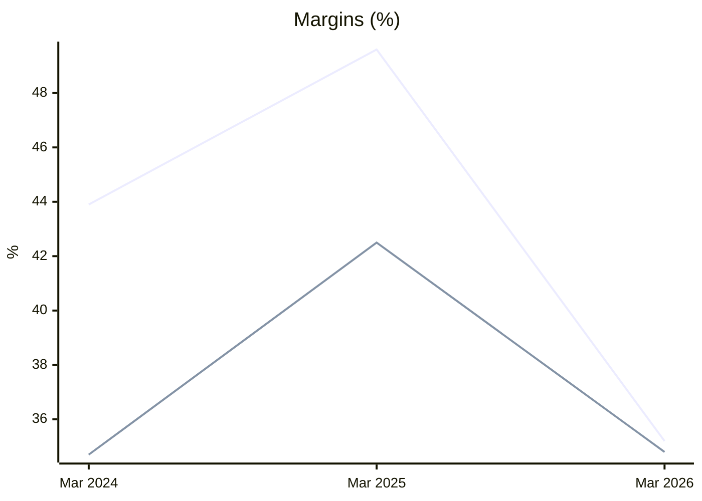

*Run 2026-11-24 · part of [SPINOFF_REPORT.md](../SPINOFF_REPORT.md) · the complete analysis of one company, with every management-call exchange in full.*

## NATCOPHARM — NATCO Pharma Ltd.

### 1. NATCO Pharma Ltd. — CONFIRMED DEMERGER

**CONFIRMED** (a demerger scheme is on the exchange record) · **PRE-SPIN — study the parent; the pieces do not trade yet** · score 6.4/10 · spin-off · 20 filing(s) from CALLS, NSE, NSE-BM, NSE-deep · first 2025-11-14, latest 2026-09-09

**The separated entities — every one the documents name:**

| Entity | Business | Listing | Who runs it |
|---|---|---|---|
| **Natco Crop Health Sciences Limited** | The Agrochemicals Undertaking: research, development, manufacturing and marketing of agrochemical products in… | to be listed | not stated — no CEO/MD/chair of the Resulting Com… |

**What is being separated, as the documents put it:** Agrochemicals (Crop Health Sciences) division — pesticides, insecticides, herbicides, biostimulants — demerged into Natco Crop Health Sciences Limited — class `value_unlocking`.

### 2. Stages and dates

> **Listing:** NOT YET — scheme at 'exchange_noc' stage; Natco Crop Health Sciences Limited will list only after NCLT sanction, effectiveness and a record date; no listing timeline stated

| Date | Event | Source |
|---|---|---|
| 2025-09-25 | Board approval (in-principle approval to evaluate the demerger of the Agro Chemicals business into a separate legal entity) — NATCO Pharma Limited | as stated: Note 7 to the unaudited financial results, Outcome of Board Meeting f… |
| 2025-11-14 | Other (board approval to incorporate a wholly-owned subsidiary in India to become the Resulting Company for the demerger of the Crop Health Sciences Division) — Natco Crop Health Sciences Limited (then unincorporated) | as stated: Outcome of Board Meeting filing dated 14 November 2025 |
| 2025-12-31 | Other (indicative time period for completion of incorporation of the Resulting Company) — Natco Crop Health Sciences Limited | as stated: Annexure to Outcome of Board Meeting filing dated 14 November 2025 ("… |
| 2026-03-18 | Other (prior intimation of the Board Meeting to consider the Scheme of Arrangement; trading window closed 19–26 March 2026) — NATCO Pharma Limited | as stated: Board Meeting (purpose) notice dated 18th March, 2026, filed 2026-03-… |
| 2026-03-24 | Stage reached: **announced** | [Outcome of Board Meeting](https://nsearchives.nseindia.com/corporate/NATCOPHARM_24032026171413_OutcomeOfBoardMeeting_24032026.pdf) |
| 2026-03-24 | Board approval (Scheme of Arrangement between NATCO Pharma Limited and Natco Crop Health Sciences Limited approved, after recommendations of the Audit Committee and the Committee of Independent Directors) — NATCO Pharma Limited and Natco Crop Health Sciences Limited | as stated: Outcome of Board Meeting filing dated March 24, 2026 |
| 2026-09-09 | Stage reached: **exchange noc** | [Outcome of Board Meeting](https://nsearchives.nseindia.com/corporate/NATCOPHARM_09092026115332_BoardOutcome09092026.pdf) |
| 2026-09-09 | Other (Board decided to make consequential changes to the Scheme post completion of the Rights Issue, maintaining the share swap ratio; Scheme and related applications not yet filed with the NCLT) — NATCO Pharma Limited | as stated: Outcome of Board Meeting filing dated September 9, 2026 |
| 2026-10-01 | Appointed date — Scheme of Arrangement (NATCO Pharma Limited / Natco Crop Health Sciences Limited) | as stated: Outcome of Board Meeting filing dated March 24, 2026 ("The Appointed … |

**The stages, as filed:** announced (2026-03-24) → exchange noc (2026-09-09)

**Stated in the filings:** resulting company **Natco Crop Health Sciences Limited**.

### 3. Size of the separated business beside the parent — is institutional selling likely?

**Reading: VERY LIKELY — the piece is under a tenth of the whole; index funds and large holders who receive it without choosing it tend to sell.**

| Entity | Stated turnover | Stated share of the whole | Segment revenue share | Market cap (₹ cr) | Share of combined market cap | Index member |
|---|---|---:|---:|---:|---:|---|
| Natco Crop Health Sciences Limited | ₹60,62,03,918 (turnover of the Demerged Undertaking i.e., A… | 1.48% | 3.4% (FY2026) | — | — | not listed |

*Stated figures are the documents' own (a turnover share, or the cost-of-acquisition split the company publishes for tax, which reflects relative value); the segment share is this business's revenue over the parent's sales, and the market-cap share is the entity's value over the entity plus the parent (parent ₹15,898 cr, NSE bhavcopy of 2026-11-13), both computed here.*

**In the documents' words:** “The turnover of the Demerged Undertaking i.e., Agrochemicals Business division as on 31st March, 2025 was ₹ 60,62,03,918 /-. The turnover of the Demerged Undertaking is 1.48% to the total turnover of the Company in the financial year ending 31st March, 2025.”

**The judge's read of selling pressure:** likely — Tiny (1.48% of turnover), loss-making, different industry; 4,22,879 pharma shareholders receive 1:1 agrochemical shares, with parent holding 20%.

### 4. Insider ownership — share swap, promoters' holding, management incentives

**Share swap / entitlement, entity by entity:**

- **Natco Crop Health Sciences Limited:** "1 (One) fully paid up Equity Share of INR 2/- (Rupee Two only) each of the Resulting Company shall be issued and allotted for every 1 (One) fully paid up equity share of INR 2/- (Rupee Two only) each held in the Demerged Company"; the Board on September 09, 2026 decided to amend the Scheme post the Rights Issue "with a view to, inter alia, maintain the share swap ratio in the revised Scheme the same as the one proposed in the Scheme"

**Promoters' holding, from the shareholding pattern:**

| Company | Promoters | FIIs | DIIs | Public | Quarter |
|---|---:|---:|---:|---:|---|
| NATCO Pharma Ltd. (NATCOPHARM) | 46.22% | 15.37% | 10.82% | 27.59% | Oct 2026 |

*Source: screener.in shareholding pattern, stored under `ShareholdingPattern/NiftyTotalMarket/`. In a mirror demerger each shareholder holds the same proportion of the new company as of the parent on the record date.*

- **Promoters in the parent, per the documents:** Percentage not stated. The 43rd AGM voting results (cut-off date 25th September, 2026) disclose "Promoter and Promoter Group" holding 88,465,126 shares out of 179,109,870 total shares
- **What the promoters will hold in the separated entity:** "There will be no change in the shareholding pattern of the Demerged Company." For the Resulting Company: "Post the implementation of the Scheme, the shareholders of the Demerged Company will directly hold about 80% in the Resulting Company, proportionate to their shareholding in the Demerged Company; the balance stake of about 20% in the Resulting Company will be held by the Demerged Company." "Overall, the shareholders of the Demerged Company will hold 100% of the ultimate beneficial economic interest in the Agrochemicals Undertaking (direct holding of about 80% and indirect holding of about 20% through the Demerged Company)." No separate promoter percentage is stated.
- **What a public shareholder receives:** "the Resulting Company shall, issue and allot equity shares, to all the members of the Demerged Company, holding fully paid-up equity shares on the Record Date in the following manner: '1 (One) fully paid up Equity Share of INR 2/- (Rupee Two only) each of the Resulting Company shall be issued and allotted for every 1 (One) fully paid up equity share of INR 2/- (Rupee Two only) each held in the Demerged Company'." Shareholders retain their existing NATCO Pharma shares unchanged.
- **Management incentives:** not stated in the documents on file.
- **Insider actions around the separation:** not stated in the documents on file.
- **Insiders, per the checklist read:** Promoter and Promoter Group hold 8,84,65,126 of 17,91,09,870 shares (~49%); 1:1 entitlement carries that stake into the Resulting Company. Demerged Company retains 20% post-listing; director P.S.R.K. Prasad sits on Natco Crop Health Sciences' board. · *option pricing date:* not stated

### 5. Why the demerger — point by point

NATCO is demerging its Crop Health Sciences (Agrochemicals) division into Natco Crop Health Sciences Limited, leaving the listed parent as a pure pharmaceutical company (FDFs, APIs, oncology-led branded/complex generics). Management's stated reason is that the two verticals carry different risk-reward profiles and serve entirely different customers — Rajesh Chebiyam said the demerger "gives a more focused approach because the business, ultimately, the customers are quite different" — so a dedicated management, channel and product strategy (differentiated, patent-controlled, limited-competition molecules like the fungicide GLANZ and CTPR combinations) can be run without competing for attention inside a much larger pharma P&L. The second reason is valuation and capital: agro turnover was only INR 60.62 crore in FY25, i.e. 1.48% of total turnover, against FY25 group revenue of INR 4,784 crore and PAT of INR 1,883.4 crore, and Rajeev Nannapaneni said shareholders "will get another business which is not being valued in our system because it is of a very tiny business and a very large business in pharma"; separately listed, "it can raise its own capital and grow by itself." The timing was deliberately set after the division approached breakeven — segment loss of about INR 150 crore in FY25 (including a INR 50 crore non-cash PP&E impairment taken in Q4 FY25), narrowing to a INR 3.2 crore loss in Q1 FY26 on INR 34.7 crore of sales, EBITDA-positive at INR 52.4 crore of sales in Q2 FY26, and roughly INR 140 crore of FY26 sales versus INR 60 crore the prior year, against the INR 150–170 crore management had said was needed for EBITDA breakeven. The Scheme adds the corporate-finance logic: focused growth, operational rationalisation, optimum use of resources, and the ability for each business to "address independent business opportunities, pursue efficient capital allocation and attract different sets of investors, strategic partners, lenders and other stakeholders," plus unlocking the value of the verticals. Shareholders get 1 share of the resulting company for every 1 NATCO share, with NATCO retaining 20% of the post-listing equity to keep supporting a business "still at its early growth stages" — so holders retain 100% of the ultimate economic interest (80% direct, 20% through NATCO). The push came from public-market shareholders, not lenders or partners: an investor on the Nov 14, 2025 call asked directly about "value unlocking for the shareholders," and management separately cited shareholder feedback that NATCO's profit base was too concentrated. Agro is almost entirely domestic ("predominantly domestic" sales, with 25–30% input cost inflation flagged in 2026), which management contrasts with the export-weighted pharma business.

**Point by point, with the source:**

1. First public confirmation of the plan: demerge Crop Health Sciences out of the parent and list it separately, targeted for 2026, disclosed alongside the division reaching roughly EBITDA breakeven at INR 52.4 crore of quarterly sales. “I think we have announced earlier that we will demerge this business from the main company and list it separately and we are targeting that for the year 2026.” — *[Nov 2025](https://www.bseindia.com/stockinfo/AnnPdfOpen.aspx?Pname=ac8f848f-8703-4403-9ae3-cb2d420d47da.pdf)*
2. Rajeev defines the value-unlock logic in response to an investor question: separate listing gives the business special focus and the ability to raise its own capital and grow independently, now that it is breaking even. “Value unlocking means I think what we see is this business now is about breaking even now. So, we will list it separately and then we will have special focus on this and it can raise its own capital and grow by itself.” — *[Nov 2025](https://www.bseindia.com/stockinfo/AnnPdfOpen.aspx?Pname=ac8f848f-8703-4403-9ae3-cb2d420d47da.pdf)*
3. The core valuation argument: the agro business is too small to be valued inside a pharma company of NATCO's size, and shareholders will get a complete see-through into both businesses. “I think you will get another business which is not being valued in our system because it is of a very tiny business and a very large business in pharma.” — *[Nov 2025](https://www.bseindia.com/stockinfo/AnnPdfOpen.aspx?Pname=ac8f848f-8703-4403-9ae3-cb2d420d47da.pdf)*
4. Timeline guidance: the process has started, with an internal goal of completing in the next 8–9 months (around October–November 2026), but no firm date committed. “I think we have started the process. So , I think roughly, we're thinking by October, November, but I don't want to say any definite time lines, but this is our, what should I say, goal to do.” — *[Feb 2026](https://www.bseindia.com/stockinfo/AnnPdfOpen.aspx?Pname=7ea4dc21-a77e-4e6d-967e-2da2d51bc890.pdf)*
5. Management's clearest operating rationale, from the head of Crop Health Sciences: a focused approach is needed because the agro customer base is entirely different from pharma, with FY26 agro sales of about INR 140 crore versus INR 60 crore the year before. “So, as you're aware, so we're in the process of demerging the business. And one of the primary reasons we felt also it gives a more focused approach because the business, ultimately, the customers are quite different.” — *[Jun 2026](https://www.bseindia.com/stockinfo/AnnPdfOpen.aspx?Pname=230327e4-9a77-4095-b46d-b9c836cc9b96.pdf)*
6. Growth plans — new differentiated, patent-controlled, limited-competition products, more channel partners and more people — are tied directly back to the demerger as the reason for sharper focus. “So I think we're fairly confident going forward. And that's also one of the main reasons for demerging and having more focus on the business.” — *[Jun 2026](https://www.bseindia.com/stockinfo/AnnPdfOpen.aspx?Pname=230327e4-9a77-4095-b46d-b9c836cc9b96.pdf)*
7. The Mar 24, 2026 Scheme of Arrangement grounds the demerger in differing risk-reward profiles of the pharmaceutical and agrochemicals verticals; agro turnover was INR 60.62 crore in FY25, 1.48% of total company turnover. “The Board of Directors of the Demerged Company believe that the risk and reward associated with each of the aforesaid business verticals are different.” — *Scheme*
8. The Scheme's capital-markets rationale: each business can chase its own opportunities, allocate capital efficiently and attract its own investor and lender base, alongside focused growth, operational rationalisation and value unlocking. “Each business would be able to address independent business opportunities, pursue efficient capital allocation and attract different sets of investors, strategic partners, lenders and other stakeholders.” — *Scheme*
9. NATCO keeps 20% of the post-listing equity of the resulting company so it can keep funding and strategically supporting an early-stage business; shareholders get 1 new share for every 1 NATCO share, retaining 100% of the ultimate economic interest (80% direct plus 20% indirect). “Further, the Demerged Company intends to retain the current shareholding in the Resulting Company (20% of post listing shareholding) in order to continue to offer support to the Agrochemicals Business which is still at its early growth stages and help in monitoring the progress and providing strategic support.” — *Scheme*
10. The Nov 14, 2025 board filing states the purpose as unlocking value in the core pharmaceutical business while giving each entity operational flexibility, dedicated management and separate brand positioning. “To demerge the Agro business of the Company into a separate entity, the move shall enable value unlocking of the core business (pharmaceuticals) and enhance long -term growth.” — *Scheme*
11. Pre-demerger baseline for why the division was a drag: a INR 50 crore non-cash impairment on agro property, plant and machinery in Q4 FY25, FY25 agro revenue of about INR 60 crore, and INR 160–170 crore needed just to be EBITDA positive. “So, I think this year, we feel we are going to hit that critical mass where we'll start breaking even. We are doing about INR60 crores net revenue last year. So, I think we need to hit about INR160 crores to INR170 crores at least to have that EBITDA positive.” — *[Jun 2025](https://www.bseindia.com/stockinfo/AnnPdfOpen.aspx?Pname=d43e2593-6819-4d99-b9a6-c3019c901490.pdf)*
12. The Sep 9, 2026 board update: the Scheme had received observation letters from both exchanges but was not filed with the NCLT because the INR 1,300 crore rights issue changes the capital structure, so the Scheme will be amended and re-filed post-issue with the swap ratio unchanged. “The fund raising by way of a Rights Issue proposed at the meeting of the board of directors held on September 09, 2026 is expected to result in change to the Company's capital structure and shareholding pattern and consequently would require necessary changes to the Scheme.” — *Scheme*

**How it evolved:** On the Feb 13, 2025 and May 29, 2025 calls there was no demerger talk — only agro losses, the INR 50 crore impairment and a INR 120–170 crore breakeven target; the Aug 13, 2025 call reported the loss down to INR 3.2 crore with still no mention. The board gave in-principle approval to evaluate the demerger on Sep 25, 2025, and Rajeev first discussed it publicly on the Nov 14, 2025 call ("demerge this business from the main company and list it separately... targeting that for the year 2026"), framing it as value unlocking plus the ability to raise its own capital; the board approved incorporating the wholly-owned resulting company on Nov 14, 2025. On Feb 12, 2026 the timeline was guided to "October, November" 2026 (8–9 months), and the Scheme itself was approved on Mar 24, 2026 with a 1:1 share entitlement, appointed date Oct 1, 2026 and 20% retained by NATCO; the May 29, 2026 call reiterated focus and different customers as the primary reason. By Sep 9, 2026 the Scheme had stock-exchange observation letters but had not been filed with the NCLT, because the INR 1,279.36 crore rights issue at INR 750/share (allotted Oct 23, 2026) changes the capital structure — the board decided to re-cut and re-file the Scheme after the rights issue while keeping the same swap ratio.

**What management expects from it:** Agro: dedicated management focus, its own capital raising, differentiated limited-competition products, growth past breakeven from roughly INR 140 crore sales. Pharma: a cleaner, focused oncology/complex-generics entity. For shareholders: value unlocked in a business "not being valued in our system," a complete see-through into both, operational efficiency, efficient capital allocation, and distinct investor/lender bases.

*Not explained on the calls:* No standalone agro financials, debt/asset split, valuation or swap-ratio basis; no post-demerger profitability, capital needs, board/management, listing date, or revised Scheme terms.

- *Stated reason, in one line:* Risk and reward of the pharmaceutical and agrochemicals verticals differ; segregation enables focused growth, operational efficiency, independent capital allocation, different investor sets, and is expected to unlock the value of the business verticals.
- *What it reveals:* Demerged turnover was only ₹60.62 crore, 1.48% of total; FY25 agro segment result was a ₹1,458 million loss. Management says it reached ~₹140 crore sales and roughly EBITDA breakeven. Separation removes a loss-maker from pharma and exposes an early-growth agro business.
- *Parent or spin:* parent · *Read next:* The revised Scheme to be filed with Stock Exchanges post Rights Issue — check the share swap ratio and agro segment numbers.
- *In their words:* “The segregation is also expected to unlock the value of the business verticals of the Demerged Company.”

### 6. On the calls, verbatim

12 call(s), oldest first: **9 question-and-answer exchange(s)** given in full — the question and every answer to it, nothing trimmed — and 17 passage(s) from management's prepared remarks (the complete sentences about it; the whole remarks are in the linked transcript). Text is as the transcript prints it.

#### Nov 2023 — [transcript](https://www.bseindia.com/stockinfo/AnnPdfOpen.aspx?Pname=69ef4068-751c-4c97-ae82-a551c697e63b.pdf)

**From the prepared remarks** *(the passage about it; the whole turn runs to 1,898 characters in the transcript)*

> **Rohit Bhat:** Thank you. Good morning everyone and welcome to Natco Pharma Q2FY24 Earnings Conference Call ho sted by B&K Securities. From Natco Pharma management, we have with us Mr. Rajeev Nannapaneni , Director and Chief Executive Officer and Rajesh Chebiyam , Executive Vice President, Crop Health Sciences. We'll request Rajesh to give brief opening remarks about Natco's 2Q results before we open the floor for Q&A session. Over to you, Rajesh. Raje sh Chebiyam : Thank you, Rohit.

**Question and answer**

> **Robert Joseph:** Yes, sir. Congratulations for the good set of numbers. And especially growth on the agrochemical business. Sir, act ually, I have only one question. During your last AG M, you were answering a retail investor. During that time, he was asking about the... Because our market cap was consolidating for the past five to six years in the same space. So, is there any action you are going to take regarding the increasing of the market cap of the share? You told that time that you may consider issuing a bonus for the last time, sir, in order to reward them. So, do you have any ideas still regarding this issue of bonus, sir?
>
> **Rajeev Nannapaneni:** As of now, no, my friend. I can't answer your question at this time. We look at different options. We have done a buyback. We have reduced equity by about 2%. NATCO Pharma Limited November 15, 2023
>
> **Robert Joseph:** Okay, sir. Thank you, sir.
>
> **Rajeev Nannapaneni:** We have given a reaso nable amount of dividend. And I would like to say that our financial performance has been very strong. And as I also said, we have a good amount of cash in our books. The company is in the pink of health. So, beyond that, I can't answer your question I mean, Yes. But I think you just have to articulate our position that this is what we are doing. And this is the pipeline. And this is how we are going forward. I think that's all I can do.
>
> **Robert Joseph:** Thank you. Thank you.

#### Feb 2024 — [transcript](https://www.bseindia.com/stockinfo/AnnPdfOpen.aspx?Pname=98ef9451-83a8-4657-acce-18d31611b872.pdf)

**From the prepared remarks** *(the passage about it; the whole turn runs to 2,230 characters in the transcript)*

> **Rajesh Chebiyam:** Very briefly on the segmental split for the quarter, for Q3, API clocked INR46.3 crores. Formulation domestics, INR99.4 crores. Formulation exports, which includes pro fit share and foreign subs, was INR605.6 crores. Crop health clocked INR14.1 crores. The rest were in operating, nonoperating income. Thank you, all. We'll open up for questions.

#### Jun 2024 — [transcript](https://www.bseindia.com/stockinfo/AnnPdfOpen.aspx?Pname=99cc0f91-9fd5-4d78-b404-a4e50d143d60.pdf)

**From the prepared remarks** *(the passage about it; the whole turn runs to 469 characters in the transcript)*

> **Hrishikesh Patole:** Hello. Good morning, everyone. On behalf of B&K Securities, I welcome you all to the Q4 FY '24 Earnings Conference Call of Natco Pharma. I hope everyone is in good health and doing well. On behal f of Natco today, we have with us Mr. Rajeev Nannapaneni – Director and CEO; Mr. Rajesh Chebiyam – Executive VP, Crop Health Science. I now hand over the call to Rajesh for the Management's Opening Remarks , post which we will open the session for Q&A. Over to you, Rajesh.

**Question and answer**

> **Chetan Doshi:** Congratulations for the excellent set of numbers. And as per the guidance, you have performed very well. So, congratulations to the entire team. So, my specific question is that we have taken a hit as far as API revenue is concerned for the last quarter. So, this is onetime, or this is going to be a regular feature. And the second question is regarding the Crop Health Science, wherein you have underutili zed that division. So, you are planning to launch some products and buy some raw material and then it was discarded? What is it that Rs. 30 crores is you have accounted for?
>
> **Rajeev Nannapaneni:** The hit is a onetime overall, the Rs. 90 crores . So,the domestic, as we explained a few minutes ago, it was a change in the business model. The secondary sale is consistent and close to Rs. 100 crores a quarter. So, I don't see any challenge there. Your question is specifically why we take a hit on the agro. So, what we did was we built some intermediate s capability at a third -party site and w e were using it for the launch of the agrochemicals that we are making internally at Natco. What has happened is there has been a dramatic change in the market environment where the pricing has dropp ed dramatically for the intermediates and we are not utilizing that intermediate capability. So, because we are not utilizing the intermediate capability, we had to make a provision for non -utilization of that. So, we took a hit on depreciation of amo unt and certain advance we gave to that supplier. So, I think that's why we took a Rs. 30 crores hit .

#### Aug 2024 — [transcript](https://www.bseindia.com/stockinfo/AnnPdfOpen.aspx?Pname=dba08330-79f4-449b-bfa2-8f5fde18a088.pdf)

**From the prepared remarks** *(the passage about it; the whole turn runs to 480 characters in the transcript)*

> **Hrishikesh Patole:** Thank you. Good morning, everyone. On behalf of B&K Securities, I welco me you all to the Q1 FY '25 Earnings Conference Call of Natco Pharma. Hope everyone is in good health and doing well. On behalf of Natco today, we have with us Mr. Rajeev Nannapaneni, Director and CEO; Mr. Rajesh Chebiyam, Executive Vice President, Crop He alth Sciences. I now hand over the call to Rajesh for the management's opening remarks, post which we'll open the session for Q&A. Over to you, Rajesh.

**From the prepared remarks** *(the passage about it; the whole turn runs to 1,887 characters in the transcript)*

> **Rajesh Chebiyam:** Natco recorded consolidated total revenue of INR1,410.7 crores for the first quarter which ended the 30th June 2024, as against INR1,160.2 crores for the same period last year, reflecting a growth of 21.6% in revenue. The net profit for the period on a consolidated basis was INR668.5 crores as against INR420.3 crores same period last year, reflecting 59% grow th in profits. The growth in revenue and profits were primarily driven by export formulation business as our domestic pharma business remains stable. On the overall segmental split, formulation exports including profit share and foreign subs carried INR1,2 10.10 crores, formulation domestics INR102.2 crores, API INR39.2 crores, crop health INR15.6 crores, other operating and non -operating income clocked roughly INR43.6 crores. All totalling to INR1,410.7 crores. Thank you all. Now we'll open up for Q&A.

#### Nov 2024 — [transcript](https://www.bseindia.com/stockinfo/AnnPdfOpen.aspx?Pname=bfa2b366-9531-46e4-a6e5-1be622bc6b51.pdf)

**From the prepared remarks** *(the passage about it; the whole turn runs to 481 characters in the transcript)*

> **Hrishikesh Patole:** Good morning. Good morning, everyone. On behalf of B&K Securities, I welcome you all to the Q2 FY '25 Earnings Conference Call of NATCO Pharma. Hope everyone is in good health and doing well. On behalf of NATCO today, we have with us Mr. Rajeev Nannapaneni: , Director and CEO; Mr. Rajesh Chebiyam , Executive Vice President, Crop Health Sciences. I now hand over the call to Rajesh for the management's opening remarks, post which we'll open the session for Q&A. Over to you, sir.

#### Feb 2025 — [transcript](https://www.bseindia.com/stockinfo/AnnPdfOpen.aspx?Pname=649d3521-2c1e-4ecd-ab9c-0b1292bb5559.pdf)

**From the prepared remarks** *(the passage about it; the whole turn runs to 489 characters in the transcript)*

> **Hrishikesh Patole:** Thank you. Good morning , everyone. On behalf of B &K Securities, I welcome you all to the Q3 FY '2 5 Earnings Conference Call of Natco Pharma. Hope everyone is in good health and do ing well. On behalf of Natco today, we have with us , Mr. Rajeev Nannapaneni, Vice -Chairman and CEO; Mr. Rajesh Chebiyam, Executive Vice President, Crop Health Sciences. I now hand over the call to Rajesh for the management's opening remarks, post which we will open the session for Q&A. Over to you, sir.

**Question and answer**

> **Chetan Dhosi:** Sorry to interrupt, but there is no backup plan from the company that suppose this product doesn't come in, then the other product has to be concentrated.
>
> **Rajeev Nannapaneni:** You can't do backup plans, my friend. See, I think that question is wrong. I think we are here to state what the present financial position is. You can't have backup plans for revenue. You have what you have. And what you don't have, you don't have. I don't think that question is right. What you have is what you have. What you book is what you book. What you don't have, you just say that you don't have. That's how business works.
>
> **Chetan Dhosi:** This Crop Health Sciences …
>
> **Rajeev Nannapaneni:** My friend, I will not answer that question the way you, I don't like the way you are asking that question. It is w hat you have sold, you sold. And what you don't have, you don't have. You have to accept it. That's it. Next caller, please.

#### Jun 2025 — [transcript](https://www.bseindia.com/stockinfo/AnnPdfOpen.aspx?Pname=d43e2593-6819-4d99-b9a6-c3019c901490.pdf)

**From the prepared remarks** *(the passage about it; the whole turn runs to 503 characters in the transcript)*

> **Hrishikesh Patole:** Good morning, everyone. On behalf of B&K Securities, I welcome you all to the Q4 and Full Year FY '25 Earnings Conference Call of NATCO Pharma. Hope everyone is in good health and doing well. On behalf of NATCO today, we have with us Mr. Rajeev Nannapaneni, Vice Chairman and Chief Executive Officer; Mr. Rajesh Chebiyam, Executive Vice President, Crop Health Sciences. I now hand over the call to Rajesh for the management's opening remarks, post which we'll open the session for Q&A. Over to you, sir.

**From the prepared remarks** *(the passage about it; the whole turn runs to 2,393 characters in the transcript)*

> **Rajesh Chebiyam:** This is the result of decades of our diligence and focused strategy. For the fourth quarter ended on March 31, 2025, the company recorded a net revenue of INR1,287.3 crores on a consolidated basis as against INR1,110.3 crores during Q4 of FY '24. Natco Pharma Limited May 29 , 202 5 Profit for the fourth quarter on a consolidated basis was INR406 crores as against INR386.3 crores same period last year. During the quarter, the company took an impairment charge of INR50 crores in the Crop Health Science business related to property, plant and machinery and a chargeback adjustment of roughly INR25 crores in its U.S. subsidiary, apart from incurring higher R&D expenses. As of today, the company has a strong cash position of over INR3,500 crore as it prepares for headwinds coming from its U.S. business during the financial year FY '26. The company estimates a possible dip in revenue by 20% and profits by 30% due to geopolitical uncertainties and pricing pressure in its core product po rtfolio in the U.S. and increased R&D expenses. Thank you all.

**Question and answer**

> **Rahul:** I was just going through the segment reporting. Sir, in the Crop Health division year-on-year, our top line has reduced, sales have reduced and obviously, the losses have also increased. I think we have set a segment loss of around INR150 crores this year. Your optimism in the coming years is based on what, sir, because historically, we have reduced numbers. What is the...
>
> **Rajeev Nannapaneni:** The loss also represents the impairment that we have taken, okay? Let's start with that. And the second is , what has happened was when we stopped the product 2 years ago. Then basically, what happens is a lot of the stock came back as returns. So , the sale reduction is because of returns of the previous year. It's a new business. I mean it's not a good place to be. But because it's a new business, it took us a while to sort of figure out how the distribution works, how do you manage the controls, how do you make sure that the stock is liquidated. So, I think it's getting better. I mean, as I said, because of the returns and all, we had to take a loss, and a reduction in sale. So, when something come back as returned, then you have to reduce the sales. But I think it's looking better. I think if you look at the cash flow, the sale was INR60 crores, we actually had a cash flow of almost INR85 crores to INR90 crores. So, cash flow in my world is a true indicator of whether you're selling the product. Natco Pharma Limited May 29 , 202 5 So, I think we're getting there. So , 150 is a number that we need to be there. So, I believe that we'll be able to get there this year. But see, I tell you, my friend, generally, when you start a new business, it is not a fairytale, right? You come in and then you start making money on day 1. And especially when you're doing a business that you're not having a setup, what I call before, a greenfield, it's always going to be a challenge. To build a business, in my experience has always been it takes about 4 to 5 years. And sometimes you get luck y and things turn around in a year or 2. So unfortunately, Agro is coming in that median where it is a 4 to 5 years’ time line. But I think we're getting there. It's not as bad as it looks.

#### Jul 2025 — [transcript](https://www.bseindia.com/stockinfo/AnnPdfOpen.aspx?Pname=26c8d332-fc11-4299-9977-cb8dc43d0153.pdf)

**From the prepared remarks** *(the passage about it; the whole turn runs to 0 characters in the transcript)*

> **(speaker not labelled):** 29th July, 2025 Corporate Relationship Department Manager – Listing M/s. BSE Ltd. M/s. National Stock Exchange of India Ltd Mumbai 400 001 Mumbai 400 051 Scrip Code: 524816 Scrip Code: NATCOPHARM Dear Sir Sub: - Transcript of conference call held on July 23, 2025 Ref:- Regulation 30 of the SEBI (Listing Obligations and Disclosure Requirements), Regulations, 2015 We are enclosing herewith the copy of transcript of the Company's conference call for Proposed Investment held on July 23, 2025. Th e transcript is also available on the website of the company i.e., www.natcopharma.co.in. Thanking you Yours faithfully For NATCO Pharma Limited Ch. Venkat Ramesh Company Secretary & Compliance Officer 1 NATCO's Call for Proposed Investment July 23, 2025 − Host: − Good evening and welcome to NATCO's Call for Proposed Investment in A dcock Ingram Holdings Limited . I now hand over the call to Mr. Rajesh Chebiyam, Executive Vice President, Crop Health Sciences, NATCO Pharma Ltd. for his opening remarks. Thank you and over to you, sir. − Mr. Rajesh Chebiyam - Executive Vice President (Crop Health Sciences), NATCO Pharma Ltd.: − Thank you, Vandit. , I welcome all of you for our evening call today to update on the acquisition and thank you for joining on a very short notice. So, during the call, we may be making certain forward -looking statements about the acquisition or future events about it. So, anything said on the call which reflects our outlook for future, must be reviewed in conjunction with the risks that the company faces. − We are very excited that we are offering to acquire a stake in Adcock Ingram Ltd., one of the largest pharmaceutical and healthcare companies in the African continent. The press release and the presentation related to the same has been uploaded with the stock exchanges and on our website. So, with that said, we'll delve into the key highlights of the transaction and then open the floor for the Q&A. I would like Mr. Rajeev Nannapaneni, our Vice Chairman and CEO, to take you guys through the presentation and share his thoughts. Thank you. − Mr. Rajeev Nannapaneni - CEO & Vice Chairman, NATCO Pharma Ltd.: − Good evening, everyone. First , I'd like to thank everyone for participating and showing interest in our call today and turning up. − Let me start off with the first slide. So, we'll just run through the presentation and for us, it's a very large transaction for our firm. It's probably the biggest investment that we ever made in our life. So, it gives us a good global presence. It’s 35.75% stake in this company. At this time, this was the share that was available, but still, it's a very substantial minority's position and we get to consolidate the profits of the company into our books. We also get an avenue to send our products there and work in a market that we are not present in. I'll just walk through the company and the major highlights of the transaction. − So, the name of the company, as you have seen, is Adcock Ingram. So, we're proposing a 35.75% shareholding, and Bidvest is going to own 64.25%. We're paying ZAR 75 (South African Rands) for buying the shares, which are in public, and we will delist the company and make it a private holding company. It will cost us about 2,000 crores. Financial highlights, last year it did about US$536 million and half year it did about US$262 million. 2 − So, a little bit of background. It has a very long history. It was established in 1890 in South Africa. It's the second largest company in the private market, and it's there in private and public sector. It is having a nice portfolio of Prescription, OTC, Hospital

**From the prepared remarks** *(the passage about it; the whole turn runs to 0 characters in the transcript)*

> **(speaker not labelled):** transaction. − Mr. Kunal Randeria – Participant: − Fair enough , second question. South Africa , you’ve made an entry here. You still have the cash on the books. So future acquisitions again would be in countries where you do not have a footprint at the moment? − Mr. Rajeev Nannapaneni - CEO & Vice Chairman, NATCO Pharma Ltd.: − I think so, This is not the only transaction we want to do. I think we've been saying that. Finally, we accomplished one. So, I think that's good. So, I'm also looking for another transaction and hopefully we can do something as large as this or even bigger than this so that we can solidify our position in our key markets that we operate in and bring more diversification and stability in our core earnings. That’s what my thinking is. And I think that's where we're going, and this is part of that accomplishment. − Mr. Kunal Randeria – Participant: − Yeah. And so just to kind of take this forward. So , would it be fair to assume it will not be Canada and Brazil where we already have some presence? − Mr. Rajeev Nannapaneni - CEO & Vice Chairman, NATCO Pharma Ltd.: − I think I said there are only three things in this business that works, right? One is , you need to have great products and great R&D. Two, you need to have global scale and three, you need to have multiple markets that you're there. If you get three right, then you're building a wonderful business. If you don't get these three things right, it's tough to compete in this business. I think our strength has always been R&D , our problem has been market access and a lot of times we don't have access, or we did sharing . So, I think that's what we're trying to sort of address so that we have access, and we have scale so that we can bring value to the pipeline. − Mr. Kunal Randeria – Participant: − Right. Okay, thanks. Thanks for answering my question. − Host: − Next question is from Nirali Shah. − Ms. Nirali Shah – Participant: − Yeah, congratulations. I have one question. I just wanted to know what are the 2-3 immediate synergies or any near -term wins that you're targeting from this deal? Whether it's a dossier monetization or R&D collaboration or any supply chain 8 leverage ? And if you could mention by, when should we expect them to reflect in numbers? − Mr. Rajeev Nannapaneni - CEO & Vice Chairman, NATCO Pharma Ltd.: − It will take some time. We have a few filings in South Africa. So, we'll try to see whether we can monetize those assets through our associate firm. Those, I think, will start kicking in immediately. It will be immediately earnings -accretive because we'll be able to consolidate the numbers. − The real value for the asset, we'll be able to see in the next two to three years, I would believe. Once the new registrations start coming in, we start filing, start getting approved and we launch products, I think that's where the real value is. I think you have to look at medium -term, not in the near -term. Near -term, you'll see some value, but the real value will come in the next three years. − Mr. Rajeev Nannapaneni - CEO & Vice Chairman, NATCO Pharma Ltd.: − Anything else, Nirali? − Ms. Nirali Shah – Participant: − No, thanks . − Host: − The next question is from Neeraj, requesting everyone to please identify themselves and their company name, please. − Mr. Neeraj Kayal – Retail Investor: − Thank you for the opportunity. I'm a retail investor, individual investor. I wanted to ask, does this company have asse ts like first -to-file or new molecules? − And the second question is, we are paying a significant premium. Is it because we are taking the company private? Is that why we are paying the premium? − Mr. Rajeev Nannapaneni - CEO & Vice Chairman, NATCO Pharma Ltd.: − Okay. Let me answer that question . First , their geographical expanse is Southern Africa. They sell primarily in South Africa specifically and countries nearby and majority of the sale is coming from South Africa per se. It's a very highly concentrated single geography business. − The second question you had was what? − Mr. Rajesh Chebiyam - Executive Vice President (Crop Health Sciences), NATCO

**From the prepared remarks** *(the passage about it; the whole turn runs to 0 characters in the transcript)*

> **(speaker not labelled):** − Your first question about market access, I think this company has very good access in South Africa , obviously, which is one of the most dynamic economies in the African continent, and in the neighbouring countries too is has very good access. I think we’ve been discussing with them how we can expand this reach to more countries in Africa. Those discussions are ongoing. I think, once we settle down as a shareholder and take it forward, I think lot of these plans will come through. − Mr. Karthik – ICICI: − And to acquire controlling stake in this company? − Mr. Rajeev Nannapaneni - CEO & Vice Chairman, NATCO Pharma Ltd.: − At this time, it’s not available, Karthik. We had this discussion. I was very keen on a higher stake; I’m always very keen. So, I think the only consensus we could build is, at this time, it’s not for offer. But in the future, if they’re interested in selling, we have the first right of refusal. So, if that opportunity comes, we’ll be very happy to take. But for now, this is what is up for offer. But even thought it’s a strong 36%, but an asset like this we won’t get every day. So, I thought it’s worth doing it, because to build this type of business in South Africa, for us, it’s simply not possible. It will take us decades to do that. And I think the valuations are far more reasonable in our country. You know that as well, right? So, this I feel is a far superior transaction than anything we have seen. − Mr. Karthik – ICICI: 13 − Congratulations, Rajeev. − Mr. Rajeev Nannapaneni - CEO & Vice Chairman, NATCO Pharma Ltd.: − Yeah, thank you. So, this is my last question for today. Again, I appreciate the time you guys have spent attending this call. Again, it’s a monumental achievement for us that we’re able to do this transaction which allows us to gain size and stability. And we look forward to your support. Thank you so much guys. − Mr. Rajesh Chebiyam - Executive Vice President (Crop Health Sciences), NATCO Pharma Ltd.: − Thank you. − Host: − Thank you for joining us. You may now disconnect your lines and exit the webinar. Thank you. − END OF TRANSCRIPT

#### Aug 2025 — [transcript](https://www.bseindia.com/stockinfo/AnnPdfOpen.aspx?Pname=7ecea13a-21ca-404b-8fdf-e05856f77026.pdf)

**From the prepared remarks** *(the passage about it; the whole turn runs to 2,011 characters in the transcript)*

> **Rajesh Chebiyam:** This is also reflected in other expenses being higher for the quarter. The Board of Directors have declared an interim dividend of INR2 per equity share during the quarter. On the segmental split for the quarter, I'll just briefly outline, which is also shared. The API business clocked INR52.6 crores; domestic formulation, INR107 crores; formulation exports, including profit share and subsidiaries, was INR1,126.5 crores; crop health sciences, INR34.7 crores; other operating and non-operating was INR69.8 crores; totaling INR1,390.6 crores for the quarter. Natco Pharma Limited August 13, 202 5 Thank you all. We'll take the questions now. We can take the questions when you're ready.

**Question and answer**

> **Rashmi:** Okay. And my second question is related to the crop health sciences. This time, we have seen a good pickup. So how is the demand picking up? And are we on track to achieve that INR140 crore s, INR150 crore s of sales for this year?
>
> **Rajeev Nannapaneni:** I think we had a good start and got good receivable. I think things are settling down. We think that this sale will continue. We're losing still money. I think we lost about INR3.2 crores . So, I think we're coming very close to breakeven we're almost there. I think we're doing well.

#### Nov 2025 — [transcript](https://www.bseindia.com/stockinfo/AnnPdfOpen.aspx?Pname=ac8f848f-8703-4403-9ae3-cb2d420d47da.pdf)

**From the prepared remarks** *(the passage about it; the whole turn runs to 482 characters in the transcript)*

> **Hrishikesh:** Thank you. Good afternoon, everyone. On behalf of B &K Securities, I welcome you all to the Q2 FY26 Earnings Conference Call of Natco Pharma. Hope everyone is in good health and doing well. On behalf of Natco today, we have with us Mr. Raj eev Nannapaneni, Vice Chairman & CEO, Mr. Rajesh Chebiyam , Executive Vice President , Crop Health Sciences. I now hand over the call to the “Management's Opening Remarks” p ost which we would open the session for the Q&A . Over to you , sir.

**From the prepared remarks** *(the passage about it; the whole turn runs to 1,858 characters in the transcript)*

> **Rajesh Chebiyam:** The net profit for the period on a consolidated basis was Rs 517.9 crores. Natco Pharma Limited November 14, 2025 During the quarter, the company has incurred substantial R&D expenses on bioequivalence and one - time employee bonuses in addition to other business -related provisions. The board of directors have declared an interim dividend of Rs. 1.5 per equity share of Rs.2 during the quarter. On the segmental revenue split for Quarter 2, the API clocked 53.9 crores, domestic formulations Rs 105.4 crores, formulation exports including the profit share and subsidiaries clocked Rs 1,147 crores, crop health sciences clocked Rs 52.4 crores, other operating and non-operating income was Rs 104.3 crores, all consolidating to Rs 1,463 crores. Thank you, all. We will take Q&A now.

**Question and answer**

> **Guru:** Thank you for that. The other question part of it is like real value. Is there any opportunity of value unlocking for the shareholders when it comes to the ROW business , what would be the value unlocking that we can expect , not accurately, but at least some kind of an indicative thing on the value unlock that you probably plan for the agro diversification or whatever is in the pipeline ?
>
> **Rajeev Nannapaneni:** I think the idea here is that we will demerge the company , I think we are planning the demerger , I think we have announced it. So, we will list that entity maybe sometime in 2026 once all the clearances come through. Value unlocking means I think what we see is this business now is about breaking even now. So, we will list it separately and then we will have special focus on this and it can raise its own capital and grow by itself. Somewhere, I think that business in our setup, it is a very small business. So, I think it will be good for the shareholders. You will get a complete see-through in our crop business and you also have a phar maceutical business. So , I think the real value, I think you will see it in 2026. What numbers and all, very hard to predict right now .

**Question and answer**

> **Guru:** That is understood. I mean, can we expect some value unlocking , can we see that as an opportunity? Sorry about that. I think my question more is not on numbers. More of like indicative comments from your side on would that be a good opportunity for shareholder value unlocking, the demerger ? That is all I wanted to understand.
>
> **Rajeev Nannapaneni:** Absolutely, yes. I think you will get another business which is not being valued in our system because it is of a very tiny business and a very large business in pharma. So, this business will get more attention and I think shareholders will be duly rewarded for the fact that it has been demerged.
>
> **Guru:** Understood.
>
> **Rajeev Nannapaneni:** Thank you.

#### Feb 2026 — [transcript](https://www.bseindia.com/stockinfo/AnnPdfOpen.aspx?Pname=7ea4dc21-a77e-4e6d-967e-2da2d51bc890.pdf)

**From the prepared remarks** *(the passage about it; the whole turn runs to 493 characters in the transcript)*

> **Hrishikesh Patole:** Hello. Thank you. Good afternoon, everyone. On behalf of B&K Securities, I welcome you all to the Q3 FY '26 Earnings Conference Call of NATCO Pharma. Hope everyone is in good health and doing well. On behalf of NATCO today, we have with us Mr. Rajeev Nannapaneni , Vice Chairman and CEO; Mr. Rajesh Chebiyam, Executive Vice President, Crop Health Sciences. I now hand over the call to Rajesh for the management's opening remarks, post which we'll open the session for Q&A. Over to you, Rajesh.

**Question and answer**

> **Candice Pereira:** Okay. That is helpful. And sir, is there any time line for the Crop Health Sciences de -merger in place for now?
>
> **Rajeev Nannapaneni:** I think we have started the process. So , I think roughly, we're thinking by October, November, but I don't want to say any definite time lines, but this is our, what should I say, goal to do. But I mean, there's a lot of processes that we have to run, right? So I think the process will take whatever time it will take . But our end goal is that we should be able to do it in the next 8, 9 months. But again, we'll keep you updated to give you more accurate timelines . But as of now, that is the expectation.

#### Jun 2026 — [transcript](https://www.bseindia.com/stockinfo/AnnPdfOpen.aspx?Pname=230327e4-9a77-4095-b46d-b9c836cc9b96.pdf)

**From the prepared remarks** *(the passage about it; the whole turn runs to 526 characters in the transcript)*

> **Hrishikesh Patole:** Good afternoon, everyone. On behalf of 360 ONE, I welcome you all to the Q4 FY '26 Earnings Conference Call of NATCO Pharma. Hope everyone is in good health and doing well. On behalf of NATCO today, we have with us Mr. Management: , Vice Chairman and CEO; Mr. Management: , CFO; Mr. Rajesh Chebiyam: , Executive Vice President, Crop Health Sciences; and Mr. Rajeev Menon, Investor Relations. I now hand over the call to Rajesh for the management's opening remarks, post which we'll open the sessi on for Q&A. Over to you, sir.

**Question and answer**

> **Neeraj Kayal:** Sir, I wanted to ask you about our Crop Sciences division. I wanted to understand this division, the industry, if you can give any color on that and our business?
>
> **Rajeev Nannapaneni:** That's a good question. So, I think my colleague, Rajesh will answer and he'll also tell us abo ut our demerging process as well.
>
> **Rajesh Chebiyam:** So, as you're aware, so we're in the process of demerging the business. And one of the primary reasons we felt also it gives a more focused approach because the business, ultimately, the customers are quite different. See, one of the key things we are pursuin g as part of our approach is, again, trying to find molecules which are a little differentiated from most of the other players. And the approach that we have taken towards pharma, right? So products which could be unique, which could be patent controlled, limited competition. So that's the approach that we are taking. So we are slowly building on overall presence in the market, right? It's been only 3, 4 years of our commercial presence actually. And so the past 2 years has been mostly learning in terms of how the market works and all that. But we believe that once you have a very strong product and with the right offering to the farmers, I think we can do wonders. So yes. So in terms of sale, let's say, this year, we ended up close to INR140 crores, right? And as opposed to a declared number for last year was about INR60 crores. Natco Pharma Limited May 29 , 202 6 So from INR140 crores, we certainly have aspirations to grow significantly well. It's also being driven by product launches as well as the penetration with the channels, okay? So the channel partners that we have as compared to most of our peers is still less. So this is the primary. So both products, channels and a lso the people additions. So all these activities are going on. So I think we're fairly confident going forward. And that's also one of the main reasons for demerging and having more focus on the business.

### 7. The parent's financial statements

**The parent, last three fiscal years (consolidated)**

| | Mar 2024 | Mar 2025 | Mar 2026 |
|---|---:|---:|---:|
| Sales (₹ cr) | 3,999 | 4,430 | 4,078 |
| Sales growth (%) | +47.7% | +10.8% | -7.9% |
| Operating profit (₹ cr) | 1,754 | 2,196 | 1,436 |
| Operating profit growth (%) | +87.4% | +25.2% | -34.6% |
| Operating margin (%) | 43.9 | 49.6 | 35.2 |
| PAT (₹ cr) | 1,388 | 1,883 | 1,418 |
| PAT growth (%) | +94.1% | +35.7% | -24.7% |
| PAT margin (%) | 34.7 | 42.5 | 34.8 |
| EPS (₹) | 77.5 | 105 | 79.2 |

*Source: ProfitStatement/NiftyTotalMarket/NATCOPHARM.csv (consolidated, screener.in); growth and margins computed here.*

```mermaid
xychart-beta
    title "Sales, operating profit and PAT (₹ cr)"
    x-axis ["Mar 2024", "Mar 2025", "Mar 2026"]
    y-axis "₹ crore"
    bar [3999, 4430, 4078]
    bar [1754, 2196, 1436]
    bar [1388, 1883, 1418]
```

*Series in order: Sales, Operating profit, PAT.*

*Series in order: Operating margin, PAT margin.*

**P/E:** 11.6 — live market file (screener.in), trailing (price ₹917.00 as of 2026-08-02).

**Cash flows (₹ cr):**

| | Mar 2024 | Mar 2025 | Mar 2026 |
|---|---:|---:|---:|
| Cash from operations (₹ cr) | 1,212 | 1,697 | 1,768 |
| Cash from investing (₹ cr) | -1,026 | -1,436 | -2,082 |
| Cash from financing (₹ cr) | -247 | -211 | 298 |
| Net cash flow (₹ cr) | -62.0 | 50.0 | -16.0 |
| Free cash flow (₹ cr) | 855 | 1,300 | 1,379 |

*Source: CashFlow/NiftyTotalMarket/NATCOPHARM.csv (consolidated, screener.in).*

### 8. The separated business's financial statements

**The business being separated — its own numbers**, entity by entity: its reported statements once it is listed and on file, and the segment numbers the annual reports and presentations carry for it before that.

**Agro Chemicals (Agrochemicals Undertaking / Crop Health Sciences division) → Natco Crop Health Sciences Limited** · unit ₹ million · Operating profit line = 'Segment results' from Ind AS 108 consolidated segment reporting, i.e. segment result before finance cost and tax (EBIT-like); FY2025 segment result includes a ₹500 mn impairment loss on PP&E of the Agro Chemicals segment. Segment revenue is revenue from operations as reported per segment (no inter-segment line disclosed). No segment-level PAT, capex or depreciation disclosed. Latest-quarter revenue is the 'Crop Health Sciences' division line in the earnings presentation.

| | FY2024 | FY2025 | FY2026 |
|---|---:|---:|---:|
| Revenue (₹ million) | 1,083 | 606 | 1,382 |
| Revenue growth (%) | — | -44.0% | +128.1% |
| Operating profit (₹ million) | -596 | -1,458 | -198 |
| Operating profit growth (%) | — | -144.6% | +86.4% |
| Operating margin (%) | -55.0 | -241 | -14.3 |
| PAT (₹ million) | — | — | — |
| PAT growth (%) | — | — | — |
| Segment assets (₹ million) | 4,238 | 2,712 | 3,022 |
| Segment liabilities (₹ million) | 588 | 314 | 520 |
| Capital employed (₹ million) | 3,650 | 2,398 | 2,502 |
| Return on capital employed (%) | -16.3 | -60.8 | -7.9 |
| Segment assets / revenue (x) | 3.9 | 4.5 | 2.2 |
| Capex (₹ million) | — | — | — |

*Sources:* Annual Report 2024 — page 329; Annual Report 2024 — page 330; Annual Report 2025 — page 302; Annual Report 2025 — page 303; Annual Report 2026 — page 316

*Latest quarter (Q2 FY27):* revenue 610, operating profit None — Presentation Nov 2026 — page 6

*Not in the pages read:* No segment PAT, capex, depreciation, or quarterly segment profit. Standalone reports give no segment data (presented only in consolidated).

*Businesses with no numbers in the pages read (3 annual report(s) and 12 presentation(s) on file):* Natco Crop Health Sciences Limited carries no standalone entity-level financials in these pages; its figures appear only as the parent's Agro Chemicals segment. Only one undertaking is being separated.

*Documents on file:* [Annual Report 2026](https://www.bseindia.com/xml-data/corpfiling/AttachHis/0d25dc00-4a7e-4acc-b5a8-d747c870ab2f.pdf); [Annual Report 2025](https://www.bseindia.com/xml-data/corpfiling/AttachHis/08737473-9fef-496b-881b-746b8ab600b1.pdf); [Annual Report 2024](https://www.bseindia.com/xml-data/corpfiling/AttachHis/d5a992a3-1b5a-44b4-8e5b-343b600e56fc.pdf); [Presentation Nov 2026](https://www.bseindia.com/stockinfo/AnnPdfOpen.aspx?Pname=0ce9cb9d-1ebf-4916-9a1b-c3c98e19e819.pdf); [Presentation Aug 2026](https://www.bseindia.com/stockinfo/AnnPdfOpen.aspx?Pname=02c8ef3b-6c4b-470e-83f0-69e880a97e9d.pdf); [Presentation Jun 2026](https://www.bseindia.com/stockinfo/AnnPdfOpen.aspx?Pname=f192f32c-197f-430f-b27f-7338ba5ee9a8.pdf); [Presentation Feb 2026](https://www.bseindia.com/stockinfo/AnnPdfOpen.aspx?Pname=236bc8c2-778b-4af2-a104-b4e902651e29.pdf); [Presentation Nov 2025](https://www.bseindia.com/stockinfo/AnnPdfOpen.aspx?Pname=c5fe60cd-6aa5-4ff4-9fd3-1e93a3014e6e.pdf); [Presentation Aug 2025](https://www.bseindia.com/stockinfo/AnnPdfOpen.aspx?Pname=c755548f-c325-46ba-8d7a-8c2108a36a18.pdf)

### 9. Other financial differences — working capital, margins, returns, debt

| Metric (latest year) | Parent (NATCOPHARM) | Natco Crop Health Sciences Limited |
|---|---:|---:|
| *Basis* | *reported, consolidated* | *segment numbers (Agro Chemicals (Agrochemical…* |
| Sales (₹ cr) | 4,078 (Mar 2026) | — |
| Sales growth (%) | -7.9 (Mar 2026) | 128.1 (FY2026) |
| Operating margin (%) | 35.2 (Mar 2026) | -14.3 (FY2026) |
| Operating profit growth (%) | -34.6 (Mar 2026) | 86.4 (FY2026) |
| PAT margin (%) | 34.8 (Mar 2026) | — |
| ROCE % | 17 (Mar 2026) | -7.9 (FY2026) |
| Debtor Days | 79 (Mar 2026) | — |
| Inventory Days | 480 (Mar 2026) | — |
| Days Payable | 216 (Mar 2026) | — |
| Cash Conversion Cycle | 343 (Mar 2026) | — |
| Working Capital Days | 163 (Mar 2026) | — |
| Debt / equity (x) | 0.1 (Mar 2026) | — |
| Borrowings (₹ cr) | 714 (Mar 2026) | — |
| Segment assets / revenue (x) | — | 2.2 (FY2026) |
| Sales (₹ million) | — | 1,382 (FY2026) |

*Each figure is the latest on file, with its year. Working-capital days and ROCE come from the stored working-capital file; segment figures from the pages cited in part 8. A dash means the documents do not carry it.*

**What stays with the parent — its segments, from the same pages:**

| Remaining segment | Revenue | Operating margin | ROCE | Segment assets / revenue | Unit | Year |
|---|---:|---:|---:|---:|---|---|
| Pharmaceuticals (bulk drugs and finished dosage formulations) | 39,401 | 39.3% | 18.9% | 2.46x | ₹ million | FY2026 |

**What the documents themselves say about the differences:**

- **growth** — parent / remaining: Pharmaceutical business declining in FY26–FY27: consolidated total revenue fell from INR4,784 crores (FY25) to INR4,375.9 crores (FY26); FY27 guidance of INR3,400–3,500 crores revenue and INR700–750 crores PAT, with compounding of 15%–25% expected from FY28; separated business: Agrochemicals business growing fast off a small base: about INR60 crores last year to close to INR140 crores in FY26 “So in terms of sale, let's say, this year, we ended up close to INR140 crores, right? And as opposed to a declared number for last year was about INR60 crores.”
- **operating margin** — parent / remaining: Pharmaceuticals segment result ₹24,611 million for the year ended 31-03-2025 and ₹12,117 million for the half year ended 30-09-2025; consolidated EBITDA margin 46.4% in Q2 FY26 and 30.7% in Q3 FY26; separated business: Agro chemicals segment result was a loss of ₹(1,458) million for the year ended 31-03-2025 and ₹(98) million for the half year ended 30-09-2025; management described it as only around EBITDA breakeven “And if you look at the business, now it has grown to about 52 crores this quarter. So, we are at least close to EBITDA positive now. Earlier, we were losing money.”
- **return on capital** — parent / remaining: Parent described as the "core business (pharmaceuticals)" whose value is to be unlocked by the demerger; separated business: Agrochemicals Business described as still at its early growth stages, requiring continued support, which is why the Demerged Company retains about 20% “Further, the Demerged Company intends to retain the current shareholding in the Resulting Company (20% of post listing shareholding) in order to continue to offer support to the Agrochemicals Business which is still at its early growth stages and help in monitoring the progress and providing strategic support.”
- **capex and capital intensity** — parent / remaining: Each business to pursue its own capital allocation and investor base after separation; the Resulting Company "can raise its own capital and grow by itself" per the November 14, 2025 call; separated business: Separation is intended to let the agrochemicals business attract its own investors, partners and lenders “Each business would be able to address independent business opportunities, pursue efficient capital allocation and attract different sets of investors, strategic partners, lenders and other stakeholders.”
- **cash** — parent / remaining: Group net cash of about INR2,400 crores at the time of the Q4 FY26 call, earmarked for acquisitions rather than buyback; subsequently raised ₹12,794 millions via the Rights Issue (1,70,58,082 shares at ₹750 each, allotted October 23, 2026); separated business: not stated “Yes. So net cash would be around INR2,400 crores at a group level.”
- **debt and leverage** — parent / remaining: Consolidated current borrowings ₹2,528 million as at 30-09-2025 (₹2,731 million as at 31-03-2025); total consolidated liabilities ₹17,759 million against total equity ₹86,542 million; separated business: not stated (Agro chemicals segment liabilities were ₹736 million as at 30-09-2025 and ₹314 million as at 31-03-2025) “Add: a. Unallocated 4,245 2,833 3,344 4,245 3,344 3,551 Total liabilities 17,759 10,674 10,879 17,759 10,879 10,185”
- **other** — parent / remaining: Pharmaceutical business is largely export-oriented and therefore less exposed to domestic input-cost inflation; inventory cushions the impact into later quarters; separated business: Agrochemicals business has seen 25%–30% increase in input raw material costs and is more exposed because its sales are predominantly domestic “The agrichem business will have more impact because the exposure is high on domestic sales.”
- **tax** — parent / remaining: "Net profit for the quarter and financial year includes a onetime benefit of INR115 crores as the company has elected to move to the new tax regime from FY '26-'27 and has remeasured its deferred tax assets on MAT credit and other deferred tax assets/liabilities"; guided tax rate around 25% including surcharge; separated business: not stated “Net profit for the quarter and financial year includes a onetime benefit of INR115 crores as the company has elected to move to the new tax regime from FY '26 -'27 and has remeasured its deferred tax assets on MAT credit and other deferred tax assets/liabilities.”
- **other** — parent / remaining: Risk and reward of the two verticals are stated to be different, which is the stated basis for the split; demerger expected to unlock value of the business verticals; separated business: Agrochemicals customers and business model are different (farmers, domestic channel partners), warranting separate focus and management “The Board of Directors of the Demerged Company believe that the risk and reward associated with each of the aforesaid business verticals are different.”

**The checklist:**

| Item | Status | Evidence |
|---|---|---|
| Why the spin-off | yes | value unlocking for shareholders; unrelated businesses separated; regulatory / strategic knot — “…t it. Guru: Thank you for that. The other question part of it is like real value. Is there any opportunity of value unlocking for the shareholders when it comes to the ROW business , what would be the value unlocking th” |
| Institutional selling likely (small / different business) | partly | the businesses are described as distinct |
| Insider ownership and incentives aligned | unknown | no promoter-continuity or option-pricing language found *(next: the date the management options are priced; promoter holding in the resulting company)* |
| A hidden value revealed (pro-forma, leverage, comparables) | yes | borrowings 714 cr (Mar 2026) = 0.04× market cap; P/E 11.6 on Mar 2026 profit vs industry median 52.7 (45 peers) |
| Parent before the spin (clean parent, takeover prelude) | partly | stage exchange_noc — the spin has not happened; the parent can still be bought whole |
| Timing (first year sells, second year gains) | partly | not yet listed — 375 days since the first filing, stage exchange_noc |
| Management discussing it on the calls | yes | 9 mention(s) in the last 12 months of calls — “…a lso the people additions. So all these activities are going on. So I think we're fairly confident going forward. And that's also one of the main reasons for demerging and having more focus on the business. Moderator: ” |

**On the calls (last 12 months):**

- *Nov 2025* (forward) — “…ill see. So, I think that is how we want to look at it. Guru: Thank you for that. The other question part of it is like real value. Is there any opportunity of value unlocking for the shareholders when it comes to the ROW business , what would be the value unlocking that we can expect , not accurately, but at least some kind of an in…”
- *Nov 2025* (forward) — “…question part of it is like real value. Is there any opportunity of value unlocking for the shareholders when it comes to the ROW business , what would be the value unlocking that we can expect , not accurately, but at least some kind of an indicative thing on the value unlock that you probably plan for the agro diversification or w…”
- *Nov 2025* (forward) — “…when it comes to the ROW business , what would be the value unlocking that we can expect , not accurately, but at least some kind of an indicative thing on the value unlock that you probably plan for the agro diversification or whatever is in the pipeline ? Rajeev Nannapaneni: I think the idea here is that we will demerge the comp…”
- *Nov 2025* (forward) — “…the value unlock that you probably plan for the agro diversification or whatever is in the pipeline ? Rajeev Nannapaneni: I think the idea here is that we will demerge the company , I think we are planning the demerger , I think we have announced it. So, we will list that entity maybe sometime in 2026 once all the clearances…”
- *Nov 2025* (forward) — “…ro diversification or whatever is in the pipeline ? Rajeev Nannapaneni: I think the idea here is that we will demerge the company , I think we are planning the demerger , I think we have announced it. So, we will list that entity maybe sometime in 2026 once all the clearances come through. Value unlocking means I think what we…”

The filings

| Date | Category | Headline | Attachment |
|---|---|---|---|
| 2025-11-01 | Earnings call Nov 2025 | …ill see. So, I think that is how we want to look at it. Guru: Thank you for that. The other question part of it is like real value. Is there any opportunity of | [pdf](https://www.bseindia.com/stockinfo/AnnPdfOpen.aspx?Pname=ac8f848f-8703-4403-9ae3-cb2d420d47da.pdf) |
| 2025-11-01 | Earnings call Nov 2025 | …question part of it is like real value. Is there any opportunity of value unlocking for the shareholders when it comes to the ROW business , what would be the  | [pdf](https://www.bseindia.com/stockinfo/AnnPdfOpen.aspx?Pname=ac8f848f-8703-4403-9ae3-cb2d420d47da.pdf) |
| 2025-11-01 | Earnings call Nov 2025 | …when it comes to the ROW business , what would be the value unlocking that we can expect , not accurately, but at least some kind of an indicative thing on the | [pdf](https://www.bseindia.com/stockinfo/AnnPdfOpen.aspx?Pname=ac8f848f-8703-4403-9ae3-cb2d420d47da.pdf) |
| 2025-11-01 | Earnings call Nov 2025 | …the value unlock that you probably plan for the agro diversification or whatever is in the pipeline ? Rajeev Nannapaneni: I think the idea here is that we will | [pdf](https://www.bseindia.com/stockinfo/AnnPdfOpen.aspx?Pname=ac8f848f-8703-4403-9ae3-cb2d420d47da.pdf) |
| 2025-11-01 | Earnings call Nov 2025 | …ro diversification or whatever is in the pipeline ? Rajeev Nannapaneni: I think the idea here is that we will demerge the company , I think we are planning the | [pdf](https://www.bseindia.com/stockinfo/AnnPdfOpen.aspx?Pname=ac8f848f-8703-4403-9ae3-cb2d420d47da.pdf) |
| 2025-11-01 | Earnings call Nov 2025 | …I think we are planning the demerger , I think we have announced it. So, we will list that entity maybe sometime in 2026 once all the clearances come through.  | [pdf](https://www.bseindia.com/stockinfo/AnnPdfOpen.aspx?Pname=ac8f848f-8703-4403-9ae3-cb2d420d47da.pdf) |
| 2025-11-01 | Earnings call Nov 2025 | …nk the real value, I think you will see it in 2026. What numbers and all, very hard to predict right now . Guru: That is understood. I mean, can we expect some | [pdf](https://www.bseindia.com/stockinfo/AnnPdfOpen.aspx?Pname=ac8f848f-8703-4403-9ae3-cb2d420d47da.pdf) |
| 2025-11-01 | Earnings call Nov 2025 | …rry about that. I think my question more is not on numbers. More of like indicative comments from your side on would that be a good opportunity for shareholder | [pdf](https://www.bseindia.com/stockinfo/AnnPdfOpen.aspx?Pname=ac8f848f-8703-4403-9ae3-cb2d420d47da.pdf) |
| 2025-11-01 | Earnings call Nov 2025 | …nk my question more is not on numbers. More of like indicative comments from your side on would that be a good opportunity for shareholder value unlocking, the | [pdf](https://www.bseindia.com/stockinfo/AnnPdfOpen.aspx?Pname=ac8f848f-8703-4403-9ae3-cb2d420d47da.pdf) |
| 2025-11-01 | Earnings call Nov 2025 | …ess and a very large business in pharma. So, this business will get more attention and I think shareholders will be duly rewarded for the fact that it has been | [pdf](https://www.bseindia.com/stockinfo/AnnPdfOpen.aspx?Pname=ac8f848f-8703-4403-9ae3-cb2d420d47da.pdf) |
| 2025-11-14 | Outcome of Board Meeting | Outcome of Board Meeting | [pdf](https://nsearchives.nseindia.com/corporate/NATCOPHARM_14112025132546_Outcome14112025.pdf) |
| 2026-03-24 | Outcome of Board Meeting | Outcome of Board Meeting | [pdf](https://nsearchives.nseindia.com/corporate/NATCOPHARM_24032026171413_OutcomeOfBoardMeeting_24032026.pdf) |
| 2026-03-24 | Outcome of Board Meeting | Natco Pharma Limited has informed the Exchange regarding Outcome of Board Meeting held on March 24, 2026 | [pdf](https://nsearchives.nseindia.com/corporate/NATCOPHARM_24032026171413_OutcomeOfBoardMeeting_24032026.pdf) |
| 2026-03-24 | Board Meeting (purpose) | Other business matters To consider Scheme of arrangement (demerger) | [pdf](https://nsearchives.nseindia.in/corporate/NATCOPHARM_18032026155941_BMnotice.pdf) |
| 2026-03-24 | Board Meeting (purpose) | Board Meeting Intimation NATCO PHARMA LIMITED has informed the Exchange about Board Meeting to be held on 24-Mar-2026 to consider Scheme of arrangement. | [pdf](https://nsearchives.nseindia.in/corporate/xbrl/BMintimation_18032026_PRIOR_INTIMATION_WebXMLFile_20260318_160706696.xml) |
| 2026-06-01 | Earnings call Jun 2026 | …any color on that and our business? Rajeev Nannapaneni : That's a good question. So, I think my colleague, Rajesh will answer and he'll also tell us abo ut our | [pdf](https://www.bseindia.com/stockinfo/AnnPdfOpen.aspx?Pname=230327e4-9a77-4095-b46d-b9c836cc9b96.pdf) |
| 2026-06-01 | Earnings call Jun 2026 | …my colleague, Rajesh will answer and he'll also tell us abo ut our demerging process as well. Rajesh Chebiyam: So, as you're aware, so we're in the process of  | [pdf](https://www.bseindia.com/stockinfo/AnnPdfOpen.aspx?Pname=230327e4-9a77-4095-b46d-b9c836cc9b96.pdf) |
| 2026-06-01 | Earnings call Jun 2026 | …a lso the people additions. So all these activities are going on. So I think we're fairly confident going forward. And that's also one of the main reasons for  | [pdf](https://www.bseindia.com/stockinfo/AnnPdfOpen.aspx?Pname=230327e4-9a77-4095-b46d-b9c836cc9b96.pdf) |
| 2026-09-09 | Outcome of Board Meeting | Outcome of Board Meeting pursuant to Regulation 30 read with Schedule III | [pdf](https://nsearchives.nseindia.com/corporate/NATCOPHARM_09092026115332_BoardOutcome09092026.pdf) |
| 2026-09-09 | Outcome of Board Meeting | Natco Pharma Limited has informed the Exchange regarding Outcome of Board Meeting held on September 09, 2026. | [pdf](https://nsearchives.nseindia.com/corporate/NATCOPHARM_09092026115332_BoardOutcome09092026.pdf) |

