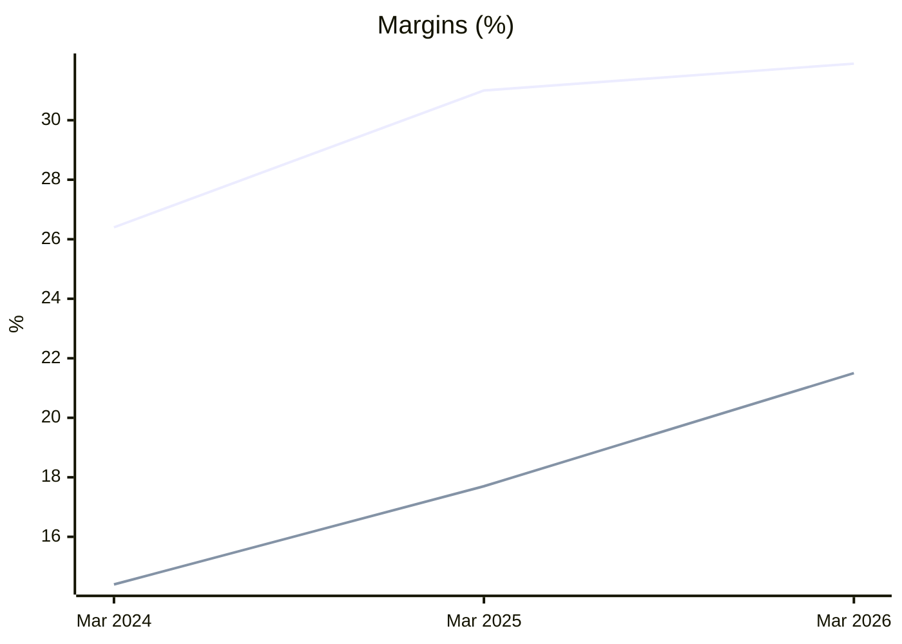

*Run 2026-11-24 · part of [SPINOFF_REPORT.md](../SPINOFF_REPORT.md) · the complete analysis of one company, with every management-call exchange in full.*

## NLCINDIA — NLC India Ltd.

### 1. NLC India Ltd. — PARTIAL SPIN-OFF (subsidiary IPO)

**CONFIRMED** (partial spin-off — the IPO of NLC India Renewables Limited is in motion (board approval)) · **PARTIAL SPIN-OFF, IPO IN MOTION — the parent's stub is priced once the piece trades** · score 2.9/10 · partial spin-off (subsidiary IPO) · 3 filing(s) from NSE · first 2026-11-04, latest 2026-11-04

**The separated entities — every one the documents name:**

| Entity | Scheme | Business | Listing | Who runs it |
|---|---|---|---|---|
| **NLC India Renewables Limited** | 2025 Business Transfer Agreement hive-off of 1,430 MW renew… | 7 renewable energy assets totalling 1,430 MW hived off from NLCIL under the Asset Monetization Plan; Phase II… | to be listed | not stated |

**What is being separated, as the documents put it:** NLC India Renewables Limited (NIRL) — the group's renewable energy assets, being IPO'd via Offer for Sale — class `regulatory_strategic`.

### 2. Stages and dates

> **Listing:** PARTIAL SPIN-OFF, IPO BOARD APPROVAL — NLC India Renewables Limited; date not fixed

| Date | Event | Source |
|---|---|---|
| 2025-08-07 | Board approval — NLC India Limited / NLC India Renewables Limited | as stated: In-principle approval for the Business Transfer Agreement to hive off… |
| 2025-10-31 | Other — NLC India Limited and NLC India Renewables Limited | as stated: Business Transfer Agreement entered into for hive-off of 7 RE assets … |
| 2025-12-31 | Other — NLC India Renewables Limited | as stated: "the expected date of completion of sale/disposal; 31st December, 202… |
| 2026-01-01 | Effective date — NLC India Renewables Limited (Phase I) | as stated: "The aforesaid transfer has been effected on 01st January, 2026" — Ge… |
| 2026-01-12 | Board approval — NLC India Renewables Limited (listing / IPO) | as stated: "The Board had earlier, at its meeting held on 12.01.2026, accorded i… |
| 2026-09-01 | Other — NLC India Renewables Limited (Phase II) | as stated: "based on the assets and liabilities as of 1st September 2026" — note… |
| 2026-09-03 | Other — NLC India Limited and NLC India Renewables Limited | as stated: Addendum (second addendum) to the Business Transfer Agreement signed … |
| 2026-11-04 | Stage reached: **announced** | [Outcome of Board Meeting](https://nsearchives.nseindia.com/corporate/NLCINDIA_04112026135958_573_BM_-_Outcome_04112026_Signed.pdf) |
| 2026-11-04 | Stage reached: **record date** | [Outcome of Board Meeting](https://nsearchives.nseindia.com/corporate/NLCINDIA_04112026135958_573_BM_-_Outcome_04112026_Signed.pdf) |
| 2026-11-04 | Board approval — NLC India Renewables Limited (OFS as part of proposed IPO) | as stated: Outcome of Board Meeting / Updates filing dated 04.11.2026 |

**The stages, as filed:** announced (2026-11-04) → record date (2026-11-04)

**The partial spin-off:** **NLC India Renewables Limited** (subsidiary); parent's stake 100% (Wholly Owned Subsidiary); IPO stage: board approval.

> “Offer for Sale (OFS) of up to 10,00,00,000 (Ten Crore) equity shares of face value of Rs.10 each held by the Company in NLC India Renewables Limited (NIRL), Wholly Owned Subsidiary, as part of the pro”

### 3. Size of the separated business beside the parent — is institutional selling likely?

**Reading: NO FORCED SELLING ON SIZE — an IPO distributes no shares to the parent's shareholders, so nobody receives a piece they did not choose. Size matters here for the stub: how much of the parent's market value the listed piece accounts for.**

| Entity | Stated turnover | Market cap (₹ cr) | Its market value beside the parent's | Index member |
|---|---|---:|---:|---|
| NLC India Renewables Limited | "Revenue from 7 Renewable Energy assets proposed to be transferred is… | — | — | not listed |

*The last column is the subsidiary's whole market value over the parent's (parent ₹32,989 cr, NSE bhavcopy of 2026-11-13), computed here; the parent's own value already contains the stake it keeps, so the stub is the parent's value less that stake.*

**In the documents' words:** “"Revenue from 7 Renewable Energy assets proposed to be transferred is Rs. 701.61 Crore in FY 2025, which is 4.59 % of the NLCIL revenue of Rs. 15,282.96 Crore (on consolidated basis) based on Audited Financial Statements of 31st March, 2025." and "Net worth of 7 RE assets is Rs. 3,869.26 Crore, which is 20.67 % of Net-worth of NLCIL i.e., Rs. 18,722.97 Crore (Total equity attributable to owners) based on Audited Financial Statements of 31st March, 2025." (filing 31.10.2025). For the Phase II tranche: "Revenue from operational Renewable Energy assets proposed to be transferred was Rs. 41.16 Crore for FY 2025-26, which is 0.24 % of the Company's revenue of Rs. 17,489.53 Crore (on consolidated basis) based on Audited Financial Statements of 31st March, 2026." and "Net worth of RE assets was Rs. 925.08 Crore, which is 4.30% of Net-worth of the Company i.e., Rs. 21,524.76 Crore (Total equity attributable to owners) based on Audited Financial Statements of 31st March, 2026." (filing 03.09.2026)”

**The judge's read of selling pressure:** unlikely — No shares distributed to NLCIL holders — separation is via IPO/Offer for Sale by the parent, so no forced spin-off supply.

### 4. Insider ownership — share swap, promoters' holding, management incentives

**Share swap / entitlement, entity by entity:**

- **NLC India Renewables Limited:** IPO offer structure: "Offer for Sale (OFS) of up to 10,00,00,000 (Ten Crore) equity shares of face value of Rs.10 each held by the Company in NLC India Renewables Limited (NIRL), Wholly Owned Subsidiary, as part of the proposed Initial Public Offering (IPO) of NIRL" (Board, 04.11.2026); any fresh issue component and issue size not stated. Consideration for the asset transfer itself: "The consideration will be paid by NIRL by issuance of equity shares/ acknowledgement of debt." (31.10.2025); "The consideration will be paid by NIRL in cash /acknowledgement of debt." (03.09.2026)

**Promoters' holding, from the shareholding pattern:**

| Company | Promoters | FIIs | DIIs | Public | Quarter |
|---|---:|---:|---:|---:|---|
| NLC India Ltd. (NLCINDIA) | 69.47% | 4.61% | 13.64% | 7.98% | Sep 2026 |

*Source: screener.in shareholding pattern, stored under `ShareholdingPattern/NiftyTotalMarket/`. In a mirror demerger each shareholder holds the same proportion of the new company as of the parent on the record date.*

- **Promoters in the parent, per the documents:** not stated in the documents on file.
- **What the promoters will hold in the separated entity:** not stated as a percentage. Before the IPO: "NLC India Renewables Limited (NIRL), a 100% subsidiary of NLC India Limited." The only stated dilution is the parent's own sale: "Offer for Sale (OFS) of up to 10,00,00,000 (Ten Crore) equity shares of face value of Rs.10 each held by the Company in NLC India Renewables Limited (NIRL), Wholly Owned Subsidiary, as part of the proposed Initial Public Offering (IPO) of NIRL". No mirror shareholding or post-IPO promoter percentage is disclosed; nothing is stated for the 2025 BTA beyond consideration being paid to the Company.
- **What a public shareholder receives:** not stated in the documents on file.
- **Management incentives:** not stated in the documents on file.
- **Insider actions around the separation:** The promoter-parent is selling down: Board approval on 04.11.2026 of "Offer for Sale (OFS) of up to 10,00,00,000 (Ten Crore) equity shares of face value of Rs.10 each held by the Company in NLC India Renewables Limited (NIRL), Wholly Owned Subsidiary, as part of the proposed Initial Public Offering (IPO) of NIRL, subject to compliance with the applicable provisions of the SEBI (Issue of Capital and Disclosure Requirements) Regulations, 2018". Before that the parent injected equity: "The company invested 200,00,00,000 equity shares in NLC India Renewables Limited (NIRL), wholly owned subsidiary of the company at Rs. 10 per share aggregating to Rs. 2,000 crore on 12th October 2026. Pursuant to this investment, the Company's total investment in NIRL increased to ₹5,119.75 crore as on 12th October 2026." No promoter or management buying, selling or pledging in the listed parent's own shares is stated.
- **Insiders, per the checklist read:** NIRL is NLCIL's wholly owned subsidiary; NLCIL's investment rose to ₹5,119.75 crore as on 12.10.2026; Board approved OFS of up to 10 crore shares held by NLCIL. Management stake not stated. · *option pricing date:* not stated

### 5. Why the listing — point by point

The business being separated is NLC India Ltd's renewable energy (solar/wind) portfolio, carved out of the lignite-mining and thermal-power parent into NLC India Renewables Limited (NIRL), a wholly owned subsidiary. The filings state the reason explicitly as policy-driven monetisation, not a strategic idea originated by management: the 31.10.2025 intimation says the hive-off of 7 RE assets totalling 1,430 MW is 'under Asset Monetization Plan approved by the Ministry of Coal, Administrative Ministry', and the Q2 FY27 accounts repeat that it is 'In line with the National Monetization Pipeline and in consultation with the Ministry of Coal'. Scale cited: the 7 assets earned Rs 701.61 crore of revenue in FY25 (4.59% of consolidated revenue of Rs 15,282.96 crore) but carried net worth of Rs 3,869.26 crore (20.67% of owners' equity of Rs 18,722.97 crore) — i.e. a capital-heavy, low-revenue block being moved off the parent's balance sheet at book value, with consideration by equity shares/acknowledgement of debt, and Government of India approval already received. Execution was phased: Phase I (1,430 MW) transferred w.e.f. 01.01.2026; a second addendum dated 03.09.2026 added 708.96 MW (including a 4 MW green hydrogen project, assets at various stages of construction/operation) for Rs 853.97 crore, contributing only Rs 41.16 crore of FY26 revenue (0.24%) and Rs 925.08 crore of net worth (4.30%). The separate vehicle is visibly being used to raise third-party capital and partners that the parent could not house: a maiden green loan with Sumitomo Mitsui Banking Corporation of JPY 15.464 billion (USD 100 million) under the ECB framework 'to fund renewable energy projects through its subsidiary NIRL', a PTC India JV for 2,000 MW, an OREDA MoU/JV, a DIPAM-approved JV with MAHAPREIT, an SJVNL 200 MW wind PPA and an NCRTC LoA for 110 MW captive solar — now sitting as step-down subsidiaries NARL, NRRL, NNRL, NORL and NPRL. The end state is a listing: the Board gave in-principle approval for listing NIRL on 12.01.2026 and on 04.11.2026 approved an Offer for Sale of up to 10,00,00,000 equity shares of Rs 10 each held by NLCIL in NIRL as part of NIRL's proposed IPO, after NLCIL injected a further Rs 2,000 crore of equity on 12.10.2026 taking its NIRL investment to Rs 5,119.75 crore.

**Point by point, with the source:**

1. The separation is a Ministry of Coal-mandated monetisation: 7 renewable assets of 1,430 MW hived off from NLCIL to wholly owned subsidiary NIRL under the approved Asset Monetization Plan, with Government of India approval already obtained. “we write to inform that the Company has entered into a Business Transfer Agreement with NLC India Renewables Limited (NIRL), a wholly owned subsidiary of the Company on 31st October, 2025, for proposed Hived off of the 7 Renewable Energy Assets with total Capacity of 1,430 MW from the Company to its Wholly Owned Subsidiary, NIRL, under Asset Monetization Plan approved by the Ministry of Coal, Administrative Ministry.” — *Scheme*
2. The disclosed economics show a capital-heavy, low-revenue block: 4.59% of consolidated revenue but 20.67% of owners' equity, transferred at book value with consideration in shares or acknowledgement of debt. “Net worth of 7 RE assets is Rs. 3,869.26 Crore, which is 20.67% of Net-worth of NLCIL i.e., Rs. 18,722.97 Crore (Total equity attributable to owners) based on Audited Financial Statements of 31st March, 2025.” — *Scheme*
3. Q2 FY27 accounts restate the driver as the National Monetization Pipeline and set out the two-phase mechanics, Phase II being 708.96 MW for Rs 853.97 crore under a second addendum. “In line with the National Monetization Pipeline and in consultation with the Ministry of Coal, NLCIL executed a Business Transfer Agreement (BTA) with NLC India Renewables Limited on 31st October 2025 for transferring 1,430 MW of renewable energy assets.” — *Scheme*
4. The scope later widened beyond operating plants to assets still being built, including a 4 MW green hydrogen project, contributing only 0.24% of FY26 revenue and 4.30% of net worth. “Addendum to the Business Transfer Agreement with NIRL is signed on 03rd September, 2026 for proposed hiving off 708.96 MW of Renewable Energy Assets including a 4 MW Green Hydrogen Project which are at various stages of construction/ operation.” — *Scheme*
5. The first transfer actually completed on 1 January 2026, converting the plan from intimation to executed carve-out. “The aforesaid transfer has been effected on 01st January, 2026, in terms of the Business Transfer Agreement executed between the Company and NIRL on 31st October, 2025.” — *Scheme*
6. The end-point is an IPO of NIRL with NLCIL selling down: OFS of up to 10 crore shares approved on 04.11.2026, following in-principle listing approval on 12.01.2026. “Offer for Sale (OFS) of up to 10,00,00,000 (Ten Crore) equity shares of face value of Rs.10 each held by the Company in NLC India Renewables Limited (NIRL), Wholly Owned Subsidiary, as part of the proposed Initial Public Offering (IPO) of NIRL, subject to compliance with the applicable provisions of the SEBI (Issue of Capital and Disclosure Requirements) Regulations, 2018, and other applicable statutory and regulatory requirements.” — *Scheme*
7. Lenders and partners are transacting with the subsidiary, not the parent: a maiden offshore green loan of JPY 15.464 billion (USD 100 million) from SMBC under the ECB framework is explicitly routed through NIRL. “Signed its maiden Green Loan agreement with Sumitomo Mitsui Banking Corporation (SMBC) under the ECB framework , amounting to JPY 15.464 billion (USO 100 million), to fund renewable energy projects through its subsidiary NIRL.” — *Scheme*
8. NIRL has become the JV platform for state and PSU partners (PTC India 2,000 MW, OREDA, MAHAPREIT with DIPAM approval, SJVNL 200 MW wind PPA, NCRTC 110 MW captive solar), now held as step-down subsidiaries. “NIRL signed a JV agreement with PTC India Ltd, for development of 2000 MW of green energy capacity and formation of JV company is in progress.” — *Scheme*
9. The parent is funding the vehicle ahead of the IPO, taking its NIRL equity to Rs 5,119.75 crore, while renewables segment assets roughly doubled to Rs 10,881.76 crore from Rs 5,470.15 crore a year earlier. “The company invested 200,00,00,000 equity shares in NLC India Renewables Limited (NIRL ), wholly owned subsidiary of the company at Rs. IO per share aggregating to Rs. 2,000 crore on 12th October 2026.” — *Scheme*
10. The structure deliberately avoids a merger/demerger scheme: it is a related-party slump sale at book value between holding company and wholly owned subsidiary, so Regulation 37A does not apply. “No amalgamation/ merger is envisaged. Hence compliance w.r.t. Regulation 37A of SEBI (LODR) Regulations, 2015, is not applicable as the transaction is being entered between the Company and its Wholly Owned Subsidiary i.e. NIRL.” — *Scheme*

**How it evolved:** The seven earnings calls tagged Feb 2024, Aug 2024, Nov 2024, Feb 2025, May 2025, Aug 2025 and Feb 2026 (held 10.02.2026) contain no extractable transcript text — six are scanned images and the Feb 2026 item is only the covering letter — so the idea cannot be traced call by call from these documents. From the filings the sequence is: in-principle approval for the Business Transfer Agreement to hive off the RE assets on 07.08.2025 (referenced in the 31.10.2025 intimation), BTA signed 31.10.2025 for 7 assets/1,430 MW under the Ministry of Coal's Asset Monetization Plan, transfer effected 01.01.2026, in-principle Board approval for listing NIRL on 12.01.2026, an addendum on 03.09.2026 adding 708.96 MW plus a 4 MW green hydrogen project, and OFS/IPO approval on 04.11.2026. The plan therefore widened from a one-off intra-group asset transfer at book value into a phased carve-out plus an IPO of the subsidiary, with the scope growing to include under-construction and green-hydrogen assets and five new partner-funded step-down subsidiaries.

**What management expects from it:** Not stated in words. The documents imply only: a dedicated, separately capitalised renewables vehicle (NIRL equity Rs 5,119.75 crore) able to raise third-party green debt (SMBC USD 100 million ECB) and partner equity via JVs with PTC, OREDA, MAHAPREIT, SJVNL and NCRTC, monetising assets per the Ministry of Coal plan and realising value through an NIRL IPO/OFS, leaving NLCIL focused on mining and thermal.

*Not explained on the calls:* No call transcripts were extractable, so no management commentary, margin, valuation, capital-allocation or focus rationale; IPO size, pricing, timing, use of proceeds and residual NLCIL stake are unstated.

- *Stated reason, in one line:* "In line with the National Monetization Pipeline and in consultation with the Ministry of Coal"; hive-off of RE assets "under Asset Monetization Plan approved by the Ministry of Coal, Administrative Ministry"
- *What it reveals:* Renewables, long buried in a lignite/thermal group, is now a priced standalone: segment assets ₹10,881.76 cr and H1 FY27 segment result ₹237.08 cr on revenue ₹462.27 cr; NLCIL has sunk ₹5,119.75 cr of equity into NIRL.
- *Parent or spin:* parent · *Read next:* NIRL's IPO offer document / DRHP, plus Power–Renewables segment assets (₹10,881.76 cr) and liabilities (₹6,646.10 cr)
- *In their words:* “The Board had earlier, at its meeting held on 12.01.2026, accorded in-principle approval for the listing of NIRL, which was duly intimated.”

### 6. On the calls, verbatim

No call in the last 36 months carries a statement about it (or no transcript is on file).

### 7. The parent's financial statements

**The parent, last three fiscal years (consolidated)**

| | Mar 2024 | Mar 2025 | Mar 2026 |
|---|---:|---:|---:|
| Sales (₹ cr) | 13,001 | 15,322 | 17,490 |
| Sales growth (%) | -19.6% | +17.9% | +14.1% |
| Operating profit (₹ cr) | 3,438 | 4,747 | 5,588 |
| Operating profit growth (%) | -40.1% | +38.1% | +17.7% |
| Operating margin (%) | 26.4 | 31.0 | 31.9 |
| PAT (₹ cr) | 1,868 | 2,714 | 3,769 |
| PAT growth (%) | +31.0% | +45.3% | +38.9% |
| PAT margin (%) | 14.4 | 17.7 | 21.5 |
| EPS (₹) | 13.4 | 18.9 | 25.4 |

*Source: ProfitStatement/NiftyTotalMarket/NLCINDIA.csv (consolidated, screener.in); growth and margins computed here.*

```mermaid
xychart-beta
    title "Sales, operating profit and PAT (₹ cr)"
    x-axis ["Mar 2024", "Mar 2025", "Mar 2026"]
    y-axis "₹ crore"
    bar [13001, 15322, 17490]
    bar [3438, 4747, 5588]
    bar [1868, 2714, 3769]
```

*Series in order: Sales, Operating profit, PAT.*

*Series in order: Operating margin, PAT margin.*

**P/E:** 11.7 — live market file (screener.in), trailing (price ₹298.00 as of 2026-08-02).

**Cash flows (₹ cr):**

| | Mar 2024 | Mar 2025 | Mar 2026 |
|---|---:|---:|---:|
| Cash from operations (₹ cr) | 5,512 | 8,977 | 5,166 |
| Cash from investing (₹ cr) | -3,059 | -7,160 | -7,549 |
| Cash from financing (₹ cr) | -1,985 | -2,196 | 2,907 |
| Net cash flow (₹ cr) | 468 | -379 | 525 |
| Free cash flow (₹ cr) | 2,357 | 1,709 | -2,474 |

*Source: CashFlow/NiftyTotalMarket/NLCINDIA.csv (consolidated, screener.in).*

### 8. The separated business's financial statements

**The business being separated — its own numbers**, entity by entity: its reported statements once it is listed and on file, and the segment numbers the annual reports and presentations carry for it before that.

**Power - Renewable / Power - Renewables (reportable segment) → NLC India Renewables Limited (NIRL)** · unit ₹ crore · Operating_profit = 'Segment Result' per Ind AS 108 segment note, i.e. segment profit before tax and interest (EBIT-type), stated before other income, unallocated corporate expenses, finance cost and tax. Revenue shown is External Sales (no inter-segment sales reported for this segment; total revenue equals external revenue). Segment assets/liabilities exclude unallocated corporate items. PAT is not disclosed at segment level.

| | FY2024 | FY2025 | FY2026 |
|---|---:|---:|---:|
| Revenue (₹ crore) | — | 702 | 726 |
| Revenue growth (%) | — | — | +3.5% |
| Operating profit (₹ crore) | — | 380 | 322 |
| Operating profit growth (%) | — | — | -15.0% |
| Operating margin (%) | — | 54.1 | 44.4 |
| PAT (₹ crore) | — | — | — |
| PAT growth (%) | — | — | — |
| Segment assets (₹ crore) | — | 5,635 | 9,124 |
| Segment liabilities (₹ crore) | — | 2,373 | 5,271 |
| Capital employed (₹ crore) | — | 3,263 | 3,854 |
| Return on capital employed (%) | — | 11.6 | 8.4 |
| Segment assets / revenue (x) | — | 8.0 | 12.6 |
| Capex (₹ crore) | — | 707 | 2,912 |

*Sources:* Annual Report 2024 — page 232 (renewables not a separate reportable segment in FY2024; only Mining and Power Generation reported); Annual Report 2026 — page 260

*Latest quarter (Q1 FY27 (quarter ended 30-06-2026)):* revenue 220.01, operating profit 104.47 — Presentation Aug 2026 — page 14

*Not in the pages read:* No PAT, no FY2024 segment split (renewables sat inside Power Generation), no standalone NIRL entity financials; renewable NBV ₹5,107 crore at 31.03.2024 only.

*Businesses with no numbers in the pages read (3 annual report(s) and 8 presentation(s) on file):* '7 renewable energy' and NIRL entity-level financials carry no numbers; 'Renewable Energy Assets / RE Assets' appear only as net book value (₹5,107 crore, 1,420 MW, AR2024 p205) and NBV trend (Presentation Nov 2025 p22), not as revenue/profit.

*Documents on file:* [Annual Report 2026](https://www.bseindia.com/xml-data/corpfiling/AttachHis/d28b50c9-e932-4f4e-b082-ab8a10dfcc20.pdf); [Annual Report 2025](https://www.bseindia.com/xml-data/corpfiling/AttachHis/3820278f-a17a-467b-b3dd-aca7902cc966.pdf); [Annual Report 2024](https://www.bseindia.com/xml-data/corpfiling/AttachHis/2683fb6f-c4b1-4f9a-8e7d-302c41933a40.pdf); [Presentation Nov 2026](https://www.bseindia.com/stockinfo/AnnPdfOpen.aspx?Pname=2641611a-dc69-45c5-b964-6200472856e3.pdf); [Presentation Aug 2026](https://www.bseindia.com/stockinfo/AnnPdfOpen.aspx?Pname=9b1e76d6-6477-4611-b278-e43e422965b8.pdf); [Presentation May 2026](https://www.bseindia.com/stockinfo/AnnPdfOpen.aspx?Pname=ae523ca7-e933-4ec4-af04-6c514eccddbb.pdf); [Presentation Nov 2025](https://www.bseindia.com/stockinfo/AnnPdfOpen.aspx?Pname=09957902-9af7-4f6d-896a-89e23f8d33eb.pdf); [Presentation May 2025](https://www.bseindia.com/stockinfo/AnnPdfOpen.aspx?Pname=64333213-3419-4653-a910-0a7256bd5051.pdf); [Presentation Jan 2024](https://www.bseindia.com/stockinfo/AnnPdfOpen.aspx?Pname=bc812425-16c7-4d9e-8489-5d369ef69599.pdf)

### 9. Other financial differences — working capital, margins, returns, debt

| Metric (latest year) | Parent (NLCINDIA) | NLC India Renewables Limited |
|---|---:|---:|
| *Basis* | *reported, consolidated* | *segment numbers (Power - Renewable / Power - …* |
| Sales (₹ cr) | 17,490 (Mar 2026) | — |
| Sales growth (%) | 14.1 (Mar 2026) | 3.5 (FY2026) |
| Operating margin (%) | 31.9 (Mar 2026) | 44.4 (FY2026) |
| Operating profit growth (%) | 17.7 (Mar 2026) | -15 (FY2026) |
| PAT margin (%) | 21.5 (Mar 2026) | — |
| ROCE % | 10 (Mar 2026) | 8.4 (FY2026) |
| Debtor Days | 70 (Mar 2026) | — |
| Cash Conversion Cycle | 70 (Mar 2026) | — |
| Working Capital Days | -62 (Mar 2026) | — |
| Debt / equity (x) | 1.3 (Mar 2026) | — |
| Borrowings (₹ cr) | 27,892 (Mar 2026) | — |
| Segment assets / revenue (x) | — | 12.6 (FY2026) |
| Sales (₹ crore) | — | 726.1 (FY2026) |

*Each figure is the latest on file, with its year. Working-capital days and ROCE come from the stored working-capital file; segment figures from the pages cited in part 8. A dash means the documents do not carry it.*

**What stays with the parent — its segments, from the same pages:**

| Remaining segment | Revenue | Operating margin | ROCE | Segment assets / revenue | Unit | Year |
|---|---:|---:|---:|---:|---|---|
| Mining (mining of lignite and coal) | 2,901 | 62.2% | 120.6% | 3.02x | ₹ crore | FY2026 |
| Power - Thermal (FY2024 reported as 'Power Generation', then including renewables) | 13,862 | 15.2% | 11.5% | 3.05x | ₹ crore | FY2026 |

**What the documents themselves say about the differences:**

- **other** — parent / remaining: Consolidated revenue of ₹17,489.53 crore for FY 2025-26 (audited); separated business: Revenue of the operational RE assets transferred in Phase II was ₹41.16 crore for FY 2025-26, i.e. 0.24% of the parent “Revenue from operational Renewable Energy assets proposed to be transferred was Rs. 41.16 Crore for FY 2025-26, which is 0.24 % of the Company's revenue of Rs. 17,489.53 Crore (on consolidated basis) based on Audited Financial Statements of 31st March, 2026.”
- **other** — parent / remaining: Net worth (total equity attributable to owners) of ₹18,722.97 crore as at 31.03.2025; separated business: Net worth of the 7 RE assets of ₹3,869.26 crore, 20.67% of the parent's — far larger as a share of net worth than of revenue (4.59%) “Net worth of 7 RE assets is Rs. 3,869.26 Crore, which is 20.67 % of Net-worth of NLCIL i.e., Rs. 18,722.97 Crore (Total equity attributable to owners) based on Audited Financial Statements of 31st March, 2025.”
- **debt and leverage** — parent / remaining: Parent raises rupee bonds in the nature of debentures by private placement — "Fund raising through Issuance of Bonds in the nature of Debentures of upto Rs. 2,500 Crore in phased manner based on requirement."; separated business: The renewable business is funded through a foreign-currency green loan raised for NIRL “Signed its maiden Green Loan agreement with Sumitomo Mitsui Banking Corporation (SMBC) under the ECB framework , amounting to JPY 15.464 billion (USD 100 million), to fund renewable energy projects through its subsidiary NIRL.”
- **capex and capital intensity** — parent / remaining: Group capex of ₹6,242 crore up to December 2025, exceeding the FY 2025-26 annual target by 23%; consolidated purchase of PP&E of ₹3,895.33 crore in H1 FY 2026-27; separated business: The parent keeps funding NIRL's equity: ₹2,000 crore injected on 12 October 2026, total investment in NIRL ₹5,119.75 crore “Pursuant to this investment, the Company's total investment in NIRL increased to ₹5,119.75 crore as on 12th October 2026.”
- **operating margin** — parent / remaining: Consolidated Operating Margin 16.49% for the quarter and 17.44% for the half year ended 30-09-2026 (22.39% for FY 2025-26); standalone 16.58% and 17.79%; separated business: Power-Renewables segment result of ₹132.61 crore on segment revenue of ₹242.26 crore for the quarter ended 30-09-2026 (₹237.08 crore on ₹462.27 crore for the half year); no separate margin is stated for the transferred undertaking “c .Power -Renewables 242.26 220.01 194.11 462.27 373.88 726.06”

**The checklist:**

| Item | Status | Evidence |
|---|---|---|
| Why the spin-off | unknown | no stated rationale in the filings on file *(next: read the scheme's rationale section / the board's press release)* |
| Institutional selling likely (small / different business) | unknown | size of the demerged piece not stated *(next: pro-forma statements: revenue / assets of the demerged undertaking vs the parent)* |
| Insider ownership and incentives aligned | unknown | no promoter-continuity or option-pricing language found *(next: the date the management options are priced; promoter holding in the resulting company)* |
| A hidden value revealed (pro-forma, leverage, comparables) | yes | borrowings 27,892 cr (Mar 2026) = 0.68× market cap; P/E 11.0 on Mar 2026 profit vs industry median 31.1 (15 peers) |
| Parent before the spin (clean parent, takeover prelude) | no | stage record_date — the pieces trade separately now |
| Partial spin-off: price the stub from the listed piece | partly | a subsidiary is being listed; once it trades, stub = parent price − (stake value ÷ parent shares) *(next: stub_value(parent price, parent shares, [(sub price, shares held)]))* |
| Timing (first year sells, second year gains) | partly | 20 days since listing/record date; first year since listing — the selling-pressure window; watch, size the entry |

The filings

| Date | Category | Headline | Attachment |
|---|---|---|---|
| 2026-11-04 | Outcome of Board Meeting | NLC India Limited has submitted to the Exchange, the financial results for the period ended September 30, 2026. | [pdf](https://nsearchives.nseindia.com/corporate/NLCINDIA_04112026135958_573_BM_-_Outcome_04112026_Signed.pdf) |
| 2026-11-04 | Record Date | NLC India Limited has informed the Exchange that Record date for the purpose of Dividend is 12-Nov-2026. | [pdf](https://nsearchives.nseindia.com/corporate/NLCINDIA_04112026140709_573_BM_-_Outcome_04112026_Signed.pdf) |
| 2026-11-04 | Updates | NLC India Limited has informed the Exchange regarding 'Offer for Sale (OFS) of up to 10,00,00,000 (Ten Crore) equity shares of face value ofRs.10 each held by t | [pdf](https://nsearchives.nseindia.com/corporate/NLCINDIA_04112026142212_573_BM_-_Outcome_04112026_Signed.pdf) |

