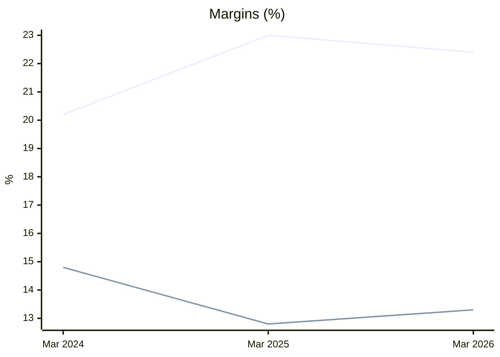

*Run 2026-11-24 · part of [SPINOFF_REPORT.md](../SPINOFF_REPORT.md) · the complete analysis of one company, with every management-call exchange in full.*

## PICCADIL — Piccadily Agro Industries Ltd.

### 1. Piccadily Agro Industries Ltd. — CONFIRMED DEMERGER

**CONFIRMED** (a demerger scheme is on the exchange record) · **PRE-SPIN — study the parent; the pieces do not trade yet** · score 4.3/10 · spin-off · 6 filing(s) from CALLS, NSE · first 2026-04-28, latest 2026-08-17

**The separated entities — every one the documents name:**

| Entity | Scheme | Business | Listing | Who runs it |
|---|---|---|---|---|
| **Piccadily Food & Essentials Limited** | 2026 demerger of the Sugar Business into Piccadily Food & E… | Sugar Business: manufacturing, marketing, sales and/or distribution of white crystal sugar from sugarcane and… | to be listed | not stated |

**What is being separated, as the documents put it:** The Sugar Business — white crystal sugar, allied and food products — demerged into wholly owned Piccadily Food & Essentials Limited — class `value_unlocking`.

### 2. Stages and dates

> **Listing:** NOT YET — scheme at 'exchange_noc' stage; the resulting company will list only after NCLT sanction, effectiveness and a record date; indicated timeline: Press release and earnings call (28–29 April 2026): demerger scheme filed with SEBI, "expects completion by the end of FY27"; NSE observation letter (14 August 2026): listing/trading must commence "within sixty days of receipt of the order of the Hon'ble High Court/NCLT"; shares frozen in depositories till trading permission.

| Date | Event | Source |
|---|---|---|
| 2026-04-28 | Board approval — Piccadily Agro Industries Limited | as stated: Outcome of the Board Meeting under Regulation 30 held on April 28, 20… |
| 2026-04-28 | Other — Piccadily Agro Industries Limited | as stated: Press release dated 28th April 2026: "the demerger scheme has been fi… |
| 2026-07-22 | Other — National Stock Exchange of India Limited submission of the draft scheme to SEBI (letter reference no. NSE/LIST/54953) | as stated: NSE Observation Letter Ref: NSE/LIST/54953 dated August 14, 2026 |
| 2026-08-13 | Other — SEBI comment letter on the draft scheme of arrangement | as stated: NSE Observation Letter Ref: NSE/LIST/54953 dated August 14, 2026 ("SE… |
| 2026-08-14 | Exchange no-objection — BSE Limited and National Stock Exchange of India Limited | as stated: Intimation regarding receipt of Observation Letters dated August 17, … |
| 2026-08-17 | Stage reached: **exchange noc** | [General Updates](https://nsearchives.nseindia.com/corporate/CSPICCADILY_17082026163842_approval.pdf) |
| 2026-08-17 | Other — Piccadily Agro Industries Limited | as stated: General Updates filing dated August 17, 2026 — intimation to BSE and … |

**The stages, as filed:** exchange noc (2026-08-17)

**When it lists, in the documents' words:** Press release and earnings call (28–29 April 2026): demerger scheme filed with SEBI, "expects completion by the end of FY27"; NSE observation letter (14 August 2026): listing/trading must commence "within sixty days of receipt of the order of the Hon'ble High Court/NCLT"; shares frozen in depositories till trading permission.

### 3. Size of the separated business beside the parent — is institutional selling likely?

**Reading: LIKELY — the piece is small beside the parent; mandates with size limits tend to sell.**

| Entity | Stated turnover | Stated share of the whole | Segment revenue share | Market cap (₹ cr) | Share of combined market cap | Index member |
|---|---|---:|---:|---:|---:|---|
| Piccadily Food & Essentials Limited | "The turnover of the Demerged Undertaking of the Company fo… | 20.53% | 22.5% (FY2026) | — | — | not listed |

*Stated figures are the documents' own (a turnover share, or the cost-of-acquisition split the company publishes for tax, which reflects relative value); the segment share is this business's revenue over the parent's sales, and the market-cap share is the entity's value over the entity plus the parent (parent ₹5,444 cr, NSE bhavcopy of 2026-11-13), both computed here.*

**In the documents' words:** “The turnover of the Demerged Undertaking of the Company for the financial year ended 31% March 2026 is as follows: (Rs. In Lakh) | Financial Year: 2026 | Turnover of the demerged division: 233.05 | Percentage to the total turnover of the listed entity: 20.53%”

**The judge's read of selling pressure:** likely — Entitlement is only 1 PFEL share per 9 PAIL shares; sugar is a different, seasonal industry premium-spirits holders did not buy.

### 4. Insider ownership — share swap, promoters' holding, management incentives

**Share swap / entitlement, entity by entity:**

- **Piccadily Food & Essentials Limited:** for every 9 (Nine) equity shares of face value of Rs. 10/- fully paid up held in the Demerged Company, 1 (One) equity share of face value of Rs. 10/- credited as fully paid up in the Resulting Company.

**Promoters' holding, from the shareholding pattern:**

| Company | Promoters | FIIs | DIIs | Public | Quarter |
|---|---:|---:|---:|---:|---|
| Piccadily Agro Industries Ltd. (PICCADIL) | 68.56% | 1.0% | 0.92% | 29.5% | Sep 2026 |

*Source: screener.in shareholding pattern, stored under `ShareholdingPattern/NiftyTotalMarket/`. In a mirror demerger each shareholder holds the same proportion of the new company as of the parent on the record date.*

- **Promoters in the parent, per the documents:** not stated in the documents on file.
- **What the promoters will hold in the separated entity:** 2026 demerger: "There will be no change in the shareholding pattern of Piccadily Agro Industries Limited. Further the Piccadily Food & Essentials Limited is a wholly owned subsidiary of the Company. Upon effectiveness of the Scheme, the entire pre scheme paid up share capital of PFEL, shall stand cancelled and reduced." and "The effectiveness of the Scheme would result in the creation of two listed companies with proportionate shareholding with the Resulting Company housing the Sugar Business and the Company housing the Distillery Business." Promoter percentages are not stated.
- **What a public shareholder receives:** 2026 demerger: "for every 9 (Nine) equity shares of face value of Rs. 10/- fully paid up held in the Demerged Company, | (One) equity share of face value of Rs. 10/- credited as fully paid up in the Resulting Company." and "There is no cash consideration being discharged under the Scheme."
- **Management incentives:** Treatment of existing grants under the Scheme is not stated, and no new plan in the Resulting Company is stated. The only disclosure is in the cash flow statements: standalone "EMPLOYEES STOCK OPTION SCHEME 584.69" for the year ended 31.03.2026 against "149.68" for the year ended 31.03.2025 (consolidated: "EMPLOYEE STOCK OPTION SCHEME 584.69" / "149.68"), and "PROCEEDS BY WAY OF ISSUE OF EQUITY SHARE 423.22". Diluted EPS Rs. 14.42 versus basic Rs. 14.42 for FY2026 (FY2025: 11.08 diluted versus 11.09 basic). Management or insider shareholding percentages: not stated.
- **Insider actions around the separation:** not stated in the documents on file.
- **Insiders, per the checklist read:** Not stated as a percentage; shareholding proportionate — no change in PAIL's pattern; PFEL's pre-scheme capital cancelled, no consideration. Promoter converted 6,36,942 warrants into PAIL shares, listed November 2025. · *option pricing date:* not stated

### 5. Why the demerger — point by point

Management is demerging the Sugar Business of Piccadily Agro Industries Ltd. (PAIL) into Piccadily Food & Essentials Limited (PFEL), a wholly owned subsidiary, so that PAIL becomes a pure-play premium alco-bev company; CFO Natwar Aggarwal framed it on the April 29, 2026 call as "we want to be a global alco-bev company and in that pursuit we want to focus on our core brand portfolio," with the scheme Board-approved April 28, 2026, filed with SEBI, KPMG as adviser, and completion envisaged in FY27. The stated intent is to pool human and capital resources behind the Alco-Bev portfolio (Indri single malt, Camikara rum, Cashmir vodka, Whistler blended whisky) and to list sugar — described as a "traditional heritage business" — as a separate entity rather than sell it. The economics behind it are visible in the numbers management cited: Alco-Bev revenue grew 42% to INR 908 crore (from INR 639 crore) with 31.5% EBITDA margins and 45–50% IMFL margins, while sugar was only INR 233.05 crore of turnover (20.53% of the listed entity) and dragged Q4 standalone EBITDA margin down ~300 bps as sugar's quarterly EBITDA margin collapsed from 11% to 2%; the segment tables show the sugar segment result at a loss of INR 904.62 lakh in FY26 versus a loss of INR 327.13 lakh in FY25, with sugar segment assets of INR 10,553.97 lakh against segment liabilities of INR 22,166.79 lakh. Management also repeatedly blamed sugar seasonality for making quarter-to-quarter margins hard to read. The scheme's own rationale (Annexure B) lists focused attention for each core business and the ability to attract required investment, greater business focus and enhanced shareholder value, more efficient use of financial resources, managerial talent, technical skills and marketing resources, value unlock "through price-discovery of the individual entities," the "right operating architecture" with sharper individual strategies and "clear capital allocation," and separately listed companies attracting a specific set of investors with financial flexibility and "stronger capital market outcomes." Mechanically it is a mirror listing: no cash consideration, 1 PFEL share of INR 10 for every 9 PAIL shares (ratio fixed on sugar's turnover and assets), PFEL's pre-scheme capital cancelled, no change in PAIL's shareholding pattern, producing "two listed companies with proportionate shareholding." No investor, lender or business partner is identified anywhere as having demanded the separation — it is presented as a management/Board decision, recommended by the Audit Committee and Independent Directors, alongside the unrelated FY27 agenda of INR 250–300 crore incremental Indri revenue, INR 300–400 crore from the 200 KLPD Chhattisgarh plant, 60–70% growth and brand-side inorganic options.

**Point by point, with the source:**

1. The CFO announced the demerger of the sugar business into a new entity as a step toward becoming a global alco-bev company focused on the core brand portfolio, filed with SEBI with KPMG as partner and NCLT to follow, targeting completion in FY27. “A couple of announcements also, we want to be a global alco-bev company and in that pursuit we want to focus on our core brand portfolio.” — *[May 2026](https://www.piccadily.com/themes/piccadily/pdfs/piccadily_transcript_earnings_call_dated_29_4_26.pdf)*
2. Timeline and process: scheme filed with SEBI, NCLT filing after SEBI go-ahead, completion envisaged within FY27. “Once we get go-ahead from SEBI, we will follow the due process of filing it to NCLT and we envisage to complete this process by FY '27 this year.” — *[May 2026](https://www.piccadily.com/themes/piccadily/pdfs/piccadily_transcript_earnings_call_dated_29_4_26.pdf)*
3. Management restated the demerger purely as a focus measure alongside guidance of 60–70% FY27 growth and 3x–4x revenue in three to four years. “As mentioned earlier, we also in a process of demerger just to focus on the main Alco-Bev business.” — *[May 2026](https://www.piccadily.com/themes/piccadily/pdfs/piccadily_transcript_earnings_call_dated_29_4_26.pdf)*
4. Asked by Himanshu Shah of Dolat Capital whether sugar would eventually be sold or listed, management said the intent is to pool human and capital resources for Alco-Bev only and to separately list sugar, which it called a traditional heritage business. “Yes, intent is very clear that we want to be a global Alco-Bev company. We want to pool our human and capital resources just for the Alco-Bev business.” — *[May 2026](https://www.piccadily.com/themes/piccadily/pdfs/piccadily_transcript_earnings_call_dated_29_4_26.pdf)*
5. The separation is explicitly a separate listing of the heritage sugar business, not a divestment, so the company can focus only on the Alco-Bev portfolio. “So sugar business is like a traditional heritage business for us. So we want to separate it and list it as a separate entity than our Alco-Bev company and focus only on the Alco-Bev portfolio.” — *[May 2026](https://www.piccadily.com/themes/piccadily/pdfs/piccadily_transcript_earnings_call_dated_29_4_26.pdf)*
6. Sugar was the main reason standalone Q4 EBITDA margin fell about 300 basis points, its quarterly EBITDA margin dropping from 11% to 2% — the dilution the demerger removes. “That is one of the major factor is because of sugar drop in business, sugar margins drop, which was 11% EBITDA margin last year and last year same quarter and 2% this year quarter.” — *[May 2026](https://www.piccadily.com/themes/piccadily/pdfs/piccadily_transcript_earnings_call_dated_29_4_26.pdf)*
7. Management contrasted sugar's drag with Alco-Bev EBITDA margins of about 31.5% (and IMFL margins of 45–50%), which it expects to maintain or improve with premiumisation. “I would like to highlight one more point here that if you look at our Alco-Bev business EBITDA margins, which is in the range of, let's say, current year about 31.5%, which is one of the highest margin in any Alco-Bev competition.” — *[May 2026](https://www.piccadily.com/themes/piccadily/pdfs/piccadily_transcript_earnings_call_dated_29_4_26.pdf)*
8. Sugar seasonality was also cited as what makes quarter-to-quarter margin comparison unreliable for the consolidated entity. “So as I said, that as you rightly said that overall our EBITDA margins are same on year-over-year basis, but quarterly one factor is a sugar because of seasonality of the sugar business.” — *[May 2026](https://www.piccadily.com/themes/piccadily/pdfs/piccadily_transcript_earnings_call_dated_29_4_26.pdf)*
9. The April 28, 2026 Board outcome states the scheme demerges the Sugar Business into wholly owned subsidiary PFEL under Sections 230–232, creating two listed companies with proportionate shareholding — sugar in PFEL, distillery in PAIL. ““The effectiveness of the Scheme would result in the creation of two listed companies with proportionate shareholding with the Resulting Company housing the Sugar Business and the Company housing the Distillery Business.” — *Scheme*
10. Sugar's scale is disclosed as INR 233.05 crore of FY26 turnover, 20.53% of the listed entity's total turnover. “The turnover of the Demerged Undertaking of the Company for the financial year ended 31% March 2026 is as follows:” — *Scheme*
11. Scheme rationale: separating the undertaking lets each company give focused attention to its core business and attract the investment that business needs. “Demerger of the Demerged Business and Undertaking and transferrmg it to a separate company would enable both the Demergéd Company and. the Resulting Company to provide focused attention for growth of their core businesses and attract required investments for growing that business;” — *Scheme*
12. Scheme rationale: value unlock via separate price discovery for each entity for existing shareholders. “The Scheme would unlock value for the overall-business portfolio through price-discovery of the individual entities for existing shareholders;” — *Scheme*
13. Scheme rationale: the right operating architecture, sharper individual business strategies and clear capital allocation for each company. “The Scheme could lead to the right operating architecture for both companies with sharper focus on, their individual business strategies and clear capital allocation, in alignment with the respective value creation journeys;” — *Scheme*
14. Scheme rationale: two separately listed companies each attract their own investor set, gain financial flexibility and better capital market outcomes. “Separately listed companies to attract specific set of investors for their’ business profile, achieve financial flexibility and consequently, encourage stronger capital market outcomes.” — *Scheme*
15. Scheme rationale: better, more efficient conduct of each business by using its own financial resources, managerial talent, technical skills and marketing resources, and greater business focus enhancing shareholder value. “The Scheme will be conducive to better and more’ efficient and effective conduct of: business. and operations of the respective . companies, by utilizing the financial resources, managerial talents, technical skills and marketing resources and services delivery” — *Scheme*
16. Mirror listing, no cash: one PFEL share of INR 10 for every nine PAIL shares, PFEL's existing capital cancelled, no change in PAIL's shareholding pattern, ratio set on sugar's turnover and assets. “The Share Entitlement Ratio is fixed keeping in view the turnover of Sugar Business Undertaking and assets of the Sugar Business.” — *Scheme*
17. The April 28, 2026 press release frames the end state as a pure-play alco-bev company with sharper focus, better capital allocation and value creation, scheme filed with SEBI and completion expected by end-FY27. “Post-demerger, Piccadily Agro will transition into a pure-play alco-beverage company, enabling sharper strategic focus, improved capital allocation, and enhanced value creation for stakeholders.” — *Scheme*
18. CFO's press-release quote ties the demerger directly to unlocking value in core operations alongside Chhattisgarh monetisation from May 2026. “With the strategic demerger of our sugar division, we are now sharply focused on unlocking value in our core operations.” — *Scheme*
19. On August 17, 2026 the company intimated receipt of no-adverse-observation letters dated August 14, 2026 from BSE and NSE (following SEBI's August 13, 2026 comments), enabling the NCLT filing; the letter is valid six months and PFEL's listing is at the exchange's discretion. “We wish to inform you that the Company has received the No Adverse Observation Letters dated August 14, 2026, in respect of the aforesaid Scheme from the BSE Limited and National Stock Exchange of India Limited (“Stock Exchanges”).” — *Scheme*
20. SEBI's comments require the company to spell out, to NCLT and shareholders, the need for and rationale of the demerger, cost-benefit analysis, swap-ratio basis, assets and liabilities transferred, risks and the financial implications for promoters and public shareholders — disclosure not yet made in these documents. “Need for the demerger, rationale of the scheme, synergies of business of the entities involved in the scheme, impact of the scheme on the shareholders and cost benefit analysis of the scheme.” — *Scheme*

**How it evolved:** Only one earnings call falls in the window, the FY26 call of April 29, 2026, and the demerger appears there already as a done decision rather than an idea being floated — announced in the CFO's opening remarks the day after the April 28, 2026 Board meeting approved the scheme and filed it with the exchanges/SEBI, with KPMG as partner and FY27 as the completion target. It resurfaced later in the same call only when Himanshu Shah of Dolat Capital pressed on intent (sell or separately list), drawing the explicit answer that sugar would be listed separately, not sold. The filings then track execution rather than rationale: the April 28, 2026 Regulation 30 outcome with the full Annexure B rationale, share entitlement ratio and sugar turnover of INR 233.05 crore (20.53%), the April 28, 2026 press release restating the pure-play framing, and the August 17, 2026 intimation of BSE/NSE no-adverse-observation letters dated August 14, 2026 (SEBI comments dated August 13, 2026) clearing the way for the NCLT petition. Earlier filings in the window (November–December 2025) concern only CCD and warrant conversions and never mention a separation.

**What management expects from it:** Alco-Bev PAIL becomes a pure-play premium spirits company: sharper focus, pooled human and capital resources, better capital allocation, and 31.5% alco-bev / 45–50% IMFL margins no longer diluted by seasonal sugar; 60–70% FY27 growth and 3–4x revenue in 3–4 years. Sugar, housed in PFEL, gets focused attention, its own investor set, price discovery, financial flexibility and ability to attract investment.

*Not explained on the calls:* No sugar standalone P&L/debt split, lender or creditor consents, demerger costs, PFEL management, dividend or sale intent beyond listing; no investor, lender or partner named as requesting it.

- *Stated reason, in one line:* Separating the Sugar Business lets both companies give focused attention to core businesses and attract investment, unlocks value through price-discovery of individual entities, and makes PAIL a pure-play alco-bev company.
- *What it reveals:* Parent becomes pure-play alco-bev: FY26 distillery segment result Rs 23,658.72 lakhs vs sugar's Rs 494.79 lakhs on 20.53% of turnover; sugar segment liabilities Rs 22,166.79 lakhs exceed its assets Rs 10,553.97 lakhs, so leverage leaves with the stub.
- *Parent or spin:* parent · *Read next:* Scheme explanatory statement: value of assets and liabilities transferred to PFEL, plus PFEL's abridged prospectus/Information Memorandum.
- *In their words:* “The effectiveness of the Scheme would result in the creation of two listed companies with proportionate shareholding with the Resulting Company housing the Sugar Business and the Company housing the Distillery Business.”

### 6. On the calls, verbatim

1 call(s), oldest first: **1 question-and-answer exchange(s)** given in full — the question and every answer to it, nothing trimmed — and 1 passage(s) from management's prepared remarks (the complete sentences about it; the whole remarks are in the linked transcript). Text is as the transcript prints it.

#### May 2026 — [transcript](https://www.piccadily.com/themes/piccadily/pdfs/piccadily_transcript_earnings_call_dated_29_4_26.pdf)

**From the prepared remarks** *(the passage about it; the whole turn runs to 3,956 characters in the transcript)*

> **Natwar Aggarwal:** On a standalone basis, revenue grew by 33% year-on-year basis from INR270 crores to INR364 crores. Our PBT grew by 17% from INR54 crores to INR63 crores and our PAT grew by 14% from 40 crores to INR46 crores. A couple of announcements also, we want to be a global alco-bev company and in that pursuit we want to focus on our core brand portfolio. And we've been discussing this and with management approval and Board approval yesterday, now we have filed our scheme of demerger of our sugar business, into a new entity. So the entire scheme has been filed with SEBI KPMG is our partner for this exercise. Once we get go-ahead from SEBI, we will follow the due process of filing it to NCLT and we envisage to complete this process by FY '27 this year. There is also a change in statutory auditor, which is just a change in the audit firm because of some realignment between the partners. […] Talking about our greenfield project, Chhattisgarh, we expect Chhattisgarh plant to start getting monetized this year with a capacity of 200 KLPD and generate revenue of about INR300 crores to INR400 crores in FY '27. Owing to the above factor, we expect coming financial year FY '27 as an exceptional year for us. It's going to be exceptional year where the company is looking to grow at 60% to 70%. As mentioned earlier, we also in a process of demerger just to focus on the main Alco-Bev business. In next 3 to 4 years, we expect revenue to grow by 3x to 4x of the current revenue. We also aspire to be a global brand, just not a domestic brand. So currently with Indri we are a top 15 brand in the world in single malts.

**Question and answer**

> **Himanshu Shah:** Okay. And lastly this demerger of sugar business into a separate I think so a subsidiary wholly owned subsidiary. So what is the intent? Are we looking to sell out eventually this particular business or what are the or list it separately or what are the intent of plans on that particular side? Management: Yes, intent is very clear that we want to be a global Alco-Bev company. We want to pool our human and capital resources just for the Alco-Bev business. So sugar business is like a traditional heritage business for us. So we want to separate it and list it as a separate entity than our Alco- Bev company and focus only on the Alco-Bev portfolio.

### 7. The parent's financial statements

**The parent, last three fiscal years (consolidated)**

| | Mar 2024 | Mar 2025 | Mar 2026 |
|---|---:|---:|---:|
| Sales (₹ cr) | 742 | 797 | 1,038 |
| Sales growth (%) | +24.1% | +7.4% | +30.2% |
| Operating profit (₹ cr) | 150 | 183 | 233 |
| Operating profit growth (%) | +141.9% | +22.0% | +27.3% |
| Operating margin (%) | 20.2 | 23.0 | 22.4 |
| PAT (₹ cr) | 110 | 102 | 138 |
| PAT growth (%) | +400.0% | -7.3% | +35.3% |
| PAT margin (%) | 14.8 | 12.8 | 13.3 |
| EPS (₹) | 11.6 | 10.8 | 13.9 |

*Source: ProfitStatement/NiftyTotalMarket/PICCADIL.csv (consolidated, screener.in); growth and margins computed here.*

```mermaid
xychart-beta
    title "Sales, operating profit and PAT (₹ cr)"
    x-axis ["Mar 2024", "Mar 2025", "Mar 2026"]
    y-axis "₹ crore"
    bar [742, 797, 1038]
    bar [150, 183, 233]
    bar [110, 102, 138]
```

*Series in order: Sales, Operating profit, PAT.*

*Series in order: Operating margin, PAT margin.*

**P/E:** 41.7 — close 2026-10-01 ÷ EPS 13.95 (Mar 2026) (price ₹581.05 as of 2026-10-01).

**Cash flows (₹ cr):**

| | Mar 2024 | Mar 2025 | Mar 2026 |
|---|---:|---:|---:|
| Cash from operations (₹ cr) | 51.0 | -27.0 | 118 |
| Cash from investing (₹ cr) | -30.0 | -270 | -163 |
| Cash from financing (₹ cr) | -10.0 | 292 | 50.0 |
| Net cash flow (₹ cr) | 11.0 | -5.0 | 5.0 |
| Free cash flow (₹ cr) | 29.0 | -270 | -40.0 |

*Source: CashFlow/NiftyTotalMarket/PICCADIL.csv (consolidated, screener.in).*

### 8. The separated business's financial statements

**The business being separated — its own numbers**, entity by entity: its reported statements once it is listed and on file, and the segment numbers the annual reports and presentations carry for it before that.

**Sugar (reporting segment) — Sugar, Molasses, Power and Bagasse; the Sugar Business / Demerged Undertaking → Piccadily Food & Essentials Limited (PFEL)** · unit ₹ lakh · Annual figures are standalone Ind AS-108 segment disclosures in ₹ lakh. Revenue is total segment revenue with inter-segment revenue reported as nil. Operating profit = segment 'Profit/(loss) before unallocated expenditure, finance cost and tax' (segment result / PBIT). No segment-level PAT, since tax and finance cost are unallocated. Latest-quarter figures come from the earnings presentation and are in ₹ crore (not ₹ lakh): Sugar vertical revenue only; no segment-level EBITDA/profit is disclosed quarterly. FY2025 segment assets read 33,423.33 in a scanned/OCR-degraded table (note 38, AR2025 p.205).

| | FY2024 | FY2025 | FY2026 |
|---|---:|---:|---:|
| Revenue (₹ lakh) | 27,534 | 24,950 | 23,305 |
| Revenue growth (%) | — | -9.4% | -6.6% |
| Operating profit (₹ lakh) | 390 | -327 | -905 |
| Operating profit growth (%) | — | -184.0% | -176.5% |
| Operating margin (%) | 1.4 | -1.3 | -3.9 |
| PAT (₹ lakh) | — | — | — |
| PAT growth (%) | — | — | — |
| Segment assets (₹ lakh) | 13,494 | 33,423 | 10,554 |
| Segment liabilities (₹ lakh) | 13,254 | 11,684 | 22,167 |
| Capital employed (₹ lakh) | 241 | 21,740 | -11,613 |
| Return on capital employed (%) | 162 | -1.5 | — |
| Segment assets / revenue (x) | 0.5 | 1.3 | 0.5 |
| Capex (₹ lakh) | 0.0 | 0.0 | 0.0 |

*Sources:* Annual Report 2024 — page 121; Annual Report 2025 — page 205; Annual Report 2026 — page 142 and page 143

*Latest quarter (Q2 FY27):* revenue 6.6, operating profit None — Presentation Nov 2026 — page 8

*Not in the pages read:* No PAT, EBITDA, standalone PFEL accounts, or quarterly segment profit for Sugar; FY2024–FY2026 sugar capex shown as nil ('-').

*Businesses with no numbers in the pages read (3 annual report(s) and 10 presentation(s) on file):* Pages carry no standalone or carve-out financials for Piccadily Food & Essentials Limited / PFEL / Resulting Company as an entity; only the parent's Sugar segment numbers stand in for the Sugar Business Undertaking.

*Documents on file:* [Annual Report 2026](https://www.bseindia.com/xml-data/corpfiling/AttachHis/3ca42014-23d1-4a77-9dd3-3f28079ed2c8.pdf); [Annual Report 2025](https://www.bseindia.com/xml-data/corpfiling/AttachHis/a5dc1d1f-888f-4d7d-a239-24df1d818bca.pdf); [Annual Report 2024](https://www.bseindia.com/xml-data/corpfiling/AttachHis/21b43261-f80c-45e6-b922-337e65902621.pdf); [Presentation Nov 2026](https://www.bseindia.com/stockinfo/AnnPdfOpen.aspx?Pname=d6b9f236-0f82-412b-856e-cef08d8a95c5.pdf); [Presentation Aug 2026](https://www.bseindia.com/stockinfo/AnnPdfOpen.aspx?Pname=b2433562-c6fe-411f-b6bb-83d98e625218.pdf); [Presentation May 2026](https://www.bseindia.com/stockinfo/AnnPdfOpen.aspx?Pname=fac98645-ab06-41be-a93c-3f7b81d75309.pdf); [Presentation Jan 2026](https://www.bseindia.com/stockinfo/AnnPdfOpen.aspx?Pname=098e8742-32fe-4222-8902-9cbd1098c1a3.pdf); [Presentation Nov 2025](https://www.bseindia.com/stockinfo/AnnPdfOpen.aspx?Pname=428cb101-9db0-4ae2-860f-ebf9be7bceb8.pdf); [Presentation Aug 2025](https://www.bseindia.com/stockinfo/AnnPdfOpen.aspx?Pname=ec836cff-71a2-465e-a90c-12508fba0df2.pdf)

### 9. Other financial differences — working capital, margins, returns, debt

| Metric (latest year) | Parent (PICCADIL) | Piccadily Food & Essentials Limited |
|---|---:|---:|
| *Basis* | *reported, consolidated* | *segment numbers (Sugar (reporting segment) — …* |
| Sales (₹ cr) | 1,038 (Mar 2026) | — |
| Sales growth (%) | 30.2 (Mar 2026) | -6.6 (FY2026) |
| Operating margin (%) | 22.4 (Mar 2026) | -3.9 (FY2026) |
| Operating profit growth (%) | 27.3 (Mar 2026) | -176.5 (FY2026) |
| PAT margin (%) | 13.3 (Mar 2026) | — |
| ROCE % | 18 (Mar 2026) | -1.5 (FY2025) |
| Debtor Days | 85 (Mar 2026) | — |
| Inventory Days | 277 (Mar 2026) | — |
| Days Payable | 57 (Mar 2026) | — |
| Cash Conversion Cycle | 305 (Mar 2026) | — |
| Working Capital Days | 70 (Mar 2026) | — |
| Debt / equity (x) | 0.6 (Mar 2026) | — |
| Borrowings (₹ cr) | 531 (Mar 2026) | — |
| Segment assets / revenue (x) | — | 0.5 (FY2026) |
| Sales (₹ lakh) | — | 23,305 (FY2026) |

*Each figure is the latest on file, with its year. Working-capital days and ROCE come from the stored working-capital file; segment figures from the pages cited in part 8. A dash means the documents do not carry it.*

**What stays with the parent — its segments, from the same pages:**

| Remaining segment | Revenue | Operating margin | ROCE | Segment assets / revenue | Unit | Year |
|---|---:|---:|---:|---:|---|---|
| Distillery (including Alcoholic Beverages / Alco-bev) — Liquor, Malt, Carbon dioxide Gas and Ethanol | 90,201 | 26.5% | 22.2% | 1.7x | ₹ lakh | FY2026 |

**What the documents themselves say about the differences:**

- **operating margin** — parent / remaining: Alco-Bev / distillery EBITDA margin about 31.5% in FY2026, with IMFL EBITDA margins around 45% to 50%; standalone FY2026 EBITDA margin 23.4%, same as FY2025; separated business: Sugar EBITDA margin fell from 11% in the year-ago quarter to 2% in Q4 FY2026, the main reason for the ~300 basis point standalone quarterly EBITDA margin drop “That is one of the major factor is because of sugar drop in business, sugar margins drop, which was 11% EBITDA margin last year and last year same quarter and 2% this year quarter.”
- **growth** — parent / remaining: Alco-Bev division revenue grew 42.1% YoY in FY2026 to INR 908 crore; Q4 FY2026 brand portfolio revenue up 67% YoY from INR 150 crore to INR 250 crore; guidance of 60% to 70% growth in FY2027; separated business: Sugar segment revenue fell from Rs. 24,950.10 lakh in FY2025 to Rs. 23,305.03 lakh in FY2026; Sugar segment results fell from Rs. 1,334.95 lakh (Q4 FY2025) to Rs. 495.11 lakh (Q4 FY2026) “Alco-bev Division: INR 908 crore from INR 639 crore , grew by 42.1% YoY”
- **working capital** — parent / remaining: Short-term borrowings attributed mainly to distillery working capital — added debtors on higher sales and about INR 100 crore of additional malt inventory; DSO around 80 to 90 days; borrowings to be brought back to FY2026 levels in FY2027; separated business: Sugar season working capital raised as one of the two possible drivers of the jump in short-term borrowings; sugar is described as the seasonal segment “So on your short-term borrowings which have jumped about 132%. How much of that is because of the sugar season working capital versus distillery inventory financing and what is the expected normalization path, sir?”
- **other** — parent / remaining: Distillery business described as the growth engine; company to be a pure-play alco-beverage company post demerger; separated business: Sugar described as the seasonal segment whose quarterly performance is not representative of the year “One of the business segment is of seasonal nature , the performance in any quarter may not be representative of the annual performance of the company.”
- **debt and leverage** — parent / remaining: Distillery segment liabilities Rs. 45,901.85 lakh as at 31.03.2026 (Rs. 31,164.68 lakh as at 31.03.2025), standalone; total standalone current borrowings Rs. 38,552.19 lakh versus Rs. 16,612.51 lakh; separated business: Sugar segment liabilities Rs. 22,166.79 lakh as at 31.03.2026 (Rs. 11,683.77 lakh as at 31.03.2025), standalone “D. Segment Liabilities : Sugar Distillery Other Unallocable Liabilities 22,166.79 45,901.85 5,604.42”
- **capex and capital intensity** — parent / remaining: Indri distillery expansion completed October 2025 (ENA and ethanol 78 to 220 KLPD, malt 12 to 30 KLPD), Mahasamund Chhattisgarh greenfield 200 KLPD commissioned December 2025, total capacity 450 KLPD; FY2027 capex limited to barrels (85,000 going to 100,000), warehousing and bottling; separated business: not stated “Should not be more than INR25 to INR30 crores.”
- **return on capital** — parent / remaining: Distillery segment assets Rs. 1,53,410.18 lakh with segment results of Rs. 23,872.46 lakh for FY2026 (standalone); separated business: Sugar segment assets Rs. 10,553.97 lakh as at 31.03.2026 (down from Rs. 33,423.23 lakh) with segment results of a loss of Rs. (327.13) lakh for FY2026 (standalone) “C. Seqment Assets Sugar- Distillery Other Unallocable Assets 10,553.97 1,53,410.18 35,922.22”
- **cash** — parent / remaining: Standalone closing cash and cash equivalents Rs. 1,071.20 lakh and other bank balances Rs. 13,433.85 lakh as at 31.03.2026; net cash flow from operating activities Rs. 11,709.42 lakh against Rs. (2,527.90) lakh in FY2025; separated business: not stated “NET CASH FLOW FROM OPERATING ACTIVITIES (A) 11,709.42 (2,527.90)”

**The checklist:**

| Item | Status | Evidence |
|---|---|---|
| Why the spin-off | yes | value unlocking for shareholders; attracting different investors / capital — “…o. LOTIISERIS94PLC032244° PICCADILLY ome SURE 98 capabilities; ° The Scheme would unlock value for the overall-business portfolio through price-discovery of the individual entities for existing sharehol…” |
| Institutional selling likely (small / different business) | unknown | size of the demerged piece not stated *(next: pro-forma statements: revenue / assets of the demerged undertaking vs the parent)* |
| Insider ownership and incentives aligned | unknown | no promoter-continuity or option-pricing language found *(next: the date the management options are priced; promoter holding in the resulting company)* |
| A hidden value revealed (pro-forma, leverage, comparables) | unknown | no pro-forma or market data on file *(next: pro-forma P&L of each piece × the peer P/E of its own industry)* |
| Parent before the spin (clean parent, takeover prelude) | partly | stage exchange_noc — the spin has not happened; the parent can still be bought whole |
| Timing (first year sells, second year gains) | partly | not yet listed — 210 days since the first filing, stage exchange_noc |
| Management discussing it on the calls | yes | 3 mention(s) in the last 12 months of calls — “…to building that distillery over the next couple of years. Himanshu Shah: Over the next couple of years? Management: Yes. Himanshu Shah: Okay. And lastly this demerger of sugar business into a separate I think so a subs” |

**On the calls (last 12 months):**

- *May 2026* (forward) — “…to focus on our core brand portfolio. And we've been discussing this and with management approval and Board approval yesterday, now we have filed our scheme of demerger of our sugar business, into a new entity. So the entire scheme has been filed with SEBI KPMG is our partner for this exercise. Once we get go-ahead from SEBI,…”
- *May 2026* (forward) — “…n exceptional year for us. It's going to be exceptional year where the company is looking to grow at 60% to 70%. As mentioned earlier, we also in a process of demerger just to focus on the main Alco-Bev business. In next 3 to 4 years, we expect revenue to grow by 3x to 4x of the current revenue. We also aspire to be a global…”
- *May 2026* (neutral) — “…to building that distillery over the next couple of years. Himanshu Shah: Over the next couple of years? Management: Yes. Himanshu Shah: Okay. And lastly this demerger of sugar business into a separate I think so a subsidiary wholly owned subsidiary. So what is the intent? Are we looking to sell out eventually this particular…”

The filings

| Date | Category | Headline | Attachment |
|---|---|---|---|
| 2026-04-28 | Demerger | Scheme of Arrangement and Demerger between Piccadily Agro Industries Limited ('Demerged Company') and Piccadily Food & Essentials Limited ('Resulting Company')  | [pdf](https://nsearchives.nseindia.com/corporate/CSPICCADILY_28042026183919_8dba6b3d-8047-4e81-ad26-e695343ff853.pdf) |
| 2026-04-28 | Press Release | Piccadily Agro Industries Limited has informed the Exchange regarding a press release dated April 28, 2026, titled "Announcing FY25-26 Yearly Result. ". | [pdf](https://nsearchives.nseindia.com/corporate/CSPICCADILY_28042026215531_Press_Release_for_Yearly_Result.pdf) |
| 2026-05-01 | Earnings call May 2026 | …to focus on our core brand portfolio. And we've been discussing this and with management approval and Board approval yesterday, now we have filed our scheme of | [pdf](https://www.piccadily.com/themes/piccadily/pdfs/piccadily_transcript_earnings_call_dated_29_4_26.pdf) |
| 2026-05-01 | Earnings call May 2026 | …n exceptional year for us. It's going to be exceptional year where the company is looking to grow at 60% to 70%. As mentioned earlier, we also in a process of  | [pdf](https://www.piccadily.com/themes/piccadily/pdfs/piccadily_transcript_earnings_call_dated_29_4_26.pdf) |
| 2026-08-17 | General Updates | Piccadily Agro Industries Limited has informed the Exchange about General Updates | [pdf](https://nsearchives.nseindia.com/corporate/CSPICCADILY_17082026163842_approval.pdf) |
| 2026-08-17 | Demerger | Piccadily Agro Industries Limited has informed the Exchange that Company has received no adverse observation letters dated August 14, 2026 from BSE Limited and  | [pdf](https://nsearchives.nseindia.com/corporate/CSPICCADILY_17082026165215_approval.pdf) |

