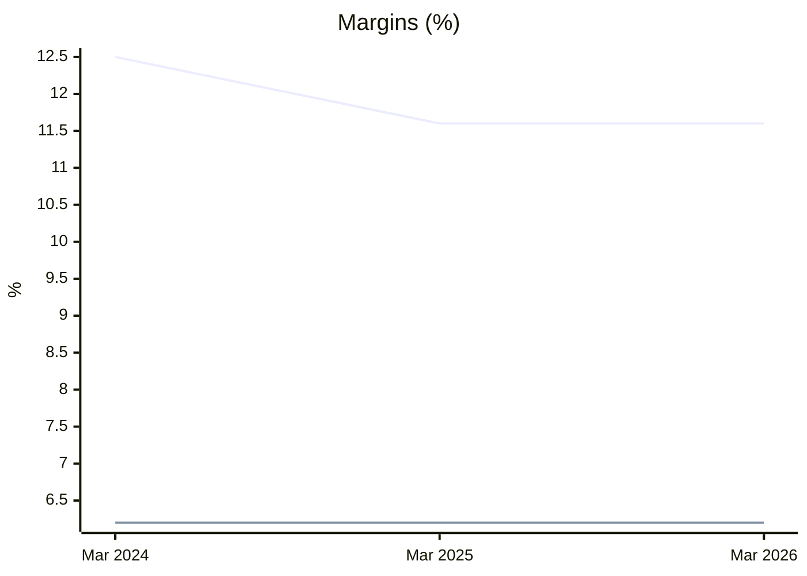

*Run 2026-11-24 · part of [SPINOFF_REPORT.md](../SPINOFF_REPORT.md) · the complete analysis of one company, with every management-call exchange in full.*

## PRICOLLTD — Pricol Ltd.

### 1. Pricol Ltd. — CONFIRMED DEMERGER

**CONFIRMED** (a demerger scheme is on the exchange record) · **PRE-SPIN — study the parent; the pieces do not trade yet** · score 5.0/10 · spin-off · 9 filing(s) from NSE, NSE-deep · first 2026-06-27, latest 2026-11-13

**The separated entities — every one the documents name:**

| Entity | Scheme | Business | Listing | Who runs it |
|---|---|---|---|---|
| **Pricol Autotech Limited** | 2026 demerger of the Driver Information & Connected Vehicle… | DICVS Business: driver information systems and instrument clusters, integrated infotainment, e-cockpit, telem… | to be listed | not stated |

**What is being separated, as the documents put it:** Driver Information & Connected Vehicle Solutions (DICVS) business — instrument clusters, telematics, sensors, e-cockpit — class `value_unlocking`.

### 2. Stages and dates

> **Listing:** NOT YET — scheme at 'announced' stage; Pricol Autotech Limited will list only after NCLT sanction, effectiveness and a record date; no listing timeline stated

| Date | Event | Source |
|---|---|---|
| 2026-02-21 | Other — Pricol Autotech Limited – incorporation | as stated: Regulation 30 intimation / Share Purchase Agreement disclosure dated … |
| 2026-06-27 | Board approval — Boards of Pricol Limited and Pricol Autotech Limited approved the Scheme of Arrangement for the DICVS demerger | as stated: Outcome of Board Meeting / Demerger intimation dated 27 June 2026 |
| 2026-06-27 | Other — Share Entitlement Ratio Report by SSPA & Co, Chartered Accountants, Registered Valuer, with Fairness Opinion by Saffron Capital Advisors Private Limited | as stated: Annexure A to the intimation dated 27 June 2026 |
| 2026-11-13 | Board approval — Pricol Limited board approved execution of the Share Purchase Agreement with the Warburg Pincus affiliate | as stated: Outcome of Board Meeting / Agreements intimation dated 13 November 20… |
| 2026-11-13 | Other — Share Purchase Agreement entered into ("Date on which the agreement for sale has been entered into: 13 November 2026") | as stated: Regulation 30 Part B disclosure dated 13 November 2026 |

**Stated in the filings:** resulting company **Pricol Autotech Limited**; entitlement **1 for every 1**; appointed date 2026-06-27; size hint: 4.5% of revenue.

### 3. Size of the separated business beside the parent — is institutional selling likely?

**Reading: LESS LIKELY on size alone — the piece is the larger part of the business.**

| Entity | Stated turnover | Stated share of the whole | Market cap (₹ cr) | Share of the whole by market cap | Segment revenue share | Index member | Selling on size |
|---|---|---:|---:|---:|---:|---|---|
| Pricol Autotech Limited | "The turnover of the DICVS Business  for the financial year… | 61.17% (share of turnover) | — | — | — | not listed | less likely |

*Stated figures are the documents' own (a turnover share, or the cost-of-acquisition split the company publishes for tax, which reflects relative value). The market-cap share is the entity's value over the whole — the parent plus every separated entity that trades (parent ₹9,115 cr, whole ₹9,115 cr, NSE bhavcopy of 2026-11-13); the segment share is the business's revenue over the parent's reported sales of that year. Both are computed here. The reading uses the market-cap share when the entity trades, else the stated share, else the segment share.*

**In the documents' words:** “The turnover of the DICVS Business  for the financial year ending March 31, 2026, stood at INR 2,424.63  crores. This represents 61.17%  of the total consolidated turnover of the Company for the financial year ending March 31, 2026 .”

**The judge's read of selling pressure:** likely — Promoters sell entire 38.51% stake; new listing, no index membership, different industry (automotive electronics vs precision engineering).

### 4. Insider ownership — share swap, promoters' holding, management incentives

**Share swap / entitlement, entity by entity:**

- **Pricol Autotech Limited:** "1 (One) fully paid-up equity share of the Resulting Company having face value of INR 1 (Rupee One only) each for every 1 (One) fully paid-up equity share of INR 1 (Rupee One only) each of the Company."

**Promoters' holding, from the shareholding pattern:**

| Company | Promoters | FIIs | DIIs | Public | Quarter |
|---|---:|---:|---:|---:|---|
| Pricol Ltd. (PRICOLLTD) | 38.51% | 14.06% | 11.66% | 35.76% | Sep 2026 |

*Source: screener.in shareholding pattern, stored under `ShareholdingPattern/NiftyTotalMarket/`. In a mirror demerger each shareholder holds the same proportion of the new company as of the parent on the record date.*

- **Promoters in the parent, per the documents:** 38.51% promoters / 61.49% public, shown as the "Current" shareholding pattern of Pricol Limited in the 27 June 2026 demerger presentation (share capital INR 12.19 crores, face value INR 1); no as-on date is stated in the documents.
- **What the promoters will hold in the separated entity:** 2026 demerger: "(I) In the case of the Company: Pursuant to the Scheme, there shall be no change in the shareholding pattern of the Company." For the resulting company: "Details | Pre-Scheme Shareholding % | Post-Scheme Shareholding % — Promoters 100.00 # | 38.51; Public - | 61.49; Total 100.00 | 100.00" with "# The Company  owns 100% shareholding of the Resulting Company", i.e. "resulting in the shareholding of Pricol Autotech Limited mirroring the shareholding of Pricol Limited". 2026 share purchase agreement: the promoters then sell their entire 38.51% of Pricol Autotech — "the Sellers will cease to be in control of Pricol Autotech and will seek reclassification from the promoter and promoter group category of Pricol Autotech , subject to applicable law" — while in Pricol Limited "Both businesses will remain under the ownership and management of the current promoter group, the Mohan family, with  no change  in their shareholding."
- **What a public shareholder receives:** 2026 demerger: "1 (One) fully paid -up equity share of the Resulting Company having face value of INR 1 (Rupee One only) each for every 1 (One) fully paid -up equity share of INR 1 (Rupee One only) each of the Company"; "There is no cash consideration being discharged under the Scheme." 2026 share purchase agreement: public shareholders of Pricol Autotech get an exit opportunity — "Warburg  Pincus  to launch  a mandatory open  offer  to Pricol  Autotech Limited's  public shareholders following completion of the demerger and listing on NSE and BSE", and "the open offer will be to acquire up to an additional 26% of the Company's share capital"; "The Company will not receive any consideration pursuant to the Proposed Transaction."
- **Management incentives:** Stock options / RSUs / SARs: not stated — no treatment of existing grants, no new plan, no exercise price or pricing date is disclosed, and basic and diluted EPS are identical in all reported periods. The only incentive statement is in the 27 June 2026 scheme presentation, for Pricol Autotech: "Dedicated leadership, specialised talent and incentive structures fully aligned to the needs of a high-growth mobility technology business"; and the rationale that "This demerger will provide each of the businesses with independent and dedicated management teams enabling clear market access and a clean operating model". Insider shareholding: promoter and promoter group hold 38.51% of Pricol Limited and are to receive and then sell 4,69,34,833 shares (38.51%) of Pricol Autotech.
- **Insider actions around the separation:** On 13 November 2026 the Board approved execution of a Share Purchase Agreement under which the promoter/promoter group Sellers (Mr. Vijay Mohan, Mr. Vikram Mohan and Mrs. Vanitha Mohan (Promoters), Mr. Viren Mohan, Ms. Manasa Mohan, Ms. Madhura Mohan, Pricol Holdings Private Limited, Pricol Engineering Industries Private Limited, Shrimay Enterprises Private Limited and Pricol Logistics Private Limited) will sell their entire 38.51% stake (4,69,34,833 shares) in Pricol Autotech — to be allotted to them under the demerger — to Topaz Terrace Investments B.V. (Warburg Pincus affiliate) for "up to INR 1,663.07 Crores"; the agreement "contains customary stand still provisions, warranties and indemnities being provided by the Sellers" and "certain non -compete obligations on the Sellers and the Company for a specified period", and the Sellers will seek reclassification out of Pricol Autotech's promoter category. The Company receives no consideration and there is no change in the promoters' holding in Pricol Limited. Separately, Mrs. Vanitha Mohan stepped down from an active role at Pricol (Vikram Mohan took over as Chairman) and "goes on to become the chairperson of PRICOL Holdings". No promoter or management buying or pledging is stated.
- **Insiders, per the checklist read:** Promoters (Mohan family) get 38.51% of Pricol Autotech, then sell their entire 38.51% to Warburg Pincus affiliate for up to INR 1,663.07 crores and exit control; they keep 38.51% of Pricol Limited. · *option pricing date:* not stated

### 5. Why the demerger — point by point

Management's case, as set out in the 27 June 2026 board filing, press note and demerger presentation, is that Pricol had become two structurally different companies inside one shell: the Driver Information & Connected Vehicle Solutions (DICVS) business — instrument clusters (mechanical, electro-mechanical, LCD/TFT), integrated infotainment, e-cockpit, telematics, battery management systems and some sensors — versus the Actuation, Control & Fluid Management Systems (ACFMS) business and the polymer/precision business held in wholly owned Pricol Precision Products (P3L). DICVS was the bigger half, at INR 2,424.63 crore of FY26 revenue, or 61.17% of consolidated turnover (the press release rounds it to ~INR 2,400 crore and ~60%), against FY26 consolidated revenue of INR 3,963.85 crore and total income of INR 40,523.70 million. The problem they said this solves is divergence: the two now operate with "differing customer needs, competitive dynamics, capital allocation and risk profiles" — DICVS innovation-led (display, electrification, connectivity, e-cockpit, ADAS, software-defined vehicles; risk = technology disruption and the semiconductor ecosystem; partners = display, chip-design and semiconductor firms; talent = embedded software, system architects, cyber-security and functional-safety experts) while ACFMS/P3L is scale-led (manufacturing excellence, cost competitiveness, lightweighting, exports; risk = automotive cyclicality and commodity costs; partners = Tier-2/3 suppliers). Capital deployment priorities were said to be incompatible in one entity: DICVS money goes to talent, software, global R&D centres, technology investments and overseas acquisitions, Pricol Limited's to manufacturing capacity, automation, productivity and domestic acquisitions. Other stated benefits: financial flexibility for each entity, reduced operational complexity and faster decision-making, independent and dedicated management teams, the ability to tailor processes, policies, systems and governance, improved visibility of each business's value and growth prospects, better ability to attract strategic and financial investors, and "appropriate valuation benchmarks for each business, free from conglomerate discount." Consideration is non-cash: 1 Pricol Autotech share of INR 1 for every 1 Pricol Limited share, so Autotech's register mirrors Pricol's (promoters 38.51%, public 61.49%), with listing sought on NSE and BSE; SSPA & Co. gave the share-entitlement report and Saffron Capital the fairness opinion. The 13 November 2026 filing revealed the commercial endpoint the June rationale did not mention: the promoters (Vijay, Vikram and Vanitha Mohan plus family and Pricol Holdings, Pricol Engineering Industries, Shrimay Enterprises and Pricol Logistics) will sell their entire 38.51% — 4,69,34,833 shares — of Pricol Autotech to Topaz Terrace Investments B.V., a Warburg Pincus affiliate, for up to INR 1,663.07 crore, followed by a mandatory open offer for up to a further 26%, after which Warburg controls Autotech and the family keeps ACFMS and polymer with no change in shareholding; no investor, lender or customer is named as having asked for any of this, and the only disclosed initiators are the board and the promoters, who used Veda Corporate Advisors as exclusive financial advisor.

**Point by point, with the source:**

1. The 27 June 2026 board filing frames the DICVS demerger as creating a simpler, faster entity matched to fast-changing technology, because the two halves already ran on different customer, competitive, capital and risk logic. “The demerger of the DICVS Business is a strategic decision to create a simpler, sharper and more agile corporate entity, to meet the fast changing needs and technologies related to this business and its dynamic market realities.” — *Scheme*
2. The demerged undertaking is the majority of the company: DICVS turnover of INR 2,424.63 crore in FY26, 61.17% of consolidated turnover (press note: ~INR 2,400 crore, ~60%), against consolidated FY26 revenue from operations of INR 3,963.85 crore. “The turnover of the DICVS Business for the financial year ending March 31, 2026, stood at INR 2,424.63 crores. This represents 61.17% of the total consolidated turnover of the Company for the financial year ending March 31, 2026.” — *Scheme*
3. Consideration is a mirror 1:1 share entitlement with no cash, so Pricol Autotech starts with promoters at 38.51% and public at 61.49%, and is to be listed on NSE and BSE; Pricol Limited receives nothing and retains no shares. “1 (One) fully paid-up equity share of the Resulting Company having face value of INR 1 (Rupee One only) each for every 1 (One) fully paid-up equity share of INR 1 (Rupee One only) each of the Company.” — *Scheme*
4. The presentation makes valuation an explicit objective — separate frameworks for two structurally different businesses, removing the holding-company drag of one blended multiple. “Clear market recognition and appropriate valuation benchmarks for each business, free from conglomerate discount” — *Scheme*
5. The side-by-side table splits the two on capital deployment (software, global R&D centres and overseas acquisitions for Autotech versus capacity, automation and domestic acquisitions for Pricol), talent, partners and risk (technology disruption versus automotive cyclicality and commodity costs). “Talent, product development, software, global R&D centres, tech investments & overseas acquisitions” — *Scheme*
6. The 13 November 2026 share purchase agreement discloses the endpoint: Warburg Pincus affiliate Topaz Terrace Investments B.V. buys the promoters' entire 4,69,34,833 shares (38.51%) of Pricol Autotech for up to INR 1,663.07 crore, plus a mandatory open offer for up to 26% more. “For completeness, the aggregate consideration payable for the sale by the Sellers of their entire stake of Pricol Autotech of 38.51% (to be issued to the Sellers pursuant to the Scheme) is up to INR 1,663.07 Crores (Indian Rupees One Thousand Six Hundred and Sixty Three Crores and Seven Lakhs) subject to the terms of the Share Purchase Agreement.” — *Scheme*
7. Control of the demerged business passes to Warburg and the Mohan family seeks reclassification out of Autotech's promoter group, while the agreement imposes non-compete obligations on the sellers and on Pricol Limited itself; ACFMS and polymer stay with the family with no shareholding change. “Amongst other things, the Share Purchase Agreement contains customary stand still provisions, warranties and indemnities being provided by the Sellers, subject to customary limitations and caps, and certain non-compete obligations on the Sellers and the Company for a specified period.” — *Scheme*
8. Vikram Mohan ties the separation rationale directly to handing the business to Warburg, describing DICVS as having been "at the heart" of Pricol's five-decade journey and Warburg as its next owner-custodian. “The proposed demerger will give Pricol Autotech the focus and independence to realise its full potential.” — *Scheme*
9. Asked on the 30 January 2026 call why a new subsidiary had been incorporated, Siddharth Manoharan attributed it to technology-partnership flexibility and the BOE MOU, not to any restructuring; Pricol Autotech Limited was incorporated on 21 February 2026. “But whenever the plan materializes, we will talk about that in detail later.” — *CALL Feb 2026*
10. Management's own segment guidance showed the margin and growth divergence later used as rationale — DICVS at INR 2,100–2,200 crore and 12.5–13% EBITDA, ACFMS at INR 600 crore growing 30–35%, polymer at INR 850–900 crore on 9.5% — though no separation was suggested. “This year, the plastics, the Polymer business will be about INR 850 crores to INR 900 crores with a steady-state margin of 9.5%.” — *CALL Nov 2025*
11. A year earlier Vikram Mohan had conceded that consolidating the lower-margin plastics business pulled the group's blended EBITDA down even as rupee profit rose — the conglomerate-mix problem the 2026 presentation addresses via separate valuation frameworks. “Overall margin of Pricol will be maintained, but when Sundaram consolidates, it is going to come down lower because plastics is a single digit margin and not a double digit EBITDA product.” — *CALL Feb 2025*
12. Six weeks before the board approved the scheme, the Q4 FY26 call described a unified group starting a fresh INR 680–700 crore capex cycle across all three divisions, with no hint of a demerger; Ganesh put DICVS at ~60%, ACFMS ~20% and P3L ~20% of revenue. “In fact, this year, in itself, we have planned for about between INR 680 crore to INR 700 crores of CAPEX to cater to all of our new businesses that we have won, new plants, new machines, so on and so forth, which will keep propelling us forward and to maintain this growth momentum.” — *CALL May 2026*
13. The same call disclosed the governance handover that preceded the restructuring: Vanitha Mohan stepped back from Pricol to chair Pricol Holdings and Vikram Mohan became Chairman and Managing Director — the signatory of both the June scheme and the November stake sale. “Mrs. Vanita Mohan has stepped down as an active role from PRICOL, and I have taken over as the Chairman of the company.” — *CALL May 2026*

**How it evolved:** The idea is entirely absent from the eleven earnings calls (Nov 2023 through the 15 May 2026 Q4 FY26 call), where management instead talked up a single integrated group — a FY31 INR 8,000 crore target, INR 680–700 crore of FY27 group capex across DICVS, ACFMS and polymer, and converting polymer "from a component maker to a value-added polymer player." The nearest hint is the 30 January 2026 (Feb 2026) call, where Siddharth Manoharan confirmed a newly incorporated subsidiary but attributed it to technology-partnership flexibility and the BOE MOU, saying the plan would be discussed "later"; Pricol Autotech Limited was in fact incorporated on 21 February 2026. The board then approved the scheme on 27 June 2026 — six weeks after a call that never raised it — and the purpose sharpened on 13 November 2026, when the promoters' entire 38.51% of the demerged entity was agreed for sale to Warburg Pincus for up to INR 1,663.07 crore plus a 26% open offer, converting a stated "focus and agility" restructuring into a control exit from the group's largest business.

**What management expects from it:** Pricol Autotech: a focused automotive-electronics platform — innovation-led growth, higher content per vehicle, global R&D, IP-led acquisitions, Warburg's capital and sector network. Pricol Limited: scale-led precision engineering — ACFMS exports, disc brakes, a polymer centre of excellence, domestic acquisitions. Both: dedicated management, tailored capital allocation, faster decisions, separate valuation benchmarks free of conglomerate discount, easier access to strategic and financial investors.

*Not explained on the calls:* No call ever mentioned it. Filings omit stranded corporate costs, debt/asset and employee/IP allocation, tax, the INR 1,663.07 crore valuation basis, and why promoters exited DICVS.

- *Stated reason, in one line:* Clear segregation so each company concentrates on its core activities; strategic decision to create a simpler, sharper, more agile entity meeting fast-changing technology needs and dynamic market realities; unlocking shareholder value.
- *What it reveals:* DICVS is the bigger, faster business — INR 2,424.63 crores, 61.17% of FY26 consolidated turnover — yet presented as a "4.5%" small share; Warburg Pincus pays INR 1,663.07 crores for 38.51%, implying ~INR 4,318 crores equity value, plus a 26% open offer.
- *Parent or spin:* both · *Read next:* The Scheme of Arrangement on pricol.com/investors — DICVS asset, liability and debt allocation to Pricol Autotech.
- *In their words:* “The turnover of the DICVS Business for the financial year ending March 31, 2026, stood at INR 2,424.63 crores. This represents 61.17% of the total consolidated turnover of the Company for the financial year ending March 31, 2026.”

### 6. On the calls, verbatim

No call in the last 36 months carries a statement about it (or no transcript is on file).

### 7. The parent's financial statements

**The parent, last three fiscal years (consolidated)**

| | Mar 2024 | Mar 2025 | Mar 2026 |
|---|---:|---:|---:|
| Sales (₹ cr) | 2,272 | 2,692 | 4,041 |
| Sales growth (%) | +16.0% | +18.5% | +50.1% |
| Operating profit (₹ cr) | 285 | 313 | 469 |
| Operating profit growth (%) | +24.5% | +9.8% | +49.8% |
| Operating margin (%) | 12.5 | 11.6 | 11.6 |
| PAT (₹ cr) | 141 | 167 | 251 |
| PAT growth (%) | +12.8% | +18.4% | +50.3% |
| PAT margin (%) | 6.2 | 6.2 | 6.2 |
| EPS (₹) | 11.5 | 13.7 | 20.6 |

*Source: ProfitStatement/NiftyTotalMarket/PRICOLLTD.csv (consolidated, screener.in); growth and margins computed here.*

```mermaid
xychart-beta
    title "Sales, operating profit and PAT (₹ cr)"
    x-axis ["Mar 2024", "Mar 2025", "Mar 2026"]
    y-axis "₹ crore"
    bar [2272, 2692, 4041]
    bar [285, 313, 469]
    bar [141, 167, 251]
```

*Series in order: Sales, Operating profit, PAT.*

*Series in order: Operating margin, PAT margin.*

**P/E:** 35.7 — close 2026-10-01 ÷ EPS 20.58 (Mar 2026) (price ₹734.50 as of 2026-10-01).

**Cash flows (₹ cr):**

| | Mar 2024 | Mar 2025 | Mar 2026 |
|---|---:|---:|---:|
| Cash from operations (₹ cr) | 255 | 223 | 281 |
| Cash from investing (₹ cr) | -129 | -377 | -298 |
| Cash from financing (₹ cr) | -69.0 | 142 | 33.0 |
| Net cash flow (₹ cr) | 57.0 | -11.0 | 17.0 |
| Free cash flow (₹ cr) | 117 | 27.0 | -38.0 |

*Source: CashFlow/NiftyTotalMarket/PRICOLLTD.csv (consolidated, screener.in).*

### 8. The separated business's financial statements

**The business being separated — its own numbers**, entity by entity: its reported statements once it is listed and on file, and the segment numbers the annual reports and presentations carry for it before that.

*Businesses with no numbers in the pages read (3 annual report(s) and 13 presentation(s) on file):* No numbers at all for any separated business: Pricol Autotech Limited / Pricol AutoTech Limited (Resulting Company, Automotive Technology Entity) and the DICVS / Driver Information & Connected Vehicle Solutions Business (Demerged Undertaking). AR2026 p184-185 names Pricol Autotech Limited only as a subsidiary from 21-Feb-2026; Presentation Feb 2026 p15 mentions DICVS only in an award citation.

The segment pages read (3 annual report(s) and 13 presentation(s) on file) do not carry this business's own revenue or profit.

*Documents on file:* [Annual Report 2026](https://www.bseindia.com/xml-data/corpfiling/AttachHis/6cc3d8a5-a525-41fa-a7ee-f34e6b7b5011.pdf); [Annual Report 2025](https://www.bseindia.com/xml-data/corpfiling/AttachHis/3e0e2438-9308-4d44-a8c0-5a7af26bbe71.pdf); [Annual Report 2024](https://www.bseindia.com/xml-data/corpfiling/AttachHis/12c79cc4-ea38-49aa-ac82-3ca6f9a83a81.pdf); [Presentation Nov 2026](https://www.bseindia.com/stockinfo/AnnPdfOpen.aspx?Pname=d250e973-ae0f-44c2-9b71-74f4c0073884.pdf); [Presentation Aug 2026](https://www.bseindia.com/stockinfo/AnnPdfOpen.aspx?Pname=46de04ba-a9d9-49d5-aef5-5e16367fa8e5.pdf); [Presentation May 2026](https://www.bseindia.com/stockinfo/AnnPdfOpen.aspx?Pname=ccf69f16-b21f-40cb-99f4-4c618367fadf.pdf); [Presentation Feb 2026](https://www.bseindia.com/stockinfo/AnnPdfOpen.aspx?Pname=5b92a0ac-2755-469f-b8c1-824857d4cca6.pdf); [Presentation Nov 2025](https://www.bseindia.com/stockinfo/AnnPdfOpen.aspx?Pname=52a73d57-b9bd-4c3a-9d91-34d7c3f490c1.pdf); [Presentation Aug 2025](https://www.bseindia.com/stockinfo/AnnPdfOpen.aspx?Pname=1ec6bf04-9586-4d4d-88b6-222c969d044e.pdf)

### 9. Other financial differences — working capital, margins, returns, debt

Only the parent's figures are on file: Sales (₹ cr) 4,041 (Mar 2026); Sales growth (%) 50.1 (Mar 2026); Operating margin (%) 11.6 (Mar 2026); PAT margin (%) 6.2 (Mar 2026); Operating profit growth (%) 49.8 (Mar 2026); Debtor Days 52 (Mar 2026); Inventory Days 70 (Mar 2026); Days Payable 71 (Mar 2026); Cash Conversion Cycle 51 (Mar 2026); Working Capital Days 9 (Mar 2026); ROCE % 24 (Mar 2025); Debt / equity (x) 0.3 (Mar 2026); Borrowings (₹ cr) 379 (Mar 2026). The separated business has no comparable numbers in the documents read.

**What stays with the parent — its segments, from the same pages:**

| Remaining segment | Revenue | Operating margin | ROCE | Segment assets / revenue | Unit | Year |
|---|---:|---:|---:|---:|---|---|
| Automotive (single reportable segment — "The Group primarily operates in the automotive segment… manufacture and trading of automotive components"; no reportable segment under Ind AS 108) | 4,041 | — | — | — | ₹ crore | FY2026 |

**What the documents themselves say about the differences:**

- **operating margin** — parent / remaining: Polymer/P3L business ran a steady-state EBITDA margin of about 9.5% in FY26 (INR 924 crores revenue at 9.24% EBITDA for FY26; 9.33% in Q3 FY26), with margins expected to soften to about 10% while a polymer centre of excellence and new plants are built; group consolidated EBITDA margin 12.44% for FY26.; separated business: DICVS vertical margin indicated at around 12.5% to 13%. “The DICVS vertical will be at around INR 2,100 crores to INR 2,200 crores, and the margin is likely to be at around 12.5% to 13%.”
- **growth** — parent / remaining: ACFMS was guided to 30%-35% year-on-year growth over 2-3 years (30% achieved in FY26, driven by FPM, then disc brakes and switches); the Polymer business was guided to 11%-15% growth until new capacity is created, then accelerated growth.; separated business: DICVS guided to steady-state growth above 15%. “The DICVS division will maintain a steady state growth of above 15%.”
- **capex and capital intensity** — parent / remaining: Capital deployment priorities: "Manufacturing capacity, automation, productivity enhancement, operations & domestic acquisitions"; polymer capacity was above 90% utilised and bulk of the planned INR 400-500 crore capex was earmarked for the polymer division; group capex of about INR 680-700 crores planned for FY27 with a debt-equity ratio of about 0.5-0.6.; separated business: Capital deployment priorities: talent, product development, software, global R&D centres, technology investments and overseas acquisitions. “5Capital Deployment PrioritiesTalent, product development, software, global R&D centres, tech investments & overseas acquisitionsManufacturing capacity, automation, productivity enhancement, operations & domestic acquisitions”
- **other** — parent / remaining: Business risk profile: "Automotive cyclicality, commodity costs & operational execution risks"; value creation is "Scale -led: manufacturing excellence, operational efficiency & competitive pricing".; separated business: Business risk profile: technology disruption, product innovation cycles and semiconductor ecosystem risks; value creation is "Innovation -led: technology, premiumization & increasing electronic content per vehicle, with integrated solutions". “8Business Risk ProfileTechnology disruption, product innovation cycles & semiconductor ecosystem risksAutomotive cyclicality, commodity costs & operational execution risks”
- **debt and leverage** — parent / remaining: Group net debt of INR 63.11 crores as at 31 March 2026 (excluding supplier and customer bill discounting regrouped into borrowings); no long-term borrowing in the balance sheet, finance cost driven by working capital; consolidated non-current borrowings INR 97.16 crores and current borrowings INR 265.76 crores at 31 March 2026, INR 82.22 crores and INR 428.58 crores at 30 September 2026. Not split between the businesses.; separated business: not stated “Just to give you a perspective, barring the supplier discounting and the customer bill discounting which earlier was hitherto treated as trade payable, now actual borrowing as of 31st March 2026, net debt is INR 63.11 crores.”
- **working capital** — parent / remaining: Group-level only: consolidated net cash from operating activities fell to INR 71.83 crores in H1 FY27 from INR 146.30 crores in H1 FY26, with trade receivables and inventories absorbing cash on higher sales; standalone operating cash flow was negative INR 13.43 crores in H1 FY27. Not split between the businesses.; separated business: not stated “Yes . Karan that is because of the large growth in our sales, working capital has gone up. That is the reason.”
- **other** — parent / remaining: Competitive advantage: "Manufacturing capabilities, process excellence, cost competitiveness & operational execution"; talent ecosystem of manufacturing leaders, electro-mechanical engineers, fluid management experts and polymer specialists; partners are Tier-2/3 suppliers and industrial ecosystem participants.; separated business: Competitive advantage: software, hardware and electronics engineering expertise, IP and product innovation; talent in embedded software, system architecture, cyber security and functional safety; partners are display, chip design and semiconductor companies. “4Competitive AdvantageSoftware, hardware & electronics engineering expertise, IP & product innovation through integrated solutionsManufacturing capabilities, process excellence, cost competitiveness & operational execution”

**The checklist:**

| Item | Status | Evidence |
|---|---|---|
| Why the spin-off | yes | unrelated businesses separated; value unlocking for shareholders; attracting different investors / capital; a weak or capital-heavy business carved away; regulatory / strategic knot — “…tem P3L – Precision Products • • • • • • • • >Y<pr,cal I\ Strategic Objective for Demerger Strategic Focus Independent growth strategies aligned to distinct industry dynamics, integrated solution and fast changing techn” |
| Institutional selling likely (small / different business) | yes | the demerged piece is 4.5% of revenue; the businesses are described as distinct |
| Insider ownership and incentives aligned | unknown | no promoter-continuity or option-pricing language found *(next: the date the management options are priced; promoter holding in the resulting company)* |
| A hidden value revealed (pro-forma, leverage, comparables) | unknown | no pro-forma or market data on file *(next: pro-forma P&L of each piece × the peer P/E of its own industry)* |
| Parent before the spin (clean parent, takeover prelude) | partly | stage announced — the spin has not happened; the parent can still be bought whole |
| Timing (first year sells, second year gains) | partly | not yet listed — 150 days since the first filing, stage announced |

The filings

| Date | Category | Headline | Attachment |
|---|---|---|---|
| 2026-06-27 | Outcome of Board Meeting | Intimation of the outcome of the meeting of the Board of Directors of Pricol Limited | [pdf](https://nsearchives.nseindia.com/corporate/PRICOLLTD_27062026152948_sedisclosure.pdf) |
| 2026-06-27 | Outcome of Board Meeting | Pricol Limited has informed the Exchange regarding Outcome of Board Meeting held on Jun 27, 2026. | [pdf](https://nsearchives.nseindia.com/corporate/PRICOLLTD_27062026152948_sedisclosure.pdf) |
| 2026-06-27 | Demerger | Pricol Limited has informed the Exchange about Demerger | [pdf](https://nsearchives.nseindia.com/corporate/PRICOLLTD_27062026153350_sedisclosure.pdf) |
| 2026-06-27 | Press Release | Pricol Limited submitted the copy of media note with respect to Scheme of Demerger | [pdf](https://nsearchives.nseindia.com/corporate/PRICOLLTD_27062026153703_sedisclosure.pdf) |
| 2026-07-30 | Outcome of Board Meeting | Pricol Limited has submitted to the Exchange, the financial results for the period ended Jun 30, 2026. | [pdf](https://nsearchives.nseindia.com/corporate/PRICOLLTD_30072026174524_sedisclosure_sd.pdf) |
| 2026-11-04 | Outcome of Board Meeting | Pricol Limited has submitted to the Exchange, the financial results for the period ended September 30, 2026. | [pdf](https://nsearchives.nseindia.com/corporate/PRICOLLTD_04112026152908_sedisclosure.pdf) |
| 2026-11-13 | Outcome of Board Meeting | Pricol Limited has informed the Exchange regarding Outcome of Board Meeting held on November 13, 2026. | [pdf](https://nsearchives.nseindia.in/corporate/PRICOLLTD_13112026223656_sedisclosure.pdf) |
| 2026-11-13 | Agreements | Pricol Limited has informed the Exchange about Share Purchase Agreement | [pdf](https://nsearchives.nseindia.in/corporate/PRICOLLTD_13112026224412_sedisclosure.pdf) |
| 2026-11-13 | Press Release | Pricol Limited has informed the Exchange regarding a press release dated November 13, 2026, titled "Pricol and Warburg Pincus Jointly Announce Agreement for Pro | [pdf](https://nsearchives.nseindia.in/corporate/PRICOLLTD_13112026225017_sedisclosure.pdf) |

