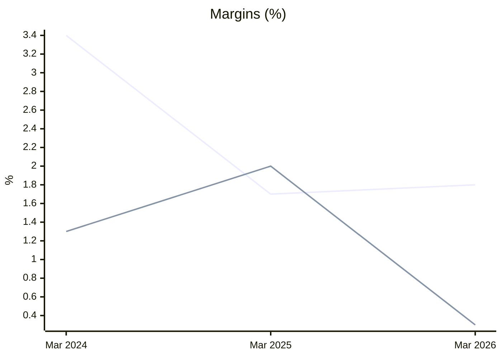

*Run 2026-11-24 · part of [SPINOFF_REPORT.md](../SPINOFF_REPORT.md) · the complete analysis of one company, with every management-call exchange in full.*

## QUESS — Quess Corp Ltd.

### 1. Quess Corp Ltd. — CONFIRMED DEMERGER

**CONFIRMED** (a demerger scheme is on the exchange record) · **LISTED 1–2Y — the second-year window** · score 5.7/10 · spin-off · 6 filing(s) from CALLS, NSE, NSE-register · first 2025-04-15, latest 2026-10-05

**The separated entities — every one the documents name:**

| Entity | Scheme | Business | Listing | Who runs it |
|---|---|---|---|---|
| **Digitide Solutions Limited** | 2025 three-way demerger (Composite Scheme of Arrangement be… | Demerged Undertaking 1 / Transferred Business 1: BPM Services, Insurtech and HRO — Conneqt, Allsec, Brainhunt… | listed 2025-06-11 as DIGITIDE (NSE) | Gurmeet Chahal, CEO; Suraj Prasad, CFO |
| **Bluspring Enterprises Limited** | 2025 three-way demerger (Composite Scheme of Arrangement be… | Demerged Undertaking 2 / Transferred Business 2: infra services — Facility Management, Food Services, Securit… | listed 2025-06-11 as BLUSPRING (NSE) | Kamal Pal Hoda, CEO (elevated from Group CFO of Q… |

**What is being separated, as the documents put it:** Digitide Solutions (technology/BPM) and Bluspring Enterprises (industrial/facility services) separated from Quess, leaving a pure-play workforce staffing company — class `value_unlocking`.

### 2. Stages and dates

> **Listing:** LISTED — Digitide Solutions Limited (DIGITIDE) since 2025-06-11; Bluspring Enterprises Limited (BLUSPRING) since 2025-06-11 (NSE equity list); record date 2025-04-15

| Date | Event | Source |
|---|---|---|
| 2024-02-16 | Board approval — Quess Corp Limited | as stated: Intimation regarding receipt of Observation letters, filing dated Aug… |
| 2024-03-02 | Filed with exchanges — Quess Corp Limited / Digitide / Bluspring | as stated: NSE Observation Letter Ref: NSE/LIST/40413 dated August 01, 2024: "vi… |
| 2024-04-01 | Appointed date | as stated: Filing dated March 31, 2025 – effective date intimation: "the Scheme … |
| 2024-07-31 | SEBI observations | as stated: BSE letter DCS/AMAL/AK/R37/3275/2024-25 dated July 31, 2024 and NSE l… |
| 2024-07-31 | Exchange no-objection — BSE Limited | as stated: Observation letter of BSE dated July 31, 2024, intimated by filing da… |
| 2024-08-01 | Stage reached: **exchange noc** | [Updates](https://nsearchives.nseindia.in/corporate/QUESS_01082024172801_SEintimation_Observationletters.pdf) |
| 2024-08-01 | Exchange no-objection — National Stock Exchange of India Limited | as stated: Observation letter of NSE dated August 1, 2024, intimated by filing d… |
| 2024-09-20 | Stage reached: **meetings** | [Shareholders meeting](https://nsearchives.nseindia.in/corporate/QUESS_20092024161308_Quess_Transcript.pdf) |
| 2024-10-22 | NCLT order — First motion order, C.A. (CAA) No.36/BB/2024 (meetings of equity shareholders of Digitide and Bluspring and secured creditors of Quess dispensed with) | as stated: Filing dated October 24, 2024 – 'Receipt of 1st motion order of Natio… |
| 2024-10-24 | Stage reached: **nclt sanction** | [Updates](https://nsearchives.nseindia.in/corporate/QUESS_24102024104954_SE_Intimation_Receiptof1stmotionorder.pdf) |
| 2024-12-09 | Shareholders / creditors meeting — Quess Corp Limited equity shareholders (10:30 A.M., votes in favour 99.97%) and unsecured creditors (12:00 P.M., votes in favour 100%) | as stated: Shareholders meeting filings and Scrutinizer's Reports dated December… |
| 2024-12-12 | Other — Second Motion Petition CP (CAA) No.47/BB/2024 filed | as stated: NCLT order delivered 04/03/2025, enclosed with filing dated March 06,… |
| 2024-12-19 | NCLT order — Admission of second motion petition; hearing fixed for 30 January 2025 | as stated: Filing dated December 23, 2024 (order uploaded on NCLT website Decemb… |
| 2025-03-04 | NCLT order — Hon'ble NCLT, Bengaluru Bench sanctioning the Composite Scheme of Arrangement (certified true copy received, intimated 18 March 2025) | as stated: Filing dated March 04, 2025 and press release dated March 06, 2025 'Q… |
| 2025-03-31 | Stage reached: **effective** | [General Updates](https://nsearchives.nseindia.in/corporate/QUESS_31032025170754_Quess_SELetter_EffectivenessofScheme_31032025.pdf) |
| 2025-03-31 | Effective date — Quess Corp, Digitide and Bluspring each filed Form No. INC-28 with the Registrar of Companies, Karnataka | as stated: Filing dated March 31, 2025 – 'Effective date of the Composite Scheme… |
| 2025-04-15 | **Record date** | NSE corporate-actions register |
| 2025-04-15 | Stage reached: **record date** | Record Date (corporate-actions register) |
| 2025-04-15 | Record date — Quess Corp Limited (Demerged Company) shareholders entitled to shares of Digitide and Bluspring | as stated: Record date intimation dated April 01, 2025 |
| 2025-04-21 | Allotment — Digitide Solutions Limited and Bluspring Enterprises Limited — 14,89,49,413 shares of Rs. 10/- each allotted by each | as stated: Filing dated April 21, 2025 – 'Allotment of shares by Digitide Soluti… |
| 2025-06-11 | **Digitide Solutions Limited** listed (DIGITIDE) | NSE equity list |
| 2025-06-11 | **Bluspring Enterprises Limited** listed (BLUSPRING) | NSE equity list |
| 2025-06-11 | Listing and trading — Digitide Solutions Limited and Bluspring Enterprises Limited (BSE and NSE) | as stated: Filing dated June 09, 2025 – 'Listing of equity shares of Digitide So… |

**The stages, as filed:** exchange noc (2024-08-01) → meetings (2024-09-20) → nclt sanction (2024-10-24) → effective (2025-03-31) → record date (2025-04-15)

**Stated in the filings:** resulting company **Digitide Solutions Limited**; entitlement **1,889 for every 10,000**; record date 2025-04-15; size hint: 2% of revenue.

### 3. Size of the separated business beside the parent — is institutional selling likely?

**Reading: BY ENTITY — Digitide Solutions Limited: likely (11.0% of the whole, by market value); Bluspring Enterprises Limited: possible (28.7% of the whole, by market value).**

| Entity | Stated turnover | Stated share of the whole | Market cap (₹ cr) | Share of the whole by market cap | Segment revenue share | Index member | Selling on size |
|---|---|---:|---:|---:|---:|---|---|
| Digitide Solutions Limited | Global Technology Solutions / Global Technology Services pl… | 26.47% (cost-of-acquisition split) | 934 | 11.0% | 48.2% (FY2024) | no | likely |
| Bluspring Enterprises Limited | Operating Asset Management platform revenue FY24 ₹2,801 cr … | 31.82% (cost-of-acquisition split) | 2,433 | 28.7% | 50.8% (FY2024) | no | possible |

*Stated figures are the documents' own (a turnover share, or the cost-of-acquisition split the company publishes for tax, which reflects relative value). The market-cap share is the entity's value over the whole — the parent plus every separated entity that trades (parent ₹5,118 cr, whole ₹8,485 cr, NSE bhavcopy of 2026-11-13); the segment share is the business's revenue over the parent's reported sales of that year. Both are computed here. The reading uses the market-cap share when the entity trades, else the stated share, else the segment share.*

**In the documents' words:** “"For the purpose of determining the cost of acquisition of equity shares of the Company, Digitide and Bluspring (post demerger), you are advised to apportion your cost of acquisition of equity shares in the Company in the following manner: 1. Quess Corp Limited 41.71% 2. Digitide Solutions Limited 26.47% 3. Bluspring Enterprises Limited 31.82%" (apportionment of % of Cost of Acquisition of Equity Shares of the Company, filing dated 14 April 2025). Segment revenues FY24, as reported: Workforce Management ₹13,442 cr, Global Technology Services ₹2,340 cr, Operating Asset Management ₹2,801 cr, Product Led Business ₹517 cr.”

**The judge's read of selling pressure:** likely — Management notes "the stock saw some weakness immediately following the demerger"; resulting companies sit in different industries (technology, industrial services)

### 4. Insider ownership — share swap, promoters' holding, management incentives

**Share swap / entitlement, entity by entity:**

- **Digitide Solutions Limited:** 1 (One) fully paid-up equity share of Digitide having face value of Rs 10/- (Rupees Ten) each for every 1 (One) fully paid-up equity share of Rs 10/- (Rupees Ten) each of Quess
- **Bluspring Enterprises Limited:** 1 (One) fully paid-up equity share of Bluspring having face value of Rs 10/- (Rupees Ten) each for every 1 (One) fully paid-up equity share of Rs 10/- (Rupees Ten) each of Quess

**Promoters' holding, from the shareholding pattern:**

| Company | Promoters | FIIs | DIIs | Public | Quarter |
|---|---:|---:|---:|---:|---|
| Quess Corp Ltd. (QUESS) | 56.81% | 10.26% | 11.97% | 19.75% | Sep 2026 |
| Digitide Solutions Limited (DIGITIDE) | 57.31% | 6.85% | 11.07% | 24.77% | Sep 2026 |
| Bluspring Enterprises Limited (BLUSPRING) | 58.41% | 5.28% | 8.62% | 27.69% | Sep 2026 |

*Source: screener.in shareholding pattern, stored under `ShareholdingPattern/NiftyTotalMarket/`. In a mirror demerger each shareholder holds the same proportion of the new company as of the parent on the record date.*

- **Promoters in the parent, per the documents:** "Shareholding Pattern Promoters 56.6 Public 43.4" — Quess Corp "Current" shareholding, investor presentation dated 28 October 2024 (also 14.8 cr shares each). Consistent with the NCLT-convened meeting voting results as on cut-off date 2 December 2024: Promoter and Promoter Group 8,41,09,774 shares of 14,86,25,678 total.
- **What the promoters will hold in the separated entity:** 2025 three-way demerger — "Mirror Shareholding": investor presentation pro-forma for the transaction shows for each of "RemainCo: Quess Corp", "Resulting Co 1: Digitide" and "Resulting Co 2: Bluspring" — "Promoters 56.6 Public 43.4", 14.8 cr shares, 1 share held, face value ₹10. Press release: "The record date for the demerger has been fixed for the 15th of April 2025 and the shareholders of Quess Corp Limited will receive shares in Digitide and Bluspring which will mirror their existing shareholding." 2019 TCIL scheme: not stated.
- **What a public shareholder receives:** 2025 three-way demerger: "Upon demerger, all Quess Corp shareholders on the record date will receive one equity share in each of Resulting Company 1 and Resulting Company 2 for every equity share held in Quess Corp." and "1 equity share of the face value of Rs. 10/- each fully paid-up of the Resulting Company 1 shall be issued and allotted for every 1 equity share of face value of Rs 10/- each fully paid-up held by equity shareholders of the Demerged Company, and 1 equity share of the face value of Rs. 10/- each fully paid-up of the Resulting Company 2 shall be issued and allotted for every 1 equity share of face value of Rs 10/- each fully paid-up held by equity shareholders of the Demerged Company." 2019 TCIL scheme: "in the ratio of 1,889 equity shares of the Company for every 10,000 equity shares of ₹1 each held in TCIL", with fractional entitlements "consolidated and sold, and the net sale proceeds were distributed to the eligible shareholders in proportion to their fractional entitlements."
- **Management incentives:** not stated in the documents on file.
- **Insider actions around the separation:** not stated in the documents on file.
- **Insiders, per the checklist read:** not stated · *option pricing date:* not stated

### 5. Why the demerger — point by point

The separation Quess management describes is a completed three-way demerger of the old Quess Corp, effected from 1 April 2024 under a Composite Scheme of Arrangement in which Quess Corp was the Demerged Company and Digitide Solutions Limited (Resulting Company 1, holding the Global Technology Solutions/BPM, platform, foundit and Brainhunter businesses) and Bluspring Enterprises Limited (Resulting Company 2, holding Operating Asset Maintenance — IFM, food & beverage, security, Vedang telecom infra, and the Golden Star facility-management contracts) were carved out, leaving Quess Corp as a pure-play workforce/staffing company in General Staffing, Professional (IT) Staffing, Overseas staffing and the Hamara digital platforms. The stated reason was focus and value unlocking: management repeatedly said the demerger gives each entity 'its own focus and its own management', a 'sharper strategic identity', agility and the ability to unlock value for shareholders, with Quess itself able to concentrate on 'high-margin, high-growth core segments'. The separation was explicitly used as the trigger for portfolio cleaning: in the run-up, Digitide's service lines were rationalised for low-margin/low-efficiency contracts, and at Quess, the Board and management decided to exit non-core, outcome-based projects in skilling and utilities, booking INR158 crore of Q4 FY25 exceptionals (INR119 crore accelerated expected credit loss on discontinued projects, INR26 crore goodwill impairment — INR7 crore Stellarslog and INR19 crore Quess International Services — and INR13 crore of demerger costs, mainly stamp duty), after INR22 crore of demerger expenses in Q3 FY25; skilling alone had been roughly INR300 crore of revenue at ~20% EBITDA margin. Management conceded the cost: standalone workforce margins of 2.4–2.5% pre-demerger became 1.8% post-demerger because of newly allocated corporate overheads, and the old 4–4.5% consolidated margin is 'noncomparable' since skilling was discontinued and Brainhunter (US/Canada) moved to Digitide — so the goalpost was reset to 2% exit margin. The quid pro quo was balance-sheet and capital-allocation discipline: net cash of INR255 crore and gross debt of only INR12 crore at 31 March 2025, consolidated DSO cut from 44 to 37 days, a new dividend policy returning up to 75% of free cash flow over a rolling three-year block, FY25 dividend of INR10 per share, adjusted ROE moving from high teens to above 20%, and no acquisitions planned — investment to go into AI/sourcing technology instead. Strategically, the separated Quess was to tilt its mix from volume to value: profitability from General Staffing fell from 59% (FY25) to 50%, with Professional Staffing (~30%) plus Overseas (~20%) now half of operating profit (42% a year earlier), Professional Staffing margins rising from ~4.5–4.7% in FY20–21 to 12.7% by Q4 FY26, and 'Quess 2.0' targeting 65% of profit from Professional Staffing plus Overseas and dollar-linked revenue from 7% to over 20% in three to four years. By the AGM, Ajit Isaac framed the outcome as value created from the INR1,270 crore of IPO/IPP capital reinvested, with the three listed companies together generating about INR500 crore of EBITDA and employing over 600,000 people, while Quess remained debt-free with FY26 revenue of INR15,305 crore, EBITDA of INR312 crore (up 19%) and 20% ROE. No call attributes the decision to a demand from investors, lenders or partners — only to the Board and management.

**Point by point, with the source:**

1. With the first NCLT approval done and shareholder/creditor approvals obtained on 9 December 2024, Guruprasad framed the pending three-way split as a value-unlocking and positioning exercise for each entity. “This transition marks an important step in unlocking shareholder value and positioning each entity for its future success.” — *CALL Feb 2025*
2. CFO Kamal Pal Hoda described the internal work — internal controls, process streamlining and separate leadership teams — as aimed at creating agile, independently focused entities; demerger-related expenses of INR22 crore were booked in the quarter and more were flagged for Q4. “Our aim is to create independent entities that are agile, strategically focused and well positioned to unlock value for all stakeholders in the long term.” — *CALL Feb 2025*
3. The separation was already being used to clean the portfolio of the entity going into Digitide, by exiting low-margin, low-efficiency service lines to lift long-run operating margins. “As a run-up to demerger, with a new entity, Digitide, we are examining our existing service lines and rationalizing low-margin low-efficiency contracts, which would give a sustainable upside to our long-term operating margins.” — *CALL Feb 2025*
4. First call as a standalone company: the completed three-way demerger was presented as delivering sharper focus, value unlocking and strategic transformation, alongside net cash of INR255 crore, gross debt of INR12 crore and DSO improved by 7 days to 37. “This important milestone leads to a sharper focus and unlocking value, strategic transformation, and delivering sustained growth.” — *CALL May 2025*
5. Guruprasad tied portfolio streamlining post-separation directly to profitability, capital efficiency and long-term value creation for the remaining staffing core. “Moving forward as we streamline our business portfolios, it will enable a sharper focus on high-margin, high-growth core segments.” — *CALL May 2025*
6. The demerger triggered a comprehensive business review and Board-approved exit of non-core outcome-based projects in skilling and utilities — INR158 crore of exceptionals (INR119 crore accelerated ECL, INR26 crore goodwill impairment in Stellarslog and Quess International Services, INR13 crore demerger/stamp-duty costs); skilling had been ~INR300 crore of revenue at ~20% EBITDA margin. “As part of the demerger transformation, we revisited some of our businesses through a comprehensive review, and we will be exiting certain non-core projects in line with the position taken by the management and the Board to discontinue such projects.” — *CALL May 2025*
7. Asked about new geographies, management said the point of the separation was to go deeper in existing core businesses rather than expand, with no acquisitions planned and investment redirected to AI-led sourcing productivity. “See, as part of this demerger, Siddharth, our focus is going to be on the core businesses and how much more we can do and bring in more efficiency and stay profitable.” — *CALL May 2025*
8. The identity after separation was stated plainly in the closing remarks — a pure-play staffing company with a simplified structure, zero gross debt at quarter-end, and 53%/29%/21% profitability contribution from General Staffing, Professional Staffing and Overseas. “So, as we strengthen our position as a pure-play staffing leader, we remain deeply committed to operational excellence, innovation and continuously evolving our offerings to meet the dynamic needs of our clients.” — *CALL Aug 2025*
9. The post-separation design goal was restated as a 50/50 profit split between scale (General Staffing) and the higher-margin Professional Staffing (11–12%) and Overseas (6%+) businesses — a point management said it had set out two or three quarters earlier and had now reached. “I think we had made one point about 2 or 3 quarters ago where we said we would like to have a healthy state where General Staffing on a growing base contributes 50% of the profitability of that company.” — *CALL Nov 2025*
10. Answering why margins are ~2% versus 4–4.5% historically, new CFO Neeraj Jain explained the pre-demerger comparison is invalid: the high-margin skill development business was discontinued and Brainhunter (US/Canada operations) went to Digitide; Kushal added the demerged balance sheet applies from 1 April 2024. “With all of those business with high EBITDA margins, we were averaging around 4%, 4.5%, but that businesses have been discontinued and Brainhunter as part of demerger has moved into Digitide.” — *CALL Feb 2026*
11. On the INR120 crore expected credit loss taken in Q4 FY25, Guruprasad confirmed it related to the government skilling receivables of the businesses discontinued as part of the demerger, with collections still being pursued (delayed into Q4 by a new RBI escrow process) and any recovery to be a write-back. “If you recollect, in Q4, these were the discontinued businesses as part of the demerger that we had announced to the Street, and we had taken an exceptional credit loss on that.” — *CALL Feb 2026*
12. One year after the demerger, the same exit test was applied again: a 7,000-headcount milestone-based project was closed down, costing about INR200 crore or 1.3% of revenue, with no further such events known. “As you would remember, closer to our demerger timeline, we had said any business which does not meet the financial metrics of the company and does not yield us the cash realization, we will exit and discontinue such businesses.” — *CALL May 2026*
13. AGM (August 2026): Chairman Ajit Isaac described the FY25 three-way demerger as turning one company into three separately listed ones, with the value creation enabled by INR1,270 crore of IPO/IPP capital reinvested; the three now generate about INR500 crore of EBITDA and employ over 600,000 people. “Where there was one company, there are now three separately listed companies: Quess Corp, Bluspring Enterprises and Digitide Solutions, each with its own focus and its own management.” — *Scheme*
14. What shareholders retain in Quess Corp was defined as a debt-free, single-mandate workforce company — FY26 revenue INR15,305 crore, EBITDA INR312 crore (up 19%), net cash INR271 crore, 20% ROE, INR11 per share dividend — with Professional Staffing plus Overseas now half of operating profit versus 42% in FY25, targeted at ~65%. “What remains with you is Quess Corp, an independent workforce, talent and technology company, with no debt on its books.” — *Scheme*

**How it evolved:** In the Feb 2025 (Q3 FY25) call the demerger was still in flight — first NCLT approval received, shareholder and creditor approvals on 9 December 2024, second-motion NCLT pending, INR22 crore of demerger costs booked, listing of all three companies guided for Q1 FY26 — and Digitide's low-margin contracts were already being rationalised 'as a run-up to demerger'. By the May 2025 (Q4 FY25) call it was done ahead of timeline and framed as Quess's 'first earnings call as an independent entity', with INR158 crore of exceptionals for exiting non-core skilling and utilities projects, a new 75%-of-FCF dividend policy, and a reset margin goalpost of 1.8% to 2%. The Aug 2025 and Nov 2025 calls shifted entirely to execution of the 'pure-play staffing leader' model and the 50/50 profit-mix target, while Feb 2026 used the demerger retrospectively to explain why margins are 2% rather than the old 4–4.5% (skilling discontinued, Brainhunter moved to Digitide) and why the INR120 crore ECL related to demerger-era discontinued businesses. The May 2026 call, 'one year post our demerger', applied the same demerger-era test to exit a further 7,000-headcount, milestone-based project worth about INR200 crore (1.3% of revenue), and the August 2026 AGM closed the arc with the three-company outcome and the 'Quess 2.0' mix targets.

**What management expects from it:** For Quess: a pure-play, zero-debt staffing company with sharper focus on high-margin segments — margins rebuilt from 1.8% to 2%+ (2.4% medium term), Professional Staffing 11–12% and Overseas 6%+ lifting their profit share from 50% to 65%, dollar-linked revenue 7% to 20%, ROE above 20%, 80% EBITDA-to-cash conversion and up to 75% of free cash flow returned. Digitide and Bluspring get independent focus, management and technology/industrial platforms.

*Not explained on the calls:* Who initiated or demanded it; sum-of-parts or valuation math; how assets, debt and corporate costs were allocated between the three; Digitide/Bluspring economics or listing details.

- *Stated reason, in one line:* Three-way split so each company has "its own focus and its own management"; Quess left "deliberately a pure play business with a single mandate" in workforce management
- *What it reveals:* Reveals parent as a thin-margin volume business: FY26 EBITDA margin 2.0% versus ~4–4.5% pre-demerger, since higher-margin skilling and Brainhunter left. Offset by zero debt, ₹271 crore net cash, 20% ROE, ₹11 dividend
- *Parent or spin:* parent · *Read next:* Digitide Solutions and Bluspring Enterprises standalone results — the EBITDA and debt that left Quess
- *In their words:* “Where there was one company, there are now three separately listed companies: Quess Corp, Bluspring Enterprises and Digitide Solutions, each with its own focus and its own management.”

### 6. On the calls, verbatim

9 call(s), oldest first: **25 question-and-answer exchange(s)** given in full — the question and every answer to it, nothing trimmed — and 11 passage(s) from management's prepared remarks (the complete sentences about it; the whole remarks are in the linked transcript). Text is as the transcript prints it.

#### May 2024 — [transcript](https://www.bseindia.com/stockinfo/AnnPdfOpen.aspx?Pname=c3fcddee-665d-4277-a835-c17924f41442.pdf)

**From the prepared remarks** *(the passage about it; the whole turn runs to 5,645 characters in the transcript)*

> **Kamal Hoda:** For the year 2019-20 and 2020-21, the company has filed objections before DR P against the adjustments proposed by the tax office; and the hearing for 2019-20 is scheduled in the current month. A few corporate updates for the year. In line with our leaner structure simplification strategy, implementations o f amalgamation of our wholly owned subsidiaries Conneqt, MFX, Greenpiece post-NCLT approval was completed during the year. You are aware that our Board approved this proposal to demerge the business into three independent listed entities, each one capable of executing its individual business strategies. We believe that this will enable value unlock for our shareholders in medium and long term, scale the businesses to new heights with enhanced management focus, follow -on optimal capital allocation strategy and attract separate investor base. We have filed a scheme of demerger with stock exchange in February 2024, and we are progressing well on our plan. With this, I conclude our financial results and pass it back to the moderator, for taking your questions. Thank you. Quess Corp Limited.

**Question and answer**

> **Chintan Sheth:** Congratulations team for a great set of numbers. First, on the WFM side , if you look at last four quarters we have been able to maintain our margins at 2.6%. We understand that the IT side of the business is not p icking well. T here are losses in North America which we re likely to turn around by the end of this year , in the fourth quarter. How should one loo k at margins now going forward g iven -- any color on the IT side and the North American operations? If you would like to give us some color on that part? Ques s Corp Limited. May 10 , 202 4
>
> **Kushal Maheshwari:** Thank you, Chintan, for your question. I request Lohit to give his inputs on this question, please.
>
> **Lohit Bhatia:** Thanks for that question. First and foremost, I'll just take a minute to say that there have been key milestones already achieved this year by our WFM business. And we are proud of the platform that we have created today. We've crossed the 400,000 mark in active hea dcount base. Overall, WFM has crossed the 450,000 mark. We are poised for a long -term growth in WFM which we've already stated as part of our demerger plan to become the world's number one staffing company by volume, by head count and eventually a lso to grow our profitability along with it. In this year, there were challenges that we were facing. There are global headwinds and geopolitical scenarios which have obviously shrunk the business and margins coming out of the IT industry. Particularly wi thin the IT industry also it was the IT services. How that impacts our business and portfolio in WFM is we did two large businesses in Indian IT. One is the contract staffing business, as you know. And the second is the IT permanent recruitment business. IT permanent recruitment business itself on a year -on-year basis has lost around INR 17 crores from where we were one year ago in FY 2023, what we delivered as EBITDA to what we eventually delivered in FY 2024. In spite of that, the core businesses , the staffing businesses , with its focus towards niche digital and predominantly in GCCs as a segment in India has been able to offset some of those losses. To your point on margin pressu res, yes, WFM, especially with g eneral staffing continues to remain a tight margin play. We've been very proud that, in spite of the fact that we 've consistently grown our head count and revenue we've been able to now maintain the margin at about 2.6% as we speak. With no further burn anticipated in U.S. operations for WFM, we feel this would inch upwards by another 20 basis points coming closer to about 2.8% going forward. Medium term to long term we would like to take this to 3% or so.

#### Aug 2024 — [transcript](https://www.bseindia.com/stockinfo/AnnPdfOpen.aspx?Pname=109057a5-2324-4997-b1a1-9a0e4ff1043a.pdf)

**From the prepared remarks** *(the passage about it; the whole turn runs to 9,808 characters in the transcript)*

> **Guruprasad Srinivasan:** Year -on-year Quess Corp Limited. July 30 , 202 4 improvement in margins was led by reduction in Foundit burn with the sales growth and optimized market spends and improvement in OAM margins through higher contribution by telecom and infra business and profitability focus in other businesses. We continue to implement cost reduction and productivity improvement initiatives to optimize our business operations further. In preparation for the announced demerger of Quess, we are also setting up leadership and internal processes. In this regard, I am pleased to welcome Gurmeet Chahal, who has joined us as CEO of Quess GTS plat form and will eventually lead the Digitide entity. He’s been early proponent of integrated BPO and tech offering throughout his career. Under his guidance, the GTS platform will expand its global BPM and IT services footprint. Now let me talk specific updates by platform. […] I'm pleased to share that our workplace has been recognized as a great place to work for the fifth consecutive year, with a r ank of 32nd, our highest ever. As Quess Corp Limited. July 30 , 202 4 a ‘people first ’ organization, this achievement reflects our collective dedication to foster a culture of respect, growth, and innovation. Our demerger plan is on track. We expect approval by stock exchange, after which NCLT proceeding will commence. Internally, we are concurrently enhancing our leadership , refining the process es and bolstering operational capabilities to empower each entity to establish a leadership position in their respective sectors after they demerge. Before concluding, I would like to highlight few factors that will be instrumental in driving growth at Quess over next few quarters. The government's focus on job and empl oyment and this financial assistance to companies adding job will give Quess , India's largest domestic employer, many opportunities for growth. The private sector investment cycle should kick in with employment and job creation being on everybody's mind. The strengthening of leadership, particularly in GTS segment is expected to give our BPM business more tailwind s as it intensifies its go -to-market approach. The overall organization, strengthening and optimizing that Quess has undertaken in last few months is showing result, and we expect this to continue leading up to the demerger . So starting off with a robust start to the year, we are looking forward for this year to be the best year for us before we get into the demerger. So, with this I'll now hand ov er to Kamal for financial updates. Over to you, Kamal.

**From the prepared remarks** *(the passage about it; the whole turn runs to 5,826 characters in the transcript)*

> **Kamal Pal Hoda:** Additionally, DR P proceedings for FY 2019-2020 have also been completed. In line with the previous orders of FY 2017-2018 and FY 2018-2019 reductions under the principal matters , that is, Section 80JJAA and Goodwill have been disallowed. We believe that tax treatments availed by the company are valid and we intend to contest this position and the interpretative stance on these sections on merits. On updates regarding the demerger, we are progressing on track towards the proposed three - way demerger of Quess Corp. We are enhancing our leadership and boosting operational capabilities to empower each entity to establish a leadership position in their respective sectors after the demerger, and post approval by the stock exchange we shall be filing the application with NCLT. The Union Budget recommendations presented a forward -looking approach towards generating formal employment with key emphasis on social security and skilling. These initiatives, coupled with an increased b udgetary allocation towards PLI, Mudra schemes for MSMEs and capital Quess Corp Limited. July 30 , 202 4 expenditure will create many employment opportunities in the formal sector.

**Question and answer**

> **Aniket Kulkarni:** Yes. Thank you for the opportunity. So could you please give a timeline of the demerger details and when will you think the demerger will be completed? And do you expect any hurdle on the way? And secondly, why do you think this demerger will unlock value for Quess Corp. So if you can give some color on that ?
>
> **Kamal Pal Hoda:** Sure, Aniket, thanks for your question. So on demerger, we have previously also guided that it’s a 12 to 15 months’ process from the date of announcement. So we announced the demerger in the month of February. And the scheme is a mirror sharehold ing scheme and we expect with a simplistic scheme, we should be able to complete this demerger on the timelines that we stated. Obviously, there is lot of external interface on this. There are regulatory approvals, but so far we are on track and hopeful that probably by Q1 of next year we should have the demerger processed. To your question on why or whether it will unlock any value. There a re multiple reasons that we did the announcement of demerger. It does simplify corporate structure and post simplification, there is an opportunity for value unlock. It also leads to an enhanced managerial focus because all these businesses are well scaled , large businesses and industry leaders in each of their respective states, respective lines of businesses. So demerger and running it as a separate listed entity, definitely bringing additional managerial focus and giv ing the competitive edge. Each of our businesses are into different service lines and hence there was also a need of uniquely Quess Corp Limited. July 30 , 202 4 defined capital allocation strategy for each of these businesses, which again, leads to value creation for shareholders. So that was also one of the reasons. And it al so gives flexibility to these businesses to pursue independent strategies. And that brings a lot of clarity on the investment thesis for, let's say, the shareholder as to which businesses they are investing money. So those were some of the reasons the deme rger was announced in the month of February. And like I said, we are on track. Hopeful that by Q1 of next year, we should be able to get this done.

#### Nov 2024 — [transcript](https://www.bseindia.com/stockinfo/AnnPdfOpen.aspx?Pname=09494f35-5317-41ea-b779-f7c4073aad30.pdf)

**From the prepared remarks** *(the passage about it; the whole turn runs to 10,801 characters in the transcript)*

> **Guruprasad Srinivasan:** I have an interesting announcement to make. We are excited to welcome Jasprit Bumrah, India's leading fast bowler and top ranked player in ICC Men's Player ranking across all three formats of the game as the Brand Ambassador for our staffing vertical. His exceptional journey in cricket driven by relentless dedication, resilience and pursuit of excellence aligns with the value s that we champion at Quess workforce management . Our demerger plan is progressing as per schedule. We have received NOC from stock exchange and the first motion with the NCLT has been completed with shareholders and creditors meeting scheduled on December 9. Since the announcement of our demerger in February, we have been strategically investing in people, technology to enhance our leadership capabilities, driving improvement in both sales and internal process es within each platform. With these investments and healthy financial and operating performance, we are confident that each of these three entities - Quess, Digitide and Bluspring will become the market leaders in their respective industries. I'll now hand over to Kamal to give you more updates on financial for the quarter. Kamal, over to you.

**From the prepared remarks** *(the passage about it; the whole turn runs to 4,069 characters in the transcript)*

> **Kamal Pal Hoda:** In the product -led business, adjusted for our divestments in Qdigi, revenue for the quarter was INR 39 crores, a growth of 12% year -on-year. Foundit sales growth was 11% on a year -on- year basis. EBITDA was a negative INR 8 crores with cash burn at significantly lower levels on a year -on-year basis. Moving on to demerger updates, we are progressing on track towards the proposed three -way demerger of Quess Corp. After we filed NCLT application in August , post stock exchange approval, NCLT on 22nd October disposed the first motion applications, giving directions for convening meetings with equity shareholders and unsecured creditors on 9th December. Quess Corp Limited . October 29 , 202 4 Strengthening our internal processes and leadership are the key work streams before the demerger, and we are hopeful of completing the entire demerger process by Q1 of next financial year. With this, I conclude our financial results and pass back to the moderator for taking your questions. Thank you.

**Question and answer**

> **Amit Chandra:** Yes, and thanks for the opportunity. Sir, my first question is on the margins for the WFM segment. So obviously you have provided the clarification. But for my understanding, the margins Y -o-Y has been down and sequentially also it has been almost flat, right? So this is now like despite the increasing contribution of GCC, which is suppose dly at a higher margin. So can you assume that the general staffing, the core general staffing margins have been coming down and still there is no respite to the margins for the core segment within WFM? And also the sourcing component has been going up and the transfer component has been coming down. So in general, if you explain whether the sourcing, higher sourcing can also lead to lower margins?
>
> **Guruprasad Srinivasan:** Sure. Amit, I will start with the margin. We were 2.6% and we've come down to about 2.4%. Again, multiple pointers here. One is, of course, as part of the demerger process we are also Quess Corp Limited . October 29 , 202 4 strengthening each of the platforms. So we are again hiring the capabilities for the back office and all of that for of the platform. Number two, specifically for W FM I spoke about verticalization. We have been investing because investment for future in terms of how each of these vertical s are going to represent and will have its trajectory of growth. Just to give you an example again , for us the manufacturing is about 70,000. We intend to drive this and it has an opportunity in itself to cross over 200,000 associates over a couple of years from now, right. So, to build that you got to get the right structures in place, the processes in place, the challenges between segment to segment is very extremely different. So , we got to make those investments in IR being closer to customers, specifically when I take manufacturing. Then consumer retail hiring is extremely different than what we do for manufacturing. So , from that standpoint we are strengthening the vertical. So verticalization will help us to get the competitive edge as we move forward. So that's the secon d investment post the demerger. Third , hiring for GCC versus hiring for IT services is extremely different. So , in terms of the quality of recruiters, we don't hire freshers here, they are minimum of about three years to eight years of experience. And to hire them in terms of onboarding is something that you need a better quality of recruiters to handle it. The last one here is the international mix , if you take overall WFM EBITDA, 50% comes from general staffing, 50% comes from all other . So, of which balance 50% which comes from all other staffing, 21% comes from international. So , international comes at a very high EBITDA margin level. So, Singapore currently not hiring has also got few basis points down in terms of the EBITDA margin. So , from margin perspective, the levers for us to work on is one, of course international recovery; Two, as we get volume coming in , in incoming quarters it should come back to the levels where we were and then slowly we should see how we can graduate from thereafter . So, the next question that you had on sourcing , on source sourcing versus trans fer, sourcing engine is doing well. I'll hand over to Lohit to take this question.
>
> **Lohit Bhatia:** Yes. Thank you Guru. Before I come to the sourcing versus transfers, let me put some perspective because I think there seems to be a concern on WFM margins overall. At 2.44%, we are slightly softer by about 15 -20 basis points against our medium -term last co uple of quarters at about 2.6%. Having said that, the business as large as 84% contribution coming from the general staffing India business at 2.44% margin, we are already beating industry averages by at least 2x. The nearest anybody in the industry would be performing would be at half the margin rates of what Quest is delivering at almost 50% higher headcount and revenue both. So that's the first part. Let's keep that in mind in context to the delivery from Quess. The second point which I must add, as a team, our WFM long -term margin trajectory north star remains at 3%. We have not moved away from that north star, but that's a long -term target for us. Where do we want to get into the medium term is back to the 2.6%, 2.65%. What contribute s is three large levers for us. The general staffing business which hovers between the 1.9% -2% margin, the international business which erstwhile about a year ago prior to the regulatory and visa tightness in Singapore, internationally used to contribute between 6% to 7% EBITDA margin and India which used to again contribute between the 6% to 7% for professional staffing. The good news here is that while the decline of Singapore has completely been overtaken by our focus and advent into GCC as far as the India professional Quess Corp Limited . October 29 , 202 4 staffing is concerned. Today, our India IT business is contributing upwards of 9% EBITDA margin which is a record high for us for this business. But unfortunately, it happened at the times when international or mainly Singapore has declined from 6.5% to 4.5%. So what would have otherwise aided in a 20 basis point margin expansion has just offset what has happened in Singapore. So, I just wanted to give that perspective. Guru is right about the verticalization, the investment in sourcing and the other things. I will come back to the point on sourcing versus transfers. Transfers always add to immediate uplift in gross margin. It may or may not aid your margin percentage expansion because generally large transfers also come at flat fee and those flat fees typically if it's a collect and pay actually drags your margin downwards. Sourcing on the other hand is more sticky. Once you do sourcing, the customer cannot easily replace or that account cannot be easily replaced by somebody else because that's the investment that we are doing on those majors. Now the third element that we must add here is Quess has been looking into the manufacturing space for the last three years in a very serious manner. Today we have about 70,000 to 75,000 people just in the manufacturing space, thanks to our verticalization, 265 dedicated core resources work here. As we expand in manufacturing, while our margin percentage might go up a bit, our core to FTE ratios and other ratios might come down. I'm sure all of you understand when we are dealing with services customers, managing 400 to 500 associates with one core is possible. But when you're managing manufacturing, typically you have to give shift supervisors, you have to give IR and ER professionals, you have to manage compliances at the factories. A typical core to FT E ratio comes down to 1 to 200. So, it's a blended mix. Quess WFM is almost at the cusp of 500,000 professionals. Our long -term vision is to be 1 million. To be able to do that we need to focus on our verticalization. This is not a short -term game. We are in here for the long -term. So I hope you can see it with that perspective.

**Question and answer**

> **Chintan Sheth:** The SG&A spend for WFM has increased to 6.2% ver sus it was hovering around 5.8%. So will the trend continue and how should one look at it?
>
> **Kamal Pal Hoda:** Yes. So , on the interest and the classification of interest cost on defined benefit obligation from employee benefits to finance cost, I think I explained in one of the previous question as well that it has had no impact on our profitability. In fact, in the accounting policy we have had a retrospective application. So the quarter -on-quarter EBITDA growth that you see is apple -to- apple comparable because in all our prior year numbers also we have done a reclassification. On the SG&A cost going up. I think both Lohit and Guru briefly covered that the investments that we have made in the verticalization across our sectors and also due to festive hiring, the additional recruiters that we hire leads to a bit of an increase in our SG&A cost towards Q2 and Q3 and then it gets normalized back in Q4. So , we don't expect it to be at these levels and we hope that it will come back t o the previous levels reported. Some of these also include investments that we are doing as part of our strengthening of the leadership and sales going to the demerger process. So , it's a combination of three, four things that we explain over the call. Quess Corp Limited . October 29 , 202 4 But we are hopeful that we should be able to pull back the S G&A cost to normal levels in the upcoming quarters.
>
> **Chintan Sheth:** Okay. That cost will also aid our margins that can be …
>
> **Kamal Pal Hoda:** Yes.

#### Feb 2025 — [transcript](https://www.bseindia.com/stockinfo/AnnPdfOpen.aspx?Pname=ab1e6459-1459-49fc-9855-02180f47ca7d.pdf)

**From the prepared remarks** *(the passage about it; the whole turn runs to 9,887 characters in the transcript)*

> **Guruprasad Srinivasan:** Moderation in private consumption and investments, coupled with a high inflationary and elevated interest rate environment has negatively impac ted consumer and business spending, effects of which are visible in sectors where our businesses operate. Nevertheless, we remain confident in an imminent rebound in economic growth, expecting a revival in industrial activity and continued strength in the sectors we operate in. . Quess Corp Limited . January 30, 202 5 Despite a challenging environment and demerger investments, we are on track for non -linear profitability. In the past 9 months, revenue and EBITDA grew in low double digits, while PAT and EPS increased by over 50%. In Q3 FY25, we reported revenue of ■5,519 crore, with EBITDA at ■197 crore. EBITDA margins contracted to 3.6% due to investments in sales and leadership and festive season bonus passthrough to associates. PAT decreased by 13% sequentially due to demerger -related costs. During the period, we added approximately 7,000 associates . Key financial highlights for 9 months are as follows. We added 50,000 associates, and the current total head count is 617,000, a 9% growth from March '24 levels. […] Tech and Digital includes platform and IT infra service lines. Platform b usiness reporting an 11% growth sequentially was a key growth driver. EBITDA was largely flattish sequentially with margin at 17.1%, 36 basis points lower on quarter -on-quarter basis. We have made significant investment in sales, leadership, product and delivery capabilities to accelerate our future growth post demerger. The highlights of GTS platform specific to business line are as follows. BPM business registered a revenue of 3% sequentially. Customer life cycle management business grew 4% on a quarter - on-quarter basis, led by higher contributions from international business and robust domestic Quess Corp Limited . […] The payroll business processed 4.4 million pay slips during the period, which is a 6% growth on quarter -on-quarter basis. Our sales bookings have been encouraging with 61 new logos coming in during the quarter, with ACV up 26% sequentially to close the quarter at INR147 crores. BFSI and media were key sectors where the growth is coming in from. As a run -up to demerger, with a new entity, Digitide, we are examining our existing service lines and rationalizing low -margin low -efficiency contracts, which would give a sust ainable upside to our long -term operating margins. As part of the corporate update, our demerger plans are progressing on track, followed our first NCLT approval. We successfully secured approval from shareholders and creditors in December. In recent months , we have diligently worked on building a strong f oundation for each entity. As we await the final approval from the NCLT, our commitment to drive sustainab le long-term growth across all the demerged entities remains steadfast. This transition marks an important step in unlocking shareholder value and positioning each entity for its future success. I will now hand over to Kamal specifically to give you financial updates for the quarter. Over to you, Kamal.

**From the prepared remarks** *(the passage about it; the whole turn runs to 4,715 characters in the transcript)*

> **Kamal Pal Hoda:** I will first take you through headline financial numbers before delving into segmental performance and other corporate updates. We delivered a revenue of INR5,519 crores with a growth of 14% year -on-year and 7% quarter -on-quarter. EBITDA stands at INR197 crores, up 6% year -on-year basis and marginall y higher on a sequential basis. The operating margin is 3.6%, lower by 20 basis points sequentially and 27 basis points on a year -on-year basis as platform margins have contracted owing to investments in sales, leadership and capabilities in the run -up to demerger. Moreover, the quarter characterized by bonus payments to associates, which is recognized in revenue, also impacted margins. PAT for the quarter is at INR85 crores. Demerger -related expenses of INR22 crores were recognized during the quarter, which resulted in a PAT decline of 9% on a sequential basis. However, PAT was up 34% on a year -on-year basis, primarily on account of lower finance costs from diligent and consistent debt reduction and higher o ther income. EPS for the quarter is at INR5.4 per share, a 26% increase on a year -on-year basis and down 12% on a quarter -on-quarter basis. Continuing our capital structure optimization journey, we have repaid close to INR150 crores of debt in the first 9 months of the year and gross debt now stands at INR224 crores. […] Moving on to corporate updates. I'll start off with tax -related matters. We have received tax refunds aggregating to INR147 crores, of which INR125 crores towards FY 23-24 and INR22 crores for FY 19-20. Moving on to demerger update , we are progressing on track towards the proposed 3 -way demerger of Quess Corp. Post our first round of NCLT approval, we received shareholders and creditors approval during the meeting convened on 9th December. Internally, we are focused on establishing robust internal controls, streamlining operational processes and building strong leadership teams for each of the demerged entities. Our aim is to create independent entities that are agile, strategicall y focused and well positioned to unlock value for all stakeholders in the long term. With this, I conclude our financial results and pass back to the moderator to answer your questions. Thank you.

**Question and answer**

> **Balaji Subramanian:** Congrats on a decent quarter. So my first question is on the margins. If I look at the EBITDA margins in 3 of the 4 platforms, they are down on a Y oY basis. So I understand that one reason is the investments that you are making in some of these platforms because the demerger is Quess Corp Limited . January 30, 202 5 completed. Two is because of the festive season -related bonus payouts that you did. And the third is probably because of the demand weakness. So, for instance, one of your peers that reported yesterday was talking about PA PM pressures and the PAPM increase not keeping up with the associate wage payouts. So can you give us some sense on what would be the impact from each of these factors?
>
> **Guruprasad Srinivasan:** Sure. Let me take this, and then I'll get Lohit to come in. So , Balaji, first and foremost, I mean, as you rightly said, Q3 is a season around , we'll be coming out of the season post July to October. So this time, Diwali was somewhere on 2nd of November, and we actually saw immediately de - hiring as well , massive de-hiring after Diwali season. And of course, the specific segments such as retail and a few segments which are sales -led with the incentives and other commissions and bonuses that gets paid in the subsequent month, which is November and December, which typically is a kind of pass -through, and that's roughly about INR160 crores, which is a pass - through on which there won't be any revenue for us . So that's one of the reasons why the margin is slightly low. Second, macroeconomic, specifically in Singapore, our ramp -up is not happening currently and we are almost sustaining the headcount or rather, where we are, to a very small extent, also de -growing by headcount there because we are not adding fresh onboards there. So that is another impact that has got in . To that point , our target is to first from current 2.3% , inch back to about 2.4% and see how we can stabilize by year -end for this particular platform around 2.5%. So that's what pretty much we are working on. And a few sectors which are open for Q4, specifically, again, CRT, telecom and M&I, we are seeing hiring happening. But however, BFSI, there is a slowdown. And we anticipate either to some extent there is a de -growth specifically in BFSI or it could be almost flat. So , from that standpoint, specifically for workforce, this would be the outlook to inch from 2.3% to 2.4% and then probably aim towards getting into 2.5% range. T he other 2 platforms for OAM, specifically, it's a product mix change that is bringing our margin down. Food sector commands a higher margin. And the revenue mix change there on food business has slightly impacted along with food inflation cost , we have seen some abnormal inflation cost which has probably hit us in Q3 , which should settle down. We are renegotiating the contracts and of course, with Archer integration now in Q4 we should recover back. And specifically for GTS, it's about demerger and leadership, and we are strengthening the platform and more digital acceleration, where the cost and investment is going on. So let me get Lohit to add specific anything on workforce. Lohit?
>
> **Lohit Bhatia:** Guru, you more or less mentioned it well. But I'd just like to add some specifics. In the Q3 period, because of the seasonality of bonuses and incentives, approximately INR160 crores of pass-through has happened, which does not have any kind of an earning potential. That's the first point. The second point is that while we have seasonal factors, we have to, as an organization, look at the medium to the long term as well. We are in the midst of a demerger process for which we have to strengthen across the platform, leadership as well as the c ontrol functions for technology and others. That's also kind of partially baked into this. The third is that in the last 18 months, like you rightly mentioned, Singapore , primarily because of regulatory headwinds on visa regulations is impacting overall increase in the IT business. It has not impacted our business downslide, but what it has done is that we've been able to offset with all the great work Quess Corp Limited . January 30, 202 5 that our IT team in India has done by almost doubling their business in the last 2 years. It's now reached a point where any further growth in IT in India will start to reflect directly into the numbers. Guru rightly said that the first goal for us is to stabilize at 2.4% plus and then long - term inch back towards 2.6% -2.7%, which will happen by a combination of factors of mix that we have. Today, general staffing in India contributes disproportionately at about 60% plus to EBITDA, whereas international and IT contributes at about 40%. That mix is the other factor that w e are working towards making the change. With all of this, the last point is, in the last 3 quarters, we've said that we've also looked at the overall macro situation both in India as well as globally and gone into both technology -spend as well as verticalization -spend. Most of that spend at a business level is now complete. And as that starts to fuel new growth, it will definitely give us more uptick in both margins as well as core EBITDA.
>
> **Kushal Maheshwari:** Balaji, does it answer your question?

**Question and answer**

> **Balaji Subramanian:** Yes. This is quite comprehensive. I had 2 smaller questions. So , one is on the the demerger timeline of 1Q FY 26, is it still intact? And the last question would be on this INR147 crores IT refunds. Was this all in 9 months FY 25? Because if that is the case, probably the entire debt reduction has come from that. So is my understanding right?
>
> **Kushal Maheshwari:** I'll ask Kamal to answer your question.
>
> **Kamal Pal Hoda:** Yes. So on the demerger time lines, yes, we are pretty much on track. As mentioned in our commentary, we've got the shareholders and the creditors' approval. And we are at the second motion application of NCLT, and we expect that process to get over during the current running quarter, which is Q4. So we are hopeful that we should be able to see all 3 companies demerged and listed by Q1 of next financial year. In terms of the income tax refunds, the INR120 crores of refund , if you look at our release, the refund came in January this year. So the debt reduction is a mix of the refunds that were received over the 9 months and the operation cash flows, which have been very ro bust. Given that we have received and announced anot her refund in January month, we expect this trajectory of debt reduction to continue in quarter 4 as well.

**Question and answer**

> **Amit Chandra:** Sir, my first question is on the workforce management. Obviously, we are seeing some slowdown in terms of certain sectors within the workforce, which is slowing down, particularly BFSI. So you mentioned that it will continue. But the other pillars of growth was manufacturing, where we were very positive. So how the traction has been there in terms of , are we seeing the pickup slowing down? Or is it in line with what we are estimating? And also, you mentioned about that there are investments that are required in terms of post demerger in terms of technology and the key management people. So are we like through in terms of all these investments or still these can have some impact on the m argins? And on the workforce management, please, how the overseas staffing is panning out? Is there still like margin pressures that we see there? And also, you mentioned about focusing on verticalization as a strategy in Quess Corp Limited . January 30, 202 5 your workforce management. So any update on that? How it will drive growth for you post demerger?
>
> **Kushal Maheshwari:** For the question on BFSI and manufacturing and general staffing, I would ask Lohit to give you the inputs. And at the same time, for investments regarding the demerger and the margins, I'll ask Guru to give this guidance. Lohit, if you can take up the ques tion on the weakness in BFSI and manufacturing segment, please?
>
> **Lohit Bhatia:** So yes, sure. Amit, there are broadly 2 things which are happening in the market. One is that there is an overall slight consumer sentiment reduction, which is visible in the economy itself. From the GDP data that we've been seeing from the larger broader economy that we've been seeing, I think there is a bit of a stress which i s getting built somewhere on the middle class. And that's captured across results from different companies. Now , whenever we supply manpower to consumer companies, irrespective of whether they come under telecom or retail or BFSI or the others, that could be one degree of impact. And that is what is visible. We feel that this should be temporary in nature. And obvio usly, all of us are hopeful for the long -term impact of the Indian economy. Maybe Q4 continues to be a little subdued with all of these results. But as we see maybe some positive action on the interest front, with inflation taming down and everything, we'll probably spring back extremely aggressively. You might remember if you go back 4 years ago, when COVID hit us, from 242,000 we crashed to almost 190,000. So in a period of 5 months, we lost almost 50,000 to 60,000 people. That was the worst. And from that period of 200,000 base today, we are at 500,000. 300,000 added across a 4 -year period. So , I think temporary blips in the economy and 1 or 2 quarters can be there , but I don't think so we'll see an overall slowdown of the Indian economy that we should be worried of what we saw 4 years ago. So that's on the first front. The second thing you spoke about verticalization. I'll add that and then you'll get a context. So verticalization has been done for a couple of reasons. One is that we need to get depth in the service offerings that we give to customers. We are a large org anization with 500,000 associates. We work in 65 different locations. We have over 500 recruiters in non -IT and 500 recruiters almost in IT. That gives us a massive firepower that we are able to work very, very close to the customers and work with them exactly as per the output that they require. Some solutions have to be bu ilt over a period of time, which can be differentiated from a general staffing solution to solutions which marry exclusiv ely to what the requirement of those industries are. And hence, a combination of leaders who come from both staffing as well as from th e industry practices, and they can work closer to the customers and increase that engagement and depth. And lastly, the marrying of the technology that we do is, again, subdivided for the different sectors and verticals that we deal with. While there's a common denominator of technology for onboarding, for recruitment services, for compliances, for governanc e, payroll and the others, but when we have to deliver to a retail company, the technology used is slightly differentiated than a technology which is used for banking versus used for manufacturing. So overall, if that gives you a context . I'll come to your overseas staffing pressure. I think the pressure is only in one market, which is Singapore. All the other markets are fairly doing decently for us. But that market alone has shaved off close to INR20 crores of EBITDA year -on-year basis. In spite of th at fact, we have Quess Corp Limited . January 30, 202 5 continued to stay above a certain threshold line. That substantiation actually has come from the growth of our GCC in our Indian IT business. I'll just take one second to give you one data point. Niche profiles to GCCs today contribute 1,000 of our 6,000 headcount. This was less than 220 , 4 years ago. So it's a 4x growth. The higher margin profiles are good, at 38%, which was just 13% , 4 years ago. So again, that is what has aided and helped us in staying above board. We feel another 1, 2 quarters, it will start to reflect clearly into the numbers in terms of the growth that we have. Over to you, Kushal.
>
> **Kushal Maheshwari:** Guru, if you can give some guidance or some discussion points about the demerger -related investments and margins?
>
> **Guruprasad Srinivasan:** Sure. So I mean while Lohit did cover most of it, a few specific data points, Amit. See, last full year, specifically, if I take the general staffing, they added about 59,000 headcount. And for the same period, for a period of 9 months, we have done about 46,000 headcount, and we are abou t 88% achievement to last year. And generally -- historically, if you look at it, Q3, de -hiring is a common phenomenon, but I think we have seen a little more de-hiring than the regular, plus the open mandate. And specifically Lohit did allude to BFSI segment not being that active in terms of hiring. We have seen a little slowdown on open mandate also. We have roughly about 14,000 open mandates currently. A few specific indicators to look at is -- our core -to-associate ratio continues to be healthy. We are about 1:371 and we've slightly inched up on that. Having said that, we will continue to invest and stay ahead is our sourcing capability . Specifically in my previous call, I've spoken about job spots investment that we are doing for hiring specifically for the manufacturing segment. We have already opened about 5 job spots, about 6 job spots now. By end of this year, we will have at least an other 4 of them coming up in various other manufacturing clusters. 80% of our contracts still continues to be in collect and pay. So the cash flows and the DSO days that this platform maintains are pretty healthy there. If you still look at what encourages us is the fact that still 34% of employment who are coming into the workforce are still, first time coming into workforce . That gives us more confidence that formalization is taking place, which will continue more op en mandates as we move forward. So, from that standpoint, I think the indicators are right. However, verticalization can only bring in more focus. So , for example, the large platform vertical for us is BFSI, followed by consumer retail, telecom, manufacturing and industries, plus a special focus on value -added services, how we can bring in more digital intrusion into the staffing is what we are do ing. Each of this vertical will have its own structure of delivery, and it will have its own structure to the market and go to market. While there will be a common back -end in terms of the payroll process, onboarding, and all the technology that Lohit spoke about , there will be much more deeper focus coming into each of these vertical. And the way we set the target, the way we start off reviewing this vertical will also be very exclusive. While overall business will carry a growth target of double digit, each of the vertical may have much sharper target the way the market is reacting to that particular vertical and the opportunities existing for them. Quess Corp Limited . January 30, 202 5 So, from that standpoint, we'll be much more closer to monitoring these verticals at a very micro level. And we strongly believe that consolidated effort on this will help us to continue to be at double -digit growth.

**Question and answer**

> **Chintan Sheth:** I think last part of the question has been answered on the EBITDA part. But if you think from the perspective that the investments currently which you have made, you made a comment that as they start yielding incremental revenue, we can see leverage playin g out and the margins to improve further from base, right? The next process is to recover back 2.4% -2.5% levels. And then FY 26 if you look at, once they start generat ing revenue, we can still -- our guidepost of 3% is intact. Is that understanding correct? Quess Corp Limited . January 30, 202 5
>
> **Kushal Maheshwari:** This question is regarding WFM. But on the EBITDA margins, I'll ask Kamal to give some flavour on the margins.
>
> **Kamal Pal Hoda:** Yes. So Chintan, you're absolutely right, these investments are for incremental revenue, and some of them we've already started seeing in , like Lohit explained, the GCC hiring space and the niche hiring and the premiums that we are receiving on the IT space is compensating for the slowness that we are seeing in the Singapore IT staffing. In terms of margin guidance, 3% for WFM is a North Star. And the uptick can only happen when both the IT staffing in India as well as the international IT staffing jointly fire all cylinders. So that's a North Star for the platform and the entire investment has been done keeping in line those margins in mind.
>
> **Guruprasad Srinivasan:** Just to add Chintan here. I mean as we've all said , we are doing the capacity building in each of the platforms considering the demerger situation, plus getting deeper into taking on future revenue streams, how do we strengthen the existing platforms and strengthen our existing delivery capability, plus al so invest in future revenue streams such as VAS or GCC -as-a-service, then plus specifically, the verticalization will bring in sharper focus. And verticalization in itself means more of a leadership strengthening, 5 verticals, bringing those domain experts to be part of each of the verticals so that we can create more solutions deeper into respective verticals, just continuing what we are doing. So of course, we'll continue to do better what we are doing. But how do we get future revenue streams is something that we are parallelly working on. So , all these investments are towards capacity building and supporting that delivery and strengthening our position .

**Question and answer**

> **Chintan Sheth:** Got it, got it. And last bit on the exceptional which you mentioned related to demerger, should we expect it to continue in 4Q? Any spill over expected in 4Q?
>
> **Kushal Maheshwari:** Kamal, if you can take this question.
>
> **Kamal Pal Hoda:** Yes. Chintan, so as we are almost on the verge of getting the demerger completion, as explained in our call, in the current quarter, which is Q4, there would be some costs which we are yet to incur which are purely identified and one -off costs related to d emerger. The magnitude may not be as high as what we have incurred in Q3, but there will be some costs definitely which will come in Q4 as well.

#### May 2025 — [transcript](https://www.bseindia.com/stockinfo/AnnPdfOpen.aspx?Pname=a0bbc19f-4b12-4e2e-94c9-02c1ae6af031.pdf)

**From the prepared remarks** *(the passage about it; the whole turn runs to 9,732 characters in the transcript)*

> **Guruprasad Srinivasan:** Good morning, everyone. Thank you for joining us today. I'm pleased to welcome you all to Quess Corp's first earnings call as an independent entity. It is just right after following our successful completion of our 3 -way demerger. This important milestone leads to a sharper focus and unlocking value, strategic transformation, and delivering sustained growth. This financial year has been a milestone in many ways. We successfully completed 3 -way demerger well ahead of stated timeline. We have ensured a seamless leadership transition, with all key leadership hiring successfully completed. Quess remains dedicated to building a great organization and has proudly earned "Great Place to Work" recognition for the sixth consecutive year. Following our relentless pursuit of reducing our debt levels post demerger, we are now a company with net cash of INR255 crores as of 31st March 2025, with gross debt of INR12 Quess Corp Limited . May 20, 202 5 crores. Additionally, our DSO days have improved by 7 days, standing at 37 currently. This is a testament to our industry -leading operational efficiency. Our Board has recommended a final dividend of INR6 per share, subject to shareholders' approval, bringing the total dividend for the year at INR10 per share. As a separate entity now, the Board has adopted and approved a new dividend policy for Quess whereby starting this year, the company expects to return up to 75% of free cash flow to shareholders in the form of dividend or share buyback over t he block of 3 years cumulatively, reflecting our continued confidence in financial streng th and future growth pr ospects. As part of the demerger transformation, we revisited some of our businesses through a comprehensive review, and we will be exiting certain non -core projects in line with the position taken by the management and the Board to discontinue such projects. Pursu ant to scheme of demerger, this has impacted the reported PAT numbers. However, it does not involve any cash outflow and no impact on company's operational liquidity or working capital, or the cash resource. Importantly, this has no bearing on ongoing per formance or asset base of our continuing business. Moving forward as we streaml ine our business portfolios , it will enable a sharper focus on high - margin, high -growth core segments. […] PAT for the quarter stood at negative INR95 crores. However, when adjusted to exceptional item, reported PAT adjusted for exceptional item was at INR63 crores, which Sushant h will talk about in detail . On the c onsolidated financial highlights for the year , Cumulative for the year, our headcount reduced by 7,000 associates and currently stands at 459,000, a 2% degrowth from March '24 levels. Under the demerger implemented during the year, we had recalibrated our headcount due to the discontinued projects and ended with a slightly lower headcount. We delivered a revenue of INR14,967 crores with a growth of 9% year -on-year. However, more than 90% of our business, which is General Staffing and Professional Staffing, delivered a double -digit growth, signalling encouraging demand trend and strong execution. We delivered an EBITDA of INR262 crores, a growth of 12% year -on-year, with margin of about 1.8%. […] The World Employment Confederation represents the gold standard in global employment practices, policies and framework and sustainable workforce development. Quess aims to contribute to adv ance ethical labo ur practices, skilling and formal employment, both in India and globally. I want to reiterate that we have entered this new chapter with clarity, conviction and momentum. The successful demerger has given us sharper strategic identity, and we are now better positioned than ever to unlock value across each of our business segment s. While the external environment continues to evolve, we are focused on growth, execution and operational efficiency. As a pioneer in staffing solution for India, we are spearheading a transformative initiative that leverage AI and automation to accelerat e job fulfilment and boost sourcing productivity. I would now hand over to Sushanth Pai, who has joined us as Chief Financial Officer. But before that, I want to take a moment to sincerely thank Kamal. As you all are aware, Kamal has taken new leadership role as CEO at Bluspring, which is one of the resul ting companies , as part of the demerger. I want to take this opportunity to ackn owledge his outstanding leadership and invite him to share a few words. At Quess, he has not only steered us through complex and timely demerger, but also fortified our financ ial health, enabling this smooth transition. Kamal, over to you.

**From the prepared remarks** *(the passage about it; the whole turn runs to 449 characters in the transcript)*

> **Kamal Pal Hoda:** Thank you for your kind words, Guru. It's been a privilege to be part of Quess and engage with our investor community. I'm truly grateful for your trust and support, especially through the pivotal phase of the demerger. I have full confidence in the leader ship team, and I look forward to cheering for Quess in its next phase of growth and will continue to engage with all of you in my new role. Over to you, Sushanth, for the financial highlights.

**From the prepared remarks** *(the passage about it; the whole turn runs to 6,991 characters in the transcript)*

> **Sushanth Pai:** Operating margins improved to 1.8% with a sequential expansion of 29 basis points and a 15-basis point improvement over last year. For the full year, we delivered revenues of INR14,967 crores, up 9% year -on-year. Full year EBITDA stood at INR262 crores, registering a healthy 12% growth over the previous year. As part of the demerger transformation, we have revisited some of our businesses through a comprehensive review, and we will be exiting certain non -core projects, in line with the position taken by the management and the Board to discontinue such projects pursuant to the scheme of demerger. This has impacted the profit after tax in Q4 FY25 and the same is shown as exceptional items broadly characterized in 3 parts totalling to INR158 crores. Impact of discontinued projects is about INR119 crores, which is basically additional expected credit loss. These projects have long gestation periods and recovery cycles based on the nature of business. Quess Corp Limited . May 20, 202 5 Given the demerger, we evaluated such businesses, its future prospects and decided to exit such projects mainly in the a reas of utilities and skilling. We have accelerated the flow rates for expected credit loss over and above the normal flow rates used for such businesses. However, we'll continue the collection efforts in the process of winding down. The second part is impairment of goodwill totalling to INR26 crores, which is INR7 crores in Stellarslog and INR19 crores in Quess International Services. The last part is demerger expenses of INR13 crores, mainly comprising stamp duty on demerger -related expenses. This has impacted reported PAT by INR158 crores in the quarter. Adjusted for this, PAT Q4 FY25 has grown by 49% year - on-year and the full year PAT has grown by 54% year -on-year. Similarly, adjusted EPS for the quarter and year is INR4.2 per share and INR14.1 per share, respectively. […] Our digital platforms for blue -collar workforce and gig workers , currently in the incubation phase , are being scaled up steadily. Moving on to corporate updates. We recorded INR11 crores in other income this quarter, a large part of this, which is attributable to the interest from income tax refunds of INR145 crores in the quarter. As a newly demerged stand -alone entity, Quess is now fully focused on delivering double -digit revenue growth and a non -linear EBITDA growth trajectory. While we anticipate near -term headwinds on top line growth due to ramp down in NBFC sector because of one client over the coming months, our underlying fundamentals remain strong to deliver double -digit revenue growth with non -linear growth in profitability. We are on track to becoming debt -free in the coming quarters. Our adjusted ROE for the year stands i n high teens, and we are confident of crossing 20% mark from this year onwards, reflective of a stronger balance sheet and sharper capital efficiency.

**Question and answer**

> **Deep Shah:** Congratulations on this demerger being done. Welcome, Sushanth. Good to have you. And thanks, Kamal, for all the help that you did all these years. So, first question was on this exceptional item itself. So, I think I heard multiple times that some projects were discontinued because they are long gestation periods. But it would be useful if you could give some detail into what these projects were and how did the receivables , there was a very significant number in our understanding , build up? Over how many years were these projects being tried? So, some clarity here, I think, would be useful . So that's my first question. On the second question, we understand the NBFC circular had come out, which led to in - sourcing, and which is why we've seen sequential headcount decline. But if you could just help us understand how are the trends looking for this year? And I understand this is a one -time thing, but then do we feel confident that we can more than offset this loss and report double -digit headcount growth for FY26? Your initial thoughts on these fronts will be very useful.
>
> **Kushal Maheshwari:** Thank you, Deep, for the question. For the operational part of the exceptional item, I'll ask Guru to give some insight. And on the financial impact, I will ask Sushanth to give you details on that. Guru, over to you. Quess Corp Limited . May 20, 202 5
>
> **Guruprasad Srinivasan:** Sure. I'll take the first question. So specific to the ECL on discontinued projects. See, as we had also alluded to this a couple of quarters ago, there are 2 specific segments which are long -drawn contracts that we have been working on. The first is on th e skill development and the second one specific to the utility segment where we do m eter reading and build distribution kind of outcome - based program. One, we had clearly signalled to the market that we'll not get into any outcome - based projects, and we have been creating a flow rate for each of these, but considering the demerger, it is being more conservative and prudent in terms of getting it transitioning into the new 3.0 of Quess. The Board and everyone decided that it's the right time for us to accelerate our provision. So, the projects are specifically to utilities and the skill development area where we are working. So, it is not something that, while we are accelerating the provision, as Sushanth said in his speech, we'll stil l continue to drive whatever the collections that are pending there. And then as and when it comes in, of course, it's going to be upward as we move forward. Sushanth, do you want to add?
>
> **Sushanth Pai:** No, I think Guru has covered. Just want to add, this was part of the receivables, and it was provided for as per our provisioning policy. Now since we looked at all the businesses together, we evaluated these businesses, and we felt based on the long gestation periods and long recovery cycles and to focus only on our core, we thought i t's a good time to accelerate the ECL provision and then take this INR119 crores of loss. But having said that, like Guru said, we will continue our collection e fforts as we wind down such projects.
>
> **Guruprasad Srinivasan:** Other 2-line items as part of this was impairment of goodwill. So , we had an entity Golden Star, which we have now repurposed to do international staffing. We have just got our licenses in place and the carrying value there, we have actually impaired because all the contracts of Golden Star, it's a facility management business and it moves into Bluspring and this entity is repurposed as Ques s International Services and the workforce. So that's the second part of it. And third is demerger -related expenses, specifically on stamp duty.
>
> **Kushal Maheshwari:** And on the second question on the NBFC impact on the headcount and growth, can you give some insights on that? I would ask Guru and consequently, Lohit can giv e some more insights on General Staffing.
>
> **Guruprasad Srinivasan:** So, I would a little roll back on this long answer to this. So people look at post -COVID, we exited the year, we were about 232,000. And since then, 3 years now, if you look at, we have almost doubled in terms of our headcount. We are about 4 lakh s, if I take overall 459,000 and specific to general staffing, we are about 4 25,000. So , in a long tenure, we are aggressive to grow. We add almost about 80,000 people in a quarter. Two areas that we'll have to work, and that's also , of cours e, there will be one -off cases like this will happen and that we would recover and we would come out of it as we move forward. These are natural. But in a long -term horizon, we continue to aggressively grow. We continue to double our headcount. At the same time, this one area that we'll have to focus is further on how we work on our attrition side as well. So, we are running a project on both , productivity, as I said, on fulfilment as well as on the attrition control. But otherwise, this is one odd case, and I'm sure as we step into FY26, we will recover out of it. I'll just ask Lohit to give more colour. Quess Corp Limited . May 20, 202 5
>
> **Lohit Bhatia:** Thank you, Guru. Deep, as Guru mentioned a little while back as well, this has been, in many ways, one of the best years from the sales team perspective, 323 new contracts worth an ACV value of almost INR720 crores have been signed by the General Staffing team. If you also see the first half of the year, the economy and both the business was trending at a very different run rate. 29,000 net adds were done in the Q1. Almost 11,000 net adds was done in Q2. So just in the first half of the year itself, we had almost as a compa ny, added more than 40,000 headcount, and we were very bullish to end the year at one of our best ever. This, like you rightly mentioned in your question itself, this is an NBFC circular, which required the customer to do what is called in -sourcing. And because of that in -sourcing, that 38,000 numbers have been there. But when you look at our open mandate bo ok even today at 49,000, you look at our 323 new customers added, over 1,300 customers portfolio that we currently have, telecom, retail, logistics and manufacturing are the 4 segments where we are clearly seeing demand. And with both our ability to sourc e across the country in more than 700 locations, hundreds of our recruiters and mobilizers and the customer demand, we are quite bullish that we should be able to , in the next 1 to 2 quarters, be able to offset from the kind of headcount loss that we've had in this one-time event.

**Question and answer**

> **Chintan Sheth:** Thank you for the opportunity and congrats for the demerger and the dividend policy. One set of question on the exceptional again. If you could highlight what kind of revenue loss we have seen for the quarter and the year by exiting these businesses. Even if you point out how much associate were employed on those projects, which led to thi s contraction. That is one. And in terms of margin trajectory going forward, it's good thing to see the professional staffing business coming up strongly . If you can guide overall what you think about IT staffing growth going forward? You alluded to General Staffing a bit earlier, but if you can highlight this and I'll come back in queue.
>
> **Kushal Maheshwari:** Thank you Chintan, for your question , for the first part of the exceptional item, I'll ask Sushanth to give you more details. And for the IT staffing, and we have Kapil on the call. He'll give you some insights on the growth guidance.
>
> **Sushanth Pai:** Sure. So firstly, I want to clarify whatever we have taken as exceptional items has no bearing on our revenue growth for next year because this , like I told you, these are long gestational pr ojects, and we have not taken anything new in these projects. So there's no revenue impact for next year. So that is one thing. Second, on the margin profile, broadly, if you see our margins, right, 87% of our revenue comes from GS with a 1.5% margin profile. 6% comes from professional staffing with a 9.4% margin profile, yielding 23% of our profits. So , which means that we want to concentrate on higher -margin business as we go forward. And that is why we have said that while we are aiming at double -digit revenue growth, our profitability will accelerate higher than that. So that's the way we are seeing because higher - margin business that we do, we will get into much better margin traject ory growth profile for next year. Quess Corp Limited . May 20, 202 5

**Question and answer**

> **Chintan Sheth:** Okay. So just a follow -up on the exception al items . The utilities and the skill development, given you mentioned that you are not adding new business there, and scaling down over time once the projects are over. So , what is the current run rate and the associates getting employed in those segments so that we can kind of look at numbers of that and see the growth going forward? That is one. And on the margins prior to the demerger, our goalpost is to take the margins corporate overhead margins of around 3%. Now it will be some time because of the corporate overhead. What is the goalpost now on the reported basis, if you can guide like -to-like going forward?
>
> **Sushanth Pai:** So broadly at the Quess level, yes, there are corporate overheads that has come in. And broadly, if you see our margins are at 1.8%. So , the way forward for that is it will be in that range. Our aim is to improve slightly from there because there are corporate overheads that are going to be there. So that's the way to look at it. It will be in this range bound sort of scenario for going forward as well.
>
> **Guruprasad Srinivasan:** Chintan, again, in multiple events, we have been signalling this as well. So we were , I mean, if you look at the overall margin was hovering between 2.4% to 2.5% prior to demerger, specifically for the workforce as a division. And we had clearly called out because of the corporate cost that would come in post demerger. I mean, we are about 1.8%. By exit of this year, we should be somewhere over 2%. So there, I think, again, we have been consistent in terms of signalling , giving this messaging to the market. So that's where Stage 1, we want to get to from 1.8% to 2%, and then we will accelerate as we move forward.

**Question and answer**

> **Chintan Sheth:** What was the impact if we were to continue that business, what would have been the revenue? I'm trying to understand for the full year.
>
> **Guruprasad Srinivasan:** Skilling always ran at a very high EBITDA margin, and almost about 20% of EBITDA margin business. If you were to plug in, then yes, it would have been at least about INR300 crores of revenue. But however, it does not reall y impact, since we have discontinued the business completely. So I mean, we can't model it around because we already discontinued it. Quess Corp Limited . May 20, 202 5
>
> **Kushal Maheshwari:** So as part of our demerger entities, as Guru and Sushanth have highlighted, we did not have any operations as the Board as well as the management took a decision that we do not want to continue in discontinued projects. So going forward, you can see the current revenue for the quarter, you can model your growth basis the business segments identified by the management. And for your second part of your question on IT staffing, I would ask Kapil to give you more insights on the hiring trends and the growth trajectory.
>
> **Kapil Joshi:** IT staffing is definitely going through a very interesting phase. One side in the market, we have geopolitical and macroeconomic issues. But at Quess, we have seen very different result of our early focus on the GCC. If you remember FY20, we were roughly a round INR22 crores EBITDA operating on less than 4% EBITDA margin. In last 5 years, this business has seen almost 27% CAGR and EBITDA margin is close to double digit now. Why it has happened is definitely you would have seen the GCC has moved from transaction to transformation. And this is the journey which we have travelled through the GCC. We have been associated and closely working with GCC s for a decade now. And as GCC do high -end work in innovation, product development, so we are. And this resulted in better revenue per associate, better margin per associate, and operationally also, we got the efficiency. We have focused on operational effi ciency. Our gross margin versus EBITDA is far better now what it was 5 years back , and our sales engin e is running very well. As y ou have seen in our investor deck , we have acquired 45 new contracts last year. And headcount buildup is expected over the next 1 year in this account. So we are hopeful that we will continue this journey.
>
> **Guruprasad Srinivasan:** I would just like to add one thing here, Chintan. It is not just like this, but we have been planning for this for the last 8 -plus quarters to reach where we have reached in this segment, specifically for IT staffing. So , because it also means a lot of change inside the house in terms of the order, right? So , we'll have to get a better recruiter productivity. We'll have to get the better structure also needs the change in terms of the recruit ability and capability in terms of hiring for them. The sales engine is extremely different than what we used to regula rly have. And plus, in addition to that, the vertical approach, which we build every tower starting from products to enterprise. So , the tower heads under Kapil who are managing each of this vertical in itself. So from that standpoint, I think there's a lo t of preparation that has gone behind where we have reached to this stage today. Lohit, do you want to add anything?
>
> **Lohit Bhatia:** No. I think Guru it's well covered.

**Question and answer**

> **Deep Modi:** So, my question will continue on margin side. So as per my understanding, sir, we have the 1.8% EBITDA margin, and we have the aspiration of 2% for FY'26. So , what will be the medium - to longer -term margin aspiration? Because in the past, we have seen that when we are chasing the growth, the margin has declined. So, in the demerged entity, what we are doing in a strategic way? And second question is on the government's job creation because in the last year, union budget government has announced a certain benefit related to job creation and a clarification was awaited regarding to the fine prints. So is there a ny update in this regard as well? Quess Corp Limited . May 20, 202 5
>
> **Sushanth Pai:** So, I'll just give you a sense on how we are going to look at margins. So , one, if you see, like we said, one, we want to look at high -margin accounts as we go along. So there will be some improvement because of that. The second part is we are closely looking at the costs in terms of the IDCs and all of that and see how productively we can bring in operational efficiency in the IDC related. Third, Guru also alluded to saying that how do we bring productivity through AI in terms of sourcing, in terms of giving jobs, et cetera. So , I think a combination of all these 3 will help us in getting there. And how all this will translate into medium and long term, we need to see how all this progresses. So , we have given something for the coming year. But as and when all these initiatives take shape, we can further update you on where these margins will go. But clearly, the trajectory is to look upwards from here.
>
> **Lohit Bhatia:** Deep, on the other question that you have asked about the government's employment -linked benefits as they are called ELI, you're aware that the government launched it in the budget prior to the recent budget. In the current financial year 25-26 also, if you see the expenditure statement and the budgeting for all the allocations, you will notice an allocation of upwards of about INR20,000 crores for the ELI scheme. As industry, all of us, including other larger federations as well, have given their recommendations to the government already. We are told that it's at the final stages of rule round. Having said that, as Quess, we continue to be the biggest enablers in the market of informa lity moving to formalization. Guru, in his opening statement, said that 131,000 people have been added to first -time job creation, which remains important for us. ELI, as it gets impacted, will have 3 benefits. One, it will reduce cost for us as well as fo r our employer customers. So , there is a potential that more hiring would kick in and will happen. The second is that there is, as you're aware, one of the schemes is tailor -made towards associates itself. There is an initial mobilization cost, which associates go through when they move from rural India to urban or from informal to formal. That will aid many more people coming into the formal industry. And third most important, these schemes can eventually help something which Guru again alluded towards, wh ich is very high attrition in this industry. If stickiness and retention increase , it's again a natural benefit for large staffing companies like us. So we keenly keep looking forward for the rules.

**Question and answer**

> **Deep Modi:** If I can give one follow -up question is on exceptional items. So whether we expect this kind of exceptional item or a small exceptional item in the coming quarter as well due to the demerger or one -time expenditure, et cetera?
>
> **Sushanth Pai:** Yes. So , as I said, these are one -time, and these are based on specific projects that the Board and management has taken a call. And therefore, there are no such items in the coming quarters.

**Question and answer**

> **Siddharth Zabak:** My other question was on any new geographies which you are looking to...
>
> **Lohit Bhatia:** Not at the moment. We've just gone through a demerger process. There is a focus given to each one of us for deepening the kind of results and returns from every geography that we are already invested in, and that's what our business leaders are focused on.
>
> **Guruprasad Srinivasan:** See, as part of this demerger, Siddharth, our focus is going to be on the core businesses and how much more we can do and bring in more efficiency and stay profitable. That's the immediate goal that we have.

**Question and answer**

> **Chintan Sheth:** One question I had was on the dividend policy. You mentioned the 3-year block, 75% payout of the free cash. If you can elaborate, will it be a linear annually 75% payout or depending on the yearly requirement, how should one look at that? Second is, given that we have already decent cash on books, are we planning any acquisitions to fuel the growth? And what is our investment policy going forward? That's the 2 set of questions.
>
> **Kushal Maheshwari:** Sushanth do you want to give a brief view on the new dividend policy?
>
> **Sushanth Pai:** So firstly, let me ta lk about the rationale because the demerger process is over, and we are an independent company. And like I said, we are generating strong cash flows in the coming year. The Board has decided to look at a better dividend policy in terms of number, which is up to 75% of the free cash flows over a block of 3 years. So that's the policy. Now year -to-year, what will happen, it depends on how the progress of the business is, what are the cash flows we generate. But broadly, the thing is over a period of 3 years. Year -to-year, we will figure out as we go along, and we will update you when the dividend proposal comes. But this is the broad policy that has been decided.

#### Aug 2025 — [transcript](https://www.bseindia.com/stockinfo/AnnPdfOpen.aspx?Pname=6ead2617-fae8-46a9-ba34-f49155443329.pdf)

**From the prepared remarks** *(the passage about it; the whole turn runs to 3,945 characters in the transcript)*

> **Sushanth Pai:** We reported reven ues of INR3,651 crores for the quarter, reflecting a 2% year -on-year growth and a flat growth sequentially. We delivered an EBITDA of INR70 crores, which is 10% increase year-on-year and 4% increase quarter -on-quarter. Operating margins improved to 1.9% w ith a sequential expansion of 7 basis points and a 15 basis points improvement over last year. We reported PAT profit after tax of INR51 crores, which includes demerger -related expenses of INR2 crores, primarily on account of professional fees incurred. Ex cluding this, our adjusted profit after tax came at INR53 crores, a decrease of 15% quarter -on-quarter and an increase of 8% year -on-year. Correspondingly, our adjusted EPS for the quarter is INR3.5 per share. Excluding the interest on income tax refund b enefit of INR9.7 crores in Q4, the net profit of the business remains stable.

**Question and answer**

> **Sankaranarayanan:** My first question is regarding the ONDC network. So how are you going to differentiate in terms of sourcing capabilities and getting the employees from our peers and the global competitors?
>
> **Guruprasad Srinivasan:** Sure. Thanks for this quest ion. And just -- let me give a little background. ONDC is a network -- open digital network for all SMEs and MSMEs to participate on -- I mean, as a channel to impact and for trade and commercial on various other parameters across the country. So this has multiple sections. One of the subsection under ONDC is a platform called ONEST , which focuses specifically for skilling and employment. Now Quess' platform is getting integrated into ONDC, which is our platform called Hamara Jobs as an anchor network part icipant for the work opportunities. So what does this mean to Quess is these opens up a complete network or an area, where Quess does not currently focus about. So for example, we service all enterprise accounts, the large and enterprise accounts. So jus t to give you an example, if a quick restaurant, if a QSR wants to hire people, they can go to ONDC and they can post the job on ONDC , where the platform would be assisted or the platform that they will ride on is going to be, the demand and supply platform is going to be linked to Ques s. So, we have candidates coming onto our application on a daily basis, who are the job seekers, and we have people posting job, who want to hire. So it will enable more job matching or job selections in Tier 2, Tier 3 and rural areas. So this is an area, where currently Quest does not focus as an enterprise, but MSME is a much larger base for us to accelerate. So as we move forward, we would also see a lot of traction coming in from MSMEs onto this platform. Sankaranar ayanan: Got it, sir. Sir, my second question is regarding your new business line for GCC, that's Origint. So previously, before the organization of Origint, how was the GCC business vertical was structured? And after this introducing new vertical as a new business line, how is it going to transform our existing business? How is it going to improve us?
>
> **Guruprasad Srinivasan:** So as I called out in my initial speech, we have been in IT staffing specifically for over the last 15 years. And we have been hiring p eople for IT, ITES and GCC. So we have been doing that, and we have been doing fairly well for the last 15 years, and you have seen the result. The toughest part for somebody to set up GCC in India, one of the heavy lift ing element is hiring, and we have b een doing that for long. Naturally, it's a good fit in for us if -- to get into the other Quess Corp Limited . July 29, 202 5 plug-in services. So for example, hiring is one part that we are good at. So the other part is end - to-end services in terms of finding infrastructure and managing tho se infrastructures for our customers. So we did that as a natural plug -in, created this brand called Origint. And now we have a capacity that we have built, where we can pitch into customers to do end - to-end, if somebody is setting up their shop in India, we can tell them where the talent is available because we have enormous data in that zone as to what kind of like where the health care tech talents are available, where high -end niche IT talents are available across. We'll be able to consult and coach cu stomers, who are setting up their shop here, which geography or where they should set up considering the talent availability and help them to accelerate the entire start -up in a much more faster way by setting up end -to-end infrastructure premises as well. So I mean, again, these are not capex -heavy model. These are a cost -plus markup model. And since we have the capability to manage end -to-end through our own company, which is Bluspring and Digitide, so we can bring all of them together to work on this. So what have we done till now, we have gone live with one of the health care wearable company, and there are 2 more in pipeline, which we are working on. So there is a sales strategy that we have put across together.

#### Nov 2025 — [transcript](https://www.bseindia.com/stockinfo/AnnPdfOpen.aspx?Pname=136d9c9f-7768-4916-8180-4351583f7b77.pdf)

**Question and answer**

> **Dipesh Mehta:** A couple of questions. First about the operating cash flow. If I look OCF in H1, it is, I think, 35, 40 percentage down compared to last year, even though our E BITDA has grown. So if you can provide some sense about operating cash flow. Even though you indicated OCF EBITDA is 108, 110 percentage kind of thing. But when I look at consol level, it is weak. That is question one. Second question is effective tax rat e. How one should look at it? This quarter it is around 10 percentage. Considering now demerger -related thing as well as business mix change, what we are observing from profit contribution perspective, what would be the effective tax rate one should look a t it? Third question is about Professional Staffing. Now you indicated about margin improvement and all those things. But if I look, let's say, an exit from low -margin business, ideally low -margin business exits would reflect into better revenue per assoc iate. If I look your number, revenue per associate declined almost 20% sequentially, even though your margin has expande d, but this is a bit confusing. Quess Corp Limited . October 30, 202 5 If you can provide some detail around it, how to understand these 2 nuances when you exit from low marg in, but your revenue per associate continue to decline. And last question is about Origint. If you can provide some update on our GCC offering?
>
> **Kushal Maheshwari:** Thank you, Dipesh. Thanks for your question. I'll take a question on tax rate, post which Gur u will answer your question on OCF. Kapil can answer your question on revenue per associate in Professional Staffing as well as answer your question on Origint business. So coming to tax rate, we are getting higher contribution from our higher margin busi ness. So on the modeling basis, I would advise you that the new tax rate or the tax incidence should be in the range of 10% to 12% as compared to previously, which was he had guided to 5%. But I think the new normal on the tax rate is around 10% for our bu siness as the growth goes forward. Kapil, can you answer the question on Professional Staffing -- on contribution of revenue per associate in Professional Staffing as well as some insights into Origint business.
>
> **Kapil Joshi:** Sure. So Dipesh, just to explai n you again, I mean, I did earlier is also. It is a -- MSP is a pass - through business where we manage client spend on workforce management and technology space. The headcount is not on our payroll. Okay. So what we have lost is only revenue, we didn't the headcount. And that is where if you calculate headcount it's the same and the revenue has dropped. I think that is where you see drop per associate, but actually our revenue -- only revenue has dropped - - pass through revenue. And our per associate revenue is actually getting improved quarter -on- quarter, margin per associate is getting improved quarter -on-quarter.
>
> **Guruprasad Srinivasan:** Dipesh, on your other question with regard to specific to OCF, see, it's not straight comparable because last year, we had a tax refund of about INR 129 crores. And this year, we are working on the period to get there. But where we are close to do is about 109%, which is exceptionally high considering few advanced salaries that we would have collected and paid just on t he last year for Diwali and all of that . But otherwise, anyway, the range that we should be able to sustain be should be anywhere between about 80% to 90%. So that's the range that we will be able to sustain. But last time was one-off where we had INR 129 crores of tax savings. Dipesh, does that answer your question?
>
> **Kushal Maheshwari:** Dipesh, does that answer your question on OCF?

#### Feb 2026 — [transcript](https://www.bseindia.com/stockinfo/AnnPdfOpen.aspx?Pname=30ebba67-5636-4798-a64b-0da5f7c4fda1.pdf)

**Question and answer**

> **Siddharth Zabak:** I have a couple of them. My first question is on Middle East EBITDA margin. In your 2Q press release, you have indicated an EBITDA margin of 12.8% for the region. And in 3Q also, you mentioned d ouble -digit margins. However, if we look at staffing companies operating in Middle East, industry EBITDA margins are typically around 4%. So could you please help us understand what are we doing differently that allows us to operate at materially higher ma rgins in this region? And secondly, how sustainable are these margins over the medium to long-term? My second question is on the expected credit loss allowance of INR120 crores that was provided on trade receivables in 4Q FY '25. Could you share whether an y recovery has been made from this data so far? And how we think about the potential write -backs or further recoveries going ahead? Quess Corp Limited . January 29, 2026
>
> **Kushal Maheshwari:** Thank you, Siddharth. For your question on Middle East and margins, I would ask Lohit to answer the quest ion. On the expected credit loss, I will ask Neeraj to answer.
>
> **Lohit Bhatia:** Hi, Siddharth . Yes, you're absolutely right. We trade at double -digit margins in our Middle East book. We are between the 11.5% to 12.5% EBITDA margin that we've been delivering t here. Middle East for us is a long -term success story. This is not something which has been created in one, two quarters or 1 or 2 years. Middle East has been growing on its base at a steady state of 25% to 30% year -on-year. We, across Middle East also, work and provide talent in multiple different segments. We provide talent in the retail. We provide talent in e -commerce. We provide talent in manufacturing and engineering. We also provide talent in banking sector. Last year, as part of our diversificatio n strategy and our derisking strategy, we looked at every BU of ours and every geography of ours, and we decided that we will double down on areas which do not exist for us, but can be a blue ocean for that location. So to give you an idea, in Middle East, where we were heavily reliant on the General Staffing across different segments, we added a layer of IT talent. Happy to report to you that as we speak, we've almost touched 100 associates in Middle East in high -margin IT business as well. Total Middle Ea st has a little over 2,000 book size. With that kind of a volume, our IDC cost also is well optimized and is kept on a fairly low side. So I think the comparison with the low -margin businesses would possibly be because they do not have the scale that Quess has in some of these geographies, Middle East being one of those.
>
> **Kushal Maheshwari:** Over to Neeraj to answer your question on the expected credit loss of INR120 crores that we have taken in Q4 FY '25. Neeraj?
>
> **Neeraj Jain:** Thank you, Lohit. So Sidd harth, on the ECL provision that we took in Q4 FY '25, this is largely for the skilling project that we are doing with the government. And just to update you on the collection in Q3, while we are very closely working with the state governments on processing of th ese collections, just to update, there is a new process that is being instituted by RBI on the escrow account process. So, because of that new process and both state government and RBI and all of us are trying to work it around, it has unfortunately delaye d the collection from Q3 to Q4. So we expect some of those collections to flow back in Q4. And just also wanted to mention that while these have been already provisioned, so any collection that we do from here on is going to positively impact our numbers a s we move forward.
>
> **Guruprasad Srinivasan:** Just to add a point there. If you recollect, in Q4, these were the discontinued businesses as part of the demerger that we had announced to the Street, and we had taken an exceptional credit loss on that. And as co mmitted, the effort is on. And as and when the collection happens, we'll report back to the Street. Quess Corp Limited . January 29, 2026

**Question and answer**

> **Karan Gupta:** So my question is regarding on the other expenses side . So, on a Y -o-Y basis, there is 24%, 25% of down in the other income side. And for quarter 3 FY '25, you already adjusted the numbers of Digitide Solutions, and Bluspring. But still there is a drop of 20%, 25%, which is majorly contributing to the profit side of around INR55 crores. So, can you put some light on this thing? And how much this other expenses part on a consolidated basis is contributed to each segment?
>
> **Kushal Maheshwari:** Karan, hi. Okay. First and foremost, what I understood is on the total i ndirect cost you're referring to is what I presume. So, our average total cost per quarter is about INR102 crores across the group as part of the IDC. And there are a few costs in the earlier, if you are comparing year-on-year, there were demerger expenses , which wouldn't recur in this current year. So that's the entire sort of gap there. But otherwise, the run rate where we are today is about INR102 crores of cost per quarter. And that has been intact for the last three quarters.

**Question and answer**

> **Gunit Singh:** First of all, can you please help me understand why our margins are currently around 2%, whereas they used to be around 4% to 5% historically? Has there been a subsequent change in the industry? Kushal Ma heshwari: When you're looking at margins, then they were looking at consolidated Quess before demerger. Now the margins which we are reflecting over year in the range of 2% are post demerger for Quess Corp itself. So, if you look at it, if you look at the history of our company, we underwent a demerger, which was since 1st April 2024. And if you look at our financials, Bluspring and Digitide are not part of the company. So, prior to that, when you're looking at margins, they were a consolidated Quess. Quess Corp Limited . January 29, 2026

**Question and answer**

> **Gunit Singh:** The standalone margins they were higher, I think. And if you can help me, I mean, correct me , were the staffing margins around 2% sales around, say, 5 years back or pre -COVID? Or has there been a general trend of margins declining?
>
> **Neeraj Jain:** Okay. Just to add, so as Kushal said, it's a demerged balance sheet now, and its only workforce business that we have, of which we, General Staffing delivers about 1.4% to 1.5% EBITDA margin. Professional Staffing delivers about 12% and international is just about 7%. So way back with the question that you're asking is if I were to really go back to the previous business mix, which we have been calling repeatedly is that the skill development when business was part of workforce, and we had another entity, whic h was Brainhunter, which was part of workforce, which was outside India where we were operating in U.S. and Canada. With all of those business with high EBITDA margins, we were averaging around 4%, 4.5%, but that businesses have been discontinued and Brain hunter as part of demerger has moved into Digitide. So, it's noncomparable. We would be happy to take this question if you have anything specifically and you can reach out to Kushal, we can share. But the product mix in itself has changed, and there are a set of businesses that has been discontinued, which are no more part of workforce. And hence, steady state, if you look at, we have been, when we started the year about 1.8% EBITDA to about 2% EBITDA is where we were guiding to the market, and we are in li ne to that.
>
> **Kushal Maheshwari:** Also to add to that, in the last five quarters, our EBITDA margin has expanded from 1.6% to currently at 2.03%. So, if you look at it, there's been a 47 basis point improvement in the EBITDA margin in the last five quarters o f our operation of Quess Corp.

#### May 2026 — [transcript](https://www.bseindia.com/stockinfo/AnnPdfOpen.aspx?Pname=57792063-4601-4365-9e78-0dfb4c9a7d79.pdf)

**Question and answer**

> **Vikas Ahuja:** So, before that, I wanted to get some understanding on overall blended margins for the next two to three years. And the question on that 7,000 was can you provide more details on the revenue and margin impact of this discontinuation? And also, are we largely done with this restructuring or do we think that in FY27 there could be some revenue hit because of further discontinuation of the project?
>
> **Kushal Maheshwari:** So, for the question on the overall margin, basically is it sustainable for the next two to three years, I will ask Lohit to answer this thing followed by the question on discontinuity.
>
> **Lohit Bhatia:** So, as you see, Vikas, this year started with a range of 1.6% to 1.8% margin. Across our various quarterly calls, we had said that we want to be at 2% and create that as a new baseline and foundation for our company. Today, we are glad that at a full financial year FY26 basis, we have crossed the 2% mark. But as we exited Q4, it was 2.2%. If the blending of our current portfolio remains where it is, a 2.2% is possible. However, given the fact that General Staffing is a 1.5% EBITDA margin busin ess, we are anticipating a higher clip rate growth in FY27 and thereafter in terms of headcount. So, it would be safe to say that in an immediate term, a (+2%) margin in a medium -term going towards a 2.4%. As far as medium term is concerned, I would call it a three -year period. That would be a medium term. So, that is how we should kind of look at it. To your question on the discontinued project, as you would remember, closer to our demerger timeline, we had said any business which does not meet the financi al metrics of the company and does not yield us the cash realization , we will exit and discontinue such businesses. This was one of the projects which we were doing, which was 7,000 -odd resources, but a milestone - Quess Corp Limited May 05 , 2026 based project, which in this financial year we have completely closed and dialed down. The impact of revenue from this is roughly about 1.3% at about INR 200 crores. We do not have any such known event in front of us.

**Question and answer**

> **Lohit Bhatia:** Thank you everyone for joining us and continuing to support Quess Corp in this journey. As we said, we are foundationally strong in our 19th year and one year post our demerger. From a balance sheet perspective, there is strength in the organization and the balance both from a business and an execution point of view as well as from a treasury and a finance point of view. We will continue to keep looking forward for your questions and feedback as always. We will appreciate your continued interest and support and sincerely look forward to catching up with all of you again. Than k you very much.

### 7. The parent's financial statements

**The parent, last three fiscal years (consolidated)**

| | Mar 2024 | Mar 2025 | Mar 2026 |
|---|---:|---:|---:|
| Sales (₹ cr) | 17,158 | 13,695 | 14,967 |
| Sales growth (%) | +25.3% | -20.2% | +9.3% |
| Operating profit (₹ cr) | 589 | 237 | 263 |
| Operating profit growth (%) | -5.6% | -59.8% | +11.0% |
| Operating margin (%) | 3.4 | 1.7 | 1.8 |
| PAT (₹ cr) | 223 | 280 | 46.0 |
| PAT growth (%) | -11.2% | +25.6% | -83.6% |
| PAT margin (%) | 1.3 | 2.0 | 0.3 |
| EPS (₹) | 15.1 | 18.7 | 3.1 |

*Source: ProfitStatement/NiftyTotalMarket/QUESS.csv (consolidated, screener.in); growth and margins computed here.*

```mermaid
xychart-beta
    title "Sales, operating profit and PAT (₹ cr)"
    x-axis ["Mar 2024", "Mar 2025", "Mar 2026"]
    y-axis "₹ crore"
    bar [17158, 13695, 14967]
    bar [589, 237, 263]
    bar [223, 280, 46]
```

*Series in order: Sales, Operating profit, PAT.*

*Series in order: Operating margin, PAT margin.*

**P/E:** 109.2 — close 2026-10-01 ÷ EPS 3.08 (Mar 2026) (price ₹336.20 as of 2026-10-01).

**Cash flows (₹ cr):**

| | Mar 2024 | Mar 2025 | Mar 2026 |
|---|---:|---:|---:|
| Cash from operations (₹ cr) | 529 | 380 | 230 |
| Cash from investing (₹ cr) | 50.0 | -333 | -73.0 |
| Cash from financing (₹ cr) | -496 | -318 | -237 |
| Net cash flow (₹ cr) | 83.0 | -271 | -80.0 |
| Free cash flow (₹ cr) | 431 | 379 | 221 |

*Source: CashFlow/NiftyTotalMarket/QUESS.csv (consolidated, screener.in).*

### 8. The separated business's financial statements

**The business being separated — its own numbers**, entity by entity: its reported statements once it is listed and on file, and the segment numbers the annual reports and presentations carry for it before that.

**Digitide Solutions Limited (DIGITIDE) — as reported since listing**

| | Mar 2026 |
|---|---:|
| Sales (₹ cr) | 3,269 |
| Sales growth (%) | — |
| Operating profit (₹ cr) | 475 |
| Operating profit growth (%) | — |
| Operating margin (%) | 14.5 |
| PAT (₹ cr) | 138 |
| PAT growth (%) | — |
| PAT margin (%) | 4.2 |
| EPS (₹) | -1.1 |

*Source: ProfitStatement/NiftyTotalMarket/DIGITIDE.csv (consolidated, screener.in); growth and margins computed here.*

**Bluspring Enterprises Limited (BLUSPRING) — as reported since listing**

| | Mar 2026 |
|---|---:|
| Sales (₹ cr) | 2,682 |
| Sales growth (%) | — |
| Operating profit (₹ cr) | 78.0 |
| Operating profit growth (%) | — |
| Operating margin (%) | 2.9 |
| PAT (₹ cr) | -156 |
| PAT growth (%) | — |
| PAT margin (%) | -5.8 |
| EPS (₹) | -1.0 |

*Source: ProfitStatement/NiftyTotalMarket/BLUSPRING.csv (consolidated, screener.in); growth and margins computed here.*

**Global Technology Solutions (BPO services and technology solutions; CGUs MFXchange Holdings Inc., Brainhunter Systems Ltd and Conneqt Business Solution Limited transferred to Digitide Solutions Limited) → Digitide Solutions Limited (Resulting Company 1)** · unit ₹ million · Profit line is 'Segment result' = segment revenue less allocable segment costs, before other income, depreciation/amortisation, finance costs, unallocated corporate expenses, exceptional items and tax. Revenue is external (disaggregated revenue from contracts with customers); no inter-segment revenue disclosed. Segment-level PAT and depreciation are not reported (depreciation is wholly unallocated).

| | FY2023 | FY2024 |
|---|---:|---:|
| Revenue (₹ million) | 21,723 | 23,400 |
| Revenue growth (%) | — | +7.7% |
| Operating profit (₹ million) | 3,541 | 4,253 |
| Operating profit growth (%) | — | +20.1% |
| Operating margin (%) | 16.3 | 18.2 |
| PAT (₹ million) | — | — |
| PAT growth (%) | — | — |
| Segment assets (₹ million) | 14,461 | 15,019 |
| Segment liabilities (₹ million) | 7,534 | 7,311 |
| Capital employed (₹ million) | 6,927 | 7,708 |
| Return on capital employed (%) | 51.1 | 55.2 |
| Segment assets / revenue (x) | 0.7 | 0.6 |
| Capex (₹ million) | 481 | 710 |

*Sources:* Annual Report 2024 — page 291; Annual Report 2024 — page 290

*Not in the pages read:* No PAT, depreciation or capex at Digitide entity level; no FY2025/FY2026 figures (segment ceased on demerger); only FY2024 discontinued-operations cash flows given (AR2025 p.241).

**Operating Asset Management (janitorial, security, electro-mechanical, pest control, food and hospitality, industrial O&M; CGUs Integrated Facility Management and Vedang Cellular transferred to Bluspring Enterprises Limited) → Bluspring Enterprises Limited (Resulting Company 2)** · unit ₹ million · Profit line is 'Segment result' (pre-D&A, pre-finance cost, pre-unallocated corporate expense, pre-exceptional, pre-tax). Revenue is external segment revenue. Segment PAT and depreciation not disclosed by segment.

| | FY2023 | FY2024 |
|---|---:|---:|
| Revenue (₹ million) | 26,216 | 28,007 |
| Revenue growth (%) | — | +6.8% |
| Operating profit (₹ million) | 1,196 | 1,410 |
| Operating profit growth (%) | — | +17.9% |
| Operating margin (%) | 4.6 | 5.0 |
| PAT (₹ million) | — | — |
| PAT growth (%) | — | — |
| Segment assets (₹ million) | 13,926 | 13,951 |
| Segment liabilities (₹ million) | 4,943 | 5,982 |
| Capital employed (₹ million) | 8,983 | 7,969 |
| Return on capital employed (%) | 13.3 | 17.7 |
| Segment assets / revenue (x) | 0.5 | 0.5 |
| Capex (₹ million) | 92.6 | 112 |

*Sources:* Annual Report 2024 — page 291; Annual Report 2024 — page 290

*Not in the pages read:* No PAT, depreciation or entity-level revenue/profit for Bluspring; no FY2025/FY2026 figures; only FY2024 discontinued-operations cash flows disclosed (AR2025 p.241).

**Product Led Business (break fix services, hiring technology platform, workforce management tool) → Digitide Solutions Limited and Bluspring Enterprises Limited (pages do not split this segment between the two resulting companies)** · unit ₹ million · 'Segment result' as above (loss-making). Revenue external. Segment is absent from the post-demerger segment set; goodwill of ₹1,042.42 mn at 31 March 2024 formed part of the ₹7,470.27 mn goodwill transferred to the resulting entities (AR2025 p.277), but the pages do not allocate this segment's revenue/result between Digitide and Bluspring.

| | FY2023 | FY2024 |
|---|---:|---:|
| Revenue (₹ million) | 5,336 | 5,171 |
| Revenue growth (%) | — | -3.1% |
| Operating profit (₹ million) | -964 | -628 |
| Operating profit growth (%) | — | +34.8% |
| Operating margin (%) | -18.1 | -12.2 |
| PAT (₹ million) | — | — |
| PAT growth (%) | — | — |
| Segment assets (₹ million) | 2,409 | 1,588 |
| Segment liabilities (₹ million) | 2,390 | 1,368 |
| Capital employed (₹ million) | 19.0 | 220 |
| Return on capital employed (%) | -5,088 | -286 |
| Segment assets / revenue (x) | 0.5 | 0.3 |
| Capex (₹ million) | 71.0 | 365 |

*Sources:* Annual Report 2024 — page 291; Annual Report 2024 — page 290

*Not in the pages read:* No PAT, no depreciation, no split by receiving entity, no FY2025/FY2026 figures.

**Discontinued operations (businesses demerged under the Composite Scheme of Arrangement, effective 1 April 2024) → Digitide Solutions Limited and Bluspring Enterprises Limited combined (Demerged Undertaking 1 and Demerged Undertaking 2)** · unit ₹ million · PAT is 'Profit/(loss) after tax for discontinued operations' as reported in the FY2024 comparative segment note; revenue is the FY2024 revenue from discontinued operations stated in the geographic-information footnote. No operating profit, assets, liabilities, capex or depreciation given for discontinued operations as a whole; figures are combined, not per entity.

| | FY2024 |
|---|---:|
| Revenue (₹ million) | 54,050 |
| Revenue growth (%) | — |
| Operating profit (₹ million) | — |
| Operating profit growth (%) | — |
| Operating margin (%) | — |
| PAT (₹ million) | 1,450 |
| PAT growth (%) | — |

*Sources:* Annual Report 2025 — pages 313 and 314

*Not in the pages read:* Operating profit/EBITDA, segment assets and liabilities, capex and depreciation for discontinued operations; any split of these combined figures between Digitide and Bluspring.

*Businesses with no numbers in the pages read (3 annual report(s) and 12 presentation(s) on file):* Brainhunter (only CGU discount/terminal-growth rates), skill development business and 'technology and industrial' (no standalone figures); Demerged Undertaking 1 and 2 only via combined discontinued operations; Digitide/Bluspring entity P&L absent (only FY2024 cash flows).

*Documents on file:* [Annual Report 2026](https://www.bseindia.com/xml-data/corpfiling/AttachHis/93a79a4f-19f1-4b40-a260-7f4cc857a3bb.pdf); [Annual Report 2025](https://www.bseindia.com/xml-data/corpfiling/AttachHis/48ff9bae-94c8-40e2-9b9b-44d1a8f92fa7.pdf); [Annual Report 2024](https://www.bseindia.com/xml-data/corpfiling/AttachHis/c8c42337-7926-47ed-9c3e-989d56e028ac.pdf); [Presentation Nov 2026](https://www.bseindia.com/stockinfo/AnnPdfOpen.aspx?Pname=4a21eecc-7245-471f-a1f0-018133920ed2.pdf); [Presentation Aug 2026](https://www.bseindia.com/stockinfo/AnnPdfOpen.aspx?Pname=a37e7690-555e-4e67-bf95-5c0a2bd15e68.pdf); [Presentation May 2026](https://www.bseindia.com/stockinfo/AnnPdfOpen.aspx?Pname=9cb0031f-40b6-434d-b6e3-0cc6f0c9b0b3.pdf); [Presentation Feb 2026](https://www.bseindia.com/stockinfo/AnnPdfOpen.aspx?Pname=0ee7ae3e-c0fc-4c49-a286-63627552275a.pdf); [Presentation Nov 2025](https://www.bseindia.com/stockinfo/AnnPdfOpen.aspx?Pname=148b1f4f-bb37-428e-b7a9-26aa5cc6bc70.pdf); [Presentation Aug 2025](https://www.bseindia.com/stockinfo/AnnPdfOpen.aspx?Pname=f399263d-0034-47e6-b6ec-f8c23efec045.pdf)

### 9. Other financial differences — working capital, margins, returns, debt

| Metric (latest year) | Parent (QUESS) | Digitide Solutions Limited (DIGITIDE) | Bluspring Enterprises Limited (BLUSPRING) |
|---|---:|---:|---:|
| *Basis* | *reported, consolidated* | *its own reported statements* | *its own reported statements* |
| Sales (₹ cr) | 14,967 (Mar 2026) | 3,269 (Mar 2026) | 2,682 (Mar 2026) |
| Sales growth (%) | 9.3 (Mar 2026) | — | — |
| Operating margin (%) | 1.8 (Mar 2026) | 14.5 (Mar 2026) | 2.9 (Mar 2026) |
| Operating profit growth (%) | 11 (Mar 2026) | — | — |
| PAT margin (%) | 0.3 (Mar 2026) | 4.2 (Mar 2026) | -5.8 (Mar 2026) |
| ROCE % | 23 (Mar 2026) | 10 (Mar 2025) | 5 (Dec 2024) |
| Debtor Days | 19 (Mar 2026) | 78 (Mar 2026) | 95 (Mar 2026) |
| Inventory Days | — | — | 14 (Dec 2024) |
| Days Payable | — | — | 76 (Dec 2024) |
| Cash Conversion Cycle | 19 (Mar 2026) | 78 (Mar 2026) | 95 (Mar 2026) |
| Working Capital Days | 8 (Mar 2026) | 8 (Mar 2026) | 21 (Mar 2026) |
| Debt / equity (x) | 0.1 (Mar 2026) | 0.6 (Sep 2026) | 0.8 (Sep 2026) |
| Borrowings (₹ cr) | 124 (Mar 2026) | 505 (Sep 2026) | 625 (Sep 2026) |

*Each figure is the latest on file, with its year. Working-capital days and ROCE come from the stored working-capital file; segment figures from the pages cited in part 8. A dash means the documents do not carry it.*

**What stays with the parent — its segments, from the same pages:**

| Remaining segment | Revenue | Operating margin | ROCE | Segment assets / revenue | Unit | Year |
|---|---:|---:|---:|---:|---|---|
| Workforce Management (pre-demerger segment: general and IT staffing, recruitment and executive search, RPO, payroll, compliance, background verification, training and skill development, logistics) — superseded from FY2025 by General/Professional/Overseas staffing | 134,423 | 2.6% | 74.2% | 0.14x | ₹ million | FY2024 |
| General Staffing | 131,758 | 1.4% | 123.6% | 0.1x | ₹ million | FY2026 |
| Professional Staffing | 9,299 | 11.9% | 85.4% | 0.28x | ₹ million | FY2026 |
| Overseas business (APAC — Singapore, Malaysia, Philippines, Vietnam, Sri Lanka — and Middle East) | 11,973 | 6.4% | 25.9% | 0.39x | ₹ million | FY2026 |
| Digital platforms (HamaraJobs, HamaraHR, Hamara Academy, Hamara Benefits, TaskMo) | 21 | -341.5% | -138.3% | 2.94x | ₹ million | FY2026 |

**What the documents themselves say about the differences:**

- **operating margin** — parent / remaining: Workforce Management (the remaining Quess Corp business) FY24 EBITDA margin 2.61%; post-demerger Quess Corp FY25 reported EBITDA margin 1.8% and FY26 2.0%, with General Staffing at ~1.4-1.5%, Professional Staffing ~12% and Overseas ~6-7%; separated business: Global Technology Services (Digitide) FY24 EBITDA margin 18.17%; Operating Asset Management (Bluspring) FY24 5.03%; Product Led Business (foundit, into Bluspring) FY24 (12.15)% “Global Technology Services  Revenue  604 571 6% 588 3% 2,340 2,168 9% EBITDA  113 95 19% 108 5% 425 353 21% EBITDA %  18.76% 16.68% 208bps 18.30%    46bps 18.17% 16.27% 191bps”
- **cash** — parent / remaining: Post-demerger Quess Corp: gross debt ₹12 crore and net cash ₹255 crore (FY25); net cash ₹271 crore with zero gross debt (FY26); separated business: not stated “Healthy Balance Sheet Gross debt at ₹ 12 crore , net cash position of ₹ 255 croreGlobal Scale Operations”
- **return on capital** — parent / remaining: Quess Corp (remaining) adjusted ROE of 19%, with a stated aim of 20%; FY26 ROE 20%; separated business: not stated “Shareholder Returns Healthy adj ROE levels of 19% Sustainable dividend policy”
- **growth** — parent / remaining: Quess Corp FY25 (first results post demerger) revenue up 9% YoY to ₹14,967 cr, EBITDA up 12% to ₹262 cr, Adj. PAT up 54% to ₹210 cr; FY26 revenue ₹15,305 cr (up 2%), EBITDA ₹312 cr (up 19%); separated business: not stated “Quess Corp’s FY25 Revenue up 9% YoY  to ₹14,967 cr  and Adjusted PAT up 54% YoY”
- **working capital** — parent / remaining: Quess Corp (remaining) DSO at 37 days and EBITDA to OCF at 151% (FY25); General Staffing DSO 24-25 days and Collect & Pay at 76%; separated business: not stated “Strong cashflows DSO at 37 days EBITDA to OCF* at 151%Catalyzed Job Growth”
- **tax** — parent / remaining: Qualified audit conclusion on the Parent: certain tax deductions claimed by the Parent have been disallowed by the Income Tax Authority and are under challenge; effective tax rate guided at 7%-10% (FY26) / ~10% ; separated business: not stated “As stated in note 5 to the Statement, certain tax deductions claimed by the Parent and recognised in computation of income tax expense in the current and preceding periods have been disallowed by the Income Tax Authority.”
- **other** — parent / remaining: Rationale stated for all three entities: simplified corporate structure, enhanced management focus, uniquely defined capital allocation strategy, clarity of investment thesis; separated business: Each resulting company gains independence to pursue focused strategies; Quess retains partnership with "our demerged entities - Digitide for AI-first digital solutions and Bluspring for infrastructure management" “3-way Demerger Simplified corporate structure Enhanced management focus Uniquely defined capital allocation strategy Clarity of investment thesisValue Creation”

**The checklist:**

| Item | Status | Evidence |
|---|---|---|
| Why the spin-off | yes | value unlocking for shareholders — “…uess Corp, Bluspring Enterprises and Digitide Solutions, each with its own focus and its own management. The value creation from the demerger was made possible by the ₹1,270 crore of capital raised through the Quess IPO” |
| Institutional selling likely (small / different business) | partly | the demerged piece is 2% of revenue |
| Insider ownership and incentives aligned | partly | option pricing mentioned: …t) Interest on income tax refunds Exceptional items (refer note 6) -Employee stock option cost Interest on term deposits Amortised cost adjustments for financial instruments Loss/( Profit) on sale of property, plant and equipm… *(next: the date the management options are priced; promoter holding in the resulting company)* |
| A hidden value revealed (pro-forma, leverage, comparables) | unknown | no pro-forma or market data on file *(next: pro-forma P&L of each piece × the peer P/E of its own industry)* |
| Parent before the spin (clean parent, takeover prelude) | no | stage record_date — the pieces trade separately now |
| Timing (first year sells, second year gains) | yes | 588 days since listing/record date; second year since listing — where the notes found the largest gains |
| Management discussing it on the calls | yes | 9 mention(s) in the last 12 months of calls — “…u everyone for joining us and continuing to support Quess Corp in this journey. As we said, we are foundationally strong in our 19th year and one year post our demerger. From a balance sheet perspective, there is streng” |

**On the calls (last 12 months):**

- *Nov 2025* (forward) — “…, it is weak. That is question one. Second question is effective tax rat e. How one should look at it? This quarter it is around 10 percentage. Considering now demerger -related thing as well as business mix change, what we are observing from profit contribution perspective, what would be the effective tax rate one should look…”
- *Feb 2026* (backward) — “…r numbers a s we move forward. Guruprasad Srinivasan: Just to add a point there. If you recollect, in Q4, these were the discontinued businesses as part of the demerger that we had announced to the Street, and we had taken an exceptional credit loss on that. And as co mmitted, the effort is on. And as and when the collection h…”
- *Feb 2026* (backward) — “…per quarter is about INR102 crores across the group as part of the IDC. And there are a few costs in the earlier, if you are comparing year-on-year, there were demerger expenses , which wouldn't recur in this current year. So that's the entire sort of gap there. But otherwise, the run rate where we are today is about INR102 cr…”
- *Feb 2026* (backward) — “…y? Has there been a subsequent change in the industry? Kushal Ma heshwari: When you're looking at margins, then they were looking at consolidated Quess before demerger. Now the margins which we are reflecting over year in the range of 2% are post demerger for Quess Corp itself. So, if you look at it, if you look at the histor…”
- *Feb 2026* (backward) — “…looking at margins, then they were looking at consolidated Quess before demerger. Now the margins which we are reflecting over year in the range of 2% are post demerger for Quess Corp itself. So, if you look at it, if you look at the history of our company, we underwent a demerger, which was since 1st April 2024. And if you lo…”

The filings

| Date | Category | Headline | Attachment |
|---|---|---|---|
| 2025-04-15 | Record Date (corporate-actions register) | Record date 2025-04-15 for Demerger — NSE corporate-actions register |  |
| 2025-10-29 | Outcome of Board Meeting | Quess Corp Limited has submitted to the Exchange, the financial results for the period ended September 30, 2025. | [pdf](https://nsearchives.nseindia.in/corporate/Quesscorp_29102025204448_Outcome.pdf) |
| 2025-11-01 | Earnings call Nov 2025 | …, it is weak. That is question one. Second question is effective tax rat e. How one should look at it? This quarter it is around 10 percentage. Considering now | [pdf](https://www.bseindia.com/stockinfo/AnnPdfOpen.aspx?Pname=136d9c9f-7768-4916-8180-4351583f7b77.pdf) |
| 2026-05-01 | Earnings call May 2026 | …. That would be a medium term. So, that is how we should kind of look at it. To your question on the discontinued project, as you would remember, closer to our | [pdf](https://www.bseindia.com/stockinfo/AnnPdfOpen.aspx?Pname=57792063-4601-4365-9e78-0dfb4c9a7d79.pdf) |
| 2026-09-01 | Updates | Quess Corp Limited has informed the Exchange regarding 'Transcript for the 19th AGM'. | [pdf](https://nsearchives.nseindia.com/corporate/Quesscorp_01092026194031_SE_Intimation_Transcript.pdf) |
| 2026-10-05 | General Updates | Quess Corp Limited has informed the Exchange about General Updates | [pdf](https://nsearchives.nseindia.com/corporate/Quesscorp_05102026142744_SE_Intimation_KYC_Letter.pdf) |

