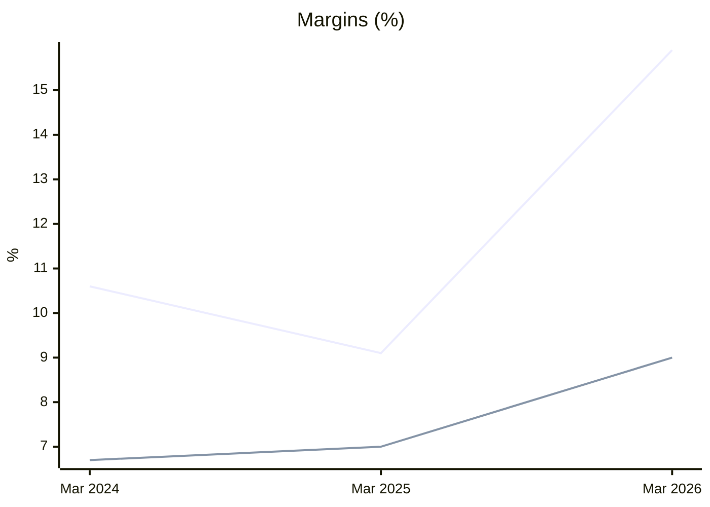

*Run 2026-11-24 · part of [SPINOFF_REPORT.md](../SPINOFF_REPORT.md) · the complete analysis of one company, with every management-call exchange in full.*

## REFEX — Refex Industries Ltd.

### 1. Refex Industries Ltd. — CONFIRMED DEMERGER (in progress — read from the filings' text)

**CONFIRMED** (demerger in progress — read from the filings' text (no scheme-category filing names it): “Demerger of the Green Mobility Business Undertaking of RIL (vested in RIL pursuant to amalgamation of RGML with RIL) into Refex Mobility Limited ('Res”) · **PRE-SPIN — study the parent; the pieces do not trade yet** · score 5.7/10 · spin-off · 39 filing(s) from CALLS, NSE · first 2025-11-04, latest 2026-10-28

**The separated entities — every one the documents name:**

| Entity | Scheme | Business | Listing | Who runs it |
|---|---|---|---|---|
| **Refex Mobility Limited** | 2025 Composite Scheme of Amalgamation and Arrangement (Part… | Green Mobility Business Undertaking: technology integrated fleet management service using clean fuelled vehic… | to be listed — "Yes. The shares issued by RML would be list… | not stated |

**The other parties to the scheme(s)** — not separated entities: Refex Green Mobility Limited — merged in — no shares for the parent's holders

**What is being separated, as the documents put it:** Green Mobility Business Undertaking — cleaner-fuel/EV passenger transport and corporate fleet services — into Refex Mobility Limited — class `value_unlocking`.

### 2. Stages and dates

> **Listing:** NOT YET — scheme at 'nclt_sanction' stage; Refex Mobility Limited will list only after NCLT sanction, effectiveness and a record date; no listing timeline stated

| Date | Event | Source |
|---|---|---|
| 2025-04-01 | **Record date** | the filings |
| 2025-04-01 | Appointed date — Refex Green Mobility Limited transfer into Refex Industries Limited | as stated: Notice of court convened meeting of equity shareholders dated July 03… |
| 2025-09-12 | Other (incorporation of the Resulting Company) — Refex Mobility Limited | as stated: Outcome of Board Meeting / Q2 FY26 standalone results, November 04, 2… |
| 2025-09-22 | Stage reached: **announced** | [Outcome of Board Meeting](https://nsearchives.nseindia.in/corporate/REFEX2002_22092025182146_RIL_STXIntimationforCompositeScheme_F_22092025_sd.pdf) |
| 2025-09-22 | Board approval — Refex Green Mobility Limited, Refex Industries Limited and Refex Mobility Limited (boards of all three; also Audit Committee, Committee of Independent Directors, share entitlement ratio report, fairness opinion) | as stated: Intimation under Regulation 30 and Media Release, both dated Septembe… |
| 2026-01-23 | Other (NSE submitted the draft scheme to SEBI) — Refex Industries Limited | as stated: NSE Observation Letter Ref: NSE/LIST/51151 dated March 16, 2026 |
| 2026-03-13 | SEBI approval — Refex Industries Limited | as stated: BSE and NSE Observation Letters dated March 16, 2026 ("SEBI vide its … |
| 2026-03-16 | Exchange no-objection — BSE Limited and National Stock Exchange of India Limited observation letters with 'no adverse observations' | as stated: Disclosure under Regulation 30 dated March 17, 2026, enclosing both o… |
| 2026-03-17 | Stage reached: **exchange noc** | [General Updates](https://nsearchives.nseindia.com/corporate/REFEX2002_17032026111030_RIL_STX_Observation_Letter_sd.pdf) |
| 2026-03-26 | Other (Company Application / petition filed before NCLT, Chennai Bench) — Refex Industries Limited | as stated: Disclosure under Regulation 30 dated March 27, 2026; reconfirmed in Q… |
| 2026-03-31 | Other (cut-off date for voting and attending the creditors' meetings) — Secured and Unsecured Creditors of Refex Industries Limited | as stated: Notices of court convened meetings of Secured and Unsecured Creditors… |
| 2026-06-18 | NCLT order — NCLT Division Bench-I, Chennai order in CA(CAA)/43(CHE)/2026 directing meetings of equity shareholders, secured creditors and unsecured creditors of RIL and of creditors of RGML; dispensing with meetings of equity shareholders of RML and RGML | as stated: Disclosure under Regulation 30 dated June 24, 2026 (order uploaded on… |
| 2026-06-24 | Stage reached: **nclt sanction** | [General Updates](https://nsearchives.nseindia.com/corporate/REFEX2002_24062026193439_RIL_NCLT_order.pdf) |
| 2026-07-03 | Other (notice convening the court-convened meetings; newspaper publication July 05, 2026) — Refex Industries Limited | as stated: Notices of court convened meetings dated July 03, 2026; Scrutinizer's… |
| 2026-07-31 | Record date (cut-off date for e-voting / attending the equity shareholders' meeting) — Equity Shareholders of Refex Industries Limited | as stated: Notice dated July 03, 2026 and Voting Results filing dated August 07,… |
| 2026-08-05 | Stage reached: **meetings** | [Shareholders meeting](https://nsearchives.nseindia.com/corporate/REFEX2002_05082026230439_RIL.pdf) |
| 2026-08-05 | Shareholders / creditors meeting — Equity Shareholders (11:00 A.M.), Secured Creditors (11:30 A.M.) and Unsecured Creditors (12:00 P.M.) of Refex Industries Limited; meetings of Secured (10:00 am) and Unsecured (10:30 am) Creditors of RGML also directed for the same day | as stated: Summary of Proceedings dated August 05, 2026; Disclosure dated June 2… |
| 2026-08-07 | Other (voting results and Scrutinizer's reports submitted — scheme approved by requisite majority; 99.999% of votes in favour, creditors unanimous) — Refex Industries Limited | as stated: Submission of Voting Results along with Consolidated Scrutinizer's Re… |
| 2026-10-28 | Other (next NCLT hearing scheduled) — Refex Industries Limited | as stated: Press Release dated October 28, 2026 ("NCLT hearings are underway for… |

**The stages, as filed:** announced (2025-09-22) → exchange noc (2026-03-17) → nclt sanction (2026-06-24) → meetings (2026-08-05)

**Stated in the filings:** resulting company **Refex Mobility Limited**; demerged undertaking: are transferred to the Resulting Company and all the liabilities of Transferor Company; record date 2025-04-01; appointed date 2025-04-01; size hint: 2.5% of revenue.

### 3. Size of the separated business beside the parent — is institutional selling likely?

**Reading: VERY LIKELY — the piece is under a tenth of the whole; index funds and large holders who receive it without choosing it tend to sell.**

| Entity | Stated turnover | Stated share of the whole | Segment revenue share | Market cap (₹ cr) | Share of combined market cap | Index member |
|---|---|---:|---:|---:|---:|---|
| Refex Mobility Limited | RML itself: "Turnover: NIL* ... *The company was incorporat… | 1.18% | 4.4% (FY2026) | — | — | not listed |

*Stated figures are the documents' own (a turnover share, or the cost-of-acquisition split the company publishes for tax, which reflects relative value); the segment share is this business's revenue over the parent's sales, and the market-cap share is the entity's value over the entity plus the parent (parent ₹3,194 cr, NSE bhavcopy of 2026-11-13), both computed here.*

**In the documents' words:** “The turnover of the Green Mobility Business division (vested in RIL upon merger), which is getting demerged as per Part C of the Scheme, the turnover for the financial year ending March 31, 2025 is Rs. 2,897.62 Lakhs which represents 1.18% of RIL (post-merger under Part B).”

**The judge's read of selling pressure:** likely — Tiny (2.5% of revenue, ~₹100cr turnover), loss-making, unlisted new entity in a different industry, distributed 1:1 to 92,973 shareholders.

### 4. Insider ownership — share swap, promoters' holding, management incentives

**Share swap / entitlement, entity by entity:**

- **Refex Mobility Limited:** "1 (One) fully paid-up Equity Share of Rs.2 each of the Resulting Company shall be issued and allotted as fully paid up for every 1 (One) Equity Shares of Re. 2 each fully paid up held in the Demerged Company." and, for warrants, "1 (One) Warrant of the Resulting Company shall be issued and allotted for every 1 (One) Warrant in the Demerged Company"

**Promoters' holding, from the shareholding pattern:**

| Company | Promoters | FIIs | DIIs | Public | Quarter |
|---|---:|---:|---:|---:|---|
| Refex Industries Ltd. (REFEX) | 56.56% | 0.55% | 0.65% | 42.24% | Sep 2026 |

*Source: screener.in shareholding pattern, stored under `ShareholdingPattern/NiftyTotalMarket/`. In a mirror demerger each shareholder holds the same proportion of the new company as of the parent on the record date.*

- **Promoters in the parent, per the documents:** not stated in the documents on file.
- **What the promoters will hold in the separated entity:** For the 2025 Composite Scheme (resulting company RML): "As per the Scheme, simultaneous with the issue and allotment of equity shares by the Resulting Company to the equity shareholders of the Demerged Company, the entire pre-Scheme issued, subscribed and paid-up equity share capital of the Resulting Company as held by the Demerged Company along with its nominees will stand cancelled, extinguished and annulled, without any further act, instrument or deed or payment of any consideration. Pursuant to the Scheme, a mirror image of the shareholding structure will be created in both the Companies." Pre-scheme RML shareholding: "Promoter and Promoter group 50,000 / 100"; Post-scheme RML shareholding: "Promoter and Promoter group 8,44,68,085 / 55.98" and "Public - / 6,64,19,058 / 44.02", with the note "*Considering that the entire warrants issued and outstanding by the demerged company as on the date of this intimation will be converted into equity shares." For the Transferee Company: "As no new shares are proposed to be issued for the amalgamation of Transferor Company into the Transferee Company, there shall be no change in the shareholding of the Transferee Company after the effectuation of this Scheme."
- **What a public shareholder receives:** 2025 Composite Scheme: "It is further informed that upon completion of the scheme, the shareholders of RIL will receive equity shares in RML in the same proportion as their existing shareholding in RIL as on the record date, thereby creating a mirror shareholding structure." The entitlement is "1 (One) fully paid-up Equity Share of Rs.2 each of the Resulting Company shall be issued and allotted as fully paid up for every 1 (One) Equity Shares of Re. 2 each fully paid up held in the Demerged Company." For the amalgamation leg no consideration is paid: "There is no cash consideration involved in the Scheme."
- **Management incentives:** No treatment of ESOPs under the Scheme is stated. Existing plan in the parent: "During the quarter, the Company had not granted any Employee Stock Options ("ESOPs") under the Refex Employee Stock Option Scheme, 2021 ("ESOP 2021"). However, the Company had allotted 20,057 equity shares of face value of ₹2/-each pursuant to the exercise of vested Employee Stock Options by eligible employees under the said ESOP 2021 on May 01,2026." and "The Company, on November 20, 2025 has made allotment of 2,73,925 equity shares of ₹2/- each, in lieu of exercise of vested Employee Stock Options (ESOPs) under Refex Employee Stock Option Scheme 2021 ("ESOP 2021"), to the eligible employees." No new plan in the resulting company is stated. Warrants are mirrored with a repricing mechanism: "If any share warrants convertible into equity shares of the Demerged Company are outstanding on the Record Date (as defined in the Scheme), upon the Scheme becoming effective and upon vesting of the Demerged Undertaking of the Demerged Company in the Resulting Company, the Resulting Company shall allot share warrants for each warrant outstanding on the Record Date. The adjustments to the issue price of warrants would be based on the net assets (post factoring the impact of merger under Part B of the Scheme), that are transferred to the Resulting Company". Benefit to promoters: "Benefits if any, which may incur to the promoter /promoter group/group companies, will be at par with other public shareholders."
- **Insider actions around the separation:** Promoter warrants lapsed and upfront money forfeited: "On November 07, 2024, the Company had allotted 1,11,70,000 convertible warrants on a preferential basis at an issue price of ₹468/-per warrant (including face value of ₹2/-each) to certain persons belonging to the promoter & promoter group and non-promoter category... As the balance consideration towards the warrants was not received within the stipulated period ending May 06, 2026, the said warrants lapsed upon expiry of the exercise period. Consequently, the upfront amount received on such warrants aggregating to ₹1,30,68,90,000/-has been forfeited by the Company"; management called it deliberate: "It was a deliberate decision. And company has sufficient cash balance and the banking limit and the internal accrual." Earlier promoter subscriptions: "the Company approved the preferential allotment of 1,25,75,000 warrants to Refex Holding Private Limited (formerly Sherisha Technologies Private Limited)(RHPL), Promoter of the Company. Upon exercise of conversion of warrants, the Company allotted 50,00,000 equity shares of ₹2 each to RHPL on July 22, 2024, at an issue price of ₹125 per share... Subsequently, upon exercise of conversion of warrants for the second tranche, the Company allotted the remaining 75,75,000 equity shares on October 3, 2025, at an issue price of ₹125 per share, for an aggregate consideration of ₹94.68 crore". Promoter pledge (Q3 FY26 call): "this catalyst pledge was related to a borrowing at a holdco level and there is a plan over a period of next six months substantial pledge will get reduced. As of now, close to 25%-26% of the promoter holding has been pledged"; on a margin call: "company has taken a steps prepaid you are right the margin call came and we have paid from the own source and we have we have securitized the lender." In the Q4 FY26 call a participant stated "the pledge has only increased to 41%" and management said "We expect some relief would happen in the coming week. And over a period of months, we'll be closing the pledge." Group-level dilution unrelated to the scheme: "the Company diluted its holding of 540 equity shares constituting 0.40% of the total paid up share capital in Venwind Refex Power Limited pursuant to an internal structural realignment."
- **Insiders, per the checklist read:** Directors/KMP have no interest except directorship and shareholding; RIL holds 100% of RML pre-scheme (cancelled); post-scheme promoter and promoter group hold 56.57% of RML, mirroring RIL 1:1. · *option pricing date:* not stated

### 5. Why the demerger — point by point

The separation is the demerger of Refex's green mobility (electric-vehicle fleet) business out of Refex Industries Ltd (RIL), whose core is Ash & Coal Handling. Management structured it as a composite scheme in two steps: first merge the wholly-owned subsidiary Refex Green Mobility Ltd (RGML) into RIL, then demerge the Mobility Undertaking from RIL into a new, separately listed entity, Refex Mobility Ltd (RML), with mirror shareholding (1 RML share of Rs 2 for every 1 RIL share) and, as Dinesh Agarwal stressed, no valuation exercise required because RGML was a 100% subsidiary. The stated reason is investor fit and value discovery: 'the set of investor for the sustainable and the EV business is a completely different set of investor compared to what is there in the Refex Industries Limited,' so a parallel listing is meant to unlock value; the Scheme adds that the mobility business can attract a different set of investors, lenders and strategic partners, and that its risk, competition, financial profile and return ratios are distinct from ash & coal. The second driver is the drag mobility placed on consolidated results — Q1 FY26 showed standalone PAT of about INR33 crore against consolidated INR20.4 crore, with Green Mobility segment margin at minus 50%, prompting an investor to allege 'a miscalculation in your capital allocation'; management had already exited Bangalore airport B2C services to save INR6.82 crore of annual fixed cost. Post-demerger RIL becomes essentially a single-business company (Anil Jain: '95% business from ash and coal handling only'), while RML carries its own balance sheet — roughly INR220 crore of net assets and, per Jan 2026, 'all the debt etc. will also move to that entity' — and pursues asset-light, clean-fuel, enterprise-led growth toward profitability after crossing about INR100 crore of revenue in three years. Mechanically the appointed date is 1 April 2025, mobility was reported as discontinued operations from FY26, lender NOCs were a gating item, BSE/NSE no-adverse-observation letters came on 16 March 2026, the NCLT application was filed 26 March 2026, and the NCLT-convened shareholder and creditor meetings on 5 August 2026 approved the scheme unanimously (equity shareholders ~99.999% of value in favour).

**Point by point, with the source:**

1. Before any demerger was mentioned, management was already pruning the loss-making B2C part of mobility (Bangalore airport taxis) to cut fixed costs and refocus on B2B/B2B2C. “The withdrawal of service from Bangalore Airport will help us save an annual fixed cost of INR6.82 crores and other variable expenses pertaining to the operation over there.” — *[Apr 2025](https://www.bseindia.com/stockinfo/AnnPdfOpen.aspx?Pname=162e778d-67b5-41c3-a245-daaee5637513.pdf)*
2. An investor confronted management with the gap between standalone PAT (~INR32-33 crore) and consolidated PAT (INR20.4 crore), blaming mobility's minus-50% segment margin; this is the first on-record push to rework the business. “It seems to be there is a miscalculation in your capital allocation, sir. Why don't you focus on coal business and go one by one later on?” — *[Aug 2025](https://www.bseindia.com/stockinfo/AnnPdfOpen.aspx?Pname=308de71b-7879-459a-8396-d6990b0a31cb.pdf)*
3. Anil Jain conceded mobility was pulling down consolidated results because EMIs start the day a vehicle is acquired while full utilisation takes 6-9 months, and accepted the need to restructure. “Point well taken, we will try and assess how to rework on these businesses to ensure that we remake them profitable, sir.” — *[Aug 2025](https://www.bseindia.com/stockinfo/AnnPdfOpen.aspx?Pname=308de71b-7879-459a-8396-d6990b0a31cb.pdf)*
4. First disclosure of the structure on a call: a two-step composite scheme — RGML merges into RIL, then the Mobility Undertaking is demerged into a separately listed Refex Mobility Ltd — framed as unlocking focused value. “On this note, I would like to briefly mention that the de-merger of Refex Green Mobility Limited from Refex Industries Limited is in progress through a
composite scheme comprising two steps.” — *[Nov 2025](https://www.bseindia.com/stockinfo/AnnPdfOpen.aspx?Pname=f2733f9d-0910-4f38-8c2d-f74a1600e438.pdf)*
5. Because RGML is a 100% subsidiary, no valuation was done and shareholders simply get mirror shareholding in the new entity; value is left to the market after listing. BSE/NSE filing done, NCLT next, 6-7 months estimated. “As per the company and the process of merger and demerger process there is no valuations requirement to be done since the company holds 100, it is a 100 subsidiary and a mirror shareholding will happen, all the shareholder of Refex Industries Limited will be same shareholding as per the scheme which has been disclosed there.” — *[Nov 2025](https://www.bseindia.com/stockinfo/AnnPdfOpen.aspx?Pname=f2733f9d-0910-4f38-8c2d-f74a1600e438.pdf)*
6. Lenders were a gating party — final NOCs from lenders were the open item — and management confirmed the demerged entity carries its own debt and operating freedom; INR220 crore of net assets move to Mobility. “Once it is demerged, the Refex Mobility will run as a separate entity where it will have more liberty to do its own business and also it will have its own, all the debt etc. will also move to that entity.” — *[Jan 2026](https://www.bseindia.com/stockinfo/AnnPdfOpen.aspx?Pname=63755f06-063b-42e8-b635-b18c38eb7a4a.pdf)*
7. Management quantified what leaves the consolidated balance sheet and confirmed RML will be a parallel separate listing rather than a sale. “It is a 100% subsidiary and Refex industry does not own any assets of the Refex Green Mobility. So it is a 100% subsidiary and it will be a parallel separate listing completely.” — *[Jan 2026](https://www.bseindia.com/stockinfo/AnnPdfOpen.aspx?Pname=63755f06-063b-42e8-b635-b18c38eb7a4a.pdf)*
8. Post-demerger RIL is intended to be effectively a single-business company, with mobility no longer consolidated. “Green mobility will be demerged. So it will be a separate entity. Officially, on a standalone basis, Refex industries will have 100% business, maybe 95% business from ash and coal handling only.” — *[Jan 2026](https://www.bseindia.com/stockinfo/AnnPdfOpen.aspx?Pname=63755f06-063b-42e8-b635-b18c38eb7a4a.pdf)*
9. The clearest statement of rationale: the EV/sustainability business appeals to a different investor base, and separation is intended to unlock value, with mobility itself on a path to profitability after crossing ~INR100 crore revenue in three years. “The purpose of the demerger is because the set of investor for the sustainable and the EV business is a completely different set of investor compared to what is there in the Refex Industries Limited.” — *[Jun 2026](https://www.bseindia.com/stockinfo/AnnPdfOpen.aspx?Pname=f1aa0b70-a34f-4c91-8973-009a48c493d3.pdf)*
10. Management framed the expected post-separation benefits for each entity — focus, capital allocation and value discovery — and said compliance was complete with only the NCLT court process (75-90 days) pending after BSE and NSE approvals. “We believe this structure will create sharper operational focus, clear capital allocation and stronger long-term value discovery for all the stakeholders.” — *[Jun 2026](https://www.bseindia.com/stockinfo/AnnPdfOpen.aspx?Pname=f1aa0b70-a34f-4c91-8973-009a48c493d3.pdf)*
11. The scheme's own rationale rests on the distinct risk/return character of the two businesses and mobility's ability to draw its own investors, lenders and partners, enabling separate capital-market access. “The Green Mobility Business is capable of attracting a different set of investors, lenders, strategic partners and other stakeholders and have significant potential for growth and profitability.” — *Scheme*
12. Shareholders receive a 1:1 mirror entitlement in RML (appointed date 1 April 2025; RIL's existing 50,000 RML shares cancelled), and the August 5, 2026 NCLT-convened meetings approved it with ~99.999% of equity value and unanimous secured/unsecured creditor support. “"1 (One) fully paid-up Equity Share of Rs.2 each of the Resulting Company shall be issued and allotted as fully paid up for every 1 (One) Equity Shares of Re. 2 each fully paid up held in the Demerged Company."” — *Scheme*

**How it evolved:** Through FY25 (May 2024, Nov 2024, Apr 2025 calls) mobility was presented as a growth vertical to scale to 2,000 then 5,000 EVs, with no separation contemplated; the first visible pressure came on the Aug 13, 2025 call, where an investor attacked the capital allocation given minus-50% mobility margins, and Anil Jain replied 'point well taken, we will try and assess how to rework on these businesses.' The board approved the draft composite scheme on September 22, 2025, and it was first explained to investors on the Nov 6, 2025 call as a two-step merger-then-demerger into a separately listed Refex Mobility Ltd, with a six-to-seven-month timeline and no valuation needed. By Jan 21, 2026 the hold-up was 'final NOCs from the lenders', the net assets moving were quantified at INR220 crore with debt following, and completion was guided to end-April 2026; on May 27, 2026 BSE/NSE approvals were in hand, the NCLT filing done, and 75–90 more days guided. The timeline then slipped: creditor and shareholder meetings were only held August 5, 2026, and the October 28, 2026 press release still shows NCLT hearings pending with the next hearing on 28 October 2026.

**What management expects from it:** RIL becomes a near-pure Ash & Coal Handling play (95-100% of standalone revenue) with sharper focus and clearer capital allocation; RML operates independently, carrying its own debt and ~INR220 crore of net assets, pursuing asset-light clean-fuel and enterprise-led growth toward profitability; the 1:1 mirror listing lets a different investor set value the EV business and unlock shareholder value.

*Not explained on the calls:* No valuation, margin or capital-raise plan for RML; no reason given for the merger-then-demerger structure; no debt split detail; repeated timeline slippage never explained.

- *Stated reason, in one line:* Green Mobility's risk, competition, financial profile and return ratios are distinct from Ash & Coal handling; it attracts a different set of investors, so the group plans it as a separate listed entity to unlock value.
- *What it reveals:* Separation leaves parent as high-margin Ash & Coal handling (FY26 PAT ₹247cr, 17% EBITDA, ₹1,721cr orderbook) plus wind; the spin is small and loss-making (segment EBIT −₹38.2cr FY26, ~₹220cr net assets, RGML creditors ₹153cr) but 'progressing steadily towards profitability'.
- *Parent or spin:* parent · *Read next:* Annexure 19 — assets and liabilities demerged into RML; then RML's Information Memorandum and the NCLT sanction order.
- *In their words:* “The Green Mobility Business is capable of attracting a different set of investors, lenders, strategic partners and other stakeholders and have significant potential for growth and profitability.”

### 6. On the calls, verbatim

8 call(s), oldest first: **35 question-and-answer exchange(s)** given in full — the question and every answer to it, nothing trimmed — and 9 passage(s) from management's prepared remarks (the complete sentences about it; the whole remarks are in the linked transcript). Text is as the transcript prints it.

#### May 2024 — [transcript](https://www.refex.co.in/pdf/Refex-Industries-Q4-FY24-Earnings-Call-Transcript.pdf)

**From the prepared remarks** *(the passage about it; the whole turn runs to 9,610 characters in the transcript)*

> **Anil Jain:** Today we'd like to intimate you about our performance in the recent quarter and provide insights into our strategic initiatives and future outlook. Before we delve into the numbers, let me take a moment to highlight our core business areas and recent devel opments. Refex Industries was incorporated in 2002 and head quartered in Chennai. It has established itself as a multifaceted company with a diverse portfolio, including ash and coal handling, refrigerant gases, green mobility and power trading. Our involvement and commitment to these sectors places us at the forefront of combating clim ate change and promoting sustainable development. Since our inception, we have been dedicated to refilling refrigerant gases that serve as replacements for harmful chlorofluorocarbons, or CFCs, and hydrochlorofluorocarbons, or HCFCs. We have emerged as a leading supplier of environment -friendly hydrofluorocarbons or HFC refrigerant gases in India. […] To optimize our fleet management, we rely on centralized GPS tracking, partnering with reputable service providers like Loconav, TATA Fleet Edge , and iAlert. Through this innovative tracking system, we can closely monitor volumes, GPS location, and other vital metrics, positioning us as pioneers in this field. In 2022, we venture into power trading and obtain a Category 1 Power Trading license. Most recently, Ref ex Green Mobility Limited, a wholly owned subsidiary of Ref ex Industries, commenced operation of employee transportation using electric vehicles in Bengaluru in March and Chennai thereafter. RGML provides bundled offerings that include electric vehicles, trained and background -verified drivers, a sophisticated tech nology platform that helps employees book their pick -up and drop on time. We provide these services under the brand name Refex eVeelz to corporate customers like software companies, large banks, and companies who are into back -office services with large employees on board. As of yesterday, our fleet has run 73 lakh kilometres , and in the process, it has abated approximately 4.38 lakh kilograms of CO2, showcasing our commitment to reducing carbon emissions. We are also committed to help our customers achieve their ESG goals. I'm happy to share some of our recent developments that highlight our progress and strategic initiatives. Our step -down subsidiary in the green mobility vertical, along with employee transportation, has commenced operation at Bengaluru airport as a preferr ed airport taxi, where we'll be operating 660 electric vehicles that the taxi pick -up b ay. This marks a significant milestone in our green mobility effort where we'll cater to B2C customers. Refex Industries Limited May 27, 202 4 Additionally, we are expanding geographically and increasing our fleet size, forcing collaborative sustainability initiatives that align with our commitment to reducing carbon emissions. We plan to start operations .in Pune and Hyderabad by September 2024. We are currently operating 479 vehicles for this business and plan to grow up to 2,000 by the end of this year. Our order book for other businesses also remains robust, with the ash and coal handling segment totalling about INR1,000 crores and power trading segment at around INR500 crores as of 24th May 2024. Bolstered by a strong presence in ash and coal handling and power trading, alongside our expanding footprint in the refrigerant gas vertical and advancing operation in green mobility, we are poised for sustainable growth. Co ming to our financial performance, for the fourth quarter ended FY24, we reported robust stand -alone financial results, highlighting the success of our strategic initiative and operational efficiencies. Our total income for Q4 '24 was INR345.7 crores, contributing to an annual total income of INR1,388.84 crores. This growth underscores the effectiveness of a diversified business portfolio.

**Question and answer**

> **Yashwanti:** Okay. And coming down to your mobility business, sir, can you please guide us more on your mobility business? We acquired the business from the…
>
> **Anil Jain:** Sorry, your voice is again going feeble. Can you be a little loud please ?

**Question and answer**

> **Yashwanti:** Yes. I just wanted to understand more on your green mobility services. We are giving services, pickup and drop services for a couple of corporates. And you also mentioned your [inaudible 0:15:07] which we have started with the Bangalore airport. So can you just give us the outline or the business prospect for this line of business?
>
> **Anil Jain:** Yes. So, if you look at the employee transportation using electric vehicles, when lot of these, most of these corporates want to fulfil their ESG compliance or a Scope 3 ESG, they will all have to shift from ICE vehicles to electric vehicles over a period of time. And today, we are providing these services. So the market for this also is very huge. Every large corporate software Refex Industries Limited May 27, 202 4 or a back -office company provides transportation of their employees from the house to office. So this market is potentially going to grow, the electric vehicle market is going to grow a lot. And on the Bangalore airport, we acquired a company which had won a tender for providing airport taxis for Bangalore airport. So the number of vehicles which are going to be deployed there is about 660 vehicles , of which we have already started deploying some of these vehicles. And by end of July, we would have deployed all the 660 vehicles there. And that is more for B2C where the passenger coming out of the airport, this is the first lane outside the airport where they can book this airport taxi.

**Question and answer**

> **Yashwanti:** Okay. So considering this Bangalore taxi services and considering this corporate mobility services, what would be your total fleet size as on date?
>
> **Anil Jain:** The total fleet currently is about 479 for the electric vehicles, which are operational both at Bangalore airport and the corporate customers.

**Question and answer**

> **Aniket Nerkar:** Could you give me some details about how could this fund be otherwise invested in your green mobility or any other business in order to grow the business in the first place? I mean, what was the rationale behind investing in the fund?
>
> **Dinesh Agarwal:** This investment was done three years back, much before the green mobility business and this is looking into – we have seen this and we see a better return compared to any other investment and that is the reason we have invested.

**Question and answer**

> **Jignesh Dayda:** Yes, sir. So, I wanted to understand, like we have different segments. So, what kind of vision the company has in the next 3 years to 4 years? How our revenue will be reflecting division - wise, percentagewise if you can throw some light?
>
> **Anil Jain:** Yes. So, if you look at the businesses except refrigerant gases most of the businesses are linked to the logistics. The ash handling is also an advanced logistic business. The e -mobility is also an advanced logistic business using electric vehicles. And coal trading is more of a business where we're able to utilize – cross -utilize the logistics for ash. So, going forward, we see refrigera nt business growing at about 10% to 12 %t CAGR and the ash handling and coal handling roughly about 30% to 40 % CAGR. EVs, like we said, we are looking at almost about 5,000 electric vehicles by 2027.

#### Aug 2024 — [transcript](https://www.bseindia.com/stockinfo/AnnPdfOpen.aspx?Pname=c00970da-89da-44d9-8bc4-359c7d70dd23.pdf)

**From the prepared remarks** *(the passage about it; the whole turn runs to 3,981 characters in the transcript)*

> **Anil Jain:** I'm delighted to welcome you all to the Q1 FY'25 Earnings Conference Call for Refex Industries Limited. We appreciate your interest and participation as we review our performance over the recent quarter, provide insights into our strategic initiatives and outline our future outlook. Before we dive into the financial details, I would like to take a moment to highlight our core business areas and recent developments that have been pivotal to our growth and success. Refex has grown into a multi -faceted company with a diverse portfolio, spanning ash and coal handling, refrigerant gases, green mobility, and power trading. Our journey began with a strong focus on [inaudible 0:01:38 ] refrigerant gases that serve as replacements for harmful CFC and HCFC. Over the years, we have become one of the leading suppliers of environment -friendly hydrofluorocarbon refrigerant gases in India, playing a crucial role in application across residential, commercial and automobile sectors. In 2018, we expanded into ash and coal handling, establishing ourselves as a major organized player in ash disposal, traditionally managed by the unorganized sector. Utilizing advanced technologies, we ensure safe ash collection, transportation and disposal in the right places. In 2022, we diversified by venturing into power trading with a Category 1 power trading license. Our subsidiary, Refex Green Mobility, commenced operations in employee transportation using electric vehicles, offering bundled services to corporate customers under the brand name Refex eVeelz , and are also operating airport taxis at Bengaluru Airport. Now let's turn our attention to the financial highlights of Q1 FY '25. We are happy to report a robust performance for the quarter. Our total income on a stand -alone basis reached INR592.05 crores, reflecting a remarkable 54.46% increase from the same quarter previous year. […] This segment remains the backbone of our operations, contributing to close to about INR552.62 crores in revenue this quarter. Our daily ash handling capacity is currently 50,000 metric tons, and we continue to provide comprehensive solutions for responsible ash disposal and coal procurement. We generated INR20.92 cr ores revenue from our refrigerant gas business, from our eco -friendly refrigerant gas business. Green mobility. Our subsidiary Ref ex Green Mobility contributed about INR5.47 crores in revenue this quarter. The electric vehicle segment serves an impressive 470% growth on a year -on-year basis. With a fleet of 539 electric vehicles, we are committed to reducing carbon emissions and promoting green transportation solutions. Our partnering business with the Category 1 license achieved INR4.18 crores in revenue.

**Question and answer**

> **Yashwanti:** Okay. So, can you give me some ballpark numbers for cap ex for both the business like the cash handling fleet and also as we are focusing more on our mobility business? So, what is a cap ex or what kind of an add -through you wanted to do to your fleet in both the segments? Management: Currently, I think we immediately have current cap ex which is close to about INR100 odd crores for both the fleet, both EV and just put together. But going forward, yes, as the business goes, this might grow also. This might increase also.

**Question and answer**

> **Yashwanti:** And, sir, any budget positive for your coal and handling business, as well as your green mobility business? Anything com ing from the budget positive? Management: No, nothing. Only, just to put you in another way, directly or indirectly, the power sector demand is there. And we will help everybody in this.

**Question and answer**

> **Rushabh Shah:** Thank you for the opportunity. I think most of the questions have been answered. Just one last part. So on the green mobility business which I think which was started la st year. So if you can just throw any guidance on that whole segment I think what ultimate I think 2000 fleet you provided, but what level of revenues can actually kick in from the business and when do we actually look to achieve the profitability in the segment as a whole? Management: So current quarter the revenue is about 5.47 crores from electric vehicle where we have deployed about 539 vehicles both for the employee transportation and the airport taxi. This year like we said last time by end of this year it will go up to 2000 vehicles by March next year. And the potential revenue could be roughly about yield per vehicle could be roughly about 7 to 8 lakhs per vehicle on a yearly basis. Refex Industries Limited August 06 , 202 4

#### Nov 2024 — [transcript](https://www.bseindia.com/stockinfo/AnnPdfOpen.aspx?Pname=7ee7293e-cb1e-492d-b5da-0be29b1cddfb.pdf)

**From the prepared remarks** *(the passage about it; the whole turn runs to 5,027 characters in the transcript)*

> **Anil Jain:** We appreciate your interest and participation as we take this opportunity to discuss the performance of our company during the recent quarter and half year. Before we get into the financial performance for the quarter and half year, I would like to highlight the significant progress we have made in transforming Refex into a diversified, multi -faceted business. Over the past few years, we have strategically expanded into new areas, positioning ourselves for continued growth and developments. Refex has developed a well-founded platform that allows portfolio planning, spanning ash and coal handling, refrigerant gases, green mobility, and power trading. Our journey began with the supply of eco-friendly refrigerant gases where we established ourselves as a market leader in India's hydrofluorocarbon sector. We have recently achieved a credit rating upgrade of A - with stable outlook, reflecting our stronger financial position and the stronger business growing with us. This upgrade is a testament to the robustness of our performance in key segments such as ash and coal handling, power trading, refrigerant gases, and green mobility. Furthermore, we have successfully completed a potential allotment of equity -shares and warrants , raising a total of INR905.44 crores. This includes the issuance of 81,7 7,068 equity shares to non -promoters amounting to INR382.69 crores and 1,11, 70,000 warrants to both promoters and non -promoters, valued at INR522.76 crores. Now, let's take a closer look at the financial performance of Q2 and H1 FY 2025. […] Refrigerant Gas segment continues to perform well contributing about INR13.6 3 crores of revenue in Q2 FY 2025. Solar Power Initiative has a steady momentum of INR3.26 crores in revenue in Q2 FY 2025 further solidifying our position in renewable energy space. Green Energy. Green Mobility Limited has experienced remarkable growth with revenue of INR7.8 5 crores in Q2 FY 2025, reflecting our growth in line with the increasing demand for sustainable mobility solutions and underlying strategic investment in the sector. Looking ahead, we remain focused on leveraging our expertise to build on the momentum across diverse sectors and expand our portfolio in line with our sustainable growth strategy. The recent capital raise through preferential issue of equity shares and warrants will enable us to pursue ambitious plans, expansion plans that enhance our operational capabilities. Our growth initiatives are driven by the increasing demand for eco-friendly solutions in the ash handling, energy, mobility, and power sectors. While the continued focus on technology and operational improvement positions , we Refex Industries is at the forefront of India's Green Transformation. These achievements reflect our commitment to sustainable green innovation and value creation and we are confident in our path towards long -term growth and consistent value delivery to our stakeholders. Thank you all for your continued support.

**Question and answer**

> **Rachna Sharma:** Okay. And so my next question is, given recent investment in green mobility, how does Refex plan to capture demand in corporate transportation and B2B, B2C sectors?
>
> **Anil Jain:** All our businesses are B2B mostly and this business is purely through large corporates. We have a large feet on ground sales team which is meeting customers and large corporates continuously and promoting our services. And more so our technology platform is very robust where the employee can log -in, log -out.

**Question and answer**

> **Tara Kaur:** Yes. And following to that only, my next question is that how do we plan to scale the green mobility initiative that we are working on? And what specific growth strategies in place to penetrate the EV market going further? Because we are seeing the EV market has a good potential. The industry is very good. Refex Industries Limited November 14 , 202 4
>
> **Anil Jain:** Like I just previously answered the question to the previous caller also. EV business is mostly offered inside our production business where we have a very robust technology platform, which we are able to do stream of employees, transportation and offering power et cetera, which helps large corporates to ease out the products cost from their side. Similarly, we have a large sales team feet on ground who is able to go meet new corporates to convert them to use electric vehicles and stuff like on…

**Question and answer**

> **Dheeraj Yadav:** Yes. My question is, how does Ref ex subsidiary, which is Ref ex Green Mobility Limited, fit into the overall growth strategy and what specific performance metrics are set for it?
>
> **Anil Jain:** Like we mentioned earlier that this business is purely focused on employee transportation for large corporates. This business is continuously growing. We are currently at an ARR of almost about INR 28 crores -- sorry, INR 34 crores. And this looks like it will keep growing continuously. We are adding a lot of vehicles business by this year -end, we'll have close to 2,000 vehicles. So this business looks positive for us going forward.

#### Apr 2025 — [transcript](https://www.bseindia.com/stockinfo/AnnPdfOpen.aspx?Pname=162e778d-67b5-41c3-a245-daaee5637513.pdf)

**From the prepared remarks** *(the passage about it; the whole turn runs to 4,304 characters in the transcript)*

> **Anil Jain:** It's always encouraging to engage with those who shared our belief in the power of sustainable business transformation. FY ‘25 has been a year of dynamic execution and strategic progress for Refex. We have strengthened our market position across each of our core verticals while continuing to embed sustainability, digitalization and operational excellence at the heart of our business. At the macro level, India's thrust on infrastructure, energy security, renewable transition and green mobility has created a fertile ground for companies like us to lead with purpose. At Refex, we have capitalized on this momentum by remaining agile in our strategy, customer-centric in our execution and committed to scalable and future-ready operations. Before diving into the numbers, I'd like to briefly reflect some key highlights from the year gone by. Our Ash & Coal Handling sector remains the backbone of our business, delivering efficient logistics services across more than 40 power plants across the country. With the handling capacity touching close to 70,000 metric tons per day and a 2,000-plus fleet strength this vertical continues to grow with our operational expertise and some strong policy tailwinds. We are actively expanding our presence to newer geographies within India and deepening existing partnerships. Our green mobility platform operating under Refex Green Mobility Limited is fast becoming a symbol of our vision for decarbonized urban transport. With over 1,300 EVs deployed across key cities such as Bengaluru, Chennai, Hyderabad and Mumbai and with the tailpipe CO2 abated to the tune of 21 lakh kgs of CO2 already this vertical has not only been gaining scale but is also now evolving into a full stack mobility as a service offering with enterprise clients at the center. Recently we have made a strategic realignment to our operations at Bangalore by phasing out the EV airport taxi services at Bangalore International Airport, which will help us sharpen our Refex Industries Limited April 24, 2025 focus on the scalable B2B and B2B2C model transportation that will be anchored in long-term partnership and stable demand. The withdrawal of service from Bangalore Airport will help us save an annual fixed cost of INR6.82 crores and other variable expenses pertaining to the operation over there. The EV fleet has grown from 24 vehicles in March 2023 to over 1,300 vehicles today.

**Question and answer**

> **Vimox Shah:** Thank you for the opportunity. Sir, I have a question that, what are the e-technology advancements we are implementing for the further enhancement on the operational efficiency, so beyond the green mobility and increasing green mobility?
>
> **Anil Jain:** On the green mobility, we are actually -- we are using as much as technology as possible for completely monitoring the operations of every vehicle. Even all the rostering of the people for using our vehicles is being done digitally now. The usage of the vehicle, the battery usage, the battery availability, the route taken by driver, everything is digitalized and everything is being monitored from a central control system center in our Chennai office.
>
> **Vimox Shah:** Thank you. Refex Industries Limited April 24, 2025

**Question and answer**

> **Rajesh Kumar:** Yes. Out of your green mobility revenue this year, how much comes from the long-term contracts?
>
> **Anil Jain:** Most of our business in B2B is long-term contracts only, sir.

**Question and answer**

> **Mahesh Seth:** So my first question is that can you share how margins differ across your main businesses, like especially green mobility and power trading?
>
> **Anil Jain:** Power trading the margins are very little. It's only 0.2%. If you look at our – sorry the - - one minute. So power trading is a very low margin business. We make very less margin of 0.2% or 0.3%. And we have slowly reduced that business drastically. The EV fleet currently is -- because it's an operating B2B business, currently we are losing money there, but this year we will become profitable, sir.

**Question and answer**

> **Yashwanti:** So as we are looking to enter more focus on the corporate employee mobility services, so just wanted to understand like normally what is the contract period for whenever you get into for this contract -- sorry, the employee transportation contract and what is the feasible size to get into this contract with any corporate and the margins?
>
> **Anil Jain:** So currently the contract size varies from anywhere between 6 months to 3 years. And for us, we look at minimum 5 vehicles as the minimum number for us to enter the company. But where the companies have very large requirement and if they start with two or three vehicles and we have a visibility of 50, 100 vehicles over the next 1 year, we are going ahead and starting business with all these corporates.

**Question and answer**

> **Yashwanti:** Okay. And sir, how is the mobility, so what is the feasible contract size? I mean what is the contract size normally you enter into it?
>
> **Anil Jain:** Minimum vehicle, we look at five vehicles for a company.

**Question and answer**

> **Prashant:** Sir, I just wanted to check, I understand this question might fall under the umbrella of Refex Renewables also which have not declared its results yet. But the segregation of businesses, if you can share broadly how will it be -- what will be under subsidiary of Refex Industries and what will be done by Refex Renewables? That is one. And a side question is the manufacturing knockdown turbine that we are importing, which is a technology provider with which we will be assembling in Silvassa factory? I missed that if it was shared earlier.
>
> **Anil Jain:** Sir, I'm sorry. We'll only talk about Refex Industries today. Refex Industries like, you know, are 2, 3 sectors, Ash & Coal Handling business currently in the Refex Industries, then we have Power Trading and Refrigerant Gases. We have 2 subsidiaries. One is into employee mobility - - green mobility. Second is into wind turbine manufacturing, sir.

#### Aug 2025 — [transcript](https://www.bseindia.com/stockinfo/AnnPdfOpen.aspx?Pname=308de71b-7879-459a-8396-d6990b0a31cb.pdf)

**From the prepared remarks** *(the passage about it; the whole turn runs to 6,895 characters in the transcript)*

> **Anil Jain:** Lower coal-fired generation down by 9.5% year-on-year in May directly impacted ash output also. Importantly, these situational headwinds rather than struc tural declines. Contract renewals, post-monsoon demand recovery and new customer wins are expected to lift volumes in Q3 onwards. Now we move on to green mobility. Q1 revenue stood at INR17.24 crores, an increase of 12% from quarter-on-quarter, supported by steady fleet deployment in B2B and B2B2C segments. Average monthly revenue has been growing considerably over the last few quarters. While contribution to total revenue remains modest, this vertical continues to expand its fleet base and improve utilization. Ongoing focus on driver productivity, cross-utilization and cost optimization is expected to enhance margins in subsequent quarters. We have transitioned our green mobility fleet branding from Refex eVeelz to Refex Mobility, reflecting our broader vision of delivering integrated sustainable transportation solutions across multiple segments. To lead this next phase of growth, we have appointed Mr. Anirudh Arun as our CEO for the Green Mobility vertical. Anirudh brings a proven track record in the mobility sector and is widely recognized for building premium, safe, clean fuel fleets with industry-leading service reliability and 0 cancellation standards at scale. Moving on, I would like to inform about the wind business. Venwind has raised its first invoice in Q1 this year. We also inaugurated the Silvassa facility, where the audit is complete and it should be ready by end of Q2. […] And we have also taken a call to wind down this vertical's operations by this end of this quarter. Refex anticipates a healthy growth pipeline supported by multiple new ash handling contracts, which are scheduled to commence and expected to rebound in cement and construction demand post-monsoon from Q3 FY '26. Over this quarter, we have also increased the number of customers where we're starting to -- going to start operations soon. Fleet expansion and higher utilization in Green Mobility vertical to drive sequential growth. In the consolidated performance, we saw a total income of INR394.5 crores that reflects the same seasonal trends as stand-alone performance. Employee benefits saw a controlled increase in despite of 70% year-on increase -- year-on-year increase in rise of headcount for project Refex Industries Limited August 13, 2025 readiness. Most of the contracts are awarded and we're all ready for new projects to be starting to execute soon. […] This reinstates our tradition of rewarding shareholders, which we have consistently upheld in the previous year, barring last year when we prioritized reinvestment into growth initiatives. The resumption of dividends reflects our confidence in the company's fundamentals, our healthy cash flow position and our balanced approach of rewarding investors while continuing to invest in long-term expansion. Refex's core verticals remain well-positioned with robust demand visibility, contractual stickiness and operational readiness for scale up. With monsoon impacts getting over by end of Q2, new projects commencing and Green Mobility's utilization improving, we anticipate a significant sequential improvement in Q3 and onwards, supported by both volume recovery and operationa l efficiency gains. Thank you, everyone, for joining us on this call. We'll be happy to take any questions and answer them, please.

**Question and answer**

> **Aniket Madhwani:** I just wanted to know the margin of coals, ash and coal handling, all the different segment margin?
>
> **Anil Jain:** Yes. So currently, I can tell you in percentages. The margin for coal and ash handling is roughly about 11.77%. Refrigerant gas has been 0.9%. Green Mobility has been minus 50%. Power trading also has been negative. Yes, these are the...

**Question and answer**

> **Anil Jain:** Appreciate, sir. We are -- like you said, we are working on it. Currently, the Green Mobility, definitely, is a pull down for us as a consolidated business because Green Mobility requires a lot of time for stabilization and deployment of vehicle from the time we own the vehicle, while our EMIs get calculated from the day we acquire the vehicle. Point well taken, we will try and assess how to rework on these businesses to ensure that we remake them profitable, sir. We're committed to making them profitable.
>
> **Dinesh Agarwal:** Yes. Whereas wind business order is in hand, delivery is going on. And the results will start coming in from Q3 end. And the Q4 will have a better revenue. Wind business is not a loss, where the already suppliers are happening, negotiations are happening and the businesses keep going on, where the -- we already have an order in hand. Order is getting executed. And this year, we'll be making profit in the wind business.

**Question and answer**

> **Aniket Madhwani:** All right. And my second question is, as you mentioned, the margins in Green Mobility, it is minus 50%. So have you taken any necessary steps to improve these margins? Refex Industries Limited August 13, 2025
>
> **Anil Jain:** Yes. So like I mentioned to the previous caller also that there is a lot of margin changes happen because from the time of acquiring the vehicle to deploying the vehicle to 100% utilization is almost 6 to 9 months. So if we take the vehicle today, we start operating for a B2B customer, 100% utilization happens at the end of 6 months -- beginning to happen at the end of 6 months and complete by 9th month. So you -- we always have this shortfall of profitability as the business is growing continuously. On a -- at a stable state, this business is profitable. If I take a stable state of 1 month and the revenue to profitability, it is at a gross margin level. It is making a reasonable amount of profit, sir.

**Question and answer**

> **Miten Shah:** Since you have lot of questions, so I keep on pressing star 1 continuously. So my question -- because I've been following you, as I told you since last 4 to 5 years. So I have many questions because -- so with respect to Green Mobility, basically, how are -- I mean, I believe this would be -- on a comparison basis, this would be premium as compared to Ola or Uber, which runs on fossil fuel. Am I right in understanding?
>
> **Anil Jain:** Sir, our business model is a pure B2B model. We are not focusing on B2C at all. What we're trying to replace is for all the large corporates who are moving their employees using fossil fuel, we are replacing them with electric vehicles to adhere to their ESG compliance. For Scope 3 ESG compliance, all these companies need to ensure that even people movement does not have carbon burn. We have to avoid the carbon burn of people coming from home to office. Second, we also offer vehicles to Uber, where we offer them at a fixed revenue basis. I mean, we don't have a -- we don't acquire customers. Uber acquires customers. We are a B2B2C operator for them. So both these areas, we don't have any kind of a direct customer acquisition cost, nor an exposure to B2C market, sir.

**Question and answer**

> **Miten Shah:** Got it. So I mean, my question in that case would be, there are a couple of quite popular players like Wise Travel, if you would have heard it, Shree OSFM. How are we competing with these guys? They are also into B2B category.
>
> **Anil Jain:** They are fully completely into ICE vehicles, sir. In electric vehicles or a Green Mobility, I think there are very, very few players. Lithium is one player who is very active. We are not sure if any of these other companies like WTI or Wise or whatever you mentioned, OSFM are into electric vehicle, sir.

**Question and answer**

> **Maitri Shah:** And we're closing off the power trading business. So those margins, the negative margins will go away, but t he Green Mobility are at 50% negative margins. So when do we expect that business to breakeven at an EBITDA level?
>
> **Anil Jain:** At an EBITDA level, the mobility business will start making profit by end of this year. And PAT level by next year, it will start making profit.

#### Nov 2025 — [transcript](https://www.bseindia.com/stockinfo/AnnPdfOpen.aspx?Pname=f2733f9d-0910-4f38-8c2d-f74a1600e438.pdf)

**From the prepared remarks** *(the passage about it; the whole turn runs to 3,140 characters in the transcript)*

> **Anil Jain:** With the monsoon period now largely behind us, except in a few states still experiencing prolonged rainfall, we are seeing a steady pickup in site activity and volumes across our core ash and coal handling operations. More specifically, the improved site access and normalized plan schedules are driving this recovery. As we move through Q3, our focus remains on disciplined execution and operational efficiency. Our mobility vertical continues to strengthen its foundation with teams on the ground engaging closely with the corporate clients to chart a ready to deploy fleet expansion and improve utilization across B2B and B2B2C platforms. On this note, I would like to briefly mention that the de-merger of Refex Green Mobility Limited from Refex Industries Limited is in progress through a composite scheme comprising two steps. That is, first the merger of RGML into RIL, followed by a de-merger of Mobility Undertaking from RIL into a separate listed entity called Refex Mobility Limited, in line with our strategy to unlock focused value creation for all our stakeholders. Post-demerger, the mobility vertical will pursue its growth plan independently with strategic and financial flexibility. Our wind vertical continues to progress steadily as we are fulfilling the initial customer orders while exploring new opportunities as well. We remain in the building phase of our internal technology and manufacturing capabilities, laying the foundation for scalable growth in the years ahead. As shared earlier, we have taken a conscious call to wind down our power trading operations, focusing instead on core business with higher strategic and financial alignment.

**From the prepared remarks** *(the passage about it; the whole turn runs to 80 characters in the transcript)*

> **Anil Jain:** It is a very separate listed entity. It has nothing to do with Refex Industries.

**Question and answer**

> **Smit Jain:** Okay so basically the 179 megawatt and the other order that we won for INR 74 Crores is that to be executed and completely booked in this year or like there would be spillover in subsequent years as well?
>
> **Anil Jain:** Majority will be done in this year there could be potentially some spillover in the next year. Refex Industries Limited November 06, 2025 Page 6 of 15 Smit Jain : Ok, second question was regarding the Refex Mobility Vertical that now we are wanting to hive off to a different listed entity. What valuation is that going to be? Let’s say if I own 100% of Refex, what valuation have we ascertained to this particular vertical? Because now that it would be demerged from the company, have we reached that number? And at what point do we see that company getting listed completely as a separate unit? Is there a timeline to it?
>
> **Dinesh Kumar Agarwal:** As per the company and the process of merger and demerger process there is no valuations requirement to be done since the company holds 100, it is a 100 subsidiary and a mirror shareholding will happen, all the shareholder of Refex Industries Limited will be same shareholding as per the scheme which has been disclosed there. There is no valuations requirement to be done and we have already done a filing with BSE and NSE and we are awaiting the approval of BSE and NSE. After that the NCLT filing has to be done. We expect this will take six to seven months process as per the normal whatever it happens and given various compliance process, I mean it will take another six to seven months’ time.

**Question and answer**

> **Tanya Kothary:** Okay. Sir, since ash and coal handling business derives around more than 96% and how do you see the contribution evolving once the green mobility and wind verticals which match yours, how do you see the EBITDA margins contributed by these verticals going the next half or next couple of years sir? Refex Industries Limited November 0 6, 2025 Page 9 of 15 Anil Jain : Like we said that we are demerging the mobility business so hopefully in the next few months it will be a separate listed entity and the results will not get consolidated after that. And as far as wind is concerned, yes, it will continue to contribute on the revenues consistently and the EBITDA margins, we do not see a big difference between both the businesses. But yes, as we mature in the business, we will be able to give more color to those numbers.
>
> **Tanya Kothary:** Okay, sir. Thank you so much, sir.

#### Jan 2026 — [transcript](https://www.bseindia.com/stockinfo/AnnPdfOpen.aspx?Pname=63755f06-063b-42e8-b635-b18c38eb7a4a.pdf)

**From the prepared remarks** *(the passage about it; the whole turn runs to 2,760 characters in the transcript)*

> **Anil Jain:** Despite this, the operating performance improved meaningfully. Profit before tax increased to Rs.89 Crores compared to Rs.71 Crores in Q2, reflecting a 24% sequential growth while profit after tax rose to Rs.67 Crores up 29% quarter-on-quarter. In order to achieve stronger return profiles by redeploying capital and focus towards core businesses, the management has taken a strategic call to exit power trading and refrigerant gas business. Our mobility business continues to strengthen its operational foundation with teams actively engaging enterprise clients and working towards calibrated fleet expansion with a clear focus on utilization and unit economics. The de-merger of Refex Green Mobility Limited is progressing as per the approved composite scheme, following which the mobility business will operate as a separate entity with enhanced strategic and financial flexibility. The wind business continues to progress steadily with execution of initial customer orders underway, while internal capabilities are being strengthened to support future scale. The business has already secured a cumulative order of Rs.1860 Crores. Looking ahead with multiple new ash projects commencing the site activity, stabilizing across regions, we expect operational momentum to continue the coming quarters.

**Question and answer**

> **Ananya Khanna:** Hello, first of all, congratulations on a good set of numbers. I wish to understand the timeline of the demerger scheme, how long it is expected to take and the expected synergies from the same?
>
> **Anil Jain:** On the demerger, I think we currently are waiting for some final NOCs from the lenders. As soon as it comes, the scheme is ready to be filed and we are trying our best to ensure that this can happen as soon as possible. Once it is demerged, the Refex Mobility will run as a separate entity where it will have more liberty to do its own business and also it will have its own, all the debt etc. will also move to that entity.
>
> **Dinesh Agarwal:** Timeline, Mr. Anil, that we expect by April and it should get finished.
>
> **Ananya Khanna:** Alright, thank you.
>
> **Anil Jain:** Next question.

**Question and answer**

> **Vivek Joshi:** Okay, end of April. And roughly, what will be the division of the assets within these companies?
>
> **Dinesh Agarwal:** It is a 100% subs idiary and Refex industry does not own any assets of the Refex Green Mobility. So it is a 100% subsidiary and it will be a parallel separate listing completely.

**Question and answer**

> **Vivek Joshi:** Okay. So from the net assets, Rs.220 Crores get transferred to Mobility, right?
>
> **Dinesh Agarwal:** Yes. Refex Industries Limited January 21, 2026 Page 8 of 20 Vivek Joshi : Okay, thanks. and could you also update the recent pledging of shares by the promoters? Any particular reason for that?
>
> **Dinesh Agarwal:** No, we have done three months back. That is a borrowing at the holding company level.
>
> **Vivek Joshi:** Oh, thank you so much. All the best.
>
> **Anil Jain:** Thank you.

**Question and answer**

> **Ananya Khanna:** Yeah, so I wish to understand two things. First of all, can you explain to me how exactly your multi-year tie-ups work with the companies that you cater to in the ash handling and coal handling segment? In the sense that, what are the contractual, what are the terms of the contract? What is the tenure of the contract and how does it exactly work? Is there some sort of a bidding involved? Etc, etc. Secondly, I want to understand what is your outlook on the mobility segment with respect to say the model that you currently follow. Do you expect the demand aggregator and the ride hailing part of the segment to grow by any chance?
>
> **Anil Jain:** I will answer that, Ananya, on the mobility business. I think we can talk about our business. We are a pure B2B business where we do employee transportation and rent-a-car service. So both these businesses are growing very fast in the country. And we do not see any chance of the demand reducing, because mobility is something which is growing continuously. We do not have any inputs on the ride-hailing apps or the business, what is happening around. On the second part, I think Dinesh can take up the question.
>
> **Dinesh Agarwal:** Yeah, ash business completely ash and cold business completely through a bidding process only and contract period is anywhere between five months to three years. Majority of the Rs.1500 Crores of contract will get executed over next 9 months to 12 months. I mean, majority, like 50% will get executed in next four to five months, 50% in the 12 months, and around 30% of Rs.1,500 Crores is over a period of three years. We are now tying off for the long-term contract and bidding for the long-term contract, working with many private plant and the government plant to work on a comprehensive ash management where we take complete O&M of the ash handling plant. We also do certain capex so that we tie off anywhere between 3 to 10 years with the power plant and handle the complete comprehensive ash management, handling the ash, taking care of the O&M of the ash Refex Industries Limited January 21, 2026 Page 11 of 20 handling plant and also taking care of their silos area. So we also depute people there so that we become a solutions provider to these power plants. And we are working towards signing of the 3 to 10 years for the contract.

**Question and answer**

> **Vivek Joshi:** Yeah, my question was, if you take a slightly lo nger term view, three, five years, do you have some idea of what percentage of your business will be from ash, coal, and green mobility, just to get an idea of how the company is thinking?
>
> **Anil Jain:** Green mobility will be demerged. So it will be a separate entity. Officially, on a standalone basis, Refex industries will have 100% business, maybe 95% business from ash and coal handling only. Refex Industries Limited January 21, 2026 Page 14 of 20 Vivek Joshi : And like 5% from wind, right?
>
> **Anil Jain:** No, we are talking about consolidated. Consolidated, obviously we do not have such a long projections to make over here, but substantial business will be between ash and coal and wind. Mobility will again get demerged, so it will be a separate entity and there would not be any consolidation.
>
> **Vivek Joshi:** Okay. Thank you so much.

**Question and answer**

> **Rahul Bafna:** Any information regarding when the stock split is happening, the demerger is happening?
>
> **Anil Jain:** No, there is no stock split and demerger, we have already given the guideline that by end of April it will happen, sir.
>
> **Rahul Bafna:** Okay, sir. Thank you. Best of luck, sir.
>
> **Anil Jain:** Thank you. Refex Industries Limited January 21, 2026 Page 20 of 20 Moderator: Thank you so much. We have our next question coming in from the line of Aniket Madhwani. Please go ahead.
>
> **Aniket Madhwani:** Yeah, hi. I was just going through the P&L and just realized that there is a significant dip year-on-year basis. I mean, if you compared to the December 2024 number, so there is around 16% drop in top line. So any specific reason for that?
>
> **Anil Jain:** Aniket I think we did explain that earlier also. It is because of the discontinuation of power trading business and the refrigeration business, refrigeration and gas business. That is why there is a dip.
>
> **Aniket Madhwani:** Okay, so you will be expecting to improve in coming quarters, right?
>
> **Dinesh Agarwal:** Our profit will keep improving. Our focus is creating maximum profit in the business. We are realigning the strategy. We have discontinued where margin is less like power trading, refrigerant gas, which we have spoken. And we are also our focus is more on growing the service business, which is ash handling and the mining service business. We are not concentrating on more of a coa trading also, we are reducing it.
>
> **Anil Jain:** That is the reason revenue drop has happened, whereas profit has increased from year on. I mean, if you compare, it was EBITDA level, it was Rs.153 Crores, and it is now, this nine months, it is Rs.207 Crores.
>
> **Aniket Madhwani:** Thank you.

#### Jun 2026 — [transcript](https://www.bseindia.com/stockinfo/AnnPdfOpen.aspx?Pname=f1aa0b70-a34f-4c91-8973-009a48c493d3.pdf)

**From the prepared remarks** *(the passage about it; the whole turn runs to 6,339 characters in the transcript)*

> **Anil Jain:** During the year, the business also achieved an important milestone with the receipt of ALMM approval for our wind turbine platform. This strengthens our market positioning, enhances our execution credibility and supports our participation in upcoming opportunities across renewable energy ecosystem. We believe this development further reinforces our long-term growth strategy in this sector. Now coming to the mobility business. The demerger process continues to progress in line with the approved scheme and planned time line. Key regulatory and procedural milestones have already been achieved and the process remains on track for operational separation. Post completion of the demerger, the mobility platform will operate independently with a dedicated strategic and financial focus. We believe this structure will create sharper operational focus, clear capital allocation and stronger long-term value discovery for all the stakeholders. Operationally, the mobility business continues to witness strong growth momentum and has crossed INR100 crores revenue this year with just 3 years of operation. The business is now increasingly focused on an asset-light growth strategy with expansion into clean fuel and enterprise-led scaling. With the announcement of our Prime Minister shift to EVs for various government and other agencies, I think this business and the company will see a good growth for the next few years. Refex Industries Limited May 27, 2026 With improving utilization levels, better operating efficiency and disciplined action, the platform is steadily progressing towards profitability while continuing to strengthen its market presence. Overall, FY26 has been a strategic execution and business transformation for Refex Industries. We have strengthened our operating foundation, improved our earning quality, expanded execution capabilities and continue to build long-term growth platforms using technologies across our businesses. With a strong order book at Ash & Coal Handling, the wind business entering active execution and the mobility business progressing towards demerger, we remain confident about the company's long-term growth trajectory and value creating potential. I would like to conclude by thanking our shareholders, customers, partners and employees for their continued trust and support. We remain committed to building a resilient future-ready organization with a focus on governance, execution, excellence and sustainable growth. Thank you.

**Question and answer**

> **Sucrit D. Patil:** My second question is what liquidity buffers and refinancing tactics have been planned over the next 1 to 2 years to sustain profitability while supporting the mobility demerger and renewable energy scale up?
>
> **Dinesh Agarwal:** Yes. Already we started the work with respect to the financing. We have already did some refinancing during the current quarter for improving the borrowing cost, I mean, reducing the borrowing cost. And there will be a temporary expenses with respect to processing charges and other things getting the better terms from the bank, both at a Venwind business and also in the Refex Industries Limited. And we are not seeing any challenge with respect to the capital. We have sufficient internal accrual and also the bank balance to fund the current and the future capital requirements.
>
> **Sucrit D. Patil:** Thank you. And best wishes.
>
> **Dinesh Agarwal:** Thank you.

**Question and answer**

> **Vidyashankar R:** Yes. I have only been dormantly disengaged. But holding wise, I'm still at the same place where I left you at around 2 years back. So that way, I have kept the trust on irrespective of the noise that has been going around. And that brings me to making a statement that what retail investors should believe is like we, senior citizens, try to say is not just a number. Stock price and market returns, these are also just a number. What we need to actually reflect and look upon is the company growth, the management vision and the management mission, how they are executing it. And I think you are doing a great job in that. We would like to understand where we are on the demerger. Is it just stuck with NCLT Refex Industries Limited May 27, 2026 and other regulatory process? Or is there some other stumbling block that you have encountered there? I don't have any other questions because everything else is quite sticking for us.
>
> **Dinesh Agarwal:** Yes. This is, I mean, ongoing. I mean, there is no challenge in the demerger process. It is a part of NCLT process. We expect very soon to get the demerger process being done. Currently, the courts are on holidays. It is a summer vacation in the court. And as of now, we should get the hearing on the first week of June. if we put a time line, another 60 to 75 days, this should get completed. I mean that's all depend on the court process, but that is what the time line we expect the demerger process to get completed.

**Question and answer**

> **Maya:** First of all, congratulations, very amazing set of numbers. I have 2 questions. First, I would like if you could clarify on the IT search issue. Was there any financial or reputational impact on Refex? The second one would be the purpose of the demerger, how will it create value for us, shareholders?
>
> **Dinesh Agarwal:** I'll take the second question. The purpose of the demerger is because the set of investor for the sustainable and the EV business is a completely different set of investor compared to what is there in the Refex Industries Limited. And for the better unlocking the value for the shareholder, it has been, we have planned to do the demerger. Refex Industries Limited May 27, 2026 And as I have told in my previous question, this company is also in the path to profitability, and it will create value for all the shareholders. The IT issue, we have done all the disclosure at various point of time. I mean every stages of the disclosure, it has been done. And we are confident about the governan ce in the company, and we don't see any challenges from the IT for the company.
>
> **Maya:** Okay. Thank you sir.

**Question and answer**

> **Majid Ahmed:** Got it, sir. And sir, finally, just regarding the demerger, when are we like expecting, sir, exactly like the demerger on the EV business?
>
> **Dinesh Agarwal:** Company has done all the compliances. And as on date, there is nothing pending from our side. We have got the BSE approval, NSE approval. We have done the filing with the NCLT. It is an NCLT time line process where this has to go through a court process. Currently, court under the summer vacation, and it will open on 1st of June, court will reopen on the 1st of June. And should get closed, I mean, normally, NCLT process takes anywhere between the 90 days, 75 days to 90 days. Same time should take 90 days here also and should get completed in the next 90 days. Refex Industries Limited May 27, 2026

### 7. The parent's financial statements

**The parent, last three fiscal years (consolidated)**

| | Mar 2024 | Mar 2025 | Mar 2026 |
|---|---:|---:|---:|
| Sales (₹ cr) | 1,383 | 2,259 | 2,277 |
| Sales growth (%) | -15.1% | +63.3% | +0.8% |
| Operating profit (₹ cr) | 146 | 206 | 362 |
| Operating profit growth (%) | -16.6% | +41.1% | +75.7% |
| Operating margin (%) | 10.6 | 9.1 | 15.9 |
| PAT (₹ cr) | 93.0 | 158 | 204 |
| PAT growth (%) | -19.8% | +69.9% | +29.1% |
| PAT margin (%) | 6.7 | 7.0 | 9.0 |
| EPS (₹) | 8.1 | 12.3 | 14.8 |

*Source: ProfitStatement/NiftyTotalMarket/REFEX.csv (consolidated, screener.in); growth and margins computed here.*

```mermaid
xychart-beta
    title "Sales, operating profit and PAT (₹ cr)"
    x-axis ["Mar 2024", "Mar 2025", "Mar 2026"]
    y-axis "₹ crore"
    bar [1383, 2259, 2277]
    bar [146, 206, 362]
    bar [93, 158, 204]
```

*Series in order: Sales, Operating profit, PAT.*

*Series in order: Operating margin, PAT margin.*

**P/E:** 18.3 — close 2026-10-01 ÷ EPS 14.82 (Mar 2026) (price ₹271.30 as of 2026-10-01).

**Cash flows (₹ cr):**

| | Mar 2024 | Mar 2025 | Mar 2026 |
|---|---:|---:|---:|
| Cash from operations (₹ cr) | 3.0 | -248 | 107 |
| Cash from investing (₹ cr) | -42.0 | -105 | -268 |
| Cash from financing (₹ cr) | 62.0 | 602 | 65.0 |
| Net cash flow (₹ cr) | 23.0 | 248 | -95.0 |
| Free cash flow (₹ cr) | -43.0 | -414 | 47.0 |

*Source: CashFlow/NiftyTotalMarket/REFEX.csv (consolidated, screener.in).*

### 8. The separated business's financial statements

**The business being separated — its own numbers**, entity by entity: its reported statements once it is listed and on file, and the segment numbers the annual reports and presentations carry for it before that.

**Green Mobility / Electric Vehicle (the "Green Mobility Business Undertaking" demerged from Refex Industries Ltd into Refex Mobility Limited; Refex Green Mobility Limited is simultaneously amalgamated into RIL)** · unit ₹ lakh · operating_profit = "Segment Results" (EBIT before other income and exceptional items, as labelled in the consolidated Ind AS 108 note). Revenue is segment revenue (net sales/income); the notes do not state whether inter-segment revenue is included. Figures are from the CONSOLIDATED segment note (the segment does not appear in the standalone note, since the EV business sat in subsidiary Refex Green Mobility Ltd / step-down Refex EV Fleet Services Pvt Ltd). In FY2026 Green Mobility is shown as a discontinued operation.

| | FY2024 | FY2025 | FY2026 |
|---|---:|---:|---:|
| Revenue (₹ lakh) | 1,231 | 3,765 | 9,952 |
| Revenue growth (%) | — | +205.8% | +164.3% |
| Operating profit (₹ lakh) | -737 | -2,684 | -3,824 |
| Operating profit growth (%) | — | -264.0% | -42.5% |
| Operating margin (%) | -59.9 | -71.3 | -38.4 |
| PAT (₹ lakh) | — | — | — |
| PAT growth (%) | — | — | — |
| Segment assets (₹ lakh) | 7,170 | 19,022 | 21,248 |
| Segment liabilities (₹ lakh) | 6,009 | 13,454 | 10,488 |
| Capital employed (₹ lakh) | 1,161 | 5,568 | 10,760 |
| Return on capital employed (%) | -63.5 | -48.2 | -35.5 |
| Segment assets / revenue (x) | 5.8 | 5.0 | 2.1 |
| Capex (₹ lakh) | — | — | — |

*Sources:* Annual Report 2024 — page 317 (revenue, segment result); Annual Report 2024 — page 318 (assets, liabilities); Annual Report 2025 — page 324 (revenue, segment result, assets); Annual Report 2025 — page 325 (liabilities); Annual Report 2026 — page 361 (revenue, segment result); Annual Report 2026 — page 362 (assets, liabilities)

*Not in the pages read:* No PAT, capex or depreciation for the segment; no quarterly Green Mobility revenue/profit in the presentation pages (only fleet counts and CO2 abated).

*Businesses with no numbers in the pages read (3 annual report(s) and 13 presentation(s) on file):* Refex EV Fleet Services Private Limited and Refex Green Mobility Limited carry no standalone financials on these pages — only the combined Green Mobility / Electric Vehicle segment numbers, plus RIL's investment (₹8,000 lakh) and loans (₹8,277.50 lakh) in RGML (AR2026 p284).

*Documents on file:* [Annual Report 2026](https://www.bseindia.com/xml-data/corpfiling/AttachHis/c6083eca-a123-45b4-b4dd-24dc352859a5.pdf); [Annual Report 2025](https://www.bseindia.com/xml-data/corpfiling/AttachHis/1aba5966-a06b-4bb4-8cf6-1825cf642b14.pdf); [Annual Report 2024](https://www.bseindia.com/xml-data/corpfiling/AttachHis/b113d399-4e15-4ee7-911a-4466f7610d51.pdf); [Presentation Nov 2026](https://www.bseindia.com/stockinfo/AnnPdfOpen.aspx?Pname=7de343a0-621e-45ec-bb26-560c2d616133.pdf); [Presentation Aug 2026](https://www.bseindia.com/stockinfo/AnnPdfOpen.aspx?Pname=076b9ce7-8b98-43a1-9378-84d5d3f9688e.pdf); [Presentation Jul 2026](https://www.bseindia.com/stockinfo/AnnPdfOpen.aspx?Pname=09ab570a-f96a-42ed-aefe-d519bc0afad8.pdf); [Presentation Jun 2026](https://www.bseindia.com/stockinfo/AnnPdfOpen.aspx?Pname=d256b9a2-f2cd-4003-a843-567340b7479c.pdf); [Presentation Jan 2026](https://www.bseindia.com/stockinfo/AnnPdfOpen.aspx?Pname=0d14eec4-d516-4bc2-98a1-c3fa8ded30b1.pdf); [Presentation Nov 2025](https://www.bseindia.com/stockinfo/AnnPdfOpen.aspx?Pname=2a11a425-08c1-4ba7-a788-92ef7bbd6239.pdf)

### 9. Other financial differences — working capital, margins, returns, debt

| Metric (latest year) | Parent (REFEX) | Refex Mobility Limited |
|---|---:|---:|
| *Basis* | *reported, consolidated* | *segment numbers (Green Mobility / Electric Ve…* |
| Sales (₹ cr) | 2,277 (Mar 2026) | — |
| Sales growth (%) | 0.8 (Mar 2026) | 164.3 (FY2026) |
| Operating margin (%) | 15.9 (Mar 2026) | -38.4 (FY2026) |
| Operating profit growth (%) | 75.7 (Mar 2026) | -42.5 (FY2026) |
| PAT margin (%) | 9 (Mar 2026) | — |
| ROCE % | 23 (Mar 2024) | -35.5 (FY2026) |
| Debtor Days | 142 (Mar 2026) | — |
| Inventory Days | 15 (Mar 2026) | — |
| Days Payable | 92 (Mar 2026) | — |
| Cash Conversion Cycle | 65 (Mar 2026) | — |
| Working Capital Days | 144 (Mar 2026) | — |
| Debt / equity (x) | 0.1 (Mar 2026) | — |
| Borrowings (₹ cr) | 225 (Mar 2026) | — |
| Segment assets / revenue (x) | — | 2.1 (FY2026) |
| Sales (₹ lakh) | — | 9,951.5 (FY2026) |

*Each figure is the latest on file, with its year. Working-capital days and ROCE come from the stored working-capital file; segment figures from the pages cited in part 8. A dash means the documents do not carry it.*

**What stays with the parent — its segments, from the same pages:**

| Remaining segment | Revenue | Operating margin | ROCE | Segment assets / revenue | Unit | Year |
|---|---:|---:|---:|---:|---|---|
| Ash & Coal Handling Business | 201,267 | 17.6% | 35.4% | 0.81x | ₹ lakh | FY2026 |
| Solar Power - Generation and Related Activities | 1,037 | 42.1% | — | 4.91x | ₹ lakh | FY2026 |
| Windpower (Venwind Refex Power Limited) | 23,753 | 0.9% | 1.9% | 2.04x | ₹ lakh | FY2026 |
| Sale Of Service | 1,487 | 24.8% | 41.1% | 0.78x | ₹ lakh | FY2026 |
| Power Trading (discontinued from Aug 12, 2025; stays with parent, not transferred) | 84 | -51.0% | -219.9% | 0.57x | ₹ lakh | FY2026 |
| Refrigerant Gas - Manufacturing (Refilling) and Sales (discontinued from Jan 21, 2026; stays with parent, not transferred) | 3,455 | -3.9% | -81.9% | 0.05x | ₹ lakh | FY2026 |
| Others | 130 | 9.4% | — | 0.0x | ₹ lakh | FY2026 |

**What the documents themselves say about the differences:**

- **return on capital** — parent / remaining: Ash & Coal handling business of RIL — distinct risk, competition, financial profile and return ratios; separated business: Green Mobility Business, presently undertaken through wholly owned subsidiary RGML “The nature of risk and competition, financial profiles and return ratios involved in the Ash & Coal handling business of RIL are distinct from Green Mobility Business presently undertaken through its wholly owned subsidiary RGML.”
- **growth** — parent / remaining: Ash & Coal Handling order book stood at nearly INR 1,500 crore as on March 31, 2026 and Q2 FY27 secured new orders worth ₹346 crore with an orderbook of ₹1,721 crs; separated business: Mobility business crossed approx. INR 100 crore turnover within three years of operations (RGML revenue ₹36 crs in Q2FY27 and ₹69 crs in H1FY27) “Mobility demerger progressing as planned; business clocked INR 100 crore approx. turnover within three years of operations”
- **operating margin** — parent / remaining: Ash & Coal Handling Business segment result (profit before interest and tax) of Rs. 11,146.90 Lakhs for the quarter ended June 30, 2026; separated business: Green mobility segment result (loss before interest and tax) of Rs. (1,360.79) Lakhs for the quarter ended June 30, 2026; still pre-profitability “Our Mobility business is progressing steadily towards profitability, driven by rising demand for premium corporate mobility and higher fleet utilisation.”
- **capex and capital intensity** — parent / remaining: Ash & Coal handling built on an asset-light partner model: "asset-light working with partners and growing with the partners is what we've been building"; separated business: Mobility moving to an asset-light model with clean fuel and enterprise-led scaling “The business is now increasingly focused on an asset-light growth strategy with expansion into clean fuel and enterprise-led scaling.”
- **debt and leverage** — parent / remaining: Consolidated debt around Rs.700 Crores, of which "Rs.150 Crores will be the CC limit. Rs.550 Crores will be the BG/LC limit" and "that is Rs.37 Crores of term loan that is for the office building"; 10 secured creditors with total credit of Rs. 1,58,90,59,414/- and 379 unsecured creditors with total credit of Rs. 3,47,67,69,639/- as on March 31, 2026; separated business: Green mobility segment liabilities of Rs. 13,026.29 Lakhs as at December 31, 2025; debt moves with the demerged entity “Once it is demerged, the Refex Mobility will run as a separate entity where it will have more liberty to do its own business and also it will have its own, all the debt etc. will also move to that entity.”
- **other (net worth and relative size)** — parent / remaining: RIL standalone Net worth: Rs. 1,09,693.94 Lakhs; Consolidated Net worth: Rs. 1,05,968.75 Lakhs (as on March 31, 2025); separated business: RGML Net worth: Rs. 6,840.04 Lakhs (as on March 31, 2025); RML net worth NIL at incorporation; approximately Rs.220 Crores of net assets transferred “Net worth: Rs. 6,840.04 Lakhs”
- **other (investor base and capital market access)** — parent / remaining: RIL to consolidate its core strengths across Ash & Coal handling; separated business: RML dedicated to sustainable mobility solutions using clean fuelled vehicles, able to attract a different investor set “Both RIL and RML can aƩract different sets of investors, strategic partners, lenders, and other stakeholders enabling independent collaboraƟon and expansion at their end;”
- **working capital** — parent / remaining: Ash & Coal receivables run long and unbilled revenue is large: contract assets of over INR 700 crore and receivables of "between the 105 days to 125 days"; separated business: not stated “That is majorly the unbilled revenue where the work has already happened and in the process of certifications and the approval with the customer.”

**The checklist:**

| Item | Status | Evidence |
|---|---|---|
| Why the spin-off | yes | value unlocking for shareholders; unrelated businesses separated; regulatory / strategic knot; attracting different investors / capital — “…RIL into a separate listed entity called Refex Mobility Limited, in line with our strategy to unlock focused value creation for all our stakeholders. Post-demerger, the mobility vertical will pursue its growth plan inde” |
| Institutional selling likely (small / different business) | yes | the demerged piece is 2.5% of revenue; the businesses are described as distinct |
| Insider ownership and incentives aligned | unknown | no promoter-continuity or option-pricing language found *(next: the date the management options are priced; promoter holding in the resulting company)* |
| A hidden value revealed (pro-forma, leverage, comparables) | unknown | no pro-forma or market data on file *(next: pro-forma P&L of each piece × the peer P/E of its own industry)* |
| Parent before the spin (clean parent, takeover prelude) | partly | stage nclt_sanction — the spin has not happened; the parent can still be bought whole |
| Timing (first year sells, second year gains) | partly | not yet listed — 385 days since the first filing, stage nclt_sanction |
| Management discussing it on the calls | yes | 18 mention(s) in the last 12 months of calls — “…have any other questions because everything else is quite sticking for us. Dinesh Agarwal: Yes. This is, I mean, ongoing. I mean, there is no challenge in the demerger process. It is a part of NCLT process. We expect ve” |

**On the calls (last 12 months):**

- *Nov 2025* (forward) — “…ients to chart a ready to deploy fleet expansion and improve utilization across B2B and B2B2C platforms. On this note, I would like to briefly mention that the de-merger of Refex Green Mobility Limited from Refex Industries Limited is in progress through a composite scheme comprising two steps. That is, first the merger of RGML…”
- *Nov 2025* (neutral) — “…Limited from Refex Industries Limited is in progress through a composite scheme comprising two steps. That is, first the merger of RGML into RIL, followed by a de-merger of Mobility Undertaking from RIL into a separate listed entity called Refex Mobility Limited, in line with our strategy to unlock focused value creation for al…”
- *Nov 2025* (forward) — “…from RIL into a separate listed entity called Refex Mobility Limited, in line with our strategy to unlock focused value creation for all our stakeholders. Post-demerger, the mobility vertical will pursue its growth plan independently with strategic and financial flexibility. Our wind vertical continues to progress steadily as…”
- *Nov 2025* (neutral) — “…r. Refex Industries Limited November 06, 2025 Page 6 of 15 Smit Jain : Ok, second question was regarding the Refex Mobility Vertical that now we are wanting to hive off to a different listed entity. What valuation is that going to be? Let’s say if I own 100% of Refex, what valuation have we ascertained to this particular verti…”
- *Nov 2025* (forward) — “…t valuation is that going to be? Let’s say if I own 100% of Refex, what valuation have we ascertained to this particular vertical? Because now that it would be demerged from the company, have we reached that number? And at what point do we see that company getting listed completely as a separate unit? Is there a timeline to it…”

The filings

| Date | Category | Headline | Attachment |
|---|---|---|---|
| 2025-11-01 | Earnings call Nov 2025 | …ients to chart a ready to deploy fleet expansion and improve utilization across B2B and B2B2C platforms. On this note, I would like to briefly mention that the | [pdf](https://www.bseindia.com/stockinfo/AnnPdfOpen.aspx?Pname=f2733f9d-0910-4f38-8c2d-f74a1600e438.pdf) |
| 2025-11-01 | Earnings call Nov 2025 | …from RIL into a separate listed entity called Refex Mobility Limited, in line with our strategy to unlock focused value creation for all our stakeholders. Post | [pdf](https://www.bseindia.com/stockinfo/AnnPdfOpen.aspx?Pname=f2733f9d-0910-4f38-8c2d-f74a1600e438.pdf) |
| 2025-11-01 | Earnings call Nov 2025 | …t valuation is that going to be? Let’s say if I own 100% of Refex, what valuation have we ascertained to this particular vertical? Because now that it would be | [pdf](https://www.bseindia.com/stockinfo/AnnPdfOpen.aspx?Pname=f2733f9d-0910-4f38-8c2d-f74a1600e438.pdf) |
| 2025-11-01 | Earnings call Nov 2025 | …e that company getting listed completely as a separate unit? Is there a timeline to it? Dinesh Kumar Agarwal : As per the company and the process of merger and | [pdf](https://www.bseindia.com/stockinfo/AnnPdfOpen.aspx?Pname=f2733f9d-0910-4f38-8c2d-f74a1600e438.pdf) |
| 2025-11-01 | Earnings call Nov 2025 | …these verticals going the next half or next couple of years sir? Refex Industries Limited November 0 6, 2025 Page 9 of 15 Anil Jain : Like we said that we are  | [pdf](https://www.bseindia.com/stockinfo/AnnPdfOpen.aspx?Pname=f2733f9d-0910-4f38-8c2d-f74a1600e438.pdf) |
| 2025-11-04 | Outcome of Board Meeting | Disclosure under Regulation 30 and 33 of Securities and Exchange Board of India (ListingObligations and Disclosure Requirements) Regulations, 2015, as amended ( | [pdf](https://nsearchives.nseindia.com/corporate/REFEX2002_04112025170329_RIL_OutcomeoftheBM_04112025_sd.pdf) |
| 2025-11-04 | Outcome of Board Meeting | Disclosure under Regulation 30 and 33 of Securities and Exchange Board of India (ListingObligations and Disclosure Requirements) Regulations, 2015, as amended ( | [pdf](https://nsearchives.nseindia.com/corporate/REFEX2002_04112025170505_RIL_OutcomeoftheBM_04112025_sd.pdf) |
| 2026-01-01 | Earnings call Jan 2026 | …dation with teams actively engaging enterprise clients and working towards calibrated fleet expansion with a clear focus on utilization and unit economics. The | [pdf](https://www.bseindia.com/stockinfo/AnnPdfOpen.aspx?Pname=63755f06-063b-42e8-b635-b18c38eb7a4a.pdf) |
| 2026-01-01 | Earnings call Jan 2026 | …es. Please go ahead with your question. Ananya Khanna : Hello, first of all, congratulations on a good set of numbers. I wish to understand the timeline of the | [pdf](https://www.bseindia.com/stockinfo/AnnPdfOpen.aspx?Pname=63755f06-063b-42e8-b635-b18c38eb7a4a.pdf) |
| 2026-01-01 | Earnings call Jan 2026 | …numbers. I wish to understand the timeline of the demerger scheme, how long it is expected to take and the expected synergies from the same? Anil Jain : On the | [pdf](https://www.bseindia.com/stockinfo/AnnPdfOpen.aspx?Pname=63755f06-063b-42e8-b635-b18c38eb7a4a.pdf) |
| 2026-01-01 | Earnings call Jan 2026 | …rom the lenders. As soon as it comes, the scheme is ready to be filed and we are trying our best to ensure that this can happen as soon as possible. Once it is | [pdf](https://www.bseindia.com/stockinfo/AnnPdfOpen.aspx?Pname=63755f06-063b-42e8-b635-b18c38eb7a4a.pdf) |
| 2026-01-01 | Earnings call Jan 2026 | …percentage of your business will be from ash, coal, and green mobility, just to get an idea of how the company is thinking? Anil Jain : Green mobility will be  | [pdf](https://www.bseindia.com/stockinfo/AnnPdfOpen.aspx?Pname=63755f06-063b-42e8-b635-b18c38eb7a4a.pdf) |
| 2026-01-01 | Earnings call Jan 2026 | …ed, obviously we do not have such a long projections to make over here, but substantial business will be between ash and coal and wind. Mobility will again get | [pdf](https://www.bseindia.com/stockinfo/AnnPdfOpen.aspx?Pname=63755f06-063b-42e8-b635-b18c38eb7a4a.pdf) |
| 2026-01-01 | Earnings call Jan 2026 | …well going forward also. We do not have any comments on the stock price, please. Rahul Bafna : Any information regarding when the stock split is happening, the | [pdf](https://www.bseindia.com/stockinfo/AnnPdfOpen.aspx?Pname=63755f06-063b-42e8-b635-b18c38eb7a4a.pdf) |
| 2026-01-01 | Earnings call Jan 2026 | …rice, please. Rahul Bafna : Any information regarding when the stock split is happening, the demerger is happening? Anil Jain : No, there is no stock split and | [pdf](https://www.bseindia.com/stockinfo/AnnPdfOpen.aspx?Pname=63755f06-063b-42e8-b635-b18c38eb7a4a.pdf) |
| 2026-01-21 | Outcome of Board Meeting | Disclosure under Regulation 30 and 33 of Securities and Exchange Board of India (Listing Obligations and Disclosure Requirements) Regulations, 2015, as amended  | [pdf](https://nsearchives.nseindia.com/corporate/REFEX2002_21012026102003_REFEX_sd.pdf) |
| 2026-01-21 | Outcome of Board Meeting | Disclosure under Regulation 30 and 33 of Securities and Exchange Board of India (Listing Obligations and Disclosure Requirements) Regulations, 2015, as amended  | [pdf](https://nsearchives.nseindia.com/corporate/REFEX2002_21012026102147_REFEX_sd.pdf) |
| 2026-01-21 | Other Restructuring | Disclosure under Regulation 30 of Securities and Exchange Board of India (Listing Obligations and Disclosure Requirements) Regulations, 2015, as amended SEBI Li | [pdf](https://nsearchives.nseindia.com/corporate/REFEX2002_21012026103444_REFEX_sd.pdf) |
| 2026-03-17 | General Updates | Disclosure under Regulation 30 and other applicable regulations of the Securities and Exchange Board of India (Listing Obligations and Disclosure Requirements)  | [pdf](https://nsearchives.nseindia.com/corporate/REFEX2002_17032026111030_RIL_STX_Observation_Letter_sd.pdf) |
| 2026-03-27 | General Updates | Disclosure under Regulation 30 of the Securities and Exchange Board of India (Listing Obligations and Disclosure Requirements) Regulations, 2015, as amended ( S | [pdf](https://nsearchives.nseindia.com/corporate/REFEX2002_27032026132241_RIL_STX_NCLT_sd.pdf) |
| 2026-05-26 | Press Release | Refex Industries Limited has informed the Exchange regarding a press release dated May 26, 2026, titled "Media Release on Audited Financial Results for the 4th  | [pdf](https://nsearchives.nseindia.com/corporate/REFEX2002_26052026152457_RIL_press.pdf) |
| 2026-05-26 | Press Release (Revised) | Refex Industries Limited has informed the Exchange regarding a revised press release dated May 26, 2026, titled "Revised Media Release on Audited Financial Resu | [pdf](https://nsearchives.nseindia.com/corporate/REFEX2002_26052026190256_RIL_revised_sd.pdf) |
| 2026-06-01 | Earnings call Jun 2026 | …e line. Key regulatory and procedural milestones have already been achieved and the process remains on track for operational separation. Post completion of the | [pdf](https://www.bseindia.com/stockinfo/AnnPdfOpen.aspx?Pname=f1aa0b70-a34f-4c91-8973-009a48c493d3.pdf) |
| 2026-06-01 | Earnings call Jun 2026 | …ross our businesses. With a strong order book at Ash & Coal Handling, the wind business entering active execution and the mobility business progressing towards | [pdf](https://www.bseindia.com/stockinfo/AnnPdfOpen.aspx?Pname=f1aa0b70-a34f-4c91-8973-009a48c493d3.pdf) |
| 2026-06-01 | Earnings call Jun 2026 | …nt vision and the management mission, how they are executing it. And I think you are doing a great job in that. We would like to understand where we are on the | [pdf](https://www.bseindia.com/stockinfo/AnnPdfOpen.aspx?Pname=f1aa0b70-a34f-4c91-8973-009a48c493d3.pdf) |
| 2026-06-01 | Earnings call Jun 2026 | …have any other questions because everything else is quite sticking for us. Dinesh Agarwal: Yes. This is, I mean, ongoing. I mean, there is no challenge in the  | [pdf](https://www.bseindia.com/stockinfo/AnnPdfOpen.aspx?Pname=f1aa0b70-a34f-4c91-8973-009a48c493d3.pdf) |
| 2026-06-01 | Earnings call Jun 2026 | …esh Agarwal: Yes. This is, I mean, ongoing. I mean, there is no challenge in the demerger process. It is a part of NCLT process. We expect very soon to get the | [pdf](https://www.bseindia.com/stockinfo/AnnPdfOpen.aspx?Pname=f1aa0b70-a34f-4c91-8973-009a48c493d3.pdf) |
| 2026-06-01 | Earnings call Jun 2026 | …, I would like if you could clarify on the IT search issue. Was there any financial or reputational impact on Refex? The second one would be the purpose of the | [pdf](https://www.bseindia.com/stockinfo/AnnPdfOpen.aspx?Pname=f1aa0b70-a34f-4c91-8973-009a48c493d3.pdf) |
| 2026-06-01 | Earnings call Jun 2026 | …cond one would be the purpose of the demerger, how will it create value for us, shareholders? Dinesh Agarwal: I'll take the second question. The purpose of the | [pdf](https://www.bseindia.com/stockinfo/AnnPdfOpen.aspx?Pname=f1aa0b70-a34f-4c91-8973-009a48c493d3.pdf) |
| 2026-06-01 | Earnings call Jun 2026 | …r compared to what is there in the Refex Industries Limited. And for the better unlocking the value for the shareholder, it has been, we have planned to do the | [pdf](https://www.bseindia.com/stockinfo/AnnPdfOpen.aspx?Pname=f1aa0b70-a34f-4c91-8973-009a48c493d3.pdf) |
| 2026-06-01 | Earnings call Jun 2026 | …rs, and we are confident to execute whatever the order in hand as on date for the wind business. Majid Ahmed: Got it, sir. And sir, finally, just regarding the | [pdf](https://www.bseindia.com/stockinfo/AnnPdfOpen.aspx?Pname=f1aa0b70-a34f-4c91-8973-009a48c493d3.pdf) |
| 2026-06-24 | General Updates | Disclosure under Regulation 30 of the Securities and Exchange Board of India (Listing Obligations and Disclosure Requirements) Regulations, 2015 ( SEBI Listing  | [pdf](https://nsearchives.nseindia.com/corporate/REFEX2002_24062026193439_RIL_NCLT_order.pdf) |
| 2026-07-03 | Shareholders meeting | Notice of court convened meeting of equity shareholders of Refex Industries Limited to be held on Wednesday, August 05, 2026 at 11:00 AM as per the order of Hon | [pdf](https://nsearchives.nseindia.com/corporate/REFEX2002_03072026161907_RIL_SH_STX_sd.pdf) |
| 2026-07-03 | General Updates | Notice of Court Convened meeting of Secured Creditors of Refex Industries Limited to be held on Wednesday, August 05, 2026 at 11:30 AM as per the order of Hon'b | [pdf](https://nsearchives.nseindia.com/corporate/REFEX2002_03072026164248_RIL_SC_STX_sd.pdf) |
| 2026-07-03 | General Updates | Notice of Court Convened meeting of Unsecured Creditors of Refex Industries Limited to be held on Wednesday, August 05, 2026 at 12:00 PM as per the order of Hon | [pdf](https://nsearchives.nseindia.com/corporate/REFEX2002_03072026164405_RIL_USC_STX_sd.pdf) |
| 2026-07-29 | Outcome of Board Meeting | Outcome of the Board Meeting of Refex Industries Limited held on July 29, 2026, inter-alia considered and approved the un-audited financial results for the 1st  | [pdf](https://nsearchives.nseindia.com/corporate/REFEX2002_29072026124023_RIL_Outcome_of_the_BM29072026.pdf) |
| 2026-08-05 | Shareholders meeting | Intimation under Regulation 30 of SEBI (Listing Obligations and Disclosure Requirements) Regulations 2015 - Proceedings of NCLT convened Equity Shareholders, Se | [pdf](https://nsearchives.nseindia.com/corporate/REFEX2002_05082026230439_RIL.pdf) |
| 2026-08-07 | Shareholders meeting | Submission of Voting Results along with the Consolidated Scrutinizer's Report for the Court Convened meetings of Equity Shareholders, Secured Creditors and Unse | [pdf](https://nsearchives.nseindia.com/corporate/REFEX2002_07082026175813_RIL-NCLT_Convened_meeting_Scrutinizers_Report.pdf) |
| 2026-10-28 | Press Release | Press/ Media Release on the un-audited financial results for the 2nd quarter and half year ended September 30,2026 of FY 2026- 27, both on standalone and consol | [pdf](https://nsearchives.nseindia.com/corporate/REFEX2002_28102026140611_Press_release_Q2.pdf) |

