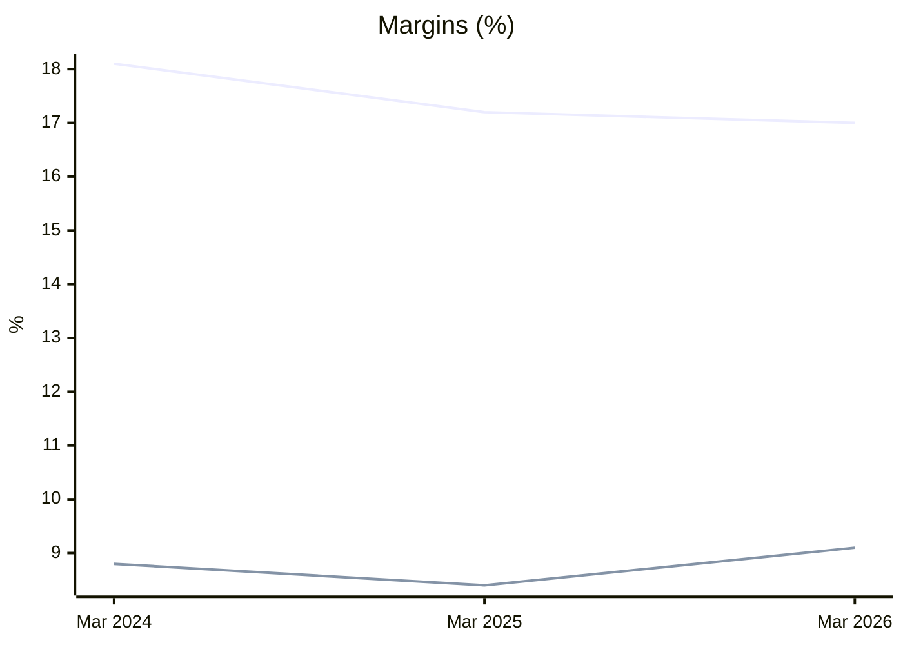

*Run 2026-11-24 · part of [SPINOFF_REPORT.md](../SPINOFF_REPORT.md) · the complete analysis of one company, with every management-call exchange in full.*

## RELIANCE — Reliance Industries Ltd.

### 1. Reliance Industries Ltd. — PARTIAL SPIN-OFF (subsidiary IPO)

**CONFIRMED** (partial spin-off — Jio Platforms Limited is listed since 2026-10-28) · **PARTIAL SPIN-OFF, LISTED <1Y — price the parent's stub against the listed piece** · score 5.0/10 · partial spin-off (subsidiary IPO) · 12 filing(s) from CALLS, NSE · first 2025-12-01, latest 2026-10-24

**The separated entities — every one the documents name:**

| Entity | Scheme | Business | Listing | Who runs it |
|---|---|---|---|---|
| **Jio Platforms Limited** | 2026 initial public offer of Jio Platforms Limited (fresh i… | Technology arm of Reliance; digital services and, through wholly owned subsidiary Reliance Jio Infocomm Limit… | listed 2026-10-28 as JPL (NSE) | "Shri. Akash M. Ambani, Managing Director, Jio Pl… |
| **Reliance Consumer Products Limited** (earlier Tira Beauty Limited) | 2025 composite scheme of arrangement among RRL, RRVL, RCPL … | Consumer Brands Business Undertaking demerged from RRVL — FMCG: beverages (Campa), daily essentials (Independ… | not stated | "Sh Ketan Mody, Executive Director, Reliance Cons… |

**The other parties to the scheme(s)** — not separated entities: Star Television Productions Limited — merged in — no shares for the parent's holders

**What is being separated, as the documents put it:** Consumer Brands (FMCG) business undertaking demerged from Reliance Retail Ventures Ltd into Tira Beauty Ltd, renamed Reliance Consumer Products Ltd — class `value_unlocking`.

### 2. Stages and dates

> **Listing:** PARTIAL SPIN-OFF, LISTED — Jio Platforms Limited trades since 2026-10-28 (NSE equity list); the parent keeps its remaining stake

| Date | Event | Source |
|---|---|---|
| 2024-08-30 | Stage reached: **nclt sanction** | [Updates](https://nsearchives.nseindia.in/corporate/RELIANCE_30082024192852_SE_30082024.pdf) |
| 2024-08-30 | NCLT order — Composite scheme among Viacom18 Media Private Limited, Digital18 Media Limited and Star India Private Limited | as stated: Filing dated August 30, 2024 — NCLT, Mumbai Bench order |
| 2024-11-14 | Effective date — Composite scheme among Viacom18, Digital18 and SIPL; same day, RIL acquired 63.16% of STPL and Paramount's 13.01% of Viacom18, and the FSDL stake was sold | as stated: Filing dated November 14, 2024 (Acquisition) and media release of the… |
| 2024-11-14 | Other — Scheme for merger of STPL with SIPL filed with NCLT, Mumbai bench and pending sanction (as disclosed) | as stated: Filing dated November 14, 2024 — "A scheme of arrangement for merger … |
| 2025-11-30 | Effective date — Merger of Star Television Productions Limited with Jiostar India Private Limited | as stated: Filing dated December 1, 2025 (Other Restructuring) — Jiostar informe… |
| 2025-12-01 | Stage reached: **effective** | [Other Restructuring](https://nsearchives.nseindia.com/corporate/kavinavora_01122025174049_RIL_011225.pdf) |
| 2025-12-01 | Effective date — 2025 composite scheme — RRL / RRVL / RCPL / New RCPL (Reliance Consumer Products Limited, formerly Tira Beauty Limited); RCPL stands dissolved the same date | as stated: Filing dated December 1, 2025 (Other Restructuring) — RRVL informed t… |
| 2026-06-19 | Board approval — Jio Platforms Limited | as stated: Filing dated June 19, 2026 — "Proposed Initial Public Offer of Jio Pl… |
| 2026-06-19 | DRHP filed — Jio Platforms Limited | as stated: Filing dated June 19, 2026; confirmed by filing dated October 14, 202… |
| 2026-08-28 | Stage reached: **exchange noc** | [Updates](https://nsearchives.nseindia.com/corporate/PVIVINMA_28082026183323_RIL_SE_28082026.pdf) |
| 2026-08-28 | SEBI observations — Jio Platforms Limited | as stated: Filing dated August 28, 2026 — "Observation Letter on the Draft Red H… |
| 2026-10-14 | Other — Jio Platforms Limited — Red Herring Prospectus filed with the Registrar of Companies, Gujarat at Ahmedabad; also the record date for Eligible RIL Shareholders | as stated: Filing dated October 14, 2026 — "Proposed Initial Public Offer of Jio… |
| 2026-10-19 | Other — Jio Platforms Limited — Anchor Investor Bidding Date | as stated: Filing dated October 14, 2026 |
| 2026-10-21 | IPO opened — Jio Platforms Limited | as stated: Filing dated October 14, 2026; confirmed by filing dated October 24, … |
| 2026-10-23 | Other — Jio Platforms Limited — IPO closed for subscription | as stated: Filing dated October 24, 2026 |
| 2026-10-24 | Other — Jio Platforms Limited — Issue Price finalised at ₹1,119 per equity share and Prospectus filed with the Registrar of Companies, Gujarat at Ahmedabad | as stated: Filing dated October 24, 2026 — "Initial Public Offer of Jio Platform… |
| 2026-10-28 | **Jio Platforms Limited** listed (JPL) | NSE equity list |

**The stages, as filed:** nclt sanction (2024-08-30) → effective (2025-12-01) → exchange noc (2026-08-28)

**The partial spin-off:** **Jio Platforms Limited** (subsidiary); IPO stage: listed; exchange: BSE Limited and National Stock Exchange of India Limited; NSE symbol JPL; timeline: per the October 14, 2026 filing, "The Anchor Investor Bidding Date is Monday, October 19, 2026. The IPO will open for subscription on Wednesday, October 21, 202.

> “JPL has today finalised the Issue Price (including the anchor investor issue price) at ₹1,119 per Equity Share of face value of ₹10 each and has also filed the Prospectus dated October 24, 2026 with t”

**Stated in the filings:** size hint: 16.4% of ebitda.

### 3. Size of the separated business beside the parent — is institutional selling likely?

**Reading: VERY LIKELY — the piece is under a tenth of the whole; index funds and large holders who receive it without choosing it tend to sell.**

| Entity | Stated turnover | Stated share of the whole | Segment revenue share | Market cap (₹ cr) | Share of combined market cap | Index member |
|---|---|---:|---:|---:|---:|---|
| Jio Platforms Limited | "the revenue for the year at Rs.1,46,085 Crores, which was … | — | 13.9% (FY2026) | 1,289,909 | 41.6% | no |
| Reliance Consumer Products Limited | "we closed our revenue of Rs.22,000 Crores in 2026 and for … | — | 2.1% (FY2026) | — | — | not listed |

*Stated figures are the documents' own (a turnover share, or the cost-of-acquisition split the company publishes for tax, which reflects relative value); the segment share is this business's revenue over the parent's sales, and the market-cap share is the entity's value over the entity plus the parent (parent ₹1,812,954 cr, NSE bhavcopy of 2026-11-13), both computed here.*

**The judge's read of selling pressure:** unlikely — No listing stated; shares allotted to shareholders of unlisted RRVL, with RIL retaining 83.56% — no index exclusion mechanism disclosed.

### 4. Insider ownership — share swap, promoters' holding, management incentives

**Share swap / entitlement, entity by entity:**

- **Jio Platforms Limited:** "Initial Public Offer by way of a fresh issue of up to 27,00,00,000 (Twenty seven crore) equity shares of face value of ₹10 each of Jio Platforms Limited (JPL), a subsidiary of the Company"; "JPL has today finalised the Issue Price (including the anchor investor issue price) at ₹1,119 per Equity Share of face value of ₹10 each"; reservations of up to Rs. 500 crore for Eligible Employees and up to Rs. 2,500 crore for Eligible RIL Shareholders; no offer for sale stated
- **Reliance Consumer Products Limited:** "New RCPL will allot 1 (one) fully paid-up equity share of Rs. 10 (Rupees ten only) each for every 2 (two) fully paid-up equity shares of Rs. 10 (Rupees ten only) each of RRVL, to the shareholders of RRVL"

**Promoters' holding, from the shareholding pattern:**

| Company | Promoters | FIIs | DIIs | Public | Quarter |
|---|---:|---:|---:|---:|---|
| Reliance Industries Ltd. (RELIANCE) | 50.44% | 16.67% | 21.62% | 11.08% | Sep 2026 |
| Jio Platforms Limited (JPL) | 64.48% | 32.54% | 0.7% | 2.28% | Oct 2026 |

*Source: screener.in shareholding pattern, stored under `ShareholdingPattern/NiftyTotalMarket/`. In a mirror demerger each shareholder holds the same proportion of the new company as of the parent on the record date.*

- **Promoters in the parent, per the documents:** not stated in the documents on file.
- **What the promoters will hold in the separated entity:** 2026 JPL IPO: not stated (the IPO is a fresh issue only; no promoter/RIL holding percentage after the issue is given). 2025 Consumer Brands demerger: "Upon allotment of equity shares as above, the entire pre-scheme paid-up share capital of New RCPL held by RRVL shall stand cancelled and reduced, without any consideration. Accordingly, New RCPL will become 83.56% direct subsidiary of the Company." 2024 composite scheme / JV: "Upon allotment of equity shares by SIPL under paragraphs (1)(d) and (2)(a), SIPL (the JV) is controlled by the Company and owned 16.34% by the Company, 46.82% by Viacom18 and 36.84% by Disney."
- **What a public shareholder receives:** 2026 JPL IPO — a reserved portion to bid for, not a share distribution: "The IPO includes reservation of equity shares of JPL (i) for a value not exceeding Rs. 500 crore for subscription by the Eligible Employees (as defined in the RHP); and (ii) for a value not exceeding Rs.2,500 crore for subscription by the Eligible RIL Shareholders, i.e., Individuals and HUFs (directly or in the name of karta) who are the public equity shareholders of the Company (excluding such persons who are not eligible to invest in the IPO under applicable laws, rules, regulations and guidelines), as on the date of the filing of the RHP by JPL, i.e., October 14, 2026." 2025 Consumer Brands demerger — shares go to RRVL's shareholders, not to RIL's shareholders: "New RCPL will allot 1 (one) fully paid-up equity share of Rs. 10 (Rupees ten only) each for every 2 (two) fully paid-up equity shares of Rs. 10 (Rupees ten only) each of RRVL, to the shareholders of RRVL." 2025 STPL merger and 2024 composite scheme — consideration shares went to RIL / Viacom18, not to public shareholders: "the Company will be allotted shares of SIPL as consideration for the merger."
- **Management incentives:** No stock option, RSU or SAR plan, grant treatment, exercise price or pricing date is stated in any document. The only employee-level terms disclosed are in the JPL IPO: "The IPO includes reservation of equity shares of JPL (i) for a value not exceeding Rs. 500 crore for subscription by the Eligible Employees (as defined in the RHP)" and "our disclosure dated October 14, 2026 intimating the Price Band, Employee Discount, and Minimum Bid Lot for the Initial Public Offer". On management changes at the entity being listed: "On the second question around management changes, right? Routine in nature. You all have seen Pankaj Pawar being involved with Jio pretty much from day one... He has been the MD of RJIL and the connectivity business for a fair bit of time and he was on the board of JPL as well and on the third one". Management or insider shareholding: not stated.
- **Insider actions around the separation:** No promoter or management buying, selling or pledging of the parent's shares, and no stated intent around the separation, is disclosed. Group-level transactions around the 2024 media JV are disclosed: "The Company has today, at around 3:01 p.m. (IST), acquired shares representing 63.16% of Star Television Productions Limited ("STPL") from the existing Disney shareholder of STPL, for a consideration of Rs. 211.59 crore."; "The Company has acquired Paramount Global's entire 13.01% of the diluted equity share capital in Viacom18 for a consideration of Rs. 4,286 crore."; "The Company invested Rs. 11,500 crore in SIPL and has been allotted 26,05,19,406 equity shares."; sale of the 65% FSDL stake by RIL and RISE to Viacom18 for Rs. 94.54 crore. On promoter interest: "The acquisition of shares of STPL is not a related party transaction and none of the Company's promoter / promoter group / group companies have any interest in the said transaction. No governmental or regulatory approvals were required for this transaction."
- **Insiders, per the checklist read:** Promoter holding not stated. New RCPL becomes an 83.56% direct subsidiary of RIL; RRVL shareholders get 1 New RCPL share per 2 RRVL shares. Ketan Mody is Executive Director, RCPL. · *option pricing date:* not stated

### 5. Why the demerger — point by point

The business being separated is Reliance's FMCG/consumer-brands arm, Reliance Consumer Products Ltd (RCPL) — Campa, Independence, Good Life, Ravalgaon/Toffeeman/Lotus, Velvette, Glimmer, Enzo, SIL, Maliban, Alan's, plus acquisitions Udhaiyam, Manna, Sosyo, Goodness Group and the Toni & Guy/Brylcreem/Badedas/Matey brands — which was carved out of Reliance Retail Ventures Ltd (RRVL) under a composite scheme effective 1 December 2025: the 'Consumer Brands Business Undertaking' was demerged from RRVL into Tira Beauty Ltd (renamed RCPL), the old RCPL was dissolved, RRVL shareholders received 1 new RCPL share for every 2 RRVL shares, and the new entity became an 83.56% direct subsidiary of RIL rather than a retail subsidiary. The only rationale management actually articulates is in the Chairman's 16 January 2026 statement: the consumer products vertical is 'progressing on its accelerated growth trajectory with a focused organizational structure' — i.e. a dedicated, directly-held vehicle for a business scaling far faster than retail (Q3 FY26 Rs 5,000 crore, +60% Y-o-Y; 9M FY26 Rs 15,000 crore; FY26 Rs 22,000 crore, 2x Y-o-Y; Q4 FY26 Rs 7,350 crore; Q1 FY27 Rs 8,600 crore, 2x; Campa Rs 4,700 crore and India's 4th largest CSD brand; Independence Rs 2,600 crore; beverages over Rs 6,000 crore; 3rd largest packaged water player; 5,000+ distributors, 3 million outlets, 40 export markets; target Rs 1 lakh crore by FY2030). The problem it visibly solves, though never stated as the reason, is mixing an only-breakeven, capex-hungry FMCG build-out (12 plants, integrated food parks, Kurnool and 'one of the largest beverage plants in Asia', edible-oil facility in West Bengal) into Reliance Retail's P&L: on every call since, management has had to strip RCPL out to show the underlying retail trend — Q3 FY26 8.1% reported, Q4 FY26 11% reported vs ~14% adjusted, Q1 FY27 7.4% reported vs 11.6% adjusted — while Ketan Mody confirms RCPL itself is only 'breakeven on EBITDA terms'. Two parallel separations run alongside it: the Jio Platforms IPO (DRHP 19 June 2026 for a fresh issue of up to 27 crore shares of Rs 10, SEBI observation 28 August 2026, RHP 14 October 2026, priced at Rs 1,119 on 24 October 2026, with Rs 500 crore reserved for employees and Rs 2,500 crore for individual/HUF RIL shareholders), and the carve-out of AI/data-centre activity into 'Reliance Intelligence'/RIL so that JPL stays asset-light — capex at RIL or Reliance Intelligence, service provision and products accessed by Jio under long-term leases. No investor, lender or partner is recorded as having asked for any of this; analysts' only questions on the demerger were for like-for-like revenue and EBITDA adjustments, and management expressly deferred the EBITDA impact to the next quarter.

**Point by point, with the source:**

1. The 1 Dec 2025 composite scheme demerged the Consumer Brands Business Undertaking from RRVL into Tira Beauty Ltd (renamed RCPL), dissolved the old RCPL, and paid RRVL shareholders 1 new RCPL share for every 2 RRVL shares. “in terms of the Scheme, as consideration for the demerger of the Consumer Brands Business Undertaking from RRVL to New RCPL, New RCPL will allot 1 (one) fully paid-up equity share of Rs. 10 (Rupees ten only) each for every 2 (two) fully paid-up equity shares of Rs. 10 (Rupees ten only) each of RRVL, to the shareholders of RRVL.” — *Scheme*
2. The structural outcome: FMCG stops being a retail subsidiary and becomes a business RIL owns directly at 83.56%, with the pre-scheme RRVL-held capital of the new entity cancelled. “Accordingly, New RCPL will become 83.56% direct subsidiary of the Company.” — *Scheme*
3. The only stated rationale anywhere in these documents: the Chairman frames the demerger as giving the consumer products vertical a focused organisational structure to support accelerated growth. “The demerger of consumer products business came into effect this quarter. With a broad and diverse product basket ranging from classic Indian brands to new age labels, the consumer products vertical is progressing on its accelerated growth trajectory with a focused organizational structure.” — *FILING 2026-01-16*
4. CFO V Srikanth confirmed the 1 December effective date and sized the separated business at over Rs 5,000 crore of quarterly turnover, growing 60% Y-o-Y — the growth differential versus retail's 8%. “On the FMCG side, the demerger happened on 1st December. And we are at more than 5,000 Crores of turnover, and this is 60% up on a year-on-year basis.” — *CALL Jan 2026*
5. Ketan Mody opened RCPL's first post-demerger section by stating the new ownership line (direct subsidiary of RIL, not of Reliance Retail), with 9M revenue of Rs 15,000 crore and four brands above Rs 1,000 crore. “So RCPL became the direct subsidiary of RIL from 1st December 2025.” — *CALL Jan 2026*
6. Asked by CLSA and Investec to quantify the EBITDA that left Reliance Retail with the demerger, Dinesh Taluja declined to give the number — the separation's margin arithmetic was never explained on the call. “We will have to wait for the next quarter.” — *CALL Jan 2026*
7. From Q4 FY26 the demerger became a permanent adjustment in retail's reported growth: 11% reported, ~14% ex-RCPL for the quarter and 12% for the year. “Now, if you recollect, RCPL business was demerged out in the last quarter adjusted for that, the growth is almost 14%, for the full year the growth is 12% and if you exclude RCPL demerger the growth would be even higher.” — *CALL Apr 2026*
8. RCPL began reporting through its own CFO with full-year scale figures — Rs 22,000 crore FY26 revenue (2x), Campa Rs 4,700 crore as India's 4th largest CSD brand, Independence Rs 2,600 crore, 12 plants, 5,000 distributors, 3 million outlets, 40 countries. “From an FMCG business perspective, we closed our revenue of Rs.22,000 Crores in 2026 and for the Q4 alone, we delivered a revenue of Rs.7350 Crores, both these are two times growth on the similar period for the last year.” — *CALL Apr 2026*
9. A full year of the demerger now creates a ~4 percentage point gap between retail's reported and underlying growth, the clearest evidence of the optics the separation changes. “In terms of topline growth, as you would recollect, RCPL business was demerged out on 1st of December. So Q1 had the full revenue. Adjusted for that, the underlying revenue growth is 11.6%. On a reported basis, the growth is 7.4%.” — *CALL Jul 2026*
10. The separated entity's own target is Rs 1 lakh crore of revenue by FY2030, with Q1 FY27 revenue of Rs 8,600 crore (2x) — but it is still only at EBITDA breakeven, with margins to come from scale and supply chain. “So, like we have announced, the target continues to kind of grow leadership in all categories and we have anyway announced the target is to kind of take this to Rs.1 lakh Crores on FY2030.” — *CALL Jul 2026*
11. Ketan Mody conceded RCPL earns essentially nothing today — i.e. a breakeven, market-share-focused business was removed from a retail P&L running at ~8% EBITDA margin. “EBITDA, I would put it across since the concentration there, yes, we are breakeven on EBITDA terms, but EBITDA will improve as a scale and all the supply chain is kind of put it across but yes, right now the concentration more on the market share” — *CALL Jul 2026*
12. Baseline before the separation: the same brands (Campa, Independence, Maliban, Ravalgaon) were reported as one line inside Reliance Retail, with no mention of any demerger or separate entity. “Consumer brands business continues to scale up very nicely. We are expanding our distribution network. The general trade revenues are growing at 250% plus on Y-o-Y basis.” — *CALL Oct 2024*
13. A second, explicitly-reasoned separation: AI/data-centre capex is placed in RIL / Reliance Intelligence while Jio buys capacity under long-term leases, keeping JPL asset-light ahead of its IPO. “Capex will be RIL or Reliance Intelligence. Service provision will be done by JPL; it will be asset-light service. Products will be developed by Reliance Intelligence, AI products and capex will be incurred there.” — *CALL Jan 2026*
14. Management clarified that the gigawatt-scale AI data centres (including the 168 MW Meta project at Jamnagar) sit outside Jio Platforms in the already-created intelligence entity. “So firstly, I would like to clarify that the AI data centers are not being done in Jio Platforms Limited. They are going to be part of the intelligence business, so RIL or the intelligence entity that has already been created.” — *CALL Apr 2026*
15. The Jio Platforms IPO (fresh issue of up to 27 crore Rs 10 shares) carved out reservations specifically for RIL's own individual shareholders and for employees — a partial separation that hands RIL holders direct access to the asset. “The IPO includes reservation of equity shares of JPL (i) for a value not exceeding Rs. 500 crore for subscription by the Eligible Employees (as defined in the RHP) ; and (ii) for a value not exceeding Rs.2,500 crore for subscription by the Eligible RIL Shareholders” — *FILING 2026-10-14*
16. The JPL listing was priced on 24 October 2026 after a 21–23 October book-build, putting an external price on the separated digital business. “JPL has today finalised the Issue Price (including the anchor investor issue price)  at ₹1,119  per Equity Share of face value of  ₹10 each  and has  also filed the Prospectus dated October 24, 2026  with the Registrar of Companies, Gujarat at Ahmedabad .” — *FILING 2026-10-24*
17. Context for separating consumer assets: S&P's upgrade to A- was credited to the rising share of less-cyclical consumer earnings, and RIL cited access to A-rated capital pools and tighter spreads. “They have focused on the fact that higher portion of our earnings are coming from less cyclical businesses, especially the consumer side.” — *CALL Jan 2026*

**How it evolved:** On the Oct 2024 call the consumer-brands business was still just a bullet inside Dinesh Taluja's retail section (general-trade revenue '250% plus' Y-o-Y) with no hint of separation. The 1 Dec 2025 scheme filings made it real — RCPL demerged out of RRVL into a directly held 83.56% RIL subsidiary — and on the 16 Jan 2026 call (Q3 FY26) RCPL got its own speaker (Ketan Mody), its own Rs 5,000 crore quarter, and the Chairman's 'focused organizational structure' line, while analysts (Investec's Harit Kapoor, CLSA's Vikash Jain) could only extract 'we will have to wait for the next quarter' on the margin impact. By 24 Apr 2026 RCPL presented through its own CFO (Ashutosh Goyal, FY26 Rs 22,000 crore) and retail growth was being quoted both reported and ex-demerger; by 17 Jul 2026 an RCPL Executive Director gave a Rs 1 lakh crore FY2030 ambition and admitted EBITDA breakeven. Over the same window the separation theme widened: AI data centres were explicitly moved out of JPL into Reliance Intelligence (Jan/Apr 2026 calls) and the JPL IPO moved from 'imminent' (Apr 2026) to DRHP (19 Jun 2026) to pricing at Rs 1,119 (24 Oct 2026).

**What management expects from it:** RCPL: a focused structure for accelerated growth to Rs 1 lakh crore by FY2030, with EBITDA rising from breakeven as capacity, food parks and supply chain scale. Retail: cleaner double-digit underlying growth plus ~8% margins, free to fund hyperlocal/digital commerce and double EBITDA in three years. RIL shareholders: direct 83.56%-held ownership and 1-for-2 shares; Jio stays asset-light with capex in Reliance Intelligence.

*Not explained on the calls:* No stated reason for separating rather than retaining RCPL, no RCPL margin, capex, funding or listing plan, no EBITDA quantification, no synergy loss, tax or governance discussion.

- *Stated reason, in one line:* Management says the demerger gives the consumer products vertical a 'focused organizational structure' on an 'accelerated growth trajectory'; no other reason is stated in the filings.
- *What it reveals:* A fast-scaling FMCG business previously buried in Retail: FY26 revenue Rs.22,000 crore (2x Y-o-Y), Q1 FY27 Rs.8,600 crore, Campa Rs.4,700 crore, Independence Rs.2,600 crore — but only 'breakeven on EBITDA terms', with a Rs.1 lakh crore FY2030 target.
- *Parent or spin:* parent · *Read next:* RCPL standalone EBITDA split that Dinesh Taluja deferred ('we will have to wait for the next quarter') and the composite scheme document
- *In their words:* “Further, in terms of the Scheme, as consideration for the demerger of the Consumer Brands Business Undertaking from RRVL to New RCPL, New RCPL will allot 1 (one) fully paid-up equity share of Rs. 10 (Rupees ten only) each for every 2 (two) fully paid-up equity shares of Rs. 10 (Rupees ten only) each of RRVL, to the shareholders of RRVL.”

### 6. On the calls, verbatim

14 call(s), oldest first: **0 question-and-answer exchange(s)** given in full — the question and every answer to it, nothing trimmed — and 18 passage(s) from management's prepared remarks (the complete sentences about it; the whole remarks are in the linked transcript). Text is as the transcript prints it.

#### Jan 2024 — [transcript](https://www.bseindia.com/stockinfo/AnnPdfOpen.aspx?Pname=de3e8ff3-efca-4266-9bc8-7509f48574a4.pdf)

**From the prepared remarks** *(the passage about it; the whole turn runs to 55,612 characters in the transcript)*

> **Regd. Office:** But as I mentioned, O2C has been stable EBITDA in a weak downstream market environment. We have done a lot to offset some of that market weakness by focusing on crude sourcing, by focusing on ethane cracking by placing more products in the domestic market. Oil and gas as I mentioned, higher volumes, helping deliver 50% increase. Retail very broad based and you know, grocery sal es up 41%, fashion and lifestyle up 28%, consumer electronics up 19%. On digital services, healthy subscriber growth and also improvement in the ARPU side and others reflect multiple factors across other businesses which have done well focus on costs, impl ementation to treasury income, all of them have helped deliver the other segment. On a sequential basis, barring O2C that I talked about you can see you can see a strong growth. On the oil and gas side, in the previous quarter we had we had costs related to field commissioning and decommissioning which is not there this quarter and so th at explains the jump there. […] Please note that at this point. We're not charging for our 5G services. And this is really coming out of the existing set of subscribers using the recharg ing on the LTE. Moving on to the financials, consolidated financials for Jio Platforms Ltd, we ended the quarter with Rs 27,700 crores of operating revenues. That's 11.3% year -on-year growth. EBITDA was close to Rs 14,000 crores . EBITDA margin improved to 50.4% and that's also been showing an increasing trend , and the Profit After Tax increase d to Rs 5,445 crore. […] Digital and New commerce continues to grow well and contributed 19% of our total revenues during the quarter, increase of 100 basis points on a y-o-y basis. We continue to invest in infrastructure, retail stores have increased by 9% on a y -o-y basis. We added 250+ stores during the quarter, our retail space stands at 72.9 million sq ft now, a 21% increase on a y -o-y basis. We continue to invest in infrastructu re upfront as well as backend infrastructure as well as the technology platforms to reach the length and depth of the country as well as provide consumers with a true omni channel experience, provide them a good shopping experience as the consumers are als o evolving. If you look at our key customer metrics, footfalls grew a healthy 40% y -o-y basis, our registered customer base grew by 25% and now stands at 293 million. Our total transactions grew 20% and crossed 300 million transactions. It came at 320 million during t he quarter. […] All the major consumption baskets did well, grocery grew at a 41% y -o-y growth. Fashion lifestyle grew at 28% on a y -o-y basis. And this is the context where on the apparel side the market has been weak and you will see it for the other players as well, but we have done exceedingly well. Consumer electronics grew 19% on a y -o-y basis. So healthy growth across on our larger consumption baskets, all our businesses are doing extremely well. We had a very good fe stival season. We saw good engagement from customers and healthy growth during the festival period across the businesses. […] We contin ue to invest in the platform to improve the product features, enhance during the quarters and the notable enhancements that w e did include the product search, returned doorstep delivery for fashion, and a lot of other interesting features and exciting features are in the pipeline. We continue to expand the catalogue and offer more explaining more options to our consumers. The op tion count was up 84% and the seller base was the up 3x on y -o-y basis and this growth will continue as we add more and more options to make it a truly horizontal platform. On the consumer brands business, we are excited about this business. It's showing very good growth. The revenue was up 3x on a y -o-y basis as well as we are increasing the distribution reach substantially. So, this is a business where it has a big advantag e in terms of in terms of our in -house channels as well as the B2B Kirana network that we have. 13 © Reliance Industries Limited 2020 In addition, we are building a broad distribution network to reach many Kiranas across the country as well as modern trade to build and grow these brands. […] We have got some very strong traction. We have set up a few stores across top tier cities and we continue to expand the network and we are getting very good response from customers. We signed up three celebrities to promote the brand. We have seen very strong brand recall and engagement from consumers on both our stores as well as online platforms. It is an experience discovery driven cat egory so offer a differentiated retail experience through larger formats and wider assortment. All our operating metrics including sales productivity, average Bill values, repeats, again engagement across brands, all of that are seeing good strong momentum, early days but we're very excited and seeing very good results in the initial days. We are al so including many new launches many new brands we are bringing to India some of the notable ones that we signed up for online as well as offline during the quarter are Laura Mercier, Allies of Skin and Blessed Moon. Moving on to our consumer electronics business – again had a pretty sustained 19% y -o-y growth. We see growth healthy growth in average values as well as the conversions are improving. The growth has been quite broad based across phones large appliances as well as TVs. In fact, we saw a strong surge in demand for a large screen TVs during t he World Cup so 55” and 65 inches TVs did very well. […] And overall, of course, the offset is the fact that domestic demand is remains resilient in line with the kind of economic activity that we're seei ng in India. So just to bring it together overall, while the environment was what it was , I think our focus has been an operational discipline and despite all the dynamics in all the markets, you know, done well to be where we are . Whenever I refer to operational discipline is when this across businesses and you saw Dinesh talking through each of the parameters in Retail. Overall, we do see a strong domestic demand, and this is in both consumer as well as energy market , so that's pretty positive for us. Overall O2C earnings , you know, is going to remain a bit volatile because of market disruptions, but I think overall, refining margins, given the context that I described is favorable in that sense for some of the cracks there. However, downstream margins do remain a bit 22 © Reliance Industries Limited 2020 pressured on the backdrop of feedstock prices being high as well as demand from China still being tepid . Overall , when you look at how we have seen look at revenue growth, you look at margin expansion, we are seeing it across our businesses .

#### Apr 2024 — [transcript](https://www.bseindia.com/stockinfo/AnnPdfOpen.aspx?Pname=06b05d06-8c38-4aee-aa5b-5e7108ae3871.pdf)

**From the prepared remarks** *(the passage about it; the whole turn runs to 54,868 characters in the transcript)*

> **Regd. Office:** On a standalone basi s if you were to look , JPL and RRVL at this level, you know , would be among the top 20 and top 30 companies respectively. Looking at FY 20 23-24, our EBITDA is at ■ 1, 79,000 crore up 16% YoY. We delivered a net profit of ■ 79,000 crore , up 7.3% YoY. When you look at our consumer business, EBIDTA now close to ■ 80,000 crore which is up almost 17% YoY. 5 -year CAGR for consumer business at 30%. And this has been enabled on the back of larger physical - digital footprint , 3 © Reliance Industries Limited 2020 increase in footfalls , increase in the number of transactions , increase in the number of registered subscribers. On 5 G, it is on the back of a higher customer engagement in 5 G rollout and FTTH penetration. Highlight also has been resilient O2C performance , given what we are seeing on cracks. […] Even though P BT was up 11.4% because, as you may recall in that last year, we did avail of tax credits that were available and now we are back to normal tax. This is the bridge on EBIDTA contribution , really led by oil and gas on volumes , retail because of categories and margin expansion , Digital Services on the back of strong subscriber growth and operating leverage, and others really reflect contributions from other businesses , higher treasury income and the focus on cost which has helped us reduce some of the unallo cable expenses. Moving to the 4Q numbers standalone … EBITDA at ■ 47,150 crore, u p 14% and net profit of ■ 21,243 crore which is really flat on a YoY basis. And as I was mentioning, revenue is up because we saw double digit growth in both O 2C and consumer business . EBITDA , we have seen contribution from across businesses and p articularly big growth in KG D6 related EBITDA . Overall net profit was muted only because of the fact that we have availed a lot of tax credits , particularly in the fourth quarter of last year. However, when you see the QoQ, you can see there is a sharp increase and that is primarily coming because of O2C where p ost maintenance and inspection , we saw an increase in volumes. […] And the EBITDA came in at close to Rs 53,000 crores. Growth of 12.4% year -on-year. So almost a hundred basis points increase in margins through this period. Moving on to Jio Platforms Limited. The operating revenue for the quarter for Jio Platforms Limited at a consolidated level came in at Rs 28,871 crores and EBITDA at Rs 14,360 crores and PAT at Rs 5,583 crores. Looking at the full year for JPL revenue, operating revenue of 10 © Reliance Industries Limited 2020 Rs 1,09,558 crores and EBITDA close to Rs 55,000 crores. At an EBITDA margin of little over 50%. The profit after tax came in at Rs 21,423 crores. […] Our overall revenues grew 18% on a Y -o-Y basis and 11% on a Q -o-Q basis. So rry, on a 18% for the year and 11% for the quarter on a Y-o-Y basis. In terms of segmental growth, the growth for grocery for FY ’24 was the highest at about 31%. Fashion lifestyle grew by about 23% and consumer electronics grew by about 18%. Our EBITDA margins continue to expand. For the full year, the EBITDA from operations was at 8.1% , which is a 50 -basis points Y -o-Y growth. For the quarter , it was 8.3% , which is a 60 - basis point year -on-year growth. […] So healthy growth in all the financial metrics. Moving on to some of the key highlights across the various business segments , on Electronics, a consistent trend that we have been seeing and disclosing in the last few quarters is growth in average bill values as well as improving convergence. So, what we see is people are spending more on mobile phones, AC s etc. On consumer durables . So that is showing a healthy growth in average bill values, which is driving the growth for this business. We saw pretty strong sales in ACs, summers came in March and that t rend continues. We had the Digital India sales event, which saw 15% Y -o-Y growth in sales. Across categories, whether it is mobile phones, whether it is consumer durables , the growth is quite robust. resQ, which is a key differentiator , continues to expand its service network. We opened 24 new centres during the quarter . We have over 1 ,000 centres overall across the length and breadth of the country. And we serve 1.2 million customers with the resQ offering. […] But for the first time , we saw that the sale during the pre -Holi period was very strong in few markets , and that is driven by probably the regional insights we have on the assortment as well as the communication that we do regionally and that’s where local influencers, digital market ing – we are able to communicate digitally to the right customer segment in a localised manner, helps a lot. We are also focussing on growing new categories . So, for example international food, body mist, serums, these are some of the new categories which are growing very well. As consumer preferences are changing , we continue to refine our assortment, our merchandising strategy so that we catch the new trends and are able to attract customers to our stores with what they are looking for, which are new options as well in addition to what they are used to buying. On our B2B Metro business , we continue to see good traction. The Metro Kirana Utsav, a key event which we executed during the quarter to drive onboarding of new kiranas as well as in addition to growing the Kirana business , we are also focusing on growing the Ho ReCa segment , which provides a very large opportunity that varies from you know small restaurants to large hotel chains. There is a wide opportunity which is there in the HoReCa segment as well which we are looking to tap. 14 © Reliance Industries Limited 2020 On JioMart again, this is something that we've talked about in the last few quarters, our focus has been on improving the average order values, which were 30% on a year -on-year basis, as well as an increase in the number of units per order, which is up 37% on a Y -o-Y basis. […] These events act as good points to acquire new customers as well as get them to try new categories , to get them to buy more from us , we use a lot of basket builder initiatives , to drive growth in customer engagement as well as new categories during these events. We also continued to enhance the functionalities of the platform to improve the shopping experience for the customers. So, ‘Buy Again’ is one widget which we launched during the quarter, we also have customer ratings for products so independent customer ratings, which is available on the platform and incentivi se customers to provide genuine reviews. The consumer brands business , which is one of our newer businesses last year , was the first full year of operations. The business continues to scale up nicely. We had a 3x Y -o-Y growth in in general trade channel in addition to selling through the network of our stores and our B2B network. You would have seen a lot of new brands and new products getting launched from a consumer brands business. Two key brands that we launched last year were , Campa in the beverages space and Independence in the staples space . Both of them had very strong traction and got very strong customer acceptance. The products were liked by the customers and the price points are quite attractive. […] We launched several new products during the quarter. We launched an energy drink called Campa Runner. We launched Necto , which is an aerated beverage. We also launched brewed tea, which is a growing category and has substantial potential , and there are a lot of other substantial , other interesting products in the pipeline as well. 15 © Reliance Industries Limited 2020 Acquisitions and partnerships continue to be a core part of our strategy for our consumer brands business. During the quarter , we completed the acquisition of IP rights and trade including trademarks and a recipe for Ravalgaon, as many of you may recollect at one point in time they had a very well -known confectionery brand, and they still do, we did some research and realised that these brands still have a very strong brand recall amongst consumers. So, we acquired the se brands, as well as the recipes , and this will be a key part of our confectionery strategy. We have also partnered with Elephant House of Sri Lanka . […] Almost mirrored, when you look at it from a quarter -on-quarter point of view. And, you know, gasoline, obviously led by the trends in persona l mobility, diesel on the back of demand for agri as well as mining activities, industrial activities, growth and ATF on the back of passenger traffic, and you can see that passenger traffic at 39 million passengers is up about 4.5% year -on-year. 19 © Reliance Industries Limited 2020 On the polymer side again looking at the lower part of the box. This is what I was referring to year-on-year growth in Polymer up 14% of which PE has been very strong 20% PP and PVC also have been about 9%. and we have seen this trend about demand for PE c oming on the back of infrastructure pipes and also the packaging sector, be it FMCG and retail. PP is up on the back of demand for consumer durables, automotive and household appliances. PVC up driven by agriculture and infrastructure and a lot of government projects and that's something that people have seen in the quarter -on-quarter basis. The aber ration in PVC is really more to do with the fact that the same time in fourth quarter FY23 there were significantly higher imports because as EDC prices collapsed in the US and there was a lot of reports, but other than that, you can see that PE and PP gre w by 6% and 7% respectively. Po lyester side again lower part of the box 4% growth led by PET, and you know, the beverage segment has been doing well. […] ATF has moderated in line with gasoil cracks and the fact that there is a continuing recovery in global oil travel has also kept the cracks well supported. Yet the takeaway from this slide is the fact that production me ant for sale went up from 16.4 to 17.2, as we came out of major M&I activity in the last quarter. The other points clearly you can see, focus has been on crude and ethane sourcing, focus on dom estic fuel sales, optimization of gasoline versus PX, focus on gasoline in the US markets and really sustaining our gasifier operations so that we have very minimal dependence on LNG sourcing. 21 © Reliance Industries Limited 2020 So, the broad dynamics here when you look at it the point being that oil demand still in 24 is expected to be 1.2 million barrels per day and it is coming after growth of 2.3 that we saw in 23. The domestic demand continues to be strong for fuel and downstream chemicals, given the emphasis on infra, mobility being there, and you know, the whole consumer sentiment leading to buoyancy. The gasoline cracks, we think, is expected to be supported by s trong seasonal demand, the fact that there is lower inventory. Middle distillates likely to remain firm given the disruptions and refinery vulnerability in conflict zones. And downstream chemical margins are expected to recover gradually with a slowing pace of capacity addition. […] Yeah, just to summarize. You are seeing the operating performance, very strong, very robust. On the back of strong execution, we have doubled our EBITDA in five -year period. Consumer EBITDA particularly is up 4x in the same period, and when you think about each of the businesses, in our minds there is strong visibility of continuing growth trajectory, as well as, overall, when you put the numbers together our earnings it does show very, very subdued volatility, when you look at the whole portfolio, take the portfolio as a whole on the energy business for us, the next phase will be led more by India -centric capacity expansion, the final change we have talked about, customer -centricity the whole focus there and circularity, our 22 © Reliance Industries Limited 2020 focus on green energy investment involves integrated managing ecosystem and the ability to deliver round -the-clock (RTC) power. With lower cost as well as least amount of volatility and as far as energy costs are concerned. KGD6, coming in at the right time providing valuable transition fuel for the economy. On the Retail and Jio side, we have a clear -cut strategy as some aspects t hat Kiran talked about.

#### Jul 2024 — [transcript](https://www.bseindia.com/stockinfo/AnnPdfOpen.aspx?Pname=191e6ab9-4751-4017-ba5f-bb63daf2d871.pdf)

**From the prepared remarks** *(the passage about it; the whole turn runs to 43,035 characters in the transcript)*

> **Regd. Office:** Over to you Srikanth. Sh V Srikanth 00:00: 36 – 00:09:44 (Consolidated Financials) Thanks Srini and Good evening to all of you. Starting with the performance, EBITDA at Rs 42,748 crore up 2% year -on-year. It’s important for me to say that the growth in consumer business and strong upstream offset weak 02C . On retail we have seen a growth led by grocery and consumer electronics and improvements in their overall customer engagement as well as some contribution from digital channels . On digital side benefits coming from healthy subsc riber addition and increasing FTTH penetration . Overall , on the O2C side we will see it later , but you know clearly declining fuel cracks and challenging downstream margin environment. In oil and gas led by high volumes which was offset little bit by lower price realization. For us the diversified portfolio helped deliver this performance, with consumer being more than half of the overall earnings. Specifically on retail you can see revenues at almost Rs 76,000 crores , EBITDA about Rs. 5,700 crores they add up about 8% and about 10 .5%. Overall, PAT at Rs 2,549 crore up close to 5% and you can see some of the operational metrics like footfall 296 million up 19% registered customer base at 316 million up 18%. When you look at revenue and EBITDA growth it includes the fact that we had a strong consumer electronics business growth specifically ACs and refrigerators and TV. We also had strong performance in grocery stores some of the sales that we did show, high traction with almost 30% year -on-year growth. 3 © Reliance Industries Limited 2020 However, in t erms of fashion and lifestyle it was much more tepid with distribution in demand being lower there so that in some sense, that was the vis-a-vis consumer electronics and grocery was on the lower side. The revenue and EBITDA growth also covers for the fact that, you know, there's a streamlining of operations with focus on margin improvement and as you can see year-on-year, there has been an improvement of margin by almost 30 basis points to 8.5% . Also, while the gross sides (store adds) were at 331 stores you can see the net adds were about 82 stores . So, also the performance it covers for the fact that you know, we continue to focus on enhancing the tech platform, focus on supply chain and distribution. […] Overall, we now have gas of almost 29 MMSCMD it was used to be 2 0 MMSCMD same time last year and oil condensate production of almost 22,000 barrels per day. This is the overall financial results as I was highlighting , revenue at Rs. 2,58,000 crores up 11.5% as you know, both because of O 2C revenues being higher because oil prices were much higher than what it was year back. Also, it is on the back of growth of retail. EBITDA, we spoke about overall growth of 2% with consumer businesses more than offsetting the sharp reduction in O 2C performance given the broader operating context. And therefore, you can see the translation coming to terms of PAT at Rs 17,500 crore which is lower by 4.5% on year-on-year basis . Just the bridge when you see a year -on-year comparison, I talked about cracks, gasoline PE, PP polyester cha in being lower. I talked about oil and gas be nefiting from higher volume but to some extent offset by lower price the re, retail benefiting from store expansion and increasing footfall s, digital side benefiting from customer add of 41 billion year -on-year and the fact that people are using more 33% increase in data traffic now per user per month is almost 30 GB per customer. […] So not in the previous quarter. The impact wi ll only be seen starting this quarter. The tariff increase, you know, across the industry was in the 13% to 25% rate. But what we've done is for the JioBharat and the Jio Phone, which are the entry -level devices which really are focused towards our aim of 2 G Muk Bharat, and really transitioning all of the subscribers onto digital services and digital platforms, which is a n aim that we have got a for them. There has been no change in tariff. In addition, for the 5G experience that we are currently offering is still available at no additional cost to subscribers who have subscribed to certain plans, and this is to encourage 5G consumption on the network and people to adopt more and more of 5G services. We expect, as was on expected lines post tariff increase. […] For reasons that I already spoke about. The 5G consumption uptick has driven data consumption to 30.3 GB per user per month. That's more than a GB per user per day. You know something that we used to speak about when we had just about started , that consumer should be consuming more than a GB of data per day. And the voice traffic also continues to be healthy. So, all of the business KPIs or the operating KPIs going healthily. Moving on to the RJIL financials. […] That was a 10.1% YoY increase. And the EBITDA went up to Rs. 14,022 crores at an EBITDA margin of 53%. So , the margins have kept on constantly, steadily improving, and fairly consistent performance on this front. Moving on to the consolidated financials for Jio Platforms Limited, the operating revenues for the quarter came in at Rs. 29,449 crores. That was a 12.8% YoY growth. The EBITDA was at Rs. 14,638 crores and EBITDA margin was 49.7%. Profit After Tax increased to Rs 5,693 crore, again around 11.7% YoY increase. […] The net addition was at 82 for the quarter and the total store count stands at 18,918, with a total area of at 81.3 million square feet. We continue to make enhancements to our technology platform, our supply chain capabilities, our distribution capabilities; all of these are, are putting us in a good position to sustain the growth momentum in the near and medium term. We’ve covered this – revenue growth of 8% at Rs. 75,615 crores, EBITDA Rs. 5,664 crores at 10% growth, and Profit After Tax at Rs. 2, 549 crores. Moving on to the highlights for each of the consumption baskets, the consumer electronics business had healthy growth on average bill values as well as growth in customer walk -ins. Our digital stores continue to deliver steady growth with high percentage L FL growth. We had a really hot summer, so the growth in summer season was driven by ACs and refrigerators, plus we had Cricket World Cup and IPL which drove the demand for TVs. ResQ, which is our services business: We launched 50+ new centres during the quarter. […] JioMart: the focus has been on enhancing the economics by increasing average order values, which were up 16% on a YOY basis. As you are aware, it started as a grocery platform, but over the last 18 months, we've kind of we've been working on a growing it a s a multi -category horizontal platform, and towards that objective the non -grocery categories, both 1P as well as 3P, continue to do well. Electronics, which is a key category after grocery, had a 50% growth on a on YOY basis. We continue to add new options as well as the seller base to expand options which are available to the consumer so that they have a wide choice when they when they come to the platform. We're also leveraging our hyperlocal presence for customer acquisition and target them for grocery and cross -sell other categories through targeted interventions. We have a big advantage with our pan -India store network compared to any of the other online players who spend a lot on customer acquisition. We are able to take very targeted initiatives and create customer stickiness through an omni -channel offering. We continue to improve our platform and add new functionalities. It's an ongoing endeavour to enhance the experience of the consumers. And we added some interesting options during the quarter , for example, you know if you have SKUs with multiple weights, there's a weight 12 © Reliance Industries Limited 2020 drop down based on which the customer can just select what weight of that category they want. Next, our consumer brands business which is one of our newer businesses continues to get very strong traction in the market. We now have multi -category presence across beverages, staples, home and personal care, processed food etc. And across categories we have been launching new products as well as we have been expanding our presence in the in the general trade channel, which delivered for 150% Y-o-Y growth while the business has a big advantage of leveraging our own store network as well as the b2b channe l which we have. But we are also taking these brands into general trade and they're getting very strong traction there. […] The idea is to have an expanded portfolio at attractive price points. And there are multiple pilots underway so across different categories , so you'll see a host of product launches in the coming quarters which will further enhance our product portfolio. We are also investing in strengthening the supply chain across categories through partnering with different players so that we have loca lised supply chain which will give us a big cost advantage over other FMCG companies. That's it for consumer brands. We can move on to the Oil & Gas section. Sh Sanjay Roy 00:32:50 – 00:37:13 (Hydrocarbons - Exploration & Production) Thanks Dinesh . Good evening, everyone. […] Fairly healthy growth in oil demand in India . On the polyester side , 8% growth in polymer to 5% growth in polyester . Polymer growth was really led by PVC benefiting from all the government schemes on agriculture and infrastructure . Polypropylene was specifically consumer durables and food packaging that we saw in automotive demand. On the overall polyester side, big jump 27% in P ET on the back of summer and also the fact that it was election. So, you saw that kind of surge in demand . In PSF 9% was driven by the fact that we did see downstream operating rates improve and therefore , by definition the PSF volumes went up because of fabric exports , but on the other side polyester filament yarn we saw a fall of 4% because of fabric imports. […] Going forward , it is not very obvious that there will be surges in this kind of c apacity increase, so we'll have to wait and watch there. Overall, that is really some of the thought process saying that structurally refining looks strong. Just to summarize, it has been a strong operating quarter. Consumer businesses and upstream fully negating the impact of a weak O2C. Over all, as I was highlighting , fuel markets are likely to remain supported by seasonal demand drivers for gasoline . For ATF demand also because of weather and, geopolitical disruption . So, these things have an impact on the overall price and deltas. 17 © Reliance Industries Limited 2020 The fact that there is strong demand for India helps , and also the fact that, you know, thanks to a fairly integrated O 2C operation, we can leverage that kind of integration there. On the consumer side , we are strengthening our market leadership in structurally long-term growth business. Dinesh talked about the whole focus on tech platform , on supply chain and distribution. All this is to support sustain growth momentum in both near and medium term . On Jio side, clearly the traction t hat we are seeing in home and enterprises , and the fact that the impact of revised tariffs will start getting reflected in the coming quarters.

#### Oct 2024 — [transcript](https://www.bseindia.com/stockinfo/AnnPdfOpen.aspx?Pname=0e6309fa-450f-4db6-88b2-d76d9a3ff756.pdf)

**From the prepared remarks** *(the passage about it; the whole turn runs to 53,439 characters in the transcript)*

> **Regd. Office:** So that's really what we are doing. Also, we are strengthening our portfolio in AJIO through new brand launches - ASOS, H&M, Timberland. Also, we are scaling up our ‘Y ousta’ format, and we have now scaled it up to 50 stores, and you will see more rapid growth in this format. Our focus on strengthening of tech platforms, infrastructure, the streamlining of o perations, as well as having a calibrated approach in B2B, is expected to work its way in the next couple of quarters. Post that we expect to revert to our industry leading growth momentum, as can be seen even in this quarter, because if you see the operat ional parameters, footfalls are up 14 .2%, customer base is up 16 .4%, area and square feet at 79 .4 million is up at 11%, number of transactions are higher. So, we do expect this to work its way out in the next two quarters and then come back to the kind of growth rates that I talked about. On the digital services side, revenue and EBITDA up 18% and benefiting from broader scaling up of digital services and also partial impact of the tariff hike and we continue to add to customers overall slide churn that we saw in this quarter, but nothing u nusual, in fact, lower than what we have seen in the past, when there has been a tariff hike. […] And our target now, the next target that we have is to add nearly 1 million homes every given month. So that is the pace at which we are able to grow our hom e broadband service thanks to Jio AirFiber. When it comes to the in home experience itself, now we have a great product called Jio TV+, which was a unified experience to discover all of the OTT services which are available, especially on the Jio Set Top Box, so that from a single interface, users ca n discover and 8 © Reliance Industries Limited 2020 consume all their favourite shows and movies and so on, without having to search and jump across multiple apps and so on. So, this particular service, which was till now on the Jio Set Top Box and a very well -loved offering, we have now also enabled that t o be available on other smart TV platforms. So, what that means is that if you are a JioFiber or Jio AirFiber customer, then the same Jio TV+ application which is available on the Set Top Box is now also available for additional televisions that you may ha ve in your home without requiring an additional Set Top Box or an additional connection. So, it just becomes an additional app that you can download on your smart TV without having to take additional efforts to enable that to happen. So, what that means is , by just getting one connection, you are able to enjoy the Jio TV+ experience and all the OTT content that you are able to enjoy not just in the primary TV, which is connected to the Jio Set Top Box, but also across additional TVs in the home. […] Moving to the RJIL financials, as you can see, quite a large increase in this quarter after some steady growth consistently over the previous few quarters. The RJIL operating revenue grew 14.5% year on year and the EBITDA increased to Rs. 15,225 crore s at an EBITDA margin of 53.7%. And that's also been steadily increasing. Moving on to the JPL, the Jio Platforms Ltd consolidated financials, Operating Revenue for the quarter came in at Rs. 31,709 crores and the EBITDA at Rs. 15,931 crores. The consolidated EBITDA margin is also slightly above 50%. The Profit After Tax increased to Rs. 6,536 crores. That was a healthy 23% year -on-year increase in Profit After Tax. […] While all our categories are present on the platform, to fill any gaps and provide consumers the widest choice, we continue to add external sellers onto the platform as well. The option count was up 13% on a Y -o-Y basis. 15 © Reliance Industries Limited 2020 Milk basket, which is a premium subscription service continues to deliver steady growth as we expand and go deeper in the geographies that we are in, and drive higher AOVs, higher share of FMCG categories in our orders. So that's something that that's work ing well for us. Consumer brands business continues to scale up very nicely. We are expanding our distribution network. The general trade revenues are growing at 250% plus on Y -o-Y basis. We continue to launch new products. […] It’s been resilient earnings. You know, overall, when you see strong upstream and Digital Services largely offset by muted O2C earnings here, and clearly when you see from a cashflow point of view, it remains strong, and the balance sh eet and liquidity continue to be strong. On the overall energy business side, you know, price and margin volatility on the back of geopolitics is a continuing theme that we have been talking about, and some of the drivers of 20 © Reliance Industries Limited 2020 demand can come on the back of some of the actions on economic stimulus, as well as monetary policies stimulus. And on the consumer side, the focus on, of course, as Dinesh talked about the upcoming festive season, demand has at least started off well. And our own focus is on strengthening of operations that I talked about. Overall, all of them are on the tech platforms, the streamlining their calibrated approach to B - to-B. So as the underlying thematic of the business continues to be well, but for the next one or two quarters it could be a little bit more volatile. As all th ese actions work its way in the next couple of quarters, post that you can see the whole. We expect it to revert back to the industry leading momentum that we have seen.

#### Jan 2025 — [transcript](https://www.bseindia.com/stockinfo/AnnPdfOpen.aspx?Pname=89c33a3e-5683-4a1d-b8f9-1952ff4df63f.pdf)

**From the prepared remarks** *(the passage about it; the whole turn runs to 56,945 characters in the transcript)*

> **Trading Symbol:** Srikanth 00:00: 41 – 00:07:17 (Consolidated Financials) Thank you, Srini, and Happy New Year to everyone. We had a good operati ng quarter with strong performances in each of our segments. Revenue growth, EBITDA growth at close to 8%, and PAT (Profit After Tax) growth close to 12%. And specifically, the consumer businesses did well and so did O2C. We had strong sequential performance in fact, if you were to look at EBITDA on an aggregate basis, sequentially up 9%, retail was up 17% sequentially, O2C was up 16% sequentially. So, stron g improvement there and in each of the businesses, retail and we will go through the slides, but it’s on the back of strong festive season and good traction with our customers . On Jio, the story is about higher ARPU, and the fact that we are adding consumers, especially in FTTH. […] And also, that 5G customer base is now 170 million. On retail side, revenue , EBITDA and PAT grew between 9 -10%, and as I mentioned, very strong sequential performance with revenues up actually on a sequential basis 18% and EBITDA about 17%. We obviously benefitted from an exceptionally strong festive season demand. And as you may recall, we have been talking about significant efforts over the past few quarters in terms of streamlining our operations and the benefit out of that, and the productivity gains that have come out, especially when you look at g rocery , if you look at B2C that’s a 37% growth, and also benefiting from very strong traction in our consumer brands. In fashion and lifestyle, we saw a very strong rebound with some of our new formats, delivering the highest ever sales. Digital again benefited from the festive and wedding season and EBITDA margin continue to expand at 8.6%. It’s up 20 basis points on a y ear-on-year basis. […] And this story will continue to unfold into the future. And more interestingly, thanks to the fact that we have this superlative True 5G network, which is a big differentiato r vis-à-vis other competitors, also means that any new 5G device that is sold in the market, 70% of them end up becoming a Jio customer and using Jio services. So literally, I think we are at the cusp where probably in a very short period of time we'll be able to say that probably one of the fastest 5G rollouts, not only 5G rollouts, but 5G adoption anywhere in the world, the total 5G traffic on our network will surpass the 4G traffic very, very shortly. Now, it is not just in the consumer side. We have also been briefing all of you over the last few quarters about True 5G , also powering something called Jio AirFiber . So, if you look at the pie chart on the left, what is heartening is that the availability of AirFiber has really opened up demand, unlocked demand or pent-up demand from beyond what we call the top thousand cities and towns of India. And what we are seeing is that as you know, nearly 70% of the population of the country is outside of what we call the cities or the urban markets. […] So very excited by that. Internally I think we are seeing already multiple use cases where we are starting to weave that AI story across our operating companies in the Reliance Group. And of course, on the back of whatever we are doing here, eventually we will be then looking to offer this as a platform even for other enterprises in India. And if you are looking at what other offerings beyond the platform play, what are the offerings we are looking to take to market across the board , all of the consumer and small businesses and enterprise offerings that we're already providing in the market, all of them will see a lift thanks to the adoption of AI within all of those applications as well through multiple use cases. Looking at some of the AI related, not just AI, but across the board comprehensive suite of offerings that we unveiled in the India Mobile Congress 2024, which happened over the last quarter, I think building on the AI theme, a platform called JioBrain, which is really the plumbing on top of which we are able to rapidly spin up all of these AI use cases that I spoke about that was unveiled and showcased. We made an announcement and now it is available through a beta offering called AI Cloud , which is again an offering for the consumer. So that was also announced and showcased and now taking compute into the homes, which has always been an underserved market, again partly because homes are not connected, but partly also because of the high cost of having personal computers in the home. So now we showcased a solution called JioCloud PC which is effectively, and I'll talk about that in a slide shortly, but effectively a very low cost and pay as you go. Capability of having a personal computer, evergreen personal computer never needed to be upgraded, always the latest specs and pay as you go. […] So, some updates that I had, and I'll just hand it over to now Ans human to talk about both the operational and financial numbers for the quarter. Sh Anshuman Thakur 00:21:30 – 00:26:52 (Digital Services - Financials) Thanks everyone. A very happy new year. Coming to the quarterly highlights, both combination of tariff hike as well as scale up of some of the digital platforms and improving customer mix resulted in our operating revenues growing at 19.4% year on year going up to 33,074 crores. Corresponding in crease in EBITDA as well at 18.8% year on year, 16,585 crores. So fairly healthy quarter, combination of a lot of things going on there and some of the digital revenues just about kicking in. Subscriber 10 © Reliance Industries Limited 2020 base at 482.1 million. […] That was a 15.5% year on year increase and the 11 © Reliance Industries Limited 2020 EBITDA growing a little bit faster coming to 15,798 crores. The EBITDA margin at 53.9%. This is only for the connectivity business RJIL, the connectivity service provider. And coming to the Key Financials for Jio Platforms Limited Consolidated Financials, the overall Q3 revenues came in at 33,074 crores, 19.4% year on year growth. We are seeing a very healthy increase in non-connectivity . The digital revenues which grew at 60% year on year. The annualized run rate has crossed 15,000 crores and this we are seeing very healthy growth trend here coming in with most of the growth coming in from new customers that we are able to serve. […] They are the amongst the leading brands in their respective categories, and they do drive a lot of footfalls in our stores . AJIO Business, the focus has been on , you know, improving the economics and improving the Average Bill Values and premiumize the offering. So that continues to do well. We have amongst the highest average bill values amongst all the online fashion platforms in the country. The Average Bill Value was up 7% on Y -o-Y basis. We added almost 2 million customers during the quarter. We continue to expand our catalogue , and we added over half a million options just in the first nine months of this year. The total catalogue now stands at 2.2 million . In this you know, you have to provide customers a wide range as well as exc lusive, exclusive brands. So, most of our own br ands that we have, whether the partner brands or our in-house brands, they're exclusive on the platform, and they do provide us a differentiation as well as better economics compared to other platforms, because if the customer has to buy, he has to come on to these platforms. We've also launched a bunch of new brands. There were 38 international brands and a host of other national brands, which were launched during the quarter. ON, Forever 21 and Saucony being some of the few. […] We continue to add 3P sellers , so we can offer the entire range to the to the customers, and we continue to add new sellers onto the platform. And there was a big push on the Festival event to acquire customers, as well as push new categories. And you know, during the festival season, we saw one and a half x growth in GMV during that period. Consumer brand business is scaling up exponentially . In the nine months FY 25 – this is our FMCG busin ess – we had revenues upward of Rs 8000 crores. Two of our most prominent brands Campa and Independence, t hey continue to gain traction. Each one of them individually should cross Rs 1000 crores turn over in FY25 . Campa has already gain ed 10% market share in the sparkly beverage category in select sta tes. The focus here is three pronged expand distribution in the priority states, strengthen our product portfolio through innovative products and partnerships, products which are meant for the Indian market, for the Indian consumer, that differentiates us from competition, as well as build a robust supply chain, where I can have the widest presence at the lower supply chain cost. Now that we also have a critical presence in terms of distribution and supply chain, we are also starting to invest in marketing and promotions to really create brand salience, which will accelerate the presence of this business even further. 16 © Reliance Industries Limited 2020 So, all in all, a very strong quarter, I think the business is well positioned. There are several businesses doing exceedingly well, and we're optimistic that going forward, quarter on quarter, we shou ld show healthy growth, coupled with all the, you know, all the productivity improvements that we've done. I think we are well positioned in the coming quarters. […] So, for us, the benefit has come because of higher use of the assets that we had. And we tried to maximize light feed cracking so as to keep the margins there. Near term demand continues to be good for PE , when you look at demand for packaging and the broader overhang of incremental global capacity additions will continue to weigh on. 20 © Reliance Industries Limited 2020 PP deltas were up 9%. Domestic demand, pretty strong, 16% growth that we saw across consumer durables, packaging. We benefited, this time from improved asset availability, and from a near term point of view, the upcoming expansions on BOPP films will suppo rt demand for PP. PVC, delta improved by 12% year-on-year. That was mainly on the back of falling EDC prices. […] And so, when you put this together, the point I was making about being constructive on O 2C growth into the future , is something that we see. We see this business that on that trajectory . Just summarizing all the presentations that have been done thus far. So, we had record consolidated earnings both year on year, as well as sequential and with now consumer businesses accounting for 52% of our segment EBITDA . On the energy side, domestic market remains very strong, and with all the momentum and economic activity, and also, there has been recovery in fuel cracks with stronger demand in APAC region including India . Our operating model mitigated impact of weak downstream margin environment . On consumer side, strong festive and we dding season demand. But importantly, you know, I've been emphasizing over the last few quarters that focused a lot on operational streamlining and all that you are starting to see the benefit, and we remain confident about that it is behind us. And you know the constructive outlook for retail is very much now intact . Jio is seeing the benefit of the tariff hikes , and you're seeing the very strong traction on the customer addition side, both and especially on homes, and also the broader digital services 23 © Reliance Industries Limited 2020 earnings growth , which was touched upon.

#### Jan 2025 — [transcript](https://www.bseindia.com/stockinfo/AnnPdfOpen.aspx?Pname=89c33a3e-5683-4a1d-b8f9-1952ff4df63f.pdf)

**From the prepared remarks** *(the passage about it; the whole turn runs to 56,945 characters in the transcript)*

> **Trading Symbol:** Srikanth 00:00: 41 – 00:07:17 (Consolidated Financials) Thank you, Srini, and Happy New Year to everyone. We had a good operati ng quarter with strong performances in each of our segments. Revenue growth, EBITDA growth at close to 8%, and PAT (Profit After Tax) growth close to 12%. And specifically, the consumer businesses did well and so did O2C. We had strong sequential performance in fact, if you were to look at EBITDA on an aggregate basis, sequentially up 9%, retail was up 17% sequentially, O2C was up 16% sequentially. So, stron g improvement there and in each of the businesses, retail and we will go through the slides, but it’s on the back of strong festive season and good traction with our customers . On Jio, the story is about higher ARPU, and the fact that we are adding consumers, especially in FTTH. […] And also, that 5G customer base is now 170 million. On retail side, revenue , EBITDA and PAT grew between 9 -10%, and as I mentioned, very strong sequential performance with revenues up actually on a sequential basis 18% and EBITDA about 17%. We obviously benefitted from an exceptionally strong festive season demand. And as you may recall, we have been talking about significant efforts over the past few quarters in terms of streamlining our operations and the benefit out of that, and the productivity gains that have come out, especially when you look at g rocery , if you look at B2C that’s a 37% growth, and also benefiting from very strong traction in our consumer brands. In fashion and lifestyle, we saw a very strong rebound with some of our new formats, delivering the highest ever sales. Digital again benefited from the festive and wedding season and EBITDA margin continue to expand at 8.6%. It’s up 20 basis points on a y ear-on-year basis. […] And this story will continue to unfold into the future. And more interestingly, thanks to the fact that we have this superlative True 5G network, which is a big differentiato r vis-à-vis other competitors, also means that any new 5G device that is sold in the market, 70% of them end up becoming a Jio customer and using Jio services. So literally, I think we are at the cusp where probably in a very short period of time we'll be able to say that probably one of the fastest 5G rollouts, not only 5G rollouts, but 5G adoption anywhere in the world, the total 5G traffic on our network will surpass the 4G traffic very, very shortly. Now, it is not just in the consumer side. We have also been briefing all of you over the last few quarters about True 5G , also powering something called Jio AirFiber . So, if you look at the pie chart on the left, what is heartening is that the availability of AirFiber has really opened up demand, unlocked demand or pent-up demand from beyond what we call the top thousand cities and towns of India. And what we are seeing is that as you know, nearly 70% of the population of the country is outside of what we call the cities or the urban markets. […] So very excited by that. Internally I think we are seeing already multiple use cases where we are starting to weave that AI story across our operating companies in the Reliance Group. And of course, on the back of whatever we are doing here, eventually we will be then looking to offer this as a platform even for other enterprises in India. And if you are looking at what other offerings beyond the platform play, what are the offerings we are looking to take to market across the board , all of the consumer and small businesses and enterprise offerings that we're already providing in the market, all of them will see a lift thanks to the adoption of AI within all of those applications as well through multiple use cases. Looking at some of the AI related, not just AI, but across the board comprehensive suite of offerings that we unveiled in the India Mobile Congress 2024, which happened over the last quarter, I think building on the AI theme, a platform called JioBrain, which is really the plumbing on top of which we are able to rapidly spin up all of these AI use cases that I spoke about that was unveiled and showcased. We made an announcement and now it is available through a beta offering called AI Cloud , which is again an offering for the consumer. So that was also announced and showcased and now taking compute into the homes, which has always been an underserved market, again partly because homes are not connected, but partly also because of the high cost of having personal computers in the home. So now we showcased a solution called JioCloud PC which is effectively, and I'll talk about that in a slide shortly, but effectively a very low cost and pay as you go. Capability of having a personal computer, evergreen personal computer never needed to be upgraded, always the latest specs and pay as you go. […] So, some updates that I had, and I'll just hand it over to now Ans human to talk about both the operational and financial numbers for the quarter. Sh Anshuman Thakur 00:21:30 – 00:26:52 (Digital Services - Financials) Thanks everyone. A very happy new year. Coming to the quarterly highlights, both combination of tariff hike as well as scale up of some of the digital platforms and improving customer mix resulted in our operating revenues growing at 19.4% year on year going up to 33,074 crores. Corresponding in crease in EBITDA as well at 18.8% year on year, 16,585 crores. So fairly healthy quarter, combination of a lot of things going on there and some of the digital revenues just about kicking in. Subscriber 10 © Reliance Industries Limited 2020 base at 482.1 million. […] That was a 15.5% year on year increase and the 11 © Reliance Industries Limited 2020 EBITDA growing a little bit faster coming to 15,798 crores. The EBITDA margin at 53.9%. This is only for the connectivity business RJIL, the connectivity service provider. And coming to the Key Financials for Jio Platforms Limited Consolidated Financials, the overall Q3 revenues came in at 33,074 crores, 19.4% year on year growth. We are seeing a very healthy increase in non-connectivity . The digital revenues which grew at 60% year on year. The annualized run rate has crossed 15,000 crores and this we are seeing very healthy growth trend here coming in with most of the growth coming in from new customers that we are able to serve. […] They are the amongst the leading brands in their respective categories, and they do drive a lot of footfalls in our stores . AJIO Business, the focus has been on , you know, improving the economics and improving the Average Bill Values and premiumize the offering. So that continues to do well. We have amongst the highest average bill values amongst all the online fashion platforms in the country. The Average Bill Value was up 7% on Y -o-Y basis. We added almost 2 million customers during the quarter. We continue to expand our catalogue , and we added over half a million options just in the first nine months of this year. The total catalogue now stands at 2.2 million . In this you know, you have to provide customers a wide range as well as exc lusive, exclusive brands. So, most of our own br ands that we have, whether the partner brands or our in-house brands, they're exclusive on the platform, and they do provide us a differentiation as well as better economics compared to other platforms, because if the customer has to buy, he has to come on to these platforms. We've also launched a bunch of new brands. There were 38 international brands and a host of other national brands, which were launched during the quarter. ON, Forever 21 and Saucony being some of the few. […] We continue to add 3P sellers , so we can offer the entire range to the to the customers, and we continue to add new sellers onto the platform. And there was a big push on the Festival event to acquire customers, as well as push new categories. And you know, during the festival season, we saw one and a half x growth in GMV during that period. Consumer brand business is scaling up exponentially . In the nine months FY 25 – this is our FMCG busin ess – we had revenues upward of Rs 8000 crores. Two of our most prominent brands Campa and Independence, t hey continue to gain traction. Each one of them individually should cross Rs 1000 crores turn over in FY25 . Campa has already gain ed 10% market share in the sparkly beverage category in select sta tes. The focus here is three pronged expand distribution in the priority states, strengthen our product portfolio through innovative products and partnerships, products which are meant for the Indian market, for the Indian consumer, that differentiates us from competition, as well as build a robust supply chain, where I can have the widest presence at the lower supply chain cost. Now that we also have a critical presence in terms of distribution and supply chain, we are also starting to invest in marketing and promotions to really create brand salience, which will accelerate the presence of this business even further. 16 © Reliance Industries Limited 2020 So, all in all, a very strong quarter, I think the business is well positioned. There are several businesses doing exceedingly well, and we're optimistic that going forward, quarter on quarter, we shou ld show healthy growth, coupled with all the, you know, all the productivity improvements that we've done. I think we are well positioned in the coming quarters. […] So, for us, the benefit has come because of higher use of the assets that we had. And we tried to maximize light feed cracking so as to keep the margins there. Near term demand continues to be good for PE , when you look at demand for packaging and the broader overhang of incremental global capacity additions will continue to weigh on. 20 © Reliance Industries Limited 2020 PP deltas were up 9%. Domestic demand, pretty strong, 16% growth that we saw across consumer durables, packaging. We benefited, this time from improved asset availability, and from a near term point of view, the upcoming expansions on BOPP films will suppo rt demand for PP. PVC, delta improved by 12% year-on-year. That was mainly on the back of falling EDC prices. […] And so, when you put this together, the point I was making about being constructive on O 2C growth into the future , is something that we see. We see this business that on that trajectory . Just summarizing all the presentations that have been done thus far. So, we had record consolidated earnings both year on year, as well as sequential and with now consumer businesses accounting for 52% of our segment EBITDA . On the energy side, domestic market remains very strong, and with all the momentum and economic activity, and also, there has been recovery in fuel cracks with stronger demand in APAC region including India . Our operating model mitigated impact of weak downstream margin environment . On consumer side, strong festive and we dding season demand. But importantly, you know, I've been emphasizing over the last few quarters that focused a lot on operational streamlining and all that you are starting to see the benefit, and we remain confident about that it is behind us. And you know the constructive outlook for retail is very much now intact . Jio is seeing the benefit of the tariff hikes , and you're seeing the very strong traction on the customer addition side, both and especially on homes, and also the broader digital services 23 © Reliance Industries Limited 2020 earnings growth , which was touched upon.

#### Apr 2025 — [transcript](https://www.bseindia.com/stockinfo/AnnPdfOpen.aspx?Pname=3e36b485-0a6c-4f84-bf74-7d60b0e26d9d.pdf)

**From the prepared remarks** *(the passage about it; the whole turn runs to 101,334 characters in the transcript)*

> **Regd. Office:** The analyst meet, conducted physically, concluded at 10:10 p.m. on April 2 5, 202 5. This is for information and records. Thanking you Yours faithfully, For Reliance Industries Limited Savithri Parekh Company Secretary and Compliance Officer Encl.: as above Copy to: The Luxembourg Stock Exchange 35A Boulevard Joseph II L-1840 LuxembourgSingapore Exchange Limited 4 Shenton Way, #02 -01 SGX Centre 2, Singapore 068807 1 © Reliance Industries Limited 2020 RIL Q 4 2024 - 2025 Media & Analyst Call Transcript 25 April 2025 20:15 IST Call Participant s: Sh V Srikanth, CFO, Reliance Industries Limited Sh Anshuman Thakur, Head of Strategy, Reliance Jio Infocomm Limited Sh Dinesh Taluja , CFO & Corporate Development, Reliance Retail Sh Kevin Vaz, CEO – Entertainment, JioStar Sh Sanjay Barman Roy, President – E&P, Reliance Industries L imited Duration: 01:55:02 Presentation Link: https://rilstaticasset.akamaized.net/sites/default/files/2025 - 04/RIL_4Q_FY25_Analyst_Presentation_25Apr25.pdf Meeting Video: https://www.ril.com/investors/events -presentations#webcast -sec Sh V . Srikanth 00:00: 01 – 00:06:36 (Macro Environment and Performance) Sh Anshuman Thakur 00:06:44 – 00:21:15 (Jio Platforms ) Sh Dinesh Taluja 00:21:19 – 00:37:20 (Reliance Retail) Sh Kevin Vaz 00:37:27 – 00:45:55 (JioStar ) Sh Sanjay Barman Roy 00:46:03 – 00:52:19 (Oil & Gas) Sh V . Srikanth 00:52:31 – 01:14:19 (Oil to Chemicals, New Energy and Summary) Q&A Session 01:14:47 – 01:55:02 2 © Reliance Industries Limited 2020 Transcript: PRESENTATION Sh V. Srikanth 00:00: 01 – 00:06:36 (Macro Environment and Performance) But before that, just the overall macroeconomic. So, this is all about the context being significant volatility, tariff -related. […] Overall, I think the other point I would definitely flag is when you look at the O2C or energy performance in the context of how other global refineries have performed or standalone petrochemical manufacturers or even actually integrated players. If you see the numbers, it is absolutely standout in terms of our performance. So that is how EBITDA was lower by 8%. Jio platforms up 17% on the back of, of course, the leadership in technology, the number of customers add ed the ARPU increase, and now we are the world's largest data company and have 191 million 5G subscribers and ARPU at ■ 206 plus at 13.5%. On retail I talked to you about the first half being soft and all the efforts on streamlining and rationalizations of stores, etc ., and the third and fourth quarter has been pretty good. And 3 © Reliance Industries Limited 2020 also, all the operating metrics in terms of transactions, in terms of number of customers, all of them holding pretty well. And a lot of focus on quick commerce and Dinesh will talk to you about what we are doing on quick commerce. […] I think it means a lot in the context of what you have seen even globally. And Kevin do talk about this when he presents. So these are the overall numbers on a full year basis, revenue up 7% , but obviously muted on EBITDA and PAT and we talked about O 2C's performance there. When you look at each of , obviously the consumer business fully offset the weakness there. When you look at the PAT numbers for each of the entities, you can see JPL at ■ 26,000 crore, it is up 22% and RRVL almost ■ 12,400 crore, up 11%. RIL stand -alone impacted because of O2C. Here is the balance sheet. […] And big offsets with Jio on with up 18% and retail up 14%. Oil and gas was impacted with lower production. With this Anshuman. Sh Anshuman Thakur 00:06:44 – 00:21:15 (Jio Platforms) Thanks Srikanth. Good evening everyone . Welcome to the physical analyst meet. An update on the performance of Jio platforms. Strong revenue and EBITDA growth. This was a combination of both the tariff impact flowing through but in addition a lot of success that we are seeing with our home rollout, home broadband rollout, both combination of fibe r, but more importantly fixed wireless and I'll speak a bit more 4 © Reliance Industries Limited 2020 about that. Consolidated operating revenues for the full year at ■ 1,28,218 crore and EBITDA at ■ 64,170, so roughly around 17 to 18% growth. […] Coming to the revenue numbers, these are the RJIL quarterly financials, which grew to 30,018 crore in terms of revenues and 16,188 crore in EBITDA. That is close to 54 % EBITDA margin for our connectivity busin ess and the growth has been fairly steady and continuous. And the full year numbers for the connectivity business, RJIL, we ended the year at ■ 1,14,000 crore of operating revenues and EBITDA of ■ 61,233 crore, so both gro wing in the 14 to 16% range and again fairly steady and healthy growth delivered across the years over last several years. The consolidated financials for Jio Platforms Limited, the first three columns are quarterly and then the full year numbers on the right two columns. Full year fiscal 2025 revenue and 8 © Reliance Industries Limited 2020 EBITDA growth of 17%, consistent EBITDA margins of 50% and this is after a whole bunch of initiatives that are currently being taken to grow our digital services or other service offerings that we are going to provide to customers, we are maintaining our EBITDA margin at 50%. Q4 revenues at ■ 33,986 crore consol revenues, which is again close to 18% year - on-year growth, and EBITDA at ■ 17,000 crore, and profit after tax growth of 26% to ■ 7,023 crore. This was for the quarter Q4. […] On the quick commerce side, we continue d to expand our hyper local deliveries. The number of orders were up quarter -on-quarter 2.4 times. So that is a pretty significant scale -up that we have been able to do in the last quarter. Consumer brands business is the fastest growing FMCG business in India. We have achieved almost ■ 11,450 crore of sales in the second year of operations. We also did the commercial launch of SHEIN with the vision of providing global fashion to every Indian at affordable prices. It is live across app, website, as well as we have a shop -in-shop on our Jio. […] When you look at it on a full year basis, the revenue was up 8%, EBITDA from operations was up 9 © Reliance Industries Limited 2020 9%, and profit after tax was up 12%. So we have almost crossed 25,000 crore in EBITDA for the full year, and 12,400 crore of PAT. Moving on to business updates across each of the businesses. The consumer electronics business, we had pretty healthy mid -single -digit growth like for like growth . The average bill values continues to grow. The average bill values were up 26% on a Y-o-Y basis. Also we see our conversions improving substantially. […] So we are increasing the speed at which we are able to deliver the products. One big benefit of that is the returns are directly correlated as your time to delivery goes down, returns goes down and we are seeing that very clearly in our data. The All -Star Sale, which is a flagship event for March. In March, most of the online platforms go on sale. This is the time where we acquire a lot of customers. We had a big event, and we added 6 lakh plus new customers during this campaign. We talked about the SHE IN launch, which we have done during the quarter as well. […] Live selection was up 10% on a Y-o-Y basis. Similarly, our subscription service continues to see 13 © Reliance Industries Limited 2020 strong growth. We had a 27% growth Y-o-Y on daily orders and 37% growth in apps and web visits. Consumer brands, it is on a very, very exciting trajectory , the business is growing from strength to strength. We did almost ■ 11,500 crore of turnover during the year. More than 60% of that comes from general trade, so the brands are very, very widely distributed. If we look at some of our key brands, like Campa and Independence, they are all growing very rapidly. […] And overall again, when you look at polyester demand , if you recall we used to always track this high cotton versus PSF. That differential remains attractive, so demand should hold there. These are projects that we had talked about, but just putting it there in terms of 1 million ton ne expansion for polyester. And the difference is that it is focused on the high growth consumer and downstream market. And if you see this specifics on active wear, athleisure , hygiene denim. So these are products which can also command a higher premium. So that's where the focus is and then it is integrated with backward integration with three million ton ne PTA facility that is also planned. […] Cloud has grown quite well for us, enterprise cloud, as well as the cloud services, some of the government departments. Miraj project we have spoken about in the past as well that is scaling up. So Cloud is something that is doing very well. We have also launched a consumer cloud offering. And that again, the uptick has been quite good. We are not charging for it today, but there we are seeing good traction. The additional services tha t we provide to our consumers, both on mobility and home content for example or some security solutions, those are picking up well once again. […] So both additional revenues, incremental ARPUs, as well as just getting more customers, because customers will look for those kind of serv ices. We see those opportunities in the next few quarters for us. Devanshu Bansal So question on the retail business. Of the 2,200 stores which was streamlined, if you can just give some picture in terms of between consumer electronics, fashion and lifestyle and grocery, where the biggest part of streamlining happened. And also on the f ashion and lifestyle, you touched upon, reducing the timeline from design to shelf and reducing the inventory or increasing inventory returns. So given the Shein partnership, is it also coming from their global learning or maybe is it because of the Shein partnership was done internally? 42 © Reliance Industries Limited 2020 Sh Anshuman Thakur So I will answer the second one first and wait for Dinesh to turn up for the first one. It is a whole bunch of projects we have undertaken over the last three or four quarters, over the last year. […] And at this point in time, yes, the effort has been to create the domestic supply chain, which we have been able to now roll out quite well. We have over 12,000 options on Shein now and we have been able to create the domestic supply chain to be able to give that, provide a similar service as Shein offers globally. But these are two separate instances. The whole tech platforms are separate. Sh Gaurav Jain So I think the question was on the store optimization. So I think it has been across the formats. We have seen store closures but it is also because of a variety of reasons. It could be just about some stores maybe have shifted because of maybe the trade areas or the consumer preferences moving. Some st ores not performing well because maybe the mall itself is not performing up to the mark and so it is a function of variety of reasons for both fashion largely and also for grocery business so it is both from small town to largely mall based stores and in large citi es. So we have seen maybe just optimization in large pockets. But we have also replaced all of those stores with new stores, so you actually see for the year, there is a net addition of about 500 stores.

#### Apr 2025 — [transcript](https://www.bseindia.com/stockinfo/AnnPdfOpen.aspx?Pname=3e36b485-0a6c-4f84-bf74-7d60b0e26d9d.pdf)

**From the prepared remarks** *(the passage about it; the whole turn runs to 101,334 characters in the transcript)*

> **Regd. Office:** The analyst meet, conducted physically, concluded at 10:10 p.m. on April 2 5, 202 5. This is for information and records. Thanking you Yours faithfully, For Reliance Industries Limited Savithri Parekh Company Secretary and Compliance Officer Encl.: as above Copy to: The Luxembourg Stock Exchange 35A Boulevard Joseph II L-1840 LuxembourgSingapore Exchange Limited 4 Shenton Way, #02 -01 SGX Centre 2, Singapore 068807 1 © Reliance Industries Limited 2020 RIL Q 4 2024 - 2025 Media & Analyst Call Transcript 25 April 2025 20:15 IST Call Participant s: Sh V Srikanth, CFO, Reliance Industries Limited Sh Anshuman Thakur, Head of Strategy, Reliance Jio Infocomm Limited Sh Dinesh Taluja , CFO & Corporate Development, Reliance Retail Sh Kevin Vaz, CEO – Entertainment, JioStar Sh Sanjay Barman Roy, President – E&P, Reliance Industries L imited Duration: 01:55:02 Presentation Link: https://rilstaticasset.akamaized.net/sites/default/files/2025 - 04/RIL_4Q_FY25_Analyst_Presentation_25Apr25.pdf Meeting Video: https://www.ril.com/investors/events -presentations#webcast -sec Sh V . Srikanth 00:00: 01 – 00:06:36 (Macro Environment and Performance) Sh Anshuman Thakur 00:06:44 – 00:21:15 (Jio Platforms ) Sh Dinesh Taluja 00:21:19 – 00:37:20 (Reliance Retail) Sh Kevin Vaz 00:37:27 – 00:45:55 (JioStar ) Sh Sanjay Barman Roy 00:46:03 – 00:52:19 (Oil & Gas) Sh V . Srikanth 00:52:31 – 01:14:19 (Oil to Chemicals, New Energy and Summary) Q&A Session 01:14:47 – 01:55:02 2 © Reliance Industries Limited 2020 Transcript: PRESENTATION Sh V. Srikanth 00:00: 01 – 00:06:36 (Macro Environment and Performance) But before that, just the overall macroeconomic. So, this is all about the context being significant volatility, tariff -related. […] Overall, I think the other point I would definitely flag is when you look at the O2C or energy performance in the context of how other global refineries have performed or standalone petrochemical manufacturers or even actually integrated players. If you see the numbers, it is absolutely standout in terms of our performance. So that is how EBITDA was lower by 8%. Jio platforms up 17% on the back of, of course, the leadership in technology, the number of customers add ed the ARPU increase, and now we are the world's largest data company and have 191 million 5G subscribers and ARPU at ■ 206 plus at 13.5%. On retail I talked to you about the first half being soft and all the efforts on streamlining and rationalizations of stores, etc ., and the third and fourth quarter has been pretty good. And 3 © Reliance Industries Limited 2020 also, all the operating metrics in terms of transactions, in terms of number of customers, all of them holding pretty well. And a lot of focus on quick commerce and Dinesh will talk to you about what we are doing on quick commerce. […] I think it means a lot in the context of what you have seen even globally. And Kevin do talk about this when he presents. So these are the overall numbers on a full year basis, revenue up 7% , but obviously muted on EBITDA and PAT and we talked about O 2C's performance there. When you look at each of , obviously the consumer business fully offset the weakness there. When you look at the PAT numbers for each of the entities, you can see JPL at ■ 26,000 crore, it is up 22% and RRVL almost ■ 12,400 crore, up 11%. RIL stand -alone impacted because of O2C. Here is the balance sheet. […] And big offsets with Jio on with up 18% and retail up 14%. Oil and gas was impacted with lower production. With this Anshuman. Sh Anshuman Thakur 00:06:44 – 00:21:15 (Jio Platforms) Thanks Srikanth. Good evening everyone . Welcome to the physical analyst meet. An update on the performance of Jio platforms. Strong revenue and EBITDA growth. This was a combination of both the tariff impact flowing through but in addition a lot of success that we are seeing with our home rollout, home broadband rollout, both combination of fibe r, but more importantly fixed wireless and I'll speak a bit more 4 © Reliance Industries Limited 2020 about that. Consolidated operating revenues for the full year at ■ 1,28,218 crore and EBITDA at ■ 64,170, so roughly around 17 to 18% growth. […] Coming to the revenue numbers, these are the RJIL quarterly financials, which grew to 30,018 crore in terms of revenues and 16,188 crore in EBITDA. That is close to 54 % EBITDA margin for our connectivity busin ess and the growth has been fairly steady and continuous. And the full year numbers for the connectivity business, RJIL, we ended the year at ■ 1,14,000 crore of operating revenues and EBITDA of ■ 61,233 crore, so both gro wing in the 14 to 16% range and again fairly steady and healthy growth delivered across the years over last several years. The consolidated financials for Jio Platforms Limited, the first three columns are quarterly and then the full year numbers on the right two columns. Full year fiscal 2025 revenue and 8 © Reliance Industries Limited 2020 EBITDA growth of 17%, consistent EBITDA margins of 50% and this is after a whole bunch of initiatives that are currently being taken to grow our digital services or other service offerings that we are going to provide to customers, we are maintaining our EBITDA margin at 50%. Q4 revenues at ■ 33,986 crore consol revenues, which is again close to 18% year - on-year growth, and EBITDA at ■ 17,000 crore, and profit after tax growth of 26% to ■ 7,023 crore. This was for the quarter Q4. […] On the quick commerce side, we continue d to expand our hyper local deliveries. The number of orders were up quarter -on-quarter 2.4 times. So that is a pretty significant scale -up that we have been able to do in the last quarter. Consumer brands business is the fastest growing FMCG business in India. We have achieved almost ■ 11,450 crore of sales in the second year of operations. We also did the commercial launch of SHEIN with the vision of providing global fashion to every Indian at affordable prices. It is live across app, website, as well as we have a shop -in-shop on our Jio. […] When you look at it on a full year basis, the revenue was up 8%, EBITDA from operations was up 9 © Reliance Industries Limited 2020 9%, and profit after tax was up 12%. So we have almost crossed 25,000 crore in EBITDA for the full year, and 12,400 crore of PAT. Moving on to business updates across each of the businesses. The consumer electronics business, we had pretty healthy mid -single -digit growth like for like growth . The average bill values continues to grow. The average bill values were up 26% on a Y-o-Y basis. Also we see our conversions improving substantially. […] So we are increasing the speed at which we are able to deliver the products. One big benefit of that is the returns are directly correlated as your time to delivery goes down, returns goes down and we are seeing that very clearly in our data. The All -Star Sale, which is a flagship event for March. In March, most of the online platforms go on sale. This is the time where we acquire a lot of customers. We had a big event, and we added 6 lakh plus new customers during this campaign. We talked about the SHE IN launch, which we have done during the quarter as well. […] Live selection was up 10% on a Y-o-Y basis. Similarly, our subscription service continues to see 13 © Reliance Industries Limited 2020 strong growth. We had a 27% growth Y-o-Y on daily orders and 37% growth in apps and web visits. Consumer brands, it is on a very, very exciting trajectory , the business is growing from strength to strength. We did almost ■ 11,500 crore of turnover during the year. More than 60% of that comes from general trade, so the brands are very, very widely distributed. If we look at some of our key brands, like Campa and Independence, they are all growing very rapidly. […] And overall again, when you look at polyester demand , if you recall we used to always track this high cotton versus PSF. That differential remains attractive, so demand should hold there. These are projects that we had talked about, but just putting it there in terms of 1 million ton ne expansion for polyester. And the difference is that it is focused on the high growth consumer and downstream market. And if you see this specifics on active wear, athleisure , hygiene denim. So these are products which can also command a higher premium. So that's where the focus is and then it is integrated with backward integration with three million ton ne PTA facility that is also planned. […] Cloud has grown quite well for us, enterprise cloud, as well as the cloud services, some of the government departments. Miraj project we have spoken about in the past as well that is scaling up. So Cloud is something that is doing very well. We have also launched a consumer cloud offering. And that again, the uptick has been quite good. We are not charging for it today, but there we are seeing good traction. The additional services tha t we provide to our consumers, both on mobility and home content for example or some security solutions, those are picking up well once again. […] So both additional revenues, incremental ARPUs, as well as just getting more customers, because customers will look for those kind of serv ices. We see those opportunities in the next few quarters for us. Devanshu Bansal So question on the retail business. Of the 2,200 stores which was streamlined, if you can just give some picture in terms of between consumer electronics, fashion and lifestyle and grocery, where the biggest part of streamlining happened. And also on the f ashion and lifestyle, you touched upon, reducing the timeline from design to shelf and reducing the inventory or increasing inventory returns. So given the Shein partnership, is it also coming from their global learning or maybe is it because of the Shein partnership was done internally? 42 © Reliance Industries Limited 2020 Sh Anshuman Thakur So I will answer the second one first and wait for Dinesh to turn up for the first one. It is a whole bunch of projects we have undertaken over the last three or four quarters, over the last year. […] And at this point in time, yes, the effort has been to create the domestic supply chain, which we have been able to now roll out quite well. We have over 12,000 options on Shein now and we have been able to create the domestic supply chain to be able to give that, provide a similar service as Shein offers globally. But these are two separate instances. The whole tech platforms are separate. Sh Gaurav Jain So I think the question was on the store optimization. So I think it has been across the formats. We have seen store closures but it is also because of a variety of reasons. It could be just about some stores maybe have shifted because of maybe the trade areas or the consumer preferences moving. Some st ores not performing well because maybe the mall itself is not performing up to the mark and so it is a function of variety of reasons for both fashion largely and also for grocery business so it is both from small town to largely mall based stores and in large citi es. So we have seen maybe just optimization in large pockets. But we have also replaced all of those stores with new stores, so you actually see for the year, there is a net addition of about 500 stores.

#### Jul 2025 — [transcript](https://www.bseindia.com/stockinfo/AnnPdfOpen.aspx?Pname=38a33049-ed9e-4544-ace5-a92e5f984f23.pdf)

**From the prepared remarks** *(the passage about it; the whole turn runs to 125,121 characters in the transcript)*

> **Meeting Audio:** https://www.ril.com/investors/financial -reporting  Sh V Srikanth 00:00:01 – 00:14:00 (Group Performance )  Sh Sanjay Barman Roy 00:14: 16 – 00:20:55 (Oil & Gas )  Sh Srinivas Tuttagunta 00:21:04 – 00:31:21 (Refining & Marketing )  Sh Amit Chaturvedi 00:31:27 – 00:39:26 (Petrochemicals)  Sh Anshum an Thakur 00:39:35 – 01:02:26 (Jio Platforms )  Sh Dinesh Taluja 01:02:30 – 01:23:19 (Reliance Retail)  Sh Kevin Vaz 01:23:24 – 01:33:35 (JioStar)  Sh Kar an Suri 01:33:55 – 01:44:47 (New Energy)  Sh V Srikanth 01:44:53 – 01:48:24 (Summary )  Q&A Session 01:48:25 – 02:17:35 2 © Reliance Industries Limited 2020 Transcript: PRESENTATION Sh V Srikanth 00:00:01 – 00:14:00 (Group Performance ) So, thank you, thank you for being here. And we will keep the same format, a very quick introduction of the consol idated level, and then followed by each of the businesses. And like last time, we will do the Q&A at the end. We have quite a few slides, so I am asking my team to be focused 10 minutes so that we complete it on time, and then we have the time for the Q&A. […] We are the largest carriers of traffic in the world. If you look at the number of customers close to 500 million or the number of homes, we are in. All that is facilitated because that is pretty unique and importantly, it allows us to do and offer product and services which are really not offerable by others, especially when you look at it as what the standalone 5G stack does for all this. And when you talk about digital platforms capability, be it on the gaming part of it, the AI cloud part of it, and so on. So, a lot of opportunities coming because of what we have set out to do. And all this is translating in terms of when you see the performance . It is a 19% growth in revenue, a 24% growth in EBITDA. […] That is the focus to ensure that these kind of EBITDAs are maintained. Digital services, the 5G network, the standalone that we talked about, that is a huge market when you look at it from homes, when you look at enterprises is just I think the beginning, especially because today the type of services which are required by an enterprise are very high. I think you will see a very strong traction when it comes to enterprises. Digital platforms are about the gaming, the Jio Games , the AI Cloud, I mean, then you are talking about the operating systems, which can be now put directly on PCs instead of having to have set -top boxes so, a big expansion there. Media and consumer products, and Dinesh will talk about it, a very, very strong set of performance that we have , more importantly, this consumption will only grow as we talk about the broader demographics, the younger population, disposable income, and so on. In short, all this, we're trying to also highlight the fact that therefore, with these kind of construct in place and the inflection point that we are in . We are on track to double our value by the end of the golden decade. This is something the Chairman has consistently reiterated in 2022 and even as later in the last AGM he talked about. […] Jio-bp continues to expand as Srini said earlier, their offerings, not only in the traditional but even in the new environment friendly mobility solutions. And we will continue to focus on our expansion projects also, the two of them which we are working on, the polyester expansion and the PVC expansion. That is it for me. Sh Anshum an Thakur 00:39:35 – 01:02:26 (Jio Platforms ) So, an update on the results for Jio, but before that, just, some comments around what we are trying to do at Jio, which, we have spoken about this in the past as well over the last several years. Just wanted to reiterate some of these points for better understanding of people around this room and elsewhere. Jio was born as a deep tech company. So, while the results, it is important to see how the connectivity business and the telecom business is doing. but we should not lose sight of the fact that it is really a deep tech company that we built here. […] We hold the highest number of patents on 6G technology already. So that is something that we are doing a fair bit of work already. Most of these are telecom related tech stacks that we have developed, but this is not the only area that, as you are aware and we have spoken about this in the past. We have developed best in class platform services as well, be it enterprise and consumer cloud offerings. We are now one of the largest cloud players in the country for enterprises. And with our own Jio Cloud for consumers that we launched, and with over 35 million active users the re. We are now a force to reckon with when it comes to consumer cloud services as well. And we have been able to provide qua lity of services, in fact, at par, I would say better than what is being offered today. And of course, we provide it free of cost. We have cloud PC, gaming, media stack, a whole bunch of things that we have developed. […] Now, part of this was using the 5G network that we had, but a substantial chunk also is using UBR. And I will cover that in subsequent slides but 82% market share, the largest FWA service provider globally. On the tech side, once again, the 5G SA network that we have deployed, the ability to slice our network to offer better services, and now some of the services that we are already offering, and I will again cover that in subsequent slides, is getting enable d because of the network that we have deployed. On the platform side, digital enterprise solutions, which again, we are seeing a pickup with some of the new services being taken up quite well by enterprises, consumer -taking initiatives. UBR, a very important piece, and this again we are going to cover i n a subsequent slide, but the fact is that we are the world leaders in this. Today this technology, this tech stack, the entire value chain, the whole software, hardware stack is only available with us and has been deployed at scale. This is something that all the global operators are looking at us to see how we have done this so successfully. […] I will give you the exact numbers in a bit, more than 45% connectivity revenue market share and an EBITDA margin of over 52% where our operating leverage is playing out quite well and it is been growing. So strong quarter with 24% year -on-year EBITDA grow th and sustained leadership in most of our businesses but yeah, connectivity definitely. So, on the connectivity side, this slide just shows the entire tech stack for offering or deploying 4G, LTE, 5G, and the air fiber services that we have done. All of this, all of the components of the tech stack that you see on the right, be it the core, be i t the automation platforms, OSS, BSS, everything has been done in -house. So, we may have started with using some of the vendor services or platforms, but over a period we have transitioned completely to our core. Now this is a network of half a billion users with over 200 million 5G consumers, which is running on a stack completely developed in -house. This is the kind of technology, this is the kind of network that globally companies are looking for. This is a big opportunity for us. […] And then differentiated product proposition for these enterprises. So, we are seeing good traction here. We are expecting a lot more growth to come in this space as well over the next few quarters. We launched a few consumer services. Now that our 5G has well matured, it is fairly ubiquitous. Customers are using a lot of the 5G services. So we are now gradually bringing in things that LTE network would have found it difficult to support but given 5G on the mobile device and our home broadband, we are able to launch some of these services now, l ike Jio Games, which is really a cloud -based gaming platform. […] And we are seeing a good uptake on this service. The other service that we have spoken a quarter ago, or maybe a few months ago, was Jio AI Cloud, which is where we are giving cloud access to all of the us ers. So, we are basically democratizing AI and cloud storage. We are giving up to 100 GB of cloud space free to every consumer. We are helping them use this better. They are no longer facing constraints at 15 GB or even lesser in some cases, where they are running out of cloud space and they are having to pay for that service. And along with the cloud offering, of course, it is not just the storage, but we are giving them a whole bunch of solutions alongside that. So, starting with the frictionless sign -in, but then photos, digilocker, events. So, a whole bunch of things. This service is as good as any cloud service that a consumer can get, and this is completely free of cost. And it is now being used by over 33 million registered users. It is scaling up quite well. We think we can push this a lot more. […] Coming to financials for the quarter, we had operating revenues of 30,882 Crores that was a 17% year -on-year increase. EBITDA showed a higher percentage increase, 23%, led by both the revenue growth as well as 300 bps year -on-year margin expansion t o 56%. So, the EBITDA for the quarter was 17,300 Crores so very healthy growth on our connectivity business. For the console Jio Platforms Limited, the gross revenue came in at 41,000 Crores, the operating revenue at 35,032 Crores, which was a 19% growth year on year. EBITDA of 18,135 Crores, again showing higher increase here, 24% year on year growth because of the operating leverage, the EBITDA margin going up by 210 basis points during the quarter. And profit after tax came in at 7,110 Crores at 25% year -on-year increase so that throws a quick summary of all of the financial and key operating results. We will c ome back for the Q&A later. […] All the segments continue to do very well. We have given market -leading performance in grocery and fashion. So, both these verticals are growing exceedingly well. Consumer electronics, there was some impact of the early onset of monsoon rain. So, some of the things like AC sales, which are a significant part of business in the summers, they did get impacted but overall, pretty resilient performance across all consumption baskets, and that is the benefit of diversification. Our number of transactions increased 16% on a year -on-basis. We continue to expand our network and after the streamlining that we had done last year, we are back on the expansion trajectory. […] This is the fastest growing digital grocery platform in the country today. We are also now on the path of growing back our store network. We added 388 new stores, and our total store count has crossed 19,600 now. Also, our consumer brands business continues to grow very well. It was our revenues were up 2x on a Y-o-Y basis. So, we have multiple growth engines which are driving the growth of our busines s, and this gives us confidence on our ability to deliver on the vision which our chairman laid down in the last AGM of doubling our business every 3 to 4 years. Our grocery, it is not just the largest consumption basket, it is also the most resilient. […] We are also encouraging loyalty, subscriptions. In Metro, we launched the loyalty programme in a couple of months we had 100,000 enrollments. As you know, India's online grocery industry is growing at almost 40% on a YOY basis. It is shaping consumer habits where people are valuing convenience and speed. So, in that context, JioMart is the fastest growing online grocery platform in the country today. Our daily orders have grown on a 68% on a quarter -on-quarter basis. Our mix of, I think what we bring to the table is the mix of technology, infrastructure, leveraging our store network and the local partnerships that we have, it gives us immense advantage and ability to deliver a very strong proposition for the customers, which is significantly above everybody else. […] The acceptability, acceptance is much higher. So, what we are seeing is almost close to 12% to 15% of bills where we are offering this service, our people are adopting a Ajio Rush. And the returns are significantly lower because it is addressing a need that the customer has. In case of fashion, a lot of returns come because you ordered something from two or three platforms, you got something first and then you return the rest. Here, you needed something, it got delivered to you in a couple of hours, you tried it, it works well, so you keep it, and that is why you see returns which are much lower, which means that with better bill values and lower returns, the unit economics will improve substantially. We also continue to add more options onto the platform. We already have now almost 2.6 million options available on the platform now. […] In volume terms, the demand for gold has gone down. Our approach of differentiating through targeted theme -based collections continues to work well. 24 © Reliance Industries Limited 2020 We launched the Tirupati collection during this quarter. Also, we are offering 18K jewellery as an alternate to 22K jewellery to make it more affordable, especially for everyday wear. Consumer electronics, I think what customers are looking for here is a service -oriented offering with a solution -led approach. People do not know what they want to buy, and it is a bit of discoverability. And service is very important. And while the demand is pretty steady and continues to grow, service is the big pain point of the customers. […] We are also pretty quickly expanding our supply chain and building pretty robust manufacturing capabilities across the length and breadth of the country. W e are using world -class, building world -class manufacturing and R&D facilities with a lot of automation and backward integration, which will give us superiority on product as well as the lowest cost and help us win in the market. This business is being dem erged. It is in the process of being demerged out of Reliance Retail into a subsidiary of Reliance Industries. So, it will become sometime this year, once the regulatory approvals are in place, it will become an independent business. And we have, even today we have an arm's length 25 © Reliance Industries Limited 2020 relationship between our retail business and our FMCG business, but then these two become completely independent. So that is a quick update on the retail business. […] Questioner ( Devanshu Bansal , Emkay) Hi, Devanshu from Emkay. Sir, there is some moderation in retail revenue growth, right? So, there were some strategic changes that we had implemented last year and Q4 saw quite a strong pickup in retail revenue growth, right? So, I just wanted to better understand among categories is this only because of consumer electronics that we are seeing such kind of an impact in growth or was it led by some slowdown in other categories like grocery and fashion as well? Company Speaker ( Sh Anshuman Thakur ) I think as Dinesh said consumer electronics we saw some impact, both grocery and fashion did reasonably well. There was a l ittle bit of impact on devices as well. The device pickup was lesser in this quarter, but that tends to be a bit more bulky because t hat a lot of supplies happened to Jio, so inventory had been built up, but that is more temporary. So, only consumer electronics is where there was a slight impact and even that was growing, but the growth was lesser than what we were expecting. And rememb er Q1 is generally seasonally weak, it is the seasonally weakest quarter. Growth will pick up, a lot of new store additions happen in Q2 and Q3 because you try to get a strong start with onset of festive season. So Q1 always is a muted quarter . […] When you th ink about translation of that into numbers for the business, one is obviously market share, where on the fixed side you have done very well. But when you think what is the wireless market share, and also margin profile of the business, and then the capex p rofile of the business, where do you see this in -house stack to reflect in terms of numbers, let us say, in the next two, three, four, five years? And when you think about this quarter where you had substantial improvement in incremental margins in the bus iness, which was missing in the last few quarters, is this now the new normal or would there be still quarterly volatility there? Company Speaker ( Sh Anshuman Thakur ) On the first one, having our own technology and having control over that tech stack and being able to modify it in the way that we need it for our consumer services is going to have benefits across it just about everything. On the revenue side, we can ramp up much faster because all of this is completely in our control versus working with a vendor, where you are dependent on the vendor to do certain actions at the time that you really want to expand services. Here you are not dependent. On the cost side, it is very advantageous because you are not paying some huge license fee to somebody. […] That is a learning that we had. Initially, we also were focusing on the next day delivery, but I guess we have realized that customers want convenience, the immediate gratification. You order something, you get it immediately , 10 minutes versus 30 minutes is debatable whether how many people value 10 versus 30 but we offer whatever the market offers. There is a consumer shift which is happening in consumer preferences across the board. In fact, smaller cities, the average basket values are not very different. The cost structure is much lower. So, the unit economics actually ends up, and I have an existing store, the economics works actually even better in the smaller cities. […] You have certain lock -ins. Once you stop your operations, it takes time to take out your inventory, and the people remain on the payroll for certain amount of t ime. So, it is not a very long period, it relates to stores that we closed in end of Q3 and Q4 for which some of the cost would have come in Q1, more or less it is done. Questioner (Vikash Jain, CLSA) And FMCG when you mentioned that, you know, now the demerger process is it done or it is not yet? Company Speaker ( Sh Dinesh Taluja ) Not yet, it is under regulatory approvals. So once the regulatory approvals are in place, then the business will get demerged out. Questioner (Vikash Jain, CLSA) And so, all the Reliance retail shareholders will be shareholders of exactly same. Company Speaker ( Sh Anshuman Thakur ) Today it is 100% sub of RR VL, it will just move out and shareholding will get replicated. Questioner (Vikash Jain, CLSA) And one last thing on new energy, the modules, cells, you said that cell production will possibly, we are one quarter away from that. […] Company Speaker (Sh Anshuman Thakur ) So, it is sustainable. I think these are basically tech and platform services that we are offering to enterprise customers mostly who are paying today. Cloud is contributing, cloud services contributing there. Consumer services, we are not really charging a lot for the services that we are offering other than for some of the content driven, you know, Jio TV or those subscriptions but we will gradually start charging. It should, the current run rate should actually improve because we are launching more services now. We do not have an immediate plan to start charging for these services for the consumer, on the consumer end but at some point in time, we will start monetizing those. And the enterprise run rate has been picking up, it has actually been improving over the last few quarters, and the traction is better now. So, you should expect more build up happening there. Questioner ( Sachin Salgaonkar , BofA) And margins we see on the digital services are slightly lower than connectivity. […] So, there is several of those. Questioner ( Sanjay Mookim , JP Morgan) Okay, thank you. Questioner ( Ashish Kanodia , Citi) Hi, Ashish from Citi. So, on the retail part of the business, I understand consumer electronics had some headwinds because of early monsoon. So, between grocery and fashion and lifestyle, if you can just share qualitatively which category have grown faster and also any comments on the like -for-like growth across all the three segments. And on the margins part, you also talked that all the three segments have different mix so margins for that will also 41 © Reliance Industries Limited 2020 have an impact on how margins plays out. So, if you can just rank, maybe not specific on the numbers, but if you can rank between these three broader categories, how the margins stacks up.

#### Oct 2025

**From the prepared remarks** *(the passage about it; the whole turn runs to 101,770 characters in the transcript)*

> **Meeting Audio:** https://www.ril.com/investors/events -presentations#webcast -sec  Sh V. Srikanth 00:00:04 - 00:05:44 (Group Performance)  Sh Anshuman Thakur 00:05:45 - 00:27:58 (Jio Platforms)  Sh Dinesh Taluja 00:27:59 - 00:39:24 (Reliance Retail)  Sh Kevin Vaz 00:39:25 - 00:45:45 (JioStar)  Sh Sanjay Barman Roy 00:45:46 - 00:50:15 (Oil & Gas)  Sh Srinivas Tuttagunta 00:50:16 - 01:01:10 (Refining & Marketing)  Sh Amit Chaturvedi 01:01:18 - 01:08:31 (Petrochemicals)  Sh Sriram Ramakrishnan 01:08:33 - 01:19:13 (New Energy)  Q&A Session 01:19:14 - 01:52:52 2 © Reliance Industries Limited 2020 Transcript: PRESENTATION Sh V. Srikanth 00:00:04 - 00:05:44 (Group Performance) Good evening. Nice to see you all pre -Deepawal i and in a new location. Somebody was asking me whether this will continue. […] The CAPEX tha t we spent at about close to 40 ,000 Crores, almost in line with our cash profits. So overall, a strong performance and continuing strength in the balance sheet. And I am going to request Anshuman to present the Jio section. Sh Anshuman Thakur 00:05:45 - 00:27:58 (Jio Platforms) Hi, good evening, everyone. So Jio, update on the results. Before I do that, I wanted to bring the attention to the fact that we are operating as a next -gen technology company at scale. We have spoken about this in the past, but every quarter we have been proving, doing new things, and demonstrating our ability to develop technology and imp lement technology at scale. Indigenous technology, we have our own proprietary 5G stack and fixed wireless stack that we have spoken about in the past, and which is now working at a significant sc ale, at global scale 3400 plus patent applications across 5G and 6G where we are among the thought leaders now across internat ional forums. We have built several digital services for India at scale and not only built but deployed and people are enjoying those services and those platforms, enterprises are using those 4 © Reliance Industries Limited 2020 platforms at scale. Our ability to operate at population scale, once again, over 500 million consumers that we hit in this previous quarter. We closed at 506 million . Homes, we ha ve crossed 22 million and growing rapidly. Enterprises, which is also, is growing fairly rapidly. So, we have got these platforms and technologies or solutions which are working at scale across all of these categories. And we are developing end -to-end control over the value chain, which will help us, which has already helped us in keeping the cost in control, keeping the whole development cycle in control, being able to bring out new functionalities at an agility which is better than what you see global operators being able to do, and taking this fu ll stack approach which also helps us now possibly taking some of these technologies and platforms to other places as well. So that is a theme that we are very focused on, and we have been working on and we have demonstrated that repeatedly and we are continuing to demonstrate that across our business at scale. All of which gets us market leadership in mobility and home solutions. Number one in connectivity, 506 million subscribe rs at the end of the quarter. 8 .3 million net additions during the quarter. […] And they can buy it whenever is a requirement. We are integrating it with the Jio Workspace, so they get everything, all of the office functionalities on their cloud PC. We have also tied up with some of the partners, service providers, where we are able to of fer more software through the Jio Cloud PC. So, for a consumer, there is no difference between this or there is no difference between what this Cloud PC can give them versus a traditional computer. But of course, this is far better, because you can optimize. You can pay for only what you n eed to use. And the upgrades are automatic. […] EBITDA came in at ■17 ,874 Crores, which is 17 .4% growth , EBITDA margin expanding to 56 .1%. So, all in all, fairly good growth. The operating leverage is playing out quite well, and we continu e to see healthy margin expansion in our connectivity business. For Jio -platforms, consolidated business, consolidated financials for Jio -platforms limited. The operating revenue was at 36 ,332 Crores. EBITDA increased 18% to 18 ,757 Crores. And profit after tax at 7 ,375 Crores. 13 % growth year on year. […] Within Reliance Industries, we have the capability to build the infrastructure, the power, which is really needed to put all of the AI infrastructure in place. In Reliance Intelligence, we have created a company as a 100 % subsidiary of RIL, which will utilize all of this, which will invest in developing AI capabilities, infrastructure, and then build solutions and products and take them to market through Jio or through the other ecosystem companies that they have got. We have already made a lot of progress here. Some of our 9 © Reliance Industries Limited 2020 products already integrate a fair bit of AI that is homegrown, of course, us ing Ji oBrain and integrating with the leading products and models of other service providers, and doing some of that ourselves, and building products and ser vices for the entire consumer segment, plus also SMBs and enterprises. So, the partnership with Meta, a joint venture that we have formed in Reliance Intelligence, a 70-30 partnership, that has been formed to develop solutions for enterprises, for example. We will do similar partnerships with others as well, not joint ventures necessarily, but partnerships. And similarly, we are developing products for the consumer segment. Now, all of this will go to the market through J io, because Jio has the access. Jio knows what the customers are using and are looking for. So, it is a fai rly synergistic play between all of these ecosystem players coming together and developing the best of AI for Indian consumers and Indian enterprises. […] Questioner ( Sachin Salgaonkar , Bank of America) And AI use cases are in very early stages so is it fair to say we could see some kind of a monetization maybe 12 to 18 months down the line at a JPL level or that might take more than that? Company Speaker (Sh Anshuman Thakur ) Well, some of the AI use cases, like search itself, like what ChatGPT or Gemini are doing today are becoming very popular. They may not, the monetization may still be low, but are becoming popular. In all those cases th e owner of that consumer is going to have a pie of that monetization. So, some things may start sooner. But look we are all working towards and we are all trying to figure out how this can be not only expedited but who will have the right to win in these situations. So, it is going to evolve over the next few quarters. 26 © Reliance Industries Limited 2020 Questioner ( Sachin Salgaonkar , Bank of America) Got it. […] Company Speaker (Sh Anshuman Thakur ) The good thing is that the offline itself is also growing well, so it is a good tussle to have. Questioner ( Sachin Salgaonkar , Bank of America) Thank you. 27 © Reliance Industries Limited 2020 Company Speaker (Sh Dinesh Taluja) See, ultimately look at it this way, our objective is to maximize wallet share with the customer. I am neither an offline player, nor an online player, we look at the am I capturing enough wallet share of the customer, whether he buys online or offline, th at is something that does not concern us. Questioner (Kunal Vora, BNP) Okay, so how should we think about the advantages which your platforms will have from the investments which the group is making in data centers, new energy, intelligence, how does Jio Platforms leverage it? Company Speaker (Sh Anshuman Thakur) Well, Jio Platforms is the entity which knows the customers, which is going to the customers with its digital offerings and connectivity. It has the use cases that it wants developed. It benefits because it now does not have to invest a lot of capital. And this is all fairly capex heavy play, at least in the initial few years. […] So, it is in some ways getting the best of all worlds. It d oes not have to invest a lot in capex. It has a symbiotic relationship with Reliance Intelligence where it can together co -develop products and solutions or it could, depending on how the market evolves, work with others as well. So, it is kind of de -risk model for Jio platforms but whatever be the case, finally, the go -to market, the go -to customer is going to be in some form or manner through Jio platforms limited. Questioner (Kunal Vora, BNP) And will these advantages be unique to JPL or even Reli ance Intelligence can deal with multiple parties? Company Speaker (Sh Anshuman Thakur) Reliance Intelligence is an intelligence game, it will work with everyone. So, there are no restrictions on either of them. […] And yes, our cell equipment sourcing is happening across the globe, and we are monitoring the impact of the new regulations which are coming in but for the most part, we have secured the equipment for our first phase of the cell manufacturing plant. Questioner (Nikhil Bhandari, Goldman) Thank you for that. And in terms of next three to five years of production of our PV factory and the battery factories, is it fair to say most of the production that will be done in this decade for the next three to five years will be for captive purpose o r how long of the production will be used in your assessment for the captive purpose before we are starting to sell to the outside market? 30 © Reliance Industries Limited 2020 Company Speaker (Sh Sriram Ramakrishnan) See, definitely the focus initially, like I said, is to deploy our own power plants, RE -RTC power plants in Kutch which will first supply all our internal demand, including, you saw the presentation, we are setting up a gigawatt data center. So that would also be one of the consumer for this RE -RTC power. And so, for the first few years, for sure, it will be internal consumption. And then we are looking at how we can market this green RE -RTC power to other C&I customers across the country. Questioner (Nikhil Bhandari, Goldman) Okay, thank you. […] And also, as you scale JioMart in your digital kind of business, there has not been a commensurate reduction in margins at an overall retail level. Can you speak about how this model of JioMart may be different from some of the other quick commerce models we are seeing? Company Speaker (Sh Dinesh Taluja) So, I think 2 things right, if you look at JioMart in the initial avatar was about scheduled deliveries right. And at that point in time, consumer behavior adoption, especially on groceries was very different over the last couple of years. If you look at i t, quick commerce has really picked up where people are looking for instant deliveries, right? If you look at that market has grown substantially. We were a bit late compared to some of our peers in that, but we pivoted our model sometime last year.

#### Jan 2026 — [transcript](https://www.bseindia.com/stockinfo/AnnPdfOpen.aspx?Pname=26290395-526a-441f-a347-c8ac12e4adf3.pdf)

**From the prepared remarks** *(the passage about it; the whole turn runs to 1,717 characters in the transcript)*

> **Trading Symbol:** RELIANCE Dear Sirs, Sub: Disclosure under Regulation 30 of the Securities and Exchange Board of India (Listing Obligations and Disclosure Requirements) Regulations, 2015 - Transcript Transcript of the discussion on the Unaudited Financial Results (Consolidated and Standalone) of the Company for the quarter and nine months ended December 31, 2025, at the analyst meet held on January 16, 2026, is attached and also available on the website of the Company at https://www.ril.com/investors/events -presentations#webcast -sec. The analyst meet, conducted physically, concluded at 9:45 p.m. (IST) on January 16, 202 6. This is for information and records. Thanking you Yours faithfully, For Reliance Industries Limited Savithri Parekh Company Secretary and Compliance Officer Encl.: as above Copy to: Luxembourg Stock Exchange 35A Boulevard Joseph II, L-1840 Luxembourg Singapore Exchange Limited 4 Shenton Way, #02 -01 SGX Centre 2, Singapore 068807 1 © Reliance Industries Limited 2020 RIL Q 3 2025 - 2026 Media & Analyst Call Transcript 16 January 2026 19:47 IST Call Participant s:  Sh V Srikanth, CFO, Reliance Industries Limited  Sh Anshuman Thakur, Head of Strategy, Reliance Jio Infocomm Limited  Sh Dinesh Taluja, CFO & Corporate Development, Reliance Retail  Sh Ketan Mody, Executive Director , Reliance Consumer Products  Sh Kevin Vaz, CEO – Entertainment, JioStar  Sh Sanjay Barman Roy, President – E&P, Reliance Industries Limited  Sh Srinivas Tuttagunta, COO – Refining & Marketing, Reliance Industries Limited  Sh Amit Chaturvedi, President – Petrochemicals, Reliance Industries Limited  Sh Karan Suri , Senior Vice P resident - New Energy , Reliance Industries Limited Duration: 01:59:28 minutes

**From the prepared remarks** *(the passage about it; the whole turn runs to 106,144 characters in the transcript)*

> **Meeting Audio:** https://www.ril.com/investors/events -presentations#webcast -sec  Sh V Srikanth 00:00:03 – 00:06:06 (Group Performance )  Sh Anshum an Thakur 00:06:08 – 00:20:3 7 (Jio Platforms )  Sh Dinesh Taluja 00:20:4 0 - 00:31:12 (Reliance Retail)  Sh Ketan Mody 00:31 :17 - 00:36: 49 (FMCG)  Sh Kevin Vaz 00:36:58 – 00:44 :09 (JioStar)  Sh Sanjay Barman Roy 00:44:14 – 00:50:01 (Oil & Gas Exploration & P roduction )  Sh Srinivas Tuttagunta 00:50:08 - 01:01: 09 (O2C - Refining & Marketing)  Sh Amit Chaturvedi 01:01:14 – 01:11: 25 (O2C - Petrochemicals)  Sh Karan Suri 01:11:30 – 1:25:5 0 (New Energy )  Sh V Srikanth 01:25:54 – 01:29:49 (Summary )  Q&A Sessi on 01:29:50 – 01:59:28 2 © Reliance Industries Limited 2020 Transcript: PRESENTATION Sh V Srikanth 00:00:03 – 00:06:06 (Group Performance ) So, I will just do the summary one and then open it up for individual businesses. So , starting from the consumer businesses side, customer addition strong at about 9 million, taking the total to about 515 million customers. Very good traction on the home side with about 25 million that we have. And we saw a significant margin expansion too . And on the retail side, revenue growth has been about 8%, and overall EBITDA growth has been 1.3% and we will go through what has been unique in this particular quarter. Overall store count at close to 20,000 stores and having added about 430 stores. We will talk through in that presentation about how the quick commerce is progressing. And as one of the important data points is the fact that we have now 1.6 million orders run rate that is what we are doing, and very much on track to be the second largest QC player. On the FMCG side, the demerger happened on 1st December. And we are at more than 5,000 Crores of turnover, and this is 60% up on a year -on-year basis. A lot of purchases of brands that we have, which we will talk through in those slides. Media continues to do exceptionally well, and even though it was not the sports season and MAUs at about 450 million. […] You can see there is no change in terms of the net debt number, leverage, etc. and businesses continue to deliver cash. And when you see the capex at 33,000, almost 34,000 vis -a-vis the cash profits, so you can see that we continue to generate more cash. And just an update, you may have seen that S&P changed our rating from BBB Plus to A Minus, which is really two notches above. They have focused on the fact that higher portion of our earnings are coming from less cyclical businesses, especially the consumer side. And in their own minds, the assessment earnings growth will continue to outpace the capex there because of the free cash flows there. And of course, as a company, we will benefit because there are pools of capital which lend only to A -rated consumers, A -rated companies, and liquidity improves, credit spreads come down. And I think we are the first Indian manufacturing company with an int ernational rating of A-. With this, I am going to ask Anshuman to take us through the Jio presentation. Sh Anshum an Thakur 00:06:08 – 00:20:3 7 (Jio Platforms ) Thank you, Srikant h. Good evening, everyone. Update on the results and performance of Jio platforms in the quarter. Before I start with the numbers and how we have done, I would like to just take you back to the approach to business that we have had over the last several years, in fact pretty much from the beginning, 4 © Reliance Industries Limited 2020 the emphasis on technology, developing our own proprietary technologies , which are suitable for Indian customers, which are suitable for Indian price points and are truly differentiated and can work at global scale with global efficiencies. We have developed proprietary technologies, as you can see on the left -hand side, across our network. Today, our whole core of 4G and 5 .G run on our own stack, developed in -house. […] You are, of course, familiar with the innovations that we have done on devices and OS as well. And currently, the home OS, the tele OS that we are offering to homes on their connected devices, on the CTV, and of course, the set -top box, which is now scaled up to over 25 million homes and working very efficiently. And then, of course, the various applications that we have developed and kept launching from time to time and we will speak about some of them in a bit. That, combined with the reach that we have got through a combination of both digital as well as physical, with our own family of apps, MyJio, the set -top box, JioTV +, and then, of course, other partner apps that we have got in the ecosystem, be it the JioHotstar or now with the financial services companies, helps us take these technologies and these platforms deeper into the ecosystem, scale them up very fast, prove that they are working efficiently. And of course, that alongside the physical on the ground presence as well, the fact that we have 99% population reach and a million plus touch points helps us scale these up. And we have now proven them at scale and on cost, which is where we see a lot of both organic efficiencies coming in as well as opportunities for us to really use these technologies beyond just the Jio network and Jio companies. Getting on to some of the key numbers for the quarter, we ended the quarter with 515 million plus subscribers, 8.9 million net adds during the quarter. […] Festive demand, this time the festival season was split between Q2 and Q3, whereas last year the entire festival season was in Q3. So , if you remember, we had a very strong Q2 growth. Some of the sales, which was built in Q3 last year was in Q2. And then the third part is the RCPL demerger, which was effective during the quarter. So RCPL's entire revenue was included in Q2. Now that reve nue has gone out of retail business. EBITDA came in at 6,915 Crores. […] More than half a million options have just been added in the last 12 months itself. Ajio Rush , which is our, effectively equivalent of a quick commerce offering where you are able to deliver very quickly. That is live across 420 pin codes in 10 cities. Now the benefit of this is customers returns is the nature of this industry and the biggest reason for returns i s customers change their mind or they may order on multiple platforms. When they are able to get something very quickly when they need it, the returns are much lower, and the bill values are higher. In addition, we have launched next day delivery to top 26 cities. So , this is leveraging our store network , which nobody else can replicate. […] So , as you could see, we have kind of launched products across categories and across pack sizes. Just other update, because generally the updates are only on beverages and all, so we thought we will give a glimpse of what we are doing in other categories. Our chocolates and confectionery categories are led by , we have built a comprehensive portfolio using Ravalgaon, Toffeeman, and our Lotus chocolate brands. We keep on launching new products to kind of generate consumer love and continue the fun in these categories. Our home and personal care also, we have been concentrating on Enzo to generate more consumer adoption. And our soaps now under Get Real and Glimmer are starting to give us some increase d uptakes in key markets. We continue to see robust growth in our snack businesses. We have now added new markets, and we see more demand for our value packs. […] Even among the originals that we talked about, we had some of the top originals, which was Search, which had Konkona Sen and Mrs. Deshpande, which had Madhuri in the show. Both of these have been our top performers. If you look at Orm ax's ratings which comes for the industry, these are among the tops across all OTT platforms. It did not stop at that, even our recent movies whether it is in Malayalam or Telugu, were the most watched movies with Lokah and Mirai. And lastly, in the last presentation, I talked about our first attempt at AI content. Happy to share that Mahabharat, which launched on the platform, actually was one of our best launches. […] A healthy EBITDA performance in spite of tough macroeconomic environment. A strong performance in subscription revenue across both digital and TV. As I mentioned earlier, our digital entertainment revenue hit its record highs driven by CTV and focused content monetization. The TV ad market continues to be challenging due to spend cuts from FMCG and consumer electronics. But the good part is post -GST, December month has shown great signs of recovery, and we are hoping that continues as we go forward. Lastly, it is not fair to compare year to a year comparison, as the previous quarter we started the merger only from November 14th. So, we have had strong momentum growth sustained despite the macroenvironment conditions. […] Market effectiveness is a measure of how much we are selling per outlet as compared to the competition. So as compared to the competition we are in gasoline selling 1.8 times what others sell from their outlets and in the case of diesel 2.7 times what the others supply. Network is up , we are at 2,125 , charge points at 6815 and CBG , CNG stations 121 and convenience stores at 164. So , we continue to focus on the domestic market and we are trying to outperform the market with innovative products and then we have some fleet and driver programs which we are encouraging so that we improve our sales and also give the consumer back in terms of more miles. These are the reasons why the markets have moved, prices have fallen. Let us say Brent price has fallen by almost 15%. I think everyone here is aware that oversupply in the market has been pretty high. […] So, I think I wanted to emphasize that sometimes when you look at these numbers and we need to look at it and say that these are extremely short -term volatility and growth rates and we are talking about here. On energy side, that is the O2C side, high quality assets, throwing up the cash and we talked about the flexibility that we have created in feedstock sourcing, the whole focus on domestic side for placement both for refined products as well as on downstrea m petrochemicals and you can see how it is helping us in terms of generating the cash. New Energy, we talked about all the progress that we have made and significant progress, this is the glass factory is something that I want to see before it starts off b ecause this is something we had we spoke about today also in the board meeting and finally, new energy it is something that I am sure we'll come back to you about we have talked about the announcement , but there is a lot happening and we will come to you and talk to you at the right time . Consumer products, again, we talked about the opportunity, and you can see how rapid has been the progress in terms of the product suite and how fast manufacturing is getting ramped up. Ketan t alked about actually from the time the land allotment to where we are in terms of starting production by March, very quick and these are many, many more food parts there. So, we are pretty excited about that business too. So, with this, I bring this presentation to an end. […] Store is all about experience , you come, you get the right experience and then you want to come buy at the store, you want to get it delivered at your home, I am fine to do both ways. As far as the margins are healthy at an aggregate level it is margin positive , it is adding rupee margin to my bottomline , it is accretive for me. Ques tioner ( Harit Kapoor ) Good evening, this is Harit from Investec. This is the first quarter where there is an RCPL demerger and from the next quarter it will be entirely there , so if you could just give us a sense of ex the merger what the like -to-like growth would be for the retail business and a little bit of back of the envelope suggests that it would be like a 1% impact but would want to kind of know from you, especially because it comes fully in the quarter and more so on the margins as well, h ow much of a margin impact woul d the demerger have from next quarter we start looking at the numbers ? Company Speaker ( Dinesh Taluja ) From a revenue perspective, there is a month of revenue which has gone out, out of RRVL it was there when it comes next quarter the entire full quarter would be there you have seen the RCP L revenues which are there, which has gone out of my portfolio. It is a meaningful impact adjusted for RCPL adjusted for you have seen the net gross versus net and adjusted for seasonal it is a decent double -digit growth that we have in revenues. Ques tioner ( Harit Kapoor ) Do we expect this kind of single digit bit to be there going forward until the RCPL goes out of the system is that the way to think about the next three or four quarters going into FY2027? […] Srikanth ) So when you look at it on an aggregate the labour code obviously there is an impact on gratuity, etc. , we have obviously considered it in the P&L, but it is not material, therefore we have not really broken it up , but in the context of retail also it will add a few percentage points in terms of growth rate. 36 © Reliance Industries Limited 2020 Questioner ( Vikash Jain ) I appreciate you saying that near -term, short -term volatility in growth rate, but is there any other better way in which we can visualize the coming quarters in terms of how you can put that in English? Company Speaker ( V. Srikanth ) That was the best I did in terms of explaining that we were very constructive about growth rates and that we would think that some of these things are extremely short -term and these kind of volatility in growth rates , so we are not talking about growth o r de -growth we are talking about growth rates. It is something that we expect it to be extremely short -term that is what it is as much as I can say, but yes , but I think you have to step back and see what we have built and what this business is capable of an d where we are in this cycle in terms of what the opportunity is and frankly where I am standing you would also go past and look beyond this extreme and more so in the context of fairly valid set of explanations because it is a combination of things unique you do not have this Q2 and Q3 and some RCPL demerger and something to do with GST coming at the same time and accelerating from an EBITDA standpoint, accelerating on quick commerce, lots of things , so you have to see all that in context. Questioner ( Vikash Jain ) Just one on new energy. You mentioned that Rs.75,000 Crores is for manufacturing -related capex in terms of generation, since you are saying that in about 12, 15 months we will be starting some generation and I think our internal needs would be somewhere aro und 20 - gigawatt or something is what you said so what kind of numbers are we looking at and how would that be funded in terms of debt and equity? Company Speaker ( V.

#### Jan 2026 — [transcript](https://www.bseindia.com/stockinfo/AnnPdfOpen.aspx?Pname=26290395-526a-441f-a347-c8ac12e4adf3.pdf)

**From the prepared remarks** *(the passage about it; the whole turn runs to 1,717 characters in the transcript)*

> **Trading Symbol:** RELIANCE Dear Sirs, Sub: Disclosure under Regulation 30 of the Securities and Exchange Board of India (Listing Obligations and Disclosure Requirements) Regulations, 2015 - Transcript Transcript of the discussion on the Unaudited Financial Results (Consolidated and Standalone) of the Company for the quarter and nine months ended December 31, 2025, at the analyst meet held on January 16, 2026, is attached and also available on the website of the Company at https://www.ril.com/investors/events -presentations#webcast -sec. The analyst meet, conducted physically, concluded at 9:45 p.m. (IST) on January 16, 202 6. This is for information and records. Thanking you Yours faithfully, For Reliance Industries Limited Savithri Parekh Company Secretary and Compliance Officer Encl.: as above Copy to: Luxembourg Stock Exchange 35A Boulevard Joseph II, L-1840 Luxembourg Singapore Exchange Limited 4 Shenton Way, #02 -01 SGX Centre 2, Singapore 068807 1 © Reliance Industries Limited 2020 RIL Q 3 2025 - 2026 Media & Analyst Call Transcript 16 January 2026 19:47 IST Call Participant s:  Sh V Srikanth, CFO, Reliance Industries Limited  Sh Anshuman Thakur, Head of Strategy, Reliance Jio Infocomm Limited  Sh Dinesh Taluja, CFO & Corporate Development, Reliance Retail  Sh Ketan Mody, Executive Director , Reliance Consumer Products  Sh Kevin Vaz, CEO – Entertainment, JioStar  Sh Sanjay Barman Roy, President – E&P, Reliance Industries Limited  Sh Srinivas Tuttagunta, COO – Refining & Marketing, Reliance Industries Limited  Sh Amit Chaturvedi, President – Petrochemicals, Reliance Industries Limited  Sh Karan Suri , Senior Vice P resident - New Energy , Reliance Industries Limited Duration: 01:59:28 minutes

**From the prepared remarks** *(the passage about it; the whole turn runs to 106,144 characters in the transcript)*

> **Meeting Audio:** https://www.ril.com/investors/events -presentations#webcast -sec  Sh V Srikanth 00:00:03 – 00:06:06 (Group Performance )  Sh Anshum an Thakur 00:06:08 – 00:20:3 7 (Jio Platforms )  Sh Dinesh Taluja 00:20:4 0 - 00:31:12 (Reliance Retail)  Sh Ketan Mody 00:31 :17 - 00:36: 49 (FMCG)  Sh Kevin Vaz 00:36:58 – 00:44 :09 (JioStar)  Sh Sanjay Barman Roy 00:44:14 – 00:50:01 (Oil & Gas Exploration & P roduction )  Sh Srinivas Tuttagunta 00:50:08 - 01:01: 09 (O2C - Refining & Marketing)  Sh Amit Chaturvedi 01:01:14 – 01:11: 25 (O2C - Petrochemicals)  Sh Karan Suri 01:11:30 – 1:25:5 0 (New Energy )  Sh V Srikanth 01:25:54 – 01:29:49 (Summary )  Q&A Sessi on 01:29:50 – 01:59:28 2 © Reliance Industries Limited 2020 Transcript: PRESENTATION Sh V Srikanth 00:00:03 – 00:06:06 (Group Performance ) So, I will just do the summary one and then open it up for individual businesses. So , starting from the consumer businesses side, customer addition strong at about 9 million, taking the total to about 515 million customers. Very good traction on the home side with about 25 million that we have. And we saw a significant margin expansion too . And on the retail side, revenue growth has been about 8%, and overall EBITDA growth has been 1.3% and we will go through what has been unique in this particular quarter. Overall store count at close to 20,000 stores and having added about 430 stores. We will talk through in that presentation about how the quick commerce is progressing. And as one of the important data points is the fact that we have now 1.6 million orders run rate that is what we are doing, and very much on track to be the second largest QC player. On the FMCG side, the demerger happened on 1st December. And we are at more than 5,000 Crores of turnover, and this is 60% up on a year -on-year basis. A lot of purchases of brands that we have, which we will talk through in those slides. Media continues to do exceptionally well, and even though it was not the sports season and MAUs at about 450 million. […] You can see there is no change in terms of the net debt number, leverage, etc. and businesses continue to deliver cash. And when you see the capex at 33,000, almost 34,000 vis -a-vis the cash profits, so you can see that we continue to generate more cash. And just an update, you may have seen that S&P changed our rating from BBB Plus to A Minus, which is really two notches above. They have focused on the fact that higher portion of our earnings are coming from less cyclical businesses, especially the consumer side. And in their own minds, the assessment earnings growth will continue to outpace the capex there because of the free cash flows there. And of course, as a company, we will benefit because there are pools of capital which lend only to A -rated consumers, A -rated companies, and liquidity improves, credit spreads come down. And I think we are the first Indian manufacturing company with an int ernational rating of A-. With this, I am going to ask Anshuman to take us through the Jio presentation. Sh Anshum an Thakur 00:06:08 – 00:20:3 7 (Jio Platforms ) Thank you, Srikant h. Good evening, everyone. Update on the results and performance of Jio platforms in the quarter. Before I start with the numbers and how we have done, I would like to just take you back to the approach to business that we have had over the last several years, in fact pretty much from the beginning, 4 © Reliance Industries Limited 2020 the emphasis on technology, developing our own proprietary technologies , which are suitable for Indian customers, which are suitable for Indian price points and are truly differentiated and can work at global scale with global efficiencies. We have developed proprietary technologies, as you can see on the left -hand side, across our network. Today, our whole core of 4G and 5 .G run on our own stack, developed in -house. […] You are, of course, familiar with the innovations that we have done on devices and OS as well. And currently, the home OS, the tele OS that we are offering to homes on their connected devices, on the CTV, and of course, the set -top box, which is now scaled up to over 25 million homes and working very efficiently. And then, of course, the various applications that we have developed and kept launching from time to time and we will speak about some of them in a bit. That, combined with the reach that we have got through a combination of both digital as well as physical, with our own family of apps, MyJio, the set -top box, JioTV +, and then, of course, other partner apps that we have got in the ecosystem, be it the JioHotstar or now with the financial services companies, helps us take these technologies and these platforms deeper into the ecosystem, scale them up very fast, prove that they are working efficiently. And of course, that alongside the physical on the ground presence as well, the fact that we have 99% population reach and a million plus touch points helps us scale these up. And we have now proven them at scale and on cost, which is where we see a lot of both organic efficiencies coming in as well as opportunities for us to really use these technologies beyond just the Jio network and Jio companies. Getting on to some of the key numbers for the quarter, we ended the quarter with 515 million plus subscribers, 8.9 million net adds during the quarter. […] Festive demand, this time the festival season was split between Q2 and Q3, whereas last year the entire festival season was in Q3. So , if you remember, we had a very strong Q2 growth. Some of the sales, which was built in Q3 last year was in Q2. And then the third part is the RCPL demerger, which was effective during the quarter. So RCPL's entire revenue was included in Q2. Now that reve nue has gone out of retail business. EBITDA came in at 6,915 Crores. […] More than half a million options have just been added in the last 12 months itself. Ajio Rush , which is our, effectively equivalent of a quick commerce offering where you are able to deliver very quickly. That is live across 420 pin codes in 10 cities. Now the benefit of this is customers returns is the nature of this industry and the biggest reason for returns i s customers change their mind or they may order on multiple platforms. When they are able to get something very quickly when they need it, the returns are much lower, and the bill values are higher. In addition, we have launched next day delivery to top 26 cities. So , this is leveraging our store network , which nobody else can replicate. […] So , as you could see, we have kind of launched products across categories and across pack sizes. Just other update, because generally the updates are only on beverages and all, so we thought we will give a glimpse of what we are doing in other categories. Our chocolates and confectionery categories are led by , we have built a comprehensive portfolio using Ravalgaon, Toffeeman, and our Lotus chocolate brands. We keep on launching new products to kind of generate consumer love and continue the fun in these categories. Our home and personal care also, we have been concentrating on Enzo to generate more consumer adoption. And our soaps now under Get Real and Glimmer are starting to give us some increase d uptakes in key markets. We continue to see robust growth in our snack businesses. We have now added new markets, and we see more demand for our value packs. […] Even among the originals that we talked about, we had some of the top originals, which was Search, which had Konkona Sen and Mrs. Deshpande, which had Madhuri in the show. Both of these have been our top performers. If you look at Orm ax's ratings which comes for the industry, these are among the tops across all OTT platforms. It did not stop at that, even our recent movies whether it is in Malayalam or Telugu, were the most watched movies with Lokah and Mirai. And lastly, in the last presentation, I talked about our first attempt at AI content. Happy to share that Mahabharat, which launched on the platform, actually was one of our best launches. […] A healthy EBITDA performance in spite of tough macroeconomic environment. A strong performance in subscription revenue across both digital and TV. As I mentioned earlier, our digital entertainment revenue hit its record highs driven by CTV and focused content monetization. The TV ad market continues to be challenging due to spend cuts from FMCG and consumer electronics. But the good part is post -GST, December month has shown great signs of recovery, and we are hoping that continues as we go forward. Lastly, it is not fair to compare year to a year comparison, as the previous quarter we started the merger only from November 14th. So, we have had strong momentum growth sustained despite the macroenvironment conditions. […] Market effectiveness is a measure of how much we are selling per outlet as compared to the competition. So as compared to the competition we are in gasoline selling 1.8 times what others sell from their outlets and in the case of diesel 2.7 times what the others supply. Network is up , we are at 2,125 , charge points at 6815 and CBG , CNG stations 121 and convenience stores at 164. So , we continue to focus on the domestic market and we are trying to outperform the market with innovative products and then we have some fleet and driver programs which we are encouraging so that we improve our sales and also give the consumer back in terms of more miles. These are the reasons why the markets have moved, prices have fallen. Let us say Brent price has fallen by almost 15%. I think everyone here is aware that oversupply in the market has been pretty high. […] So, I think I wanted to emphasize that sometimes when you look at these numbers and we need to look at it and say that these are extremely short -term volatility and growth rates and we are talking about here. On energy side, that is the O2C side, high quality assets, throwing up the cash and we talked about the flexibility that we have created in feedstock sourcing, the whole focus on domestic side for placement both for refined products as well as on downstrea m petrochemicals and you can see how it is helping us in terms of generating the cash. New Energy, we talked about all the progress that we have made and significant progress, this is the glass factory is something that I want to see before it starts off b ecause this is something we had we spoke about today also in the board meeting and finally, new energy it is something that I am sure we'll come back to you about we have talked about the announcement , but there is a lot happening and we will come to you and talk to you at the right time . Consumer products, again, we talked about the opportunity, and you can see how rapid has been the progress in terms of the product suite and how fast manufacturing is getting ramped up. Ketan t alked about actually from the time the land allotment to where we are in terms of starting production by March, very quick and these are many, many more food parts there. So, we are pretty excited about that business too. So, with this, I bring this presentation to an end. […] Store is all about experience , you come, you get the right experience and then you want to come buy at the store, you want to get it delivered at your home, I am fine to do both ways. As far as the margins are healthy at an aggregate level it is margin positive , it is adding rupee margin to my bottomline , it is accretive for me. Ques tioner ( Harit Kapoor ) Good evening, this is Harit from Investec. This is the first quarter where there is an RCPL demerger and from the next quarter it will be entirely there , so if you could just give us a sense of ex the merger what the like -to-like growth would be for the retail business and a little bit of back of the envelope suggests that it would be like a 1% impact but would want to kind of know from you, especially because it comes fully in the quarter and more so on the margins as well, h ow much of a margin impact woul d the demerger have from next quarter we start looking at the numbers ? Company Speaker ( Dinesh Taluja ) From a revenue perspective, there is a month of revenue which has gone out, out of RRVL it was there when it comes next quarter the entire full quarter would be there you have seen the RCP L revenues which are there, which has gone out of my portfolio. It is a meaningful impact adjusted for RCPL adjusted for you have seen the net gross versus net and adjusted for seasonal it is a decent double -digit growth that we have in revenues. Ques tioner ( Harit Kapoor ) Do we expect this kind of single digit bit to be there going forward until the RCPL goes out of the system is that the way to think about the next three or four quarters going into FY2027? […] Srikanth ) So when you look at it on an aggregate the labour code obviously there is an impact on gratuity, etc. , we have obviously considered it in the P&L, but it is not material, therefore we have not really broken it up , but in the context of retail also it will add a few percentage points in terms of growth rate. 36 © Reliance Industries Limited 2020 Questioner ( Vikash Jain ) I appreciate you saying that near -term, short -term volatility in growth rate, but is there any other better way in which we can visualize the coming quarters in terms of how you can put that in English? Company Speaker ( V. Srikanth ) That was the best I did in terms of explaining that we were very constructive about growth rates and that we would think that some of these things are extremely short -term and these kind of volatility in growth rates , so we are not talking about growth o r de -growth we are talking about growth rates. It is something that we expect it to be extremely short -term that is what it is as much as I can say, but yes , but I think you have to step back and see what we have built and what this business is capable of an d where we are in this cycle in terms of what the opportunity is and frankly where I am standing you would also go past and look beyond this extreme and more so in the context of fairly valid set of explanations because it is a combination of things unique you do not have this Q2 and Q3 and some RCPL demerger and something to do with GST coming at the same time and accelerating from an EBITDA standpoint, accelerating on quick commerce, lots of things , so you have to see all that in context. Questioner ( Vikash Jain ) Just one on new energy. You mentioned that Rs.75,000 Crores is for manufacturing -related capex in terms of generation, since you are saying that in about 12, 15 months we will be starting some generation and I think our internal needs would be somewhere aro und 20 - gigawatt or something is what you said so what kind of numbers are we looking at and how would that be funded in terms of debt and equity? Company Speaker ( V.

#### Apr 2026 — [transcript](https://www.bseindia.com/stockinfo/AnnPdfOpen.aspx?Pname=971d8c86-397a-4780-b843-5a84d3006d0b.pdf)

**From the prepared remarks** *(the passage about it; the whole turn runs to 1,708 characters in the transcript)*

> **Trading Symbol:** RELIANCE Dear Sirs, Sub: Disclosure under Regulation 30 of the Securities and Exchange Board of India (Listing Obligations and Disclosure Requirements) Regulations, 2015 - Transcript Transcript of the discussion on the Audited Financial Results (Consolidated and Standalone) of the Company for the quarter and year ended March 31, 2026 , at the analyst meet held on April 24, 2026, is attached and also available on the website of the Company at https://www.ril.com/investors/events -presentations#webcast -sec. The analyst meet, conducted physically, concluded at 9 :50 p.m. (IST) on April 24, 2026. This is for information and records. Thanking you Yours faithfully, For Reliance Industries Limited Savithri Parekh Company Secretary and Compliance Officer Encl.: as above Copy to: Luxembourg Stock Exchange 35A Boulevard Joseph II, L-1840 Luxembourg Singapore Exchange Limited 4 Shenton Way, #02-01 SGX Centre 2, Singapore 068807 1 © Reliance Industries Limited 2020 RIL Q 4 2025 - 2026 Media & Analyst Call Transcript 24 April 2026 20:02 IST Call Participant s:  Sh V Srikanth, CFO, Reliance Industries Limited  Sh Anshuman Thakur, Head of Strategy, Reliance Jio Infocomm Limited  Sh Dinesh Taluja, CFO & Corporate Development, Reliance Retail  Sh Ashutosh Goyal , CFO, FMCG Business, Reliance Consumer Products Limited  Sh Ishan Chatterjee, CEO , Sports, JioStar  Sh Srinivas Tuttagunta, COO – Refining & Marketing, Reliance Industries Limited  Sh Amit Chaturvedi, President – Petrochemicals, Reliance Industries Limited  Sh Karan Suri, Senior Vice President - New Energy, Reliance Industries Limited  Sh Sanjay Barman Roy, President – E&P, Reliance Industries Limited Duration: 01:47:40 minutes

**From the prepared remarks** *(the passage about it; the whole turn runs to 93,569 characters in the transcript)*

> **Meeting Audio:** https://www.ril.com/investors/events -presentations#webcast -sec  Sh V Srikanth 00:00:0 1 – 00:06: 32 (Group Performance)  Sh Anshuman Thakur 00:06: 36 – 00:18:28 (Jio Platforms)  Sh Dinesh Taluja 00:18:33 - 00:28:05 (Retail)  Sh Ashutosh Goyal 00:28:18 - 00:33:02 (FMCG)  Sh Ishan Chatterjee 00:33:17 – 00:42:16 (JioStar)  Sh Srinivas Tuttagunta 00:42:34 - 01:00:41 (Refining & Marketing , Oil to Chemicals )  Sh Amit Chaturvedi 01:00:53 – 01:09:43 (Petrochemicals , Oil to Chemicals )  Sh Karan Suri 01:09:54 – 1:13:48 (New Energy)  Sh Sanjay Barman Roy 01:14:00 – 01:20:15 (Exploration & Production)  Q&A Session 01:20:17 – 01:47:40 2 © Reliance Industries Limited 2020 Transcript: PRESENTATION Sh V Srikanth 00:00:0 1 – 00:06: 32 (Group Performance) The first 11 months seem pretty different from what happened in March and in 11 months it seemed like fastest growing economy , domestic activity was fairly robust , and from our own telecom point of view significant growth in traffic on the 5G network and so on. All the measures taken on GST rationalization, the easing rate cycle , monsoons were good and t hat gave broadly consumption tailwinds were decent there, energy prices also give or take, was range bound and even growth in both fuel and refined products remained steady and then you go into March. We all know the numbers almost doubling of 70% higher i n some cases , even in gas it went up to double , of course the concern for everybody and all of us is the fact that the supply shock and its impact on industry and consumer confidence, that is something that as it is happening, everybody is grappling with it. Rupee depreciation obviously is an area of concern, 11% for the year and 4% just in March and the bias will be there if this situation were to persist because on the back of widening gap, these are concern areas , it all depends on what is the outcome of the war , when does the settlement happen , but were it not these are really the immediate concern areas in everybody ’s mind . In this context , when I just look at FY20 25-26 the full year and before I go into the quarter 10% up on revenue, 13.5% on EBITDA , this of course includes the one time that we had in the sale of listed shares. Now, with the consumer businesses contributing more than 5 5% of EBITDA and PAT growth was also good, and I have provided the details of the standalone profitability of RIL, JPL and RRVL. So, JPL at year-on-year PAT increase is about 15% and RRVL about 12%, RIL close to 24 and this is really the mix . Overall growth 13% , digital very strong 18% , subscribers, 5G subscriptions, broadband mix, customer engagement , all these metrics are very good strong numbers . Retail 8% growth on EBITDA a nd this is muted because of the scale up of the hyperlocal e-commerce. […] This I just thought, just put a five- year context. Overall is up more than 2x, but digital is again more than 2x, retail two and a half times , O2C close to two. So, in a more broader timeframe I just wanted to emphasize this more than doubling is something that we have been doing and this is again another indication . Just going into for the quarter , as you can see overall EBITDA growth is flat and actually it is about consumer. When I say consumer here I am taking both Jio and retail that is up 14% , which really negates the impact of energy , which has been lower and more on PAT has been on a quarter -on-quarter lower because of depre ciation and interest on the back of the capitalization of the 5G assets, and more specifically on Oil-to-Chemicals down 4% and actually the 4% does not bring the overall context of how diffic ult the environment was. One, of course, last year, year back, same time the overall numbers were strong and when you 3 © Reliance Industries Limited 2020 look at what happened in terms of just physical inability to get crude, in fact if you see the throughput for us it was lower by 4% and just getting physical crude, the premium which was trading on top of the benchmarks, logistics cost, insurance cost, the sh eer volatility that we saw there and coupled with under recoveries on fuel retailing , the introduction of SAED, there are million things which have happened in this quarter and that is what I meant by saying that 4% number really does not capture what t he environment was and in that sense I am very happy or delighted to look at this performance and the quality of the performance is very strong. Oil and Gas because of gas volumes, digital services has been good, 16% on the back of subscriber additions, which was up 7.5%, and the 5G user base has been growing at about 40% and retail more broad based consumption that we have seen and the hyperscale expansion, which Dinesh will talk through in the retail presentations and this is again, same five year perspective I just thought to put that overa ll still net debt we have been able to keep that in control or continuing the capex vis a vis what is the cash profit , all of those trends have remained fairly strong and these numbers say that the EBITDA has been at about 0.64, which against what we have been talking about below one. Sh Anshuman Thakur 00:06: 36 – 00:18:28 (Jio Platforms) Thank you Srikanth . Good evening, everyone. Update on the Jio P latform s results for the quarter and the full year. So strong double -digit growth in our digital services business , which is already a global scale business and then showing double digit growth. […] Again, as you all know, we manage our own network , the core has been completely developed by us , we do a lot of innovation on the radio as well. We have been able to work on some proprietary beam form cell design, which helps us improve coverage and capacity, especially in specific locations. So, if there is a match in a stadium or there is a high traffic zone , we are able to now enhance capacity, which has always been a challenge area for operators, and we have been able to come up with our own proprietary solutions to address improve customer experience in these situations. Distribution strategy , on the 5G side working with OEMs to see how we can improve the experience for users as it take new devices, same attachment, etc ., and you will hear about some of this in the market , leveraging our distribution as a digital gateway for digital platforms and services coming into the country, be it Gemini, be it Jio Hotstar, that continues to be a focus area, helps us improve our customer attraction, customer engagement and also gets us some more revenues, which is always welcome and als o helps us in getting improving our ARPUs . On the customer experience side, you would have seen some recent third party reports , which have all rated us as the best network , multiple awards including download speed 1.8 times competition , 99.9% time on network and a very important metric which is 5G coverage experience, where third party results are showing that our users are able to access 5G services most of the time they are on the network. So, converting network leadership to premium subscriber engagement and I think just more customer engagement, just more traction with customers as they remain on the network. Homes continues to be a priority for us, we had a good year , we have now reached 27 million subscribers, almost 10 million net adds during the last 12 months, and 75% of those coming through AirFiber, which is working at scale, working really well. […] On the retail business, we had a pretty strong quarter. For the quarter , we had the highest ever revenues of Rs.98,000 Crores. In fact, normally Q3 is the strongest quarter for any retailer , but this time Q4 our revenue was even marginally higher than Q3 , so overall, very good performance, 11% growth on a Y-o-Y basis for th e full quarter. Now, if you recollect, RCPL business was demerged out in the last quarter adjusted for that, the growth is almost 14%, for the full year the growth is 12% and if you exclude RCP L demerger the growth would be even higher. EBITDA came in at Rs.6,900 Crores , EBITDA margin is at 7.9%. Hyperlocal commerce continues to grow pretty steadily. We had a 30% growth in average daily orders on a quarter -on-quarter basis, and 300% growth on a Y -o-Y basis. […] There are some categories , which are emerging out especially with the focus of health and convenience. Some of the health -related categories are continuing to outperform. Metro, which is our B2B business again had a very good steady quarter. There is growth in average values driven by various programs , the investor programs that we are running. 7 © Reliance Industries Limited 2020 Also, the digital platform, which is self-serve platform with the announcements that we are doing on the consumer experience the digital platform continues to scale very rapidly. JioMart, which is our hyperlocal commerce business , it has the widest reach , we are serving, 1200 plus cities with 3100 stores , this is a combination of dark stores and walk -in stores , this is the widest network that any hyperlocal player has in this country. The other advantage that we have is these are just grocery stores ; in addition, we have also put all our electronics stores and 1700 plus fashion stores onto the platform where we are able to offer two-hour delivery. Now, that is pretty unique to us because nobody has the kind of network density to be able to offer th e service. […] The grammage has gone down a little bit but not substantially, which means that the business is seeing pretty strong growth. Diamond jewelry that continues to gain traction. We have been trying pretty hard and over the last few quarters the share of diamond has been increasing, which does help in improving margins as well. On the consumer electronics business , again a pretty healthy quarter , the digital India sale, we had our first ever 500 crore sales in a single day. The overall 30% Y -o-Y growth during that period. The growth was again quite broad -based across laptop s, mobiles, televisions . ResQ which is our big differentiator we have now presence across 1600 plus locations where we are able to fulfill the promise of most cities, same day installation and delivery otherwise same da y delivery and next day installation . […] The other thing I wanted to call out was, if you look at the chart that you see in the middle of the page, even when we do not have marquee cricket like World Cup, you can see that we are hitting on average now, a steady number of over 400 million MAUs , which is a reflection of the scale of our platform. The second thing that I wanted to call out from this last quarter is that we made foundational bets on technology and on AI driven technologies, in particular, to make sure that we are competitive in a very increasingly technology -led marketplace and I wanted to call out three examples like this. All three are 10 © Reliance Industries Limited 2020 currently available on JioHotstar so if you have not tried these three things, please try it whenever you have some time. The first one is called Ta dka that is our launch of micro - content , we have launched it over 100 shows, and we are one of the few platforms globally that has both horizontal content as well as vertical content in a way that meets multiple consumer needs. The second is a deep product integration that we did with OpenAI ’s ChatGPT, which has transformed the search functionality within the ap p. So earlier on, if you wanted to search, you would have to go in and type something. We have now switched that to voice, and the integration that we have done with ChatGPT is also very good at recognizing Indian accents, and especially regional languages and regional dialects a nd the third one that I wanted to call out is actually live today and live right now as an IPL game is going on and that is in app commerce integration with Swiggy. […] I t is a fantastic movie. And also, in addition to the movie itself, it also was one of the biggest music albums of 2025. And also, the sequel is now the biggest music album of 2026. You can see some of the performance that you see across the global music platforms, including Spotify, and in terms of the number of views, that is 40 billion plus views, which is a lot . Finally, on t he back of that, Jio Studios is now the largest content studio in India by revenue, by catalog size, as well as with box office share. You can see here a number of the different blockbuster hits that the studio has presented, and the industry also has rewarded the studio with over 500 plus awards across its content slate, including Oscar nominee Laapataa Ladies from a couple of years ago. Sh Srinivas Tuttagunta 00:42:34 - 01:00:41 (Refining & Marketing , Oil to Chemicals ) All of you, I hope I am audible. […] We had expected about 12% to 14% decline as against that we are getting about, we are being able to manag e it to 8% decline. 19 © Reliance Industries Limited 2020 So that is reflected in the production figures. Overall, if you look at it on the EBITDA number as well as EBITDA margins, now EBITDA margins are slightly lower than the previous quarters only because in terms of the operating costs, they have been slightl y higher. There are two components. One is we are doing refurbishment activities for asset integrity purposes so painting of the CRC and offshore platforms and so on. Also, to some extent the government labor have been slightly higher this time around, but as we continue to invest in workovers and in additional wells and further in both in the R cluster and the MGA field for which we expect the rig to come later this year. This should all even out. Overall, we see the CBM field continues to grow in production. […] So, where people need higher throughputs and which they are willing to pay a premium for. So that is something that our network is ready for, but of course we have to see if the market, the regulations, etc., are also ready for those. Questioner (Sanjesh Jain, ICICI Securities) We are not looking at anything on B2C kind of a business in the mobility? 23 © Reliance Industries Limited 2020 Company Speaker (Anshuman Thakur) No, even on the mobility, so you create specialized slices for different use cases. As I said, gaming will be a B2C direct to consumer offering. Questioner (Sanjesh Jain, ICICI Securities) In the voice or data, we are not looking to do? Company Speaker (Anshuman Thakur) No, not today. You could ag ain, you could potentially do that, the network supports it, but whether consumers need something like that, but the consumers pay a premium for that and whether that would be regulatory compliant, I think those are the things th at we will need to work through. […] Do you, like a dark store target, a market share target, a user target and would you be like a consoli dator in the industry if the opportunity comes? That would be my first question. Company Speaker ( Dinesh Taluja ) See, the way we look at our stores is they are omni stores, right? Ultimately, I am looking at wallet share of the consumer, right? People have different needs, where they go for weekly or monthly shopping missions to a store and they do top up from online deliveries, right? I am using the same big box store to deliver to the customer or walk into the customer, right? Ultimately, that is what I care about. […] We are working towards it, and we will keep you posted. A lot of the work has been done. So, we will keep you posted in the coming days and on the third question around the AI data centers. So firstly, I would like to clarify that the AI data centers are not being done in Jio Platforms Limited. They are going to be part of the intelligence busine ss, so RIL or the intelligence entity that ha s already been created. We have started. There is work going on our own data centers that we need for our captive purposes as well as for our partners in Jamnagar.

#### Jul 2026 — [transcript](https://www.bseindia.com/stockinfo/AnnPdfOpen.aspx?Pname=c9d3d96a-8b04-4b41-b454-3f98d1f90702.pdf)

**From the prepared remarks** *(the passage about it; the whole turn runs to 1,705 characters in the transcript)*

> **Trading Symbol:** RELIANCE Dear Sirs, Sub: Disclosure under Regulation 30 of the Securities and Exchange Board of India (Listing Obligations and Disclosure Requirements) Regulations, 2015 - Transcript Transcript of the discussion on the Unaudited Financial Results (Consolidated and Standalone) of the Company for the quarter ended June 30, 2026 , at the analyst meet held on J uly 17, 2026, is attached and also available on the website of the Company at https://www.ril.com/investors/events -presentations#webcast -sec. The analyst meet, conducted physically, concluded at 9:45 p.m. (IST) on July 17 , 2026 . This is for information and records. Thanking you Yours faithfully, For Reliance Industries Limited Savithri Parekh Company Secretary and Compliance Officer Encl.: as above Copy to: Luxembourg Stock Exchange 35A Boulevard Joseph II L-1840 Luxembourg Singapore Exchange Limited 2 Shenton Way, #02- 02 SGX Centre 1, Singapore 068804 1 © Reliance Industries Limited 2020 RIL Q 1 FY2026 - 2027 Media & Analyst Call Transcript 17 July 2026 19:52 IST Call Participant s:  Sh V Srikanth, CFO, Reliance Industries Limited  Sh Anshuman Thakur, Head of Strategy, Reliance Jio Infocomm Limited  Sh Dinesh Taluja, CFO & Head of Corporate Development, Reliance Retail  Sh Ketan Mody , Executive Director, Reliance Consumer Products Limited  Sh Ishan Chatterjee, CEO , Sports, JioStar  Sh Srinivas Tuttagunta, COO – Refining & Marketing, Reliance Industries Limited  Sh Amit Chaturvedi, President – Petrochemicals, Reliance Industries Limited  Sh Sanjay Barman Roy, President – E&P, Reliance Industries Limited  Sh Karan Suri, Senior Vice President - New Energy, Reliance Industries Limited Duration: 01:51:20 minutes

**From the prepared remarks** *(the passage about it; the whole turn runs to 96,397 characters in the transcript)*

> **Meeting Audio:** https://www.ril.com/investors/events -presentations#webcast -sec  Sh V Srikanth 00:00:0 1 – 00:09:45 (Group Performance)  Sh Anshuman Thakur 00:09:51 – 00:20:53 (Jio Platforms)  Sh Dinesh Taluja 00:20:58 - 00:32:28 (Retail)  Sh Ketan Mody 00:32:32 - 00:37:12 (FMCG)  Sh Ishan Chatterjee 00:37:20 – 00:42:54 (JioStar)  Sh Srinivas Tuttagunta 00:43:09 - 00:59:18 (Refining & Marketing , Oil to Chemicals )  Sh Amit Chaturvedi 00:59:36 – 01:06:38 (Petrochemicals , Oil to Chemicals )  Sh Sanjay Barman Roy 01:06:47 – 01:12:12 (Exploration & Production)  Sh Karan Suri 01:12:26 – 01:19:45 (New Energy)  Q&A Session 01:19:48 – 01:51:20 2 © Reliance Industries Limited 2020 Transcript: PRESENTATION Sh V Srikanth 00:00:0 1 – 00:09:45 (Group Performance) So, this has been an extraordinary quarter. Extraordinary when you look at it from point of view of macro volatility. Extraordinary if you see it from point of view of energy market shock. Extraordinary when you think of it in the context of what kind of supp ly chain dislocation that happened. […] And when you see the numbers, strong performance, by O2C up 17%, JPL 15%. And that is really those where they stand out performance. And we will also talk about the other businesses. So again, consumer businesses is now again back to , it is about 50% of the overall mix. And, cash flows continue to be strong, more than from a cash profit point of view, really funding the overall capex . Moving on to O2C specifically, 30% up on revenue basis. Rs.17,000 Crores and that's up 17%. […] So overall the balance sheet is healthy and supporting our capex initiative both in the O2C side, N ew Energy side and also as we build more on the hyper local strategy on retail and of course on RCPL and the data center. So, the cash flow momentum is enormously valuable to support those capex . With this, Anshuman. Sh Anshuman Thakur 00:09:51 – 00:20:53 (Jio Platforms) Thank you, Srikant h. Good evening, everyone. Update on the Jio results. Some key highlight numbers for the quarter , 533 million subscribers in connectivity. […] One other important piece of update for the quarter, there is this PCT rankings of the World IP Organization. We are the only Indian technology company, technology innovator to be in the global top 20 rankings and this has been a significant jump in our ra nkings over the last year with almost now I think around 4,500 odd patents , which have either been awarded or under e valuation. So , clearly establishing our technology leadership and these patents range from across telecom -related products, network, OSS, B SS, the 4G, 5G core that we run ourselves. So, the full network stack, and then a few other things around consumer and digital services. On the mobility side, strategy continues to remain the same, add consumers, extend market leadership and where we have some inherent advantages or advantages that we have worked on, unique advantages through our superior 5G experience, which network is now pretty ubiquitous and it is helping us gain both 5G market share but also incremental customer market share. We are able to do unique use cases, and we have again spoken about this in the past, so I will not dwell on this, but because of the SA architecture, we have been able to offer customers differentiated value propositions, and these are things like URSP as well, which gives much better quality of service, of course, with the device supporting. The other bit for us on the mobility side, and which is both a cause and an effect, is using our network and our customer base as a gateway for digital services. […] Digital commerce is picking up, the revenue contribution is growing across consumption baskets because of which the average transaction value is coming down. Unique customers served during the quarter is up 8.5% on a Y -o-Y basis. So, we continue to add new customers who are coming across our retail platform. So, these are customers who shopped across at least one of the platforms. In terms of topline growth, as you would recollect, RCPL business was demerged out on 1 st of December. So Q1 had the full revenue. Adjusted for that, the underlying revenue growth is 11.6%. On a reported basis, the growth is 7.4%. […] EBIT DA is more or less flat for the quarter. Now just to give , you know, just a three -year roadmap for how we are thinking about the business, right? So, we are looking at growing our online businesses pretty rapidly during this year. So we will expand dark stores, we will grow our omni -channel platforms, we will grow JioMart, also focus on improving in the operational metrics around availability, speed, reliability, market by market, we are looking at expansion from a unit economics perspective, each market, the unit economics, we need to have a clear path to positive unit eco nomics. So accordingly, we are evaluating each and every market and focusing our investments in that manner. And what we believe is with the scale that will come in this year, the benefit of that scale will convert into value in terms of margins and cash generation over the next two years. Because as we are looking at acquiring high quality customers, as those customers experience the p ropos ition as the repeat rates go up, basket values grow over a period of time. […] So, what that means is that it gives you can call it flexibility, you can say that we have a way in which you can face programs, face capex and to your questions maybe even evaluate partners at the appropriate time. So, a lot more of options absolutely available acr oss these projects. So yes stopping short of saying what is exactly the set of numbers that we will do but you also know broadly how the larger Capex in Jio, etc., have scaled down, you know what we talked about in the context of retail, yes, specific to hyper local one but as Dinesh explained, the investment is more in the nature of trading off EBITDA or EBITDA margins rather than a very specific physi cal capital. So, yes, long winded answer, but it is just to lay the context. 26 © Reliance Industries Limited 2020 Questioner ( Puneet Gulati, HSBC) Thank you and lastly on the consumer piece, you talked about there was also an expectation of a much higher growth rate on the revenue side , are you satisfied with what you are doing right now or is there something else that you need to do and also in the same business, both the retail part actually? Company Speaker ( Dinesh Taluja ) So, see revenue growth in the context of the market, if you look at this quarter, it is healthy double digits, all the consumption baskets are doing well, that is a good thing. So, I think, as we are looking up at scaling up of digital commerce, right, that can be scaled disproportionate, it is not limited. Setting up stores takes time physically, right, you have to set up each and every store.

### 7. The parent's financial statements

**The parent, last three fiscal years (consolidated)**

| | Mar 2024 | Mar 2025 | Mar 2026 |
|---|---:|---:|---:|
| Sales (₹ cr) | 899,041 | 962,820 | 1,055,780 |
| Sales growth (%) | +2.6% | +7.1% | +9.7% |
| Operating profit (₹ cr) | 162,498 | 165,598 | 179,065 |
| Operating profit growth (%) | +14.2% | +1.9% | +8.1% |
| Operating margin (%) | 18.1 | 17.2 | 17.0 |
| PAT (₹ cr) | 79,020 | 81,309 | 95,754 |
| PAT growth (%) | +6.7% | +2.9% | +17.8% |
| PAT margin (%) | 8.8 | 8.4 | 9.1 |
| EPS (₹) | 51.5 | 51.5 | 59.7 |

*Source: ProfitStatement/NiftyTotalMarket/RELIANCE.csv (consolidated, screener.in); growth and margins computed here.*

```mermaid
xychart-beta
    title "Sales, operating profit and PAT (₹ cr)"
    x-axis ["Mar 2024", "Mar 2025", "Mar 2026"]
    y-axis "₹ crore"
    bar [899041, 962820, 1.05578e+06]
    bar [162498, 165598, 179065]
    bar [79020, 81309, 95754]
```
*Series in order: Sales, Operating profit, PAT.*


*Series in order: Operating margin, PAT margin.*

**P/E:** 23.7 — live market file (screener.in), trailing (price ₹1,308.00 as of 2026-08-02).

**Cash flows (₹ cr):**

| | Mar 2024 | Mar 2025 | Mar 2026 |
|---|---:|---:|---:|
| Cash from operations (₹ cr) | 158,788 | 178,703 | 192,113 |
| Cash from investing (₹ cr) | -113,581 | -137,535 | -101,089 |
| Cash from financing (₹ cr) | -16,646 | -31,891 | -51,549 |
| Net cash flow (₹ cr) | 28,561 | 9,277 | 39,475 |
| Free cash flow (₹ cr) | 21,212 | 41,079 | 70,023 |

*Source: CashFlow/NiftyTotalMarket/RELIANCE.csv (consolidated, screener.in).*

### 8. The separated business's financial statements

**The business being separated — its own numbers**, entity by entity: its reported statements once it is listed and on file, and the segment numbers the annual reports and presentations carry for it before that.

**Jio Platforms Limited (JPL) — as reported since listing**

| | Mar 2024 | Mar 2025 | Mar 2026 |
|---|---:|---:|---:|
| Sales (₹ cr) | 109,558 | 128,218 | 146,885 |
| Sales growth (%) | +34.3% | +17.0% | +14.6% |
| Operating profit (₹ cr) | 54,388 | 63,107 | 73,401 |
| Operating profit growth (%) | +41.3% | +16.0% | +16.3% |
| Operating margin (%) | 49.6 | 49.2 | 50.0 |
| PAT (₹ cr) | 21,423 | 26,109 | 30,049 |
| PAT growth (%) | +38.3% | +21.9% | +15.1% |
| PAT margin (%) | 19.6 | 20.4 | 20.5 |
| EPS (₹) | 24.0 | 29.2 | 33.6 |

*Source: ProfitStatement/NiftyTotalMarket/JPL.csv (consolidated, screener.in); growth and margins computed here.*

**Jio Platforms Limited (JPL Consolidated) — technology arm / digital services, listed via IPO** · unit ₹ crore · Company-level JPL consolidated P&L from quarterly presentations. Revenue = Operating Revenue (revenue from operations); Gross Revenue (value of services) FY26 = 172,317. Profit line given is EBITDA (pre-D&A, pre-finance cost); PAT includes share of associates and JVs. No segment asset/liability or capex disclosure.

| | FY2026 |
|---|---:|
| Revenue (₹ crore) | 146,885 |
| Revenue growth (%) | — |
| Operating profit (₹ crore) | 76,255 |
| Operating profit growth (%) | — |
| Operating margin (%) | 51.9 |
| PAT (₹ crore) | 30,049 |
| PAT growth (%) | — |

*Sources:* Presentation Apr 2026 — page 20

*Latest quarter (Q1 FY27):* revenue 39173, operating profit 20865 — Presentation Jul 2026 — page 21

*Not in the pages read:* FY2024 and FY2025 full-year JPL figures; assets, liabilities, capex; Q2 FY27 financials (only IPO/subscriber data given).

**RCPL / FMCG (Consumer Brands Business demerged from RRVL) → Reliance Consumer Products Limited** · unit ₹ crore · Only Gross Revenue (gross sales) disclosed; FY26 gross revenue includes RCPL sales before de-merger from RRVL. No EBITDA, PAT, assets, liabilities, capex or depreciation line for RCPL/FMCG anywhere on these pages; FMCG sits inside the unreported 'Others' segment.

| | FY2026 |
|---|---:|
| Revenue (₹ crore) | 22,000 |
| Revenue growth (%) | — |
| Operating profit (₹ crore) | — |
| Operating profit growth (%) | — |
| Operating margin (%) | — |
| PAT (₹ crore) | — |
| PAT growth (%) | — |

*Sources:* Presentation Apr 2026 — page 32

*Latest quarter (Q4 FY26):* revenue 7350, operating profit None — Presentation Apr 2026 — page 32

*Not in the pages read:* All profit, PAT, asset, liability, capex, depreciation lines; FY2024/FY2025 revenue. Brand-level FY26 gross sales only: Campa ₹4,700+ crore, Independence ~₹2,600 crore (same page).

*Businesses with no numbers in the pages read (3 annual report(s) and 12 presentation(s) on file):* No numbers at all for: Tira Beauty Limited; New RCPL; Consumer Brands Business Undertaking as a standalone unit; consumer products division/vertical as a reported segment (FMCG sits inside 'Others').

*Documents on file:* [Annual Report 2026](https://www.bseindia.com/xml-data/corpfiling/AttachHis/cc08294f-ec68-4f15-aaa4-c14a3c4bdfb2.pdf); [Annual Report 2025](https://www.bseindia.com/xml-data/corpfiling/AttachHis/468b09a3-a212-4066-bbaa-4b0ba524d2ce.pdf); [Annual Report 2024](https://www.bseindia.com/xml-data/corpfiling/AttachHis/d473280d-1c2b-4037-8ff9-dfbb82aa2c7e.pdf); [Presentation Nov 2026](https://www.bseindia.com/stockinfo/AnnPdfOpen.aspx?Pname=0dc8ebe7-5e2d-4946-85ee-1e536c461a71.pdf); [Presentation Jul 2026](https://www.bseindia.com/stockinfo/AnnPdfOpen.aspx?Pname=01d1656c-cf53-4d52-94c3-7ed0edd50271.pdf); [Presentation Apr 2026](https://www.bseindia.com/stockinfo/AnnPdfOpen.aspx?Pname=5145c56f-ff81-4812-9663-f9b2461c4b2c.pdf); [Presentation Jan 2026](https://www.bseindia.com/stockinfo/AnnPdfOpen.aspx?Pname=d0e06e07-5a3e-4bc0-a6a6-76635bc53238.pdf); [Presentation Oct 2025](https://www.bseindia.com/stockinfo/AnnPdfOpen.aspx?Pname=7a050d55-ad53-4d57-8735-cbcf20bb412b.pdf); [Presentation Jul 2025](https://www.bseindia.com/stockinfo/AnnPdfOpen.aspx?Pname=49a01d99-854c-4c3a-b62c-e1fb3619029f.pdf)

### 9. Other financial differences — working capital, margins, returns, debt

| Metric (latest year) | Parent (RELIANCE) | Jio Platforms Limited (JPL) | Reliance Consumer Products Limited |
|---|---:|---:|---:|
| *Basis* | *reported, consolidated* | *its own reported statements* | *segment numbers (RCPL / FMCG (Consumer Brands…* |
| Sales (₹ cr) | 1,055,780 (Mar 2026) | 146,885 (Mar 2026) | — |
| Sales growth (%) | 9.7 (Mar 2026) | 14.6 (Mar 2026) | — |
| Operating margin (%) | 17 (Mar 2026) | 50 (Mar 2026) | — |
| Operating profit growth (%) | 8.1 (Mar 2026) | 16.3 (Mar 2026) | — |
| PAT margin (%) | 9.1 (Mar 2026) | 20.5 (Mar 2026) | — |
| ROCE % | 10 (Mar 2026) | 12 (Mar 2024) | — |
| Debtor Days | 20 (Mar 2026) | 6 (Mar 2026) | — |
| Inventory Days | 88 (Mar 2026) | — | — |
| Days Payable | 84 (Mar 2026) | — | — |
| Cash Conversion Cycle | 25 (Mar 2026) | 6 (Mar 2026) | — |
| Working Capital Days | -66 (Mar 2026) | -94 (Mar 2026) | — |
| Debt / equity (x) | 0.5 (Mar 2026) | 0.2 (Sep 2026) | — |
| Borrowings (₹ cr) | 402,962 (Mar 2026) | 69,351 (Sep 2026) | — |
| Sales (₹ crore) | — | — | 22,000 (FY2026) |

*Each figure is the latest on file, with its year. Working-capital days and ROCE come from the stored working-capital file; segment figures from the pages cited in part 8. A dash means the documents do not carry it.*

**What stays with the parent — its segments, from the same pages:**

| Remaining segment | Revenue | Operating margin | ROCE | Segment assets / revenue | Unit | Year |
|---|---:|---:|---:|---:|---|---|
| Oil to Chemicals (O2C) | 662,401 | 7.7% | 21.6% | 0.78x | ₹ crore | FY2026 |
| Oil and Gas (E&P) | 23,861 | 56.4% | 86.8% | 1.29x | ₹ crore | FY2026 |
| Retail | 371,085 | 5.6% | 13.1% | 0.67x | ₹ crore | FY2026 |
| Digital Services | 176,164 | 27.4% | 12.2% | 3.6x | ₹ crore | FY2026 |
| Others (includes Media, FMCG, Real Estate, New Energy) | 80,522 | 4.3% | 1.2% | 4.87x | ₹ crore | FY2026 |

**What the documents themselves say about the differences:**

- **operating margin** — parent / remaining: Consolidated RIL EBITDA margin 17.3% in 3Q FY26 (18.7% for 9M FY26); O2C EBITDA margin 10.2% in 3Q FY26; Reliance Retail EBITDA margin 8.0%; separated business: JPL consolidated EBITDA margin 51.8% in 3Q FY26 (170 bps expansion) and 53.3% in Q1 FY27; RJIL margin 57.3% in Q1 FY27 “JPL EBITDA increased by 16.4% Y-o-Y driven by strong momentum in revenue and operating leverage leading to 170 bps margin expansion.”
- **growth** — parent / remaining: Group topline up 25% in Q1 FY27 "primarily because of oil prices"; consolidated EBITDA up about 10% and PAT up 6%; separated business: JPL revenue up ~12% with EBITDA up 15% in Q1 FY27; JPL digital services growing 20% y-o-y, faster than connectivity “But starting with the numbers, topline up 25% primarily because of oil prices, but it is also a fact that Jio topline was also up 12%, even retail was up close to 12%.”
- **debt and leverage** — parent / remaining: Consolidated Outstanding Debt Rs. 346,896 crore, Net Debt Rs. 117,102 crore, Net Debt to EBITDA 0.57 at 3Q FY26; net debt "slightly lower than what it was in March, Rs 1,23,000 Crores odd" in Q1 FY27; Moody's Baa1 and S&P A-; separated business: JPL gross interest cost down on lower debt but net finance cost up as 5G interest is expensed rather than capitalised; JPL finance costs Rs. 2,140 crore in 3Q FY26, up 66.7% y-o-y “the finance cost has gone up. It is really because we are now expensing it, we are not capitalizing it. So, while the gross interest cost has really come down because our overall debt number has reduced, but the net interest cost has increased on a year-on-year basis or even from the previous quarter, and that brought down the PAT.”
- **capex and capital intensity** — parent / remaining: Consolidated capital expenditure Rs. 33,826 crore in 3Q FY26 and Rs. 103,711 crore in 9M FY26; about Rs.39,000 Crores in Q1 FY27; FY26 quarterly split given as "Rs.9000 crores was on the O2C-related expansion, about Rs.8000 Crores odd for new energy, about 7500 crores for Jio, about 4000 crores for retail"; AI data centre capex sits in RIL / Reliance Intelligence, not JPL; separated business: JPL's 5G network assets and related expenses now fully capitalised and being depreciated/expensed; JPL depreciation Rs. 6,939 crore in 3Q FY26, up 13.9% “Primarily, arising on account of the capitalization in Jio. As you know, between March 2025 and March 2026, more than a lakh crore of assets were capitalized.”
- **cash** — parent / remaining: Consolidated Cash & Cash Equivalents Rs. 229,794 crore at 3Q FY26; "cash flows continue to be strong, more than from a cash profit point of view, really funding the overall capex"; separated business: not stated separately for JPL “And balance sheet remains fairly steady. You can see there is no change in terms of the net debt number, leverage, etc. and businesses continue to deliver cash.”
- **other** — parent / remaining: Reliance Retail reported revenue growth of 7.4% in Q1 FY27 after the consumer products business left it on December 1, 2025; retail EBITDA margin 7.9%, down 80 bps y-o-y as digital commerce scales; separated business: Reliance Consumer Products (demerged consumer brands) revenue Rs. 8,600 crore in Q1 FY27, "double the growth as compared to last year", and at EBITDA breakeven “In terms of topline growth, as you would recollect, RCPL business was demerged out on 1st of December. So Q1 had the full revenue. Adjusted for that, the underlying revenue growth is 11.6%. On a reported basis, the growth is 7.4%.”
- **return on capital** — parent / remaining: No ROIC or return-on-capital figures are given for the parent; capex is framed against credit ratings and EBITDA-to-debt ratios; separated business: Management expressly declined to give forward financial metrics for JPL “Not really, because look, we are not going to get into forward looking and, where we want to be in a couple of years.”
- **tax** — parent / remaining: Consolidated Tax Expenses Rs. 7,530 crore in 3Q FY26, up 10.1% y-o-Y; O2C exposed to SAED from 27 March 2026; separated business: JPL Tax Expenses Rs. 2,595 crore in 3Q FY26, up 10.5% y-o-y “SAED, of course, at the fag-end of the year, we have had introduction of SAED, effective 27 March 2026, we have the SAED also.”

**The checklist:**

| Item | Status | Evidence |
|---|---|---|
| Why the spin-off | yes | value unlocking for shareholders — “…balance sheet strength have been recognized by international rating - Reliance is entering a new phase of value creation with its initiatives in the AI and New Energy domains. I am confident that Reliance will play a pi” |
| Institutional selling likely (small / different business) | partly | the demerged piece is 16.4% of ebitda |
| Insider ownership and incentives aligned | unknown | no promoter-continuity or option-pricing language found *(next: the date the management options are priced; promoter holding in the resulting company)* |
| A hidden value revealed (pro-forma, leverage, comparables) | partly | borrowings 402,962 cr (Mar 2026) = 0.23× market cap; P/E 18.5 on Mar 2026 profit vs industry median 11.7 (16 peers) *(next: pro-forma P&L of each piece × the peer P/E of its own industry)* |
| Parent before the spin (clean parent, takeover prelude) | no | stage effective — the pieces trade separately now |
| Timing (first year sells, second year gains) | partly | not yet listed — 358 days since the first filing, stage effective |
| Management discussing it on the calls | yes | 13 mention(s) in the last 12 months of calls — “…etail platform. So, these are customers who shopped across at least one of the platforms. In terms of topline growth, as you would recollect, RCPL business was demerged out on 1 st of December. So Q1 had the full revenu” |

**On the calls (last 12 months):**

- *Jan 2026* (neutral) — “…e fact that we have now 1.6 million orders run rate that is what we are doing, and very much on track to be the second largest QC player. On the FMCG side, the demerger happened on 1st December. And we are at more than 5,000 Crores of turnover, and this is 60% up on a year -on-year basis. A lot of purchases of brands that we h…”
- *Jan 2026* (backward) — “…in Q3. So , if you remember, we had a very strong Q2 growth. Some of the sales, which was built in Q3 last year was in Q2. And then the third part is the RCPL demerger, which was effective during the quarter. So RCPL's entire revenue was included in Q2. Now that reve nue has gone out of retail business. EBITDA came in at 6,91…”
- *Jan 2026* (forward) — “…y bottomline , it is accretive for me. Ques tioner ( Harit Kapoor ) Good evening, this is Harit from Investec. This is the first quarter where there is an RCPL demerger and from the next quarter it will be entirely there , so if you could just give us a sense of ex the merger what the like -to-like growth would be for the reta…”
- *Jan 2026* (forward) — “…uld want to kind of know from you, especially because it comes fully in the quarter and more so on the margins as well, h ow much of a margin impact woul d the demerger have from next quarter we start looking at the numbers ? Company Speaker ( Dinesh Taluja ) From a revenue perspective, there is a month of revenue which has go…”
- *Jan 2026* (neutral) — “…xtreme and more so in the context of fairly valid set of explanations because it is a combination of things unique you do not have this Q2 and Q3 and some RCPL demerger and something to do with GST coming at the same time and accelerating from an EBITDA standpoint, accelerating on quick commerce, lots of things , so you have t…”

<details><summary>The filings</summary>

| Date | Category | Headline | Attachment |
|---|---|---|---|
| 2025-12-01 | Other Restructuring | Merger of Star Television Productions Limited, a subsidiary of the Company with Star India Private Limited (now known as Jiostar India Private Limited), another | [pdf](https://nsearchives.nseindia.com/corporate/kavinavora_01122025174049_RIL_011225.pdf) |
| 2025-12-01 | Other Restructuring | Disclosure under Regulation 30 of the Securities and Exchange Board of India (Listing Obligations and Disclosure Requirements) Regulations, 2015 is attached. | [pdf](https://nsearchives.nseindia.com/corporate/PVIVINMA_01122025224807_RIL_SE_Letter_RCPL.pdf) |
| 2026-01-01 | Earnings call Jan 2026 | …y bottomline , it is accretive for me. Ques tioner ( Harit Kapoor ) Good evening, this is Harit from Investec. This is the first quarter where there is an RCPL | [pdf](https://www.bseindia.com/stockinfo/AnnPdfOpen.aspx?Pname=26290395-526a-441f-a347-c8ac12e4adf3.pdf) |
| 2026-01-01 | Earnings call Jan 2026 | …uld want to kind of know from you, especially because it comes fully in the quarter and more so on the margins as well, h ow much of a margin impact woul d the | [pdf](https://www.bseindia.com/stockinfo/AnnPdfOpen.aspx?Pname=26290395-526a-441f-a347-c8ac12e4adf3.pdf) |
| 2026-01-01 | Earnings call Jan 2026 | …y bottomline , it is accretive for me. Ques tioner ( Harit Kapoor ) Good evening, this is Harit from Investec. This is the first quarter where there is an RCPL | [pdf](https://www.bseindia.com/stockinfo/AnnPdfOpen.aspx?Pname=26290395-526a-441f-a347-c8ac12e4adf3.pdf) |
| 2026-01-01 | Earnings call Jan 2026 | …uld want to kind of know from you, especially because it comes fully in the quarter and more so on the margins as well, h ow much of a margin impact woul d the | [pdf](https://www.bseindia.com/stockinfo/AnnPdfOpen.aspx?Pname=26290395-526a-441f-a347-c8ac12e4adf3.pdf) |
| 2026-01-16 | Press Release | Reliance Industries Limited has informed the Exchange regarding a press release dated January 16, 2026, titled "In continuation of our letter of today's date on | [pdf](https://nsearchives.nseindia.com/corporate/kavinavora_16012026192013_MR_file.pdf) |
| 2026-06-14 | Updates | Please find attached a media release by Jio Platforms Limited, a subsidiary of the Company, titled Jio Platforms Surges into Global Top 20 in latest WIPO Patent | [pdf](https://nsearchives.nseindia.com/corporate/kavinavora_14062026155341_SE_14062026.pdf) |
| 2026-06-19 | General Updates | Proposed Initial Public Offer of Jio Platforms Limited | [pdf](https://nsearchives.nseindia.com/corporate/kavinavora_19062026142004_SE_19062026_signed.pdf) |
| 2026-08-28 | Updates | Observation Letter on the Draft Red Herring Prospectus for the proposed Initial Public Offer of Jio Platforms Limited | [pdf](https://nsearchives.nseindia.com/corporate/PVIVINMA_28082026183323_RIL_SE_28082026.pdf) |
| 2026-10-14 | General Updates | Proposed Initial Public Offer of Jio Platforms Limited - filing of the Red Herring Prospectus. | [pdf](https://nsearchives.nseindia.com/corporate/kavinavora_14102026183404_RIL_SE14102026.pdf) |
| 2026-10-24 | General Updates | Initial Public Offer of Jio Platforms Limited | [pdf](https://nsearchives.nseindia.com/corporate/PVIVINMA_24102026214355_RIL_SE_241026.pdf) |

</details>
