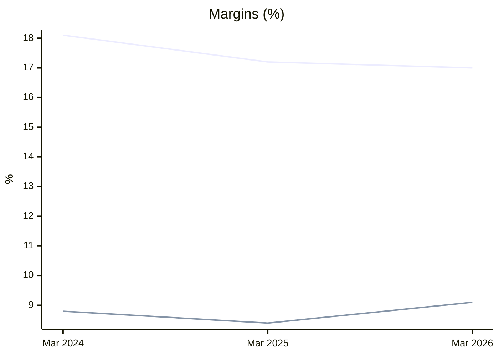

*Run 2026-11-24 · part of [SPINOFF_REPORT.md](../SPINOFF_REPORT.md) · the complete analysis of one company, with every management-call exchange in full.*

## RELIANCE — Reliance Industries Ltd.

### 1. Reliance Industries Ltd. — PARTIAL SPIN-OFF (subsidiary IPO)

**CONFIRMED** (partial spin-off — Jio Platforms Limited is listed since 2026-10-28) · **PARTIAL SPIN-OFF, LISTED <1Y — price the parent's stub against the listed piece** · score 5.0/10 · partial spin-off (subsidiary IPO) · 12 filing(s) from CALLS, NSE · first 2025-12-01, latest 2026-10-24

**The separated entities — every one the documents name:**

| Entity | Business | Listing | Who runs it |
|---|---|---|---|
| **Jio Platforms Limited** | Technology arm of RIL: digital services and 4G LTE/5G connectivity through wholly owned subsidiary Reliance J… | listed 2026-10-28 as JPL (NSE) | Shri Akash M. Ambani, Managing Director, Jio Plat… |

**What is being separated, as the documents put it:** Consumer Brands (FMCG) business undertaking demerged from Reliance Retail Ventures Ltd into Tira Beauty Ltd, renamed Reliance Consumer Products Ltd — class `value_unlocking`.

### 2. Stages and dates

> **Listing:** PARTIAL SPIN-OFF, LISTED — Jio Platforms Limited trades since 2026-10-28 (NSE equity list); the parent keeps its remaining stake

| Date | Event | Source |
|---|---|---|
| 2024-08-30 | Stage reached: **nclt sanction** | [Updates](https://nsearchives.nseindia.in/corporate/RELIANCE_30082024192852_SE_30082024.pdf) |
| 2025-12-01 | Stage reached: **effective** | [Other Restructuring](https://nsearchives.nseindia.com/corporate/kavinavora_01122025174049_RIL_011225.pdf) |
| 2026-06-19 | Board approval — Jio Platforms Limited | as stated: RIL filing dated June 19, 2026 – "Proposed Initial Public Offer of Ji… |
| 2026-06-19 | DRHP filed — Jio Platforms Limited | as stated: RIL filing dated October 14, 2026, referring to "our (i) disclosure d… |
| 2026-08-28 | Stage reached: **exchange noc** | [Updates](https://nsearchives.nseindia.com/corporate/PVIVINMA_28082026183323_RIL_SE_28082026.pdf) |
| 2026-08-28 | SEBI observations — Jio Platforms Limited | as stated: RIL filing dated August 28, 2026 – "Observation Letter on the Draft R… |
| 2026-10-14 | Other – disclosure of Price Band, Employee Discount and Minimum Bid Lot — Jio Platforms Limited | as stated: RIL filing dated October 24, 2026, referring to "our disclosure dated… |
| 2026-10-14 | Other – Red Herring Prospectus filed with the Registrar of Companies, Gujarat at Ahmedabad — Jio Platforms Limited | as stated: RIL filing dated October 14, 2026 – "JPL has today, i.e., October 14,… |
| 2026-10-19 | Other – Anchor Investor Bidding Date — Jio Platforms Limited | as stated: RIL filing dated October 14, 2026 – "The Anchor Investor Bidding Date… |
| 2026-10-21 | IPO opened — Jio Platforms Limited | as stated: RIL filings dated October 14, 2026 and October 24, 2026 – "The IPO op… |
| 2026-10-23 | Other – IPO closed for subscription — Jio Platforms Limited | as stated: RIL filing dated October 24, 2026 – "closed on Friday, October 23, 20… |
| 2026-10-24 | Other – Issue Price finalised and Prospectus filed with the Registrar of Companies — Jio Platforms Limited | as stated: RIL filing dated October 24, 2026 – "JPL has today finalised the Issu… |
| 2026-10-28 | **Jio Platforms Limited** listed (JPL) | NSE equity list |

**The stages, as filed:** nclt sanction (2024-08-30) → effective (2025-12-01) → exchange noc (2026-08-28)

**The partial spin-off:** **Jio Platforms Limited** (subsidiary); IPO stage: listed; exchange: BSE Limited and National Stock Exchange of India Limited; NSE symbol JPL; timeline: per the October 14, 2026 filing, "The Anchor Investor Bidding Date is Monday, October 19, 2026. The IPO will open for subscription on Wednesday, October 21, 202.

> “JPL has today finalised the Issue Price (including the anchor investor issue price) at ₹1,119 per Equity Share of face value of ₹10 each and has also filed the Prospectus dated October 24, 2026 with t”

**Stated in the filings:** size hint: 16.4% of ebitda.

### 3. Size of the separated business beside the parent — is institutional selling likely?

**Reading: LIKELY — the piece is small beside the parent; mandates with size limits tend to sell.**

| Entity | Stated turnover | Stated share of the whole | Segment revenue share | Market cap (₹ cr) | Share of combined market cap | Index member |
|---|---|---:|---:|---:|---:|---|
| Jio Platforms Limited | JPL operating revenues for FY2025-26 of "Rs.1,46,085 Crores… | — | 13.9% (FY2026) | 1,289,909 | 41.6% | no |

*Stated figures are the documents' own (a turnover share, or the cost-of-acquisition split the company publishes for tax, which reflects relative value); the segment share is this business's revenue over the parent's sales, and the market-cap share is the entity's value over the entity plus the parent (parent ₹1,812,954 cr, NSE bhavcopy of 2026-11-13), both computed here.*

**The judge's read of selling pressure:** unlikely — No listing stated; shares allotted to shareholders of unlisted RRVL, with RIL retaining 83.56% — no index exclusion mechanism disclosed.

### 4. Insider ownership — share swap, promoters' holding, management incentives

**Share swap / entitlement, entity by entity:**

- **Jio Platforms Limited:** IPO by way of a fresh issue only (no offer for sale stated): "Initial Public Offer by way of a fresh issue of up to 27,00,00,000 (Twenty seven crore) equity shares of face value of Rs. 10/- each"; Issue Price (including anchor investor issue price) finalised at ₹1,119 per Equity Share of face value of ₹10 each. Reservations: "(i) for a value not exceeding Rs. 500 crore for subscription by the Eligible Employees (as defined in the RHP); and (ii) for a value not exceeding Rs.2,500 crore for subscription by the Eligible RIL Shareholders". Total issue size not stated.

**Promoters' holding, from the shareholding pattern:**

| Company | Promoters | FIIs | DIIs | Public | Quarter |
|---|---:|---:|---:|---:|---|
| Reliance Industries Ltd. (RELIANCE) | 50.44% | 16.67% | 21.62% | 11.08% | Sep 2026 |
| Jio Platforms Limited (JPL) | 64.48% | 32.54% | 0.7% | 2.28% | Oct 2026 |

*Source: screener.in shareholding pattern, stored under `ShareholdingPattern/NiftyTotalMarket/`. In a mirror demerger each shareholder holds the same proportion of the new company as of the parent on the record date.*

- **Promoters in the parent, per the documents:** not stated in the documents on file.
- **What the promoters will hold in the separated entity:** not stated in the documents on file.
- **What a public shareholder receives:** A reservation to apply in the IPO: "The IPO includes reservation of equity shares of JPL (i) for a value not exceeding Rs. 500 crore for subscription by the Eligible Employees (as defined in the RHP); and (ii) for a value not exceeding Rs.2,500 crore for subscription by the Eligible RIL Shareholders, i.e., Individuals and HUFs (directly or in the name of karta) who are the public equity shareholders of the Company (excluding such persons who are not eligible to invest in the IPO under applicable laws, rules, regulations and guidelines), as on the date of the filing of the RHP by JPL, i.e., October 14, 2026." No shares of JPL are distributed to RIL shareholders without payment; this is a fresh issue, not a demerger.
- **Management incentives:** No stock options, RSUs or SARs are stated, and no management or insider shareholding in JPL is stated. The only employee-related terms stated are: "The IPO includes reservation of equity shares of JPL (i) for a value not exceeding Rs. 500 crore for subscription by the Eligible Employees (as defined in the RHP)" and "our disclosure dated October 14, 2026 intimating the Price Band, Employee Discount, and Minimum Bid Lot for the Initial Public Offer".
- **Insider actions around the separation:** not stated in the documents on file.
- **Insiders, per the checklist read:** Promoter holding not stated. New RCPL becomes an 83.56% direct subsidiary of RIL; RRVL shareholders get 1 New RCPL share per 2 RRVL shares. Ketan Mody is Executive Director, RCPL. · *option pricing date:* not stated

### 5. Why the demerger — point by point

The business being separated is Reliance's FMCG/consumer-brands arm, Reliance Consumer Products Ltd (RCPL) — Campa, Independence, Good Life, Ravalgaon/Toffeeman/Lotus, Velvette, Glimmer, Enzo, SIL, Maliban, Alan's, plus acquisitions Udhaiyam, Manna, Sosyo, Goodness Group and the Toni & Guy/Brylcreem/Badedas/Matey brands — which was carved out of Reliance Retail Ventures Ltd (RRVL) under a composite scheme effective 1 December 2025: the 'Consumer Brands Business Undertaking' was demerged from RRVL into Tira Beauty Ltd (renamed RCPL), the old RCPL was dissolved, RRVL shareholders received 1 new RCPL share for every 2 RRVL shares, and the new entity became an 83.56% direct subsidiary of RIL rather than a retail subsidiary. The only rationale management actually articulates is in the Chairman's 16 January 2026 statement: the consumer products vertical is 'progressing on its accelerated growth trajectory with a focused organizational structure' — i.e. a dedicated, directly-held vehicle for a business scaling far faster than retail (Q3 FY26 Rs 5,000 crore, +60% Y-o-Y; 9M FY26 Rs 15,000 crore; FY26 Rs 22,000 crore, 2x Y-o-Y; Q4 FY26 Rs 7,350 crore; Q1 FY27 Rs 8,600 crore, 2x; Campa Rs 4,700 crore and India's 4th largest CSD brand; Independence Rs 2,600 crore; beverages over Rs 6,000 crore; 3rd largest packaged water player; 5,000+ distributors, 3 million outlets, 40 export markets; target Rs 1 lakh crore by FY2030). The problem it visibly solves, though never stated as the reason, is mixing an only-breakeven, capex-hungry FMCG build-out (12 plants, integrated food parks, Kurnool and 'one of the largest beverage plants in Asia', edible-oil facility in West Bengal) into Reliance Retail's P&L: on every call since, management has had to strip RCPL out to show the underlying retail trend — Q3 FY26 8.1% reported, Q4 FY26 11% reported vs ~14% adjusted, Q1 FY27 7.4% reported vs 11.6% adjusted — while Ketan Mody confirms RCPL itself is only 'breakeven on EBITDA terms'. Two parallel separations run alongside it: the Jio Platforms IPO (DRHP 19 June 2026 for a fresh issue of up to 27 crore shares of Rs 10, SEBI observation 28 August 2026, RHP 14 October 2026, priced at Rs 1,119 on 24 October 2026, with Rs 500 crore reserved for employees and Rs 2,500 crore for individual/HUF RIL shareholders), and the carve-out of AI/data-centre activity into 'Reliance Intelligence'/RIL so that JPL stays asset-light — capex at RIL or Reliance Intelligence, service provision and products accessed by Jio under long-term leases. No investor, lender or partner is recorded as having asked for any of this; analysts' only questions on the demerger were for like-for-like revenue and EBITDA adjustments, and management expressly deferred the EBITDA impact to the next quarter.

**Point by point, with the source:**

1. The 1 Dec 2025 composite scheme demerged the Consumer Brands Business Undertaking from RRVL into Tira Beauty Ltd (renamed RCPL), dissolved the old RCPL, and paid RRVL shareholders 1 new RCPL share for every 2 RRVL shares. “in terms of the Scheme, as consideration for the demerger of the Consumer Brands Business Undertaking from RRVL to New RCPL, New RCPL will allot 1 (one) fully paid-up equity share of Rs. 10 (Rupees ten only) each for every 2 (two) fully paid-up equity shares of Rs. 10 (Rupees ten only) each of RRVL, to the shareholders of RRVL.” — *Scheme*
2. The structural outcome: FMCG stops being a retail subsidiary and becomes a business RIL owns directly at 83.56%, with the pre-scheme RRVL-held capital of the new entity cancelled. “Accordingly, New RCPL will become 83.56% direct subsidiary of the Company.” — *Scheme*
3. The only stated rationale anywhere in these documents: the Chairman frames the demerger as giving the consumer products vertical a focused organisational structure to support accelerated growth. “The demerger of consumer products business came into effect this quarter. With a broad and diverse product basket ranging from classic Indian brands to new age labels, the consumer products vertical is progressing on its accelerated growth trajectory with a focused organizational structure.” — *FILING 2026-01-16*
4. CFO V Srikanth confirmed the 1 December effective date and sized the separated business at over Rs 5,000 crore of quarterly turnover, growing 60% Y-o-Y — the growth differential versus retail's 8%. “On the FMCG side, the demerger happened on 1st December. And we are at more than 5,000 Crores of turnover, and this is 60% up on a year-on-year basis.” — *CALL Jan 2026*
5. Ketan Mody opened RCPL's first post-demerger section by stating the new ownership line (direct subsidiary of RIL, not of Reliance Retail), with 9M revenue of Rs 15,000 crore and four brands above Rs 1,000 crore. “So RCPL became the direct subsidiary of RIL from 1st December 2025.” — *CALL Jan 2026*
6. Asked by CLSA and Investec to quantify the EBITDA that left Reliance Retail with the demerger, Dinesh Taluja declined to give the number — the separation's margin arithmetic was never explained on the call. “We will have to wait for the next quarter.” — *CALL Jan 2026*
7. From Q4 FY26 the demerger became a permanent adjustment in retail's reported growth: 11% reported, ~14% ex-RCPL for the quarter and 12% for the year. “Now, if you recollect, RCPL business was demerged out in the last quarter adjusted for that, the growth is almost 14%, for the full year the growth is 12% and if you exclude RCPL demerger the growth would be even higher.” — *CALL Apr 2026*
8. RCPL began reporting through its own CFO with full-year scale figures — Rs 22,000 crore FY26 revenue (2x), Campa Rs 4,700 crore as India's 4th largest CSD brand, Independence Rs 2,600 crore, 12 plants, 5,000 distributors, 3 million outlets, 40 countries. “From an FMCG business perspective, we closed our revenue of Rs.22,000 Crores in 2026 and for the Q4 alone, we delivered a revenue of Rs.7350 Crores, both these are two times growth on the similar period for the last year.” — *CALL Apr 2026*
9. A full year of the demerger now creates a ~4 percentage point gap between retail's reported and underlying growth, the clearest evidence of the optics the separation changes. “In terms of topline growth, as you would recollect, RCPL business was demerged out on 1st of December. So Q1 had the full revenue. Adjusted for that, the underlying revenue growth is 11.6%. On a reported basis, the growth is 7.4%.” — *CALL Jul 2026*
10. The separated entity's own target is Rs 1 lakh crore of revenue by FY2030, with Q1 FY27 revenue of Rs 8,600 crore (2x) — but it is still only at EBITDA breakeven, with margins to come from scale and supply chain. “So, like we have announced, the target continues to kind of grow leadership in all categories and we have anyway announced the target is to kind of take this to Rs.1 lakh Crores on FY2030.” — *CALL Jul 2026*
11. Ketan Mody conceded RCPL earns essentially nothing today — i.e. a breakeven, market-share-focused business was removed from a retail P&L running at ~8% EBITDA margin. “EBITDA, I would put it across since the concentration there, yes, we are breakeven on EBITDA terms, but EBITDA will improve as a scale and all the supply chain is kind of put it across but yes, right now the concentration more on the market share” — *CALL Jul 2026*
12. Baseline before the separation: the same brands (Campa, Independence, Maliban, Ravalgaon) were reported as one line inside Reliance Retail, with no mention of any demerger or separate entity. “Consumer brands business continues to scale up very nicely. We are expanding our distribution network. The general trade revenues are growing at 250% plus on Y-o-Y basis.” — *CALL Oct 2024*
13. A second, explicitly-reasoned separation: AI/data-centre capex is placed in RIL / Reliance Intelligence while Jio buys capacity under long-term leases, keeping JPL asset-light ahead of its IPO. “Capex will be RIL or Reliance Intelligence. Service provision will be done by JPL; it will be asset-light service. Products will be developed by Reliance Intelligence, AI products and capex will be incurred there.” — *CALL Jan 2026*
14. Management clarified that the gigawatt-scale AI data centres (including the 168 MW Meta project at Jamnagar) sit outside Jio Platforms in the already-created intelligence entity. “So firstly, I would like to clarify that the AI data centers are not being done in Jio Platforms Limited. They are going to be part of the intelligence business, so RIL or the intelligence entity that has already been created.” — *CALL Apr 2026*
15. The Jio Platforms IPO (fresh issue of up to 27 crore Rs 10 shares) carved out reservations specifically for RIL's own individual shareholders and for employees — a partial separation that hands RIL holders direct access to the asset. “The IPO includes reservation of equity shares of JPL (i) for a value not exceeding Rs. 500 crore for subscription by the Eligible Employees (as defined in the RHP) ; and (ii) for a value not exceeding Rs.2,500 crore for subscription by the Eligible RIL Shareholders” — *FILING 2026-10-14*
16. The JPL listing was priced on 24 October 2026 after a 21–23 October book-build, putting an external price on the separated digital business. “JPL has today finalised the Issue Price (including the anchor investor issue price)  at ₹1,119  per Equity Share of face value of  ₹10 each  and has  also filed the Prospectus dated October 24, 2026  with the Registrar of Companies, Gujarat at Ahmedabad .” — *FILING 2026-10-24*
17. Context for separating consumer assets: S&P's upgrade to A- was credited to the rising share of less-cyclical consumer earnings, and RIL cited access to A-rated capital pools and tighter spreads. “They have focused on the fact that higher portion of our earnings are coming from less cyclical businesses, especially the consumer side.” — *CALL Jan 2026*

**How it evolved:** On the Oct 2024 call the consumer-brands business was still just a bullet inside Dinesh Taluja's retail section (general-trade revenue '250% plus' Y-o-Y) with no hint of separation. The 1 Dec 2025 scheme filings made it real — RCPL demerged out of RRVL into a directly held 83.56% RIL subsidiary — and on the 16 Jan 2026 call (Q3 FY26) RCPL got its own speaker (Ketan Mody), its own Rs 5,000 crore quarter, and the Chairman's 'focused organizational structure' line, while analysts (Investec's Harit Kapoor, CLSA's Vikash Jain) could only extract 'we will have to wait for the next quarter' on the margin impact. By 24 Apr 2026 RCPL presented through its own CFO (Ashutosh Goyal, FY26 Rs 22,000 crore) and retail growth was being quoted both reported and ex-demerger; by 17 Jul 2026 an RCPL Executive Director gave a Rs 1 lakh crore FY2030 ambition and admitted EBITDA breakeven. Over the same window the separation theme widened: AI data centres were explicitly moved out of JPL into Reliance Intelligence (Jan/Apr 2026 calls) and the JPL IPO moved from 'imminent' (Apr 2026) to DRHP (19 Jun 2026) to pricing at Rs 1,119 (24 Oct 2026).

**What management expects from it:** RCPL: a focused structure for accelerated growth to Rs 1 lakh crore by FY2030, with EBITDA rising from breakeven as capacity, food parks and supply chain scale. Retail: cleaner double-digit underlying growth plus ~8% margins, free to fund hyperlocal/digital commerce and double EBITDA in three years. RIL shareholders: direct 83.56%-held ownership and 1-for-2 shares; Jio stays asset-light with capex in Reliance Intelligence.

*Not explained on the calls:* No stated reason for separating rather than retaining RCPL, no RCPL margin, capex, funding or listing plan, no EBITDA quantification, no synergy loss, tax or governance discussion.

- *Stated reason, in one line:* Management says the demerger gives the consumer products vertical a 'focused organizational structure' on an 'accelerated growth trajectory'; no other reason is stated in the filings.
- *What it reveals:* A fast-scaling FMCG business previously buried in Retail: FY26 revenue Rs.22,000 crore (2x Y-o-Y), Q1 FY27 Rs.8,600 crore, Campa Rs.4,700 crore, Independence Rs.2,600 crore — but only 'breakeven on EBITDA terms', with a Rs.1 lakh crore FY2030 target.
- *Parent or spin:* parent · *Read next:* RCPL standalone EBITDA split that Dinesh Taluja deferred ('we will have to wait for the next quarter') and the composite scheme document
- *In their words:* “Further, in terms of the Scheme, as consideration for the demerger of the Consumer Brands Business Undertaking from RRVL to New RCPL, New RCPL will allot 1 (one) fully paid-up equity share of Rs. 10 (Rupees ten only) each for every 2 (two) fully paid-up equity shares of Rs. 10 (Rupees ten only) each of RRVL, to the shareholders of RRVL.”

### 6. On the calls, verbatim

14 call(s), oldest first: **0 question-and-answer exchange(s)** given in full — the question and every answer to it, nothing trimmed — and 14 passage(s) from management's prepared remarks (the complete sentences about it; the whole remarks are in the linked transcript). Text is as the transcript prints it.

#### Jan 2024 — [transcript](https://www.bseindia.com/stockinfo/AnnPdfOpen.aspx?Pname=de3e8ff3-efca-4266-9bc8-7509f48574a4.pdf)

**From the prepared remarks** *(the passage about it; the whole turn runs to 55,612 characters in the transcript)*

> **Regd. Office:** Please note that at this point. We're not charging for our 5G services. And this is really coming out of the existing set of subscribers using the recharg ing on the LTE. Moving on to the financials, consolidated financials for Jio Platforms Ltd, we ended the quarter with Rs 27,700 crores of operating revenues. That's 11.3% year -on-year growth. EBITDA was close to Rs 14,000 crores . EBITDA margin improved to 50.4% and that's also been showing an increasing trend , and the Profit After Tax increase d to Rs 5,445 crore. […] Digital and New commerce continues to grow well and contributed 19% of our total revenues during the quarter, increase of 100 basis points on a y-o-y basis. We continue to invest in infrastructure, retail stores have increased by 9% on a y -o-y basis. We added 250+ stores during the quarter, our retail space stands at 72.9 million sq ft now, a 21% increase on a y -o-y basis. We continue to invest in infrastructu re upfront as well as backend infrastructure as well as the technology platforms to reach the length and depth of the country as well as provide consumers with a true omni channel experience, provide them a good shopping experience as the consumers are als o evolving. If you look at our key customer metrics, footfalls grew a healthy 40% y -o-y basis, our registered customer base grew by 25% and now stands at 293 million. Our total transactions grew 20% and crossed 300 million transactions. It came at 320 million during t he quarter. […] We have got some very strong traction. We have set up a few stores across top tier cities and we continue to expand the network and we are getting very good response from customers. We signed up three celebrities to promote the brand. We have seen very strong brand recall and engagement from consumers on both our stores as well as online platforms. It is an experience discovery driven cat egory so offer a differentiated retail experience through larger formats and wider assortment. All our operating metrics including sales productivity, average Bill values, repeats, again engagement across brands, all of that are seeing good strong momentum, early days but we're very excited and seeing very good results in the initial days. We are al so including many new launches many new brands we are bringing to India some of the notable ones that we signed up for online as well as offline during the quarter are Laura Mercier, Allies of Skin and Blessed Moon.

#### Apr 2024 — [transcript](https://www.bseindia.com/stockinfo/AnnPdfOpen.aspx?Pname=06b05d06-8c38-4aee-aa5b-5e7108ae3871.pdf)

**From the prepared remarks** *(the passage about it; the whole turn runs to 54,868 characters in the transcript)*

> **Regd. Office:** And the EBITDA came in at close to Rs 53,000 crores. Growth of 12.4% year -on-year. So almost a hundred basis points increase in margins through this period. Moving on to Jio Platforms Limited. The operating revenue for the quarter for Jio Platforms Limited at a consolidated level came in at Rs 28,871 crores and EBITDA at Rs 14,360 crores and PAT at Rs 5,583 crores. Looking at the full year for JPL revenue, operating revenue of 10 © Reliance Industries Limited 2020 Rs 1,09,558 crores and EBITDA close to Rs 55,000 crores. At an EBITDA margin of little over 50%. The profit after tax came in at Rs 21,423 crores.

#### Jul 2024 — [transcript](https://www.bseindia.com/stockinfo/AnnPdfOpen.aspx?Pname=191e6ab9-4751-4017-ba5f-bb63daf2d871.pdf)

**From the prepared remarks** *(the passage about it; the whole turn runs to 43,035 characters in the transcript)*

> **Regd. Office:** So not in the previous quarter. The impact wi ll only be seen starting this quarter. The tariff increase, you know, across the industry was in the 13% to 25% rate. But what we've done is for the JioBharat and the Jio Phone, which are the entry -level devices which really are focused towards our aim of 2 G Muk Bharat, and really transitioning all of the subscribers onto digital services and digital platforms, which is a n aim that we have got a for them. There has been no change in tariff. In addition, for the 5G experience that we are currently offering is still available at no additional cost to subscribers who have subscribed to certain plans, and this is to encourage 5G consumption on the network and people to adopt more and more of 5G services. We expect, as was on expected lines post tariff increase. […] That was a 10.1% YoY increase. And the EBITDA went up to Rs. 14,022 crores at an EBITDA margin of 53%. So , the margins have kept on constantly, steadily improving, and fairly consistent performance on this front. Moving on to the consolidated financials for Jio Platforms Limited, the operating revenues for the quarter came in at Rs. 29,449 crores. That was a 12.8% YoY growth. The EBITDA was at Rs. 14,638 crores and EBITDA margin was 49.7%. Profit After Tax increased to Rs 5,693 crore, again around 11.7% YoY increase.

#### Oct 2024 — [transcript](https://www.bseindia.com/stockinfo/AnnPdfOpen.aspx?Pname=0e6309fa-450f-4db6-88b2-d76d9a3ff756.pdf)

**From the prepared remarks** *(the passage about it; the whole turn runs to 53,439 characters in the transcript)*

> **Regd. Office:** So that's really what we are doing. Also, we are strengthening our portfolio in AJIO through new brand launches - ASOS, H&M, Timberland. Also, we are scaling up our ‘Y ousta’ format, and we have now scaled it up to 50 stores, and you will see more rapid growth in this format. Our focus on strengthening of tech platforms, infrastructure, the streamlining of o perations, as well as having a calibrated approach in B2B, is expected to work its way in the next couple of quarters. Post that we expect to revert to our industry leading growth momentum, as can be seen even in this quarter, because if you see the operat ional parameters, footfalls are up 14 .2%, customer base is up 16 .4%, area and square feet at 79 .4 million is up at 11%, number of transactions are higher. So, we do expect this to work its way out in the next two quarters and then come back to the kind of growth rates that I talked about. On the digital services side, revenue and EBITDA up 18% and benefiting from broader scaling up of digital services and also partial impact of the tariff hike and we continue to add to customers overall slide churn that we saw in this quarter, but nothing u nusual, in fact, lower than what we have seen in the past, when there has been a tariff hike. […] And our target now, the next target that we have is to add nearly 1 million homes every given month. So that is the pace at which we are able to grow our hom e broadband service thanks to Jio AirFiber. When it comes to the in home experience itself, now we have a great product called Jio TV+, which was a unified experience to discover all of the OTT services which are available, especially on the Jio Set Top Box, so that from a single interface, users ca n discover and 8 © Reliance Industries Limited 2020 consume all their favourite shows and movies and so on, without having to search and jump across multiple apps and so on. So, this particular service, which was till now on the Jio Set Top Box and a very well -loved offering, we have now also enabled that t o be available on other smart TV platforms. So, what that means is that if you are a JioFiber or Jio AirFiber customer, then the same Jio TV+ application which is available on the Set Top Box is now also available for additional televisions that you may ha ve in your home without requiring an additional Set Top Box or an additional connection. So, it just becomes an additional app that you can download on your smart TV without having to take additional efforts to enable that to happen. So, what that means is , by just getting one connection, you are able to enjoy the Jio TV+ experience and all the OTT content that you are able to enjoy not just in the primary TV, which is connected to the Jio Set Top Box, but also across additional TVs in the home. […] Moving to the RJIL financials, as you can see, quite a large increase in this quarter after some steady growth consistently over the previous few quarters. The RJIL operating revenue grew 14.5% year on year and the EBITDA increased to Rs. 15,225 crore s at an EBITDA margin of 53.7%. And that's also been steadily increasing. Moving on to the JPL, the Jio Platforms Ltd consolidated financials, Operating Revenue for the quarter came in at Rs. 31,709 crores and the EBITDA at Rs. 15,931 crores. The consolidated EBITDA margin is also slightly above 50%. The Profit After Tax increased to Rs. 6,536 crores. That was a healthy 23% year -on-year increase in Profit After Tax. […] On the overall energy business side, you know, price and margin volatility on the back of geopolitics is a continuing theme that we have been talking about, and some of the drivers of 20 © Reliance Industries Limited 2020 demand can come on the back of some of the actions on economic stimulus, as well as monetary policies stimulus. And on the consumer side, the focus on, of course, as Dinesh talked about the upcoming festive season, demand has at least started off well. And our own focus is on strengthening of operations that I talked about. Overall, all of them are on the tech platforms, the streamlining their calibrated approach to B - to-B. So as the underlying thematic of the business continues to be well, but for the next one or two quarters it could be a little bit more volatile. As all th ese actions work its way in the next couple of quarters, post that you can see the whole. We expect it to revert back to the industry leading momentum that we have seen.

#### Jan 2025 — [transcript](https://www.bseindia.com/stockinfo/AnnPdfOpen.aspx?Pname=89c33a3e-5683-4a1d-b8f9-1952ff4df63f.pdf)

**From the prepared remarks** *(the passage about it; the whole turn runs to 56,945 characters in the transcript)*

> **Trading Symbol:** So, some updates that I had, and I'll just hand it over to now Ans human to talk about both the operational and financial numbers for the quarter. Sh Anshuman Thakur 00:21:30 – 00:26:52 (Digital Services - Financials) Thanks everyone. A very happy new year. Coming to the quarterly highlights, both combination of tariff hike as well as scale up of some of the digital platforms and improving customer mix resulted in our operating revenues growing at 19.4% year on year going up to 33,074 crores. Corresponding in crease in EBITDA as well at 18.8% year on year, 16,585 crores. So fairly healthy quarter, combination of a lot of things going on there and some of the digital revenues just about kicking in. Subscriber 10 © Reliance Industries Limited 2020 base at 482.1 million. […] That was a 15.5% year on year increase and the 11 © Reliance Industries Limited 2020 EBITDA growing a little bit faster coming to 15,798 crores. The EBITDA margin at 53.9%. This is only for the connectivity business RJIL, the connectivity service provider. And coming to the Key Financials for Jio Platforms Limited Consolidated Financials, the overall Q3 revenues came in at 33,074 crores, 19.4% year on year growth. We are seeing a very healthy increase in non-connectivity . The digital revenues which grew at 60% year on year. The annualized run rate has crossed 15,000 crores and this we are seeing very healthy growth trend here coming in with most of the growth coming in from new customers that we are able to serve. […] They are the amongst the leading brands in their respective categories, and they do drive a lot of footfalls in our stores . AJIO Business, the focus has been on , you know, improving the economics and improving the Average Bill Values and premiumize the offering. So that continues to do well. We have amongst the highest average bill values amongst all the online fashion platforms in the country. The Average Bill Value was up 7% on Y -o-Y basis. We added almost 2 million customers during the quarter. We continue to expand our catalogue , and we added over half a million options just in the first nine months of this year. The total catalogue now stands at 2.2 million . In this you know, you have to provide customers a wide range as well as exc lusive, exclusive brands. So, most of our own br ands that we have, whether the partner brands or our in-house brands, they're exclusive on the platform, and they do provide us a differentiation as well as better economics compared to other platforms, because if the customer has to buy, he has to come on to these platforms. We've also launched a bunch of new brands. There were 38 international brands and a host of other national brands, which were launched during the quarter. ON, Forever 21 and Saucony being some of the few.

#### Jan 2025 — [transcript](https://www.bseindia.com/stockinfo/AnnPdfOpen.aspx?Pname=89c33a3e-5683-4a1d-b8f9-1952ff4df63f.pdf)

**From the prepared remarks** *(the passage about it; the whole turn runs to 56,945 characters in the transcript)*

> **Trading Symbol:** So, some updates that I had, and I'll just hand it over to now Ans human to talk about both the operational and financial numbers for the quarter. Sh Anshuman Thakur 00:21:30 – 00:26:52 (Digital Services - Financials) Thanks everyone. A very happy new year. Coming to the quarterly highlights, both combination of tariff hike as well as scale up of some of the digital platforms and improving customer mix resulted in our operating revenues growing at 19.4% year on year going up to 33,074 crores. Corresponding in crease in EBITDA as well at 18.8% year on year, 16,585 crores. So fairly healthy quarter, combination of a lot of things going on there and some of the digital revenues just about kicking in. Subscriber 10 © Reliance Industries Limited 2020 base at 482.1 million. […] That was a 15.5% year on year increase and the 11 © Reliance Industries Limited 2020 EBITDA growing a little bit faster coming to 15,798 crores. The EBITDA margin at 53.9%. This is only for the connectivity business RJIL, the connectivity service provider. And coming to the Key Financials for Jio Platforms Limited Consolidated Financials, the overall Q3 revenues came in at 33,074 crores, 19.4% year on year growth. We are seeing a very healthy increase in non-connectivity . The digital revenues which grew at 60% year on year. The annualized run rate has crossed 15,000 crores and this we are seeing very healthy growth trend here coming in with most of the growth coming in from new customers that we are able to serve. […] They are the amongst the leading brands in their respective categories, and they do drive a lot of footfalls in our stores . AJIO Business, the focus has been on , you know, improving the economics and improving the Average Bill Values and premiumize the offering. So that continues to do well. We have amongst the highest average bill values amongst all the online fashion platforms in the country. The Average Bill Value was up 7% on Y -o-Y basis. We added almost 2 million customers during the quarter. We continue to expand our catalogue , and we added over half a million options just in the first nine months of this year. The total catalogue now stands at 2.2 million . In this you know, you have to provide customers a wide range as well as exc lusive, exclusive brands. So, most of our own br ands that we have, whether the partner brands or our in-house brands, they're exclusive on the platform, and they do provide us a differentiation as well as better economics compared to other platforms, because if the customer has to buy, he has to come on to these platforms. We've also launched a bunch of new brands. There were 38 international brands and a host of other national brands, which were launched during the quarter. ON, Forever 21 and Saucony being some of the few.

#### Apr 2025 — [transcript](https://www.bseindia.com/stockinfo/AnnPdfOpen.aspx?Pname=3e36b485-0a6c-4f84-bf74-7d60b0e26d9d.pdf)

**From the prepared remarks** *(the passage about it; the whole turn runs to 101,334 characters in the transcript)*

> **Regd. Office:** The analyst meet, conducted physically, concluded at 10:10 p.m. on April 2 5, 202 5. This is for information and records. Thanking you Yours faithfully, For Reliance Industries Limited Savithri Parekh Company Secretary and Compliance Officer Encl.: as above Copy to: The Luxembourg Stock Exchange 35A Boulevard Joseph II L-1840 LuxembourgSingapore Exchange Limited 4 Shenton Way, #02 -01 SGX Centre 2, Singapore 068807 1 © Reliance Industries Limited 2020 RIL Q 4 2024 - 2025 Media & Analyst Call Transcript 25 April 2025 20:15 IST Call Participant s: Sh V Srikanth, CFO, Reliance Industries Limited Sh Anshuman Thakur, Head of Strategy, Reliance Jio Infocomm Limited Sh Dinesh Taluja , CFO & Corporate Development, Reliance Retail Sh Kevin Vaz, CEO – Entertainment, JioStar Sh Sanjay Barman Roy, President – E&P, Reliance Industries L imited Duration: 01:55:02 Presentation Link: https://rilstaticasset.akamaized.net/sites/default/files/2025 - 04/RIL_4Q_FY25_Analyst_Presentation_25Apr25.pdf Meeting Video: https://www.ril.com/investors/events -presentations#webcast -sec Sh V . Srikanth 00:00: 01 – 00:06:36 (Macro Environment and Performance) Sh Anshuman Thakur 00:06:44 – 00:21:15 (Jio Platforms ) Sh Dinesh Taluja 00:21:19 – 00:37:20 (Reliance Retail) Sh Kevin Vaz 00:37:27 – 00:45:55 (JioStar ) Sh Sanjay Barman Roy 00:46:03 – 00:52:19 (Oil & Gas) Sh V . Srikanth 00:52:31 – 01:14:19 (Oil to Chemicals, New Energy and Summary) Q&A Session 01:14:47 – 01:55:02 2 © Reliance Industries Limited 2020 Transcript: PRESENTATION Sh V. Srikanth 00:00: 01 – 00:06:36 (Macro Environment and Performance) But before that, just the overall macroeconomic. So, this is all about the context being significant volatility, tariff -related. […] Overall, I think the other point I would definitely flag is when you look at the O2C or energy performance in the context of how other global refineries have performed or standalone petrochemical manufacturers or even actually integrated players. If you see the numbers, it is absolutely standout in terms of our performance. So that is how EBITDA was lower by 8%. Jio platforms up 17% on the back of, of course, the leadership in technology, the number of customers add ed the ARPU increase, and now we are the world's largest data company and have 191 million 5G subscribers and ARPU at ■ 206 plus at 13.5%. On retail I talked to you about the first half being soft and all the efforts on streamlining and rationalizations of stores, etc ., and the third and fourth quarter has been pretty good. And 3 © Reliance Industries Limited 2020 also, all the operating metrics in terms of transactions, in terms of number of customers, all of them holding pretty well. And a lot of focus on quick commerce and Dinesh will talk to you about what we are doing on quick commerce. […] And big offsets with Jio on with up 18% and retail up 14%. Oil and gas was impacted with lower production. With this Anshuman. Sh Anshuman Thakur 00:06:44 – 00:21:15 (Jio Platforms) Thanks Srikanth. Good evening everyone . Welcome to the physical analyst meet. An update on the performance of Jio platforms. Strong revenue and EBITDA growth. This was a combination of both the tariff impact flowing through but in addition a lot of success that we are seeing with our home rollout, home broadband rollout, both combination of fibe r, but more importantly fixed wireless and I'll speak a bit more 4 © Reliance Industries Limited 2020 about that. Consolidated operating revenues for the full year at ■ 1,28,218 crore and EBITDA at ■ 64,170, so roughly around 17 to 18% growth. […] Coming to the revenue numbers, these are the RJIL quarterly financials, which grew to 30,018 crore in terms of revenues and 16,188 crore in EBITDA. That is close to 54 % EBITDA margin for our connectivity busin ess and the growth has been fairly steady and continuous. And the full year numbers for the connectivity business, RJIL, we ended the year at ■ 1,14,000 crore of operating revenues and EBITDA of ■ 61,233 crore, so both gro wing in the 14 to 16% range and again fairly steady and healthy growth delivered across the years over last several years. The consolidated financials for Jio Platforms Limited, the first three columns are quarterly and then the full year numbers on the right two columns. Full year fiscal 2025 revenue and 8 © Reliance Industries Limited 2020 EBITDA growth of 17%, consistent EBITDA margins of 50% and this is after a whole bunch of initiatives that are currently being taken to grow our digital services or other service offerings that we are going to provide to customers, we are maintaining our EBITDA margin at 50%. Q4 revenues at ■ 33,986 crore consol revenues, which is again close to 18% year - on-year growth, and EBITDA at ■ 17,000 crore, and profit after tax growth of 26% to ■ 7,023 crore. This was for the quarter Q4. […] So we are increasing the speed at which we are able to deliver the products. One big benefit of that is the returns are directly correlated as your time to delivery goes down, returns goes down and we are seeing that very clearly in our data. The All -Star Sale, which is a flagship event for March. In March, most of the online platforms go on sale. This is the time where we acquire a lot of customers. We had a big event, and we added 6 lakh plus new customers during this campaign. We talked about the SHE IN launch, which we have done during the quarter as well. […] And at this point in time, yes, the effort has been to create the domestic supply chain, which we have been able to now roll out quite well. We have over 12,000 options on Shein now and we have been able to create the domestic supply chain to be able to give that, provide a similar service as Shein offers globally. But these are two separate instances. The whole tech platforms are separate. Sh Gaurav Jain So I think the question was on the store optimization. So I think it has been across the formats. We have seen store closures but it is also because of a variety of reasons.

#### Apr 2025 — [transcript](https://www.bseindia.com/stockinfo/AnnPdfOpen.aspx?Pname=3e36b485-0a6c-4f84-bf74-7d60b0e26d9d.pdf)

**From the prepared remarks** *(the passage about it; the whole turn runs to 101,334 characters in the transcript)*

> **Regd. Office:** The analyst meet, conducted physically, concluded at 10:10 p.m. on April 2 5, 202 5. This is for information and records. Thanking you Yours faithfully, For Reliance Industries Limited Savithri Parekh Company Secretary and Compliance Officer Encl.: as above Copy to: The Luxembourg Stock Exchange 35A Boulevard Joseph II L-1840 LuxembourgSingapore Exchange Limited 4 Shenton Way, #02 -01 SGX Centre 2, Singapore 068807 1 © Reliance Industries Limited 2020 RIL Q 4 2024 - 2025 Media & Analyst Call Transcript 25 April 2025 20:15 IST Call Participant s: Sh V Srikanth, CFO, Reliance Industries Limited Sh Anshuman Thakur, Head of Strategy, Reliance Jio Infocomm Limited Sh Dinesh Taluja , CFO & Corporate Development, Reliance Retail Sh Kevin Vaz, CEO – Entertainment, JioStar Sh Sanjay Barman Roy, President – E&P, Reliance Industries L imited Duration: 01:55:02 Presentation Link: https://rilstaticasset.akamaized.net/sites/default/files/2025 - 04/RIL_4Q_FY25_Analyst_Presentation_25Apr25.pdf Meeting Video: https://www.ril.com/investors/events -presentations#webcast -sec Sh V . Srikanth 00:00: 01 – 00:06:36 (Macro Environment and Performance) Sh Anshuman Thakur 00:06:44 – 00:21:15 (Jio Platforms ) Sh Dinesh Taluja 00:21:19 – 00:37:20 (Reliance Retail) Sh Kevin Vaz 00:37:27 – 00:45:55 (JioStar ) Sh Sanjay Barman Roy 00:46:03 – 00:52:19 (Oil & Gas) Sh V . Srikanth 00:52:31 – 01:14:19 (Oil to Chemicals, New Energy and Summary) Q&A Session 01:14:47 – 01:55:02 2 © Reliance Industries Limited 2020 Transcript: PRESENTATION Sh V. Srikanth 00:00: 01 – 00:06:36 (Macro Environment and Performance) But before that, just the overall macroeconomic. So, this is all about the context being significant volatility, tariff -related. […] Overall, I think the other point I would definitely flag is when you look at the O2C or energy performance in the context of how other global refineries have performed or standalone petrochemical manufacturers or even actually integrated players. If you see the numbers, it is absolutely standout in terms of our performance. So that is how EBITDA was lower by 8%. Jio platforms up 17% on the back of, of course, the leadership in technology, the number of customers add ed the ARPU increase, and now we are the world's largest data company and have 191 million 5G subscribers and ARPU at ■ 206 plus at 13.5%. On retail I talked to you about the first half being soft and all the efforts on streamlining and rationalizations of stores, etc ., and the third and fourth quarter has been pretty good. And 3 © Reliance Industries Limited 2020 also, all the operating metrics in terms of transactions, in terms of number of customers, all of them holding pretty well. And a lot of focus on quick commerce and Dinesh will talk to you about what we are doing on quick commerce. […] And big offsets with Jio on with up 18% and retail up 14%. Oil and gas was impacted with lower production. With this Anshuman. Sh Anshuman Thakur 00:06:44 – 00:21:15 (Jio Platforms) Thanks Srikanth. Good evening everyone . Welcome to the physical analyst meet. An update on the performance of Jio platforms. Strong revenue and EBITDA growth. This was a combination of both the tariff impact flowing through but in addition a lot of success that we are seeing with our home rollout, home broadband rollout, both combination of fibe r, but more importantly fixed wireless and I'll speak a bit more 4 © Reliance Industries Limited 2020 about that. Consolidated operating revenues for the full year at ■ 1,28,218 crore and EBITDA at ■ 64,170, so roughly around 17 to 18% growth. […] Coming to the revenue numbers, these are the RJIL quarterly financials, which grew to 30,018 crore in terms of revenues and 16,188 crore in EBITDA. That is close to 54 % EBITDA margin for our connectivity busin ess and the growth has been fairly steady and continuous. And the full year numbers for the connectivity business, RJIL, we ended the year at ■ 1,14,000 crore of operating revenues and EBITDA of ■ 61,233 crore, so both gro wing in the 14 to 16% range and again fairly steady and healthy growth delivered across the years over last several years. The consolidated financials for Jio Platforms Limited, the first three columns are quarterly and then the full year numbers on the right two columns. Full year fiscal 2025 revenue and 8 © Reliance Industries Limited 2020 EBITDA growth of 17%, consistent EBITDA margins of 50% and this is after a whole bunch of initiatives that are currently being taken to grow our digital services or other service offerings that we are going to provide to customers, we are maintaining our EBITDA margin at 50%. Q4 revenues at ■ 33,986 crore consol revenues, which is again close to 18% year - on-year growth, and EBITDA at ■ 17,000 crore, and profit after tax growth of 26% to ■ 7,023 crore. This was for the quarter Q4. […] So we are increasing the speed at which we are able to deliver the products. One big benefit of that is the returns are directly correlated as your time to delivery goes down, returns goes down and we are seeing that very clearly in our data. The All -Star Sale, which is a flagship event for March. In March, most of the online platforms go on sale. This is the time where we acquire a lot of customers. We had a big event, and we added 6 lakh plus new customers during this campaign. We talked about the SHE IN launch, which we have done during the quarter as well. […] And at this point in time, yes, the effort has been to create the domestic supply chain, which we have been able to now roll out quite well. We have over 12,000 options on Shein now and we have been able to create the domestic supply chain to be able to give that, provide a similar service as Shein offers globally. But these are two separate instances. The whole tech platforms are separate. Sh Gaurav Jain So I think the question was on the store optimization. So I think it has been across the formats. We have seen store closures but it is also because of a variety of reasons.

#### Jul 2025 — [transcript](https://www.bseindia.com/stockinfo/AnnPdfOpen.aspx?Pname=38a33049-ed9e-4544-ace5-a92e5f984f23.pdf)

**From the prepared remarks** *(the passage about it; the whole turn runs to 125,121 characters in the transcript)*

> **Meeting Audio:** https://www.ril.com/investors/financial -reporting  Sh V Srikanth 00:00:01 – 00:14:00 (Group Performance )  Sh Sanjay Barman Roy 00:14: 16 – 00:20:55 (Oil & Gas )  Sh Srinivas Tuttagunta 00:21:04 – 00:31:21 (Refining & Marketing )  Sh Amit Chaturvedi 00:31:27 – 00:39:26 (Petrochemicals)  Sh Anshum an Thakur 00:39:35 – 01:02:26 (Jio Platforms )  Sh Dinesh Taluja 01:02:30 – 01:23:19 (Reliance Retail)  Sh Kevin Vaz 01:23:24 – 01:33:35 (JioStar)  Sh Kar an Suri 01:33:55 – 01:44:47 (New Energy)  Sh V Srikanth 01:44:53 – 01:48:24 (Summary )  Q&A Session 01:48:25 – 02:17:35 2 © Reliance Industries Limited 2020 Transcript: PRESENTATION Sh V Srikanth 00:00:01 – 00:14:00 (Group Performance ) So, thank you, thank you for being here. And we will keep the same format, a very quick introduction of the consol idated level, and then followed by each of the businesses. And like last time, we will do the Q&A at the end. We have quite a few slides, so I am asking my team to be focused 10 minutes so that we complete it on time, and then we have the time for the Q&A. […] We are the largest carriers of traffic in the world. If you look at the number of customers close to 500 million or the number of homes, we are in. All that is facilitated because that is pretty unique and importantly, it allows us to do and offer product and services which are really not offerable by others, especially when you look at it as what the standalone 5G stack does for all this. And when you talk about digital platforms capability, be it on the gaming part of it, the AI cloud part of it, and so on. So, a lot of opportunities coming because of what we have set out to do. And all this is translating in terms of when you see the performance . It is a 19% growth in revenue, a 24% growth in EBITDA. […] That is the focus to ensure that these kind of EBITDAs are maintained. Digital services, the 5G network, the standalone that we talked about, that is a huge market when you look at it from homes, when you look at enterprises is just I think the beginning, especially because today the type of services which are required by an enterprise are very high. I think you will see a very strong traction when it comes to enterprises. Digital platforms are about the gaming, the Jio Games , the AI Cloud, I mean, then you are talking about the operating systems, which can be now put directly on PCs instead of having to have set -top boxes so, a big expansion there. Media and consumer products, and Dinesh will talk about it, a very, very strong set of performance that we have , more importantly, this consumption will only grow as we talk about the broader demographics, the younger population, disposable income, and so on. In short, all this, we're trying to also highlight the fact that therefore, with these kind of construct in place and the inflection point that we are in . We are on track to double our value by the end of the golden decade. […] Jio-bp continues to expand as Srini said earlier, their offerings, not only in the traditional but even in the new environment friendly mobility solutions. And we will continue to focus on our expansion projects also, the two of them which we are working on, the polyester expansion and the PVC expansion. That is it for me. Sh Anshum an Thakur 00:39:35 – 01:02:26 (Jio Platforms ) So, an update on the results for Jio, but before that, just, some comments around what we are trying to do at Jio, which, we have spoken about this in the past as well over the last several years. Just wanted to reiterate some of these points for better understanding of people around this room and elsewhere. Jio was born as a deep tech company. So, while the results, it is important to see how the connectivity business and the telecom business is doing. but we should not lose sight of the fact that it is really a deep tech company that we built here. […] I will give you the exact numbers in a bit, more than 45% connectivity revenue market share and an EBITDA margin of over 52% where our operating leverage is playing out quite well and it is been growing. So strong quarter with 24% year -on-year EBITDA grow th and sustained leadership in most of our businesses but yeah, connectivity definitely. So, on the connectivity side, this slide just shows the entire tech stack for offering or deploying 4G, LTE, 5G, and the air fiber services that we have done. All of this, all of the components of the tech stack that you see on the right, be it the core, be i t the automation platforms, OSS, BSS, everything has been done in -house. So, we may have started with using some of the vendor services or platforms, but over a period we have transitioned completely to our core. Now this is a network of half a billion users with over 200 million 5G consumers, which is running on a stack completely developed in -house. This is the kind of technology, this is the kind of network that globally companies are looking for. This is a big opportunity for us. […] Coming to financials for the quarter, we had operating revenues of 30,882 Crores that was a 17% year -on-year increase. EBITDA showed a higher percentage increase, 23%, led by both the revenue growth as well as 300 bps year -on-year margin expansion t o 56%. So, the EBITDA for the quarter was 17,300 Crores so very healthy growth on our connectivity business. For the console Jio Platforms Limited, the gross revenue came in at 41,000 Crores, the operating revenue at 35,032 Crores, which was a 19% growth year on year. EBITDA of 18,135 Crores, again showing higher increase here, 24% year on year growth because of the operating leverage, the EBITDA margin going up by 210 basis points during the quarter. And profit after tax came in at 7,110 Crores at 25% year -on-year increase so that throws a quick summary of all of the financial and key operating results. We will c ome back for the Q&A later. […] The acceptability, acceptance is much higher. So, what we are seeing is almost close to 12% to 15% of bills where we are offering this service, our people are adopting a Ajio Rush. And the returns are significantly lower because it is addressing a need that the customer has. In case of fashion, a lot of returns come because you ordered something from two or three platforms, you got something first and then you return the rest. Here, you needed something, it got delivered to you in a couple of hours, you tried it, it works well, so you keep it, and that is why you see returns which are much lower, which means that with better bill values and lower returns, the unit economics will improve substantially. We also continue to add more options onto the platform. We already have now almost 2.6 million options available on the platform now. […] We are also pretty quickly expanding our supply chain and building pretty robust manufacturing capabilities across the length and breadth of the country. W e are using world -class, building world -class manufacturing and R&D facilities with a lot of automation and backward integration, which will give us superiority on product as well as the lowest cost and help us win in the market. This business is being dem erged. It is in the process of being demerged out of Reliance Retail into a subsidiary of Reliance Industries. So, it will become sometime this year, once the regulatory approvals are in place, it will become an independent business. And we have, even today we have an arm's length 25 © Reliance Industries Limited 2020 relationship between our retail business and our FMCG business, but then these two become completely independent. So that is a quick update on the retail business. […] You have certain lock -ins. Once you stop your operations, it takes time to take out your inventory, and the people remain on the payroll for certain amount of t ime. So, it is not a very long period, it relates to stores that we closed in end of Q3 and Q4 for which some of the cost would have come in Q1, more or less it is done. Questioner (Vikash Jain, CLSA) And FMCG when you mentioned that, you know, now the demerger process is it done or it is not yet? Company Speaker ( Sh Dinesh Taluja ) Not yet, it is under regulatory approvals. So once the regulatory approvals are in place, then the business will get demerged out. Questioner (Vikash Jain, CLSA) And so, all the Reliance retail shareholders will be shareholders of exactly same. Company Speaker ( Sh Anshuman Thakur ) Today it is 100% sub of RR VL, it will just move out and shareholding will get replicated. Questioner (Vikash Jain, CLSA) And one last thing on new energy, the modules, cells, you said that cell production will possibly, we are one quarter away from that.

#### Oct 2025

**From the prepared remarks** *(the passage about it; the whole turn runs to 101,770 characters in the transcript)*

> **Meeting Audio:** https://www.ril.com/investors/events -presentations#webcast -sec  Sh V. Srikanth 00:00:04 - 00:05:44 (Group Performance)  Sh Anshuman Thakur 00:05:45 - 00:27:58 (Jio Platforms)  Sh Dinesh Taluja 00:27:59 - 00:39:24 (Reliance Retail)  Sh Kevin Vaz 00:39:25 - 00:45:45 (JioStar)  Sh Sanjay Barman Roy 00:45:46 - 00:50:15 (Oil & Gas)  Sh Srinivas Tuttagunta 00:50:16 - 01:01:10 (Refining & Marketing)  Sh Amit Chaturvedi 01:01:18 - 01:08:31 (Petrochemicals)  Sh Sriram Ramakrishnan 01:08:33 - 01:19:13 (New Energy)  Q&A Session 01:19:14 - 01:52:52 2 © Reliance Industries Limited 2020 Transcript: PRESENTATION Sh V. Srikanth 00:00:04 - 00:05:44 (Group Performance) Good evening. Nice to see you all pre -Deepawal i and in a new location. Somebody was asking me whether this will continue. […] The CAPEX tha t we spent at about close to 40 ,000 Crores, almost in line with our cash profits. So overall, a strong performance and continuing strength in the balance sheet. And I am going to request Anshuman to present the Jio section. Sh Anshuman Thakur 00:05:45 - 00:27:58 (Jio Platforms) Hi, good evening, everyone. So Jio, update on the results. Before I do that, I wanted to bring the attention to the fact that we are operating as a next -gen technology company at scale. We have spoken about this in the past, but every quarter we have been proving, doing new things, and demonstrating our ability to develop technology and imp lement technology at scale. Indigenous technology, we have our own proprietary 5G stack and fixed wireless stack that we have spoken about in the past, and which is now working at a significant sc ale, at global scale 3400 plus patent applications across 5G and 6G where we are among the thought leaders now across internat ional forums. We have built several digital services for India at scale and not only built but deployed and people are enjoying those services and those platforms, enterprises are using those 4 © Reliance Industries Limited 2020 platforms at scale. Our ability to operate at population scale, once again, over 500 million consumers that we hit in this previous quarter. We closed at 506 million . Homes, we ha ve crossed 22 million and growing rapidly. Enterprises, which is also, is growing fairly rapidly. So, we have got these platforms and technologies or solutions which are working at scale across all of these categories. And we are developing end -to-end control over the value chain, which will help us, which has already helped us in keeping the cost in control, keeping the whole development cycle in control, being able to bring out new functionalities at an agility which is better than what you see global operators being able to do, and taking this fu ll stack approach which also helps us now possibly taking some of these technologies and platforms to other places as well. So that is a theme that we are very focused on, and we have been working on and we have demonstrated that repeatedly and we are continuing to demonstrate that across our business at scale. All of which gets us market leadership in mobility and home solutions. Number one in connectivity, 506 million subscribe rs at the end of the quarter. 8 .3 million net additions during the quarter. […] EBITDA came in at ■17 ,874 Crores, which is 17 .4% growth , EBITDA margin expanding to 56 .1%. So, all in all, fairly good growth. The operating leverage is playing out quite well, and we continu e to see healthy margin expansion in our connectivity business. For Jio -platforms, consolidated business, consolidated financials for Jio -platforms limited. The operating revenue was at 36 ,332 Crores. EBITDA increased 18% to 18 ,757 Crores. And profit after tax at 7 ,375 Crores. 13 % growth year on year. […] Company Speaker (Sh Anshuman Thakur ) The good thing is that the offline itself is also growing well, so it is a good tussle to have. Questioner ( Sachin Salgaonkar , Bank of America) Thank you. 27 © Reliance Industries Limited 2020 Company Speaker (Sh Dinesh Taluja) See, ultimately look at it this way, our objective is to maximize wallet share with the customer. I am neither an offline player, nor an online player, we look at the am I capturing enough wallet share of the customer, whether he buys online or offline, th at is something that does not concern us. Questioner (Kunal Vora, BNP) Okay, so how should we think about the advantages which your platforms will have from the investments which the group is making in data centers, new energy, intelligence, how does Jio Platforms leverage it? Company Speaker (Sh Anshuman Thakur) Well, Jio Platforms is the entity which knows the customers, which is going to the customers with its digital offerings and connectivity. It has the use cases that it wants developed. It benefits because it now does not have to invest a lot of capital. And this is all fairly capex heavy play, at least in the initial few years. […] So, it is in some ways getting the best of all worlds. It d oes not have to invest a lot in capex. It has a symbiotic relationship with Reliance Intelligence where it can together co -develop products and solutions or it could, depending on how the market evolves, work with others as well. So, it is kind of de -risk model for Jio platforms but whatever be the case, finally, the go -to market, the go -to customer is going to be in some form or manner through Jio platforms limited. Questioner (Kunal Vora, BNP) And will these advantages be unique to JPL or even Reli ance Intelligence can deal with multiple parties? Company Speaker (Sh Anshuman Thakur) Reliance Intelligence is an intelligence game, it will work with everyone. So, there are no restrictions on either of them.

#### Jan 2026 — [transcript](https://www.bseindia.com/stockinfo/AnnPdfOpen.aspx?Pname=26290395-526a-441f-a347-c8ac12e4adf3.pdf)

**From the prepared remarks** *(the passage about it; the whole turn runs to 106,144 characters in the transcript)*

> **Meeting Audio:** https://www.ril.com/investors/events -presentations#webcast -sec  Sh V Srikanth 00:00:03 – 00:06:06 (Group Performance )  Sh Anshum an Thakur 00:06:08 – 00:20:3 7 (Jio Platforms )  Sh Dinesh Taluja 00:20:4 0 - 00:31:12 (Reliance Retail)  Sh Ketan Mody 00:31 :17 - 00:36: 49 (FMCG)  Sh Kevin Vaz 00:36:58 – 00:44 :09 (JioStar)  Sh Sanjay Barman Roy 00:44:14 – 00:50:01 (Oil & Gas Exploration & P roduction )  Sh Srinivas Tuttagunta 00:50:08 - 01:01: 09 (O2C - Refining & Marketing)  Sh Amit Chaturvedi 01:01:14 – 01:11: 25 (O2C - Petrochemicals)  Sh Karan Suri 01:11:30 – 1:25:5 0 (New Energy )  Sh V Srikanth 01:25:54 – 01:29:49 (Summary )  Q&A Sessi on 01:29:50 – 01:59:28 2 © Reliance Industries Limited 2020 Transcript: PRESENTATION Sh V Srikanth 00:00:03 – 00:06:06 (Group Performance ) So, I will just do the summary one and then open it up for individual businesses. So , starting from the consumer businesses side, customer addition strong at about 9 million, taking the total to about 515 million customers. Very good traction on the home side with about 25 million that we have. And we saw a significant margin expansion too . […] Overall store count at close to 20,000 stores and having added about 430 stores. We will talk through in that presentation about how the quick commerce is progressing. And as one of the important data points is the fact that we have now 1.6 million orders run rate that is what we are doing, and very much on track to be the second largest QC player. On the FMCG side, the demerger happened on 1st December. And we are at more than 5,000 Crores of turnover, and this is 60% up on a year -on-year basis. A lot of purchases of brands that we have, which we will talk through in those slides. Media continues to do exceptionally well, and even though it was not the sports season and MAUs at about 450 million. […] And of course, as a company, we will benefit because there are pools of capital which lend only to A -rated consumers, A -rated companies, and liquidity improves, credit spreads come down. And I think we are the first Indian manufacturing company with an int ernational rating of A-. With this, I am going to ask Anshuman to take us through the Jio presentation. Sh Anshum an Thakur 00:06:08 – 00:20:3 7 (Jio Platforms ) Thank you, Srikant h. Good evening, everyone. Update on the results and performance of Jio platforms in the quarter. Before I start with the numbers and how we have done, I would like to just take you back to the approach to business that we have had over the last several years, in fact pretty much from the beginning, 4 © Reliance Industries Limited 2020 the emphasis on technology, developing our own proprietary technologies , which are suitable for Indian customers, which are suitable for Indian price points and are truly differentiated and can work at global scale with global efficiencies. We have developed proprietary technologies, as you can see on the left -hand side, across our network. Today, our whole core of 4G and 5 .G run on our own stack, developed in -house. […] You are, of course, familiar with the innovations that we have done on devices and OS as well. And currently, the home OS, the tele OS that we are offering to homes on their connected devices, on the CTV, and of course, the set -top box, which is now scaled up to over 25 million homes and working very efficiently. And then, of course, the various applications that we have developed and kept launching from time to time and we will speak about some of them in a bit. That, combined with the reach that we have got through a combination of both digital as well as physical, with our own family of apps, MyJio, the set -top box, JioTV +, and then, of course, other partner apps that we have got in the ecosystem, be it the JioHotstar or now with the financial services companies, helps us take these technologies and these platforms deeper into the ecosystem, scale them up very fast, prove that they are working efficiently. And of course, that alongside the physical on the ground presence as well, the fact that we have 99% population reach and a million plus touch points helps us scale these up. And we have now proven them at scale and on cost, which is where we see a lot of both organic efficiencies coming in as well as opportunities for us to really use these technologies beyond just the Jio network and Jio companies. Getting on to some of the key numbers for the quarter, we ended the quarter with 515 million plus subscribers, 8.9 million net adds during the quarter. […] Festive demand, this time the festival season was split between Q2 and Q3, whereas last year the entire festival season was in Q3. So , if you remember, we had a very strong Q2 growth. Some of the sales, which was built in Q3 last year was in Q2. And then the third part is the RCPL demerger, which was effective during the quarter. So RCPL's entire revenue was included in Q2. Now that reve nue has gone out of retail business. EBITDA came in at 6,915 Crores. […] More than half a million options have just been added in the last 12 months itself. Ajio Rush , which is our, effectively equivalent of a quick commerce offering where you are able to deliver very quickly. That is live across 420 pin codes in 10 cities. Now the benefit of this is customers returns is the nature of this industry and the biggest reason for returns i s customers change their mind or they may order on multiple platforms. When they are able to get something very quickly when they need it, the returns are much lower, and the bill values are higher. In addition, we have launched next day delivery to top 26 cities. So , this is leveraging our store network , which nobody else can replicate. […] Even among the originals that we talked about, we had some of the top originals, which was Search, which had Konkona Sen and Mrs. Deshpande, which had Madhuri in the show. Both of these have been our top performers. If you look at Orm ax's ratings which comes for the industry, these are among the tops across all OTT platforms. It did not stop at that, even our recent movies whether it is in Malayalam or Telugu, were the most watched movies with Lokah and Mirai. And lastly, in the last presentation, I talked about our first attempt at AI content. Happy to share that Mahabharat, which launched on the platform, actually was one of our best launches. […] Store is all about experience , you come, you get the right experience and then you want to come buy at the store, you want to get it delivered at your home, I am fine to do both ways. As far as the margins are healthy at an aggregate level it is margin positive , it is adding rupee margin to my bottomline , it is accretive for me. Ques tioner ( Harit Kapoor ) Good evening, this is Harit from Investec. This is the first quarter where there is an RCPL demerger and from the next quarter it will be entirely there , so if you could just give us a sense of ex the merger what the like -to-like growth would be for the retail business and a little bit of back of the envelope suggests that it would be like a 1% impact but would want to kind of know from you, especially because it comes fully in the quarter and more so on the margins as well, h ow much of a margin impact woul d the demerger have from next quarter we start looking at the numbers ? Company Speaker ( Dinesh Taluja ) From a revenue perspective, there is a month of revenue which has gone out, out of RRVL it was there when it comes next quarter the entire full quarter would be there you have seen the RCP L revenues which are there, which has gone out of my portfolio. It is a meaningful impact adjusted for RCPL adjusted for you have seen the net gross versus net and adjusted for seasonal it is a decent double -digit growth that we have in revenues. Ques tioner ( Harit Kapoor ) Do we expect this kind of single digit bit to be there going forward until the RCPL goes out of the system is that the way to think about the next three or four quarters going into FY2027? […] Srikanth ) So when you look at it on an aggregate the labour code obviously there is an impact on gratuity, etc. , we have obviously considered it in the P&L, but it is not material, therefore we have not really broken it up , but in the context of retail also it will add a few percentage points in terms of growth rate. 36 © Reliance Industries Limited 2020 Questioner ( Vikash Jain ) I appreciate you saying that near -term, short -term volatility in growth rate, but is there any other better way in which we can visualize the coming quarters in terms of how you can put that in English? Company Speaker ( V. Srikanth ) That was the best I did in terms of explaining that we were very constructive about growth rates and that we would think that some of these things are extremely short -term and these kind of volatility in growth rates , so we are not talking about growth o r de -growth we are talking about growth rates. It is something that we expect it to be extremely short -term that is what it is as much as I can say, but yes , but I think you have to step back and see what we have built and what this business is capable of an d where we are in this cycle in terms of what the opportunity is and frankly where I am standing you would also go past and look beyond this extreme and more so in the context of fairly valid set of explanations because it is a combination of things unique you do not have this Q2 and Q3 and some RCPL demerger and something to do with GST coming at the same time and accelerating from an EBITDA standpoint, accelerating on quick commerce, lots of things , so you have to see all that in context. Questioner ( Vikash Jain ) Just one on new energy. You mentioned that Rs.75,000 Crores is for manufacturing -related capex in terms of generation, since you are saying that in about 12, 15 months we will be starting some generation and I think our internal needs would be somewhere aro und 20 - gigawatt or something is what you said so what kind of numbers are we looking at and how would that be funded in terms of debt and equity? Company Speaker ( V.

#### Jan 2026 — [transcript](https://www.bseindia.com/stockinfo/AnnPdfOpen.aspx?Pname=26290395-526a-441f-a347-c8ac12e4adf3.pdf)

**From the prepared remarks** *(the passage about it; the whole turn runs to 106,144 characters in the transcript)*

> **Meeting Audio:** https://www.ril.com/investors/events -presentations#webcast -sec  Sh V Srikanth 00:00:03 – 00:06:06 (Group Performance )  Sh Anshum an Thakur 00:06:08 – 00:20:3 7 (Jio Platforms )  Sh Dinesh Taluja 00:20:4 0 - 00:31:12 (Reliance Retail)  Sh Ketan Mody 00:31 :17 - 00:36: 49 (FMCG)  Sh Kevin Vaz 00:36:58 – 00:44 :09 (JioStar)  Sh Sanjay Barman Roy 00:44:14 – 00:50:01 (Oil & Gas Exploration & P roduction )  Sh Srinivas Tuttagunta 00:50:08 - 01:01: 09 (O2C - Refining & Marketing)  Sh Amit Chaturvedi 01:01:14 – 01:11: 25 (O2C - Petrochemicals)  Sh Karan Suri 01:11:30 – 1:25:5 0 (New Energy )  Sh V Srikanth 01:25:54 – 01:29:49 (Summary )  Q&A Sessi on 01:29:50 – 01:59:28 2 © Reliance Industries Limited 2020 Transcript: PRESENTATION Sh V Srikanth 00:00:03 – 00:06:06 (Group Performance ) So, I will just do the summary one and then open it up for individual businesses. So , starting from the consumer businesses side, customer addition strong at about 9 million, taking the total to about 515 million customers. Very good traction on the home side with about 25 million that we have. And we saw a significant margin expansion too . […] Overall store count at close to 20,000 stores and having added about 430 stores. We will talk through in that presentation about how the quick commerce is progressing. And as one of the important data points is the fact that we have now 1.6 million orders run rate that is what we are doing, and very much on track to be the second largest QC player. On the FMCG side, the demerger happened on 1st December. And we are at more than 5,000 Crores of turnover, and this is 60% up on a year -on-year basis. A lot of purchases of brands that we have, which we will talk through in those slides. Media continues to do exceptionally well, and even though it was not the sports season and MAUs at about 450 million. […] And of course, as a company, we will benefit because there are pools of capital which lend only to A -rated consumers, A -rated companies, and liquidity improves, credit spreads come down. And I think we are the first Indian manufacturing company with an int ernational rating of A-. With this, I am going to ask Anshuman to take us through the Jio presentation. Sh Anshum an Thakur 00:06:08 – 00:20:3 7 (Jio Platforms ) Thank you, Srikant h. Good evening, everyone. Update on the results and performance of Jio platforms in the quarter. Before I start with the numbers and how we have done, I would like to just take you back to the approach to business that we have had over the last several years, in fact pretty much from the beginning, 4 © Reliance Industries Limited 2020 the emphasis on technology, developing our own proprietary technologies , which are suitable for Indian customers, which are suitable for Indian price points and are truly differentiated and can work at global scale with global efficiencies. We have developed proprietary technologies, as you can see on the left -hand side, across our network. Today, our whole core of 4G and 5 .G run on our own stack, developed in -house. […] You are, of course, familiar with the innovations that we have done on devices and OS as well. And currently, the home OS, the tele OS that we are offering to homes on their connected devices, on the CTV, and of course, the set -top box, which is now scaled up to over 25 million homes and working very efficiently. And then, of course, the various applications that we have developed and kept launching from time to time and we will speak about some of them in a bit. That, combined with the reach that we have got through a combination of both digital as well as physical, with our own family of apps, MyJio, the set -top box, JioTV +, and then, of course, other partner apps that we have got in the ecosystem, be it the JioHotstar or now with the financial services companies, helps us take these technologies and these platforms deeper into the ecosystem, scale them up very fast, prove that they are working efficiently. And of course, that alongside the physical on the ground presence as well, the fact that we have 99% population reach and a million plus touch points helps us scale these up. And we have now proven them at scale and on cost, which is where we see a lot of both organic efficiencies coming in as well as opportunities for us to really use these technologies beyond just the Jio network and Jio companies. Getting on to some of the key numbers for the quarter, we ended the quarter with 515 million plus subscribers, 8.9 million net adds during the quarter. […] Festive demand, this time the festival season was split between Q2 and Q3, whereas last year the entire festival season was in Q3. So , if you remember, we had a very strong Q2 growth. Some of the sales, which was built in Q3 last year was in Q2. And then the third part is the RCPL demerger, which was effective during the quarter. So RCPL's entire revenue was included in Q2. Now that reve nue has gone out of retail business. EBITDA came in at 6,915 Crores. […] More than half a million options have just been added in the last 12 months itself. Ajio Rush , which is our, effectively equivalent of a quick commerce offering where you are able to deliver very quickly. That is live across 420 pin codes in 10 cities. Now the benefit of this is customers returns is the nature of this industry and the biggest reason for returns i s customers change their mind or they may order on multiple platforms. When they are able to get something very quickly when they need it, the returns are much lower, and the bill values are higher. In addition, we have launched next day delivery to top 26 cities. So , this is leveraging our store network , which nobody else can replicate. […] Even among the originals that we talked about, we had some of the top originals, which was Search, which had Konkona Sen and Mrs. Deshpande, which had Madhuri in the show. Both of these have been our top performers. If you look at Orm ax's ratings which comes for the industry, these are among the tops across all OTT platforms. It did not stop at that, even our recent movies whether it is in Malayalam or Telugu, were the most watched movies with Lokah and Mirai. And lastly, in the last presentation, I talked about our first attempt at AI content. Happy to share that Mahabharat, which launched on the platform, actually was one of our best launches. […] Store is all about experience , you come, you get the right experience and then you want to come buy at the store, you want to get it delivered at your home, I am fine to do both ways. As far as the margins are healthy at an aggregate level it is margin positive , it is adding rupee margin to my bottomline , it is accretive for me. Ques tioner ( Harit Kapoor ) Good evening, this is Harit from Investec. This is the first quarter where there is an RCPL demerger and from the next quarter it will be entirely there , so if you could just give us a sense of ex the merger what the like -to-like growth would be for the retail business and a little bit of back of the envelope suggests that it would be like a 1% impact but would want to kind of know from you, especially because it comes fully in the quarter and more so on the margins as well, h ow much of a margin impact woul d the demerger have from next quarter we start looking at the numbers ? Company Speaker ( Dinesh Taluja ) From a revenue perspective, there is a month of revenue which has gone out, out of RRVL it was there when it comes next quarter the entire full quarter would be there you have seen the RCP L revenues which are there, which has gone out of my portfolio. It is a meaningful impact adjusted for RCPL adjusted for you have seen the net gross versus net and adjusted for seasonal it is a decent double -digit growth that we have in revenues. Ques tioner ( Harit Kapoor ) Do we expect this kind of single digit bit to be there going forward until the RCPL goes out of the system is that the way to think about the next three or four quarters going into FY2027? […] Srikanth ) So when you look at it on an aggregate the labour code obviously there is an impact on gratuity, etc. , we have obviously considered it in the P&L, but it is not material, therefore we have not really broken it up , but in the context of retail also it will add a few percentage points in terms of growth rate. 36 © Reliance Industries Limited 2020 Questioner ( Vikash Jain ) I appreciate you saying that near -term, short -term volatility in growth rate, but is there any other better way in which we can visualize the coming quarters in terms of how you can put that in English? Company Speaker ( V. Srikanth ) That was the best I did in terms of explaining that we were very constructive about growth rates and that we would think that some of these things are extremely short -term and these kind of volatility in growth rates , so we are not talking about growth o r de -growth we are talking about growth rates. It is something that we expect it to be extremely short -term that is what it is as much as I can say, but yes , but I think you have to step back and see what we have built and what this business is capable of an d where we are in this cycle in terms of what the opportunity is and frankly where I am standing you would also go past and look beyond this extreme and more so in the context of fairly valid set of explanations because it is a combination of things unique you do not have this Q2 and Q3 and some RCPL demerger and something to do with GST coming at the same time and accelerating from an EBITDA standpoint, accelerating on quick commerce, lots of things , so you have to see all that in context. Questioner ( Vikash Jain ) Just one on new energy. You mentioned that Rs.75,000 Crores is for manufacturing -related capex in terms of generation, since you are saying that in about 12, 15 months we will be starting some generation and I think our internal needs would be somewhere aro und 20 - gigawatt or something is what you said so what kind of numbers are we looking at and how would that be funded in terms of debt and equity? Company Speaker ( V.

#### Apr 2026 — [transcript](https://www.bseindia.com/stockinfo/AnnPdfOpen.aspx?Pname=971d8c86-397a-4780-b843-5a84d3006d0b.pdf)

**From the prepared remarks** *(the passage about it; the whole turn runs to 93,569 characters in the transcript)*

> **Meeting Audio:** https://www.ril.com/investors/events -presentations#webcast -sec  Sh V Srikanth 00:00:0 1 – 00:06: 32 (Group Performance)  Sh Anshuman Thakur 00:06: 36 – 00:18:28 (Jio Platforms)  Sh Dinesh Taluja 00:18:33 - 00:28:05 (Retail)  Sh Ashutosh Goyal 00:28:18 - 00:33:02 (FMCG)  Sh Ishan Chatterjee 00:33:17 – 00:42:16 (JioStar)  Sh Srinivas Tuttagunta 00:42:34 - 01:00:41 (Refining & Marketing , Oil to Chemicals )  Sh Amit Chaturvedi 01:00:53 – 01:09:43 (Petrochemicals , Oil to Chemicals )  Sh Karan Suri 01:09:54 – 1:13:48 (New Energy)  Sh Sanjay Barman Roy 01:14:00 – 01:20:15 (Exploration & Production)  Q&A Session 01:20:17 – 01:47:40 2 © Reliance Industries Limited 2020 Transcript: PRESENTATION Sh V Srikanth 00:00:0 1 – 00:06: 32 (Group Performance) The first 11 months seem pretty different from what happened in March and in 11 months it seemed like fastest growing economy , domestic activity was fairly robust , and from our own telecom point of view significant growth in traffic on the 5G network and so on. All the measures taken on GST rationalization, the easing rate cycle , monsoons were good and t hat gave broadly consumption tailwinds were decent there, energy prices also give or take, was range bound and even growth in both fuel and refined products remained steady and then you go into March. We all know the numbers almost doubling of 70% higher i n some cases , even in gas it went up to double , of course the concern for everybody and all of us is the fact that the supply shock and its impact on industry and consumer confidence, that is something that as it is happening, everybody is grappling with it. Rupee depreciation obviously is an area of concern, 11% for the year and 4% just in March and the bias will be there if this situation were to persist because on the back of widening gap, these are concern areas , it all depends on what is the outcome of the war , when does the settlement happen , but were it not these are really the immediate concern areas in everybody ’s mind . […] When I say consumer here I am taking both Jio and retail that is up 14% , which really negates the impact of energy , which has been lower and more on PAT has been on a quarter -on-quarter lower because of depre ciation and interest on the back of the capitalization of the 5G assets, and more specifically on Oil-to-Chemicals down 4% and actually the 4% does not bring the overall context of how diffic ult the environment was. One, of course, last year, year back, same time the overall numbers were strong and when you 3 © Reliance Industries Limited 2020 look at what happened in terms of just physical inability to get crude, in fact if you see the throughput for us it was lower by 4% and just getting physical crude, the premium which was trading on top of the benchmarks, logistics cost, insurance cost, the sh eer volatility that we saw there and coupled with under recoveries on fuel retailing , the introduction of SAED, there are million things which have happened in this quarter and that is what I meant by saying that 4% number really does not capture what t he environment was and in that sense I am very happy or delighted to look at this performance and the quality of the performance is very strong. Oil and Gas because of gas volumes, digital services has been good, 16% on the back of subscriber additions, which was up 7.5%, and the 5G user base has been growing at about 40% and retail more broad based consumption that we have seen and the hyperscale expansion, which Dinesh will talk through in the retail presentations and this is again, same five year perspective I just thought to put that overa ll still net debt we have been able to keep that in control or continuing the capex vis a vis what is the cash profit , all of those trends have remained fairly strong and these numbers say that the EBITDA has been at about 0.64, which against what we have been talking about below one. Sh Anshuman Thakur 00:06: 36 – 00:18:28 (Jio Platforms) Thank you Srikanth . Good evening, everyone. Update on the Jio P latform s results for the quarter and the full year. So strong double -digit growth in our digital services business , which is already a global scale business and then showing double digit growth. […] Again, as you all know, we manage our own network , the core has been completely developed by us , we do a lot of innovation on the radio as well. We have been able to work on some proprietary beam form cell design, which helps us improve coverage and capacity, especially in specific locations. So, if there is a match in a stadium or there is a high traffic zone , we are able to now enhance capacity, which has always been a challenge area for operators, and we have been able to come up with our own proprietary solutions to address improve customer experience in these situations. Distribution strategy , on the 5G side working with OEMs to see how we can improve the experience for users as it take new devices, same attachment, etc ., and you will hear about some of this in the market , leveraging our distribution as a digital gateway for digital platforms and services coming into the country, be it Gemini, be it Jio Hotstar, that continues to be a focus area, helps us improve our customer attraction, customer engagement and also gets us some more revenues, which is always welcome and als o helps us in getting improving our ARPUs . On the customer experience side, you would have seen some recent third party reports , which have all rated us as the best network , multiple awards including download speed 1.8 times competition , 99.9% time on network and a very important metric which is 5G coverage experience, where third party results are showing that our users are able to access 5G services most of the time they are on the network. So, converting network leadership to premium subscriber engagement and I think just more customer engagement, just more traction with customers as they remain on the network. Homes continues to be a priority for us, we had a good year , we have now reached 27 million subscribers, almost 10 million net adds during the last 12 months, and 75% of those coming through AirFiber, which is working at scale, working really well. […] On the retail business, we had a pretty strong quarter. For the quarter , we had the highest ever revenues of Rs.98,000 Crores. In fact, normally Q3 is the strongest quarter for any retailer , but this time Q4 our revenue was even marginally higher than Q3 , so overall, very good performance, 11% growth on a Y-o-Y basis for th e full quarter. Now, if you recollect, RCPL business was demerged out in the last quarter adjusted for that, the growth is almost 14%, for the full year the growth is 12% and if you exclude RCP L demerger the growth would be even higher. EBITDA came in at Rs.6,900 Crores , EBITDA margin is at 7.9%. Hyperlocal commerce continues to grow pretty steadily. We had a 30% growth in average daily orders on a quarter -on-quarter basis, and 300% growth on a Y -o-Y basis. […] The other thing I wanted to call out was, if you look at the chart that you see in the middle of the page, even when we do not have marquee cricket like World Cup, you can see that we are hitting on average now, a steady number of over 400 million MAUs , which is a reflection of the scale of our platform. The second thing that I wanted to call out from this last quarter is that we made foundational bets on technology and on AI driven technologies, in particular, to make sure that we are competitive in a very increasingly technology -led marketplace and I wanted to call out three examples like this. All three are 10 © Reliance Industries Limited 2020 currently available on JioHotstar so if you have not tried these three things, please try it whenever you have some time. The first one is called Ta dka that is our launch of micro - content , we have launched it over 100 shows, and we are one of the few platforms globally that has both horizontal content as well as vertical content in a way that meets multiple consumer needs. The second is a deep product integration that we did with OpenAI ’s ChatGPT, which has transformed the search functionality within the ap p. So earlier on, if you wanted to search, you would have to go in and type something. We have now switched that to voice, and the integration that we have done with ChatGPT is also very good at recognizing Indian accents, and especially regional languages and regional dialects a nd the third one that I wanted to call out is actually live today and live right now as an IPL game is going on and that is in app commerce integration with Swiggy. […] I t is a fantastic movie. And also, in addition to the movie itself, it also was one of the biggest music albums of 2025. And also, the sequel is now the biggest music album of 2026. You can see some of the performance that you see across the global music platforms, including Spotify, and in terms of the number of views, that is 40 billion plus views, which is a lot . Finally, on t he back of that, Jio Studios is now the largest content studio in India by revenue, by catalog size, as well as with box office share. You can see here a number of the different blockbuster hits that the studio has presented, and the industry also has rewarded the studio with over 500 plus awards across its content slate, including Oscar nominee Laapataa Ladies from a couple of years ago. Sh Srinivas Tuttagunta 00:42:34 - 01:00:41 (Refining & Marketing , Oil to Chemicals ) All of you, I hope I am audible. […] We had expected about 12% to 14% decline as against that we are getting about, we are being able to manag e it to 8% decline. 19 © Reliance Industries Limited 2020 So that is reflected in the production figures. Overall, if you look at it on the EBITDA number as well as EBITDA margins, now EBITDA margins are slightly lower than the previous quarters only because in terms of the operating costs, they have been slightl y higher. There are two components. One is we are doing refurbishment activities for asset integrity purposes so painting of the CRC and offshore platforms and so on. Also, to some extent the government labor have been slightly higher this time around, but as we continue to invest in workovers and in additional wells and further in both in the R cluster and the MGA field for which we expect the rig to come later this year. This should all even out. Overall, we see the CBM field continues to grow in production. […] We are working towards it, and we will keep you posted. A lot of the work has been done. So, we will keep you posted in the coming days and on the third question around the AI data centers. So firstly, I would like to clarify that the AI data centers are not being done in Jio Platforms Limited. They are going to be part of the intelligence busine ss, so RIL or the intelligence entity that ha s already been created. We have started. There is work going on our own data centers that we need for our captive purposes as well as for our partners in Jamnagar.

#### Jul 2026 — [transcript](https://www.bseindia.com/stockinfo/AnnPdfOpen.aspx?Pname=c9d3d96a-8b04-4b41-b454-3f98d1f90702.pdf)

**From the prepared remarks** *(the passage about it; the whole turn runs to 96,397 characters in the transcript)*

> **Meeting Audio:** https://www.ril.com/investors/events -presentations#webcast -sec  Sh V Srikanth 00:00:0 1 – 00:09:45 (Group Performance)  Sh Anshuman Thakur 00:09:51 – 00:20:53 (Jio Platforms)  Sh Dinesh Taluja 00:20:58 - 00:32:28 (Retail)  Sh Ketan Mody 00:32:32 - 00:37:12 (FMCG)  Sh Ishan Chatterjee 00:37:20 – 00:42:54 (JioStar)  Sh Srinivas Tuttagunta 00:43:09 - 00:59:18 (Refining & Marketing , Oil to Chemicals )  Sh Amit Chaturvedi 00:59:36 – 01:06:38 (Petrochemicals , Oil to Chemicals )  Sh Sanjay Barman Roy 01:06:47 – 01:12:12 (Exploration & Production)  Sh Karan Suri 01:12:26 – 01:19:45 (New Energy)  Q&A Session 01:19:48 – 01:51:20 2 © Reliance Industries Limited 2020 Transcript: PRESENTATION Sh V Srikanth 00:00:0 1 – 00:09:45 (Group Performance) So, this has been an extraordinary quarter. Extraordinary when you look at it from point of view of macro volatility. Extraordinary if you see it from point of view of energy market shock. Extraordinary when you think of it in the context of what kind of supp ly chain dislocation that happened. […] So overall the balance sheet is healthy and supporting our capex initiative both in the O2C side, N ew Energy side and also as we build more on the hyper local strategy on retail and of course on RCPL and the data center. So, the cash flow momentum is enormously valuable to support those capex . With this, Anshuman. Sh Anshuman Thakur 00:09:51 – 00:20:53 (Jio Platforms) Thank you, Srikant h. Good evening, everyone. Update on the Jio results. Some key highlight numbers for the quarter , 533 million subscribers in connectivity. […] Digital commerce is picking up, the revenue contribution is growing across consumption baskets because of which the average transaction value is coming down. Unique customers served during the quarter is up 8.5% on a Y -o-Y basis. So, we continue to add new customers who are coming across our retail platform. So, these are customers who shopped across at least one of the platforms. In terms of topline growth, as you would recollect, RCPL business was demerged out on 1 st of December. So Q1 had the full revenue. Adjusted for that, the underlying revenue growth is 11.6%. On a reported basis, the growth is 7.4%. […] EBIT DA is more or less flat for the quarter. Now just to give , you know, just a three -year roadmap for how we are thinking about the business, right? So, we are looking at growing our online businesses pretty rapidly during this year. So we will expand dark stores, we will grow our omni -channel platforms, we will grow JioMart, also focus on improving in the operational metrics around availability, speed, reliability, market by market, we are looking at expansion from a unit economics perspective, each market, the unit economics, we need to have a clear path to positive unit eco nomics. So accordingly, we are evaluating each and every market and focusing our investments in that manner. And what we believe is with the scale that will come in this year, the benefit of that scale will convert into value in terms of margins and cash generation over the next two years. Because as we are looking at acquiring high quality customers, as those customers experience the p ropos ition as the repeat rates go up, basket values grow over a period of time.

### 7. The parent's financial statements

**The parent, last three fiscal years (consolidated)**

| | Mar 2024 | Mar 2025 | Mar 2026 |
|---|---:|---:|---:|
| Sales (₹ cr) | 899,041 | 962,820 | 1,055,780 |
| Sales growth (%) | +2.6% | +7.1% | +9.7% |
| Operating profit (₹ cr) | 162,498 | 165,598 | 179,065 |
| Operating profit growth (%) | +14.2% | +1.9% | +8.1% |
| Operating margin (%) | 18.1 | 17.2 | 17.0 |
| PAT (₹ cr) | 79,020 | 81,309 | 95,754 |
| PAT growth (%) | +6.7% | +2.9% | +17.8% |
| PAT margin (%) | 8.8 | 8.4 | 9.1 |
| EPS (₹) | 51.5 | 51.5 | 59.7 |

*Source: ProfitStatement/NiftyTotalMarket/RELIANCE.csv (consolidated, screener.in); growth and margins computed here.*

```mermaid
xychart-beta
    title "Sales, operating profit and PAT (₹ cr)"
    x-axis ["Mar 2024", "Mar 2025", "Mar 2026"]
    y-axis "₹ crore"
    bar [899041, 962820, 1.05578e+06]
    bar [162498, 165598, 179065]
    bar [79020, 81309, 95754]
```
*Series in order: Sales, Operating profit, PAT.*


*Series in order: Operating margin, PAT margin.*

**P/E:** 23.7 — live market file (screener.in), trailing (price ₹1,308.00 as of 2026-08-02).

**Cash flows (₹ cr):**

| | Mar 2024 | Mar 2025 | Mar 2026 |
|---|---:|---:|---:|
| Cash from operations (₹ cr) | 158,788 | 178,703 | 192,113 |
| Cash from investing (₹ cr) | -113,581 | -137,535 | -101,089 |
| Cash from financing (₹ cr) | -16,646 | -31,891 | -51,549 |
| Net cash flow (₹ cr) | 28,561 | 9,277 | 39,475 |
| Free cash flow (₹ cr) | 21,212 | 41,079 | 70,023 |

*Source: CashFlow/NiftyTotalMarket/RELIANCE.csv (consolidated, screener.in).*

### 8. The separated business's financial statements

**The business being separated — its own numbers**, entity by entity: its reported statements once it is listed and on file, and the segment numbers the annual reports and presentations carry for it before that.

**Jio Platforms Limited (JPL) — as reported since listing**

| | Mar 2024 | Mar 2025 | Mar 2026 |
|---|---:|---:|---:|
| Sales (₹ cr) | 109,558 | 128,218 | 146,885 |
| Sales growth (%) | +34.3% | +17.0% | +14.6% |
| Operating profit (₹ cr) | 54,388 | 63,107 | 73,401 |
| Operating profit growth (%) | +41.3% | +16.0% | +16.3% |
| Operating margin (%) | 49.6 | 49.2 | 50.0 |
| PAT (₹ cr) | 21,423 | 26,109 | 30,049 |
| PAT growth (%) | +38.3% | +21.9% | +15.1% |
| PAT margin (%) | 19.6 | 20.4 | 20.5 |
| EPS (₹) | 24.0 | 29.2 | 33.6 |

*Source: ProfitStatement/NiftyTotalMarket/JPL.csv (consolidated, screener.in); growth and margins computed here.*

**Jio Platforms Limited (JPL Consolidated)** · unit ₹ crore · Operating profit = EBITDA as reported by the company; revenue = Operating Revenue (Revenue from operations); Gross Revenue (value of services) FY26 was 1,72,317. PAT includes share of associates and JVs. JPL listed via India's largest IPO (₹30,188 crore) in Q2 FY27.

| | FY2026 |
|---|---:|
| Revenue (₹ crore) | 146,885 |
| Revenue growth (%) | — |
| Operating profit (₹ crore) | 76,255 |
| Operating profit growth (%) | — |
| Operating margin (%) | 51.9 |
| PAT (₹ crore) | 30,049 |
| PAT growth (%) | — |

*Sources:* Presentation Apr 2026 — page 20

*Latest quarter (Q1 FY27):* revenue 39173, operating profit 20865 — Presentation Jul 2026 — page 21

*Not in the pages read:* No FY2024 or FY2025 full-year JPL figures; no assets, liabilities or capex for JPL on these pages.

**Digital Services (RIL reportable segment) → Jio Platforms Limited** · unit ₹ crore · Revenue = Revenue from Operations (Net of GST), which includes inter-segment turnover (FY26 inter-segment 1,16,387; external turnover FY26 59,777, FY25 50,318, FY24 41,663). Operating profit = Segment Result before Interest and Taxes (EBIT), including interest/other income of the segment. Segment PAT not disclosed.

| | FY2024 | FY2025 | FY2026 |
|---|---:|---:|---:|
| Revenue (₹ crore) | 113,175 | 131,336 | 149,965 |
| Revenue growth (%) | — | +16.0% | +14.2% |
| Operating profit (₹ crore) | 33,124 | 39,717 | 48,211 |
| Operating profit growth (%) | — | +19.9% | +21.4% |
| Operating margin (%) | 29.3 | 30.2 | 32.1 |
| PAT (₹ crore) | — | — | — |
| PAT growth (%) | — | — | — |
| Segment assets (₹ crore) | 555,269 | 598,015 | 633,700 |
| Segment liabilities (₹ crore) | 237,800 | 243,664 | 237,786 |
| Capital employed (₹ crore) | 317,469 | 354,351 | 395,914 |
| Return on capital employed (%) | 10.4 | 11.2 | 12.2 |
| Segment assets / revenue (x) | 4.9 | 4.5 | 4.2 |
| Capex (₹ crore) | 57,378 | 38,438 | 33,101 |

*Sources:* Annual Report 2024 — page 164; Annual Report 2025 — page 157; Annual Report 2026 — page 168

*Latest quarter (Q4 FY26):* revenue None, operating profit 20041 — Presentation Apr 2026 — page 11

*Not in the pages read:* Segment PAT not disclosed; no segment revenue for the latest quarter (only segment EBITDA).

**RCPL / FMCG (Consumer Brands business) → Reliance Consumer Products (Consumer Brands Business Undertaking demerged from RRVL)** · unit ₹ crore · Only gross revenue disclosed (FY26 gross revenue includes RCPL sales before de-merger from RRVL). No profit line given — FMCG EBITDA sits inside the 'Others' segment in RIL reporting and is not split out.

| | FY2026 |
|---|---:|
| Revenue (₹ crore) | 22,000 |
| Revenue growth (%) | — |
| Operating profit (₹ crore) | — |
| Operating profit growth (%) | — |
| Operating margin (%) | — |
| PAT (₹ crore) | — |
| PAT growth (%) | — |

*Sources:* Presentation Apr 2026 — page 32

*Latest quarter (Q4 FY26):* revenue 7350, operating profit None — Presentation Apr 2026 — page 32

*Not in the pages read:* No EBITDA, PAT, assets, liabilities, capex or depreciation; no FY2024/FY2025 figures; no post-demerger quarterly revenue (Q1/Q2 FY27).

**Campa → Reliance Consumer Products (brand within RCPL)** · unit ₹ crore · Brand-level gross sales only, stated as '₹4,700+ Cr gross sales in FY26'; no profit measure. India's 4th largest carbonated soft drinks brand.

| | FY2026 |
|---|---:|
| Revenue (₹ crore) | 4,700 |
| Revenue growth (%) | — |
| Operating profit (₹ crore) | — |
| Operating profit growth (%) | — |
| Operating margin (%) | — |
| PAT (₹ crore) | — |
| PAT growth (%) | — |

*Sources:* Presentation Apr 2026 — page 32

*Not in the pages read:* Everything except FY26 gross sales: no profit, assets, liabilities, capex, depreciation, or quarterly figures.

**Independence → Reliance Consumer Products (brand within RCPL)** · unit ₹ crore · Brand-level sales only, stated as '~₹2,600 Cr sales' for FY26; no profit measure disclosed.

| | FY2026 |
|---|---:|
| Revenue (₹ crore) | 2,600 |
| Revenue growth (%) | — |
| Operating profit (₹ crore) | — |
| Operating profit growth (%) | — |
| Operating margin (%) | — |
| PAT (₹ crore) | — |
| PAT growth (%) | — |

*Sources:* Presentation Apr 2026 — page 32

*Not in the pages read:* Everything except FY26 brand sales: no profit, assets, liabilities, capex, depreciation, or quarterly figures.

*Businesses with no numbers in the pages read (3 annual report(s) and 12 presentation(s) on file):* Tira Beauty Limited, New RCPL, Good Life, Sosyo and the 'technology arm' carry no numbers on these pages. Consumer products division/vertical figures appear only as the RCPL/FMCG entry above.

*Documents on file:* [Annual Report 2026](https://www.bseindia.com/xml-data/corpfiling/AttachHis/cc08294f-ec68-4f15-aaa4-c14a3c4bdfb2.pdf); [Annual Report 2025](https://www.bseindia.com/xml-data/corpfiling/AttachHis/468b09a3-a212-4066-bbaa-4b0ba524d2ce.pdf); [Annual Report 2024](https://www.bseindia.com/xml-data/corpfiling/AttachHis/d473280d-1c2b-4037-8ff9-dfbb82aa2c7e.pdf); [Presentation Nov 2026](https://www.bseindia.com/stockinfo/AnnPdfOpen.aspx?Pname=0dc8ebe7-5e2d-4946-85ee-1e536c461a71.pdf); [Presentation Jul 2026](https://www.bseindia.com/stockinfo/AnnPdfOpen.aspx?Pname=01d1656c-cf53-4d52-94c3-7ed0edd50271.pdf); [Presentation Apr 2026](https://www.bseindia.com/stockinfo/AnnPdfOpen.aspx?Pname=5145c56f-ff81-4812-9663-f9b2461c4b2c.pdf); [Presentation Jan 2026](https://www.bseindia.com/stockinfo/AnnPdfOpen.aspx?Pname=d0e06e07-5a3e-4bc0-a6a6-76635bc53238.pdf); [Presentation Oct 2025](https://www.bseindia.com/stockinfo/AnnPdfOpen.aspx?Pname=7a050d55-ad53-4d57-8735-cbcf20bb412b.pdf); [Presentation Jul 2025](https://www.bseindia.com/stockinfo/AnnPdfOpen.aspx?Pname=49a01d99-854c-4c3a-b62c-e1fb3619029f.pdf)

### 9. Other financial differences — working capital, margins, returns, debt

| Metric (latest year) | Parent (RELIANCE) | Jio Platforms Limited (JPL) |
|---|---:|---:|
| *Basis* | *reported, consolidated* | *its own reported statements* |
| Sales (₹ cr) | 1,055,780 (Mar 2026) | 146,885 (Mar 2026) |
| Sales growth (%) | 9.7 (Mar 2026) | 14.6 (Mar 2026) |
| Operating margin (%) | 17 (Mar 2026) | 50 (Mar 2026) |
| Operating profit growth (%) | 8.1 (Mar 2026) | 16.3 (Mar 2026) |
| PAT margin (%) | 9.1 (Mar 2026) | 20.5 (Mar 2026) |
| ROCE % | 10 (Mar 2026) | 12 (Mar 2024) |
| Debtor Days | 20 (Mar 2026) | 6 (Mar 2026) |
| Inventory Days | 88 (Mar 2026) | — |
| Days Payable | 84 (Mar 2026) | — |
| Cash Conversion Cycle | 25 (Mar 2026) | 6 (Mar 2026) |
| Working Capital Days | -66 (Mar 2026) | -94 (Mar 2026) |
| Debt / equity (x) | 0.5 (Mar 2026) | 0.2 (Sep 2026) |
| Borrowings (₹ cr) | 402,962 (Mar 2026) | 69,351 (Sep 2026) |

*Each figure is the latest on file, with its year. Working-capital days and ROCE come from the stored working-capital file; segment figures from the pages cited in part 8. A dash means the documents do not carry it.*

**What stays with the parent — its segments, from the same pages:**

| Remaining segment | Revenue | Operating margin | ROCE | Segment assets / revenue | Unit | Year |
|---|---:|---:|---:|---:|---|---|
| Retail | 328,202 | 6.3% | 13.1% | 0.76x | ₹ crore | FY2026 |
| Oil to Chemicals (O2C) | 640,972 | 7.9% | 21.6% | 0.81x | ₹ crore | FY2026 |
| Oil and Gas | 23,837 | 56.5% | 86.8% | 1.29x | ₹ crore | FY2026 |
| Others (includes Media, FMCG, Real Estate, New Energy etc.) | 70,813 | 4.9% | 1.2% | 5.53x | ₹ crore | FY2026 |

**What the documents themselves say about the differences:**

- **operating margin** — parent / remaining: RIL consolidated 3Q FY26 EBITDA margin 17.3% (down 70 bps Y-o-Y); 9M FY26 18.7%. Within the remaining businesses: O2C EBITDA margin 10.2% (3Q FY26, up 60 bps), Reliance Retail EBITDA margin 8.0% (down 60 bps), Oil and Gas 83.3%, JioStar 18.9%.; separated business: JPL consolidated EBITDA margin 51.8% in 3Q FY26 (up 170 bps Y-o-Y), 51.7% for 9M FY26, 52% for FY26 (up 190 bps), and 53.3% in Q1 FY27 (up 150 bps Y-o-Y); RJIL connectivity margin 57.3% in Q1 FY27. “JPL EBITDA increased by 16.4% Y-o-Y driven by strong momentum in revenue and operating leverage leading to 170 bps margin expansion.”
- **growth** — parent / remaining: RIL consolidated 3Q FY26 Gross Revenue increased by 10.0% Y-o-Y to ₹293,829 crore and EBITDA by 6.1% to ₹50,932 crore; RRVL revenue up 8.1% with EBITDA up 1.3%; O2C revenue up 8.4%; Oil and Gas revenue down 8.4%.; separated business: JPL gross revenue up 12.7% Y-o-Y to ₹43,683 crore and EBITDA up 16.4% to ₹19,303 crore in 3Q FY26; FY26 revenue up 14.6% and EBITDA up almost 19%; within JPL, "The digital services growth is 20% year-on-year, which outpaces the connectivity growth" (Q1 FY27 call). “JPL revenue increased by 12.7% Y-o-Y led by robust subscriber addition, increase in ARPU and scale-up of digital services.”
- **capex and capital intensity** — parent / remaining: RIL consolidated capital expenditure ₹33,826 crore in 3Q FY26 and ₹103,711 crore in 9M FY26 (excluding spectrum); of the ~₹34,000 crore quarterly capex, "Rs.9000 crores was on the O2C-related expansion, about Rs.8000 Crores odd for new energy, about 7500 crores for Jio, about 4000 crores for retail and then the balance real estate and Rs.1200 Crores" (January 16, 2026 call). Q1 FY27 capex about Rs.39,000 Crores.; separated business: JPL's 5G build is complete and capitalised, so its spend now flows through the P&L rather than the balance sheet: "all of the 5G-related expenses and assets have been fully capitalized. So, all of those are getting expensed now" (Q1 FY27 call). AI data centre capex is explicitly kept outside JPL: "the AI data centers are not being done in Jio Platforms Limited" and "Capex will be RIL or Reliance Intelligence... Service provision will be done by JPL; it will be asset-light service." “As you know, between March 2025 and March 2026, more than a lakh crore of assets were capitalized.”
- **debt and leverage** — parent / remaining: RIL consolidated Outstanding Debt ₹346,896 crore, Cash & Cash Equivalents ₹229,794 crore, Net Debt ₹117,102 crore and Net Debt to EBITDA 0.57 at 3Q FY26; net debt "slightly lower than what it was in March, Rs 1,23,000 Crores odd" in Q1 FY27; ratings upgraded to Moody's Baa1 and S&P A-.; separated business: JPL finance costs ₹2,140 crore in 3Q FY26, up 66.7% Y-o-Y, and ₹6,390 crore for 9M FY26 versus ₹3,543 crore; gross interest lower but net interest higher as capitalisation stopped: "the gross interest cost has really come down because our overall debt number has reduced, but the net interest cost has increased on a year-on-year basis or even from the previous quarter, and that brought down the PAT." “the finance cost has gone up. It is really because we are now expensing it, we are not capitalizing it.”
- **other** — parent / remaining: RIL consolidated Profit After Tax and Share of Profit/(Loss) of Associates & JVs ₹22,290 crore in 3Q FY26, up 1.6% Y-o-Y, "muted because of higher finance and depreciation, Jio depreciation with capitalization of 5G assets was the primary driver for higher depreciation"; consolidated depreciation ₹14,622 crore, up 10.9%.; separated business: JPL Profit After Tax ₹7,629 crore in 3Q FY26, up 11.2% Y-o-Y, and crossed "Rs.30,000 Crores in PAT" for FY26 (13% growth); JPL depreciation ₹6,939 crore in 3Q FY26, up 13.9% Y-o-Y. “And consol profit was muted because of higher finance and depreciation, Jio depreciation with capitalization of 5G assets was the primary driver for higher depreciation”

**The checklist:**

| Item | Status | Evidence |
|---|---|---|
| Why the spin-off | yes | value unlocking for shareholders — “…balance sheet strength have been recognized by international rating - Reliance is entering a new phase of value creation with its initiatives in the AI and New Energy domains. I am confident that Reliance will play a pi” |
| Institutional selling likely (small / different business) | partly | the demerged piece is 16.4% of ebitda |
| Insider ownership and incentives aligned | unknown | no promoter-continuity or option-pricing language found *(next: the date the management options are priced; promoter holding in the resulting company)* |
| A hidden value revealed (pro-forma, leverage, comparables) | partly | borrowings 402,962 cr (Mar 2026) = 0.23× market cap; P/E 18.5 on Mar 2026 profit vs industry median 11.7 (16 peers) *(next: pro-forma P&L of each piece × the peer P/E of its own industry)* |
| Parent before the spin (clean parent, takeover prelude) | no | stage effective — the pieces trade separately now |
| Timing (first year sells, second year gains) | partly | not yet listed — 358 days since the first filing, stage effective |
| Management discussing it on the calls | yes | 13 mention(s) in the last 12 months of calls — “…etail platform. So, these are customers who shopped across at least one of the platforms. In terms of topline growth, as you would recollect, RCPL business was demerged out on 1 st of December. So Q1 had the full revenu” |

**On the calls (last 12 months):**

- *Jan 2026* (neutral) — “…e fact that we have now 1.6 million orders run rate that is what we are doing, and very much on track to be the second largest QC player. On the FMCG side, the demerger happened on 1st December. And we are at more than 5,000 Crores of turnover, and this is 60% up on a year -on-year basis. A lot of purchases of brands that we h…”
- *Jan 2026* (backward) — “…in Q3. So , if you remember, we had a very strong Q2 growth. Some of the sales, which was built in Q3 last year was in Q2. And then the third part is the RCPL demerger, which was effective during the quarter. So RCPL's entire revenue was included in Q2. Now that reve nue has gone out of retail business. EBITDA came in at 6,91…”
- *Jan 2026* (forward) — “…y bottomline , it is accretive for me. Ques tioner ( Harit Kapoor ) Good evening, this is Harit from Investec. This is the first quarter where there is an RCPL demerger and from the next quarter it will be entirely there , so if you could just give us a sense of ex the merger what the like -to-like growth would be for the reta…”
- *Jan 2026* (forward) — “…uld want to kind of know from you, especially because it comes fully in the quarter and more so on the margins as well, h ow much of a margin impact woul d the demerger have from next quarter we start looking at the numbers ? Company Speaker ( Dinesh Taluja ) From a revenue perspective, there is a month of revenue which has go…”
- *Jan 2026* (neutral) — “…xtreme and more so in the context of fairly valid set of explanations because it is a combination of things unique you do not have this Q2 and Q3 and some RCPL demerger and something to do with GST coming at the same time and accelerating from an EBITDA standpoint, accelerating on quick commerce, lots of things , so you have t…”

<details><summary>The filings</summary>

| Date | Category | Headline | Attachment |
|---|---|---|---|
| 2025-12-01 | Other Restructuring | Merger of Star Television Productions Limited, a subsidiary of the Company with Star India Private Limited (now known as Jiostar India Private Limited), another | [pdf](https://nsearchives.nseindia.com/corporate/kavinavora_01122025174049_RIL_011225.pdf) |
| 2025-12-01 | Other Restructuring | Disclosure under Regulation 30 of the Securities and Exchange Board of India (Listing Obligations and Disclosure Requirements) Regulations, 2015 is attached. | [pdf](https://nsearchives.nseindia.com/corporate/PVIVINMA_01122025224807_RIL_SE_Letter_RCPL.pdf) |
| 2026-01-01 | Earnings call Jan 2026 | …y bottomline , it is accretive for me. Ques tioner ( Harit Kapoor ) Good evening, this is Harit from Investec. This is the first quarter where there is an RCPL | [pdf](https://www.bseindia.com/stockinfo/AnnPdfOpen.aspx?Pname=26290395-526a-441f-a347-c8ac12e4adf3.pdf) |
| 2026-01-01 | Earnings call Jan 2026 | …uld want to kind of know from you, especially because it comes fully in the quarter and more so on the margins as well, h ow much of a margin impact woul d the | [pdf](https://www.bseindia.com/stockinfo/AnnPdfOpen.aspx?Pname=26290395-526a-441f-a347-c8ac12e4adf3.pdf) |
| 2026-01-01 | Earnings call Jan 2026 | …y bottomline , it is accretive for me. Ques tioner ( Harit Kapoor ) Good evening, this is Harit from Investec. This is the first quarter where there is an RCPL | [pdf](https://www.bseindia.com/stockinfo/AnnPdfOpen.aspx?Pname=26290395-526a-441f-a347-c8ac12e4adf3.pdf) |
| 2026-01-01 | Earnings call Jan 2026 | …uld want to kind of know from you, especially because it comes fully in the quarter and more so on the margins as well, h ow much of a margin impact woul d the | [pdf](https://www.bseindia.com/stockinfo/AnnPdfOpen.aspx?Pname=26290395-526a-441f-a347-c8ac12e4adf3.pdf) |
| 2026-01-16 | Press Release | Reliance Industries Limited has informed the Exchange regarding a press release dated January 16, 2026, titled "In continuation of our letter of today's date on | [pdf](https://nsearchives.nseindia.com/corporate/kavinavora_16012026192013_MR_file.pdf) |
| 2026-06-14 | Updates | Please find attached a media release by Jio Platforms Limited, a subsidiary of the Company, titled Jio Platforms Surges into Global Top 20 in latest WIPO Patent | [pdf](https://nsearchives.nseindia.com/corporate/kavinavora_14062026155341_SE_14062026.pdf) |
| 2026-06-19 | General Updates | Proposed Initial Public Offer of Jio Platforms Limited | [pdf](https://nsearchives.nseindia.com/corporate/kavinavora_19062026142004_SE_19062026_signed.pdf) |
| 2026-08-28 | Updates | Observation Letter on the Draft Red Herring Prospectus for the proposed Initial Public Offer of Jio Platforms Limited | [pdf](https://nsearchives.nseindia.com/corporate/PVIVINMA_28082026183323_RIL_SE_28082026.pdf) |
| 2026-10-14 | General Updates | Proposed Initial Public Offer of Jio Platforms Limited - filing of the Red Herring Prospectus. | [pdf](https://nsearchives.nseindia.com/corporate/kavinavora_14102026183404_RIL_SE14102026.pdf) |
| 2026-10-24 | General Updates | Initial Public Offer of Jio Platforms Limited | [pdf](https://nsearchives.nseindia.com/corporate/PVIVINMA_24102026214355_RIL_SE_241026.pdf) |

</details>
