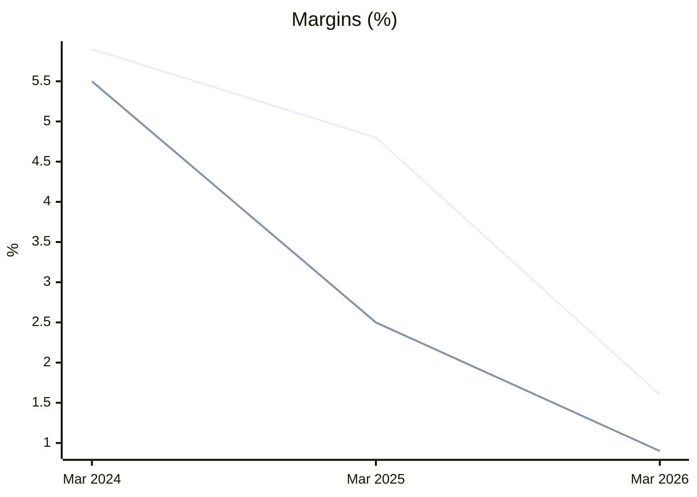

*Run 2026-11-24 · part of [SPINOFF_REPORT.md](../SPINOFF_REPORT.md) · the complete analysis of one company, with every management-call exchange in full.*

## RELIGARE — Religare Enterprises Ltd.

### 1. Religare Enterprises Ltd. — CONFIRMED DEMERGER

**CONFIRMED** (a demerger scheme is on the exchange record) · **PRE-SPIN — study the parent; the pieces do not trade yet** · score 5.0/10 · spin-off · 21 filing(s) from CALLS, NSE · first 2026-02-03, latest 2026-08-07

**The separated entities — every one the documents name:**

| Entity | Scheme | Business | Listing | Who runs it |
|---|---|---|---|---|
| **Religare Finvest Limited** | 2026 demerger of the financial services business of Religar… | All businesses pertaining to the financial services business activities including lending activities, broking… | to be listed | Mr. Karthik Srinivasan, Chief Executive Officer o… |

**The other parties to the scheme(s)** — not separated entities: Religare Digital Solutions Limited — merged in — no shares for the parent's holders

**What is being separated, as the documents put it:** REL's financial services business — lending, broking, investment activities and ancillary support services — transferred to Religare Finvest Limited — class `value_unlocking`.

### 2. Stages and dates

> **Listing:** NOT YET — scheme at 'exchange_noc' stage; Religare Finvest Limited will list only after NCLT sanction, effectiveness and a record date; indicated timeline: On February 14, 2026: "The company endeavours to complete the process and list RFL in Q1 of FY28"; Feb 16, 2026 call: process to take 15 to 18 months, culminating in Q1 FY28; NSE letter of July 07, 2026 requires listing and trading within sixty days of the NCLT order; as of August 7, 2026 RBI had not acceded to the no-objection request

| Date | Event | Source |
|---|---|---|
| 2026-02-03 | Stage reached: **announced** | [News Verification](-) |
| 2026-02-03 | Other — Religare Enterprises Limited | as stated: Exchange clarification on news item "Religare Enterprises likely to a… |
| 2026-02-14 | Board approval — Religare Enterprises Limited and Religare Finvest Limited (both boards) | as stated: Intimation of outcome of Board meeting under Regulation 30, dated Feb… |
| 2026-05-22 | Other — Religare Enterprises Limited | as stated: NSE Observation Letter dated July 07, 2026 — NSE letter reference no.… |
| 2026-07-07 | Stage reached: **exchange noc** | [Demerger](https://nsearchives.nseindia.com/corporate/RELIGARE_07072026181514_RELUPDATE07072026.pdf) |
| 2026-07-07 | SEBI observations — Religare Enterprises Limited | as stated: NSE Observation Letter dated July 07, 2026: "SEBI vide its letter dat… |
| 2026-07-07 | Exchange no-objection — Religare Enterprises Limited (NSE 'no objection'; BSE 'no adverse observations') | as stated: Intimation dated July 07, 2026 enclosing NSE observation letter (Ref:… |
| 2026-08-06 | Other — Religare Enterprises Limited (RBI letter; request not acceded to) | as stated: Intimation dated August 7, 2026: "The Company has received a letter d… |
| 2026-08-07 | Other — Religare Finvest Limited (similar RBI communication) | as stated: Intimation dated August 7, 2026: "A similar communication dated Augus… |

**The stages, as filed:** announced (2026-02-03) → exchange noc (2026-07-07)

**Stated in the filings:** resulting company **Religare Finvest Limited**.

**When it lists, in the documents' words:** On February 14, 2026: "The company endeavours to complete the process and list RFL in Q1 of FY28"; Feb 16, 2026 call: process to take 15 to 18 months, culminating in Q1 FY28; NSE letter of July 07, 2026 requires listing and trading within sixty days of the NCLT order; as of August 7, 2026 RBI had not acceded to the no-objection request

### 3. Size of the separated business beside the parent — is institutional selling likely?

**Reading: VERY LIKELY — the piece is under a tenth of the whole; index funds and large holders who receive it without choosing it tend to sell.**

| Entity | Stated turnover | Stated share of the whole | Segment revenue share | Market cap (₹ cr) | Share of combined market cap | Index member |
|---|---|---:|---:|---:|---:|---|
| Religare Finvest Limited | The turnover of the Demerged Undertaking for the year ended… | 6.2% | 6.4% (FY2026) | — | — | not listed |

*Stated figures are the documents' own (a turnover share, or the cost-of-acquisition split the company publishes for tax, which reflects relative value); the segment share is this business's revenue over the parent's sales, and the market-cap share is the entity's value over the entity plus the parent (parent ₹7,982 cr, NSE bhavcopy of 2026-11-13), both computed here.*

**In the documents' words:** “The turnover of the Demerged Undertaking for the year ended 31 March, 2025 was INR 457.29 Crores on a consolidated basis representing 6.2% of the total consolidated turnover of the Company for the year ended 31 March, 2025.”

**The judge's read of selling pressure:** likely — Small (6.2% of FY25 turnover), issued 1:1 to every REL holder, and documents say it suits a different set of investors

### 4. Insider ownership — share swap, promoters' holding, management incentives

**Share swap / entitlement, entity by entity:**

- **Religare Finvest Limited:** "1 fully paid-up equity share of INR 10/- each of the Resulting Company ("Resulting Company New Equity Shares"), credited as fully paid-up, for every 1 equity share of INR 10/- each of the Demerged Company"

**Promoters' holding, from the shareholding pattern:**

| Company | Promoters | FIIs | DIIs | Public | Quarter |
|---|---:|---:|---:|---:|---|
| Religare Enterprises Ltd. (RELIGARE) | 31.26% | 9.76% | 7.53% | 51.46% | Sep 2026 |

*Source: screener.in shareholding pattern, stored under `ShareholdingPattern/NiftyTotalMarket/`. In a mirror demerger each shareholder holds the same proportion of the new company as of the parent on the record date.*

- **Promoters in the parent, per the documents:** "The shareholding of the Burman family has further increased to 30.56% as on June 04, 2026, from 25.2% post the conclusion of the open offer in February 2025." (ICRA rationale, June 30, 2026). On the May 13, 2026 call: "I must also mention here that during the last quarter, the promoter group also increased stake in the company through open market purchases and the current shareholding is around 30.3%." On the February 16, 2026 call: "the promoter group on a fully diluted basis after the conversion of recently issued warrants shall hold 29.75% in REL, whereas the public continues to hold -- will continue to hold the remaining 70.25%."
- **What the promoters will hold in the separated entity:** 2026 demerger: "There shall be no change in shareholding pattern of REL pursuant to Scheme." and "Consequently, RFL's post-scheme equity shareholding pattern shall mirror REL's equity shareholding pattern as on Record Date (as defined in the Scheme)." / "Post-demerger, RFL's shareholding pattern will mirror REL's pre-demerger shareholding." / "Post-demerger, RFL will be listed on BSE and NSE with mirror image shareholding as REL." On the May 13, 2026 call: "I think the increase has been to the tune of roughly 4%. And post conversion of the warrants, assuming everybody converts their warrants, I mean, promoters should be close to about 34%." Look-through holding in Care: "the look-through shareholding of the promoter group today in CARE is at around 18% to 19%." 2022 RBL/RDSL scheme: not stated.
- **What a public shareholder receives:** 2026 demerger: "Upon the Scheme becoming effective and in consideration of the transfer and vesting of the Demerged Undertaking from REL to RFL in terms of this Scheme, RFL shall, issue and allot equity shares to all the members of REL, holding fully paid-up equity shares on the Record Date (as defined in the Scheme) in the following manner: "1 fully paid-up equity share of INR 10/- each of the Resulting Company ("Resulting Company New Equity Shares"), credited as fully paid-up, for every 1 equity share of INR 10/- each of the Demerged Company"" and "As consideration for the demerger, RFL will issue fully paid-up equity shares to REL shareholders on a 1:1 basis." / "REL shareholders shall receive 1 RFL share for every REL share held." "No cash consideration is payable under the Scheme." 2022 RBL/RDSL scheme: not stated (intra-group transfer of the E-Governance Undertaking on a "slump sale" basis between a wholly owned subsidiary and its own wholly owned subsidiary).
- **Management incentives:** Treatment of existing grants under the 2026 Scheme: not stated. Existing plan at the parent: "The Company has allotted 3,10,500 and 8,84,500 equity shares during the quarter and nine months ended December 31, 2024 respectively, pursuant to exercise of stock options granted under "Religare Enterprises Limited Employees Stock Option Plan 2019" (REL ESOP Scheme 2019). These equity shares of face value of Rs. 10/- each have been allotted at an exercise price ranging from Rs. 29.43 per share to Rs. 207.20 per share." Also: "Post end of the quarter / nine months, the Company further allotted 48,000 equity shares of face value of Rs. 10/- each under the REL ESOP Scheme, 2019 on February 03, 2025." Subsidiary ESOPs: "Care Health Insurance Limited, a subsidiary of the Company (CHIL) had granted 2,27,11,327 Employees Stock Options (ESOPs) to its Non-Executive Chairperson Dr. Rashmi Saluja in her capacity as an employee of the Holding Company Religare Enterprises ltd (REL) as per its ESOPs Scheme, of which 75,69,685 ESOPs have been exercised by her on October 04, 2023." IRDAI "issued directions to cause a buyback of 75,69,685 shares at the price at which they were allotted to Dr. Rashmi Saluja i.e. at INR 45.32 per share, and also cancel and revoke the stock options which remains unexercised and/or unvested as on the date of the Order"; on the February 16, 2026 call: "It is public knowledge that ESOPs to the tune of more than 2% of the equity of Care Health Insurance was granted to her, and we also understand that the one-third options which was exercised by her currently are something which is a subject matter of discussion in the courts as well as with the agencies." Scheme rationale cites incentive alignment: "Focused management attention: Enable mapping of employee performance and rewards to respective business outcomes, and facilitate attraction and retention of sector-specific talent and resources." Insider shareholding: "And Anuj remains a 5.5% shareholder." No new plan in the resulting company is stated.
- **Insider actions around the separation:** Promoter buying around the separation: "I must also mention here that during the last quarter, the promoter group also increased stake in the company through open market purchases and the current shareholding is around 30.3%." and "Yes, the promoters have increased their stake in the last quarter. I think the increase has been to the tune of roughly 4%. And post conversion of the warrants, assuming everybody converts their warrants, I mean, promoters should be close to about 34%." Capital commitment: "Capital raise via a preferential allotment of convertible warrants for ₹1,500 crore, to the promoters, the Burman family, and other investors during FY26" / "we also went ahead and concluded a preferential issue of warrants to the tune of INR1,500 crores, where promoter Group and the other marquee investors participated equally to the extent of INR750 crores each." Stated intent on further buying (to meet the insurance promoter threshold): "Now whether we can increase our stake to 26%, that is speculative. Time will tell. We have taken a first step." Legacy pledge by the erstwhile promoter: "The Decree Holder i.e. Daiichi has filed an application by suppressing the fact that the entire shareholding of RHC Holdings Pvt Ltd in Elive Info Tech Pvt Ltd. has been pledged in favour of RFL, as a security for various loans to group companies of RHC Holdings Pvt Ltd and obtained a status quo order on the brand "Religare"." No promoter or management selling is stated.
- **Insiders, per the checklist read:** Burman promoter group 30.56% as on June 04, 2026 (~34% post warrant conversion); subscribed ₹750 crore of ₹1,500 crore warrants; RFL shareholding will mirror REL's 1:1 · *option pricing date:* not stated

### 5. Why the demerger — point by point

Religare is demerging its entire financial services business — SME/MSME lending (Religare Finvest), retail broking plus e-governance (Religare Broking and its subsidiary Religare Digital Solutions), affordable housing finance (Religare Housing Development Finance, already an RFL subsidiary), and the related investment and ancillary/support activities — out of the listed holdco REL into RFL, which will itself be listed, leaving REL as a pure-play holder of its 63.2% stake in Care Health Insurance; REL shareholders get 1 RFL share for every REL share, and RFL's pre-scheme capital held by REL is cancelled so RFL's shareholding mirrors REL's. Management framed it as three converging conditions rather than a reaction to distress: the Burman Group's completed takeover as promoters (open offer concluded Feb 2025, board reconstituted July 2025, promoters at 29.75% fully diluted in Feb 2026 and ~30.3% by May 2026 after ~4% of open-market buying, heading to ~34% on warrant conversion), the INR1,500 crore preferential warrant raise subscribed 50:50 by the Burmans and marquee investors (earmarked INR600 crore to Care, INR250 crore to housing finance, INR200 crore to broking, INR75 crore to repay REL's own debt and INR375 crore general corporate purpose), and the fact that the businesses had reached an inflection point where "each business also operates with different capital requirements, risk frameworks, manpower talent and growth trajectories." The stated problems it solves are a conglomerate structure in which insurance (FY26 GWP INR11,417 crore, PBT INR539 crore on 'n' basis, 19.7% retail SAHI share) drowns out a tiny financial services segment (FY25 demerged-undertaking turnover of only INR457.29 crore, 6.2% of consolidated revenue), investors who cannot value the two halves, and management bandwidth: the scheme's four pillars are streamlined focus/simplified structure, value unlocking plus targeted capital raising through a separate RFL listing, dedicated leadership with sector-specific talent and performance-linked rewards, and risk/compliance frameworks tailored to each segment. The financial services side is being restarted from a cleaned-up base — RFL is debt-free with all legacy promoter-era diversion issues provided or written off (including the full INR750 crore Lakshmi Vilas Bank FD), RBI's Corrective Action Plan lifted in July 2025 and bank fraud tags removed, leaving ~INR591 crore cash, ~INR900 crore net worth, 261% CRAR, NOF of INR821 crore and only a ~INR60 crore core SME book — so Arjun Lamba tied the demerger directly to scaling: "Our intent is to scale all of these business to make them meaningful and sizable and part of this demerger is on account of this." Who asked for it: shareholders and analysts had been pressing since the first call back in Nov 2025 (Vikas Shrivastav on demerging Care and removing the holdco discount, Dixit Doshi on IPO vs demerger of Care), and after the announcement nearly every questioner — Umang Shah, Adarsh, Hitaindra Pradhan, Ravi Purohit, Niharika Karnani, Sarvesh Gupta — argued the value sits in Care and demanded a reverse merger giving direct Care shares, citing the Max Financial precedent. Management conceded the point but said IRDAI's 25–26% promoter requirement cannot be met while the Burmans' look-through stake in Care is only ~18–19%, so this was "the first step in that direction," done after evaluating structural alternatives with leading advisors; Lamba refused to amend the scheme and would not commit to a timeline for a second one. Execution has since run into the regulator: exchanges gave no-objection/no-adverse-observation letters on 7 July 2026, but on 6–7 August 2026 RBI informed REL and RFL that their application for no-objection/prior approval "has not been acceded to," and the companies said they would engage further with the regulator.

**Point by point, with the source:**

1. Asked outright about demerging Care and the other subsidiaries from the holdco and about removing the holdco discount, Pratul Gupta said nothing was decided — the board was weighing options and wanted to strengthen the businesses first, after the INR1,500 crore raise, before any capital-market action. “On the second question about how the structure will look like in some future time, what I can very clearly assure you is that the management and the Board is evaluating various options which can add value to the shareholders.” — *[Nov 2025](https://www.bseindia.com/stockinfo/AnnPdfOpen.aspx?Pname=25fe79a7-8023-4efc-9cd6-43c8dee47d4f.pdf)*
2. Investors were already framing the choice as Care IPO versus demerger; Dixit Doshi asked it explicitly alongside questions on NBFC yields, showing the separation idea originated with shareholders rather than management. “And in terms of your initial comments on the value unlocking, if you can just touch upon whether we will be looking for an IPO for the care health business or we will be better off with the de -merger of the business?” — *[Nov 2025](https://www.bseindia.com/stockinfo/AnnPdfOpen.aspx?Pname=25fe79a7-8023-4efc-9cd6-43c8dee47d4f.pdf)*
3. Gupta presented the demerger as a strategic imperative rather than a housekeeping exercise, announced two days after the REL and RFL boards approved it on 14 Feb 2026. “It is a strategic imperati ve step designed to unlock shareholder value, create business clarity and position the resulting entities for sustained long -term growth.” — *[Feb 2026](https://www.bseindia.com/stockinfo/AnnPdfOpen.aspx?Pname=b273d588-fe12-446c-bee6-b5d6269b6a44.pdf)*
4. The trigger was three converging conditions — the Burman takeover as promoters, the INR1,500 crore warrant raise covering funding needs for the foreseeable future, and the businesses reaching a scale that demands specialised focus. “Each business also operates with different capital requirements, risk frameworks, manpower talent and growth trajectories.” — *[Feb 2026](https://www.bseindia.com/stockinfo/AnnPdfOpen.aspx?Pname=b273d588-fe12-446c-bee6-b5d6269b6a44.pdf)*
5. Mechanics: lending, broking and ancillary support services move from REL to RFL on a going-concern basis, the Care stake stays in REL, RFL issues one share per REL share and then lists, with a 15–18 month process ending in Q1 FY28. “The lending, broking and ancillary support services held under REL shall be demer ged into RFL on a going concern basis. The investment in CARE shall continue to be retained in REL.” — *[Feb 2026](https://www.bseindia.com/stockinfo/AnnPdfOpen.aspx?Pname=b273d588-fe12-446c-bee6-b5d6269b6a44.pdf)*
6. A separate RFL listing is meant to unlock value, widen investor participation and let that business raise its own capital — the second of four stated pillars. “The independent listing of RFL is expected to unlock shareholder value and enhance investor participation.” — *[Feb 2026](https://www.bseindia.com/stockinfo/AnnPdfOpen.aspx?Pname=b273d588-fe12-446c-bee6-b5d6269b6a44.pdf)*
7. Analysts attacked the design immediately: Umang Shah argued demerging Care directly would have removed the holdco discount on the asset that carries most of the value. “I'm a bit puzzled why we chose to demerge financial services and not CARE directly?” — *[Feb 2026](https://www.bseindia.com/stockinfo/AnnPdfOpen.aspx?Pname=b273d588-fe12-446c-bee6-b5d6269b6a44.pdf)*
8. Gupta positioned this as stage one of a longer restructuring, with a Care reverse merger possible later once unspecified milestones and minimum-shareholding thresholds are met. “Well, I think this is -- as I mentioned, this is the first step in that direction.” — *[Feb 2026](https://www.bseindia.com/stockinfo/AnnPdfOpen.aspx?Pname=b273d588-fe12-446c-bee6-b5d6269b6a44.pdf)*
9. The binding constraint on a Care reverse merger is the IRDAI promoter-shareholding rule against a Burman look-through stake in Care of only ~18–19%, which Gupta confirmed when Vikas Srivastava spelled out the law. “So you are right in terms of the fact that the look - through shareholding of the promoter group today in CARE is at around 18% to 19%.” — *[Feb 2026](https://www.bseindia.com/stockinfo/AnnPdfOpen.aspx?Pname=b273d588-fe12-446c-bee6-b5d6269b6a44.pdf)*
10. Management said the structure was chosen after a full review of alternatives with external advisors, and promised no operational, customer or employee disruption during implementation. “This has resulted after comprehensive evalu ation of various structural alternatives which were discussed with leading advisors.” — *[Feb 2026](https://www.bseindia.com/stockinfo/AnnPdfOpen.aspx?Pname=b273d588-fe12-446c-bee6-b5d6269b6a44.pdf)*
11. Arjun Lamba restated the core purpose as separating financial services from insurance to give shareholders a clean, understandable structure and management a single focus, while acknowledging the holdco-discount complaint. “And for us, number one has been to separate the FS business from the insurance business and to provide a clean structure so that the shareholders can understand, th e management can be very focused in doing what they have to do.” — *[May 2026](https://www.bseindia.com/stockinfo/AnnPdfOpen.aspx?Pname=87938b4d-578d-40b0-89a8-7803462a6057.pdf)*
12. Lamba linked the demerger to the capital allocation plan — INR600 crore to Care, INR250 crore to housing finance, INR200 crore to broking, ~INR375 crore general corporate purpose, with RFL needing none given ~INR900–1,000 crore net worth and ~INR600 crore cash. “Our intent is to scale all of these business to make them meaningful and sizable and part of this demerger is on account of this.” — *[May 2026](https://www.bseindia.com/stockinfo/AnnPdfOpen.aspx?Pname=87938b4d-578d-40b0-89a8-7803462a6057.pdf)*
13. Pressed by Vikas Srivastava on whether the scheme could be amended to fold Care in once the promoters reach 26%, Lamba ruled out amending it but left a subsequent scheme open. “No, I'll answer your last question first. We don't want to amend the scheme.” — *[May 2026](https://www.bseindia.com/stockinfo/AnnPdfOpen.aspx?Pname=87938b4d-578d-40b0-89a8-7803462a6057.pdf)*
14. Lamba conceded the value is concentrated in Care and said the separation is intended to create value in the other entity too, as promoters moved from ~26% toward ~34% diluted. “Yes, we understand that the value is in Care. We are cognizant of that. That's why we are separating the entities, creating clear paths, and we hope to create value in the other entity as well” — *[May 2026](https://www.bseindia.com/stockinfo/AnnPdfOpen.aspx?Pname=87938b4d-578d-40b0-89a8-7803462a6057.pdf)*
15. The 14 Feb 2026 filing states the demerged undertaking is all of REL's financial services activity — lending, broking, investment and ancillary/support services — explicitly excluding the retained insurance business, i.e. the Care Health shareholding. “Provided that, the Demerged Undertaking shall exclude the Remaining Business ( as defined in the Scheme ) compris ing of all the units, divisions, undertakings, assets and liabilities in relation to the Demerged Company’s insurance business, comprising of its investment and shareholding in Care Health Insurance Limited .” — *Scheme*
16. The scheme quantifies how small the demerged half is: FY25 turnover of INR457.29 crore on a consolidated basis, just 6.2% of REL's consolidated turnover. “The turnover of the Demerged Undertaking for the year ended 31  March , 202 5 was INR 457.29 Crores on a consolidated basis  representing 6.2% of the total consolidated turnover of the Company for the year ended 31 March , 202 5.” — *Scheme*
17. Stated rationale includes that the two businesses face different competition and attract different investors, partners and lenders, and that a separately listed vehicle enables sector-focused talent and growth opportunities. “The nature and competition involved in the businesses comprising of the Demerged Undertaking is distinct from the other businesses and it is capable of attracting a different set of investors, strategic partners, lenders and other stakeholders.” — *Scheme*
18. The press release lists four objectives — streamlining businesses, listing financial services, focused management with performance mapped to each business, and segment-tailored risk and compliance frameworks — with 1:1 mirror shareholding in RFL and listing targeted for Q1 FY28. “Focused management attention:  Enable mapping of employee p erformance and rewards to respective business outcomes, and facilitate attraction and retention of sector -specific talent and resources.” — *Scheme*
19. SEBI's comments routed through the NSE observation letter of 7 July 2026 require REL to disclose the need for the demerger, cost-benefit analysis, risks and the RBI approval position to shareholders — i.e. the rationale was not yet fully documented for them. “Need for demerger, rationale of the scheme, synergies of  business of the entities involved in the scheme, impact of the scheme on the shareholders and cost benefit analysis of the s cheme.” — *Scheme*
20. Execution setback: after exchange no-objections on 7 July 2026, RBI declined the no-objection/prior-approval applications of both REL and RFL in letters dated 6 and 7 August 2026, and the companies said they would go back to the regulator. “The Company has received a letter dated August 6, 2026 , from the RBI, conveying that the application has been examined and that the request has not been acceded to .” — *Scheme*

**How it evolved:** On the Nov 2025 call (Q2/H1 FY26, the first investor call after the Burman takeover) there was no plan — Vikas Shrivastav asked directly what the structure would look like in two years and whether Care would be demerged from the holdco, and CFO Pratul Gupta would only say the board was evaluating options and wanted to make the businesses "larger, better, stronger" before any capital-market action, while Dixit Doshi asked whether Care would be IPO'd or demerged. A Moneycontrol report on 3 Feb 2026 that REL would demerge and list Care drew an exchange query, which REL denied as a disclosable event; eleven days later, on 14 Feb 2026, the REL and RFL boards approved the scheme — and the Feb 2026 call (16 Feb) was where Gupta laid out the full rationale, the four pillars, the 1:1 ratio, the 15–18 month timetable and a Q1 FY28 RFL listing, while every analyst pushed back that Care, not financial services, should have been separated. By the May 2026 call (13 May, Q4/FY26) the framing had shifted from Gupta's structural logic to Executive Director Arjun Lamba's: separating FS from insurance was "number one," the promoters had bought ~4% more stock toward the IRDAI threshold, and he declined to amend the scheme while leaving a later reverse merger of Care open "at an appropriate stage." The 7 July 2026 exchange observation letters cleared the way, but the 7 Aug 2026 filings disclosed RBI had refused to accede to the application, leaving the scheme stalled pending further engagement.

**What management expects from it:** REL becomes a pure-play health insurance holdco around Care (GWP INR11,417 crore, PBT INR539 crore 'n' basis, combined ratio heading from 101.4% to ~100% in two years on operating leverage, 18–24% growth). RFL becomes an integrated, separately listed financial services platform — debt-free, ~INR900 crore net worth, ~INR591 crore cash, 261% CRAR — able to leverage to industry norms, raise targeted capital, hire sector-specific leadership on performance-linked rewards, run tailored risk frameworks, and unlock value via mirror 1:1 listing.

*Not explained on the calls:* No cost-benefit or synergy quantification, no RFL valuation or AUM/ROE targets, no holdco-discount fix or Care reverse-merger timeline, no stated path to IRDAI's 26%, and no RBI-rejection reasoning.

- *Stated reason, in one line:* Growth needs differentiated strategy; business is distinct and attracts different investors, lenders and partners; focused management, targeted regulatory compliance and risk frameworks; separate listing to unlock value for REL shareholders
- *What it reveals:* RFL is debt-free with ₹898.8 crore net worth, 261.9% CRAR and ~₹591 crore cash, yet the demerged undertaking was only 6.2% of FY25 consolidated turnover; REL retains Care Health, where management says the value is
- *Parent or spin:* both · *Read next:* The next intimation on RBI no-objection after its August 6, 2026 refusal — the scheme's gating approval
- *In their words:* “The Company has received a letter dated August 6, 2026, from the RBI, conveying that the application has been examined and that the request has not been acceded to.”

### 6. On the calls, verbatim

3 call(s), oldest first: **20 question-and-answer exchange(s)** given in full — the question and every answer to it, nothing trimmed — and 9 passage(s) from management's prepared remarks (the complete sentences about it; the whole remarks are in the linked transcript). Text is as the transcript prints it.

#### Nov 2025 — [transcript](https://www.bseindia.com/stockinfo/AnnPdfOpen.aspx?Pname=25fe79a7-8023-4efc-9cd6-43c8dee47d4f.pdf)

**From the prepared remarks** *(the passage about it; the whole turn runs to 1,812 characters in the transcript)*

> **Scrip Symbol:** AMBRISH JINDAL – CHIEF FINANCIAL OFFICER – CARE HEALTH INSURANCE MR. TIRLOCKEE CHAUHAN – CHIEF FINANCIAL OFFICER – RELIGARE BROKING LIMITED MR. MINISH HANDA – BUSINESS HEAD – RELIGA RE BROKING LIMITED MR. PANKAJ SHARMA – CHIEF EXECUTIVE OFFICER – RELIGARE FINVEST LIMITED MR. PRAKASH JEJANI – CHIEF FINANCIAL OFFICER – RELIGARE FINVEST LIMITED MR. RAHUL MEHROTRA – MANAGING DIRECTOR AND CHIEF EXECUTIVE OFFICER – RELIGARE HOUSING FINANCE CORPORATION MR GAGAN CHHABRA – CHIEF FINANCIAL OFFICER – RELIGARE HOUSING FINANCE CORPORATION

**From the prepared remarks** *(the passage about it; the whole turn runs to 8,430 characters in the transcript)*

> **Pratul Gupta:** From Religare Broking Limited, we have Mr. Tirlockee Chauhan , Chief Fi nancial Officer, and Mr. Minish Handa, who is the Business Head for Broking Business. From Religare Finvest Limited, we are joined by Mr. Pankaj Sharma, who is the Chief Executive Officer there, and Mr. Prak ash Jejani, who is the Chief Financial Officer. Religare Enterprises Limited November 14, 2025 From Religare Housing Finance Corporation, we are joined by Mr. […] Multichannel servicing is the key for us via branches, partners, digital and centralized servicing desk. In addition, the business also offers e -governance services through a Religare Enterprises Limited November 14, 2025 digital platform supported by a nationwide agent network. The business boasts of a total customer base of 12 lakhs with active clients at 2. 5 lakh and branches 68 branches. Religare Finvest Limited or our SME loan business is an NBFC with over 15 years of experience in secured SME lending. Currently, the entity is debt -free. All the legacy issues have been resolved, and we have robust financials and the business is ready to r estart. It currently has a CRAR of 197.6% and a net NPA of around 1%. The housing finance business, which is a subsidiary of Religare Finvest Limited is focused on affordable and mid -income housing in smaller towns and cities. Currently, the business boasts of an AUM of INR245-odd crores and are serving 3,200 customers currently with presence across 8 states. To our mind, a strong promoter group, massive addressable opportunity, the financial strength of the company, together with experienced team and a v ery robust corporate governance system being established, REL is now well poised to be a very robust financial services platform. Just to remind the audience, the group structure is available on Slide 6. Religare Enterprises Limited is the listed Holdco a nd holds 63.2% share in Care Health Insurance, which is our leading business, followed by Religare Broking Limited, which is a wholly owned subsidiary and Religare Finvest Limited, again, a wholly owned subsidiary. And Religare Finvest in turn holds 87.5% in Religare Housing Finance. Without getting too much into the past, I think the way to look at our journey is the future. I'll just give a very brief synopsis of the key milestones, which have been covered since the time change of control happened at Rel igare Enterprises Limited in February 2025 with Burman Group being designated as promoters of REL post the successful completion of open offer, which was initiated in September 2023. In July 2025, the Board of REL was reconstituted with the inductio n of d irectors representing the promoters after regulators' approval. And immediately thereafter, we also received good news from RFL point of view in terms of removal of corrective action plan on Religare Finvest Limited and removal of fraud tag on the same sub sidiary. During the same period, we also went ahead and concluded a preferential issue of warrants to the tune of INR1,500 crores , where promoter Group and the other marquee investors participated equally to the extent of INR750 crores each. We thank our promoters and the investors for the same. And our belief as a management now is that REL is well positioned to deliver a sustainable profitable growth across all verticals .

**From the prepared remarks** *(the passage about it; the whole turn runs to 4,015 characters in the transcript)*

> **Tirlockee Chauhan:** The company has 1,400 plus touch points across 400 plus cities and towns serving 12 lakhs plus customers and active customer base is 2.5 lakhs. RBL has its in -house research capability covering all major stocks and commodities that help the customer to cater long -term wealth. RBL distribution strategy combined with o wn-branch and with a wide network of sub - brokers and franchisees ensuring deep market penetration and brand visibility across India. I am happy to share that during the quarter, e -governance business of Religare Broking has been demerged and transferred to Religare Digital Solutions Limited which is a wholly -owned subsidiary of Religare Broking Limited, pursuant to the scheme of arrangement approved by the Honorable NCLT. So I am just coming to the next slide that gives the e -governance business model how we operate. So we operate through a distributed -agent model and we have close to 56,500 distributed networks. And we provide the e -governance services: PAN, TA N, eTDS, ePAN, digital services, citizenship services, bill payment, mobile, DTH, recharge, U P bill payment and there are various other services which we provide to the customers at large.

**From the prepared remarks** *(the passage about it; the whole turn runs to 25 characters in the transcript)*

> **Pratul Gupta:** Religare Finvest Limited.

**Question and answer**

> **Vikas Shrivastav:** Yeah. Thank you. I have two questions. One is, of course, what are the key management personnel which you will hire in the foreseeable future? And my second question is what does the corporate structure look like two years from now? Specific question I am asking is r egarding the demerger of Care and the other two, three subsidiaries from the HoldCo and in terms of any plans, what are the plans there?
>
> **Pratul Gupta:** Thanks Vikas for the question. And so on your first question, while the leadership hiring is on and I am happy to report that in the last two weeks, we have informed the markets that we have onboarded Group General Counsel Babu Rao. He has joined us from Bajaj Finance Ltd. And we have also on -boarded Indranil Ch oudhury as Group CHRO from UTI Mutual Fund. Some more hiring is in the pipeline at REL level. Apart from this, the management has also taken credible steps to identify business leaders across different businesses we are in and the process is on. So, in next couple of quarters, you will see many more experienced business leaders joining the platform across the HoldCo and subsidiaries and improve the management structure from thereon. On the second question about how the structure will look like in some future time, what I can very clearly assure you is that the management and the Board is evaluating various options which can add value to the shareholders. However, various kinds of proposals and plans keep getting discussed. As and when there is anything credible in place even regarding Care , we will c ome back to the markets. Currently we believe that all the businesses are very well capitalized particularly after the recent infusion of capital at REL. We would want to curate these businesses and make them more resilient and robust before taking any cap ital market action in this regard.

**Question and answer**

> **Dixit Doshi:** Okay. And in NBFC business, if you can just broadly touch upon, so obviously with so much under leverage, we have a huge opportunity but what kind of business segment we will be targeting or what kind of yield at which we will be lending, if you can give us some broad understanding on that NBFC business, that will be helpful. And in terms of your initial comments on the value unlocking, if you can j ust touch upon whether we will be looking for an IPO for the care health business or we will be better off with the de -merger of the business? Thank you.
>
> **Pankaj Sharma:** Yeah, hi Pankaj this side, I'll take the first part of the question. On the NBFC front , as we mentioned, as I also mentioned in my opening remarks, right now the platform has been made completely clean of the legacy issues and their transformation is under process right now whereby IT and other required infrastructure is being put in place and the Board of Directors has already just been strengthened by way of the onboarding of the promoter family nominee. So, once this is done, the plans around the new business are getting formulated, and as and when they get finalized, they will be shared with the public at large. And on the cash front, yes, there is enough capital and when the further capital infusion at this point of time is not required, because INR812 crores lying in net worth and with INR430 odd crores lying in cash, there is no immed iate requirement of any capital infusion even by way of equity or debt. Thank you. And over to Pratul for the second part of the question.
>
> **Pratul Gupta:** Yeah. Thanks Pankaj. So, Dixit, on the second part regarding evaluating various options, as I mentione d earlier, we keep evaluating various proposals pertaining to the monetization or strategic initiatives that could be taken. Religare Enterprises Limited November 14, 2025 As I mentioned earlier, right now with this capital infusion, we are looking at making these businesses larger, better, stronger a nd at the opportune time when we feel that we can maximize shareholder value is when we will look at any such steps. We will discuss with the Board and come back to you and guide the market about it accordingly.
>
> **Dixit Doshi:** Okay. Thank you.

#### Feb 2026 — [transcript](https://www.bseindia.com/stockinfo/AnnPdfOpen.aspx?Pname=b273d588-fe12-446c-bee6-b5d6269b6a44.pdf)

**From the prepared remarks** *(the passage about it; the whole turn runs to 7,260 characters in the transcript)*

> **Manasi Bodas:** The group structure is as depicted in the slide. We have listed Religare Enterprises , below which there is Care Health Insurance, wherein Religare Enterprises holds 63.2% share. We also have a wholly owned subsidiary called Religare Broking Limited, which in turn also holds Religare Digital Solutions Limited, which is its wholly owned subsidiary. Religare Enterprises Limited February 16, 2026 The SME platform, Religare Finvest Limited, which is another arm of lending segment, is a wholly owned subsidiary and Religare Housing Finance -- Housing Development Finance Corporation is a significant subsidiary, which is below Religare Finvest. Religare holds majority strategic stakes across insu rance and financial services platforms, which we believe are ready for growth. Moving to Slide 7. At an industry level, the quarter ended December marked a broad -based performance across India's financial services sector.

**From the prepared remarks** *(the passage about it; the whole turn runs to 1,733 characters in the transcript)*

> **Pratul Gupta:** Thank you, Vijay. We now move over to Religare Finvest Limited. We are on slide 26. Religare Finvest Limited is a part of financial services se gment of Religare and it is categorized as a middle layer NBFC. RFL currently has a core book of SME of INR70 crores which is left, along with a cash balance of INR480 crores. This kind of cash collection has been possible because of our tremendous focus o n collections and recovery. Our collection efficiency continues to be 99% or thereabouts. Our net NPA ratio has continued to be very stable and is at 1%, and CRAR, which is the regulatory ratio, is at 228%. This quarter marked continued recovery from the loan book following regulatory clean -up. Asset quality remained stable, reflecting close portfolio monitoring. The focus of the employees also made sure that the organization is ready for the next phase of rebuilding the business and growth with the leade rship team being there. As I mentioned earlier, the cash is available, there is enough capital by way of net worth in excess of INR800 crores, and the platform is ready for next business line that we choose to adopt. During the quarter, the board has been strengthened with members from the promoter group as well as addition of independent directors. Religare Enterprises Limited February 16, 2026 Coming to slide 27, while it seems a busy slide, my takeaway is all the legacy issues have been resolved now, there are no cumulative ALM mismatches in any of the buckets, and our IT platforms are currently getting refurbished to take care of future business needs as and when we restart the business. To take you through the financials, I'll request Mr. Prakash Jejani, the CFO of Religare Finvest to give his comm ents.

**From the prepared remarks** *(the passage about it; the whole turn runs to 7,739 characters in the transcript)*

> **Pratul Gupta:** Thank you, Rahul. Now that we have discussed the quarter gone by, let me get to the other part where we will discuss about reorganization of Religare and demerger of its financial services business. On 14th Feb 2026 this year, the Boards of Religare Enterp rises Limited and Religare Finvest Limited have approved the demerger of financial services and insurance businesses of the group into two focused and independent listed entities. This is not just a structural or reorganization. It is a strategic imperati ve step designed to unlock shareholder value, create business clarity and position the resulting entities for sustained long - term growth. Let me explain the rationale a bit in detail. […] As you see, the promoter group on a fully diluted basis after the conversion of recently issued warrants shall hold 29 .75% in REL, whereas the public continues to hold -- will continue to hold the remaining 70.25%. And as mentioned earlier, we have Care on one side as the insurance segment, and we have NBFCs, RFL and housing, one below the other and broking as Financial S ervices segment. Just to remind, as far as REL is concerned, its stock is listed on BSE and NSE, whereas RFL is an unlisted entity, and it is registered with RBI as a middle layer category, NBFC. Now if you see Slide 37, this demerger is built on 4 pillars. First, streamlined business focus and simplified structure. The segregation of financial services from insurance business is to create a focused entity with specific business model, growth strategy, capital deployment and performance metrics for t he teams. Secondly, unlocking shareholder value through a separate listing. The independent listing of RFL is expected to unlock shareholder value and enhance investor participation. It will facilitate targeted capital raising for this business and enable more efficient allocation of management resources, thereby supporting sustainable growth and long -term value creation by this newly created company. Third, the focused management attention and talent alignment. Post demerger, each entity will have dedica ted leadership teams. The leadership teams are already in the hiring mode. They'll require sharper operational alignment and clearer strategic mandates. Decision -making has to become faster. […] So with these objectives in mind, there was a need to bring in this clarity. This will also help us set up the objectives for the new incumbents as we hire the senior leadership for different components of the business. Both enhance r isk management and compliance. The demerger enables implementation of spec ific risk management policies and internal compliance frameworks tailored to each business segment. This improves monitoring and control of risk associated with them. Now moving to Slide 38. Let me just outline the proposed structure more clearly. This is demerger of Financial Services business from REL to RFL pursuant to proposed scheme of arrangement. The lending, broking and ancillary support services held under REL shall be demer ged into RFL on a going concern basis. The investment in CARE shall continue to be retained in REL. As a consideration for transfer of financial services business, RFL will issue fully paid -up equity shares to the shareholders of REL in a 1:1 ratio. […] As mentioned earlier, we aim to list RFL in the first quarter of FY 2028 after the completion of the process. For the remaining, REL is as it exists today. The listed entity shall continue to hold its entire stake in Care Health Insurance as it do es today. This demerger will be implemented through a scheme of arrangement under sections 230 to 232 of the Companies Act 2013 and other relevant provisions of the act read in conjunction with them. The scheme shall also require various regulatory approv als as well as shareholders' and creditors' approval. The company expects the entire process to take 15 to 18 months starting from the current quarter and shall culminate in the first quarter of FY ‘28. The detailed timelines can be referred to in slide 40, which is there before you, with various steps being appended alongside. We believe that during this period there will be no disruption to operations, no impact on customers and no change to employ ee continuity. We are committed to ensuring a seamless transition with complete operational continuity. Just to reiterate, post demerger, each business will have a clarity and focus to pursue its own growth path. This has resulted after comprehensive evalu ation of various structural alternatives which were discussed with leading advisors. The Board concluded that this particular initiative and option represents the most efficient and future -ready structure for our next phase of growth. Any future fundraisi ng as and when required will be undertaken based on business growth plans, capital requirements and strategic opportunities and will be subject to necessary corporate and regulatory approvals. Just to summarize, we are creating a simplified structure with independent business segments concentrating on their core competencies. We are unlocking shareholder value through separate listing that enhances investor participation and enables targeted growth. We are enabling better management alignment with sector -specific talent acquisition and performance -linked rewards. We are implementing enhanced risk management with tailored compliance frameworks and strengthened governance. And last but not the least, we are executing this transformation backed by a very stro ng commitment from the Board and the promoter group.

**Question and answer**

> **Umang Shah:** So firstly, congrats on the demerger proceeding. And my question is related to that only. So I mean , I'm a bit puzzled why we chose to demerge financial services and not CARE directly? Because when we talk about value unlocking, most part of HoldCo or discount that is there on CARE in our overall financials, that could have gone away directly. So any specific reason why we chose RFL and not to demerge CARE separately?
>
> **Pratul Gupta:** So Umang, we have not demerged RFL as such. We are basically demerging the entire financial services business of Religare into RFL, one. Secondly, this is a step in the direction or let's say, this is the path towards the final outcome wherein we believe that each business needs to operate independently. However, the current consideration before the Board allowed us to take this first step. And possibly in future, we will take some in cremental steps to complete the demerger in complete sense in terms of insurance business. As of now, the structure is that the listed entity, REL will continue to hold the entire shareholding of CARE.

**Question and answer**

> **Umang Shah:** Right, sir. So we are planning a reverse m erger with REL in future after this demerger . I mean we could have incorporated that in this scheme of arrangement. So any specific reason why we chose to postpone it after 18 months?
>
> **Pratul Gupta:** Well, I think this is -- as I mentioned, this is the first step in that direction. And as and when the conditions are conducive and there are certain other milestones which are achieved by these businesses, we could be evaluating such options in the future.

**Question and answer**

> **Umang Shah:** Okay, sir. Okay. No, I had my question only related to demerger. Otherwise, business is absolutely -- it's in your control. So I don't have many questions over there, sir. Great. Thank you so much.

**Question and answer**

> **Adarsh:** Got it. And sir, then I just -- if you can lay out over a two, three year period for the broking , NBFC and the housing business, what are the broad aspirations plans over a two, three year period, you do have unutilized equity there and you're talking about another INR900 crores, which is INR1,500 crores minus INR600 crores. So it's a lot of equity in the broking or NBFC or the HFC. So if you could just highlight what the plan and the use of capital there would be?
>
> **Pratul Gupta:** Sure. So I think during my narration, I did m ention that the leadership for these businesses is coming into place. But very broadly, what I can tell you is that most of the accounts are right now unleveraged. So if I look at Religare Finvest Limited, we are sitting on a cash of INR500 crores, complet ely unlevered. So as and when we start the business with new leadership team coming in place, we are definitely looking at levering this to industry standards in the next couple of years. That's the aspiration. In terms of housing, again, right now, we don't have any lending lines, and we have aimed to infuse a large sum up to INR250 crores in housing finance. So there also, we are taking steps to start leveraging there and get banking lines and expand the franch ise to a much larger number. In terms of broking, we just have the company of Vijay. He is right now evaluating the business on a 360 -degree basis. And I am sure by the time we interact next time, we will have more details on our side to discuss in terms of broking expansion plans.
>
> **Adarsh:** Perfect. This is useful. Thank you.

**Question and answer**

> **Niteen Dharmawat:** Thank you for the opportunity. So actually to see the demerger scheme and the things that you explained. So you mentioned that there are certain parameters and certain milestones that you Religare Enterprises Limited February 16, 2026 would like to see before next steps can be taken. So can you elaborate more on that? What are the things in your mind before you take up the next steps?
>
> **Pratul Gupta:** So well, I mean, some of the milestones pertain to how we sort of grow this business. And what is the growth trajectory we are looking at, what kind of holding structures are there. So there is a promoter gr oup above Religare Enterprise. We also need to see what are the regulatory thresholds we need to sort of keep in mind in terms of minimum shareholding requirement. So some of the considerations need to be in place before any incremental steps could be tak en in that regard. But we thought and we evaluated that this is a good credible first step in that direction.

**Question and answer**

> **Hitaindra Pradhan:** Yes. So first question on the demerger. So I think there is an IRDA requirement of promoter shareholding, which I think along with the private equity investor at the CARE level, we could have probably met with the fund infusion also happening in place in REL. So was there a reluctance on part of the private equity investor to be the promoter for CARE because of which we could not have done the overall demerger in the way it would have captured the entire value?
>
> **Pratul Gupta:** Well, without specifically commenting on a particular stakeholder or participant, what I would like to say Hitaindra is that there are certain conversations, certain situations which need to be sort of a chieved before we take that step. So you are right in terms of the fact that the look - through shareholding of the promoter group today in CARE is at around 18% to 19%. However, there are -- there is a thinking to move ahead on that. And at an appropriate t ime, we will be able to come back to the shareholders with the decisions about it.

**Question and answer**

> **Vikas Srivastava:** That is comforting. My name is Vikas. Now just coming to the demerged part of the business, I'm again reconfirming -- what I understand is that no legacy amounts are still in the balance sheet as assets. They've all been writt en off. Whatever we recover will be a bonus. And just back of the envelope totalling I was doing while you were speaking earlier, is my understanding right that the non -- after writing off everything, the DB, the Lakshmi Vilas Bank and all the earlier loans, the book value of your demerged business is about INR70 to INR90 a share. Is my understanding, would that be right, approximately, give or take, INR5-INR10 crores here or there? Because would that also -- sorry, let me just compl ete. Also, would that include the -- I'm assuming out of the INR1,500 crores, INR900 crores is going to come. You said INR600 crores you are allocating to the insurance business. So all the other INR900 crores would come to the demerged entity. Just befor e and after with the INR900 crores without the INR900 crores, what is the book value of our assets there in the sense that what is the cash, what is the surplus cash, where are we with or without this INR900 crores on all these companies combined? Pratul G upta: So Vikas, as I mentioned, it will be difficult for me to give you the share price of the resulting company. What I can tell you right now is that RFL currently is as I mentioned earlier, sitting on a cash of INR500 crores plus, the total net worth is INR800 crores plus. The net worth of Religare Broking is over INR350 crores, it is approximately INR366 crores. In case of RFL, housing is assumed there. Then on top of it, you are right, a large part of INR900 crores is going to flow towards financial s ervices business. So apart from some operating expenses, the remaining amounts shall flow towards financial services business. Religare Enterprises Limited February 16, 2026

**Question and answer**

> **Vikas Srivastava:** I appreciate that. Now, last question. You've been very helpful. So just this last question. You know, last call you said that with DB taking over LVB and again, this LVB though it is sub - judice, there is also been a, there' s a commitment that 50% of the -- this was an FD and interest, and you did mention on the last call that we have a very strong case and DB being a stronger bank, you did express an opinion that your case was very, very strong. Is there any possibility of an out -of-court settlement? Are we discussing it or are we just going hammer and tong since our case is so strong, are we going hammer and tong on the high court case? Is it also that since it was an FD with a coupon rate, the interest, the probability of getting interest is high? And my last question on this is that you have a transaction with 50% of the principal of Deutsche Bank, sorry, 70 % and 50% of the interest has to go to has to go to the erstwhile lenders with whom you've made a erstwhile settleme nt. Even if I reduce that, that amount also comes to about, again back of the envelope and you don't need to comment on it, is about INR700 crores. Our share, Religare share is 450 plus 250. Even this, what I'm assuming if and when it comes it would also accrue to the it would also accrue to the other -- to the demerged business.
>
> **Pratul Gupta:** So I mean, I've got the General Counsel, Babu here wit h me, and I would actually request him to give his observations as far as DBS matter is concerned.
>
> **Vikas Srivastava:** Yes. Maybe the numbers you do not comment on .
>
> **Babu Rao:** Sure. So we'll not be numbers commenting. See the thing is first of all, I think these are all written off accounts, right? From our books actually it has been already told. So matters ar e sub - judice and we're putting company is putting all efforts to recover its money, right? Whatever deal get and in that process we can -- that can be, out of court settlement or is it within the court whatever it is we are open but at appropriate stage I think we'll be, considering all those options. And secondly , on this thing recovery I think we as you already, sort of noted that it is actually we have a strong case. We will be I think trying putting all our efforts to recover the money fully. And third point is that on the sharing of these thing money, some money to banks and all as per the agreed, agreements, terms of the agreement, we will be honouring those commitments also.

**Question and answer**

> **Chintan Mehta:** Thank you so much for the opportunity, sir. Sir, my question is regarding shareholder threat of large equity dilution in demerged entity of NBFC division. So for example, last equity dilution of INR1,500 crore s

**Question and answer**

> **Chintan Mehta:** Shareholder threat of large equity dilution at Religare NBFC division. So for example, equity dilution of INR1,500 crores, we have taken 2.723 book value. But if demerger of financial services into separate entity and it does not have a right equity listed valuation, then we need to make a very large equity dilution at a very low multiple. So how we are going to mitigate this risk if you can broadly explain , that would be great.
>
> **Pratul Gupta:** So if I have got your question right, Chintan, you are possibly asking about any future dilution on the financial services side, right? So as I mentioned earlier in my narrat ion that the financial services pieces are very well capitalized and we did the last fundraise by way of warrants preferential very recently and the warrants conversion, a significant portion of it is yet to happen and the money is targeted towards the sta ted end goals. So the focus for the management right now is to utilize that funding to grow the business, expand the franchise, and then look outside for any kind of a strategic capital. So our belief is that we will make these businesses scalable and at an appropriate stage, we will step out for any incremental fundraise as and when required, which will be value -accretive for all the shareholders.

**Question and answer**

> **Chintan Mehta:** So before the demerger, what is the AUM target we are expecting or something in next 18 months of book, that will set up our base to take further equity -dilution if needed?
>
> **Pratul Gupta:** So as I mentioned, I mean if we look at RFL, we are yet to restart the business and there is enough capital to do so, and then we have the ability to leverage that further. So we would take those baby steps and look at the first 18 months in terms of growth trajectory and once this scheme is implemented then we will chart out our incremental capital raise plans and come back to you for the same.

#### May 2026 — [transcript](https://www.bseindia.com/stockinfo/AnnPdfOpen.aspx?Pname=87938b4d-578d-40b0-89a8-7803462a6057.pdf)

**From the prepared remarks** *(the passage about it; the whole turn runs to 6,198 characters in the transcript)*

> **Pratul Gupta:** The respective speakers shall also be referring to this presentation during discussions. I am now referring to Slide 4. While some of the audience may have seen thi s slide earlier, I would just like to refresh everyone's memory on our business overview. Religare Enterprises serves as the listed holding company, CIC, with stakes in India's second largest standalone health insurance company called Care Health Insurance as well as financial services businesses across Religare Broking (RBL) ; Religare Finvest (RFL) , the MSME lending platform; Religare housing finance (RHDFCL) , which focuses on affordable housing. Moving to next slide. These are the key highlights for FY '26 . As mentioned earlier, we have strengthened our leadership across different businesses, and I'll cover the details in the next slide. […] The promoters have subscribed to 50% of the prefere ntial rights issue with commitment of INR750 crore s during the year. I must also mention here that during the last quarter, the promoter group also increased stake in the company through open market purchases and the current shareholding is around 30.3%. Upon conversion of outstanding warrants, this stake is expected to rise further. During the last quarter, the respective Boards of Religare Enterprises Limited and Religare Finvest Limited approved a demerger scheme to create 2 separately listed focused en tities. Under the proposed demerger, REL's lending, broking and ancillary financial services business will move to RFL, while REL will become a pure play health insurance holding company through its stake in Care Health Insurance business. Post the impleme ntation of demerger, RFL will operate as an integrated financial services platform and REL shareholders shall receive 1 RFL share for every REL share held. Referring to Slide 6. This just gives a snapshot of key management changes during the year. You have already been introduced to Mr. […] Anuj Gulati, who built Care as India's second largest stan dalone health insurer during his tenure. Alongside Mr. Manish Vishnu Dodeja, a member of founding team and an industry veteran, has also been appointed as Executive Director of Care Health. At Religare Finvest, Mr. Srinivasan Karthik , with nearly 3 decades of banking and financial services experience, has been appointed as the CEO. He joins us from HDB Financial Services, Religare Enterprises Limited May 13, 2026 wherein he spent the large decade to build consumer and asset finance portfolio across several products. He also played a key role in the digital transformation of the company over the last few years.

**From the prepared remarks** *(the passage about it; the whole turn runs to 3,378 characters in the transcript)*

> **Pratul Gupta:** Thank you, Vijay, for this detailed overview. We will now move to Religare Finvest Limited. We are on Slide 29, which gives you an overview of RFL. RFL is part of the Financial Services segment of Religare and is categorized as a middle layer NBFC. RFL currently has a core SME book of approximately INR60-odd crores, along with surplus f und balance of over INR590 crores.

**Question and answer**

> **Sarvesh Gupta:** So the first question is directed towards Mr. Arjun Lamba since he is representing the promoters. So I think in the last call also, there were concerns raised regarding this demerger process and the hold ing company discount, which can be created because of this sort of a structure. So now in this last quarter, we have seen promoters increasing their stake by open market purchase as well as this in pending preferential allotment. Religare Enterprises Limited May 13, 2026 So this would significantl y increase their shareholding in Religare. And hence, we wanted to understand if there is any further views on how we can avoid the holding company discount because of Care be ing subsidiary to a listed firm?
>
> **Arjun Lamba:** Yes. Thanks for the question. Yes, the promoters have increased their stake in the last quarter. I think the increase has been to the tune of roughly 4%. And post conversion of the warrants, assuming everybody converts their warrants, I mean, promoters should be close to about 34%. And this is -- I mean, it is a logical step. And we believe that the structure that we put in place sets a path. And for the current moment, that's the right structure. As and when things sort of materialize or change, we will get back to you, but we understand your concern, and we well acknowledge what the investors are saying. So I'll stop it at that. And for us, number one has been to separate the FS business from the insurance business and to provide a clean structure so that the shareholders can understand, th e management can be very focused in doing what they have to do. And whereas this question from yourself and other shareholders, which was there on the call, we will keep this at the back of our minds, and we will see what we have to do at an appropriate stage.

**Question and answer**

> **Sarvesh Gupta:** Okay. And if we were to go down on that path, can this be being done parallelly? Or it has to be done sequentially once the current scheme of arrangement gets over, which will take at least a year from now?
>
> **Arjun Lamba:** We will evaluate all this. I mean, we will evaluate all this, and we'll get back to you. And because these are complicated -- these restructurings are complicated, as you know, and they are time consuming as well. There are a lot of regulations and regulatory bodies that have to approve the same. So we'll get back to you on this.
>
> **Sarvesh Gupta:** One more question was...

**Question and answer**

> **Adarsh:** Understood. Fair. Sir, the second question, again, on the structure, while you've tried to clarify was that, as you said, there has been a creeping acquisition and post conversion for a separately listed life insurer, I believe the promoter shareholding should be 26%. In this case, we would be -- the Dabur family would still be short of it in case shares are directly issued. So what's the journey we can expect? Because even while we came out with the structure and a large part of the value comes from Care, there is still limited clarity on potential time line on when one can see a clean Care share for the shareholders.
>
> **Arjun Lamba:** Adarsh, I think the promoters have done what we wanted to or they wanted to do. I think the warrants itself convert by the end of March next year. There is time in that. And the shareholding is what it is. I m ean, that's a number that is there fixed and etched in stone. And we will see at an appropriate time what we have to do. I mean, I cannot give you a clear -cut guidance as to when -- what will happen, but we've heard you out . And we'll see what we have to do and when we have to do. Yes, we understand that the value is in Care. We are cognizant of that. That's why we are separating the entities, creating clear paths, and we hope to create value in the other entity as well, but well acknowledged what your question is, but I hope I have been able to answer what you asked me.

**Question and answer**

> **Vikas Srivastava:** Arjun, as you would have realized, there's only one thought on the shareholders' mind today. What about the reverse merg er of Care? And I think the previous people asked the same question. And to be honest, we haven't got a clear answer on this. If Kedaara is a long term -- as there are some legal issues, which the previous person asked, can we amend -- is it possible legal ly to amend the current demerger in case you are able, for example, to either get Anuj as a promoter or Kedaara as a promoter, it was good to hear that Kedaara are long -term investors. That's one question. And related to that, can the promoters buy more st ock in this financial year? Considering -- without violating the creeping acquisition takeover code. I'm assuming you can't because you're already going up 2% because of your preferential allotment. So there's a big gap between the look -through from 19% to 26%, that's 7%. Every shareholder today has that. Religare Enterprises Limited May 13, 2026 So I'm saying, are there any conversations with either Anuj or Kedaara? Is there a possibility that they could become promoters because I don't see the Burman family getting to 26%. Is there a possibility that they could join hands and become promoters? And the last question was a legal question. Can the current scheme be amended if we were able to get to that number of 26%?
>
> **Arjun Lamba:** No, I'll answer your last question first. We don't want to amend the scheme. Whether a subsequent scheme can be done, when it can be done, we shall see at an appropriate time. Now whether we can increase our stake to 26%, that is speculative. Time will tell. We have taken a first step. What can happen with our other partner s, that's an open question, and we have not sort of decided anything on this front just now, and we'll take our thoughts on board. And we hear, again, as I said to the last participant that we acknowledge and well taken. And we've listened -- we've just al so onboarded ourselves. We are streamlining everything, and we are conscious of what the shareholders want. And we will apply our minds and collectively, and we'll keep interacting with you, and we'll discuss this topic in detail when we have a plan and a view.

**Question and answer**

> **Dixit Doshi:** So some of my questions have been answered. Just a couple of things. If you can broadly mention about the Religare Housing Finance and the Religare Finvest ...

**Question and answer**

> **Chintan Mehta:** Sir, I just wanted to know when we are going to start disbursement in our Finvest and Housing Finance division. Currently, we are doing -- acquiring books or files or we have not started yet? And a ny target in mind in next 2, 3, 5 years kind of achieving any target of INR5,000 crores or INR10,000 crores kind of? I think so new leadership, vision has been set up. So if you have any?
>
> **Pankaj Rathi:** Yes. So currently, we are doing insignificant, I would say, about INR10 crores a month, less than that. But as we go along and get the first round of capital, we'll start putting in blocks in terms of our infra and expansion both. And obviously, it will be supported by investment on the front line, on the tec hnology and all of that. We can't put a number right now in terms of how much we will -- going to do in another 5 years, 10 years. But yes, the opportunity set is really pretty large. And I'm sure you would agree to that. But yes, we will start business gradually and slowly and increase the momentum.
>
> **Pratul Gupta:** These observations are for housing finance. I think, Karthik, would like to add.
>
> **Karthik Srinivasan:** Yes. For the NBFC division, I think there is a period of preparation when we put the entire technology stack in place. As probably you are well aware, today's business is as much controlled by technology as much as the people process and internal systems. So there will be a period of buildup in terms of preparation time. And once we do that, I t hink the scale -up will be fairly rapid in terms of distribution, getting national pan -India. Religare Enterprises Limited May 13, 2026 I think that's how we visualize this. And we'll definitely keep you posted, I think, more on a quarter -wise basis in terms of what the near -term visibility in ter ms of specific product launches as we move forward.

**Question and answer**

> **Parvesh Patel:** Yes. So my question is more on the valuation side of the -- and the modeling side of the business. So over the medium term, let's say, 2, 3 years, can you help me with the strategic roadmap for our verticals like insurance or broking, NBFC, housing finance , more so in terms of growth aspiration and capital allocation?
>
> **Arjun Lamba:** So Parvesh, I think we obviously raised capital at RE L level to fund the growth of each of these businesses. And I'll just break it up. Out of the INR1,500 crores, INR600 crores i s going to Care, INR250 crores is going to the housing finance company, INR200 crores is going to the broking entity. And there's about INR375-odd crores, which is a general corporate purpose fund, which can be allocated depends on the need of these busine sses. RFL, as you know , the NBFC is well capitalized with about INR900 crores - INR1,000 crore s net worth and INR600-odd crores cash sitting with it. So that obviously does not require any capital. Our intent is to scale all of these business to make them meaningful and sizable and part of this demerger is on account of this. And as these business teams with Karthik and Vijay and Pankaj and all get comfortable in their positions, we will update you on the business plans on a quarterly basis, and I think we' ll be able to share more. Religare Enterprises Limited May 13, 2026 But be rest assured, our aspirations are to grow these businesses, and that will be the endeavor of the management of each of these businesses. Care is, in any case, growing very strongly. They've grown at a healthy 24% plus. I think we plan to hopefully maintain momentum, and Ajay and Ambrish can say a little bit about that. I think they are best suited to say that.
>
> **Ajay Shah:** So tailwinds remain with the sector, and we should be able to capitalize on that.

### 7. The parent's financial statements

**The parent, last three fiscal years (consolidated)**

| | Mar 2024 | Mar 2025 | Mar 2026 |
|---|---:|---:|---:|
| Sales (₹ cr) | 6,266 | 7,385 | 8,459 |
| Sales growth (%) | +33.9% | +17.9% | +14.5% |
| Operating profit (₹ cr) | 368 | 356 | 136 |
| Operating profit growth (%) | -23.8% | -3.3% | -61.8% |
| Operating margin (%) | 5.9 | 4.8 | 1.6 |
| PAT (₹ cr) | 347 | 183 | 73.0 |
| PAT growth (%) | -89.1% | -47.3% | -60.1% |
| PAT margin (%) | 5.5 | 2.5 | 0.9 |
| EPS (₹) | 7.1 | 3.8 | 2.6 |

*Source: ProfitStatement/NiftyTotalMarket/RELIGARE.csv (consolidated, screener.in); growth and margins computed here.*

```mermaid
xychart-beta
    title "Sales, operating profit and PAT (₹ cr)"
    x-axis ["Mar 2024", "Mar 2025", "Mar 2026"]
    y-axis "₹ crore"
    bar [6266, 7385, 8459]
    bar [368, 356, 136]
    bar [347, 183, 73]
```

*Series in order: Sales, Operating profit, PAT.*

*Series in order: Operating margin, PAT margin.*

**P/E:** 87.1 — close 2026-10-01 ÷ EPS 2.58 (Mar 2026) (price ₹224.59 as of 2026-10-01).

**Cash flows (₹ cr):**

| | Mar 2024 | Mar 2025 | Mar 2026 |
|---|---:|---:|---:|
| Cash from operations (₹ cr) | 1,500 | 1,572 | 1,820 |
| Cash from investing (₹ cr) | -1,348 | -1,185 | -2,176 |
| Cash from financing (₹ cr) | -156 | -285 | 690 |
| Net cash flow (₹ cr) | -4.0 | 102 | 334 |
| Free cash flow (₹ cr) | 1,479 | 1,547 | 1,809 |

*Source: CashFlow/NiftyTotalMarket/RELIGARE.csv (consolidated, screener.in).*

### 8. The separated business's financial statements

**The business being separated — its own numbers**, entity by entity: its reported statements once it is listed and on file, and the segment numbers the annual reports and presentations carry for it before that.

**Financial Services (consolidated segment, as reported in the investor presentations) → Resulting Company (the "Demerged Undertaking" / REL's financial services business, i.e. the integrated financial services platform)** · unit ₹ crore · "Segment Performance" = Profit/(Loss) before Tax (PBT), per the slide footnote; revenue is stated before inter-segment revenue adjustments. Assets/liabilities are segment balances at the period-end date (identical in the FY26 and Q4FY26 tables, and in the H1FY27 and Q2FY27 tables).

| | FY2026 |
|---|---:|
| Revenue (₹ crore) | 538 |
| Revenue growth (%) | — |
| Operating profit (₹ crore) | 152 |
| Operating profit growth (%) | — |
| Operating margin (%) | 28.3 |
| PAT (₹ crore) | — |
| PAT growth (%) | — |
| Segment assets (₹ crore) | 2,413 |
| Segment liabilities (₹ crore) | 1,034 |
| Capital employed (₹ crore) | 1,379 |
| Return on capital employed (%) | 11.0 |
| Segment assets / revenue (x) | 4.5 |
| Capex (₹ crore) | — |

*Sources:* Presentation May 2026 — page 10

*Latest quarter (Q2 FY27):* revenue 154.28, operating profit 37.29 — Presentation Nov 2026 — page 9

*Not in the pages read:* No PAT, capex or depreciation for the segment; no FY25 or earlier year (this segment presentation starts FY26); no segment-level cash flow.

**Investment and Financing (Interest on Loans) Activities → Religare Finvest Limited (RFL) (lending business, incl. Religare Housing Development Finance Corporation)** · unit ₹ lakh · Consolidated Ind AS 108 segment disclosure. operating_profit = "Segment Results" (pre-tax segment result, after allocated finance costs and impairments). revenue = Total Revenue incl. inter-segmental revenue (external revenue separately disclosed: FY24 17,285.65; FY25 10,000.61; FY26 15,148.18). Capex = additions to non-current assets other than financial instruments/DTA. Taxes and PAT are not allocated to segments. FY26 segment result includes large write-backs/lower non-cash charges. AR 2025-26 restates FY25 comparatives (revenue 12,177.08; result 149.88; assets 84,504.72; liabilities 4,385.62).

| | FY2024 | FY2025 | FY2026 |
|---|---:|---:|---:|
| Revenue (₹ lakh) | 18,170 | 11,238 | 16,096 |
| Revenue growth (%) | — | -38.2% | +43.2% |
| Operating profit (₹ lakh) | -642 | -470 | 13,143 |
| Operating profit growth (%) | — | +26.7% | +2895.4% |
| Operating margin (%) | -3.5 | -4.2 | 81.7 |
| PAT (₹ lakh) | — | — | — |
| PAT growth (%) | — | — | — |
| Segment assets (₹ lakh) | 90,346 | 84,842 | 103,092 |
| Segment liabilities (₹ lakh) | 27,449 | 15,507 | 6,863 |
| Capital employed (₹ lakh) | 62,897 | 69,335 | 96,229 |
| Return on capital employed (%) | -1.0 | -0.7 | 13.7 |
| Segment assets / revenue (x) | 5.0 | 7.5 | 6.4 |
| Capex (₹ lakh) | 762 | 764 | 396 |

*Sources:* Annual Report 2024 — pages 270-271; Annual Report 2025 — page 146; Annual Report 2026 — pages 153-154

*Not in the pages read:* No segment PAT (tax unallocated). Quarterly presentations do not split lending from broking — they report only a combined "Financial Services" segment.

**Lending — RFL Abridged Income Statement → Religare Finvest Limited (RFL)** · unit ₹ million · Entity-level (RFL) abridged P&L from the FY16 investor presentation: revenue = Total Income; PBT and PAT as reported; depreciation as a separate expense line. Shown because lending was then still a reported REL business with its own entity numbers.

| | FY2015 | FY2016 |
|---|---:|---:|
| Revenue (₹ million) | 21,632 | 25,283 |
| Revenue growth (%) | — | +16.9% |
| Operating profit (₹ million) | 3,957 | 4,367 |
| Operating profit growth (%) | — | +10.4% |
| Operating margin (%) | 18.3 | 17.3 |
| PAT (₹ million) | 2,568 | 2,951 |
| PAT growth (%) | — | +14.9% |

*Sources:* Presentation May 2016 — page 15

*Latest quarter (Q4 FY16):* revenue 6775, operating profit 1493 — Presentation May 2016 — page 15

*Not in the pages read:* No RFL balance sheet (assets/liabilities) or capex on these pages; loan book size and NPA ratios only (page 14).

**Religare Broking (RBL combined with Religare Commodities Ltd. and Religare Digital Solutions Ltd.) → Religare Broking Limited (RBL)** · unit ₹ crore · Entity-level combined P&L and balance sheet from investor presentations. revenue = Total Income (brokerage + e-governance + interest + other operational revenue); operating_profit = Profit Before Tax; pat = Profit After Tax. FY24 and FY25 re-instated for the NCLT scheme transferring the E-Governance business from RBL to RDSL w.e.f. Aug 19, 2025. FY23 from the earlier (Feb 2026) deck; FY25 differs slightly across decks (PBT 42.9 / PAT 31.3 in May 2026 vs PAT 31.9 in Nov 2025).

| | FY2023 | FY2024 | FY2025 | FY2026 |
|---|---:|---:|---:|---:|
| Revenue (₹ crore) | 291 | 370 | 383 | 373 |
| Revenue growth (%) | — | +27.0% | +3.5% | -2.4% |
| Operating profit (₹ crore) | 20.8 | 53.4 | 42.9 | 29.6 |
| Operating profit growth (%) | — | +156.7% | -19.7% | -31.0% |
| Operating margin (%) | 7.1 | 14.4 | 11.2 | 7.9 |
| PAT (₹ crore) | 14.5 | 39.7 | 31.3 | 23.1 |
| PAT growth (%) | — | +173.8% | -21.2% | -26.2% |
| Segment assets (₹ crore) | 949 | 1,321 | 1,131 | 1,397 |
| Segment liabilities (₹ crore) | — | — | — | — |
| Capital employed (₹ crore) | — | — | — | — |
| Return on capital employed (%) | — | — | — | — |
| Segment assets / revenue (x) | 3.3 | 3.6 | 3.0 | 3.7 |
| Capex (₹ crore) | — | — | — | — |

*Sources:* Presentation Feb 2026 — page 45; Presentation May 2026 — page 44

*Not in the pages read:* Liabilities-only figure absent — the deck's "Total Liabilities" (FY26 1,397.3) includes equity. No capex, no standalone depreciation (bundled in "other costs incl. Depreciation"), no quarterly RBL P&L.

**Broking Related Activities (consolidated segment: broking in securities and commodities) → Religare Broking Limited (RBL)** · unit ₹ lakh · Consolidated Ind AS 108 segment disclosure. operating_profit = "Segment Results" (pre-tax). revenue = Total Revenue incl. inter-segmental (external: FY24 32,162.30; FY25 31,975.44; FY26 30,596.56). FY24 assets/liabilities per AR 2024 (137,021.70 / 101,319.44) are restated in AR 2025 to 126,668.78 / 90,966.52. AR 2026 restates FY25 (revenue 32,449.82; result 2,725.26; assets 106,530.15; liabilities 74,502.24).

| | FY2024 | FY2025 | FY2026 |
|---|---:|---:|---:|
| Revenue (₹ lakh) | 32,356 | 32,256 | 31,383 |
| Revenue growth (%) | — | -0.3% | -2.7% |
| Operating profit (₹ lakh) | 4,000 | 2,335 | 1,800 |
| Operating profit growth (%) | — | -41.6% | -22.9% |
| Operating margin (%) | 12.4 | 7.2 | 5.7 |
| PAT (₹ lakh) | — | — | — |
| PAT growth (%) | — | — | — |
| Segment assets (₹ lakh) | 137,022 | 105,118 | 135,667 |
| Segment liabilities (₹ lakh) | 101,319 | 74,165 | 94,905 |
| Capital employed (₹ lakh) | 35,702 | 30,953 | 40,762 |
| Return on capital employed (%) | 11.2 | 7.5 | 4.4 |
| Segment assets / revenue (x) | 4.2 | 3.3 | 4.3 |
| Capex (₹ lakh) | 1,032 | 2,446 | 267 |

*Sources:* Annual Report 2024 — pages 270-271; Annual Report 2025 — page 146; Annual Report 2026 — pages 153-154

*Not in the pages read:* No segment PAT (tax unallocated); no quarterly broking-only segment figures (quarters show only combined "Financial Services").

**E-Governance → Religare Broking Limited (RBL) — carried in Religare Digital Solutions Ltd. (RDSL) after the Aug 19, 2025 transfer** · unit ₹ lakh · Consolidated Ind AS 108 segment disclosure. operating_profit = "Segment Results" (pre-tax). revenue = Total Revenue incl. inter-segmental (external: FY24 4,518.18; FY25 5,859.05; FY26 6,175.95). AR 2026 restates FY25 (revenue 5,665.25; result 762.90; assets 3,306.22; liabilities 2,429.66).

| | FY2024 | FY2025 | FY2026 |
|---|---:|---:|---:|
| Revenue (₹ lakh) | 4,519 | 5,859 | 6,287 |
| Revenue growth (%) | — | +29.7% | +7.3% |
| Operating profit (₹ lakh) | 566 | 1,153 | 289 |
| Operating profit growth (%) | — | +103.7% | -75.0% |
| Operating margin (%) | 12.5 | 19.7 | 4.6 |
| PAT (₹ lakh) | — | — | — |
| PAT growth (%) | — | — | — |
| Segment assets (₹ lakh) | 1,822 | 2,763 | 2,572 |
| Segment liabilities (₹ lakh) | 1,812 | 2,154 | 1,685 |
| Capital employed (₹ lakh) | 10.0 | 609 | 887 |
| Return on capital employed (%) | 5,662 | 189 | 32.5 |
| Segment assets / revenue (x) | 0.4 | 0.5 | 0.4 |
| Capex (₹ lakh) | 18.4 | 9.9 | 11.6 |

*Sources:* Annual Report 2024 — pages 270-271; Annual Report 2025 — page 146; Annual Report 2026 — pages 153-154

*Not in the pages read:* No segment PAT; no quarterly E-Governance split (quarters report broking + e-governance together as "Sale of Services").

**Retail Broking — RSL, RCL, RCTL & RCDMCC combined abridged income statement → Religare Broking Limited (RBL) — predecessor broking entities** · unit ₹ million · Line-by-line combination of the then broking entities (not an AS-21 consolidation), per the FY16 deck. revenue = Total Income; operating_profit = PBT; pat = PAT; depreciation a separate expense line.

| | FY2015 | FY2016 |
|---|---:|---:|
| Revenue (₹ million) | 4,822 | 4,692 |
| Revenue growth (%) | — | -2.7% |
| Operating profit (₹ million) | 160 | 375 |
| Operating profit growth (%) | — | +134.4% |
| Operating margin (%) | 3.3 | 8.0 |
| PAT (₹ million) | 249 | 227 |
| PAT growth (%) | — | -8.8% |

*Sources:* Presentation May 2016 — page 18

*Latest quarter (Q4 FY16):* revenue 1126, operating profit 122 — Presentation May 2016 — page 18

*Not in the pages read:* No balance sheet (assets/liabilities) and no capex for the combined broking entities on these pages.

*Businesses with no numbers in the pages read (3 annual report(s) and 9 presentation(s) on file):* Religare Housing Development Finance Corporation, the MSME lending platform, "All businesses pertaining"/Demerged Undertaking as a named unit, and the "integrated financial services platform" carry no separate numbers; they are only inside the lending and Financial Services segments.

*Documents on file:* [Annual Report 2026](https://www.bseindia.com/xml-data/corpfiling/AttachHis/e39a7a22-6788-44a5-98c8-dbca3a254037.pdf); [Annual Report 2025](https://www.bseindia.com/xml-data/corpfiling/AttachHis/e61d192e-af83-47ba-a9b3-aa6139413f14.pdf); [Annual Report 2024](https://www.bseindia.com/xml-data/corpfiling/AttachHis/66dee373-9e76-41dc-b09e-307e8a5f12b8.pdf); [Presentation Nov 2026](https://www.bseindia.com/stockinfo/AnnPdfOpen.aspx?Pname=9b70cf85-149b-4188-8add-26249645a67c.pdf); [Presentation Aug 2026](https://www.bseindia.com/stockinfo/AnnPdfOpen.aspx?Pname=63b20582-f82d-4d1f-9a76-894e5f09272f.pdf); [Presentation May 2026](https://www.bseindia.com/stockinfo/AnnPdfOpen.aspx?Pname=38ef75a5-c95e-408d-8340-384c9799728a.pdf); [Presentation Feb 2026](https://www.bseindia.com/stockinfo/AnnPdfOpen.aspx?Pname=eeb99c86-3990-40f3-83d8-d3a3c35c4f1d.pdf); [Presentation Nov 2025](https://www.bseindia.com/stockinfo/AnnPdfOpen.aspx?Pname=7f96baab-04ea-4141-8fe8-ccd98f06a06b.pdf); [Presentation May 2016](https://www.bseindia.com/stockinfo/AnnPdfOpen.aspx?Pname=E52C4BD9_6D7E_489D_B2A2_3376D2D725B1_103932.pdf)

### 9. Other financial differences — working capital, margins, returns, debt

| Metric (latest year) | Parent (RELIGARE) | Religare Finvest Limited |
|---|---:|---:|
| *Basis* | *reported, consolidated* | *segment numbers (Financial Services (consolid…* |
| Sales (₹ cr) | 8,459 (Mar 2026) | — |
| Sales growth (%) | 14.5 (Mar 2026) | — |
| Operating margin (%) | 1.6 (Mar 2026) | 28.3 (FY2026) |
| Operating profit growth (%) | -61.8 (Mar 2026) | — |
| PAT margin (%) | 0.9 (Mar 2026) | — |
| ROCE % | 3 (Mar 2026) | 11 (FY2026) |
| Debtor Days | 5 (Mar 2026) | — |
| Cash Conversion Cycle | 5 (Mar 2026) | — |
| Working Capital Days | -289 (Mar 2026) | — |
| Debt / equity (x) | 0.2 (Mar 2026) | — |
| Borrowings (₹ cr) | 493 (Mar 2026) | — |
| Segment assets / revenue (x) | — | 4.5 (FY2026) |
| Sales (₹ crore) | — | 537.7 (FY2026) |

*Each figure is the latest on file, with its year. Working-capital days and ROCE come from the stored working-capital file; segment figures from the pages cited in part 8. A dash means the documents do not carry it.*

**What stays with the parent — its segments, from the same pages:**

| Remaining segment | Revenue | Operating margin | ROCE | Segment assets / revenue | Unit | Year |
|---|---:|---:|---:|---:|---|---|
| Insurance (Health Insurance) | 796,905 | -0.6% | -1.8% | 1.51x | ₹ lakh | FY2026 |
| Support Services (standalone REL segment; aggregated into Investment & Financing Activities from FY2026) | 2,107 | -156.0% | — | 1.06x | ₹ lakh | FY2025 |
| Investment Others (standalone REL segment) | 273 | 98.9% | 11.4% | 8.67x | ₹ lakh | FY2026 |

**What the documents themselves say about the differences:**

- **operating margin** — parent / remaining: Insurance segment reported a loss of approximately ₹46.8 crore at PBT level for FY26 (segment revenue ₹7,969 crore); Care's combined ratio under Ind AS improved 120 bps to 101.4%; separated business: Financial Services segment reported PBT of ₹152.3 crore for FY26 on segment revenue of about ₹537 crore “The profitability for the insurance segment is at INR41 crores for the last quarter, while it reported a loss of approximately INR46.8 crores at PBT level for FY26. For the Financial Services segment, PBT of INR127.5 crores was reported for the last quarter and INR152.3 crores on the annual basis.”
- **growth** — parent / remaining: Health insurance GWP up 24% YoY to ₹11,417 crore in FY26; retail market share up from 18.8% to 19.7% in SAHI; expected growth "anything between 18% to 24%"; separated business: Broking operating income down 2% to ₹373.4 crore in FY26 with PBT down 31%; RFL core SME book down to about ₹60 crore; RHDFCL AUM down to ₹243 crore from ₹250 crore “Consolidated Revenue grew 14.7% YoY to ₹8,493.84 crore in FY26 led by the health insurance business”
- **debt and leverage** — parent / remaining: REL repaid its ₹75 crore loan and "REL today is debt free"; Care raised sub debt of ₹100 crore in FY26 and runs investment leverage of 4.07x; separated business: RFL is debt-free with no subsisting default, no cumulative ALM mismatches, CRAR 261.9% and NOF ₹821 crore; RHDFCL managed gearing 0.3 times with 130% CRAR “Debt-free; strong liquidity profile with cash balance, including liquid investment of ~₹591 crore as of 31st March 2026”
- **cash** — parent / remaining: Capital raise of ₹1,500 crore via convertible warrants at REL, of which ₹600 crore earmarked for Care (₹256 crore infused in September '25); separated business: RFL holds cash including liquid investments of over ₹591 crore, entirely unlevered; ₹250 crore earmarked for RHDFCL and ₹200 crore for broking “RFL reported a profit of INR89 crores in quarter 4 on account of improved recoveries and has a cash balance including liquid investments of over INR591 crores currently.”
- **return on capital** — parent / remaining: Care: "Return on equity based on profit before tax increased to 19.9% from 17.7% in the previous year"; mid-teens ROE for the fourth consecutive financial year; separated business: Broking ROE in single digits (6%-7%) with no pathway number worked out; RHDFCL PAT and RoMA of Rs. -18.4 crore and -6.7% in FY2026 “So basically, we are having 6%, 7% ROE, right? So I wanted to understand, is there a pathway and how quickly can we go to a normal ROE for a broker, which is in the vicinity of 25%, 30%?”
- **capex and capital intensity** — parent / remaining: ₹600 crore of the ₹1,500 crore warrant proceeds allocated to Care Health Insurance to support solvency and business growth; separated business: ₹250 crore to housing finance, ₹200 crore to broking, ₹375 crore general corporate purpose; RFL needs no capital infusion; IT platforms being refurbished across RFL, RBL and RHDFCL “Out of the INR1,500 crores, INR600 crores is going to Care, INR250 crores is going to the housing finance company, INR200 crores is going to the broking entity. And there's about INR375-odd crores, which is a general corporate purpose fund, which can be allocated depends on the need of these businesses.”
- **tax** — parent / remaining: Scheme framed to comply with Section 2(19AA) of the Income Tax Act; details of accounting method to be certified by the Statutory Auditor per SEBI comments; separated business: Scheme framed to comply with Section 2(19AA) of the Income Tax Act “in compliance with the provisions of the SEBI Scheme Circular – Equity (as defined in the Scheme) and the Income Tax Act (as defined in the Scheme), including Section 2(19AA) thereof.”
- **other** — parent / remaining: REL continues to be barred from declaring dividends as per RBI letter issued in December, 2019; REL retains a single asset (Care) with a stated holding-company discount concern; separated business: RFL's RBI Corrective Action Plan and the banks' fraud classification have been removed; the NBFC business is set to restart operations “Strengthened balance sheet with net worth of ₹898.8 crore and 261.9% CRAR as of 31st March 2026 following RBI's removal of the Corrective Action Plan (CAP) restrictions and withdrawal of fraud classification by banks”

**The checklist:**

| Item | Status | Evidence |
|---|---|---|
| Why the spin-off | yes | value unlocking for shareholders; unrelated businesses separated; regulatory / strategic knot; attracting different investors / capital; a weak or capital-heavy business carved away — “…broad understanding on that NBFC business, that will be helpful. And in terms of your initial comments on the value unlocking, if you can j ust touch upon whether we will be looking for an IPO for the care health busine” |
| Institutional selling likely (small / different business) | partly | the businesses are described as distinct |
| Insider ownership and incentives aligned | unknown | no promoter-continuity or option-pricing language found *(next: the date the management options are priced; promoter holding in the resulting company)* |
| A hidden value revealed (pro-forma, leverage, comparables) | unknown | no pro-forma or market data on file *(next: pro-forma P&L of each piece × the peer P/E of its own industry)* |
| Parent before the spin (clean parent, takeover prelude) | partly | stage exchange_noc — the spin has not happened; the parent can still be bought whole |
| Timing (first year sells, second year gains) | partly | not yet listed — 294 days since the first filing, stage exchange_noc |
| Management discussing it on the calls | yes | 16 mention(s) in the last 12 months of calls — “…his. If Kedaara is a long term -- as there are some legal issues, which the previous person asked, can we amend -- is it possible legal ly to amend the current demerger in case you are able, for example, to either get A” |

**On the calls (last 12 months):**

- *Nov 2025* (neutral) — “…ing deep market penetration and brand visibility across India. I am happy to share that during the quarter, e -governance business of Religare Broking has been demerged and transferred to Religare Digital Solutions Limited which is a wholly -owned subsidiary of Religare Broking Limited, pursuant to the scheme of arrangement ap…”
- *Nov 2025* (neutral) — “…roking has been demerged and transferred to Religare Digital Solutions Limited which is a wholly -owned subsidiary of Religare Broking Limited, pursuant to the scheme of arrangement approved by the Honorable NCLT. So I am just coming to the next slide that gives the e -governance business model how we operate. So we operate through a distr…”
- *Nov 2025* (neutral) — “…e foreseeable future? And my second question is what does the corporate structure look like two years from now? Specific question I am asking is r egarding the demerger of Care and the other two, three subsidiaries from the HoldCo and in terms of any plans, what are the plans there? Pratul Gupta: Thanks Vikas for the question.…”
- *Nov 2025* (forward) — “…which we will be lending, if you can give us some broad understanding on that NBFC business, that will be helpful. And in terms of your initial comments on the value unlocking, if you can j ust touch upon whether we will be looking for an IPO for the care health business or we will be better off with the de -merger of the business? T…”
- *Feb 2026* (forward) — “…pta : Thank you, Rahul. Now that we have discussed the quarter gone by, let me get to the other part where we will discuss about reorganization of Religare and demerger of its financial services business. On 14th Feb 2026 this year, the Boards of Religare Enterp rises Limited and Religare Finvest Limited have approved the deme…”

The filings

| Date | Category | Headline | Attachment |
|---|---|---|---|
| 2025-11-01 | Earnings call Nov 2025 | …which we will be lending, if you can give us some broad understanding on that NBFC business, that will be helpful. And in terms of your initial comments on the | [pdf](https://www.bseindia.com/stockinfo/AnnPdfOpen.aspx?Pname=25fe79a7-8023-4efc-9cd6-43c8dee47d4f.pdf) |
| 2026-02-01 | Earnings call Feb 2026 | …pta : Thank you, Rahul. Now that we have discussed the quarter gone by, let me get to the other part where we will discuss about reorganization of Religare and | [pdf](https://www.bseindia.com/stockinfo/AnnPdfOpen.aspx?Pname=b273d588-fe12-446c-bee6-b5d6269b6a44.pdf) |
| 2026-02-01 | Earnings call Feb 2026 | …siness model, growth strategy, capital deployment and performance metrics for t he teams. Secondly, unlocking shareholder value through a separate listing. The | [pdf](https://www.bseindia.com/stockinfo/AnnPdfOpen.aspx?Pname=b273d588-fe12-446c-bee6-b5d6269b6a44.pdf) |
| 2026-02-01 | Earnings call Feb 2026 | …nt. This improves monitoring and control of risk associated with them. Now moving to Slide 38. Let me just outline the proposed structure more clearly. This is | [pdf](https://www.bseindia.com/stockinfo/AnnPdfOpen.aspx?Pname=b273d588-fe12-446c-bee6-b5d6269b6a44.pdf) |
| 2026-02-01 | Earnings call Feb 2026 | …ocess. For the remaining, REL is as it exists today. The listed entity shall continue to hold its entire stake in Care Health Insurance as it do es today. This | [pdf](https://www.bseindia.com/stockinfo/AnnPdfOpen.aspx?Pname=b273d588-fe12-446c-bee6-b5d6269b6a44.pdf) |
| 2026-02-01 | Earnings call Feb 2026 | …exists today. The listed entity shall continue to hold its entire stake in Care Health Insurance as it do es today. This demerger will be implemented through a | [pdf](https://www.bseindia.com/stockinfo/AnnPdfOpen.aspx?Pname=b273d588-fe12-446c-bee6-b5d6269b6a44.pdf) |
| 2026-02-01 | Earnings call Feb 2026 | …e 12 of 25 Umang Shah : So firstly, congrats on the demerger proceeding. And my question is related to that only. So I mean , I'm a bit puzzled why we chose to | [pdf](https://www.bseindia.com/stockinfo/AnnPdfOpen.aspx?Pname=b273d588-fe12-446c-bee6-b5d6269b6a44.pdf) |
| 2026-02-03 | News Verification | The Exchange has sought clarification from Religare Enterprises Limited with respect to recent news item captioned Religare Enterprises likely to announce demer | [pdf](-) |
| 2026-02-03 | News Verification | The Exchange has sought clarification from Religare Enterprises Limited with respect to recent news item captioned Religare Enterprises likely to announce demer | [pdf](https://nsearchives.nseindia.com/corporate/RELIGARE_03022026215719_RELCLARIFICATION.pdf) |
| 2026-02-14 | Demerger | Religare Enterprises Limited has informed the Exchange about Scheme of Arrangement between Religare Enterprises Limited ( Demerged Company / REL ) and Religare  | [pdf](https://nsearchives.nseindia.com/corporate/RELIGARE_14022026205004_RELOUTCOME14022026.pdf) |
| 2026-02-14 | Press Release | Religare Enterprises Limited has informed the Exchange regarding a press release dated February 14, 2026, titled "Religare Enterprises Ltd Announces Strategic D | [pdf](https://nsearchives.nseindia.com/corporate/RELIGARE_14022026205154_RELOUTCOME14022026.pdf) |
| 2026-05-01 | Earnings call May 2026 | …this stake is expected to rise further. During the last quarter, the respective Boards of Religare Enterprises Limited and Religare Finvest Limited approved a  | [pdf](https://www.bseindia.com/stockinfo/AnnPdfOpen.aspx?Pname=87938b4d-578d-40b0-89a8-7803462a6057.pdf) |
| 2026-05-01 | Earnings call May 2026 | …rds of Religare Enterprises Limited and Religare Finvest Limited approved a demerger scheme to create 2 separately listed focused en tities. Under the proposed | [pdf](https://www.bseindia.com/stockinfo/AnnPdfOpen.aspx?Pname=87938b4d-578d-40b0-89a8-7803462a6057.pdf) |
| 2026-05-01 | Earnings call May 2026 | …ove to RFL, while REL will become a pure play health insurance holding company through its stake in Care Health Insurance business. Post the impleme ntation of | [pdf](https://www.bseindia.com/stockinfo/AnnPdfOpen.aspx?Pname=87938b4d-578d-40b0-89a8-7803462a6057.pdf) |
| 2026-05-01 | Earnings call May 2026 | …riate stage. Sarvesh Gupta: Okay. And if we were to go down on that path, can this be being done parallelly? Or it has to be done sequentially once the current | [pdf](https://www.bseindia.com/stockinfo/AnnPdfOpen.aspx?Pname=87938b4d-578d-40b0-89a8-7803462a6057.pdf) |
| 2026-05-01 | Earnings call May 2026 | …ting with it. So that obviously does not require any capital. Our intent is to scale all of these business to make them meaningful and sizable and part of this | [pdf](https://www.bseindia.com/stockinfo/AnnPdfOpen.aspx?Pname=87938b4d-578d-40b0-89a8-7803462a6057.pdf) |
| 2026-05-12 | Press Release | Religare Enterprises Limited has informed the Exchange regarding a press release dated May 12, 2026, titled "Religare Enterprises Limited FY26 consolidated reve | [pdf](https://nsearchives.nseindia.com/corporate/RELIGARE_12052026221023_RELPRESS12052026.pdf) |
| 2026-06-30 | Updates | Religare Enterprises Limited has informed the Exchange regarding 'General Updates Credit Rating of Religare Housing Development Finance Corporation Limited , a  | [pdf](https://nsearchives.nseindia.com/corporate/RELIGARE_30062026180805_RELUPDATE30062026.pdf) |
| 2026-07-07 | Demerger | Religare Enterprises Limited has informed the Exchange about receipt of Observation Letter with no objection from National Stock Exchange of India Limited and n | [pdf](https://nsearchives.nseindia.com/corporate/RELIGARE_07072026181514_RELUPDATE07072026.pdf) |
| 2026-08-07 | General Updates | Religare Enterprises Limited has informed the Exchange about Intimation under Regulation 30 of SEBI LODR Regulations 2015-Update on Demerger Scheme | [pdf](https://nsearchives.nseindia.com/corporate/RELIGARE_07082026114525_RELUPDATE07082026_RBI.pdf) |
| 2026-08-07 | General Updates | Religare Enterprises Limited has informed the Exchange about Intimation under Regulation 30 of SEBI LODR Regulations 2015 | [pdf](https://nsearchives.nseindia.com/corporate/RELIGARE_07082026115024_RELUPDATE07082026_RBI.pdf) |

