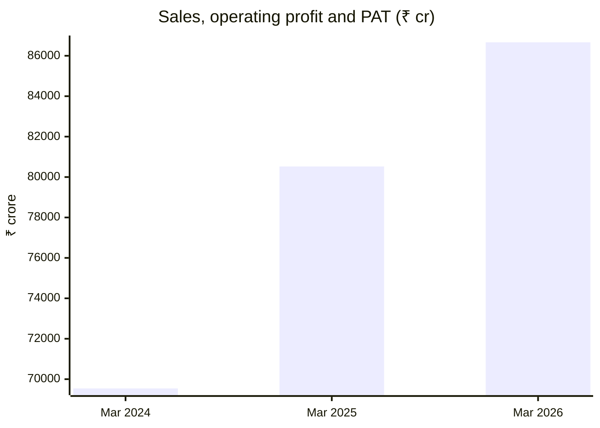

*Run 2026-11-24 · part of [SPINOFF_REPORT.md](../SPINOFF_REPORT.md) · the complete analysis of one company, with every management-call exchange in full.*

## SBIN — State Bank of India

### 1. State Bank of India — PARTIAL SPIN-OFF (subsidiary IPO)

**CONFIRMED** (partial spin-off — SBI Funds Management Limited is listed since 2026-07-21) · **PARTIAL SPIN-OFF, LISTED <1Y — price the parent's stub against the listed piece** · score 6.2/10 · partial spin-off (subsidiary IPO) · 12 filing(s) from CALLS, NSE · first 2026-03-19, latest 2026-07-17

**The separated entities — every one the documents name:**

| Entity | Scheme | Business | Listing | Who runs it |
|---|---|---|---|---|
| **SBI Funds Management Limited** | 2026 IPO (pure offer for sale) of SBI Funds Management Limi… | Asset management — SBI's mutual fund business; described in the calls as "the largest AMC in the country". No… | listed 2026-07-21 as SBIFUNDS (NSE) | not stated |

**What is being separated, as the documents put it:** SBI Funds Management Limited, the bank's asset management (mutual fund) subsidiary, partially listed via offer for sale — class `value_unlocking`.

### 2. Stages and dates

> **Listing:** PARTIAL SPIN-OFF, LISTED — SBI Funds Management Limited trades since 2026-07-21 (NSE equity list); the parent keeps its remaining stake

| Date | Event | Source |
|---|---|---|
| 2025-11-06 | Other — SBI Funds Management Limited | as stated: Letter no. CC/S&B/AND/2025-26/584 dated November 6, 2025 regarding sa… |
| 2026-03-19 | DRHP filed — SBI Funds Management Limited | as stated: Filing dated 2026-03-19, letter CC/S&B/AND/2025-26/920 — draft red he… |
| 2026-07-08 | Other — SBI Funds Management Limited | as stated: Filing dated 2026-07-08, letter CC/S&B/AND/2026-27/280 — red herring … |
| 2026-07-09 | Other — State Bank of India / SBI Funds Management Limited | as stated: Filing dated 2026-07-09 — share purchase agreements each dated July 9… |
| 2026-07-10 | Other — State Bank of India / SBI Funds Management Limited | as stated: Filing dated 2026-07-10, letter CC/S&B/AND/2026-27/288 — transfer of … |
| 2026-07-10 | Other — SBI Funds Management Limited | as stated: Filing dated 2026-07-11, letter CC/S&B/AND/2026-27/289 — addendum dat… |
| 2026-07-13 | Other — SBI Funds Management Limited | as stated: Filing dated 2026-07-08, letter CC/S&B/AND/2026-27/280 — "Anchor Inve… |
| 2026-07-14 | IPO opened — SBI Funds Management Limited | as stated: Filing dated 2026-07-08, letter CC/S&B/AND/2026-27/280 — "IPO will be… |
| 2026-07-16 | Other — SBI Funds Management Limited | as stated: Filing dated 2026-07-08, letter CC/S&B/AND/2026-27/280 as corrected b… |
| 2026-07-18 | Allotment — SBI Funds Management Limited | as stated: Filing dated 2026-07-11 (SEBI Master Circular annexure) — "Allotment … |
| 2026-07-21 | **SBI Funds Management Limited** listed (SBIFUNDS) | NSE equity list |

**The partial spin-off:** **SBI Funds Management Limited** (subsidiary); IPO stage: listed; NSE symbol SBIFUNDS; timeline: Allotment is expected to take place on or about July 18, 2026 (per the annexure to the letter dated July 11, 2026); the IPO was open for subscription by the pub.

> “We have been informed by SBIFM that it has filed a red herring prospectus dated July 8, 2026 with the Registrar of Companies, Mumbai – I at Mumbai ("RHP"), in relation to the proposed initial public o”

**Stated in the filings:** size hint: 0.7% of income.

**When it lists, in the documents' words:** No listing date stated. Filings said (July 11, 2026) "Allotment is expected to take place on or about July 18, 2026"; IPO open July 14, 2026, closing July 16, 2026. Chairman, May 8, 2026: "hopefully in this financial year we will be able to complete"

### 3. Size of the separated business beside the parent — is institutional selling likely?

**Reading: VERY LIKELY — the piece is under a tenth of the whole; index funds and large holders who receive it without choosing it tend to sell.**

| Entity | Stated turnover | Stated share of the whole | Segment revenue share | Market cap (₹ cr) | Share of combined market cap | Index member |
|---|---|---:|---:|---:|---:|---|
| SBI Funds Management Limited | "Total income: Rs. 4,969.09 crores" for Fiscal 2026 | 0.7% | — | 105,029 | 9.5% | no |

*Stated figures are the documents' own (a turnover share, or the cost-of-acquisition split the company publishes for tax, which reflects relative value); the segment share is this business's revenue over the parent's sales, and the market-cap share is the entity's value over the entity plus the parent (parent ₹996,923 cr, NSE bhavcopy of 2026-11-13), both computed here.*

**In the documents' words:** “Financial information of SBIFM for Fiscal 2026: Total income: Rs. 4,969.09 crores (0.70% of Total Income of SBI Group) Reserves and Surplus: Rs.3,533.09 crores (0.59% of reserves and surplus of SBI Group)”

**The judge's read of selling pressure:** unlikely — Book-built IPO to bidding investors and 30 pre-IPO buyers, not distributed to SBI holders; no index exclusion stated

### 4. Insider ownership — share swap, promoters' holding, management incentives

**Share swap / entitlement, entity by entity:**

- **SBI Funds Management Limited:** "the IPO is an offer for sale of up to 170,956,631 equity shares of face value of Rs. 1 (one) each, representing up to 8.3933% of the paid-up equity share capital of SBIFM" — comprising up to 99,501,649 Equity Shares (4.8851%) by State Bank of India and up to 71,454,982 Equity Shares (3.5082%) by Amundi India Holding; no fresh issue. Price band Rs. 545 to Rs. 574 per Equity Share, Offer Price fixed at Rs. 574.00; minimum bid lot 26 Equity Shares; employee discount Rs. 54 per Equity Share

**Promoters' holding, from the shareholding pattern:**

| Company | Promoters | FIIs | DIIs | Public | Quarter |
|---|---:|---:|---:|---:|---|
| State Bank of India (SBIN) | 55.45% | 11.07% | 26.21% | 7.12% | Sep 2026 |
| SBI Funds Management Limited (SBIFUNDS) | 88.21% | 1.43% | 4.16% | 6.21% | Sep 2026 |

*Source: screener.in shareholding pattern, stored under `ShareholdingPattern/NiftyTotalMarket/`. In a mirror demerger each shareholder holds the same proportion of the new company as of the parent on the record date.*

- **Promoters in the parent, per the documents:** not stated in the documents on file.
- **What the promoters will hold in the separated entity:** not stated in the documents on file.
- **What a public shareholder receives:** not stated in the documents on file.
- **Management incentives:** "In light of increase in the equity share capital of SBIFML due to issuance of bonus shares and exercise of ESOPs by eligible employees, the number of Equity Shares being offered for sale by State Bank of India has been revised from up to 3,20,60,000 Equity Shares (amounting to 6.3007% of the paid-up equity share capital of SBIFML as on November 6, 2025) to up to 12,83,34,397 Equity Shares (amounting to 6.3007% of the paid-up equity share capital of SBIFML as on date)." And: "An employee discount of Rs. 54.00 per Equity Share was offered to Eligible Employees in accordance with the terms and conditions stipulated in the RHP read with the Addendum." No new option/RSU/SAR plan in the listed entity, no exercise price or pricing date, and no management or insider shareholding is stated.
- **Insider actions around the separation:** Pre-IPO Transaction by the promoter-seller: "State Bank of India had entered into share purchase agreements each dated July 9, 2026 to sell, in aggregate, 2,88,32,748 equity shares of SBIFM of face value Rs. 1 (one) each, being equivalent to 1.4156% of pre-Offer share capital of SBIFM, to a total of 30 (thirty) investors at Rs. 574.00 per Equity Share, for an aggregate consideration of Rs. 1,655.00 crores"; "the transfer of Equity Shares pursuant to the Pre-IPO Transaction has been completed today, i.e. July 10, 2026." Consequent reduction of SBI's own sale: "The size of the offer for sale by the State Bank of India in the IPO has been revised from up to 128,334,397 Equity Shares (amounting to 6.3007% of the paid-up equity share capital of SBIFM) to up to 99,501,649 Equity Shares (amounting to 4.8851% of the paid-up equity share capital of SBIFM)." Separately, on the Q4FY26 call regarding NSE: "Within the group we have around 7.3% holding. But Bank itself would be keen on participating in the OFS. We have given our in-principal consent to them." No pledging disclosed.
- **Insiders, per the checklist read:** SBI sells only up to 4.8851% (cut from 6.3007%) and retains the rest — "we are not fully exiting... still have potential to monetize further"; employees got Rs.54/share discount and ESOPs · *option pricing date:* Price band fixed July 8, 2026 at Rs.545 to Rs.574; Offer Price decided at Rs.574.00 per Equity Share on July 16, 2026

### 5. Why the demerger — point by point

The business being separated is SBI Funds Management Limited (SBIFM) — SBI Mutual Fund, the bank's asset-management joint venture with Amundi — which SBI is partially separating by listing it, not by demerging it; management repeatedly framed the purpose as "value unlocking" and, in Chairman C.S. Setty's words, "more importantly, value recognition for the industry" (Nov 2025), with SBI General Insurance named alongside AMC as the other listing candidate. The driver management gave was that SBI's own stock does not reflect the conglomerate's worth: Setty called SBI's valuation "a conundrum, considering our return on equity and growth metrics" (Nov 2025, with ROE 19.7%–20.68% and ROA >1% through FY26), and the same theme runs through the hidden-value argument on strategic holdings — of the group's ~7.3% NSE stake he said "the moment NSE gets listed, the whole shareholding by SBI will be available as reserve to us to mark to market" (May 2026). Explicitly NOT a capital-need story at first: in Nov 2025 Setty said "these two companies do not require capital at this juncture. Neither the parent requires because we just raised Rs. 25,000 crores" (the July 2025 QIP, India's largest, 4.5x oversubscribed on a >Rs. 1.1 trillion book, >60% cross-border), which is why timing was left to "respective boards"; by May 2026 the rationale had hardened into a capital one — the listing "will result in capital augmentation, CET-1" on top of CAR already up 115bps to 15.4%. The structure confirms it is monetisation, not a fix for the business: the IPO is a pure offer for sale (no fresh issue), SBI offering 6.3007% and JV partner Amundi India Holding 3.7006%, total up to 10.0013% / 203,709,239 shares at Rs. 1 face value, so no money reaches SBIFM itself. Management stressed that separation does not break the franchise link — SBIFM stays the country's largest AMC inside the "One SBI" cross-sell engine (a special dividend of ~Rs. 2,200 crore came up to the bank in Q3FY26, cross-sell/CVE income targeted at $1 billion, YONO "deep integration with subsidiary production"), and Setty was explicit that "Mutual fund, we are not fully exiting. So we still have potential to monetize further when market improves" (Feb 2026). The push came from the sell side and retail investors — Sushil Choksey (Indus Equity), Manoj Alimchandani and Kunal Shah (Citigroup) raised monetisation/value-unlocking on four of the five calls, Alimchandani even arguing in Feb 2026 that delaying the IPO five years could fetch three times the market cap — rather than from lenders or regulators; the only regulator-linked nudge cited was the SEBI chairman on NSE's listing. No problem with SBIFM's performance was ever offered as a reason: it was described only as "the largest AMC in the country," contributing Rs. 4,969.09 crore of FY26 total income, just 0.70% of group income.

**Point by point, with the source:**

1. No separation on the table: subsidiaries framed purely as value creators to be retained, while the bank instead took an enabling resolution to raise Rs. 25,000 crore of its own equity. “Our subsidiaries are consistently performing well and continue to create significant value for all the stakeholders. We will continue to nurture these subsidiaries and maintain leadership position in the respective businesses.” — *[May 2025](https://www.bseindia.com/stockinfo/AnnPdfOpen.aspx?Pname=bba71336-f98b-40e2-8d50-c9435948876b.pdf)*
2. First acknowledgement of listing candidates, asked for by Sushil Choksey (Indus Equity Advisors); Setty explicitly de-prioritised it because the Rs. 25,000 crore QIP had just closed. “No, as we mentioned that we definitely have a couple of candidates for listing, but the timing is not very… there is no sense of urgency there, I believe.” — *[Aug 2025](https://www.bseindia.com/stockinfo/AnnPdfOpen.aspx?Pname=2fa1b8da-c066-4091-b913-b10127270df1.pdf)*
3. The rationale stated in full for the first time, in answer to Choksey on the group's underperforming consolidated value: SBI AMC and SBI General named, with value unlocking and industry recognition of value as the purpose. “But among these four major subsidiaries, we definitely would be looking at, as I mentioned several times, SBI AMC and SBI General are right candidates for listing in our stable. It also provides some value unlocking and, more importantly, value recognition for the industry.” — *[Nov 2025](https://www.bseindia.com/stockinfo/AnnPdfOpen.aspx?Pname=ad15487a-d1a9-4e33-90e9-624255749750.pdf)*
4. Answering Kunal Shah (Citigroup) on what would trigger the decision, Setty ruled capital need out as a motive for either the subsidiaries or the parent, leaving timing and quantum to the subsidiary boards. “I think we need to just look at, see, one is, as I mentioned earlier also, that these two companies do not require capital at this juncture.” — *[Nov 2025](https://www.bseindia.com/stockinfo/AnnPdfOpen.aspx?Pname=ad15487a-d1a9-4e33-90e9-624255749750.pdf)*
5. The underlying grievance the separation is meant to address — SBI's own market valuation not tracking its ROE and growth — stated in the Chairman's opening remarks; Ashok Ajmera had quantified it as a Rs. 8.82 lakh crore market cap on Rs. 100 trillion of business versus Rs. 15.14 lakh crore for a Rs. 57 trillion peer. “Although the current valuations of SBI are a conundrum, considering our return on equity and growth metrics, we are confident that they will eventually align with our fundamental and operational metrics, the institutionalized nature of our business and our market leadership in the coming years.” — *[Nov 2025](https://www.bseindia.com/stockinfo/AnnPdfOpen.aspx?Pname=ad15487a-d1a9-4e33-90e9-624255749750.pdf)*
6. Retained-stake logic: asked by Manoj Alimchandani whether delaying the IPO five years could treble the market cap, Setty defended a partial sale that keeps future upside with SBI. “Mutual fund, we are not fully exiting. So we still have potential to monetize further when market improves.” — *[Feb 2026](https://www.bseindia.com/stockinfo/AnnPdfOpen.aspx?Pname=8fabbe0f-593e-4701-b565-d5fce57385a2.pdf)*
7. Why the AMC is worth separating while staying attached: it is already the country's largest AMC, upstreamed a Rs. 2,200 crore special dividend into SBI's Q3FY26 profit, and feeds a cross-sell income stream management targets at $1 billion. “If I have to talk about one-off, I think the one item which is a special dividend we have received, around Rs. 2,200 crores from SBI Mutual Fund.” — *[Feb 2026](https://www.bseindia.com/stockinfo/AnnPdfOpen.aspx?Pname=8fabbe0f-593e-4701-b565-d5fce57385a2.pdf)*
8. The rationale shifts to capital: with the AMC listing under way, Setty tied it to CET-1 augmentation supporting credit growth (the bank could already fund ~Rs. 12 trillion of growth, CAR 15.4%, up 115bps YoY). “We are also seriously, as you are aware, we have embarked on listing SBI AMC and hopefully in this financial year we will be able to complete, which will result in capital augmentation, CET-1.” — *[May 2026](https://www.bseindia.com/stockinfo/AnnPdfOpen.aspx?Pname=9a3280a0-5ce9-445e-a881-6b7c505e9a90.pdf)*
9. Same hidden-value argument applied to the group's ~7.3% NSE holding, which is not marked to market today — listing is the mechanism that converts unrecognised strategic stakes into reported reserves. “But as you mentioned, I think the moment NSE gets listed, the whole shareholding by SBI will be available as reserve to us to mark to market.” — *[May 2026](https://www.bseindia.com/stockinfo/AnnPdfOpen.aspx?Pname=9a3280a0-5ce9-445e-a881-6b7c505e9a90.pdf)*
10. 6 Nov 2025 board approval, restated in the 19 Mar 2026 DRHP filing: a pure offer for sale of up to 10.0013% (203,709,239 shares of Rs. 1 each) — SBI 6.3007% (128,334,397 shares) and JV partner Amundi India Holding 3.7006% (75,374,842 shares). No fresh issue, so no proceeds go to SBIFM. “The IPO comprises an offer for sale of up to 128,334,397 Equity Shares (amounting to 6.3007% of the paid-up equity share capital of SBIFML) by State Bank of India, and of up to 75,374,842 Equity Shares (amounting to 3.7006% of the paid-up equity share capital of SBIFML) by Amundi India Holding.” — *Scheme*
11. Plan changed in execution: a pre-IPO secondary placement on 9–10 July 2026 moved 1.4156% of pre-offer capital to 30 investors at the eventual Rs. 574 offer price, raising Rs. 1,655 crore for SBI ahead of the book build. “State Bank of India had entered into share purchase agreements each dated July 9, 2026 to sell, in aggregate, 2,88,32,748 equity shares of SBIFM of face value Rs. 1 (one) each ("Equity Shares"), being equivalent to 1.4156% of pre-Offer share capital of SBIFM, to a total of 30 (thirty) investors at Rs. 574.00 per Equity Share, for an aggregate consideration of Rs. 1,655.00 crores.” — *Scheme*
12. The 11 July 2026 addendum cut SBI's offer-for-sale by exactly the pre-IPO quantum, to 4.8851% (total offer 8.3933%); the offer was priced at Rs. 574 on 16 July with a Rs. 54 employee discount and allotment expected on or about 18 July 2026. “The size of the offer for sale by the State Bank of India in the IPO has been revised from up to 128,334,397 Equity Shares (amounting to 6.3007% of the paid-up equity share capital of SBIFM) to up to 99,501,649 Equity Shares (amounting to 4.8851% of the paid-up equity share capital of SBIFM).” — *Scheme*
13. Materiality disclosed for the separated business: SBIFM's FY2026 total income of Rs. 4,969.09 crore is 0.70% of group income and its reserves 0.59% of group reserves — the separation is about price discovery, not size. “Total income: Rs. 4,969.09 crores (0.70% of Total Income of SBI Group)” — *Scheme*

**How it evolved:** May 2025 had no separation plan at all — only "we will continue to nurture these subsidiaries," while the bank instead took an enabling resolution for Rs. 25,000 crore of its own equity. By Aug 2025 Setty conceded "a couple of candidates for listing, but… there is no sense of urgency," and in Nov 2025 he named them — SBI AMC and SBI General — as the right candidates for "value unlocking" and "value recognition," with boards to set timing; the SBIFM stake-sale approval for 6.3007% followed on 6 Nov 2025 and the DRHP on 19 Mar 2026 (share count restated to 128,334,397 after a bonus issue and ESOP exercises). Feb 2026 added the retained-upside caveat ("we are not fully exiting") and May 2026 re-cast the deal as CET-1 capital augmentation to be completed within FY27. The plan then changed in execution in July 2026: a pre-IPO placement of 28,832,748 shares (1.4156%) to 30 investors at Rs. 574 for Rs. 1,655 crore on 9–10 July cut SBI's offer-for-sale from 6.3007% to 4.8851% (total offer 8.3933%), priced at Rs. 574 with allotment expected 18 July 2026.

**What management expects from it:** For SBIFM: a listed market price that recognises India's largest AMC, with SBI retaining control, banca distribution and future monetisation upside. For SBI: value unlocking and "value recognition," CET-1 capital augmentation supporting 13-15% credit growth, hidden reserves surfaced (as with NSE), and valuation converging on >1% ROA and 15%+ through-cycle ROE. No margin or focus benefit was claimed.

*Not explained on the calls:* No valuation target, expected proceeds, CET-1 basis points, or use of funds; no reason the offer was trimmed; Amundi's motive, SBI General's timeline, and post-listing distribution/royalty terms unexplained.

- *Stated reason, in one line:* Value unlocking and value recognition for the industry; listing will result in capital augmentation, CET-1, supporting credit growth; subsidiaries seen creating value for their own shareholders and SBI's
- *What it reveals:* A dominant AMC carried at cost: total income Rs.4,969.09 crores, only 0.70% of SBI Group income, reserves Rs.3,533.09 crores; priced at Rs.574/share. Chairman cites "hidden reserves... in terms of strategic investments" not marked to market, plus Rs.2,200 crores special dividend
- *Parent or spin:* parent · *Read next:* SBIFM Prospectus dated July 16, 2026 — AUM, PAT and implied valuation at Rs.574 versus SBI's retained stake
- *In their words:* “State Bank of India has been informed that the Offer Price for the Offer has been decided to be Rs. 574.00 per Equity Share.”

### 6. On the calls, verbatim

8 call(s), oldest first: **0 question-and-answer exchange(s)** given in full — the question and every answer to it, nothing trimmed — and 8 passage(s) from management's prepared remarks (the complete sentences about it; the whole remarks are in the linked transcript). Text is as the transcript prints it.

#### May 2024 — [transcript](https://www.bseindia.com/stockinfo/AnnPdfOpen.aspx?Pname=68b86c74-1a02-41cf-9daf-d040d60cd34d.pdf)

**From the prepared remarks** *(the passage about it; the whole turn runs to 68,958 characters in the transcript)*

> **NSE SCRIP Code:** Where do you see the credit growth for the system and where we are at State Bank? - Mr. Dinesh Khara – Chairman, State Bank of India For us, my estimation is that we should be growing as far as the loan book is concerned, should be growing at about 13% to 15%. State Bank of India May 09, 202 4 - Mr. Manish Ostwal – Fund Manager, Nirmal Bang Securities Pvt Ltd The second question on the capital consumption, this year excellent capital consumption management we have achieved and I recall during one of the quarterly analysts meet you said we will grow profit, use the profit to improve the capital and then raising the funds and you deliver on that front. So now if we maintain the 13% to 15% kind of loan growth then we should no t go for big capital raise. How should one think of your capital raise plan? - Mr. Dinesh Khara – Chairman, State Bank of India See as of now we had done, I always keep on doing the estimation in terms of what is the ability of our capital to support the growth.

#### Aug 2024 — [transcript](https://www.bseindia.com/stockinfo/AnnPdfOpen.aspx?Pname=c380dde0-c8f5-403a-b4b2-f229f050d921.pdf)

**From the prepared remarks** *(the passage about it; the whole turn runs to 69,027 characters in the transcript)*

> **NSE SCRIP Code:** I think this is what we need to understand, but we have a good amount of opportunity in terms of trading gains, not only from the fixed income securities , I think , on the equity side also, we have been doing very well. I can assure you that the Treasury income will continue to be robust. - Mr. Ashok Ajmera – Chairman, Ajcon Global Sir, my second question is on, the guidance, I mean, the note which is going on from RBI on the deposit source d through the digital media and the increase in the provision rather double than this. Have we assessed the impact of that on our bank and how many b ps it will impact our capital adequacy as well as the loss because of the blockage of that funds? - Mr. Dinesh Khara – Chairman, State Bank of India This is actually premature to really share this in an open forum like this, but as of now, we have got our own observations on these provisions which we will be sharing with RBI now, and will also be reaching out to IBA and to the Government of India describing its overall impact. So at a material point of time, let us see whether this consultation paper actually get s converted into the regulation. State Bank of India August 03, 202 4 - Mr. […] All Agri intensive RUSU branches are geared up for KCC, ACC, and also for the renewal exercise and drive for actual recovery of NPA. We are also looking at the investment credit and our experience in the past is that higher value ticket size has got lower incidence of NPA and that is something which we are practicing on ground. State Bank of India August 03, 202 4 - Sanjana Fauzdar from Nuvama , comment on the lower growth in current account deposit this quarter? It is a general trend of funds that inflow during the last quarter four of the financial year outflow during subsequent quarters of the next financial year resulting in quarter -on-quarter negative growth. Negative YoY growth is on part of the decline in the government account, funding in good time they are actually following just in time approach. In non -government accounts, it is a competition from the private sector bank, but, however, we are also meeting that competition by offering all add -ons, which are r equired. - Doshi Dixit, our credit cost and slippages have gone up considerably after good performance in the last three quarters. Can you explain why, and will it remain elevated going forward?

#### Feb 2025 — [transcript](https://www.bseindia.com/stockinfo/AnnPdfOpen.aspx?Pname=517b8824-3ed3-4763-8900-061c1455cfb2.pdf)

**From the prepared remarks** *(the passage about it; the whole turn runs to 63,078 characters in the transcript)*

> **NSE SCRIP Code:** Thank you. − Mr. C S Setty – Chairman, State Bank of India So, I think we'll take a couple of questions quickly and then we'll go to the online questions. - Mr. Sushil Choksey – Managing Director, Indus Equity So, on the margins, I think we need more debate. Like particularly on the margins front, the QoQ sequential drop that we have seen, is it also to be seen from that there were lower interest on recovery during the current quarter or there was some penal int erest related impact which actually came through in the quarter or is it all explained by the higher cost of funds? − Mr. C S Setty – Chairman, State Bank of India It’s predominantly explained by the cost of resources. - Mr. Sushil Choksey – Managing Director, Indus Equity In that case, how do we see the next quarter's margin? Because the cost of funds is not going down anytime. And if basically there's a rate cut, obviously, at least on the 28% of the portfolio, we'll pass it on if there is a rate. − Mr. C S Setty – Chairman, State Bank of India So that 28% pass on will not really be impacting in a significant manner if it is a shallow rate cut. In terms of cost of resources, there is a conscious effort to increase the savings bank portfolio and increase the C ASA.

#### May 2025 — [transcript](https://www.bseindia.com/stockinfo/AnnPdfOpen.aspx?Pname=bba71336-f98b-40e2-8d50-c9435948876b.pdf)

**From the prepared remarks** *(the passage about it; the whole turn runs to 58,995 characters in the transcript)*

> **NSE SCRIP Code:** So, in terms of the local credit, what you see here, it is predominantly coming from the markets in US, and a little bit from Bahrain. Bahrain, of course, is not local credit, but across the UAE and other jurisdiction. But local credit that is Ind ia related , is essentially ECB, External Commercial Borrowings. We park those assets in the branches where the advantage of cost of funds is there. We are , also, extensively using the Gift City now to because of the tax benefits as well as Gift City’s ability to raise the resources also has improved. So, predominantly the local loans are in the US and the ECB s are in the Gift City, Hong Kong, and DIFC Dubai. These are the jurisdictions where we are parking .

#### Aug 2025 — [transcript](https://www.bseindia.com/stockinfo/AnnPdfOpen.aspx?Pname=2fa1b8da-c066-4091-b913-b10127270df1.pdf)

**From the prepared remarks** *(the passage about it; the whole turn runs to 56,335 characters in the transcript)*

> **NSE SCRIP Code:** You got a good price, phenomenal response. Largest QIP ever, over ■ 1 lakh. So, hats off to you and good numbers. And also, good quarterly numbers, credit growth, ROE of 19.7%, good results by the funds business and insurance business; they have giv en a boost. A couple of things come to the mind on particular questions where you can update us. One is the slide no. 23. Now what we see, a little number we can see with a little scepticism that 7.88% growth in operating expenses which is very good, and which gives u s a cost to income ratio of below 0.5. […] Are we expecting this to inch up further before it stabilises and comes down? And therefore, the margins, outlook, any colour? When will we see the bottom, 2Q or can it get delayed to 3Q also? − Mr. C S Setty – Chairman, State Bank of India I think the cost of funds uptick is essentially a significant movement towards fixed deposits. If you see our FD growth rate is almost 14%, and very large FD book at that. But some of the rate cuts on the fixed deposit that we have done, we will get the be nefit in the quarters going forward. And our fixed deposit book also will get repriced predominantly in the next 8 -12 months. […] That means, you look at the process and see what are those redundant steps which we have not looked at for quite some time? Another element is, if you really ask me what would be the major investment coming forward, it would be a build -up of our own AI stack which we are under taking, but that does not require any great amount of capital expenditure. − Mr. Sushil Choksey – Indus Equity Advisors Second thing. Any plans on listing of any other subsidiaries? − Mr. C S Setty – Chairman, State Bank of India No, as we mentioned that we definitely have a couple of candidates for listing, but the timing is not very… there is no sense of urgency there, I believe. And you all have helped us to raise ■25,000 crores now. − Mr. Sushil Choksey – Indus Equity Advisors I think the markets are in good shape despite the global challenges. […] IT refund in Q4 was ■1,319 crores and IT refund in the corresponding period last year was also nil. - Armaan Nahar from Blue Sky FinTech - Do you think pain in unsecured segment MFI has come to an end? I think we never had any issues in our unsecured book, as well as our MFI exposure, which is miniscule. But we believe that from a system point of view, there is definitely an improvement in the asset quality in unsecured loan and MFI segment. While lot of State Bank of India August 08, 202 5 upfronting in terms of cleaning up the book by MFI is also one of the reasons why we believe that situation is better now. - Deepanshu - How QIP funds will be used in future? As I mentioned, it is not in terms of growth capital. It is definitely to augment our CET -1. So, today after this capital raise, the available buffer is 233 bps over minimum regulatory capital.

#### Nov 2025 — [transcript](https://www.bseindia.com/stockinfo/AnnPdfOpen.aspx?Pname=ad15487a-d1a9-4e33-90e9-624255749750.pdf)

**From the prepared remarks** *(the passage about it; the whole turn runs to 62,181 characters in the transcript)*

> **NSE SCRIP Code:** And General Insurance is moving up the ladder and has a great pot ential in terms of the Non -Life Insurance Company. Merchant Banking Unit of SBI Caps is a different ball game altogether, I do not think we should be looking at the valuation there. But among these four major subsidiaries, we definitely would be looking at, as I mentioned several times, SBI AMC and SBI General are right candidates for listing in our stable. It also provides some value unlocking and, more importantly, value recognition for the industry. We would soon be working on that. It is also important that SBI conglomerate is leveraging One SBI value, One SBI in the sense that if any customer walking into SBI branch, he is provided the gamut of services which manufactured by the conglomerate itself. And that has been successful, yes . […] C S Setty – Chairman, State Bank of India I think the draft guidelines put some cap on that, 10% of capital. − Mr. Sushil Choksey – Indus Equity Advisors Capital market is possible to support. − Mr. C S Setty – Chairman, State Bank of India Capital market, yes. I think we have done one product, which is a loan against mutual funds. We have never been active on loan against shares. While we have adequate room on the capital market exposure, there is underutilized , room available there. We will see.

#### Feb 2026 — [transcript](https://www.bseindia.com/stockinfo/AnnPdfOpen.aspx?Pname=8fabbe0f-593e-4701-b565-d5fce57385a2.pdf)

**From the prepared remarks** *(the passage about it; the whole turn runs to 62,744 characters in the transcript)*

> **NSE SCRIP Code:** Sir, I had a couple of questions. Firstly, in terms of your NIM outlook, longer term and even for the 4th Quarter, earlier I think there was a guidance that NIM would be about 3 % in the 4th Quarter. So, does that still hold? And is there scope for cost of funds to come down further? That's part of the same question. So, NIM outlook for 4th Quarter and longer term with focus on cost of funds. And secondly, in fees, the CVE income has grown very sharply. So, any comments you wanted to make on that? Because it's a sharp growth QoQ and YoY. […] Paul – Deputy Managing Director (Finance), State Bank of India Quarter 3, interest on income tax refund was Rs. 769 crores and the similar amount last quarter was Rs. 372 crores. Ms. Mahrukh Adajania – Executive Director (Equity Research), Nuvama Okay, sir. And cost of funds? Scope for deposit cost to come down further? Mr. C.S. […] That has also helped us in terms of containing the cost s. But we should also remember that 39% CASA at this level is also contributing to bringing down the costs. We got the full benefit of Savings Bank reduction in interest rate to 2.5. Current account 10% growth rate is also helping us to contain the cost of funds. Broadly, the cost of funds will remain at this level for the Q4 also. We do not want to go beyond Q4, I think we will take a call in the Q1. We may have to see how the credit growth is going to play out because all these trade deals are extremely positive. So, there would be definitely an improved credit climate. […] Ms. Mahrukh Adajania – Executive Director (Equity Research), Nuvama Thank you, sir. Mr. Jai Mundhra – ICICI Securities State Bank of India February 07 , 202 5 Sir, just continuing on the previous question , you said that COF (cost of funds) may remain stable, right? Is it because the bulk deposit rates in the system, they have actually shot up in the last 2 -3 months? Is that one of the reasons, because otherwise, your retail deposits should keep repricing, rig ht? Because, what you had done in June - July months, that should continue to flow through . So, why would the cost of funds be stable until and unless there are some moving parts, some portion of the deposits w here the rates are a bit higher? Mr. C.S. Setty – Chairman, State Bank of India No, the retail term deposits are also high even after repricing. […] And that shows again, what kind of deposit mobilization we need to do going forward if the credit growth comes. So, Q4, I think broadly the numbers remain s. There could be some repricing going forward, because what we have done in the last quarter, the interest rate reduction, will play out for some time. But I broadly believe that the reduction in the cost of funds is unlikely. We will be maintaining at thi s level, maybe if we are able to mobilize a little more current accounts, generally which happens in the Q4, it may help us to moderate the cost of funds. Mr. Jai Mundhra – ICICI Securities And Sir, on Xpress credit, now the portfolio has grown at 3 -4% QoQ. We have been maintaining that there is a decent good pickup in the disbursement. […] And there is absolutely no complaints in terms of settlement. They are at the top of the category in terms of providing customer service. Service at scale, is something what SBI Life is able to achieve, and Banca is going to play an important role in this. We are also seeing the same trend continuing in non -life, mutual funds, credit card business. The combination of their digitalisation, their underwriting processes, their customer orientation is helping us to increase our CVE income also. Mr. Sushil Choksey – Indus Equity Advisors Sir, can this income double in 3 years? […] Despite this growth, we have not significantly enhanced our RW As. That is also one of the reasons why you do not see the commensurate pickup in our margins.We play very cautiously on the risk side also. Mr. Chintan Joshi – Autonomous Research: State Bank of India February 07 , 202 5 Sir, second question was on the question from Jai on cost of funds. Wouldn’t it be a failure of transmission if the Q4 deposits from last year did not reprice this year and gave a benefit on cost of funds? Because we have seen a December rate cut that is struggling to pass -through on the liability side, not just from what you are indicating, but also for the system, which leads to margin contraction because the EBLR book reprices. So, how do you see that puzzle? There should be transmission from that fourth quarter last year to the fourth quarter this year, would be my guess. […] Setty – Chairman, State Bank of India Much of the SME growth is in the qualifying PSL category. So, MSME growth is not a worry. But I think on the corporate credit growth we definitely consider various cost factors. While we do primarily look at the risk involved and how do we price the risk, w e also look at our cost of funds and what is the alternate mechanism of investing those funds. We have a simple mechanism called risk adjusted return on capital. I think we did mention earlier. The capital optimization is also core to our pricing strategy .

#### May 2026 — [transcript](https://www.bseindia.com/stockinfo/AnnPdfOpen.aspx?Pname=9a3280a0-5ce9-445e-a881-6b7c505e9a90.pdf)

**From the prepared remarks** *(the passage about it; the whole turn runs to 74,033 characters in the transcript)*

> **NSE SCRIP Code:** Setty – Chairman, State Bank of India It’s a backhand compliment, is it? Mr. Manoj Alimchandani State Bank of India May 08, 202 6 It's a challenging year and despite of that, over 25,000 crores in this type of environment is really wonderful , and a couple of important points. Now everybody is looking at value unlocking, and we have over 10% in National Stock Exchange. SEBI chairman has said it should get listed soon. So, what's the thought process on value unlocking? I see page number 55 which talks about total reserve and surplus INR 5,95,000 crores. Now we'll get valua tion, fair market valuation on the balance sheet. Apparently, thi s number will also go up. […] Whether through rural banking or through district banking or branches and aligning with the government's objective , if in how many years we can come to 25% market share? And what is our core strategy on that also including globalization? I think it could be a great opportunity. That's it , I found the results better than expected because I have been present and looking at the transcript, saw it as a knee jerk reaction but with your clarification and lot of value unlocking hopefully your direction towards that should help in creating greater value year to year. All the best to the board and the team. Mr. C.S. […] C.S. Setty – Chairman, State Bank of India No, period end number of the previous year, which has impacted. We had a period end movement in FY25, March 25. We had a significant current account movement because of the government funds release. Those things were not there. And it was a very large amount, almost 50,000 crores, which has come in the last few days of March ‘25. Despite that fund not being available, I think we have done phenomenally well in the current account.

### 7. The parent's financial statements

**The parent, last three fiscal years (consolidated)**

| | Mar 2024 | Mar 2025 | Mar 2026 |
|---|---:|---:|---:|
| Sales (₹ cr) | — | — | — |
| Sales growth (%) | — | — | — |
| Operating profit (₹ cr) | — | — | — |
| Operating profit growth (%) | — | — | — |
| Operating margin (%) | — | — | — |
| PAT (₹ cr) | 69,543 | 80,523 | 86,666 |
| PAT growth (%) | +20.4% | +15.8% | +7.6% |
| PAT margin (%) | — | — | — |
| EPS (₹) | 75.2 | 86.9 | 90.2 |

*Source: ProfitStatement/NiftyTotalMarket/SBIN.csv (consolidated, screener.in); growth and margins computed here.*

*Series in order: PAT.* *Not plotted (gap in the data): Sales, Operating profit.*

**P/E:** 11.4 — live market file (screener.in), trailing (price ₹1,027.00 as of 2026-08-02).

**Cash flows (₹ cr):**

| | Mar 2024 | Mar 2025 | Mar 2026 |
|---|---:|---:|---:|
| Cash from operations (₹ cr) | 21,632 | 45,484 | 38,097 |
| Cash from investing (₹ cr) | -3,476 | -3,387 | 9,240 |
| Cash from financing (₹ cr) | -9,896 | -10,737 | -3,427 |
| Net cash flow (₹ cr) | 8,260 | 31,361 | 43,910 |
| Free cash flow (₹ cr) | 17,457 | 39,847 | 29,734 |

*Source: CashFlow/NiftyTotalMarket/SBIN.csv (consolidated, screener.in).*

### 8. The separated business's financial statements

**The business being separated — its own numbers**, entity by entity: its reported statements once it is listed and on file, and the segment numbers the annual reports and presentations carry for it before that.

**SBI Funds Management Limited (SBIFUNDS) — as reported since listing**

| | Mar 2024 | Mar 2025 | Mar 2026 |
|---|---:|---:|---:|
| Sales (₹ cr) | 3,424 | 4,235 | 4,974 |
| Sales growth (%) | +42.4% | +23.7% | +17.4% |
| Operating profit (₹ cr) | 2,716 | 3,411 | 4,056 |
| Operating profit growth (%) | +50.7% | +25.6% | +18.9% |
| Operating margin (%) | 79.3 | 80.5 | 81.5 |
| PAT (₹ cr) | 2,073 | 2,540 | 3,067 |
| PAT growth (%) | +54.7% | +22.5% | +20.7% |
| PAT margin (%) | 60.5 | 60.0 | 61.7 |
| EPS (₹) | — | — | — |

*Source: ProfitStatement/NiftyTotalMarket/SBIFUNDS.csv (consolidated, screener.in); growth and margins computed here.*

*Businesses with no numbers in the pages read (3 annual report(s) and 12 presentation(s) on file):* SBI Funds Management Ltd. / SBIFM / SBI AMC: pages carry no own financials — it is never a reported segment (sits inside consolidated "Other Banking Operations"). Only parent-level item: ₹7,288 cr one-time stake-sale profit, Q2FY27 (Presentation Nov 2026 — page 20).

*Documents on file:* [Annual Report 2026](https://www.bseindia.com/xml-data/corpfiling/AttachHis/faa17496-838f-432d-a39f-32d82156799c.pdf); [Annual Report 2025](https://www.bseindia.com/xml-data/corpfiling/AttachHis/9c6a98f8-f882-4c06-9cb1-7f3b6ae1159f.pdf); [Annual Report 2024](https://www.bseindia.com/xml-data/corpfiling/AttachHis/0e236470-9427-43c7-93e9-c8eb61bb1f72.pdf); [Presentation Nov 2026](https://www.bseindia.com/stockinfo/AnnPdfOpen.aspx?Pname=211c37d3-4d09-4ba6-a104-b5715dc05ff7.pdf); [Presentation Aug 2026](https://sbi.bank.in/documents/17836/1275616/07082026_SBI+Analyst+Presentation+Q1FY27.pdf/6e4ca530-1666-574e-22fb-f9e19d553ef5?t=1786091443352); [Presentation May 2026](https://www.bseindia.com/stockinfo/AnnPdfOpen.aspx?Pname=460a676a-2477-47a3-bdcf-ffce1a78b8e7.pdf); [Presentation Feb 2026](https://www.bseindia.com/stockinfo/AnnPdfOpen.aspx?Pname=1F09E6FA-D0C5-4430-BBC1-E445609981AF-135436.pdf); [Presentation Nov 2025](https://www.bseindia.com/stockinfo/AnnPdfOpen.aspx?Pname=3beaba3f-f163-4d3f-b053-70228d39a157.pdf); [Presentation Aug 2025](https://www.bseindia.com/stockinfo/AnnPdfOpen.aspx?Pname=5f03f41a-c730-4b26-927e-562b52b62c70.pdf)

### 9. Other financial differences — working capital, margins, returns, debt

| Metric (latest year) | Parent (SBIN) | SBI Funds Management Limited (SBIFUNDS) |
|---|---:|---:|
| *Basis* | *reported, consolidated* | *its own reported statements* |
| Sales (₹ cr) | — | 4,974 (Mar 2026) |
| Sales growth (%) | — | 17.4 (Mar 2026) |
| Operating margin (%) | — | 81.5 (Mar 2026) |
| Operating profit growth (%) | — | 18.9 (Mar 2026) |
| PAT margin (%) | — | 61.7 (Mar 2026) |
| ROCE % | — | 56 (Mar 2024) |
| Debtor Days | — | 6 (Mar 2026) |
| Cash Conversion Cycle | — | 6 (Mar 2026) |
| Working Capital Days | — | -10 (Mar 2026) |
| Debt / equity (x) | — | 0 (Sep 2026) |
| Borrowings (₹ cr) | — | 0 (Sep 2026) |
| ROE % | 15 (Mar 2026) | — |

*Each figure is the latest on file, with its year. Working-capital days and ROCE come from the stored working-capital file; segment figures from the pages cited in part 8. A dash means the documents do not carry it.*

**What stays with the parent — its segments, from the same pages:**

| Remaining segment | Revenue | Operating margin | ROCE | Segment assets / revenue | Unit | Year |
|---|---:|---:|---:|---:|---|---|
| Treasury | 130,119 | 11.1% | 5.7% | 15.75x | ₹ crore | FY2026 |
| Corporate / Wholesale Banking | 153,355 | 21.6% | 13.9% | 14.98x | ₹ crore | FY2026 |
| Retail Banking (total, incl. Digital Banking sub-segment) | 265,844 | 22.5% | 27.5% | 12.24x | ₹ crore | FY2026 |
| Insurance Business (SBI Life Insurance Co. Ltd. and SBI General Insurance Co. Ltd.) | 133,260 | 2.5% | 14.2% | 3.95x | ₹ crore | FY2026 |
| Other Banking Operations / Other Banking Business (all non-banking subsidiaries and JVs other than SBI Life and SBI General — includes SBI Funds Management Ltd.) | 34,822 | 28.8% | 28.9% | 3.46x | ₹ crore | FY2026 |

**What the documents themselves say about the differences:**

- **other** — parent / remaining: Listing SBI AMC is presented as capital augmentation / CET-1 accretion for the bank, alongside the mark-to-market unlocking if NSE lists; the bank says it can already fund about Rs 12 trillion of credit growth with current capital.; separated business: SBI Funds Management is the vehicle for that unlocking; only a minority stake is sold and SBI is "not fully exiting". “We are also seriously, as you are aware, we have embarked on listing SBI AMC and hopefully in this financial year we will be able to complete, which will result in capital augmentation, CET -1.”
- **growth** — parent / remaining: Bank guidance of 13-15% credit growth for FY27, domestic NIM above 3%, ROA above 1% through the cycles and minimum 15% ROE through cycles (ROE 18.5% at end-Q4FY26, 20.68% at end-Q3FY26).; separated business: The mutual fund business is described as having a large growth runway, with talk of the industry doubling in five years and SBI Mutual Fund as the largest AMC in the country. “I see a great opportunity for mutual fund growth and SBI mutual fund will be playing a very, very large role in this.”
- **other** — parent / remaining: The AMC contributes to the parent through dividends and trail/cross-sell income: a one-off special dividend of about Rs. 2,200 crores from SBI Mutual Fund was a major element of Q3FY26 miscellaneous income (of about Rs. 5,000 crores).; separated business: SBIFM's own Fiscal 2026 total income was Rs. 4,969.09 crores, 0.70% of SBI Group total income; reserves and surplus Rs. 3,533.09 crores, 0.59% of the group's. “If I have to talk about one -off, I think the one item which is a special dividend we have received, around Rs. 2,200 crores from SBI Mutual Fund.”
- **capex and capital intensity** — parent / remaining: The parent raised Rs 25,000 crores of equity by QIP in Q2FY26 (largest ever in India, oversubscribed 4.5 times) and says neither it nor the listing candidates need capital at this juncture; the listings are for value unlocking and recognition, not funding.; separated business: "these two companies do not require capital at this juncture" — i.e. the AMC (and SBI General) are not being listed to raise money for themselves; the 2026 IPO is a pure offer for sale with no fresh issue. “I think we need to just look at, see, one is, as I mentioned earlier also, that these two companies do not require capital at this juncture.”

**The checklist:**

| Item | Status | Evidence |
|---|---|---|
| Why the spin-off | yes | value unlocking for shareholders — “…several times, SBI AMC and SBI General are right candidates for listing in our stable. It also provides some value unlocking and, more importantly, value recognition for the industry. We would soon be working on that. I” |
| Institutional selling likely (small / different business) | partly | the demerged piece is 0.7% of income |
| Insider ownership and incentives aligned | unknown | no promoter-continuity or option-pricing language found *(next: the date the management options are priced; promoter holding in the resulting company)* |
| A hidden value revealed (pro-forma, leverage, comparables) | yes | P/E 10.9 on Mar 2026 profit vs industry median 24.6 (97 peers) |
| Parent before the spin (clean parent, takeover prelude) | partly | stage announced — the spin has not happened; the parent can still be bought whole |
| Partial spin-off: price the stub from the listed piece | partly | a subsidiary is being listed; once it trades, stub = parent price − (stake value ÷ parent shares) *(next: stub_value(parent price, parent shares, [(sub price, shares held)]))* |
| Timing (first year sells, second year gains) | partly | not yet listed — 250 days since the first filing, stage announced |
| Management discussing it on the calls | yes | 4 mention(s) in the last 12 months of calls — “…e results better than expected because I have been present and looking at the transcript, saw it as a knee jerk reaction but with your clarification and lot of value unlocking hopefully your direction towards that shoul” |

**On the calls (last 12 months):**

- *Nov 2025* (forward) — “…we definitely would be looking at, as I mentioned several times, SBI AMC and SBI General are right candidates for listing in our stable. It also provides some value unlocking and, more importantly, value recognition for the industry. We would soon be working on that. It is also important that SBI conglomerate is leveraging One SBI v…”
- *May 2026* (forward) — “…ng year and despite of that, over 25,000 crores in this type of environment is really wonderful , and a couple of important points. Now everybody is looking at value unlocking, and we have over 10% in National Stock Exchange. SEBI chairman has said it should get listed soon. So, what's the thought process on value unlocking? I see pa…”
- *May 2026* (forward) — “…ooking at value unlocking, and we have over 10% in National Stock Exchange. SEBI chairman has said it should get listed soon. So, what's the thought process on value unlocking? I see page number 55 which talks about total reserve and surplus INR 5,95,000 crores. Now we'll get valua tion, fair market valuation on the balance sheet. Ap…”
- *May 2026* (forward) — “…e results better than expected because I have been present and looking at the transcript, saw it as a knee jerk reaction but with your clarification and lot of value unlocking hopefully your direction towards that should help in creating greater value year to year. All the best to the board and the team. Mr. C.S. Setty – Chairman, St…”

The filings

| Date | Category | Headline | Attachment |
|---|---|---|---|
| 2025-11-01 | Earnings call Nov 2025 | …we definitely would be looking at, as I mentioned several times, SBI AMC and SBI General are right candidates for listing in our stable. It also provides some  | [pdf](https://www.bseindia.com/stockinfo/AnnPdfOpen.aspx?Pname=ad15487a-d1a9-4e33-90e9-624255749750.pdf) |
| 2026-03-19 | General Updates | State Bank of India has informed the Exchange about Updates on Sale of Stake in SBI Funds Management Limited through IPO | [pdf](https://nsearchives.nseindia.com/corporate/SBIN_19032026213213_BSE_NSE_SBIMF_DRHP1_19032026.pdf) |
| 2026-05-01 | Earnings call May 2026 | …ng year and despite of that, over 25,000 crores in this type of environment is really wonderful , and a couple of important points. Now everybody is looking at | [pdf](https://www.bseindia.com/stockinfo/AnnPdfOpen.aspx?Pname=9a3280a0-5ce9-445e-a881-6b7c505e9a90.pdf) |
| 2026-05-01 | Earnings call May 2026 | …ooking at value unlocking, and we have over 10% in National Stock Exchange. SEBI chairman has said it should get listed soon. So, what's the thought process on | [pdf](https://www.bseindia.com/stockinfo/AnnPdfOpen.aspx?Pname=9a3280a0-5ce9-445e-a881-6b7c505e9a90.pdf) |
| 2026-05-01 | Earnings call May 2026 | …e results better than expected because I have been present and looking at the transcript, saw it as a knee jerk reaction but with your clarification and lot of | [pdf](https://www.bseindia.com/stockinfo/AnnPdfOpen.aspx?Pname=9a3280a0-5ce9-445e-a881-6b7c505e9a90.pdf) |
| 2026-07-08 | General Updates | State Bank of India has informed the Exchange about Update on IPO of SBI Funds Management Limited | [pdf](https://nsearchives.nseindia.com/corporate/SBIN_08072026202646_BSE_NSE_SBIFML_08072026.pdf) |
| 2026-07-08 | General Updates | State Bank Of India has informed the Exchange about Update on IPO of SBI Funds Management Limited | [pdf](https://nsearchives.nseindia.com/corporate/SBIN_08072026235933_BSE_NSE_SBIMF2.pdf) |
| 2026-07-09 | General Updates | State Bank of India has informed the Exchange about Update on IPO of SBI Funds Management Limited | [pdf](https://nsearchives.nseindia.com/corporate/SBIN_09072026230311_merged.pdf) |
| 2026-07-10 | General Updates | State Bank of India has informed the Exchange about Update on IPO of SBI Funds Management Limited | [pdf](https://nsearchives.nseindia.com/corporate/SBIN_10072026222453_BSE_NSE_10072026.pdf) |
| 2026-07-11 | General Updates | State Bank of India has informed the Exchange about Update on IPO of SBI Funds Management Limited | [pdf](https://nsearchives.nseindia.com/corporate/SBIN_11072026192423_BSE_NSE_RHP_11072026.pdf) |
| 2026-07-16 | General Updates | State Bank of India has informed the Exchange about Update on IPO of SBI Funds Management Limited | [pdf](https://nsearchives.nseindia.com/corporate/SBIN_16072026225141_BSE_NSE_SBIFunds_16072026.pdf) |
| 2026-07-17 | General Updates | State Bank of India has informed the Exchange about Update on IPO of SBI Funds Management Limited | [pdf](https://nsearchives.nseindia.com/corporate/SBIN_17072026102320_BSE_NSE_SBIFunds_17072026.pdf) |

