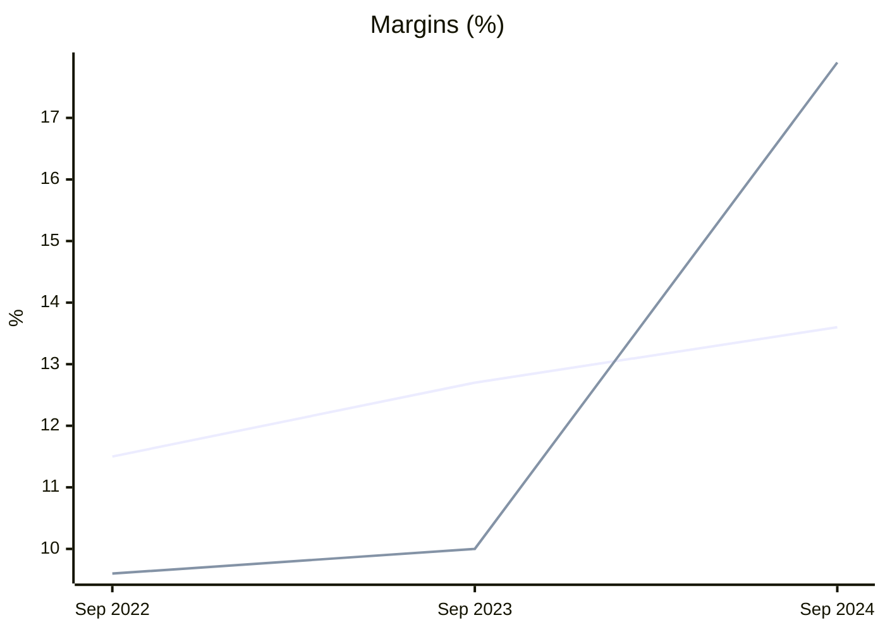

*Run 2026-11-24 · part of [SPINOFF_REPORT.md](../SPINOFF_REPORT.md) · the complete analysis of one company, with every management-call exchange in full.*

## SIEMENS — Siemens Ltd.

### 1. Siemens Ltd. — CONFIRMED DEMERGER

**CONFIRMED** (a demerger scheme is on the exchange record) · **LISTED 1–2Y — the second-year window** · score 5.7/10 · spin-off · 7 filing(s) from BSE-screener, CALLS, NSE, NSE-register · first 2025-04-07, latest 2026-11-06

**The separated entities — every one the documents name:**

| Entity | Scheme | Business | Listing | Who runs it |
|---|---|---|---|---|
| **Siemens Energy India Limited** | 2024 demerger of the Energy Business of Siemens Limited (Sc… | Energy Business: fully integrated products, solutions and services across the energy value chain of oil and g… | listed 2025-06-19 as ENRIN (NSE) | Mr. Guilherme Mendonca, Managing Director and Chi… |

**What is being separated, as the documents put it:** The Energy business of Siemens Limited, transferred to Siemens Energy India Limited under a Scheme of Arrangement — class `not stated`.

### 2. Stages and dates

> **Listing:** LISTED — Siemens Energy India Limited (ENRIN) since 2025-06-19 (NSE equity list); record date 2025-04-07

| Date | Event | Source |
|---|---|---|
| 2024-02-07 | Other — Siemens Energy India Limited | as stated: Incorporation of the Resulting Company ("a wholly owned subsidiary of… |
| 2024-05-14 | Board approval — Siemens Limited and Siemens Energy India Limited | as stated: Demerger filing dated 14 May 2024; NCLT order: "the Board of Director… |
| 2024-09-17 | SEBI approval — Siemens Limited | as stated: SEBI comments on the draft scheme conveyed to BSE and NSE, per BSE ob… |
| 2024-09-17 | Exchange no-objection — BSE Limited | as stated: Filing dated 18 September 2024: "observation letter dated 17th Septem… |
| 2024-09-18 | Stage reached: **exchange noc** | [Scheme of Arrangement](https://nsearchives.nseindia.in/corporate/SIEMENS_18092024142444_Siemens18092024.pdf) |
| 2024-09-18 | Exchange no-objection — National Stock Exchange of India Limited | as stated: Filing dated 19 September 2024: "observation letter dated 18th Septem… |
| 2024-10-25 | Other — Siemens Limited | as stated: NCLT Mumbai Bench first motion order in CA (CAA)/160/MB-IV/2024 direc… |
| 2024-10-30 | Stage reached: **meetings** | [Shareholders meeting](https://nsearchives.nseindia.in/corporate/SIEMENS_30102024110723_NoticeofShareholders30102024.pdf) |
| 2024-10-31 | Other — Siemens Limited | as stated: Newspaper advertisement of notices in Business Standard (English) and… |
| 2024-12-02 | Shareholders / creditors meeting — Siemens Limited | as stated: Voting results filings dated 2 December 2024: equity shareholders app… |
| 2025-03-01 | Appointed date — Siemens Limited and Siemens Energy India Limited | as stated: Filing dated 25 March 2025: "the Appointed Date of the Scheme is Marc… |
| 2025-03-25 | NCLT order — Siemens Limited and Siemens Energy India Limited | as stated: Filing dated 25 March 2025: "the Scheme has been sanctioned by the Ho… |
| 2025-03-25 | Effective date — Siemens Limited and Siemens Energy India Limited | as stated: Filing dated 25 March 2025: "in terms of the Scheme, the Effective Da… |
| 2025-04-01 | Other — Siemens Limited | as stated: Demerger filing dated 1 April 2025: receipt of the certified copy of … |
| 2025-04-07 | **Record date** | NSE corporate-actions register |
| 2025-04-07 | Stage reached: **record date** | Record Date (corporate-actions register) |
| 2025-04-07 | Record date — Siemens Limited | as stated: Record Date filing dated 25 March 2025: "the Company and SEIL have mu… |
| 2025-04-14 | Allotment — Siemens Energy India Limited | as stated: Filing dated 14 April 2025: "the Listing Committee of SEIL at its mee… |
| 2025-06-19 | **Siemens Energy India Limited** listed (ENRIN) | NSE equity list |
| 2025-06-19 | Listing and trading — Siemens Energy India Limited | as stated: Filing dated 18 June 2025: "SEIL has received approval from BSE Limit… |
| 2025-11-14 | Stage reached: **nclt sanction** | [Outcome of Board Meeting](https://nsearchives.nseindia.com/corporate/SIEMENS_14112025160459_SL_-_Outcome_of_Board_Meeting_-_Nov_2025.pdf) |
| 2026-08-11 | Stage reached: **effective** | [Outcome of Board Meeting](https://nsearchives.nseindia.com/corporate/SIEMENS_11082026142118_Letter.pdf) |

**The stages, as filed:** exchange noc (2024-09-18) → meetings (2024-10-30) → record date (2025-04-07) → nclt sanction (2025-11-14) → effective (2026-08-11)

**Stated in the filings:** record date 2025-04-07; appointed date 2025-03-01; size hint: 10.5% of revenue.

### 3. Size of the separated business beside the parent — is institutional selling likely?

**Reading: POSSIBLE — the piece is a sizeable minority of the whole; forced selling on size alone is weaker.**

| Entity | Stated turnover | Stated share of the whole | Market cap (₹ cr) | Share of the whole by market cap | Segment revenue share | Index member | Selling on size |
|---|---|---:|---:|---:|---:|---|---|
| Siemens Energy India Limited | The turnover [sales (excluding other operating revenues)] o… | 34.0% (share of turnover) | 111,320 | 46.1% | 47.9% (FY2024) | yes | possible |

*Stated figures are the documents' own (a turnover share, or the cost-of-acquisition split the company publishes for tax, which reflects relative value). The market-cap share is the entity's value over the whole — the parent plus every separated entity that trades (parent ₹130,340 cr, whole ₹241,660 cr, NSE bhavcopy of 2026-11-13); the segment share is the business's revenue over the parent's reported sales of that year. Both are computed here. The reading uses the market-cap share when the entity trades, else the stated share, else the segment share.*

**In the documents' words:** “The turnover [sales (excluding other operating revenues)] of the Energy Business for FY 2022-23 stood at Rs. 59,869 million. This represents 34% of the total turnover of the Company for FY 2022-23.”

**The judge's read of selling pressure:** unlikely — Energy was large, not a stub (FY2024 revenue Rs 61,580 million); management said combined share prices rose ~40%

### 4. Insider ownership — share swap, promoters' holding, management incentives

**Share swap / entitlement, entity by entity:**

- **Siemens Energy India Limited:** 1 (One) fully paid-up equity share of SEIL having a face value of INR 2 (Rupees Two) each for every 1 (One) fully paid-up equity share of INR 2 (Rupees Two) each held in the Company

**Promoters' holding, from the shareholding pattern:**

| Company | Promoters | FIIs | DIIs | Public | Quarter |
|---|---:|---:|---:|---:|---|
| Siemens Ltd. (SIEMENS) | 75.0% | 6.76% | 9.04% | 9.19% | Sep 2026 |
| Siemens Energy India Limited (ENRIN) | 75.0% | 7.6% | 6.43% | 10.96% | Sep 2026 |

*Source: screener.in shareholding pattern, stored under `ShareholdingPattern/NiftyTotalMarket/`. In a mirror demerger each shareholder holds the same proportion of the new company as of the parent on the record date.*

- **Promoters in the parent, per the documents:** Siemens International B.V. 47.70% and Siemens Energy Holding B.V. (formerly known as Siemens Gas and Power Holding B.V.) 24.00%, as per financial statements as on 30.09.2023 submitted to the Regional Director; Promoter and Promoter Group held 267,089,913 of 356,120,505 equity shares (75.00%) as on the 25-11-2024 record date for the court-convened meeting. The Company has consistently reported that it does not have any significant beneficial owner.
- **What the promoters will hold in the separated entity:** For the 2024 Energy demerger: "Siemens Energy India Limited will be subsequent ly listed and will mirror the shareholding of Siemens Limited, upon t he receipt of requisite approvals." The brief details of change in shareholding pattern of SEIL state: "Details As on 14.05.2024 Pre-Scheme Post-Scheme (Indicative) Shareholding % Shareholding % Promoters 100.00 75.00 Public - 25.00 Total 100.00 100.00"; and "There shall be no change in the shareholding pattern or control in Siemens Energy India Limited between the record date and the listing which may affect the status of this approval." For the 2025 Low Voltage Motors slump sale: "The transaction will not result in any change in the shareholding pattern of the Company." For the 2026 C&S Electric capital reduction: "Once the C&S Capital Reduction is completed / implemented, C&S will become a wholly owned subsidiary of the Company."
- **What a public shareholder receives:** 2024 Energy demerger: "1 (one) fully paid-up equity share(s) of SEIL having face value of Rs. 2/- (Rupees Two only) each for every 1 (one) fully paid-up equity share(s) of face value of Rs. 2/- (Rupees Two only) each of the Company" — allotted to "the shareholders of the Company whose names were recorded in the Register of Members of the Company or in the Register of Beneficial Owners maintained by the Depositories as on the Record Date (i.e., April 7, 2025)"; 35,61,20,505 equity shares were allotted, and shareholders were guided to apportion their cost of acquisition 76.18% to Siemens Limited and 23.82% to Siemens Energy India Limited. 2025 Low Voltage Motors slump sale: nothing is received by shareholders — "The transaction will not result in any change in the shareholding pattern of the Company" and the consideration of INR 22 Billion (enterprise value) is received by the Company. 2026 C&S Electric capital reduction: not stated (shares of specified shareholders of C&S, excluding Siemens Limited, are reduced).
- **Management incentives:** not stated in the documents on file.
- **Insider actions around the separation:** No promoter or management buying, selling or pledging is stated. Trading window closures around the separation were disclosed: "In this connection, the trading window under the Company's Code of Conduct for Prohibition of Insider Trading is closed and shall remain closed until March 27, 2025" (NCLT order sanctioning the demerger, 25 March 2025); "The trading window of the Company is currently closed until 16th May 2024" (board approval of the Scheme, 14 May 2024); and for the Low Voltage Motors sale, "the trading window under the Company's Code of Conduct for Prohibition of Insider Trading was closed from 5th December 2025 and shall remain closed until 10th December 2025 (both days inclusive)." Management moves: Mr. Guilherme Vieira De Mendonca (Head of Energy Business) and Mr. Harish Shekar (Head Accounting and Controlling) moved to the Resulting Company as MD & CEO and ED & CFO; Mr. Sunil Mathur continues as Non-executive Chairman of SEIL; Mr. Ketan Thaker ceased to be a Director of SEIL effective 1 April 2025.
- **Insiders, per the checklist read:** not stated — no promoter or management shareholding, stake, or incentive in Siemens Energy India Limited is disclosed anywhere in these documents · *option pricing date:* not stated

### 5. Why the demerger — point by point

Siemens Ltd. has separated two businesses, and the one management explained in the most detail is the Low Voltage Motors (LVM, plus geared motors and related customer service) business, sold as a going concern on a slump-sale basis to Innomotics India Private Limited for an enterprise value of INR 22 billion (INR 2,200 crore), cash-free/debt-free. The trigger was not Indian: on 1 October 2024 Siemens AG sold the global Innomotics business — and all of its intellectual property — to KPS Capital Partners, leaving the Indian unit as, in Sunil Mathur's words, a licensed sales organisation with no IP, no manufacturing (contract-manufactured to Innomotics design, ~97% of the Business's revenue) and survival dependent on an Agency & Distributorship Agreement and a Technical Cooperation & License Agreement with an entity now controlled by a private-equity owner. So the counterparty, not investors or lenders, effectively forced the decision: the Board stated the Business could not be sold to anyone else because Innomotics owns the IP, making the only alternatives selling to Innomotics India or restructuring the Business and bearing those costs. The numbers management cited were small and deteriorating: for the 12 months to 30 September 2025, revenue from operations of INR 9.67 billion (INR 967 crore) and profit from operations of INR 0.35 billion (INR 35 crore) — 6% of the company's revenue and ~2.2% of its profit from operations ex-Energy — with net capital employed of negative INR 1.38 billion, orders down 6.9% y/y in Q2 FY25, H1 EBITDA of 7.8% (down 130bps on lower price realisation and higher royalties paid to Innomotics), volumes that 'have not increased', cyclicality tied to private-sector capex and copper, and only 89 sales employees; the filing also recorded negative net worth of INR 1,175.66 million and 4.53% of revenue in FY24. Management said synergies with the rest of Siemens Ltd. were 'very limited' and framed the exit as portfolio optimisation that creates value and cash while giving customers and employees continuity. Price was set after negotiation using two independent valuations (Grant Thornton Bharat LLP and KPMG Valuation Services LLP) as at 30 September 2025, and Mathur stressed INR 22 billion was 'the same price that had been offered earlier on by the parent company' despite volumes having since declined. The earlier, larger separation was the Energy demerger into Siemens Energy India Limited (appointed date 1 March 2025, effective 25 March 2025), justified as creating two independent pure-play companies focused on their relevant markets, each with a large backlog; it transferred net assets of INR 37,846 million including INR 25,478 million of cash, cost INR 1.0 billion of demerger expenses in FY25 versus INR 0.1 billion in FY24, and under the November 2023 disclosure the promoters agreed procedures to let Siemens Energy AG acquire a majority in the new listed entity.

**Point by point, with the source:**

1. CFO Wrumnig first links LVM's fate to the parent's global divestment of Innomotics to KPS Capital Partners and to the Indian unit's technical dependence on that business, announcing an options review. “In view of this sale and the dependency on the global Innomotics business, we will now explore options for the future of the Low Voltage Motors business.” — *[May 2025](https://www.bseindia.com/stockinfo/AnnPdfOpen.aspx?Pname=2ae69c31-b96b-4781-9858-035146160df1.pdf)*
2. The economics were already visibly impaired: weak orders, price pressure and royalties payable to the new KPS-owned owner of the IP compressing margins. “Year-to-date, the business reported an EbitDA margin of 7.8%, down by 130bps due to lower price realization and higher royalties paid to Innomotics, the former global Siemens business, now owned by KPS Capital Partners.” — *[May 2025](https://www.bseindia.com/stockinfo/AnnPdfOpen.aspx?Pname=2ae69c31-b96b-4781-9858-035146160df1.pdf)*
3. Mathur describes what Siemens Ltd. actually owned in LVM — a licence to sell someone else's product, with outsourced manufacturing and no IP rights in India. “It is within Siemens Limited. It is outsourced manufacturing. Revenues are cyclical, as you know, for motors.” — *[Dec 2025](https://www.bseindia.com/stockinfo/AnnPdfOpen.aspx?Pname=82783258-f887-444b-a6f1-cbeaf34f0b62.pdf)*
4. The volume thesis that justified keeping the business had failed, tied to muted private-sector capex and copper prices. “The expectation was that the volumes will increase. Those volumes have not increased in the country.” — *[Dec 2025](https://www.bseindia.com/stockinfo/AnnPdfOpen.aspx?Pname=82783258-f887-444b-a6f1-cbeaf34f0b62.pdf)*
5. Board approval of the slump sale to Innomotics India at INR 22 billion, explicitly the same price the parent had offered earlier, with closing guided to mid-2026. “And this was then finally approved by the board of Siemens Limited in terms of a sale and transfer on a slump sale basis to Innomotics India at a purchase price of 22 billion, which I will remind you was the same price that had been offered earlier on by the parent company.” — *[Dec 2025](https://www.bseindia.com/stockinfo/AnnPdfOpen.aspx?Pname=82783258-f887-444b-a6f1-cbeaf34f0b62.pdf)*
6. Materiality and shareholder-interest framing: the business had shrunk to 6% of volumes and 2% of profits. “Considering the fact that the volumes have declined, in the meantime, it is only 6% of the overall volume of Siemens and only 2% of Siemens profits in the meantime.” — *[Dec 2025](https://www.bseindia.com/stockinfo/AnnPdfOpen.aspx?Pname=82783258-f887-444b-a6f1-cbeaf34f0b62.pdf)*
7. The prior, bigger separation is presented as completed and successful — Energy is now a separately listed pure-play, leaving Siemens Ltd. with DI, SI and Mobility. “A major development during this period has been the demerger of Siemens Energy India Limited, which is now a separately listed pure play energy company.” — *[Dec 2025](https://www.bseindia.com/stockinfo/AnnPdfOpen.aspx?Pname=82783258-f887-444b-a6f1-cbeaf34f0b62.pdf)*
8. Rationale originally given for the Energy demerger: two focused, independently capitalised companies each with large backlogs. “Both companies are very well prepared for the future growth, focusing on their relevant markets.” — *[Dec 2024](https://assets.new.siemens.com/siemens/assets/api/uuid:dc7b02ca-736c-4db6-8118-da2b47754aa6/Analyst-Call-Transcript-website.pdf)*
9. Final status update before closing; the quarter also shows demerger-related expenses falling by INR 500 million as separation costs roll off. “And third, on the portfolio topic, the sale of the low-voltage motors business is on track for completion in June 2026.” — *[Jun 2026](https://www.bseindia.com/stockinfo/AnnPdfOpen.aspx?Pname=f8a31e42-7fdf-46ab-8ac9-a4540a097f8b.pdf)*
10. Filing of 8 Dec 2025 states the hard constraint: without Innomotics/KPS support Siemens Ltd. cannot run the business, which is why the only buyer was the counterparty itself. “The Company itself does not have the requisite intellectual property or other capabilities to service the Business without support from Innomotics GmbH which is now owned by KPS.” — *Scheme*
11. Strategic-fit argument plus the stated financial benefit of exiting — portfolio optimisation generating value and cash. “Synergies between the Business and the rest of the Company’s businesses are very limited.” — *Scheme*
12. Price discovery and process: negotiated against two independent valuations as at 30 September 2025, outside any scheme of arrangement and not a related-party transaction. “The consideration for the sale and transfer of the Business has been determined after negotiation between the Company and the Buyer, taking into account two separate independent valuation reports of the Business as at 30th September 2025 pursuant to independent valuation exercises conducted by each of Grant Thornton Bharat LLP and                 KPMG Valuation Services LLP .” — *Scheme*
13. Completion on 1 June 2026 at INR 22 billion enterprise value, booking a provisional one-time gain of INR 20,990 million (INR 2,099 crore) in discontinued operations. “Basis the preliminary sale consideration, a provisional gain of Rs. 20,990 million is recognized during the quarter ended 30 June 2026 and six months period ended 30 September 2026.” — *Scheme*

**How it evolved:** Dec 2024 call (20 Dec 2024): only the Energy demerger is discussed as a separation — 'on track', creating two independent companies, with LVM not yet flagged as a portfolio issue. May 2025 call (20 May 2025): after the Siemens AG–KPS Innomotics deal of October 2024 and visible margin pressure from royalties paid to Innomotics, management formally said it would 'explore options for the future' of LVM. Dec 2025 (board 8 Dec 2025; analyst meet 12 Dec 2025): the option became a signed slump-sale agreement with Innomotics India at INR 22 billion, justified by lost IP, no local manufacturing, declining volumes (6% of revenue, 2% of profit) and shareholder interest, with closing guided to mid-2026. Jun 2026 call (28 May 2026) reconfirmed completion 'on track for June 2026'; the sale closed 1 June 2026 with a provisional gain of INR 20,990 million, while in the opposite direction the Board approved amalgamating subsidiary Siemens Rail Automation into the parent (26 May 2026) and took C&S Electric to 100% via capital reduction (NCLT order 24 September 2026).

**What management expects from it:** For Siemens Ltd.: a cleaner three-business technology portfolio (DI, SI, Mobility), removal of a sub-scale, negative-capital-employed, royalty-burdened unit worth 6% of revenue but only 2% of profit, INR 22 billion of cash plus an INR 2,099 crore gain, and portfolio optimisation 'creating value and cash'. For Innomotics India: ownership aligned with the IP it already holds, continuity for LVM customers and the 89 sales staff. For Energy: an independent pure-play.

*Not explained on the calls:* No post-sale margin, ROCE or capital-deployment guidance; no bridge from the 2024 parent offer to INR 22 billion; silent on employee transfer terms, ADA/TCLA wind-down, and buyer-selection alternatives.

- *Stated reason, in one line:* not stated — the filings give no rationale; the Dec 2025 analyst meet only describes SEIL as 'now a separately listed pure play energy company'
- *What it reveals:* Energy left with net assets of Rs 37,846 million including Rs 25,478 million cash; it earned Rs 9,418 million PBT on Rs 61,580 million revenue in FY2024. Parent remains cash-rich (Rs 77,905 million cash and bank, 30 Sep 2026) with a Rs 47,034 crore backlog.
- *Parent or spin:* parent · *Read next:* Siemens Energy India Limited's own results and the Scheme, for the Rs 37,846 million net assets and Rs 25,478 million cash transferred
- *In their words:* “Pursuant to receipt of necessary statutory approvals and in accordance with the Scheme, the Company has demerged the Energy business effective 25 March 2025, with appointed date being 1 March 2025, as per the Scheme.”

### 6. On the calls, verbatim

5 call(s), oldest first: **0 question-and-answer exchange(s)** given in full — the question and every answer to it, nothing trimmed — and 11 passage(s) from management's prepared remarks (the complete sentences about it; the whole remarks are in the linked transcript). Text is as the transcript prints it.

#### May 2024 — [transcript](https://www.bseindia.com/stockinfo/AnnPdfOpen.aspx?Pname=f0d19dfa-6df4-4e8d-8e29-373746233b5e.pdf)

**From the prepared remarks** *(the passage about it; the whole turn runs to 78,408 characters in the transcript)*

> **Sales Offices:** Sunil Mathur - Managing Director & Chief Executive Officer, Siemens Limited: - Ladies and gentlemen, a very good evening and a warm welcome to you all. Thank you for joining us. You may have already read about the three announcements that we made earlier this evening. - The first one is announcing the Q2 FY 2024 results of the Company. The second is announcing the CAPEX investment in two of our Businesses and the third is the announce ment of the approval by the Board of Directors of Siemens Limited to the proposal to demerge its Energy Business into a separate legal entity – Siemens Energy India Limited, whic h will be subsequently listed upon the receipt of requisite approvals. - First, a comment on the economy. - A year ago, many experts predicted a prolonged downturn in the global economy and a possible recession. That did not materialize in spite of the geo-political tensions. In fact, we had a better-than- expected economic scenario in 2024 – with higher growth forecasts for global GDP and trade for both 2024 and 2025. With inflation softening and interest rates expected to ease, capital investments are expected to continue. […] This is in addition to the existing bogie manufacturing fac ility at the same location. o This facility will be equipped with the latest technologies, locally procured components and skilled technical workforce, and can adapt to changing customer requirements. Going forward, the facility will play a key role as an export hub for Metr o Turnkey projects. - This is in addition to the capacity expansions of the Power Transformer factory in Kalwa and Vacuum Interrupter factory in Goa announced by the Company in November 2023. With this, total CAPEX investment is expected to exceed Rs 1,000 crore. - Both factories will rank among leading globally benchmarked sustainable factories while also contributing to the Government of India’s Make in India and Aatmanirbhar programs through localization. The factories are designed as per the LEED Gold standards, are carbon neutral and water positive using various sustainable technologies, whic h include PV solar, microgrid, EV charging, battery energy storage systems (BESS) and rainwater harvesting, and will be built with recycled materials and circular construction techniques. - I now come to the third item approved by the Board, which is the demerger of the Energy Business of Siemens Limited. - As you are aware, Siemens Limited operates in India through four major businesses – Digital Industries, Smart Infrastructure, Mobility and Energy. In terms of Sales in financial year 2023, Digital Industries reported Sales of Rs. 43.4 billion, Smart Infrastructure came in at Rs. 54 billio n and Mobility at Rs. 19.7 billion. The Energy Business, which is proposed to be demerged, clocked Sales of Rs. 59.9 billion. EBITDA Margins in financial year 2023 of Digital Industries was at 14.8%; Smart Infrastructure at 13.6% and Energy at 12.7%, the Mobilit y EBITDA Margins were at 3.5%, due to the large investments in manufacturing capacity that we are putting in. - I have shared details of each Business in the Analyst Meet in December 2023. These details are also available on the Company website. - As a background, based on a request made by the promoter shareholders of the Company to consider, evaluate and thereafter start taking exploratory steps towards a potential demerger of the Company’s Energy Business into a separate entity, the Company’s Board had, on 18 December 2023, taken note Siemens Limited – Analysts Call – 14th May 2024 6 of such request and had authorized the Company's management to commence exploratory steps as may be required to examine a potential demerger of the Company’s Energy Business subject to further consideration and deliberation by the Board at the relevant point in time. The Board had at such meeting also approved the incorporation of a wholly owned subsidiary (Siemens Energy India Limited) on the basis that such subsidiary may be required if and when the Board decides to implement the aforesaid demerger. - The Board of Directors of Siemens Limited today approved the proposal to demerge the Company’s Energy Business into Siemens Energy India Limited, a wholly owned subsidiary of the Company currently, which will get listed pursuant to the proposed demerger, subject to requisite regulatory, statutory, shareholders and creditors approvals. - Post the demerger, both companies would have identical shareholding – 69% by Siemens AG, 6% by Siemens Energy and 25% by the public. Shareholders of Siemens Limited will receive one share of Siemens Energy India Limited for every one share he ld in Siemens Limited. A Share Entitlement Report from an independent valuer – Ernst & Young – and a Fairness Opinion from a registered merchant banker – Axis Capital – were placed before the Audit Committee, Committee of Independent Directors and has been approved by the Board of Directors of Siemens Limited, on recommendation of the said Committees. - The strategic rationale for the demerger are the following. - The demerger will lead to the crea tion of two strong and independent listed entities. - Siemens Limited would continue to be a leading technology-focused company in Industry, Infrastructure and Mobility while Siemens Energy India Limited will focus on being the most -valued energy technology company supporting customers in transitioning to a more sustainable world. o Both entities will have sharper business focus – in other words, the proposed demerger will create two strong, independent companies, focusing on their core activities, portfolios and capital allocation. o Both entities will have stronger market focus – as independent enti ties, they will be able to execute their own strategy, with a tailored go-to-market and operational approach to leverage the full potential of the Indian market. o As two listed entities, Siemens Limited an d Siemens Energy India Limited will unlock shareholder value – the proposed demerger will unlock the value of the Energy business for the shareholders through an independent, market-driven valuation. - We expect the entire process of demerger and listing to be completed in CY 2025. Next steps include regulatory filings and approvals, NCLT filings and approvals (including respective shareholders and creditors approvals for both entities, i.e. Siemens Limited and Siemens Energy India Limited), ROC filing and listing of Siemens Energy India Limited on BSE Limited and National Stock Exchange of India Limited. - Over the next few slides, I will touch upon the growth opportunities for the Energy Business. - The continued high growth of the Indian economy will undoubtedly mean an increased demand for energy. The energy market in India is also boosted by policy reforms and investments in green growth. Siemens Limited – Analysts Call – 14th May 2024 7 - The Government and the private se ctor prioritizing decarbonization and sustainability presents highly- attractive growth opportunities for sustainable technology solutions. - With its integrated portfolio of technology solutions, the Energy Business is well-positioned to take advantage of these opportunities. - The Energy Business is thus well-poised for a growth trajectory supported by prudent CAPEX planning and successful acquisition of large projects. - I will speak about these in detail in the next few slides. - As I mentioned earlier, the Indian economy is expected to continue growing at a high pace. If it continues at this rate, India will soon be the third-largest economy at $5 trillion, from its current position of Number 5 in the world. - The Government of India, taking cognizance of the increased energy demand resulting from this high rate of growth, has undertaken mega reforms in the form of the National Infrastructure Pipeline, Gati Shakti, Production-Linked Incentive Scheme, National Hydrogen Mission, COP 27 strategy and Transmission Plan 2030. All these measures will mean higher power generation and transmission capacity. - In line with the fast-growing economy, the Energy Market in India is expected to grow at a CAGR of 9% till 2030. Generation capacity would almost double from the current 434 Gigawatt to 820 Gigawatt by 2030. Transmission would grow to 1,827 Giga-Volt Ampere (GVA) by 2026-27. - These are opportunities for Siemens Energy India Limited. - Siemens Energy India Limited will provide solutions across the entire energy value chain – from power and heat generation, transmission to storage through a portfolio that includes conventional and renewable energy technology such as gas and steam turbines, hybrid power plants operated with hydrogen as well as power generators and transformers. - Customers for its comprehensive portfolio include transmission utilities, independent power producers, transmission system operators and industries. - Its technology solutions include Grid technologies (66kV to 800 kV) with high voltage GIS and AIS, automation and digitalization solutions for transformation of industry, Gas services for gas turbines, project management for generation, transmission and industrial projects, high voltage power transformers, industrial steam turbines, modernization and upgradation of steam turbines and high voltage AC and DC substations. - Thus, with its strong technology leadership and product portfolio aligned to the needs of customers, Siemens Energy India Limited would be perfectly posit ioned to take advantage of market opportunities and fuel growth. - The new company’s efforts to take advantage of the opportunities provided by growing domestic and export markets will be further strengthened by capital investments. In November 2023, we announced plans to double the power transmission capacity from 15 GVA to 30 GVA with a CAPEX investment of Rs. 3,600 million over the next 2-3 years. - As a separate listed legal entity, Siemens Energy India Ltd will have the freedom to align its investments with its growth plans. Siemens Limited – Analysts Call – 14th May 2024 8 - In the first two quarters of FY 2024, the Energy Business has successfully acquired several marquee projects. To name a few: o It won an order from a leading oil exploration and production company to modernize and upgrade gas turbines. o It is executing an EPC substation construction project for a 400 KV gas insulated switchgear for a leading power producer and for a 220 KV gas insulated switchgear for a leading oil company o As part of an export order, it will be supplying a 400 KV gas insulated switchgear product for a power company outside India. - The order book for the Energy Business as of March 31, 2024 stands at Rs.97.4 Billion. - Coming to the major businesses that will remain a part of Siemens Limited – Digital Industries, Smart Infrastructure and Mobility. - The Digital Industries Business focuses on consulting and supporting customers from the discrete and process industries in their digital transformation thereby enabling customers to be more resource efficient through increased flexibility and productivity while providing higher levels of quality. The Business has been growing at approximately 33% with an average EBITDA of approximately 12%. - The Smart Infrastr ucture Business intelligently connects e nergy systems, buildings and industries enhancing the living and work conditions while significantly improving energy efficiency and sustainability. […] Last year at 53%, while in the first 6 month we have increase revenue year over year by 68%. And we do this with positive impact on our profitability. After Q2 we are at 7.6% EBITDA margin representing a 320 bps EBITDA margin improvement. - Last but not least. On this slide you can see the KPIs of Siemens Limited pre-demerger and post- demerger, as well as the Siemens Energy financial KPIs post-demerger. Without going into details, I would like to point out a couple of things. Both entities will have a healthy backlog, almost Rs. 100 billion for Siemens Energy and over Rs. 370 Billion fo r the new Siemens. - Both companies have been able to grow revenue significantly, Siemens Energy +13% in the last financial year, and the new Siemens north of 20%. Both companies are focused on profitable growth, confirmed by increased EBITDA margins last year and also this year. In summary, both companies are well prepared for their future after the de-merger. With this, I hand it back to Sunil. Mr. Sunil Mathur – Managing Director & Chief Executive Officer, Siemens Limited: - Thank you, Wolfgang! - In closing, let me reiterate the key points: o We believe the global economy is recovering and the Indian economy is robust. Our vertical markets are on a growth path in India with large players making major investments. o Our year end Order Income growth plans remain intact. o All businesses have shown a robust gr owth in Revenue and Profitability. o Siemens is investing – total CAPEX investment is expected to exceed Rs. 1,000 crore! o The proposed demerger of the Energy Business is expected to be completed by CY 2025 and will create two strong, independent companies focusing on their core activities, portfolios and capital allocation. o Both companies will be able to execute their own strategies with a tailored go-to-market and operational approach to leverage the full potential of the Indian and export markets o Consequently the proposed demerger will unlock the value of both businesses for shareholders. - Thank you, and we are now open for questions. Ms. Ramya Rajagopalan – Head of Communications - Mohit Kumar, I have unmuted you. You could unmute yourself and ask your question please. […] Mr. Mohit Kumar – ICICI Securities - Okay. Understood Sir. My second question is how do you see the inquiry for the Siemens Energy, especially given that we are seeing a large number of bidding which are happened in the transmission sector. And the related question is, are you interested in bidding for .....are you interested in supplying for HVDC projects? Mr. Sunil Mathur – Managing Director & Ch ief Executive Officer, Siemens Limited - So, you are right. […] Renu Baid – IIFL Securities - Surely. Second, if we look on the export part of our portfolio, traditionally bulk of most of Siemens exports typically tends to be housed in the energy business. In addition, we have seen with the recent announcements you have mentioned CapEx for metro projects where it will also be used for global export orders. So, is it possible to highlight that post this demerger what initiatives would Siemens Limited be taking to drive a much more broad based portfolio for the global markets ap art from mobility which we have highlighted. Any other key areas you think which have opportunities to scale up for global markets or global supply chains. Mr. Sunil Mathur – Managing Director & Ch ief Executive Officer, Siemens Limited - Absolutely, Renu, I mentioned about the metro already. […] So, is the India portfolio qualified for these developed economies and do we have the required PQs in terms of catering to these markets. Mr. Sunil Mathur – Managing Director & Ch ief Executive Officer, Siemens Limited - Absolutely, Renu. The intent is very clearly and that was part of the reason for the announcement of the transformer factory of the…. in November where essentially the intent is to use these factories also as part of the global supply chain of Siemens Energy . Already the energy b usiness in India is already exporting to multiple markets as you said, and the intent is to expand that also further in the transmission space. Primarily, because global? markets on transmission our capacity utilizations are already maxxed out and it makes sense for Siemens Energy at a global level to use India as a manufacturing base to serve their global requirements as well. Ms. Renu Baid – IIFL Securities - Got it, thank you very much and best wishes, sir. Mr. […] Sunil Mathur – Managing Director & Ch ief Executive Officer, Siemens Limited - Yes, you are audible, please go ahead. Siemens Limited – Analysts Call – 14th May 2024 17 Mr. Charanjit Singh – DSP Investment Managers - Yes, sir. First is on the Siemens Energy portfolio itself, you just now touched upon there are certain further technologies which will get added which are maybe in the Siemens parent energy portfolio, if you can touch upon those technologies which can come into Siemens Energy. And when parent has to take a call in terms of which technologies get moved into this particular entity, either Siemens Energy or Siemens Limited, then how does that decision finally get taken. That’s my first question, sir. Mr. Sunil Mathur – Managing Director & Ch ief Executive Officer, Siemens Limited - So, let me answer the second question first. Very clearly the energy business is driven by Siemens Energy AG, and the technology owner for the energy business is Siemens Energy AG, and therefore all the technologies in the energy space will be available to Siemens Energy India Limited here in India. Siemens AG which is the prime shareholder of Siemens Limited does not have any portfolio in the energy space and therefore there is no overlap and there is no decision let’s say decision making confusion. Siemens Energy India Limited will bene fit from the technologies that Siemens Energy globally has, Siemens AG doesn’t have any of those technologies. Which technologies will Siemens Energy India Limited focus on in th e future and what tech nologies are available to them, we will have to wait until the new company is created. The new board or the new management will then define their strategies moving forward and present it to the board and at the right time will make the disclosures to the markets as well. Mr. Charanjit Singh – DSP Investment Managers - Got it, sir. […] Siemens Limited – Analysts Call – 14th May 2024 21 Mr. Aditya Mongia – Kotak Institutiona l Equities - Sure. One more question from my side. As we think through the demerger happening over time, you will eventually have two different sets of promoters, Siemens AG and Siemens Energy . Is there any thought process being shared on wh ether the related party transactions, specifically royalty, will start changing in any manner? Or should we expect these RPT terms or royalty terms to be quite consistent in spite of there being two different set of promoters incrementally? Mr. […] Question number one is, how will energy transition, clean energy like hydrogen battery storage, play out between two companies? That's question number one. Mr. Sunil Mathur – Managing Director & Chief Executive Officer, Siemens Limited Siemens Limited – Analysts Call – 14th May 2024 24 - So, I mean, this is, as you're aware, Siemens Energy Global is virtually the only integrated energy company in the world. And they have all these technologies with them. And they and the new management and Board of Siemens Energy India Limited will, at the right time, re view how big the market here is, what the right time to invest, and technology will then be available to Siemens Energy India Limited at the right point in time. Ms. Ramya Rajagopalan – Head of Communications, Siemens Limited - Second question is on mobility. On locomotives order, has the work started and revenue started occurring? […] Sunil Mathur – Managing Director & Chief Executive Officer, Siemens Limited - So a lot of it depends on what technology of HVDC is being requested for. And we look at all the HVDC projects, we examine them from a technology perspective, we examine them from a realization perspective. But we also need to acknowledge the HVDC market globally is booming. And therefore, we have got to look at it and along with the parent company, Siemens Energy AG, on whom we are dependent for technology, and for some products as well, we've got to work together with them to see where the priority lie in terms of the bidding proce ss. How realistic our orders over here in actually materializing in the short term versus the realization at a global level? So there are a lot of factors that play into HVDC projects. We are geared to do them, but we take them on a very selective basis, taking into account the technologies, the customer, the payment terms, the availability of resources, engineering resources, etc.

#### Dec 2024 — [transcript](https://assets.new.siemens.com/siemens/assets/api/uuid:dc7b02ca-736c-4db6-8118-da2b47754aa6/Analyst-Call-Transcript-website.pdf)

**From the prepared remarks** *(the passage about it; the whole turn runs to 0 characters in the transcript)*

> **(speaker not labelled):** - A short update on the demerger of the Siemens Energy business. You're aware that we recently got shareholder and creditor approval. This process is on track and we hope to complete the demerger and the listing in the calendar year 2025. With that, I'd like to hand over to Wolfgang to dive deeper into the financial highlights for the last quarter, as also for the last financial year. Over to you, Wolfgang. - Mr. Wolfgang Wrumnig – Executive Director and Chief Financial Officer, Siemens Limited: - OK. Thank you, Sunil. So good morning from my side as well. - Today I will give you an update on our financial performance in fiscal year 24 and our Q4 of this fiscal year as well. So I will give you an overview of the overall performance first and we'll then go into the four major businesses - Digital Industries, Smart Infrastructure, Mobility and finally, Siemens Energy. So I will start with the KPIs for fiscal year 24. We can look back to a successful year 24. New orders grew 13.8% excluding the large locomotive orders signed and booked in fiscal year 23. And major orders in our Energy and Mobility business as well as a solid order performance in Smart Infrastructure have contributed to the growth of almost 14% in fiscal year 24. Revenue is also up by 14.4% versus prior year with double digit growth rates in all businesses except Digital Industries. Our Digital Industries business is still facing headwinds after the high order volumes during the supply chain crisis as a result of the semiconductor shortage and the still ongoing destocking at our customers. - We continue to strive for flawless execution of our projects to maintain the high level of customer satisfaction and we have been able to turn orders of the past quarters into profitable revenue. Our export business has slightly increased from 15.4% to 15.6%, so no major shift from domestic to export. Also a business mix comparing project versus product and service business is pretty much unchanged. Project business decreased slightly from 30.6% to 30.4%. Our EBITDA is at 13.7% versus 12.7% in fiscal year 23, so an increase by 100 basis points. On a comparable basis, by excluding impacts from FX and commodity hedging, 7 our EBITDA margin improved by 120 basis points from 12.4% to 13.6%. Our Profit before Tax stands at 17.4 and our Profit after Tax is at 13.2% for the full fiscal year. As a reference point, our Profit before Tax in 2023 was 14.4% and the Profit after Tax was 10.8%. - A few comments on our profitability expansion. The major reason for the expansion – higher volumes, a favorable portfolio mix and better pricing had a positive impact of almost INR 10 billion. This was offset by cost increases of approximately INR 4.7 billion on account of merit increase, additional headcount and other costs, including FX and commodity losses. We also generated profits on sale of properties of INR 2.6 billion positive and there was an increase in Income from Interest and Dividend by INR 1.9 billion. - But not only on the profit side, we also have seen progress in our cash generation and finished the year with Cash from Operations of INR 21.6 billion. So an increase of INR 2.3 billion versus prior year. Our continuous focus on working capital, especially inventory optimization and cash collections as well as our increase in profit has been driving this positive development. Overall solid results in fiscal year 24 and another proof point of our successful journey in India. - Briefly on Q4. Q4 24 was also a very successful quarter. We had a very strong finish in Q4 with New Orders growing almost 21% again, excluding impacts from the large locomotive order we booked in Q2 last year. And all four major businesses have contributed by at least double digit growth. Looking at Revenue, Revenue grew by 11.3% versus prior year. Also, all four businesses contributing to the revenue growth as well. EBITDA was at 14.6% versus 11.9% in Q4 of fiscal year 23, an expansion of 270 basis points. As already mentioned, volume increase a positive product and business mix and price enforcement as well as an accrual release in one of our businesses have contributed to the margin expansion. Profit before Tax is at 17.6%, Profit after Tax at 13.1, also representing a significant increase versus prior year and our Earnings per Share in Q4 is at INR 21.8. - So briefly, New Orders. Three strong quarters around and above INR 60 billion per quarter have contributed to a total of INR 235.6 billion of new orders increasing our order backlog to INR 483 billion. As already said, a few larger orders in our Energy and Mobility business and also a stable product and service business have contributed to the solid performance. In Q4, we have been able to grow our orders by 21% versus prior year. - I'm coming next to Revenue. With an all-time high in Q4, revenue at INR 58.9 billion, we finished the fiscal year with a total Revenue of more than INR 200 billion, growing by 14.4% versus prior year and 11.3% in Q4 on tough comps. Our product and service business as well as stringent execution in our project business have contributed to our positive revenue development. Our Book to Bill for the full fiscal year is 1.13 excluding the locomotive order. - Next, our EBITDA in Q4 at 14.6 after already 15% in a very strong Q2 and 12.9% in Q3 driven by solid project execution in our Mobility and Energy businesses. Revenue increase and product mix have contributed as well. Excluding FX and commodity hedging, our EBITDA margin is at 13.6% compared to 12.4% in fiscal year 23. Overall in fiscal year 24, EBITDA as a percentage of revenue was strong at over 13%. Before we move to the respective businesses, I would like to provide an update on CapEx. In fiscal year 24 we spent CapEx of around INR 3.2 billion. As you are certainly aware, we recently announced an additional investment of INR 101 billion end of November for the CapEx of our power transformer factory at Kalwa. This is for expanding 8 the range of its product portfolio to include large reactors. The overall CapEx investment across segments is

**From the prepared remarks** *(the passage about it; the whole turn runs to 0 characters in the transcript)*

> **(speaker not labelled):** now expected to be around INR 11 billion over the next two to three years. - So now let me go into the four major businesses and starting with Digital Industries. In general, I would say the market environment is OKish and we do see positive developments in some of the verticals we're in. But we are still challenged with ongoing destocking at our customers in the automation business. This is also reflected in our New Orders. From Q1 until Q3, we have seen a stable order booking while Q4 was muted. We booked new orders of INR 7.6 billion nevertheless, an increase of almost 22% versus prior year. On a full fiscal year basis, our orders declined by 10.6% to a total of INR 33.6 million. Looking at the Revenue in Q4, Revenue grew by 10.6% to a total of INR 10.1 billion. Our Revenue for the full fiscal year grew by 15.7% to almost INR 40 billion due to a strong order backlog from the advanced ordering in fiscal year 22 and fiscal year 23. So EBITDA margin dropped due to the muted market environment resulting in strong price pressure and unfavorable product mix. The reported margin in fiscal year 24 dropped from 15.4 to 12.9%, so 250 basis points. If we eliminate the impact of FX and commodity hedging, we do see a margin decline of 120 basis points from 14.3 to 13.1. Again, price, negative mix effects and also cost increases are the main drivers despite higher Revenue. - Now moving on to smart infrastructure in our Smart Infrastructure business, we do see a different picture supported by a positive market environment, especially in the area of electrification and building products. In Q4, we booked orders of INR 17.5 billion, a 33% growth versus prior year and in fiscal year 24, in total, we grew by almost 12% to INR 73.3 billion. Revenue reached INR 64 billion in fiscal year 24, representing a growth of 19% versus prior year. We can also see the steady development of revenue quarter over quarter. We are successfully turning orders and backlog into profitable business. And also we finished fiscal year 24 strong with Revenue of INR 17.5 billion in Q4. Product and business mix, price realization and higher Revenue are the main drivers for EBITDA of 15.6%, a total of 200 basis points up versus prior year. In Q4, we reached also 15.6%, up 150 basis points versus Q4 prior year with 10% basis points positive impact from FX and commodity hedging. - The next business is our Mobility business. With a strong Book to Bill of 1.15, we continue to add to our already strong order backlog. In fiscal year 24, we booked orders of INR 31.2 billion, a plus of 21% if we exclude the large locomotive order in fiscal year 23. Q4 also was very strong with INR 11 billion resulting in 243% growth versus Q4. Orders in the area of Metro projects, electrification and signalling, as well as export business contributed to the positive development. On the Revenue side, in our Mobility business, we finished at INR 27.2 billion, up 38% versus prior year. In Q4, we booked Revenue of INR 8.3 billion, the highest quarter in the last two years. We continue to generate Revenue from robust project execution. In Q4, our EBITDA went up by 590 basis points to 8% resulting in a fiscal year EBITDA of 6.4% up 290 basis points versus prior year. If we exclude FX and commodity hedging, profitability went up by 290 basis points and in Q4 by 510. Main reasons for the positive development of our profitability are Revenue increase, mix and lower R&D spend. So also in the Mobility business, a very positive development. - Last but not least, I will discuss the Energy business, which will be demerged in calendar year 25. Also supported by a very positive market environment driven by the ongoing energy transition, we booked orders of a total INR 88 billion in fiscal year 24 and thereof INR 23.3 billion in Q4. Fiscal year gross is at 30% like Q4 9 was at 15%. We won a couple of major orders in fiscal year 24, the majority in the Grid Technology business, Oil and Gas business and the steam turbine order. Our Book to Bill in Q4 was 1.14 and for the fiscal year 1.4 adding more to our already high order backlog. Revenue grew by 5% to INR 62.8 billion in fiscal year 24 with a strong revenue performance in Q4. Revenue in Q4 grew by 12% due to project related Revenue recognition. Finally, EBITDA continues to be strong. Our reported profitability reached 15.7 for the fiscal year, up by 300 basis points in fiscal year 24, positively impacted by an accrual release of 110 basis points booked in Q4. EBITDA without effects and commodity hedging is at 15.4 for the full fiscal year. - So with this, I come to my final slide. With the demerger of our Energy business, we are creating two strong and independent companies, Siemens Energy India Limited and Siemens Limited with three core businesses – Dig ital Industries, Smart Infrastructure and Mobility. Both companies are very well prepared for the future growth, focusing on their relevant markets. Significant order backlog for both companies, robust growth in orders and revenue over the past years and the very solid profitability are very good basis for future successes. With this let me hand it over to Sunil for closing remarks. - Mr. Sunil Mathur – Managing Director and Chief Executive Officer, Siemens Limited: - Thank you, Wolfgang. Maybe just to just to summarize: we continue to be very confident in India growth story. We believe the current, slowdown is probably a strong word, but the current position is more cyclical rather than structural. The structural story of India is still very, very strong. I'd like to reiterate that it was reflected in our robust performance in 2024. Our focus now shifts to being very clearly a One Technology company with even Siemens Xcelerator being at the center of that, and this is what we will use to expand what we were doing, which was basically going out and delivering products and solutions that were available with us in each of our individual businesses. Adding on top of that products and solutions that we can actually deliver to customers across our businesses so that we get the maximum synergy within the company. We've announced investments in May last year and in November 24 as well and those investments are on track.

**From the prepared remarks** *(the passage about it; the whole turn runs to 0 characters in the transcript)*

> **(speaker not labelled):** We've announced it in Siemens Energy, in Siemens Mobility business as well as in the Smart infrastructure business. And these investments are on track and we will continue to invest as and when we see the need for it. Finally, our Energy business demerger is on track. We expect to conclude this in the next calendar year. - So with that we are through with our presentation. Thank you very much. We hand it now back for questions and answers. Radhika, do you want to take over? - Ms. Radhika Arora – Head, Investor Relations, Siemens Limited: - Yeah, yeah. Thank you. Thank you, Sunil. So as I said earlier, whoever wishes to ask a question please raise your hand. we will unmute you from our end. Then you can unmute from your end. So the first question is from Parikshit Khandpal from HDFC Securities. We have unmuted you. You can go ahead please. - Mr. Parikshit Kandpal – HDFC Securities: - Hi Mr. Mathur, am I audible? - Mr. Sunil Mathur – Managing Director and Chief Executive Officer, Siemens Limited: 10 - Yes you are, Parikshit. Go ahead. - Mr. Parikshit Kandpal – HDFC Securities: - Congratulations on a decent quarter, Sir. So my first question is on the HVDC. I just wanted to understand for us as a place. So we have both the technologies, right, LCC and VSC. So are we bidding for these projects? I mean, two large orders have been tendered and kind of awarded. One is awarded and one is getting finalized. So have we participated in these tenders. What's our view on the entire HVDC thing? I mean, is there a play for us here? - Mr. Sunil Mathur – Managing Director and Chief Executive Officer, Siemens Limited: - So Parikshit, I will not comment on running tenders right now, but what is important for you to know is we are not participating in LCC technology in India or indeed anywhere in Siemens globally. We believe very strongly in the VSC technology, so we will participate in the VSC technology projects that emerge. We believe this is a technology which is superior and is being adopted around the world as well. We have the capabilities to do that. We continue to build up capabilities for that in India, not only for the local demand, but also providing out of India support for global projects on engineering and commissioning and so on. So simple answer, we are not present in LCC. We are present in VSC technologies. - Mr. Parikshit Kandpal – HDFC Securities: - OK. Thank you, Sir. So my second question is on the demerger now. So it it'll be at mirror demerger. So what happens to the cross holding of the promoter shareholding of Siemens Energy? And so will that trigger any sell off? Will you look at reducing stake or you looking to do like status quo or some swap between the two entities? So how are you looking at the shareholding post listing of the Siemens Energy in India? - Mr. Sunil Mathur – Managing Director and Chief Executive Officer, Siemens Limited: - So I think what I can do is basically I can't speak on behalf of the parent. As you rightly said, both the merger both companies will have identical holdings. But all I can do is quote what we said in our November 2023 disclosure where we said subsequent to the proposed demerger, the parties to the shareholder agreement, that is the promoters of Siemens limited, they have agreed to certain procedures to enable Siemens Energy AG to acquire majority share in the newly listed entity containing Siemens Limited's Energy business. So I can't speak about time, I can't speak about quantum. We are not privy to that information. All I can quote is what they have said in their global disclosures as well, which we have repeated. - Mr. Parikshit Kandpal – HDFC Securities: - OK, Sir. Thank you. Those were my questions. - Mr. Sunil Mathur – Managing Director and Chief Executive Officer, Siemens Limited: - Thanks Parikshit. - Ms. Radhika Arora – Head, Investor Relations, Siemens Limited: 11 - Thank you. The next question is from Harshit Patel from Equirus. We have unmuted you. Go ahead. - Mr. Sunil Mathur – Managing Director and Chief Executive Officer, Siemens Limited: - Harshit, please go ahead. You're on mute. - Ms. Radhika Arora – Head, Investor Relations, Siemens Limited: - Harshit, you have to unmute at your end. OK. I think we'll switch to another question. We have the next question from Arafat Saiyed from InCred. Please go ahead. Arafat, you're on mute. You'll have to unmute at your end. OK. So we'll have the next question from Jonas Bhutta from Aditya Birla Capital. Jonas, you want to go ahead? - Mr. Jonas Bhutta – Aditya Birla Capital: - Am I audible? - Mr. Sunil Mathur – Managing Director and Chief Executive Officer, Siemens Limited: - Yes, you are, Jonas. Please go ahead. - Mr. Jonas Bhutta – Aditya Birla Capital: - Congratulations on a great set of numbers, Sir. And advanced greeting for the new year. Sir, two questions. First, if we see the order book of the ex-Energy business, that's largely flat. And within that also, if I remove the large loco order, then probably we're looking at a 9 to 10% growth in the order book. You know, how does

**From the prepared remarks** *(the passage about it; the whole turn runs to 0 characters in the transcript)*

> **(speaker not labelled):** the next, let's say two years or so in the company. Are any of these already planned on VSC technology? And secondly on the export side, with regard to, you know, component exports on HVDC to patent is there already a large visible pipeline that is there at the parent level and that gives you a lot more visibility on that front as well? - Mr. Sunil Mathur – Managing Director and Chief Executive Officer, Siemens Limited: - So currently Subhadip most of the projects are using the LCC technology and therefore that is a technology that we are not working with. On the VSC technology as I mentioned on the HVDC right now the numbers are not material in terms of the export support that we give to the parent company. They are a part of the Siemens Energy segment there but there are clear plans in place to build up the engineering competency here as well as the commissioning competency, under in Siemens Energy in India, and in the next couple of quarters we would be able to see that impact the numbers of Siemens Energy in India. - Mr. Subhadip Mitra – Nuvama: - OK. Understood. Secondly, on the Mobility side, in terms of the larger, chunkier orders that were expected on the locos front, whether it was the 6000HP pull order, the 12,000 HP as well as on the Vande Bharat orders and metros, if you can give us some color as to you know how that TAM is panning out, because since elections there seems to be some bit of a slowdown in terms of those Big Bang large orders that were to come. - Mr. Sunil Mathur – Managing Director and Chief Executive Officer, Siemens Limited: - I think you are right over there. We have not seen the tenders for the 6000 HP / 12000 HP orders. Vande Bharat tenders are coming out. There are a couple of passenger train tenders that are coming out over there. 16 But you are right, the large big ones have not come out yet. In terms of the locos, the 6000 HP loco has not been tendered neither is the 12000 HP loco. - Mr. Subhadip Mitra – Nuvama: - Understood. But is there any? Because what we understand is that Railways had already put out their larger plan that there is a requirement of, let's say 1,100 to 1,200 electric locos, on an annual basis in order to replace existing locomotives, etc. So clearly over a period of, let's say the next two to three years, it will be a requirement for Indian Railways to procure these locomotives. So do you see most of these manufacturing, again shifting back to the Railways’ own coach factories or is this still a good visibility that these will pan out over the next, let's say two to three years? - Mr. Sunil Mathur – Managing Director and Chief Executive Officer, Siemens Limited: - I don’t know the answer to be honest. We will have to wait and see what gets tendered. Of now it is still on our data screen. We will have to just wait and see what decisions the Railways takes in terms of how much they want to do themselves and how much they want to tender out. The 12000 HP they do not have the technologies for but the 6000 they do. So, there is a possibility that they could do it themselves but right now we do not have that transparency. - Mr. Subhadip Mitra – Nuvama: - I understand. Lastly, you know on the Metros front as well as you know the export orders for Mobility because you know I believe when the global CEO had visited India few months back, he had put a lot of focus on making India the local or the regional hub for exports for the Mobility business. So on that front for Metro as well as exports, do you see a large visibility panning out over the next two years? - Mr. Sunil Mathur – Managing Director and Chief Executive Officer, Siemens Limited: - Yes, so exports is increasing very clearly. And you're probably awar e we did the first large export order for bogies to Bucharest in Hungary. That order is now concluded. We're expecting further growth of orders also for bogies. The Metro we announced the building of the factory which will take another year-year and a half. But when that is up the idea is to build the factory was primarily to serve not only the Indian market requirements but also the global requirements. So absolutely, we are exporting. We do export of propulsion equipment as well. The intent of building the Metro factory is also for export so increasingly India will become a major player in the overall manufacturing network Siemens Mobility. - Mr. Subhadip Mitra – Nuvama: - Thank you so much. That's it from my side. - Ms. Radhika Arora – Head, Investor Relations, Siemens Limited: - Thank you Subhadip. The next question is from Bhavin Vithlani of SBI Mutual Fund. Bhavin you may unmute yourself and go ahead. 17 - Mr. Bhavin Vithlani – SBI Mutual Fund: - Yeah. Good afternoon, gentlemen. Hope I'm audible. - Mr. Sunil Mathur – Managing Director and Chief Executive Officer, Siemens Limited: - Yes you are. Please go ahead. - Mr. Bhavin Vithlani – SBI Mutual Fund: - My first question is on the margins and I'm taking a slightly longer term view on the margins for the the Energy that we have seen margins hovering between 10 and 12% prior to 23 to if I take 2014 to 2023, we have seen a very strong increase here to 15.7. So what part of this in your view is driven by the bunching up of the

**From the prepared remarks** *(the passage about it; the whole turn runs to 0 characters in the transcript)*

> **(speaker not labelled):** business and what in your view is sustainable because we have seen cyclicality and supply catches up in this segment pretty fast? The Part 2 of the margins is the ex of the Energy segment where some parts of the segments we have seen margins move up steadily like Smart Infrastructure as well as the Digital Industries over a longer period of time and variability in Mobility. The question here is how should one think about the margins in the ex-Energy piece on a sustainable basis because what I understand is a Smart Infrastructure as a piece is a very closely guarded market with couple of MNCs. Digital Infra has a lot of impact on the increase in the installed base as your installed base goes up, the margins comes with a lag. So if you can give us a little longer term picture on the margin trajectory of the Energy and ex-Energy piece, that would be more helpful. - Mr. Sunil Mathur – Managing Director and Chief Executive Officer, Siemens Limited: - I think Wolfgang has already spoken about the Energy margins over there as outlined that against the 15.7% margin that is there. There about 3% of one-time impacts in there in Q4. So let's say the underlying would probably be in the range of 12 and a half percent. I also mentioned to you that Transmission business is growing and that is filling our factories. We are increasingly investing in the Siemens Energy business. We announced the investment in the large power transformers. A lot of that will be used for export business. The local domestic market is growing as well. So I believe the underlying margins for Siemens Energy will continue to be strong. If I move on to the DI business, the Digital Industries business, there as you rightly mentioned the margins have increased over the last couple of years as well. Our intent is that they continue to grow. As we bring in greater offerings this is not only about installed base this is also about bringing in Factory Automation, Motion Control businesses making that in with the energy efficiency solutions that we have. This goes back to the One Tech company which will effectively increase the margins because we are able to bring in a combined offering for the customer which earlier on was served either by the Digital Industries business or by the Smart Infrastructure business. Now if you're able to bring in combined offerings. So our expectation is that in the medium-long term we would like to see margin expansion happening on the Digital Industries business as well. Smart infrastructure also, you are right, electrification will continue to be a focus area particularly in the DISCOMS. As we get more renewable energy entering the grid, you will need stability over there. There will be the need for SCADA systems coming in, there will be the need for greater electrification, energy efficiency solutions. As commercial buildings increase and we are seeing that substantially happening 18 right now the need for electrification will increase there as well. When I look at private industry, the food and beverage for example, and this is going back to my earlier point of One Tech there is a very large energy efficiency story in food and beverage. They've got a large requirement for air conditioning. They have a large requirement for energy efficiency happening within their premises. And you couple that with our automation solutions that we have got and with our software solutions that adds the scope on there as well. So here again, for Smart Infrastructure I expect a growth in the margins moving forward as the volumes increase and as the market continues to grow there. Finally, on the Mobility segment, the margins are currently let's say lower than the other businesses coming primarily out of the fact that we are doing heavy investments over there. And those investments as and when they come up and we start commercial production, we expect that the margins in the Mobility segment will pick up as well. So I think put that all together we are entering new businesses in the Mobility area with the Metro business, with signalling and so on. So as we look forward I would really be driving for growth in the top line but also driving for growth in the bottom line in all our segments. - Mr. Bhavin Vithlani – SBI Mutual Fund: - To me, the second question is on the DI piece, on the growth piece part of it, and when I look at some of your peer sets like Honeywell and ABB in the relevant segments also the performance has been muted. But when we go and visit factories, the small and medium scale, the intensity to automate and what they are automating is considerably higher and so what when I see the performance actually it kind of confuses me. So on a little longer term leaving out some idiosyncrasies that could be there because of restocking, etc. Is the underlying growth in this segment possibly in the high 20s. Your thoughts on it? - Mr. Sunil Mathur – Managing Director and Chief Executive Officer, Siemens Limited: - So look the industrial segment, the industrial business is driven primarily by the large and medium companies. The small scale companies, there's a huge opportunity there but a lot of it is driven by demand as well. Now, currently we are running at 75 to 80% capacity utilizations in the country. The runway is still not particularly visible to most private sector players and therefore they are being hesitant in CapEx expansions. There is absolutely no doubt that they will need to go in for automation and digitalization solutions as and when they scale up. But currently the market as you're aware is relatively muted on private CapEx. I expect that this will change in the next couple of quarters. The government is already focusing on areas right now. The PLI scheme is showing results on the new tech businesses that they are supporting there. But as I mentioned earlier the traditional verticals are not really spending on CapEx at this point in time. Moving forward as and when the segment grows it will start feeding in terms of automation and digitalization not only the large companies but also the entire supply chains that are feeding into these companies. And that's when I see a huge growth potential for the private sector CapEx players or industries in the area of the Digital Industries business. Does that answer your question?

**From the prepared remarks** *(the passage about it; the whole turn runs to 0 characters in the transcript)*

> **(speaker not labelled):** - Mr. Bhavin Vithlani – SBI Mutual Fund: - Just a follow up, does the enqui ry book give you confidence of a significant pick up in the next couple of quarters as you highlighted? 19 - Mr. Sunil Mathur – Managing Director and Chief Executive Officer, Siemens Limited: - Currently not. - Mr. Bhavin Vithlani – SBI Mutual Fund: - Yeah, yeah. Those are my questions. OK. Yeah. Thank you so much. - Ms. Radhika Arora – Head, Investor Relations, Siemens Limited: - Thank you. The next question is from Rahul Gajare from Haitong. - Mr. Rahul Gajare – Haitong: - My question is a continuation of an earlier participant on the Mobility business. Now you know when you had received this order for locomotive I think the timeline for execution indicated that you were expected to deliver 5 locomotives in FY24. Now you just indicated that the first loco is expected to be delivered only in FY25. Does this mean that the overall execution of the entire project would be delayed beyond FY34. Maybe by one year or and if there is any penalty clause for any delay beyond FY34. That's my first question. Thank you. - Mr. Sunil Mathur – Managing Director and Chief Executive Officer, Siemens Limited: - We did not say that we will deliver the first 5 locomotives in 24. The schedule was to start delivering in 25. We are on track. Please be aware this is an 11-year project. It is too early to start talking right now about the delays in the project. So the journey has started. Suffice it to say we are on track. Yeah and it's too early to talk about penalties and LDs on an 11-year project. - Mr. Rahul Gajare – Haitong: - Got it. My second question is – you have a long CapEx plan, almost INR 11 billion over the next 2-3 years. I want to understand if you can lay out where specifically this money is going to be spent on, and if you can actually further classify it. You know how much of that could actually be spent on Siemens Energy and Siemens India, given, you know, we are looking at a global shortage of transformers? I just want to understand this 11 billion breakdown. - Mr. Sunil Mathur – Managing Director and Chief Executive Officer, Siemens Limited: - So this is already being disclosed at various points in time. But for your benefit the Siemens Energy part is about INR 4.6 billion that has been announced. The Smart Infrastructure is another 4 billion and the Mobility segment is about 2 billion. So we are looking at roughly 11 billion over there. - Mr. Rahul Gajare – Haitong: - OK. So this is all the announcement. This is 11 billion is not initial CapEx that's something which I wanted to clarify. - Mr. Sunil Mathur – Managing Director and Chief Executive Officer, Siemens Limited: 20 - If I was to pick 11 billion I wouldn't be forced to disclose it. - Mr. Rahul Gajare – Haitong: - OK. Thank you. Thank you very much. - Ms. Radhika Arora – Head, Investor Relations, Siemens Limited: - The next question is from Aditya Monga from Kotak Securities. Please go ahead. - Mr. Aditya Mongia – Kotak Institutional Equities: - Thank you for the opportunity everyone. My question was more focused from the perspective of exports for the Energy business. Could you talk us through prospects of growing in both geographically as well as from a product or service perspective in the export segment or the Energy business for the next three years? - Mr. Sunil Mathur – Managing Director and Chief Executive Officer, Siemens Limited: - So I think I mentioned it earlier as well. Part of the exports is on the transformer side. There's a huge demand globally for transformers as also in India for transformers so that is one of the reasons for building an additional factory for expanding. So transformers on the Energy side is definitely one area. We are looking also at the, this is not only…this is also for the VSC technology HVDC projects that we have there. So that is one large area we are exporting our steam turbines as well out of our Baroda factory which are used for exports over there. We're exporting switchgear. We are effectively, I think supplying to Southeast Asia, South America and parts of Europe as well. - Mr. Aditya Mongia – Kotak Institutional Equities: - Understood. So there should not be any changes in the mandates or are there prospects of you kind of getting some global mandates on from a geographical perspective and that was the side question in this one? - Mr. Sunil Mathur – Managing Director and Chief Executive Officer, Siemens Limited: - I think there is no change in mandate post-demerger. If anything the mandate will be strengthened post demerger. - Mr. Aditya Mongia – Kotak Institutional Equities: - The second question was kind of picking up from an earlier participant. As in when you talk about DI. As in,

**From the prepared remarks** *(the passage about it; the whole turn runs to 0 characters in the transcript)*

> **(speaker not labelled):** there's a product angle and there's an automation angle what can drive growth. Just wanted to get a sense of how to kind of think through as in today as we think through DI, is this more product driven kind of purposes which means automation can only add to as much growth and when do you see that changing you talked about supply chain becoming part of that, it's just somewhat what would be useful for us to understand when does the automation part start becoming heavy in that portfolio - Mr. Sunil Mathur – Managing Director and Chief Executive Officer, Siemens Limited: 21 - I think the automation will become heavy as private sector investment picks up very clearly. Right now the private sector has not yet reached its full potential. Automation is definitely part of it. It is product business but it is not only product business, it is also integration of product. It is also providing solutions, so the spray drying example that I gave you is not only plain automation, it is combining automation with software as well. And bring a complete solution to the customer.The example that we gave you on cybersecurity is in the manufacturing space, which is another area. There are also companies who are turning around and we've done work for steel companies asking, “can you find the solution for us for our for improving our in-plant logistics.” So this is not only providing plain automation this is actually planning out the entire logistics process for the company and looking at the entire possibilities of automation but also digitalization through gaining greater transparency out of digital solutions that we are able to provide partly ourselves and partly also with the other Siemens software company in India. - Mr. Aditya Mongia – Kotak Institutional Equities: - Well, those are my questions. Thank you for the responses. - Ms. Radhika Arora – Head, Investor Relations, Siemens Limited: - We have the next question from Renu Baid from IIFL. - Ms. Renu Baid Pugalia – IIFL Capital: - Am I audible? - Mr. Sunil Mathur – Managing Director and Chief Executive Officer, Siemens Limited: - Yeah. Hi Renu. - Ms. Renu Baid Pugalia – IIFL Capital: - Good afternoon, Sir, and thanks for the opportunity. First question is to understand a bit more on the export side. Can you share what was the share of exports in Mobility and Energy portfolio for us for last year and specifically for the Mobility business where is Siemens with respect to large international projects for Metros and bogies? And how large can this portfolio be over the next three to five years? Reason for asking is if you see most of the unlisted peers global peers on the Mobility side earn the larger share of profit from the export business, so will that also roll out the road map for our Mobility business moving from mid-single digit margins to double digit as exports scale up. That's the first question. - Mr. Sunil Mathur – Managing Director and Chief Executive Officer, Siemens Limited - I think I answered that question earlier on. Our intention is very clearly to increase the export content. it's also been strategically indicated by our global CEO to make India a manufacturing hub not only for the Indian busi ness but also for the global business. Bogies – I gave the example we've already started exporting. I don't, can't give you the numbers of percentage of exports separately for Siemens Energy or Mobility. We're not doing that at a segmental level but the focus is very clear. In the Mobility business to serve not only the local business because but also the global business. The reality is the business case for setting up a 22 factory for example counts only when you are able to combine the local and the global synergies over there. On the bogies we already got the orders I mentioned earlier from Hungary Bucharest for bogies that we delivered in the last financial year. We are expecting additional orders coming in as well for exports. Metros – as and when the factory is built it will be used for export projects. First we will gain experience out of export projects before addressing the Indian projects. So I think our strategy is in a way similar to the strategy of the other large players and I think there are only a handful of large players in the Mobility space. So our strategy will be very very similar to that. - Ms. Renu Baid Pugalia – IIFL Capital: - And what would be the share of exports today in the Energy portfolio? - Mr. Sunil Mathur – Managing Director and Chief Executive Officer, Siemens Limited - I don't have it offhand, Renu, we haven't disclosed that in Energy or at a segmental level. - Ms. Renu Baid Pugalia – IIFL Capital: - Sure. So just coming back on the Energy part of the business while order flows outlook everything is pretty healthy. So this year's 5% revenue growth was it largely because of capacity constraints or there were other bottlenecks also which constrained the overall revenue growth? - Mr. Sunil Mathur – Managing Director and Chief Executive Officer, Siemens Limited - I think it's a mixture of multiple things. I don't think it was capacity constraints only. I think it is also delayed offtake by customers who are delaying offtake for various reasons. As you know most of the revenue comes out of the backlog in Energy. So it's just the nature of the business. And therefore part of it is delays by customers in offtaking and part of it is project delays probably by customers as well and part of it is just the normal delivery schedules that are linked to the order inflows that we have received.

#### May 2025 — [transcript](https://www.bseindia.com/stockinfo/AnnPdfOpen.aspx?Pname=2ae69c31-b96b-4781-9858-035146160df1.pdf)

**From the prepared remarks** *(the passage about it; the whole turn runs to 60,332 characters in the transcript)*

> **BSE Limited:** Yours faithfully, ForSiemens Limited Ketan Thaker Company Secretary Encl.: as above 1 Siemens Limited Investor and Analyst Call Q2 & H1 FY 2025 10.00 am (IST) to 11.30 am (IST) 20th May 2025 Management: ■ Mr. Sunil Mathur – Managing Director and Chief Executive Officer, Siemens Limited ■ Mr. Wolfgang Wrumnig – Executive Director and Chief Financial Officer, Siemens Limited ■ Ms Radhika Arora – Head, Investor Relations, Siemens Limited 2 - Radhika Arora – Head, Investor Relations, Siemens Limited: - Good morning and welcome to the Siemens Limited Quarter 2 and Half Year FY25 Analyst and Investor Call. I hope you all are in good health and would have seen the results that were announced last week. - Please note that Siemens Energy India Limited is a separate company now and is being proposed subject to receipt of requisite approvals, market conditions and other considerations, to list its equity shares on BSE and NSE in the near future and is in the process of filing an information memorandum with the Stock Exchanges. We therefore request you to restrict your questions today to only Siemens Limited and not on Siemens Energy India Limited. - Before we start this call, let me give you a few instructions about the technology that we are using here. o We are using the Microsoft Teams platform for the meeting. o All of you are on mute and the camera has been disabled. o The meeting will start with a presentation by the management team of the company followed by Q&A. o Anyone who wishes to ask a question should use the raise hand option and we will enable the microphone for the person in that order. After enabling the microphone at our end, the speaker must also enable it on their device and then start with question. In the interest of time each one of you is requested to limit your question to maximum two. o After the question is over, the speaker's microphone will be disabled. - Moving on to the presenters we have with us today Mr. Sunil Mathur – Managing Director and CEO and Mr. […] Yes, marginally impacted also because of the DI volume and cost elements, and Wolfgang will also walk you through. And apart from that, it's basically when you look at our profitability over here overall, our Smart Infrastructure and our Mobility businesses in terms of profitability are more or less in line with the global profitability levels as well. - Our DIGITAL industries volume as, as I mentioned in the past, and the profitability is largely impacted through transfer pri cing and therefore you will not see a correlation between the global volume and the global profitability levels and our profitability levels over here. But our Smart Infrastructure and our Mobility businesses are more or less in line with the global profitability targets as well. - The PAT was impacted by two elements – one was essentially an extraordinary gain in quarter two of last year on account of sale of property of ■192 crores. The second was demerger expenses in this quarter 2 of 2025 of ■63 crores and that has really had an impact on reducing the Profit after Tax. On an overall basis I think we are still more or less comparable to the demand drop and of course Wolfgang will walk you through over here also in much more detail. 4 - Lastly, just to highlight what Radhika also mentioned earlier on. The Siemens Energy demerger has been completed with the effective date of 1st of March 2025. So the financials will reflect five months of Siemens Energy in them. Therefore, they're not really comparable and we shown Siemens Energy as discontinued operations in the financials that you have seen. - Moving on to the next slide. This is basically giving an overview of how we see the vertical markets moving in the next couple of months. Now with everything that is happening in terms of the global environment and so on, it's very difficult really to make a long-term prognosis of how we see the CapEx actually moving in the key verticals. But looking at it in the next our perspective or our visibility of the next three to six months is what we have tried to summarize over here, and as I mentioned already in our December meeting, we see the development of the market largely still driven by public CapEx. […] The EbitDA was largely down due to the normalization in the Digital Industries business. FX and commodity hedging had a positive impact on our business positive by 30 bps in Q2 while in H1 the impact was negative 40 bps. - Our Profit before Tax went down significantly from ■8.8 billion to ■5.9 billion, a decline of 37.6% vs. Q2 prior year. As already mentioned by Sunil, largely due to exceptional items including a gain on a property sale last year (■1.9 billion) and demerger expenses incurred this year (■0.6 billion). Excluding these extraordinar y items, our underlying Profit before Tax (PBT) declined by 11% and this, as already explained, due to the normalized performance of Digital Industries. The decline in reported PAT was 37.1%. - So this is my final slide summarizing the H1 performance. I won’t go through all the details, but it provides a view of Siemens Limited for 6 months and Siemens Energy for 5 months, as the appointed date for the demerger of the Energy business was March 1. As mentioned by Sunil earlier, we demerged the business on March 1, and it was transferred to Siemens Energy India Limited, which will be listed on the BSE and NSE in due course. Overall, the Energy business, which you can see here for 5 months for fiscal year 25 is developing very well, with orders and revenue growing and profitability expanding. - With this, let me hand it over to Sunil for his closing remarks. Thank you. - Sunil Mathur – Managing Director and Chief Executive Officer, Siemens Limited: 8 - Thank you, Wolfgang. So in summary, I think we can say that in spite of the global economic uncertainty, we believe that both our growth as well as our profitability is on track. […] Yeah. Yeah, we can hear you. Yeah. - Bhavin Vithlani – SBI Mutual Fund - I have two questions. First is now post the demerger of the Energy segment. If you could just help us understand for Siemens in India, what are the entities which would be outside the listed entities when you compare the parent business? That's the first question. The second question is when I look at the Smart Infra business and compare with some of your peers like ABB, Schneider, L&T where the margins are in the 20s. […] So can you help reconcile these numbers? - Radhika Arora – Head, Investor Relations, Siemens Limited: 15 - Yeah. So, Suraj, just on your this question, what you're looking at for the previous year numbers, those are on a standalone basis, what you're seeing now is consolidated including C&S, yeah. - Suraj Malu – Catamaran - OK. Got it, got it. And the next question is to understand for the past two years, FY23 and FY24, the Energy segment has grown like 13% and 4% whereas there was huge demand for Power Transformers, switchgears and like other peers have grown at like 20-30% so just wanted to understand what was the reason for that? - Sunil Mathur – Managing Director and Chief Executive Officer, Siemens Limited: - So as Radhika mentioned Suraj, we will not talk about the Siemens Energy business in this analyst meeting. There will be a separate analyst meeting that will be called at the right time with the management of Siemens Energy and we will allow them to provide the responses to that. - Radhika Arora – Head, Investor Relations, Siemens Limited: - Yeah, you have any other question, Suraj? - Suraj Malu – Catamaran - No, thank you. - Radhika Arora – Head, Investor Relations, Siemens Limited: - Thank you. The next question is from Sai Sidharth from Kotak. So I have unmuted you from our end. You can unmute and go ahead please. […] I think Sai again from Kotak is not able to hear us but he sent his questions. So his first question is what kind of orders will be undertaken for the bullet train orders? How different are these in the fitting versus the orders with L&T? And the second question being, is cash being paid out to Siemens Energy and the related reduction in other income for continuing operations? - So I'll take the first one, Wolfgang will take the second one. The first one was in terms of the…is this talking specifically about which order? The current signaling order. Yeah. […] So there is there is no compromise on that. As I said, I can't comment on what the competition has done. - Mr. Wolfgang Wrumnig – Executive Director and Chief Financial Officer, Siemens Limited: - OK. On the matter of the demerger. So yes, we went through the demerger process and in this process we allocated assets and liabilities to the Energy business and certainly a cash position was also part of this allocation and was transferred 1st of March to the Energy business. So the amount was in the range of ■25 billion. - Radhika Arora – Head, Investor Relations, Siemens Limited: - Yeah. Thank you. So that was the last question for today.

#### Dec 2025 — [transcript](https://www.bseindia.com/stockinfo/AnnPdfOpen.aspx?Pname=82783258-f887-444b-a6f1-cbeaf34f0b62.pdf)

**From the prepared remarks** *(the passage about it; the whole turn runs to 102,688 characters in the transcript)*

> **BSE Limited:** It's a pleasure to welcome you all to the Analyst and Investor Meet for Siemens Limited. I am Radhika Arora, Head of Investor Relations. It's wonderful to see so many of you here today, especially as this is our in -person gathering after a long time. − The past couple of years have brought significant change and progress for our company, as many of you would have seen. A major development during this period has been the demerger of Siemens Energy India Limited, which is now a separately listed pure play energy company. Many of you would have attended their Analyst and Investor Meet just a few days ago. Today our focus is firmly on Siemens Limited, our business and financial performance and our future. − I am delighted to introduce our management team: − Mr. Sunil Mathur - Managing Director and Chief Executive Officer, who will share insights into our strategic direction. − Mr. […] Do we continue to import? Do we continue to buy from the local market? Or does it make more sense for us to manufacture ourselves? Today the new company Siemens Limited , ex Siemens Energy India Limited , has 25 factories. We still have 25 factories. A lot of our businesses are still very heavily localized and the process of localization continues. − So when you look at that and look at where our footprint currently is in the country, when you look at the industrial metaverse and the digitalization footprint that we do have: one in three automation controllers, PLCs, in the country that have been install ed, are from Siemens. Over 75% of utilities distribution discoms are powered by Siemens switchgear. 6 Over 50% of the metros in the country are electrified by Siemens. […] How can we leverage that installed base to grow the service business? So that's going to be the focus for our Digital business moving forward. − Moving on to the Smart Infrastructure business. Here again, three key verticals contribute 40 to 50 % of the business, and this is transmission and distribution in the power sector, data centers, and commercial buildings. Now transmission … we don't do transmission; 9 that is done by Siemens Energy India Limited , but we do the software for that and the entire distribution framework is what we do; Siemens Energy does not do that. On data centers, the entire energy requirements … and you know that data centers are the largest guzzlers of energy, and you know that increasingly data center operators are turning around and saying, “We only want green energy, and can you help us create data centers which are much greener?” And that is what we can support them with. And finally, commercial buildings: how can we make commercial buildings safer and more energy efficient? And that's what we can bring in with our complete offerings of distribution, automation, smart grids, but also in the building space, network operations, and so on . […] Profit before tax is also down, and there are two major , I would say, one-time impacts we have seen this year. In 2024 we had a sale of property of 2.9 billion. We couldn't unfortunately repeat in ’25, so that's one of the reasons. And the second one : we had energy demerger -related e xpenses . In ’24 it was just 0.1 billion. In ’25 it was 1 billion. So more or less , these two topics explain the significant decline in the reported profit before tax. − So let me finish: 2025 for us was another successful year. We have complet ed the demerger of the energy business in record time, and we have increased , more or less , shareholder value of plus 40 % combining both share prices. We have grown our top line , especially orders double -digit , but also with the revenue at 8% also close to double -digit. We have expanded our profitability and assigned Mobility. A nd we will continue to focus on profitable growth, productivity, and execution.

#### Jun 2026 — [transcript](https://www.bseindia.com/stockinfo/AnnPdfOpen.aspx?Pname=f8a31e42-7fdf-46ab-8ac9-a4540a097f8b.pdf)

**From the prepared remarks** *(the passage about it; the whole turn runs to 73,337 characters in the transcript)*

> **BSE Limited:** So, the other important message is the following. - We are managing our remaining costs very well. All costs, other than the material costs, went up only by 0.8% from Q2 to Q6. And looking at our profit before tax, you can see two effects, each one offsetting each other. On one hand, the other income in Q6 declined by 500 million, and in Q6, we also had 500 million lower demerger expenses. So, overall, the impact of commodity prices and their effects is significant, but our operational performance is still very strong. - So, now let me move to the individual businesses, starting with Digital Industries. - So, Digital Industries delivered a moderate order intake in Q6, supported by revenue growth through backlog execution, and showed normalized profitability sequentially. In Q6, new orders were 9.7 billion, broadly flat, only up 1.4%, versus 9.5 billion in the comparable period. For the 6 months ending 2026, new orders increased to 20.7 billion, up 17.1% in the 6-months period.

### 7. The parent's financial statements

**The parent, last three fiscal years (consolidated)**

| | Sep 2022 | Sep 2023 | Sep 2024 |
|---|---:|---:|---:|
| Sales (₹ cr) | 16,138 | 19,554 | 15,146 |
| Sales growth (%) | +22.3% | +21.2% | -22.5% |
| Operating profit (₹ cr) | 1,860 | 2,487 | 2,059 |
| Operating profit growth (%) | +28.1% | +33.7% | -17.2% |
| Operating margin (%) | 11.5 | 12.7 | 13.6 |
| PAT (₹ cr) | 1,543 | 1,962 | 2,718 |
| PAT growth (%) | +41.7% | +27.2% | +38.5% |
| PAT margin (%) | 9.6 | 10.0 | 17.9 |
| EPS (₹) | 43.3 | 55.1 | 76.3 |

*Source: ProfitStatement/NiftyTotalMarket/SIEMENS.csv (consolidated, screener.in); growth and margins computed here.*

```mermaid
xychart-beta
    title "Sales, operating profit and PAT (₹ cr)"
    x-axis ["Sep 2022", "Sep 2023", "Sep 2024"]
    y-axis "₹ crore"
    bar [16138, 19554, 15146]
    bar [1860, 2487, 2059]
    bar [1543, 1962, 2718]
```

*Series in order: Sales, Operating profit, PAT.*

*Series in order: Operating margin, PAT margin.*

**P/E:** 47.7 — live market file (screener.in), trailing (price ₹3,760.00 as of 2026-08-02).

**Cash flows (₹ cr):**

| | Sep 2023 | Sep 2024 | Mar 2026 |
|---|---:|---:|---:|
| Cash from operations (₹ cr) | 1,400 | 1,655 | -535 |
| Cash from investing (₹ cr) | -759 | -502 | 3,695 |
| Cash from financing (₹ cr) | -450 | -508 | -3,302 |
| Net cash flow (₹ cr) | 191 | 644 | -142 |
| Free cash flow (₹ cr) | 1,334 | 1,552 | -1,080 |

*Source: CashFlow/NiftyTotalMarket/SIEMENS.csv (consolidated, screener.in).*

### 8. The separated business's financial statements

**The business being separated — its own numbers**, entity by entity: its reported statements once it is listed and on file, and the segment numbers the annual reports and presentations carry for it before that.

**Siemens Energy India Limited (ENRIN) — as reported since listing**

| | Sep 2025 |
|---|---:|
| Sales (₹ cr) | 0.0 |
| Sales growth (%) | — |
| Operating profit (₹ cr) | -0.0 |
| Operating profit growth (%) | — |
| Operating margin (%) | — |
| PAT (₹ cr) | -0.0 |
| PAT growth (%) | — |
| PAT margin (%) | — |
| EPS (₹) | 30.9 |

*Source: ProfitStatement/NiftyTotalMarket/ENRIN.csv (consolidated, screener.in); growth and margins computed here.*

**Energy (reported as "Energy - Discontinued operations" from the 18-month period ended 31 March 2026; demerged w.e.f. 1 March 2025) → Siemens Energy India Limited** · unit ₹ million · Standalone segment reporting. Revenue = external revenue (Energy total incl. inter-segment: FY2023 60,803; FY2024 63,452 per AR2024, restated 61,853 per AR2026; 18M FY2026 25,746). Operating_profit = segment 'Results' i.e. profit from operations (EBIT-type, before finance costs, interest income, other income, demerger expenses, tax). PAT not disclosed per segment; PBT of Energy discontinued operations is given: FY2024 9,418 and 5,599 for the 18M period (AR2026 p182). AR2026 restates FY2024 Energy on a discontinued-operations basis (external revenue 61,580, result 9,541) versus 63,179 / 9,101 as originally reported in AR2024. Consolidated figures are nearly identical (FY2024 result 9,098; 18M result 5,622). The Dec 2024 presentation gives the carve-out Energy Business in ₹ billion: FY24 revenue 62.8, EBITDA 9.8, PAT 7.1; FY23 revenue 59.9, EBITDA 7.6, PAT 5.2.

| | FY2023 | FY2024 | FY2025 | FY2026 |
|---|---:|---:|---:|---:|
| Revenue (₹ million) | 60,365 | 63,179 | — | 25,608 |
| Revenue growth (%) | — | +4.7% | — | — |
| Operating profit (₹ million) | 6,873 | 9,101 | — | 5,636 |
| Operating profit growth (%) | — | +32.4% | — | — |
| Operating margin (%) | 11.4 | 14.4 | — | 22.0 |
| PAT (₹ million) | — | — | — | — |
| PAT growth (%) | — | — | — | — |
| Segment assets (₹ million) | 39,656 | 46,493 | — | — |
| Segment liabilities (₹ million) | 32,318 | 37,765 | — | — |
| Capital employed (₹ million) | 7,338 | 8,728 | — | — |
| Return on capital employed (%) | 93.7 | 104 | — | — |
| Segment assets / revenue (x) | 0.7 | 0.7 | — | — |
| Capex (₹ million) | 679 | 1,515 | — | 895 |

*Sources:* Annual Report 2024 — page 173 (revenue/result); page 174 (assets, liabilities, capex, depreciation); no annual FY2025 figures on the pages — Energy demerged 1 March 2025; only a 5-month H1 FY25 stub exists (Presentation May 2025 — page 13, in ₹ billion: revenue 25.6, EBITDA 5.8, PBT 4.2); Annual Report 2026 — page 182 (revenue/result); page 183 (capex, depreciation; assets/liabilities held for distribution shown as nil after transfer)

*Not in the pages read:* No segment PAT, no FY2025 annual, no quarterly figures in ₹ million. FY2026 'year' is the 18-month period to 31 Mar 2026 but Energy is included only to demerger (5 months).

**Low Voltage Motors (LVM) — reported as "Portfolio Companies" in Annual Report 2024 → Low Voltage Motors Division of Siemens Limited — held for sale / discontinued; not one of the named Energy entities** · unit ₹ million · Standalone segment reporting. Revenue = external revenue (total incl. inter-segment: FY2024 9,366; 18M FY2026 15,308). Operating_profit = segment 'Results' (profit from operations). PBT of LVM discontinued operations: FY2024 785; 18M FY2026 717 (AR2026 p182). Assets/liabilities for FY2026 and FY2024 are the held-for-sale balances per AR2026 p183.

| | FY2023 | FY2024 | FY2025 | FY2026 |
|---|---:|---:|---:|---:|
| Revenue (₹ million) | 9,547 | 9,360 | — | 15,212 |
| Revenue growth (%) | — | -2.0% | — | — |
| Operating profit (₹ million) | 1,097 | 787 | — | 710 |
| Operating profit growth (%) | — | -28.3% | — | — |
| Operating margin (%) | 11.5 | 8.4 | — | 4.7 |
| PAT (₹ million) | — | — | — | — |
| PAT growth (%) | — | — | — | — |
| Segment assets (₹ million) | 2,044 | 2,434 | — | 2,500 |
| Segment liabilities (₹ million) | 2,861 | 3,565 | — | 3,372 |
| Capital employed (₹ million) | -817 | -1,131 | — | -872 |
| Return on capital employed (%) | — | — | — | — |
| Segment assets / revenue (x) | 0.2 | 0.3 | — | 0.2 |
| Capex (₹ million) | 36.0 | 101 | — | 158 |

*Sources:* Annual Report 2024 — page 173 (revenue/result, Portfolio Companies); page 174 (assets, liabilities, capex, depreciation); Annual Report 2026 — page 182 (revenue/result, restated as LVM discontinued); page 183 (held-for-sale assets/liabilities, capex, depreciation). AR2024 p173-174 as originally reported: revenue 9,282, result 785, capex 90, depreciation 94; no FY2025 annual figures on the pages — AR2026 covers an 18-month period; Annual Report 2026 — page 182 (revenue/result); page 183 (held-for-sale assets/liabilities, capex, depreciation)

*Not in the pages read:* No PAT, no FY2025 annual, no quarterly figures. FY2026 is the 18-month period ended 31 March 2026.

*Businesses with no numbers in the pages read (2 annual report(s) and 12 presentation(s) on file):* All named entities refer to one separated business (Energy / SEIL), for which the pages carry numbers. No separate SEIL standalone company accounts are on these pages — only Siemens Ltd. segment and carve-out data.

*Documents on file:* [Annual Report 2026](https://www.bseindia.com/xml-data/corpfiling/AttachHis/af1c888d-9e71-4ee9-b4eb-8aaf715a20e3.pdf); [Annual Report 2024](https://www.bseindia.com/xml-data/corpfiling/AttachHis/ec799378-4eb3-4b2b-9237-8bb167a357a9.pdf); [Presentation Jun 2026](https://www.bseindia.com/stockinfo/AnnPdfOpen.aspx?Pname=69211f8e-0c07-4c3b-a2d8-754b95a897b6.pdf); [Presentation Dec 2025](https://www.bseindia.com/stockinfo/AnnPdfOpen.aspx?Pname=bb8c2d25-00b3-41da-860f-1858e0deb839.pdf); [Presentation May 2025](https://www.bseindia.com/stockinfo/AnnPdfOpen.aspx?Pname=7d9b2610-decc-46e7-8c44-b79a5c39a530.pdf); [Presentation Dec 2024](https://www.bseindia.com/stockinfo/AnnPdfOpen.aspx?Pname=838e2e8e-0f82-4968-a64e-477ccd8cd24a.pdf); [Presentation May 2024](https://www.bseindia.com/stockinfo/AnnPdfOpen.aspx?Pname=d44a8eb3-5d8f-4e91-b2f2-62890ac348b5.pdf); [Presentation Dec 2022](https://www.bseindia.com/stockinfo/AnnPdfOpen.aspx?Pname=48ed3930-73eb-4034-9ede-3abd883f95c6.pdf)

### 9. Other financial differences — working capital, margins, returns, debt

| Metric (latest year) | Parent (SIEMENS) | Siemens Energy India Limited (ENRIN) |
|---|---:|---:|
| *Basis* | *reported, consolidated* | *its own reported statements* |
| Sales (₹ cr) | 15,146 (Sep 2024) | 0 (Sep 2025) |
| Sales growth (%) | -22.5 (Sep 2024) | — |
| Operating margin (%) | 13.6 (Sep 2024) | — |
| Operating profit growth (%) | -17.2 (Sep 2024) | — |
| PAT margin (%) | 17.9 (Sep 2024) | — |
| ROCE % | 21 (Sep 2024) | 68 (Sep 2024) |
| Debtor Days | 57 (Mar 2026) | 90 (Feb 2025) |
| Inventory Days | 60 (Mar 2026) | — |
| Days Payable | 94 (Mar 2026) | — |
| Cash Conversion Cycle | 23 (Mar 2026) | 90 (Feb 2025) |
| Working Capital Days | 71 (Mar 2026) | 35 (Feb 2025) |
| Debt / equity (x) | 0 (Mar 2026) | 0 (Mar 2026) |
| Borrowings (₹ cr) | 307 (Mar 2026) | 216 (Mar 2026) |

*Each figure is the latest on file, with its year. Working-capital days and ROCE come from the stored working-capital file; segment figures from the pages cited in part 8. A dash means the documents do not carry it.*

**What stays with the parent — its segments, from the same pages:**

| Remaining segment | Revenue | Operating margin | ROCE | Segment assets / revenue | Unit | Year |
|---|---:|---:|---:|---:|---|---|
| Smart Infrastructure | 112,881 | 13.3% | 37.8% | 0.55x | ₹ million | FY2026 |
| Mobility | 47,227 | 5.5% | 10.4% | 0.79x | ₹ million | FY2026 |
| Digital Industries | 57,414 | 5.3% | 51.4% | 0.31x | ₹ million | FY2026 |
| Others (services to related parties and lease rentals) | 2,732 | 8.1% | 22.0% | 1.12x | ₹ million | FY2026 |

**What the documents themselves say about the differences:**

- **growth** — parent / remaining: Continuing operations (Siemens Limited excluding Energy business) in Q1 FY 2025: New Orders up 20% at INR 4,258 crore, Revenue 3% lower at INR 3,587 crore, Profit after Tax lower by 10% at INR 372 crore; separated business: Energy business (discontinued operations) in Q1 FY 2025: Revenue INR 1,431 crore (up 28%) and Profit after Tax INR 243 crore (up 158%), on continued strong demand for Transmission products and solutions, including a favorable one-time impact of INR 98 crore on profitability “Revenue and Profit after Tax for discontinued operations for Q1 FY 2025 was INR 1,431 crore (up 28%) and INR 243 crore (up 158%), respectively .”
- **operating margin** — parent / remaining: Standalone continuing operations for the year ended 30 September 2024: revenue from operations Rs. 143,386 million with profit before tax of Rs. 25,759 million; for the eighteen months ended 31 March 2026, revenue Rs. 220,254 million with profit before tax Rs. 27,375 million; separated business: Energy business as discontinued operations for the year ended 30 September 2024: revenue from operations Rs. 61,580 million, total income Rs. 61,622 million, total expenses Rs. 52,204 million and profit before tax Rs. 9,418 million; profit for the year from discontinued operations Rs. 6,980 million “Revenue from operations 14,308 20,041 11,157 61,580 Other income 15 38 23 42 Total income 14,323 20,079 11,180 61,622 Total expenses 11,077 15,926 9,912 52,204 Profit before tax for the period/ year 3,246 4,153 1,268 9,418”
- **debt and leverage** — parent / remaining: No secured creditors and no preference shareholders in Siemens Limited; 4,342 unsecured creditors with an outstanding amount of INR 34,31,68,90,458 as on 31 August 2024; fund and non-fund based working capital facilities availed from State Bank of India with no dues owed at the date of filing the Company Scheme Application; separated business: No secured creditors and no preference shareholders in Siemens Energy India Limited; 2 unsecured creditors having an outstanding amount of INR 20,92,540 as on 31 August 2024 “It is further submitted that since there are no (i) Secured Creditors in Siemens Limited and Siemens Energy India Limited; and (ii) Preference Shareholders in Siemens Limited and Siemens Energy India Limited, this Tribunal had dispensed with the holding and convening of the meetings of Secured Creditors of Siemens Limited and Siemens Energy India Limited and Preference Shareholders of Siemens Limited and Siemens Energy India Limited.”
- **other** — parent / remaining: Cost of acquisition apportionment for the parent after the demerger: 76.18% of the total cost of acquisition of shares of the Company; separated business: Cost of acquisition apportionment for the resulting company: 23.82% of the total cost of acquisition of shares of the Company “Sr. No. Name of the Entity % of Total Cost of Acquisition of Shares of the Company 1 Siemens Limited 76.18 2 Siemens Energy India Limited 23.82”
- **other** — parent / remaining: Demerger related expenses charged in the parent: Rs. 148 million in the quarter ended 31 December 2024 and Rs. 110 million in the year ended 30 September 2024; Rs. 1,092 million in the eighteen months ended 31 March 2026 (Rs. 31 million in the quarter ended 30 June 2026). The CFO stated it was 0.1 billion in FY24 and 1 billion in FY25; separated business: not stated “And the second one : we had energy demerger -related e xpenses . In ’24 it was just 0.1 billion. In ’25 it was 1 billion.”
- **capex and capital intensity** — parent / remaining: Parent retains 25 factories and continues to invest in local manufacturing (vacuum interrupter and gas-insulated switchgear factories in Goa, Mobility factories in Nashik, Chhatrapati Sambhajinagar and Dahod); roughly 65-75% localisation in Smart Infrastructure; separated business: Low Voltage Motors business sold in 2025 has no manufacturing: the Company largely functions as a sales organisation with outsourced contract manufacturing constituting approximately 97% of the revenue of the Business, a sales team of 89 employees, and negative net capital employed of Rs. 1.38 billion “The Company largely functions as a sales organisation in respect of the Business and does not have manufacturing facilities to manufacture the low voltage motors and follows a contract  manufacturing model with Innomotics  design and with stringent quality controls across the supply chain and manufacturing, which constitute approximately 97% of the revenue of the Business.”
- **working capital** — parent / remaining: Remaining business is investing heavily in working capital, chiefly for Mobility: inventory levels raised and trade receivables and contract assets up with the revenue ramp, so operating cash flow is below prior periods; over dues stable and not at a critical level; separated business: not stated “On one hand, of course, we have CapEx with regards to our investments in manufacturing. Then , also we have OpEx related to th ese investments. And one big portion is also we invest a lot in working capital right now for the Mobility business.”

**The checklist:**

| Item | Status | Evidence |
|---|---|---|
| Why the spin-off | yes | regulatory / strategic knot — “…ions precedent, including receipt of requisite regulatory and statutory approvals such as approval from the Competition Commission of India, as may be applicable, for a cash consideration (enterprise value) of INR 22 bi” |
| Institutional selling likely (small / different business) | partly | the demerged piece is 10.5% of revenue |
| Insider ownership and incentives aligned | unknown | no promoter-continuity or option-pricing language found *(next: the date the management options are priced; promoter holding in the resulting company)* |
| A hidden value revealed (pro-forma, leverage, comparables) | partly | borrowings 307 cr (Mar 2026) = 0.00× market cap; P/E 49.3 on Sep 2024 profit vs industry median 48.1 (59 peers) *(next: pro-forma P&L of each piece × the peer P/E of its own industry)* |
| Parent before the spin (clean parent, takeover prelude) | no | stage record_date — the pieces trade separately now |
| Timing (first year sells, second year gains) | yes | 596 days since listing/record date; second year since listing — where the notes found the largest gains |
| Management discussing it on the calls | yes | 5 mention(s) in the last 12 months of calls — “…you can see two effects, each one offsetting each other. On one hand, the other income in Q6 declined by 500 million, and in Q6, we also had 500 million lower demerger expenses. So, overall, the impact of commodity pric” |

**On the calls (last 12 months):**

- *Dec 2025* (forward) — “…uple of years have brought significant change and progress for our company, as many of you would have seen. A major development during this period has been the demerger of Siemens Energy India Limited, which is now a separately listed pure play energy company. Many of you would have attended their Analyst and Investor Meet jus…”
- *Dec 2025* (backward) — “…parent, the brand is Innomotics in the Indian market. − And this was then finally approved by the board of Siemens Limited in terms of a sale and transfer on a slump sale basis to Innomotics India at a purchase price of 22 billion, which I will remind you was the same price that had been offered earlier on by the parent company.…”
- *Dec 2025* (backward) — “…ar. In 2024 we had a sale of property of 2.9 billion. We couldn't unfortunately repeat in ’25, so that's one of the reasons. And the second one : we had energy demerger -related e xpenses . In ’24 it was just 0.1 billion. In ’25 it was 1 billion. So more or less , these two topics explain the significant decline in the reporte…”
- *Dec 2025* (backward) — “…o topics explain the significant decline in the reported profit before tax. − So let me finish: 2025 for us was another successful year. We have complet ed the demerger of the energy business in record time, and we have increased , more or less , shareholder value of plus 40 % combining both share prices. We have grown our top…”
- *Jun 2026* (backward) — “…you can see two effects, each one offsetting each other. On one hand, the other income in Q6 declined by 500 million, and in Q6, we also had 500 million lower demerger expenses. So, overall, the impact of commodity prices and their effects is significant, but our operational performance is still very strong. - So, now let me…”

The filings

| Date | Category | Headline | Attachment |
|---|---|---|---|
| 2025-04-07 | Record Date (corporate-actions register) | Record date 2025-04-07 for Demerger — NSE corporate-actions register |  |
| 2025-11-14 | Outcome of Board Meeting | Siemens Limited has submitted to the Exchange, the financial results for the period ended September 30, 2025. | [pdf](https://nsearchives.nseindia.com/corporate/SIEMENS_14112025160459_SL_-_Outcome_of_Board_Meeting_-_Nov_2025.pdf) |
| 2025-12-01 | Earnings call Dec 2025 | …uple of years have brought significant change and progress for our company, as many of you would have seen. A major development during this period has been the | [pdf](https://www.bseindia.com/stockinfo/AnnPdfOpen.aspx?Pname=82783258-f887-444b-a6f1-cbeaf34f0b62.pdf) |
| 2025-12-08 | General Updates | Siemens Limited has informed the Exchange about General Updates | [pdf](https://nsearchives.nseindia.com/corporate/SIEMENS_08122025182317_2025-12-08_SE_Announcement_Lemon_Finalv1.pdf) |
| 2026-08-11 | Outcome of Board Meeting | Siemens Limited has submitted to the Exchange, the financial results for the period ended Jun 30, 2026. | [pdf](https://nsearchives.nseindia.com/corporate/SIEMENS_11082026142118_Letter.pdf) |
| 2026-09-25 | Approval For Reduction Of Share Capital  | NCLT approved reduction of 343,948 C&S Electric shares; Siemens to become sole owner. | [pdf](https://www.bseindia.com/xml-data/corpfiling/AttachLive/bd149a3d-c618-4586-a666-4b8d5e0e71a5.pdf) |
| 2026-11-06 | Outcome of Board Meeting | Siemens Limited has submitted to the Exchange, the financial results for the period ended September 30, 2026. | [pdf](https://nsearchives.nseindia.com/corporate/SiemensRaj_06112026154718_SEIntimation.pdf) |

