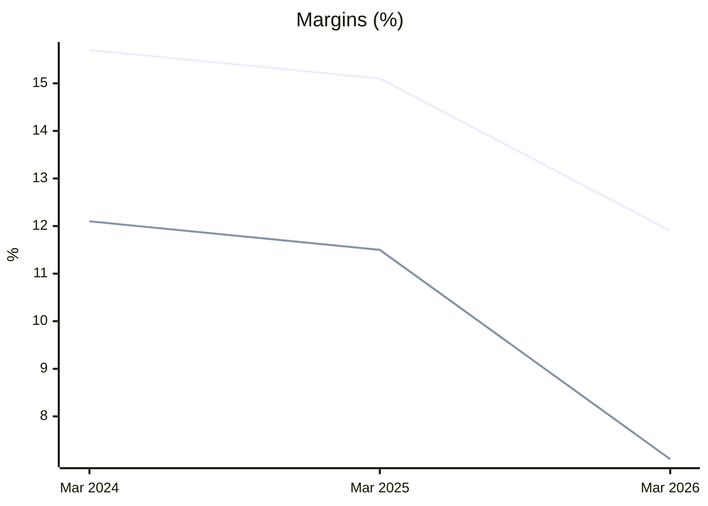

*Run 2026-11-24 · part of [SPINOFF_REPORT.md](../SPINOFF_REPORT.md) · the complete analysis of one company, with every management-call exchange in full.*

## SKFINDIA — SKF India Ltd.

### 1. SKF India Ltd. — CONFIRMED DEMERGER

**CONFIRMED** (a demerger scheme is on the exchange record) · **LISTED 1–2Y — the second-year window** · score 5.7/10 · spin-off · 9 filing(s) from CALLS, NSE, NSE-register · first 2025-10-15, latest 2026-08-20

**The separated entities — every one the documents name:**

| Entity | Scheme | Business | Listing | Who runs it |
|---|---|---|---|---|
| **SKF India (Industrial) Limited** | 2024-25 Scheme of Arrangement demerging the Industrial Busi… | Industrial Business: manufacturing, trading, marketing and dealing with rolling bearing, seals, rotating shaf… | listed 2025-12-05 as SKFINDUS (NSE) | not stated |

**What is being separated, as the documents put it:** SKF India's Industrial business (Demerged Undertaking) hived into SKF India (Industrial) Limited on going-concern basis — class `value_unlocking`.

### 2. Stages and dates

> **Listing:** LISTED — SKF India (Industrial) Limited (SKFINDUS) since 2025-12-05 (NSE equity list); record date 2025-10-15

| Date | Event | Source |
|---|---|---|
| 2024-09-17 | Other — Aktiebolaget SKF / SKF India Limited | as stated: Press Release filing dated 17th September 2024 enclosing AB SKF press… |
| 2024-10-08 | Stage reached: **announced** | [Outcome of Board Meeting](https://nsearchives.nseindia.in/corporate/SKFINDIA_08102024180012_NSE.pdf) |
| 2024-10-08 | Board approval — SKF India Limited | as stated: Outcome of Board Meeting / Acquisition filing dated 08th October 2024… |
| 2024-12-17 | Other — SKF India (Industrial) Limited | as stated: Acquisition filing dated 17th December 2024 – Certificate of Incorpor… |
| 2024-12-26 | Board approval — SKF India Limited and SKF India (Industrial) Limited | as stated: Outcome of Board Meeting and Demerger filings dated 26th December 202… |
| 2025-03-10 | Filed with exchanges — SKF India Limited | as stated: NSE Observation Letter Ref: NSE/LIST/46505 dated March 28, 2025 – "Ba… |
| 2025-03-27 | SEBI approval — SKF India Limited | as stated: BSE and NSE Observation Letters dated March 28, 2025 – "SEBI vide its… |
| 2025-03-28 | Exchange no-objection — SKF India Limited | as stated: Demerger filing dated 28th March 2025 – Observation Letters dated 28t… |
| 2025-04-09 | Other — SKF India Limited and SKF India (Industrial) Limited | as stated: Compliance Letter dated November 28, 2025 – "the application was file… |
| 2025-06-04 | NCLT order — SKF India Limited and SKF India (Industrial) Limited | as stated: Demerger filing dated 05th June 2025 – NCLT Order dated 04th June 202… |
| 2025-07-14 | Stage reached: **meetings** | [Shareholders meeting](https://nsearchives.nseindia.in/corporate/SKFINDIA23_14072025192642_NSE.pdf) |
| 2025-07-14 | Shareholders / creditors meeting — SKF India Limited | as stated: Shareholders meeting filings dated 14th July 2025 – NCLT-convened mee… |
| 2025-09-26 | NCLT order — SKF India Limited and SKF India (Industrial) Limited | as stated: Demerger filing dated September 26, 2025 – Order of Hon'ble NCLT, Mum… |
| 2025-09-30 | Other — SKF India Limited | as stated: Demerger filing dated 30th September 2025 – receipt of certified copy… |
| 2025-10-01 | Appointed date — SKF India Limited and SKF India (Industrial) Limited | as stated: Demerger filing dated 01st October 2025 – "The Appointed Date is open… |
| 2025-10-01 | Effective date — SKF India Limited and SKF India (Industrial) Limited | as stated: Demerger filing dated 01st October 2025 – "the Scheme is made effecti… |
| 2025-10-15 | **Record date** | NSE corporate-actions register |
| 2025-10-15 | Stage reached: **record date** | Record Date (corporate-actions register) |
| 2025-10-15 | Record date — SKF India Limited | as stated: Record Date filing dated 02nd October 2025 – Boards of the Company an… |
| 2025-10-17 | Stage reached: **listed** | [Demerger](https://nsearchives.nseindia.in/corporate/SKFINDIA22_17102025222058_NSE.pdf) |
| 2025-10-17 | Allotment — SKF India (Industrial) Limited | as stated: Demerger filing dated 17th October 2025 – Board of the Resulting Comp… |
| 2025-11-15 | Stage reached: **nclt sanction** | [Press Release](https://nsearchives.nseindia.com/corporate/SKFINDIA25_15112025132755_NSE.pdf) |
| 2025-11-27 | Other — SKF India (Industrial) Limited | as stated: Compliance Letter dated November 28, 2025 – newspaper advertisement d… |
| 2025-11-28 | Stage reached: **exchange noc** | [Updates](https://nsearchives.nseindia.com/corporate/SKFINDIA25_28112025194055_NSE.pdf) |
| 2025-12-05 | **SKF India (Industrial) Limited** listed (SKFINDUS) | NSE equity list |
| 2025-12-05 | Listing and trading — SKF India (Industrial) Limited | as stated: NSE's equity list (exchange record) – SKF India (Industrial) Limited … |

**The stages, as filed:** announced (2024-10-08) → meetings (2025-07-14) → record date (2025-10-15) → listed (2025-10-17) → nclt sanction (2025-11-15) → exchange noc (2025-11-28)

**Stated in the filings:** record date 2025-10-15; size hint: 15% of ebitda.

**When it lists, in the documents' words:** Shares allotted to holders on record date 15th October 2025; per NSE observation (letter 28 March 2025) listing and trading must commence "within sixty days of receipt of the order of the Hon'ble High Court/NCLT" (NCLT order 26th September 2025); Information Memorandum advertisement published 27 November 2025; by the 21st May 2026 call management refers to "the results of industrial separately".

### 3. Size of the separated business beside the parent — is institutional selling likely?

**Reading: LESS LIKELY on size alone — the piece is the larger part of the business.**

| Entity | Stated turnover | Stated share of the whole | Segment revenue share | Market cap (₹ cr) | Share of combined market cap | Index member |
|---|---|---:|---:|---:|---:|---|
| SKF India (Industrial) Limited | "The turnover of the Demerged Undertaking of the Company fo… | 63.0% | 64.9% (FY2025) | 12,415 | 63.1% | yes |

*Stated figures are the documents' own (a turnover share, or the cost-of-acquisition split the company publishes for tax, which reflects relative value); the segment share is this business's revenue over the parent's sales, and the market-cap share is the entity's value over the entity plus the parent (parent ₹7,246 cr, NSE bhavcopy of 2026-11-13), both computed here.*

**In the documents' words:** “The turnover of the Demerged Undertaking of the Company for the financial year ended 31st March 2024 was approximately Rs. 28,978.7 Million, representing 63% of the total turnover of the Company for the said year.”

**The judge's read of selling pressure:** likely — 1:1 mirror allotment pushed industrial shares onto holders of what is now a pure-play automotive company — a different industry.

### 4. Insider ownership — share swap, promoters' holding, management incentives

**Share swap / entitlement, entity by entity:**

- **SKF India (Industrial) Limited:** "1 (One) fully paid-up equity share of INR 10/- (Indian Rupees Ten only) each of the Resulting Company for every 1 (One) fully paid-up equity share of INR 10/- (Indian Rupees Ten only) each held in the Demerged Company."

**Promoters' holding, from the shareholding pattern:**

| Company | Promoters | FIIs | DIIs | Public | Quarter |
|---|---:|---:|---:|---:|---|
| SKF India Ltd. (SKFINDIA) | 52.58% | 7.14% | 25.51% | 14.77% | Sep 2026 |
| SKF India (Industrial) Limited (SKFINDUS) | 52.58% | 7.42% | 26.74% | 13.26% | Sep 2026 |

*Source: screener.in shareholding pattern, stored under `ShareholdingPattern/NiftyTotalMarket/`. In a mirror demerger each shareholder holds the same proportion of the new company as of the parent on the record date.*

- **Promoters in the parent, per the documents:** 52.58% – stated in the Regulation 30 disclosure dated 26th December 2024 as the post-Scheme (indicative) promoter shareholding of SKF Industrial, which mirrors SKF India ("Details as on 26th December 2024 … Promoters 100 / 52.58; Public - / 47.42"); the 14th July 2025 NCLT-convened meeting voting results show Promoter and Promoter Group holding 2,59,92,059 of 4,94,37,963 shares
- **What the promoters will hold in the separated entity:** 2024-25 demerger into SKF India (Industrial) Limited: "Upon the effectiveness of the Scheme, the shareholding of SKF Industrial will mirror the shareholding of the Company." and "The post Scheme shareholding pattern of SKF Industrial will replicate/ mirror the shareholding pattern of SKF India."; indicative post-Scheme shareholding of SKF Industrial: "Promoters 52.58 / Public 47.42". Share Entitlement Ratio Report: "the proposed demerger is a 'mirror image' demerger, i.e. all the shareholders of the Demerged Company shall become shareholders of the Resulting Company and the shareholding pattern of the Resulting Company shall mirror the shareholding pattern of the Demerged Company, on the Record Date."
- **What a public shareholder receives:** 2024-25 demerger: "Shareholders of the Demerged Company (as on the Record Date) will receive 1 fully paid-up share of the Resulting Company (INR 10/- face value) for every 1 fully paid-up share of the Demerged Company (INR 10/- face value) held." and "the demerger will not adversely impact the shareholding of the public shareholders. The new company will mirror the shareholding of the existing listed company with each shareholder of SKF India receiving one share of SKF Industrial as a consideration of the demerger." Public shareholders also retain their SKF India Limited shares, and "These new shares of the Resulting Company ("Resulting Company New Equity Shares") will be listed on BSE and NSE."
- **Management incentives:** not stated in the documents on file.
- **Insider actions around the separation:** Trading window closure on the promoter's separation announcement (17th September 2024): "The trading window for dealing in shares of the Company by Directors, Promoters, Designated Persons, and other insiders (including relatives thereof) is closed from the conclusion of this Board Meeting till 48 hours after the decision of the Board on this proposal." No promoter or management buying, selling or pledging around the separation is stated.
- **Insiders, per the checklist read:** Not stated — mirror-image demerger: all shareholders of the Demerged Company become shareholders of the Resulting Company, whose shareholding pattern mirrors it; no promoter stake figures or incentive terms given. · *option pricing date:* not stated

### 5. Why the demerger — point by point

SKF India separated its Industrial bearings business out of the listed company into SKF India (Industrial) Limited, leaving SKF India Ltd as a pure-play Automotive bearings company (management called it a "reverse carve-out" mirroring SKF AB's global split of Automotive, ~30% of group revenue versus 34-35% in India). Management's stated logic rested on three pillars: fundamentally different macro drivers (Automotive: EV/CAFE and BS-VII emission norms, 30% EV penetration target by 2030, premiumization/SUVs, last-mile commercial vehicles; Industrial: infrastructure spend, Make in India/NIP/PLI, China-Plus-One, railways/metro/Vande Bharat, wind and renewables doubling by 2030); different customer needs (a few large auto OEMs needing application-specific, longer-cycle engineered products — 60-65% engineered order in Auto versus ~25-30% in Industrial — against hundreds of industrial verticals wanting uptime, condition monitoring and remanufacturing); and a different manufacturing philosophy (Auto = large batch, small/medium bearings, automation and cycle-time efficiency; Industrial = wide assortment, small/large sizes, flexible lines with fast changeover plus a large traded component). The problems they said this solves: management attention split across two unlike businesses, capital allocation that could not be tailored (Auto was short of capacity, Industrial needed a brand-new Pune plant and localization from ~30-35% toward 70%), slow decision-making and launches, mismatched innovation cycles, and poor financial visibility for investors in a combined P&L. Operationally the split was defined down to the line: Bangalore 10 lines (7 Auto, 3 Industrial, with those 3 moving to Pune so Bangalore becomes 100% Auto), Pune 22 lines (12 Auto, 10 Industrial), Haridwar 4 lines all Auto; land 85:15 in Bangalore, 52:48 in Pune, 100% Auto in Haridwar; manpower 55-60% Auto versus 40-45% Industrial; cash allocated on the two businesses' last three years of profits. Shareholders received one SKF Industrial share of Rs 10 for every SKF India share held (PwC Business Consulting share entitlement report dated 24 December 2024; Saffron Capital fairness opinion 25 December 2024), with pre-demerger cost of acquisition apportioned 46.88% to SKF India and 53.12% to SKF Industrial. Pro forma FY24 economics shown to investors were Auto ~18% EBITDA and Industrial ~17%, both ~16% PBT, off a combined FY24 revenue of INR 45.7 billion; FY25 combined revenue was INR 4,919.9 crore (+7.65%) with PBT INR 763.1 crore (+3.71%). Nobody external demanded the separation — it was a group-level decision, with investors on the calls supportive (one explicitly "wholeheartedly supported" it) while pressing for structural clarity given SKF would still have three Indian entities including the unlisted SKF Engineering & Lubrication (Ahmedabad plant, global technical centre, lubrication and sealing factories); no lender or partner requirement was ever cited.

**Point by point, with the source:**

1. The stated purpose: two independent, fit-for-purpose companies that each accelerate growth and profitability, driven by three differences — industry dynamics, customer needs and manufacturing philosophy. “The intention of this demerger is to create 2 fit-for-purposes independent companies, which will accelerate both growth and profitability of both companies.” — *Apr 2025*
2. Management summarised the rationale as three separate axes of difference, with manufacturing efficiency and customer service as the payoff. “So to summarize, macro drivers are different. Customer drivers and innovation is different; and third, the manufacturing itself, the process of manufacturing itself is very different, what will make us most efficient and help us serve the customer needs.” — *Apr 2025*
3. Manufacturing philosophy was the concrete operating problem: Auto runs large batches of small/medium bearings for few OEMs with automation and economies of scale, while Industrial needs flexible lines, customised solutions and a large traded/regional component. “Automotive has a large batch sizes with small and medium-sized bearings.” — *Apr 2025*
4. Margin ambition attached to the separation: 2-3 percentage points of EBITDA upside in both businesses, from more efficient manufacturing, procurement and value-based pricing of premium products such as ceramic and energy-efficient bearings. “So I would say while the margins are typically relatively thin, we would hope that we can get at least 2 to 3 more points on our EBITDA going forward.” — *Apr 2025*
5. Shareholders were told the split was economically neutral — a mirror shareholding with a 1:1 share issue and listing of SKF Industrial on both exchanges. “The new company will mirror the shareholding of the existing listed company with each shareholder of SKF India receiving one share of SKF Industrial as a consideration of the demerger.” — *Apr 2025*
6. Investor visibility into the two businesses' separate performance was explicitly listed as one of the demerger benefits, alongside tailored capital deployment and two different manufacturing philosophies. “and finally, just more visibility for the -- our investors, all of you, to be able to see the performance of the 2 entities independently.” — *[May 2025](https://www.bseindia.com/stockinfo/AnnPdfOpen.aspx?Pname=78b3fd3b-6609-4f9b-ac56-5ec9fc26a320.pdf)*
7. Pro forma FY24 carve-out economics given to investors: Automotive ~18% EBITDA, Industrial ~17%, both around 16% PBT, with capex set to double from INR 130-150 crore as a new Industrial plant is built next to the existing Pune site. “So if you look at FY '24, our EBITDA margins for automotive was around 18%. And industrial was around 17%.” — *[May 2025](https://www.bseindia.com/stockinfo/AnnPdfOpen.aspx?Pname=78b3fd3b-6609-4f9b-ac56-5ec9fc26a320.pdf)*
8. The asset split was disclosed line by line — Bangalore 10 lines 70:30 with three lines moving to Pune so Bangalore becomes 100% Automotive, Pune 52:48 land, Haridwar 100% Automotive, manpower roughly 55:45. “There are three main plants, as we said, Bangalore, Pune and Haridwar. Bangalore, today there are 10 lines that will be split in the ratio of 70 to 30.” — *[Jul 2025](https://www.bseindia.com/stockinfo/AnnPdfOpen.aspx?Pname=3d94636c-b87c-4f11-91b6-556b4efcce20.pdf)*
9. Three-year guidance for the two entities: Automotive 10-12% growth, Industrial 8-10% (held back until the new Pune plant and localization land in FY27-28), with margins maintained at 17-19% and upside beyond FY28. “Next 3 years till '28, we expect growth in automotive to be in the 10 % to 12% range, industrial to be a little lower, 8% to 10% range.” — *[Jul 2025](https://www.bseindia.com/stockinfo/AnnPdfOpen.aspx?Pname=3d94636c-b87c-4f11-91b6-556b4efcce20.pdf)*
10. Capital allocation was the hard constraint being fixed: a brand-new Industrial-only Pune plant (DGBB, TRB, unitised bearings) costing INR 450-500 crore by 2028 plus INR 350-450 crore of additional lines, on top of INR 500-600 crore of Automotive capex to 2030. “Pune, we will be setting up a new plant, fully industrial, for industrial, making primarily DGBBs, which are deep groove ball bearings, tapered roller bearings, and unitized bearings, which are UCs.” — *[Jul 2025](https://www.bseindia.com/stockinfo/AnnPdfOpen.aspx?Pname=3d94636c-b87c-4f11-91b6-556b4efcce20.pdf)*
11. At the NCLT-convened shareholder meeting, management conceded the separation was complex precisely because the two businesses were deeply intertwined, and said the total demerger cost was still being accumulated. “As you know, it's a complex project primarily because the businesses both automotive and industrial, they are so deeply integrated that having two independent businesses is a complex process.” — *[Aug 2025](https://www.bseindia.com/stockinfo/AnnPdfOpen.aspx?Pname=6801dc1e-769f-42ac-9ea4-5ada85787e74.pdf)*
12. An existing institutional shareholder (Ravi Purohit) publicly backed the demerger while asking why India would still be left with three SKF entities when the group was simplifying structures; management said no merger of entities was contemplated until the demerger completed. “And first of all, we'd like to congratulate and have wholeheartedly supported this demerger initiative that SKF Group is undertaking.” — *[Aug 2025](https://www.bseindia.com/stockinfo/AnnPdfOpen.aspx?Pname=6801dc1e-769f-42ac-9ea4-5ada85787e74.pdf)*
13. First quantification of the cost: INR 184 million in Q1 FY26, mainly SAP and separate data infrastructure plus compliance consultants, with a 1.5-2% margin drag expected to run to H1 FY27 and extra stamp duty/registration cost on asset transfer in the Industrial entity. “So if you look at our current quarter, cost of demerger was around INR184 million.” — *[Aug 2025](https://www.bseindia.com/stockinfo/AnnPdfOpen.aspx?Pname=6801dc1e-769f-42ac-9ea4-5ada85787e74.pdf)*
14. At the FY25 AGM the Chairman framed the demerger as strategic repositioning to sharpen focus, improve execution agility and deepen customer alignment, with manufacturing roadmaps diverging (Automotive automation-led high throughput; Industrial modular and demand-responsive). “The announcement of our demerger, which is separating the automotive and industrial businesses into two focused publicly listed entities was a significant milestone.” — *[Aug 2025](https://www.bseindia.com/stockinfo/AnnPdfOpen.aspx?Pname=6801dc1e-769f-42ac-9ea4-5ada85787e74.pdf)*
15. Post-demerger, management clarified the direction of the carve-out — Industrial was hived off and the listed SKF India Limited is the automotive division, a reverse of the group-level split. “But in India, it is a reverse carve -out where industrial has gone out. So SKF India Limited remains as automotive division.” — *[May 2026](https://www.bseindia.com/stockinfo/AnnPdfOpen.aspx?Pname=fa739605-3c56-43bc-8950-6cc1db2e700e.pdf)*
16. The promised margin uplift did not appear: FY26 PBT fell 694 bps, EBITDA was 15.3%, and guidance was reset to 11-12% PBT, with Auto still buying medium DGBB and tapered roller bearings from SKF Industrial because of its own capacity shortage. “Now talking about the sustainable margin, we could be looking at 11 -12% kind of margin in the near future, while obviously in long term, the focus would be on improving it further, but the sustainable margin will be that.” — *[May 2026](https://www.bseindia.com/stockinfo/AnnPdfOpen.aspx?Pname=fa739605-3c56-43bc-8950-6cc1db2e700e.pdf)*
17. A long-term shareholder attacked the post-demerger communication gap, noting pre-demerger guidance of 16-19% (even 18-19%) EBITDA for a 95%-localised Auto business and a 50-70% valuation discount to Schaeffler and Timken; management replied royalty was unchanged and there is now no pure-play comparable. “Increasingly, our post demerger, what we are realizing is that the investor communication and the disclosures have dropped substantially.” — *[May 2026](https://www.bseindia.com/stockinfo/AnnPdfOpen.aspx?Pname=fa739605-3c56-43bc-8950-6cc1db2e700e.pdf)*
18. Management's closing framing still rested on focus and agility as the value-unlock, with restructuring costs described as a temporary hit. “The demerger positions us to unlock greater value by enabling sharper focus and agility in our business.” — *[May 2026](https://www.bseindia.com/stockinfo/AnnPdfOpen.aspx?Pname=fa739605-3c56-43bc-8950-6cc1db2e700e.pdf)*
19. The scheme transferred the Industrial business as a going concern into SKF India (Industrial) Limited under Sections 230-232, effective 1 October 2025 (NCLT order 26 September 2025, record date 15 October 2025), with pre-demerger cost of acquisition apportioned 46.88% to SKF India and 53.12% to SKF Industrial — i.e. Industrial was the larger half. “The Hon'ble National Company Law Tribunal, Mumbai Bench, vide its Order dated 26th September, 2025, sanctioned the Scheme of Arrangement between SKF India Limited ("the Company" or "Demerged Company") and SKF India (Industrial) Limited ("SKF Industrial" or "Resulting Company") and their respective shareholders and creditors under Sections 230 to 232 and other applicable provisions of the Companies Act, 2013 ("Scheme"), providing for the demerger of the Company's Industrial Business (Demerged Undertaking as defined in the Scheme ) into SKF Industrial on a going concern basis” — *Scheme*
20. The post-completion press release restated the purpose as two focused entities with independent boards and governance, and attached separate investment plans — Industrial INR 8,000-9,500 million by 2030 including a new Pune facility by 2028, Automotive INR 4,100-5,100 million by 2030 across EV, two-wheeler and wheel-end capacity in Haridwar, Pune and Bangalore. “The demerger, sanctioned by the National Company Law Tribunal (NCLT) and approved by shareholders earlier this year, has formally separated SKF India's business into two focused entities — SKF Industrial and SKF Automotive — each equipped with independent boards and governance structures.” — *Scheme*
21. The FY26 AGM presentation codified the five official reasons for the separation and rebranded the automotive entity as SKF Vertevo, reporting FY26 revenue of INR 21,295 million, 15% EBITDA margin and EPS of INR 23.7. “Why the Demerger? Different Market Dynamics Distinct Customer Needs Focused Capital Allocation Faster Decision Making Independent Growth Strategies” — *Scheme*

**How it evolved:** The demerger was announced in Q4 CY2024 and first explained in detail on a dedicated update call on 9 April 2025, which laid out the three macro/customer/manufacturing drivers, the six enablers (management focus, manufacturing efficiency, tailored capital, agility, innovation, investor visibility), pro forma FY24 carve-out financials and a 12-15 month timeline, plus an aspiration of "2 to 3 more points" of EBITDA. By the 19 May 2025 Q4 call the plant allocation had firmed up (Haridwar 100% Auto, Bangalore ~80-85% Auto, a new Industrial factory beside the Pune plant), and the 30 June 2025 investor meet added line-by-line, land and manpower splits, segment revenue mixes from FY22-FY25, three-year guidance (Auto 10-12%, Industrial 8-10% to FY28, margins held at 17-19%) and a step-up in capex from ~INR 150 crore to roughly INR 350-400 crore a year (INR 450-500 crore Pune industrial plant by 2028, INR 500-600 crore Auto capex to 2030); the NCLT-convened shareholder meeting on 14 July 2025 approved the 1:1 scheme, and the 6-7 August 2025 AGM and Q1 FY26 call quantified the cost for the first time (INR 184 million in Q1, mostly SAP/IT separation and consultants, 1.5-2% margin drag running into H1 FY27, plus stamp duty on asset transfer) while conceding the businesses were "so deeply integrated" that separation was complex. After NCLT sanction on 26 September 2025, effectiveness on 1 October 2025 and a 15 October 2025 record date, the story changed tone: the 21 May 2026 call presented SKF India as a standalone automotive company guiding to only 11-12% PBT margin (FY26 EBITDA 15.3%) with investors complaining that disclosure had "dropped substantially" post-demerger and that margins were far below what was promised in the run-up to the demerger vote, management answering that royalty was unchanged and this was a transition.

**What management expects from it:** Two fit-for-purpose entities growing faster and more profitably: automotive 10-12% and industrial 8-10% growth to FY28, both holding 17-19% EBITDA with 2-3 points of upside later; sharper management focus, tailored capital deployment and manufacturing efficiency, plus separate financial visibility attracting more aligned investors.

*Not explained on the calls:* Never quantified: total demerger cost, dis-synergies, inter-entity trading/rent/service charges, or why post-demerger margins (11-12% PBT) fall far below the 16-19% promised pre-demerger.

- *Stated reason, in one line:* Different market dynamics, distinct customer needs, focused capital allocation, faster decision making and independent growth strategies for the two businesses; strategic clarity to unlock greater value.
- *What it reveals:* Cost of acquisition apportioned 46.88% to SKF India (automotive) vs 53.12% to SKF Industrial — the industrial half carries more value. Parent's margins fell to ~15.3% EBITDA / 11-12% PBT guidance versus 16-19% pre-demerger commentary, blamed on one-offs.
- *Parent or spin:* parent · *Read next:* SKF India (Industrial) Limited's Information Memorandum and its standalone results — margins behind the 53.12% cost allocation.
- *In their words:* “The demerger gives us the strategic clarity to sharpen our priorities, accelerate growth, and unlock greater value for all stakeholders.”

### 6. On the calls, verbatim

11 call(s), oldest first: **86 question-and-answer exchange(s)** given in full — the question and every answer to it, nothing trimmed — and 123 passage(s) from management's prepared remarks (the complete sentences about it; the whole remarks are in the linked transcript). Text is as the transcript prints it.

#### Feb 2024 — [transcript](https://www.bseindia.com/stockinfo/AnnPdfOpen.aspx?Pname=f9dd3070-f0be-4441-b8b3-290f7ea5eae3.pdf)

**From the prepared remarks** *(the passage about it; the whole turn runs to 363 characters in the transcript)*

> **Ashish Saraf:** Sure. So, from a business perspective, we are broadly divided into industrial, automotive and then we have a small amount of exports. In terms of the overall business, I would say 50% is industry, 40% is automotive and the remaining 10% is exports. So that's how broadly from a segment standpoint we are. And within each of these businesses, we have sub-segments.

**From the prepared remarks** *(the passage about it; the whole turn runs to 76 characters in the transcript)*

> **Ashish Saraf:** No, industrial doesn't include tractors. Tractors is part of the automobile.

**From the prepared remarks** *(the passage about it; the whole turn runs to 676 characters in the transcript)*

> **Ashish Saraf:** So again, in industrial, we have segments like railways, wind. Then we have metals. Then we have heavy industries. So, within heavy industries, basically cement, yarn, pulp and paper, all industries which are basically related to infrastructure. And then we have wind. I said railways and then, textiles. And then we have something called general machinery, which is a combination of various small, small segments, which is like your fluid power, your textiles, your pumps, and motors. All of that is basically part of that. Agriculture, F&B, all of that is basically clubbed together. And then we have a big aftermarket in the industry for basically catering to the industry.

**From the prepared remarks** *(the passage about it; the whole turn runs to 186 characters in the transcript)*

> **ICICI Pru Speaker:** Okay. But they are predominantly industrial. So just on the wind side, it is a small segment. Within that, how much would be domestic? And how much would be catered to the export market?

**From the prepared remarks** *(the passage about it; the whole turn runs to 194 characters in the transcript)*

> **ICICI Pru Speaker:** So just now, it's been towards the industrial and the auto part. Just wanted to understand what is the localization in the industrial segment versus what is the localization in the auto segment?

**From the prepared remarks** *(the passage about it; the whole turn runs to 213 characters in the transcript)*

> **Ashish Saraf:** See, automotive is pretty much everything is localized. Almost 90% to 95% is fully localized. Industrial is around, I would say, 35% to 40% localized. Rest all is we are either importing from Europe or from China.

**From the prepared remarks** *(the passage about it; the whole turn runs to 279 characters in the transcript)*

> **Ashish Saraf:** Okay. I have included SKF technologies also. Also, the overall localization. So, if you purely look at it from an SKF India perspective, it could be a little lower. So I would say 35% is industrial localized. Automotive is all in SKF India. Industrial as I said 35% is localized.

**From the prepared remarks** *(the passage about it; the whole turn runs to 213 characters in the transcript)*

> **ICICI Pru Speaker:** So, this is SKF India overall, including auto. So auto is fairly stable. We know it at 80%-90%. So just to focus on industrial, overall, if you include SKF technologies you are saying 35% is manufactured in India.

**From the prepared remarks** *(the passage about it; the whole turn runs to 292 characters in the transcript)*

> **Ashish Saraf:** We have to do the math in a sense. 90% -- I would say maybe you reduce by 5% to 10%, so maybe 25% which is what is getting manufactured in SKF India. So industrial 25% to 30% is what is getting manufactured in India. The rest all is getting manufactured either in SKF technologies or outside.

**From the prepared remarks** *(the passage about it; the whole turn runs to 240 characters in the transcript)*

> **Ashish Saraf:** SKF technologies have other businesses also. It is not just that it is doing manufacturing for the industrial business. They are into lubrication and seals business as well. So overall their turnover would be to the tune of INR1,000 crores.

**From the prepared remarks** *(the passage about it; the whole turn runs to 64 characters in the transcript)*

> **Ashish Saraf:** SKF in India. SKF India, 60% is manufactured. 40% is industrial.

**From the prepared remarks** *(the passage about it; the whole turn runs to 1,168 characters in the transcript)*

> **Ashish Saraf:** We are also setting up new -- putting up new channels also. See, again, you will also have to understand that from a bearing industry standpoint, there are different sizes of bearings that we manufacture. So, in terms of capability, if you look at the manufacturing plants which are part of SKF India, they have capability to make smaller size bearings. And which is what we manufacture. Whereas for the industrial business, for different segments, different size bearings are required. To give you an example, wind bearing could be as big as this room. That kind of capability you need a different kind of treatment plant. You have a different kind of steel requirement which may not be even that you have to build suppliers over a period of time. So that is not something that you can easily localize. And in terms of expertise, some of that expertise lies in the Ahmedabad factory because they have been traditionally manufacturing bearings for railways and wind. So, it continues to make sense for us to do -- when we are doing localization, continue to do localization and leverage the infrastructure which is already in place in Ahmedabad for these two segments.

**From the prepared remarks** *(the passage about it; the whole turn runs to 181 characters in the transcript)*

> **ICICI Pru Speaker:** Just to understand, on the SKF technologies part, railways, and wind we know. That's 100% over there. The industrial -- are there some specific industrial bearings which we do make.

**From the prepared remarks** *(the passage about it; the whole turn runs to 121 characters in the transcript)*

> **ICICI Pru Speaker:** So, the capex which you are talking about, INR100 crores or INR150 crores, will be mostly towards the industrial segment?

**From the prepared remarks** *(the passage about it; the whole turn runs to 358 characters in the transcript)*

> **Ashish Saraf:** No, it will be both industrial as well as automotive. Because as we work with automotive industry and we do production, so we will enhance capacity as our share of business. There is also a lot of customers who are like, from an export perspective, we have one customer who is looking at exporting from here. So, we are kind of setting up a channel for that.

**From the prepared remarks** *(the passage about it; the whole turn runs to 496 characters in the transcript)*

> **Ashish Saraf:** No. See, we believe from a growth perspective, if I talk about industry, we believe the growth is going to be whole infrastructure there. So, we have seen strong growth in rail, we have seen strong growth in heavy industry, we have seen strong growth in metals. And also [general machinery]. So, these four segments from the industrial perspective are definitely going to have a very good place. If that is the case, then our gross margins will take a knock. Because we depend on stable exchange.

**From the prepared remarks** *(the passage about it; the whole turn runs to 302 characters in the transcript)*

> **ICICI Pru Speaker:** What it means is that the industrial pie will increase more than the auto pie. So, as a result, the credit part will keep on increasing from a state of technologies or imports leading to a summit on the gross margins part. Unless the pricing is so good because of the demand which will take care of it.

**From the prepared remarks** *(the passage about it; the whole turn runs to 624 characters in the transcript)*

> **Ashish Saraf:** I think the issue is still there. There are counterfeit bearings being in the market continues to be there. To address that we continue to focus on improving our reach in the automotive space especially. So, we continue to appoint a large number of distributors to increase our reach. In the industrial space we continue to work with the retailer network. We have a strong retailer network. So that they buy from authorized distributors or industrial distributors. And we have seen good traction there in terms of just increasing our market share in the aftermarket. Both in the industrial side as well as in the automotive.

**From the prepared remarks** *(the passage about it; the whole turn runs to 253 characters in the transcript)*

> **ICICI Pru Speaker:** This is PBT Yes, in terms of margins, generally industrial followed by CV and then PV, that is how the margin is there, highest in industrial, then will be the lowest So for us it would be similar given that there is a traded concept in industrial. And…

**From the prepared remarks** *(the passage about it; the whole turn runs to 319 characters in the transcript)*

> **Ashish Saraf:** See, all-to-all margin for industrial is higher right, but if you are trading, your margins are going to be lower compared to say an automotive business which you are actually manufacturing. And you are sitting with all the costs. So, all-to-all margins for an automotive business in SKF India. Is sitting in SKF India.

**From the prepared remarks** *(the passage about it; the whole turn runs to 221 characters in the transcript)*

> **ICICI Pru Speaker:** Yes, that I understood. So, what I am saying is that even including the traded and the manufacturing of industrial the net margins are higher than the overall auto sector or it could be at par because of the higher trade?

**From the prepared remarks** *(the passage about it; the whole turn runs to 49 characters in the transcript)*

> **Ashish Saraf:** In EVs it changes, I am talking about industrial.

**From the prepared remarks** *(the passage about it; the whole turn runs to 107 characters in the transcript)*

> **Speaker:** So I basically wanted to know that within auto and within industrial, which categories are growing for you?

**From the prepared remarks** *(the passage about it; the whole turn runs to 963 characters in the transcript)*

> **Ashish Saraf:** From an SKF perspective, I will first talk about industrial. We believe that India growth story is going to be infrastructure led. So, sectors like railways, heavy industry, metals, textiles, fluid power, pumps and motors; these are the sectors which will continue to grow and this is where we are expecting strong growth yoy. On the automotive side, 2Wheeler we have been present with all the big players like Bajaj, Honda, Royal Enfield and we continue to improve our share of business with them so we expect the 2Wheeler market to continue to grow. On the cars, or passenger vehicle side, we are working with players like Tata, Mahindra, and we are participating with all the new models that they are launching. With other players, primarily Japanese or Korean players, they typically buy from their local suppliers so its relatively difficult to grow our market share there so that’s where our 4Wheeler market share is not going to be as high as the 2Wheeler.

**From the prepared remarks** *(the passage about it; the whole turn runs to 90 characters in the transcript)*

> **Speaker:** If you have to slice the 12% top line growth, would you say industrial will be well above?

**From the prepared remarks** *(the passage about it; the whole turn runs to 195 characters in the transcript)*

> **Ashish Saraf:** I would say, at least long term we do expect industrial to grow at a faster pace than automotive but based on the visibility that I have for the current year, I expect 2Wheeler at a similar pace.

**From the prepared remarks** *(the passage about it; the whole turn runs to 172 characters in the transcript)*

> **Ashish Saraf:** Predominantly small and mid sized bearings is what is going to get manufactured. We make everything for the automoti ve side, don’t make everything for the industrial side.

**From the prepared remarks** *(the passage about it; the whole turn runs to 59 characters in the transcript)*

> **Ashish Saraf:** Around 35 percent is after market for auto plus industrial.

**From the prepared remarks** *(the passage about it; the whole turn runs to 54 characters in the transcript)*

> **Speaker:** Industrial is 20% of the business in terms of revenues

**From the prepared remarks** *(the passage about it; the whole turn runs to 59 characters in the transcript)*

> **Speaker:** The OE part, excluding the after market, industrial OE is…?

**From the prepared remarks** *(the passage about it; the whole turn runs to 73 characters in the transcript)*

> **Ashish Saraf:** Industrial OE for the overall SKF India revenues should be around 25-30%.

**From the prepared remarks** *(the passage about it; the whole turn runs to 175 characters in the transcript)*

> **Ashish Saraf:** Let me simplify it for you, there are 2 sectors : Industrial and automotive. Industrial is all industries excluding auto which includes wind, railways, heavy industry, metals.

**From the prepared remarks** *(the passage about it; the whole turn runs to 786 characters in the transcript)*

> **Ashish Saraf:** That’s right. On the industrial front, we do something called Rotating equipment performance where we work with some of the big players. Our revenue model is based on productivity so our intent is to work with them and basically look at the rotating equipment and see how we can improve performance through condition monitoring and adding sensor to those bearings and ensuring that we suggest or recommend the right kind of bearing for the right application to ensure that their breakdowns come down and it helps them manufacture the product they want, predominantly in the metal segment. That is where we work with a lot of end users which will help them improve their productivity and they pay us in terms of production. That helps us gain 100% market share for that particular plant.

**From the prepared remarks** *(the passage about it; the whole turn runs to 182 characters in the transcript)*

> **Ashish Saraf:** All other businesses are also growing so if you look at it as a percentage of revenue, it is pretty much similar. The industrial after market is around 25% and auto after market is …

**From the prepared remarks** *(the passage about it; the whole turn runs to 159 characters in the transcript)*

> **Speaker:** Can you show where the mix is higher terms of products so we can understand if something sells more from ASP or magic perspective? Lets say auto vs industrial.

**From the prepared remarks** *(the passage about it; the whole turn runs to 37 characters in the transcript)*

> **Speaker:** And industrial currently is only 35%?

**From the prepared remarks** *(the passage about it; the whole turn runs to 202 characters in the transcript)*

> **Speaker:** Can I understand if you said that industrial 35% is in house manufacturing, 65% is imports and within this 35% also 25% is in listed entity. You are guiding that this 35% would become 60- 65% over time?

**From the prepared remarks** *(the passage about it; the whole turn runs to 159 characters in the transcript)*

> **Ashish Saraf:** Again, when we look at manufacturing we look at overall..industrial for the listed entity is around 25% and you would see an increase by every year by 1 or 2%.

**From the prepared remarks** *(the passage about it; the whole turn runs to 448 characters in the transcript)*

> **Mirae Speaker:** So, therefore, there will be some other player, maybe another, who is gaining at your cost. Could be. So, this is also, I mean, like 3% impact on the world, I mean, and then another 3%-4% helping people out. But still if you adjust for that, I mean, it could have been 7%. So, it looks like, I mean, the industrial aftermarket has taken a lot. But in terms of cement and steel production in India, it's relatively okay still. I mean, aftermarket...

**From the prepared remarks** *(the passage about it; the whole turn runs to 49 characters in the transcript)*

> **Mirae Speaker:** So, industrial aftermarket was around 25% for us?

**From the prepared remarks** *(the passage about it; the whole turn runs to 471 characters in the transcript)*

> **Ashish Saraf:** That's what I am saying. See, for this quarter, in the auto distribution space, that is the input that we got from our sales team to look at our incentive programs. Kind of look at it this quarter and try to do a prediction. On the industrial aftermarket, as I said, there was a one-off because of contract renewals with some of the end customers, which impacted on the volume that we were expecting that we would buy. So, that should post-correct naturally this quarter.

**From the prepared remarks** *(the passage about it; the whole turn runs to 52 characters in the transcript)*

> **Mirae Speaker:** And on industrial OEM side, what is the growth rate?

**From the prepared remarks** *(the passage about it; the whole turn runs to 141 characters in the transcript)*

> **Mirae Speaker:** No, no, industrial OEM side. And also, maybe nine months of full calendar year if you can just again help us understand the breakout process.

**From the prepared remarks** *(the passage about it; the whole turn runs to 304 characters in the transcript)*

> **Ashish Saraf:** Sorry, your question was, what is the year-on-year growth of the OEM, industrial OEMs, right? Industrial OEMs would be much higher. The overall growth for industrial was 5%, right? For the nine-month period. All of which, my distribution has grown by 3%. So, distribution was almost 50% of your business.

**From the prepared remarks** *(the passage about it; the whole turn runs to 417 characters in the transcript)*

> **Mirae Speaker:** Again, looking to, I mean, let's say globally, SKF makes more tilted in favour of industry. We are still 53% globally. Now, with all these, India also, all this manufacturing thing going on, all that. But do you think any other sort of incremental opportunity coming in from, let's say, global portfolio, which we might not be having at this point in time? Yes. Particularly on the, basically, on the industrial side.

**From the prepared remarks** *(the passage about it; the whole turn runs to 960 characters in the transcript)*

> **Ashish Saraf:** See, we are, we are heading to the India market. So, the market is there already, right? So, the focus is predominantly that India manufacturing sector is growing. So that should be, and there's a lot of investments happening on the infrastructure front. So that is going to trigger the growth for the industrial business. And industrial business will grow at a much faster pace because there's more investment happening in the industrial sector compared to the auto sector. Right? That's why, and SKF has been traditionally very strong in the automotive space in India. That's why we have been having a higher, if you look at the mix, our automotive mix has been higher. So, because of that, the mix is always going to be a bit skewed when you compa re it with the industry. But we expect the industry to grow at a much faster pace compared to the auto sector. Because of the sheer investments which are going in and the focus which is there on manufacturing.

**From the prepared remarks** *(the passage about it; the whole turn runs to 54 characters in the transcript)*

> **Mirae Speaker:** But then higher industrial mix is bad for the margins.

**From the prepared remarks** *(the passage about it; the whole turn runs to 175 characters in the transcript)*

> **Mirae Speaker:** If you snap your industrial portfolio versus the opportunity set in India, where is it that you need to spend the net? Do you think you're covering more through manufacturing?

**From the prepared remarks** *(the passage about it; the whole turn runs to 1,102 characters in the transcript)*

> **Ashish Saraf:** Yes, yes. That's what I'm saying. So there are a lot of internal initiatives which are ongoing, right, in terms of ensuring that we get a right costing for our firms, right? And secondly, as I said, the focus of each and every region, they also realize that for us to serve the market better in India and Southeast Asia, it makes sense to localize. So, over a period of time, automotive is almost 95% localized. Industrial, you will see a significant localization. Again, some of it might happen in certain entities, some of it might happen in the other entities. But from a region-to-region perspective, there's a significant focus on localization and improving productivity and improving the cost efficiency so that we are better placed in the market. But having said that, we don't want to focus, we don't want to drop our markets, right? So, there is a constant focus on constantly looking at our portfolio, looking at our returns at a product level, at a customer level to see how we can further rationalize it, ensure that we are getting the right price from our customers to improve our markets.

**From the prepared remarks** *(the passage about it; the whole turn runs to 540 characters in the transcript)*

> **Ashish Saraf:** The volume should further pick up. So, that's where, as I said, if exports, all of our OEMs are dependent on exports. We don't directly see, because our export numbers are relatively small, we don't have direct export numbers. But a lot of these OEMs, both on the industrial space as well as on the auto space, they do well. And India continues to do well.- then the growth numbers that we talked aboutshould happen. HDFC speaker: So, what is the industry overall now? Right now, this, as an aspiration to grow industry is around 2% higher.

**From the prepared remarks** *(the passage about it; the whole turn runs to 409 characters in the transcript)*

> **Ashish Saraf:** See, industrial is 50%. Auto is around 40%-41%. And exports are around 8%-9%. That's the stat. Currently. Industrial growth was not so great in the last quarter. Automotive grew at a much faster pace compared to industrial. But I would say that was more of one quarter. Our growth should be higher in industrial, as we move forward. HDFC speaker: Within industrial, what are the process industry distribution?

**From the prepared remarks** *(the passage about it; the whole turn runs to 335 characters in the transcript)*

> **Ashish Saraf:** Distribution is around 50% of industrial, right? So, again, we are looking at growing our aftermarket at a much faster pace compared to the OEM market. So, I don't see any change there. HDFC speaker: So, the 1%-2% incrementally every year we are targeting industrial sale to go up. So, that would be predominantly from the aftermarket?

**From the prepared remarks** *(the passage about it; the whole turn runs to 728 characters in the transcript)*

> **Ashish Saraf:** You know, as I said, these are all infrastructure there, we have a woodshed there, we continue to build, woodshed, we have well positioned, both the aftermarket, as well as with the OEMs. So, barring wind, as I said, all sectors, again, we see some challenges on the textile sector, because of, I think, they are expecting, the new government, to form, and sort out, some of the challenges that the sector itself is facing. But barring that, we expect, all sectors, for all segments, to be distributed, barring this, and as I said, wind is one sector, where we are constantly, deciding, the sector is growing, but… HDFC speaker: So, apart from metal, what are the bigger segments, in industrial, in the OE side, of distribution?

**From the prepared remarks** *(the passage about it; the whole turn runs to 379 characters in the transcript)*

> **Ashish Saraf:** See, on the OE side, as I said, one is general machinery, which is part of, it's a combination of, a lot of sub-segments, which is, sorry, which is, fluid power, drives, pump and motors, textiles, agriculture, all of that is, basically, part of, general machinery. So, that's a pretty big, I think, almost 8% of our total business. HDFC speaker: 16% of your, industrial business…

**From the prepared remarks** *(the passage about it; the whole turn runs to 641 characters in the transcript)*

> **Ashish Saraf:** So, there are sluggishness, in pockets, as I said, textile is one area, where we have issues, or we continue to see, some issues there. A lot of, these companies, sometimes, depend on exports. So, they have sluggishness on the export side, because of the global economic situation. Then, that impact will come to us. So, it's a weeks back. I cannot say, okay, all subsectors, within that. But, overall it's a relatively, okay, not alarming, or anything concerning. HDFC speaker: So, as I want to join, maybe, so, just want to get, an overall sense, on the industrial side, because there is, much activity, etcetera going on. So, how are you…

**From the prepared remarks** *(the passage about it; the whole turn runs to 75 characters in the transcript)*

> **Ashish Saraf:** This position, as I told them, right, we see, typically, the industrial is,

**From the prepared remarks** *(the passage about it; the whole turn runs to 626 characters in the transcript)*

> **Ashish Saraf:** In industry. Automotive is also, pretty much, on the same lines, but automotive, I would say, 2- wheeler should grow, and aftermarket should grow. Right. 2-wheeler aftermarket. Whereas looking at commercial vehicles, and tractors, and all, that market, might remain, relatively, stagnant. HDFC speaker: When you think about it, over the next few years, so not really this year, as such. Is it fair to say, of course, you'll have some years, with volumes, you'll have a better years? So, two questions, in this. One is, in the next 3-4 years, will the industrial segment grow faster than auto? Is that a fair statement to make?

**From the prepared remarks** *(the passage about it; the whole turn runs to 95 characters in the transcript)*

> **Ashish Saraf:** That's a fair assessment. HDFC speaker: And margins are, better, in industrial, versus in auto?

**From the prepared remarks** *(the passage about it; the whole turn runs to 583 characters in the transcript)*

> **Ashish Saraf:** See, wall to wall margins are better, in industrial, compared to auto. But, from an, SKF India, perspective, your manufacturing margins, are better, compared to, traded products. So, your traded products are mor e in industrial, currently, compared to, automotive products. HDFC speaker: But, when you put the whole pie together, then industrial margins, look, because as you said, industrial component, is much higher. So, when you look at it, 50% of the business includes, obviously, trade business. 50% is non-trade, which is the auto business, and the export business, and so on.

**From the prepared remarks** *(the passage about it; the whole turn runs to 191 characters in the transcript)*

> **Ashish Saraf:** So that's something, automotive makes high margin, from a, from a local, standpoint. But wall to wall margin, as a company, is better, in industrial. HDFC speaker: When you say, wall to wall…

**From the prepared remarks** *(the passage about it; the whole turn runs to 100 characters in the transcript)*

> **Ashish Saraf:** At an SKF India, manufacturing will make, a higher margin. HDFC speaker: In industrial, versus auto?

**From the prepared remarks** *(the passage about it; the whole turn runs to 260 characters in the transcript)*

> **Ashish Saraf:** That is right. But the mix of automotive and manufacturing is much higher, compared to industrial. So, if you look at it from that perspective, your margin, in auto, will be higher, compared to, industrial. HDFC speaker: How much will be, manufacturing output?

**From the prepared remarks** *(the passage about it; the whole turn runs to 85 characters in the transcript)*

> **Ashish Saraf:** 90% plus. In industrial, localization is around 35%. HDFC speaker: So, 65% is, trade.

**From the prepared remarks** *(the passage about it; the whole turn runs to 682 characters in the transcript)*

> **Ashish Saraf:** Yes, I would say, but again we continue to make further inroads, right, in terms of, like in the automotive space, we continue to enroll mechanics, retailers, increase our reach to gain market share, right, as well as driver growth. On the industrial side, we are focusing a lot more on value setting, where we - engage with our distributors to build capabilities so that they can kind of suggest or recommend the right solutions. So, they become solution sellers rather than just being distributors to the large end customers. We saw some positive results of that in 2023 and we expect that to continue to make investments in that area. HDFC speaker: And how is Railways doing now?

**From the prepared remarks** *(the passage about it; the whole turn runs to 84 characters in the transcript)*

> **Ashish Saraf:** Railways is doing pretty well. HDFC speaker: Railways is housed, within industrial ?

**From the prepared remarks** *(the passage about it; the whole turn runs to 103 characters in the transcript)*

> **Ashish Saraf:** Railways is housed, within industrial. HDFC speaker: Railways is 7% of industrial . Or 70% of Railways?

**From the prepared remarks** *(the passage about it; the whole turn runs to 96 characters in the transcript)*

> **Ashish Saraf:** 7% of Overall HDFC speaker: So, again 60% of industrial. If you just, specifically market-share…

**From the prepared remarks** *(the passage about it; the whole turn runs to 180 characters in the transcript)*

> **Ashish Saraf:** See, basically, Manish was doing two roles. He was MD for SKF India, plus he was Head for the India and Southeast Asia industrial business. HDFC speaker: Industrial business, okay.

**From the prepared remarks** *(the passage about it; the whole turn runs to 418 characters in the transcript)*

> **Ashish Saraf:** Right? So now he continues to be the MD for SKF India till the replacement joins in. And he’s going to give up the role – he’s given up the role of India and Southeast Asia industrial business and he’s taken on the role for Business Head for America’s industrial business. Right? So, in the next quarter once the new person joins in... HDFC speaker: So, this person is joining. He’s going to be an external individual.

**From the prepared remarks** *(the passage about it; the whole turn runs to 179 characters in the transcript)*

> **Ashish Saraf:** Export is separate, export is another 8%. HDFC speaker: 15, 41 and 9. 15, 41 and 9, 15 is industrial 41 is auto 9 is export, which is mainly -- It's mostly for passenger products.

**From the prepared remarks** *(the passage about it; the whole turn runs to 355 characters in the transcript)*

> **Ashish Saraf:** No, no, no. Export is everything. But predominantly, automotive. Because we are manufacturing for automotive. But it will be a mix for industrial. Like, the products are... Like, they are common products, right? So, it will be a mix for both industrial and automotive. HDFC speaker: How much is, how is wind? When there was 8%, I don't know what happened.

**From the prepared remarks** *(the passage about it; the whole turn runs to 92 characters in the transcript)*

> **Ashish Saraf:** I think 7%, it used to be 7%. HDFC speaker: Industrial engineering is 16%. Eight is general.

**From the prepared remarks** *(the passage about it; the whole turn runs to 140 characters in the transcript)*

> **Ashish Saraf:** Eight is general. After-market, industrial distribution is around 25%. Wind is at 5%. HDFC speaker: Sorry, aftermarket is 25% of industrial.

#### Aug 2024 — [transcript](https://www.bseindia.com/stockinfo/AnnPdfOpen.aspx?Pname=802e8a3b-6fa1-470a-9190-6b5b7d425c97.pdf)

**Question and answer**

> **Mukesh Saraf:** My first question is on the revenue mix. So could you kind of give us some details on the different segments like the Auto, Industrial, Exports and probably within that, some of the subsegments as well.
>
> **Mukund Vasudevan:** All right. I'll let Ashish Saraf, my CFO, answer that in terms of so that he can share precise numbers.
>
> **Ashish Saraf:** Sure. So if you look at this quarter's revenue, right, we reported net sales of around INR11.8 billion, right, all of which around 50% was Industrial business and around 41% was Automotive, and the balance 8% to 9% was Exports. So that's the overall split. In terms of key segments, which delivered growth in this quarter, the key segments which delivered strong growth within heavy industries and metals within the industrial business and 2-wheelers, cars and tractor business within the Automotive business.

**Question and answer**

> **Mukesh Saraf:** So would you be able to kind of provide some breakup, like, say, within Auto, how much is 2- wheelers, 4-wheelers and say, within Industrial, how much is the heavy industrials, metals, wind, rail, some of these key end markets? SKF India Limited August 14, 2024
>
> **Ashish Saraf:** Sure. So 2-wheelers, out of the total 100%, right? I'm giving you the share of the -- so 2-wheeler is around 13% of our business. And heavy is around 5%. Overall aftermarket, both Industrial and Automotive is around 35%.

**Question and answer**

> **Mukesh Saraf:** Right. Understood Great. And the second question is on your localization strategy. I mean, we do understand that I think you should be around 60% localized in SKF India in terms of manufacturing in India itself. So what's the strategy there in terms of trying to localize or substitute some of the i mports, especially in the industrial segment. So this -- I want to also kind of juxtapose with the fact that the parent company in its recent commentary mentioned that they're going to be cutting back on capex globally. So how are they -- how is the parent company looking at the Indian operations with respect to adding more capacity locally here and probably even at some point in time looking to export from here or rather increasing export from here.
>
> **Mukund Vasudevan:** Okay. I can take that question. So you're right, we are around 60% localized. The Automotive side of the business is a lot more localized. So it's almost 95% localized, and the Industrial is a little less. So the main focus of localization is on the Industrial business. And our aspiration there is to kind of take around 40%, 45% right now to 65% in the next 2 to 3 years. So that process of localization has already started. It is in -- will continue. The global strategy on reducing capex is just prudent, but it doesn't mean the same brush applies to all regions, where it makes sense, both for -- to build competitive value chains, which is one of the stated strategies of even the parent company where it makes sense for local region for region growth, we are making investments, but we're just being prudent about it.

**Question and answer**

> **Mumuksh Mandlesha:** Hi, sir, Mumuksh here. Thank you so much for the opportunity and congratulations to Mukund sir on your new role. Sir, just first on broader level, how are you seeing the demand side, particularly on Auto replacement and on the Industrial sides, whether railways will drives -- whether the demand augurs more bullish. Can you indicate how the demand trends are there, sir?
>
> **Mukund Vasudevan:** So I can answer that. It's -- so let's start with the Automotive side. Overall, I think Automotive is a mixed bag, while the 2-wheeler and tractor segment is continuing to see some growth, especially 2-wheelers. The passenger vehicle and commercial vehicle has been relatively flat. Passenger vehicles, inside passenger vehicles, we are seeing a little bit of a shift towards larger vehicles, SUVs kind of things. Of course, though the volume is small, EVs is both in 2-wheelers and 4-wheelers is growing a bit -- is growing faster. So I'd say, demand-wise, mixed bag in Automotive. Industrial, we are seeing all the infrastructure-led segment growing well, which are heavy metals, heavy being cement and a few others, metals and correspondingly aftermarket also, right? We are seeing decent demand from wind and railways, but we are trading very cautiously there mainly to preserve our margins because I expect -- price expectations there are quite low. So broadly, that's kind of where we see. But we are very diversified, as Ashish mentioned in terms of our split of segments. So we're able to play the economic cycles much better.

**Question and answer**

> **Mumuksh Mandlesha:** Okay. Sir, also, can you share -- you shared for the Q1, the segmental mix. Can you share also for the FY '24 for our calculation purpose?
>
> **Ashish Saraf:** So if you look at financial year 24, our industrial mix was again -- Industrial was at 51%. Automotive was around 40%. And again, Exports was at around 8%, right? So again, some of the key segments within the Industrial business, distribution was almost 50%, which is 25% of the overall business. And segments like general machinery was at 8%, rail and Defense was at 7% and heavy industries was at 5%. Similarly, in the 2-wheeler business, again, the after -- 2-wheeler -- sorry, in the automotive business, the aftermarket business was around 11%. And cars business was at around 5%, 2-wheeler was at 13% and trucks and tractors were at around 6%. So pretty much similar mix as to what you see for full year last year versus what you see in this quarter.

**Question and answer**

> **Mumuksh Mandlesha:** Okay. I mean generally, where the capacity is seeing the increase -- which segments you're seeing the increase in capacity?
>
> **Mukund Vasudevan:** I think it's pretty much across the board where we are -- I mean we're seeing it in Automotive. We are seeing it in some of the Industrial areas. We spoke about some of the areas like -- so I'd say a lot of the investment is going to -- some on pure because we are running out of capacity in the automotive side. Some of it is for new areas of expansion, especially in the aftermarket of industrial -- which is a widespread, everything from general machinery to some of the heavy industries.

**Question and answer**

> **Raj Shah:** Got it. Another question was, see, I mean, as you mentioned that the manufacturing mix has increased, I'm talking from F '24 perspective. So if I see there is a fall in the traded goods being sold number and there is an increase in, say, our industrial revenues. So is there any specific, if you can mention increase in the industrial localization content for the year FY '24?
>
> **Ashish Saraf:** I will not have specific data with respect to what is the local content increase for the manufacturing products -- for the industrial products. But overall, just kind of looking at what is my manufacturing mix and trading mix. So that has gone up, right. For financial year '24, it's SKF India Limited August 14, 2024 at 60% overall manufacturing mix vis-a-vis last year of 55%. Specific to industrial, maybe you can send me a question, and I can get back to you.

**Question and answer**

> **Raj Shah:** Last question was in the industrial demand. So sir, we are hearing a lot of companies doing excessive steel and cement sector. I just wanted to know your thoughts from the demand perspective in this other industries.
>
> **Mukund Vasudevan:** Yes. I think the demand is strong, and we are also doing very well there, right? We're seeing almost 30% odd growth in the heavy metals section, which is driven by the infrastructure. So when we continue seeing that while a temporary blip might be there in terms of the elections, might have been there in the last quarter, I think we continue to see that continuing through to the next year.

**Question and answer**

> **Mayank Bhandari:** Okay. And just lastly, sir, in the annual report you mentioned that Indian ball bearing industry is expected to grow at almost 11% CAGR, '23 to '29. And global market is expected to grow at almost 4%. Our growth has been bit sluggish in the domestic market, where industry itself, we are forecasting to grow at double digit and we are growing in single digits. What is our road map of improving this growt h in the domestic market?
>
> **Mukund Vasudevan:** So I think globally, because of a lot of headwinds -- so I'll answer your first part first, right, globally, because of a lot of headwinds, we are not seeing that kind of growth, which was projected. The China economy is down, that itself is bringing down growth. EMEA is -- or Europe, Middle East, Africa is also down. Europe is also down significantly because of war and, to some extent, Middle East unrest is also causing a downturn. And then Americas is also a little bit of -- I mean it's not yet into recession, but it's -- the economy is quite soft. It's not -- it's in very low single-digit growth right now. So I would say the previous statement of overall bearing growth of 4% globally is probably not quite what we are seeing. As far as India is concerned, I would say our strategy has always been profitable growth. We will continue to aspire to grow at 11% plus, right, but not at the expense of profitability. And what you're seeing -- what you're calling softness right now is kind of very prudent actions on our part on what to pursue and what not to pursue. In terms of future, how we kind of want to get back to higher growth numbers, I think it's a strategy of what we have spoken about in the past. It's -- more localization will help us get more competitive. It's about going after the segments where we see growth. So very focused strategies around these high-growth segments. Developing products for these high-growth segments like innovating with OEMs, whether it's Automotive or Industrial OEMs to deliver against -- to gain additional market share and continue to expand our overall solution to the customer, including services and associated bearing products with bearings. So all those are elements of our growth strategy. We continue to drive each one of these, both with our internal teams, but also with our channel partners, distributors. SKF India Limited August 14, 2024

**Question and answer**

> **Krupashankar:** That's very helpful. Last one, what would be the proportion of CRB and SRBs as a part of our total industrial mix, if at all, we can share a direction or approximate number?
>
> **Mukund Vasudevan:** Give us a second.
>
> **Ashish Saraf:** So again CRB data, I don't have specifically, right? But CRB is around 25% of the products... SKF India Limited August 14, 2024

#### Aug 2024 — [transcript](https://www.bseindia.com/stockinfo/AnnPdfOpen.aspx?Pname=802e8a3b-6fa1-470a-9190-6b5b7d425c97.pdf)

**From the prepared remarks** *(the passage about it; the whole turn runs to 0 characters in the transcript)*

> **(speaker not labelled):** Together, we have navigated through challenges, seized opportunities, and achieved milestones that have reinforced our position as a leader in our industry. Our innovative spirit, coupled with customer-centric approach has driven us to excel and set new benchmarks in excellence. But it today is not just about looking back, it's also about looking forward with optimism and confidence. As we embark on a new fiscal year, we do so with a vision that is clear, a strategy that is robust and a commitment to sustainability and innovation. The future begins with exciting prospects, and we are poised to embrace it with same zeal and determination that has brought us this far. Your company posted very strong financial performance in a time when the world seemed to pause, India continued. Its relentless march forward, achieving a growth rate of 7.6%. Furthermore, the government has set an ambitious goal of transforming India into a developed country by 2047. Fueled by stable and robust domestic demand, expanding private consumption and investment, and ongoing structural reforms, India is poised to sustain its upward road trajectory in the coming years. Throughout this journey, we at SKF India have proudly served as catalysts, driving progress and fostering innovation across industries. Our commitment to pioneering sustainable solution has not only propelled growth, but has underscored our agility in adapting to change. Today we gather to reflect on our achievements as we gather to reflect on our achievements. Let us celebrate a story that goes beyond mere numbers narrative or resilience, innovation and unwavering dedication to India's progress. To foster growth, SKF India focused on high potential segments within our industrial business over the past year, we introduced innovative solutions, particularly in renewable energy, where we see substantial growth opportunities. Moreover, we strengthened our foothold in strategic industries such as cement and mining, leveraging our established market position. Recognizing the burgeoning electric vehicle sector known as EV, we expanded our footprint as a preferred partner to meet evolving mobility demands. These initiatives underscore our commitment to driving sustainable growth and capturing emerging opportunities. SKF has delivered commendable results for the financial year 2023-24. Our net profit before tax surge to INR 735.8 crores accompanied by a revenue of INR 4,570.1 crores marking respective increases of 0.4% and 6.2% over the previous fiscal year. These achievements underscore our effective portfolio management with a strategic focus on high growth segments, discipline, cost controls, and optimized pricing strategies. Our commitment to sustainable growth is evident in our robust organic sales growth and expanded margins. This success is a testament to our steadfast dedication to executing an intelligent and sustainable growth strategy made possible through the unwavering support of our stakeholders, the company's financial statements for the year ending 31st March 2024, along with reports from our Directors and Auditors have been made available to each of you. With your permission, I propose that we take these reports as read for today's proceedings. Our growth strategies throughout FY 2023-24 SKF India intensified to bolster disciplined cost management, enhance productivity, and optimize operational efficiencies across organization. Central to our strategy was the ambitious goal of increasing the localization of direct material to 85%. This significant achievement has not only led to reduced cost and shorter lead times, but also strengthened our resilience against global supply chain disruptions. We have also set clear key performance indicators for our net zero supply chain target by year 2050, enhancing our competencies and capabilities through strategic partnerships across our entire value chain. Our supplier sustainability program, w hich includes our top 55 players in the country, lays out a clear roadmap for the short and medium term, and ensuring alignment with global sustainability standards and advancing commitment to responsible business practices. Our journey towards a more sustainable future has been marked by noteworthy milestones. In financial year 2023-24, we successfully finalized renewable energy purchase agreement for our Bangalore and PO facilities, increasing our renewable energy sourcing to 43% of our total energy consumption. This achievement represents a significant step towards our ambitious decarbonization goal of reaching net zero emissions by year 2030. Simultaneously, we made substantial advancements in upskilling our workforce with a particular focus on empowering our frontline sales and leadership teams. This initiative was designed to deepen our understanding of evolving customer requirement, elevate our operational effectiveness, and deliver enhance value to all our stakeholders. Our commitment to nurturing a diverse and inclusive workforce remains unwavering as we invest on our employees, champion gender equality and set new industry benchmarks. Looking ahead, SKF India remains committed to advancing sustainability, driving innovation, and contributing positively to environmental stewardship. We are excited about the opportunities that the future holds and committed to continuing journey towards sustainable growth. Way forward, I'm filled with immense pride as I reflect on the extraordinary achievements of SKF India has celebrated in the financial year 2023-24. Our journey this past year has been nothing short of remarkable, and it is with great enthusiasm that I share our vision for the future as we build on this incredible momentum. We have entered a new chapter in our story, one

**From the prepared remarks** *(the passage about it; the whole turn runs to 0 characters in the transcript)*

> **(speaker not labelled):** refer the annual report, the full policy is being enclosed, and you can go through that. So we have the provision of special dividend also which was availed this year in paying 130% of dividend. So you can refer the annual report to get the policy copy. Mr. Mukund Vasudevan: Okay. Next question from Ms. Homayun is around Pune plant utilization. Is it at a hundred percent utilization and what are we planning to do with a hundred acres we have here? Again as I said, our plant utilization by our, the way we calculate it is around 60%, but the OEE is 75%. We are continuing to expand and add more channels to Pune. We have enough space within our existing infrastructure, so we will be very careful about adding, making unnecessary expense or cutting down a lot of forest land here trees and forest land because we believe in preserving the environment also where we can expand and expand capacity within our existing footprint, we will do that. But when required, we'll make a calculated discussion on what do we need to do with the additional language. But right now we have a place to expand within the existing facility. Next question was from Mr. Yusuf around foreign customers . What foreign customers do we sell to while it's creditable that we are selling to Indian SUV manufacturers and railways, what foreign customers do we sell to? As a matter of policy, we don't reveal the names of our customers unless the customers agree, but I can tell you that some of our exports are in the farm and tractor equipment to North Americas to railways also in North Americas, two wheelers in in middle East and Africa. Yeah, so on. Right? So I would say fair. I know Ashish, if I missed anything, you can add. Mr. Ashish Saraf: No nothing additionally to add one of the things that we also do with respect to exports is that we sell it also to a lot of SKF companies, right? And who would eventually go and sell it to the end customers. So our focus is predominantly the Indian market. And with respect to, since we do not have the sales team in the respective foreign countries, our preferences to sell it to other SKF companies who would eventually go and sell it back to the end customers. Mukund you are on mute. We can't hear you. Mr. Mukund Vasudevan: Yeah, sorry. The couple of questions around doing a get together or physically meeting I think it's a balance between, yes, there is value to physically meeting between managing getting more people to attend managing it more cost efficiently, and of course, the physical meeting. So we will continue to make these decisions on as needed basis. And we hope, we obviously hope to see you all in person at some point. There was a question which I missed, a little missed around the two wheeler bearings manufacturing, and I think it was around where it is manufactured, but if one of you can comment Ashish or Ranjan if you could comment or if I missed any other questions. Mr. Ranjan Kumar: Ashish, go on. Mr. Ashish Saraf: Sorry, I do not really recollect the question. Can you just repeat the… Mr. Ranjan Kumar: So the question was what do we manufacture in our three plants? Pune, Bangalore, and Haridwar. Mr. Ashish Saraf: Yeah. Predominantly we manufacture DGBB bearings as well as CRB and hub products, right, which cater to both predominantly to the automotive market, but also to the industrial markets in India. So these are the products that we manufacture across the three plants that we have in SKF, India. Anything you add additionally we can, you want to add here? Mr. Mukund Vasudevan: No, no. Yeah, I think that's okay. Did I miss any questions in my notes? Just did, we could not hear everyone and there was some network issues, but did I miss any questions? Mr. Ranjan Kumar: Sure. I think since we have covered all the questions from the shareholders issues in the profile, if any of the questions have got missed out the shareholders are requested to write us back on our register email id, which is investors@skf.com, we'll try to reply over email unless the same has already been covered or answered in this call. So with this, thank you. Thank you, Mukund. Thank you, Ashish, I'll refer back to, honorable chairman, thank you shareholders. Mr. Gopal Subramanyam: Thank you Mukund, Ashish and Ranjan Kumar for comprehensively answering the questions raised by the shareholders in this session. Now, since all the agenda items have been appropriately dealt with, I declare the conclusion of this meeting. I take this opportunity on behalf of the entire board and the management team to thank all of you for your effective participation, useful suggestion, and encouraging words. We look forward to your continued support. The voting facility would remain open for the next 15 minutes for the shareholders who

#### Feb 2025 — [transcript](https://www.bseindia.com/stockinfo/AnnPdfOpen.aspx?Pname=458af4e6-8be5-4ce2-b4f1-119e53cd4c5a.pdf)

**Question and answer**

> **Mumuksh Mandlesha:** Firstly, at a broader level, at global level, there's a division of auto and industrial happening. I just want to understand the thought process on this division, what kind of benefits you see over the medium to long term, whether in terms of new products or M &A opportunities? And also how different is the margin profile for both these divisions when they separate out?
>
> **Mukund Vasudevan:** This is Mukund Vasudevan, Managing Director. So I will answer the question to the best of my ability. So obviously, the separation is something which we believe is the right thing for the company, the customers and our investors. And the reason for that is these are 2 fundamentally different businesses. We have been operating them fairly independently, but we believe by separating them into 2 separate companies, it will create additional value for everyone. And let me explain why. First, from a customer perspective, the customers are fundamentally different. As you can imagine, one, automotive is a lot of automotive OEMs, where the solutions you provide, it's a longer sales cycle, but the solutions are sticky, and it takes a different kind of innovation to address that market. Industrial, on the other hand, has a lot more segments, a lot more verticals, each one requiring a different kind of innovation and a shorter sales cycle typically. From a manufacturing perspective also, the automotive is much with higher volumes and you have batch processing of much larger volumes in continuous manufacturing, whereas industrial has smaller batch sizes typically -- not all segments, typically. And it requires -- the main key there is faster changeover times and flexibility in the manufacturing line. The third is capital allocation also. In general, the automotive margin profile is a little lower than in the industrial, given the nature of the industry. And we also believe that -- so capital allocation will be much more efficient if we have 2 separate companies. And last but not least, the future of both these industries also looks a little different in terms of automotive going towards EVs in many parts of the world faster than others. Industrial moving towards industries, some sunrise industries like renewables. So all this is changes which I think can be more efficiently addressed as 2 separate companies.

**Question and answer**

> **Mumuksh Mandlesha:** And sir, you mentioned auto margins being lower because -- but in India we have the auto more of a manufacturing than in India, while industrials have a lot of traded share. So also in India, do you see that margin in auto being lower than the industrial, sir?
>
> **Ashish Saraf:** So again, if you look at -- hi this is Ashish Saraf, CFO of SKF. So if you look at the carve-out financials, as you rightly said, the mix is different. The automotive currently is 95% localized, whereas industrial is around 40% localized. So because of a different mix, the margin based on the carve-out financials, which we recently submitted is going to be very similar for both the companies. Again, this is based on the analysis that we did on the historical results.
>
> **Mukund Vasudevan:** And just to add to what Ashish said, globally, what I said was the industrial margins tend to be higher. In India because of traded products being higher in industrial, it's a bit lower. But long term, as we localize more, we expect that to normalize.

**Question and answer**

> **Mumuksh Mandlesha:** Got it, sir. And sir, in India, you also have this SKF Technology, the unlisted entity. I just want to understand, will that remain outside the listed entity or will also -- that also be merged to the industrial part of the business, sir?
>
> **Mukund Vasudevan:** At this point, th ere's no plan to merge that. We'll continue to serve both -- serve the entities as separate entities, meaning there will be a technology center, which will serve the industrial, there will be a technology center which will serve automotive. But at this point, there is no plan to merge that. There's lots going on with just the separation initially. So this is not under consideration right now.

**Question and answer**

> **Mumuksh Mandlesha:** Got it. Got it. And sir, on the revenue side, this quarter has been -- seen a very good growth of 15%. And even 9 months has gone by 10%. Can you help us how has been the subsegment growth? And also, can you share thoughts on the outlook for the key segments like wind, railways, general machinery and after market?
>
> **Mukund Vasudevan:** Sorry, what was the second part of your question? Can you share what?
>
> **Ashish Saraf:** Can you share the outlook?
>
> **Mumuksh Mandlesha:** Outlook for some key industrial segments.
>
> **Mukund Vasudevan:** So I'll let Ashish also add to this. But overall, let me start with some of the industrial segments. Industrial, pretty much all the segments did quite well, including the highlights where distribution, heavy, metals and renewables. Renewables, which did all very well this quarter. And some of those are lumpy orders like renewables, but in general, it was done -- the distribution really stood out. Also general machinery, sorry, came back strongly this last quarter. General machinery is motors, pumps, things like gearboxes. Automotive also did well. I think automotive overall was 10%. And within that, both 2-wheelers and passenger vehicles did well. Commercial vehicles not as much. And outlook, I'd say continues to be strong, driven primarily by infrastructure spending, which at least for the coming quarter, right? Long term with changing economy or global geopolitics, may be less clear. But at least for the current quarter, infrastructure spending will continue to drive some of metals, heavy industry, etcetera. And general machinery distribution will continue to be strong. Automotive, I think, we'll -- 2- wheelers will continue to be strong. Passenger vehicle is a little seasonal. So I would say that's the outlook for the coming quarter at least.

**Question and answer**

> **Mumuksh Mandlesha:** Got it. Just, I mean, in terms of growth number, can you share how was the industrial aftermarket -- auto aftermarket and the industrial segments like wind growth and railway growth sir?
>
> **Ashish Saraf:** Sure. So I'll just go first by segment, and then I'll talk about the key sub-segments within it. So Industrial grew by around 23% year-over-year for this quarter. And Automotive growth was ar ound 10%, right? If you look at within industrial, we saw a strong growth in the distribution business to the tune of around 20%, general machinery to the tune of 23% and wind to the tune of around 16%, rail and defense to the tune of around 23%, right? So that's on the industrial side. On the automotive side, again, automotive aftermarket we saw a strong growth of around 18%. 2-wheelers grew by around 10% plus, passenger vehicles, 11% and tractor business around 30% plus. These were the growth year-on-year. SKF India Limited February 13, 2025

**Question and answer**

> **Mumuksh Mandlesha:** Got it. Sir, very strong growth. Is it you are gaining some market share or is it also a lot because of the strong underlying market, sir?
>
> **Ashish Saraf:** So it's a mix of both, right? So in some segments, we are gaining market share. So say, for example, 2-wheelers, we continue to gain market share with customers like Bajaj and Honda, in the -- both in the vehicle market -- vehicle aftermarket as well as industrial distribution, our reach to our end customers are getting better. Industrial, we are kind of continue to onboard new industrial part sellers as well as engage new AID's across the market, both in vehicle aftermarket as well as on the industrial side. So that's kind of helping us significantly grow and gain share in the aftermarket business. In the general machinery side, we are -- we continue to increase our market share with existing OEMs as well as we are onboarding a lot more new OEMs directly. And that's kind of helping us grow the market in the general machinery business. Wind and railways, I would say, is more seasonal and cyclical. It's more dependent on the orders that we have in hand, and that's where you see a strong growth in Q4.

**Question and answer**

> **Mukesh Saraf:** Firstly, if you could just give this revenue mix, you did mention about each segment growth, etcetera. But the revenue mix between auto, industrial and within each of these, the OEM aftermarket?
>
> **Ashish Saraf:** Yes. So if you look at the overall sales mix for this quarter, industrial is around 54%, Auto is at 39% and exports is at around 7%, right? And within industrial -- overall, I would say, industrial distribution is around 24% and vehicle aftermarket is around 12%.

**Question and answer**

> **Mukesh Saraf:** Right. Understood. So there was this scheme of arrangement that you had filed in the stock exchanges. When we look at that, it says that the industrial revenue is 63% of revenue in F '24. While in our commentary last few quarters and even this quarter, we're saying it's around 50%, 54% mark. So could you kind of help understand this difference here between the 63% and the 50% broadly that you have been mentioning on the industrial revenue side? SKF India Limited February 13, 2025
>
> **Ashish Saraf:** Yes. Yes. So currently, if you look at our automotive business, we have the tractor business, which is predominantly around agriculture and electricals. So once basically the separation happens, that business, which we are currently reporting under automotive will transfer to industrial. As per the -- our because in India, we've been reporting these numbers under automotive. Globally, agriculture and electricals are part of industrial. Hence, po st separation, we would transfer that business to industrial.

**Question and answer**

> **Mukesh Saraf:** Understood. But the manufacturing of those bearings will also move to industrial? Or it's only the sales part of it that will move to industrial?
>
> **Mukund Vasudevan:** So we are still working through manufacturing split exactly. But as soon as we have some information on that or clarity on that, we will walk you through -- we'll kind of communicate that to you. But today, it's still, I would say, there are multiple options open to us, whether it's transferring the manufacturing assets to the individual companies, split companies or if one company manufactures for the other. Both are open options. So we're still evaluating these to see what makes the most sense.

**Question and answer**

> **Mukesh Saraf:** Got it. And in one of the comments, you had mentioned that 95% of automotive is localized and 40% of industrial is localized. This 40% industrial being localized, is it in the listed entity? Or does this include the unlisted business?
>
> **Mukund Vasudevan:** No, we're talking only about the listed right now.

**Question and answer**

> **Mukesh Saraf:** Okay. So 40% of industrial is already localized in the listed business. Got that. And just lastly, we're seeing new capacity is coming up from the competition on localizing SRB, CRBs, especially to address the industrial segment. Obviously, we are also looking at localizing more and more. But do you think immediately you might see some pressure on either market share or pricing given that a lot of new capacity is coming up in the industrial segment?
>
> **Mukund Vasudevan:** So obviously, we are aware that this is happening. We also are localizing as much as possible, whether it is in the listed entity or in the unlisted one, right, which will just make us more competitive. So I would say we are continuously working on it. And you'll see more announcement come up in the future on this.

**Question and answer**

> **Viraj:** Okay. So sir, then this -- going back to one of the earlier questions on margins in industrial versus auto for parent globally, in auto they earn EBIT margins of somewhere around high single-digits. For us in SKF India listed entity, how would the margins compare at the EBIT level or the PBT level between auto and industrial? SKF India Limited February 13, 2025
>
> **Ashish Saraf:** So again, we generally do not prepare segmented financial statements, right, between -- at a statutory level for automotive and industrial, right? As I said, what you can refer because we did this analysis for the purpose of carve-out financial statements. And if you look at financial year '23, '24, the margins were similar, right? It kind of stood around 14%, 15% each for both of them.
>
> **Viraj Kacharia:** Okay. Just 2 more questions. You talked about rationalization, which is driving the impact on gross margin and pricing being constant. Generally, from a pricing approach point of view, especially in the industrial business, pricing and margin point of view, usually, how do we go about when you kind of decide the pricing strategy in the marketplace for the industrial piece?
>
> **Mukund Vasudevan:** I'm not sure I followed your question again. Can you repeat that again?
>
> **Viraj Kacharia:** So in terms of -- I think if I look at one of the earlier calls, we talked about having a transaction margin approach when it came to operating on traded business, especially in the industrial piece. So when it comes to pricing, you talk about pricing being constant in the last 1 year. So just trying to understand like what is -- usually how do you go about in terms of a pricing strategy?
>
> **Ashish Saraf:** Yes. So see, pricing strategy is relatively simple, right? Like if you look at financial year '22-'23 and '23-'24, we have had significant inflation, right, in the global economy, especially Europe, right, which basically pushed us significantly to increase end user pricing, right, in India for the traded products. Now since the pricing pressures have relatively stabilized, we have not taken significant price increases from our customers in this financial year, right? And that is where you don't see a significant variation in the pricing. In terms of the traded products margin, we continue to follow the transaction net method process in terms of arriving at the overall margins for the traded products. As I said, since in the previous 2 financial years, our end user pricing were constantly going up, right? We were able to generate a higher margin for the traded products in those 2 financial years, which -- because in financial year -- current financial year, the prices have more or less been stable. We have been able to maintain it at the mid-single-digit, which is -- which ideally should have been maintained, right, for the previous 2 financial years as well.
>
> **Viraj Kacharia:** So on a long-term basis, on a blended basis, both for auto and industrial, given the kind of mix we have in traded versus manufactured, the kind of margins we earned maybe not in '23 or so, but we have been reporting around 15%, 16% kind of operating margins. Given the kind of mix and our players, should we e xpect this kind of margin to sustain for us?
>
> **Ashish Saraf:** So again, the way we are looking at margin growth is through localization, right? So we do expect our margins to improve, right? Not -- again, currently -- the current year margins are going to be lower than -- are likely to be lower than what you have seen in the last 2 financial SKF India Limited February 13, 2025 years. But in the long term, we do expect our margins to improve as we kind of grow in the market and as we kind of continue to localize.
>
> **Viraj Kacharia:** Okay. Just last question. If you look at some of the competitors, they have announced and even commenced significant capex in SRB, CRB kind of bearings. When you look at SKF and in the industrial piece, you talked about 40% localization in the listed entity. So if you kind of look at the portfolio gaps globally versus what we have in India and in that sense, look at localization, can you give some perspective, kind of, what are the low-hanging fruits? Or how should one understand localization play for us in the listed entity over the next 3 to 4 years?
>
> **Mukund Vasudevan:** So I think our investment is going to be -- I mean, we have committed it's going to be largely this year in line with what it was last year. We are continuing to expand wherever there's capacity needed. So in the automotive, for example, we need more capacity, and we will invest fairly rapidly. Similarly, in the industrial, we also have to make the right decision whether -- or to make sure that the return on invested capital is good. So if we have capacity elsewhere in the larger SKF entity, we will try and utilize that if that makes the most sense for even the listed entity in India. So we're trying to optimize the supply chain to the extent possible. Where it makes sense, we will invest. Where it makes -- where it doesn't make sense, we'll continue to trade.
>
> **Viraj Kacharia:** Sir, but if you look at the parent presentation, they talk about in the rationalization grouping, which the India entity is. They talk about rationalization or localization in India plus Southeast Asia to the tune of close to 70% -- 68%, 70%. So in that sense, do you see any opportunities for localization, not just for the India market, but even for exports to other regions -- other countries in that region?
>
> **Mukund Vasudevan:** Yes, absolutely. We're continuing to explore that. I think there will be more opportunities coming up for those, whether it's for the local market or for exports. I think the global statement is, you're right, it says region for region. But it also if you see the full statement, it says region for region, but competitive supply chains also. So we want to make sure that we make the best decision and not just invest for the sake of investing in every region.

**Question and answer**

> **Ravi Purohit:** Sir, again, I'll harp a little bit more on the margin side. So if you refer to '23 and '24 years, right? But if I look at our operating margins since 2018, and I'm not referring to only the last 2 years, I'm talking about last 7 years, right? Average operating margins for us have been around 16% to 17%, right? So far in the current year, we are at around 13%, 14%, right? So there is a material drop, and this does not look like last 2 years are unusual because last 2 years margins were also in the same band as we have been doing since 2018. SKF India Limited February 13, 2025 So sometimes there is a disconnect between -- either there is an increase in royalty or there is an increase in margin that the parent is keeping at its end? If you could clarify, it will be helpful because the numbers do not match, what you are mentioning about last 2 years being unusually higher margins, right? I can go back to 2018, and we've been doing 16%, 17% margins in each of those years. In the la st few calls also, Mr. Bhatnagar had also reiterated that we will focus on these margins and be in this band. And in future, as localization improves, our margins can actually go up. Parent in SKF in industrial side makes almost 19% EBITDA margin, right? So somewhere there is a disconnect. I think it will be helpful if we are more transparent and open to shareholders and help us understand this.
>
> **Ashish Saraf:** Yes. So again one -- so one is nothing has changed, right, in terms of like when you say is SKF India paying a higher royalty or any other charges to group? We haven't changed anything. It continues to remain the same, right? Yes, as I said earlier, the net -- the transfer pricing calculations, it's governed by the law, right? It's not something that SKF India or AB SKF can decide how the transaction net margin method would work between the 2 companies. And we kind of consistently continue to follow that. I have already explained you in terms of why the overall margins for this financial year were lower compared to the last two financial years. I can go back. I don't have the results for previous financial years prior to financial year '22, '23. I can go back and recheck and kind of come back to you on this if I see this anomaly.

**Question and answer**

> **Ravi Purohit:** Sure. That will be very helpful, sir, there. We'll appreciate that explanation also because '18, '19, '21, '22, each of those years the operating margins were 16%. And I think Mr. Bhatnagar had also kind of mentioned that. And sir, another thing is -- I wanted to ask about is when you mentioned that currently the operating margins between auto and industrial in India are roughly very, very similar. So we make on an average about 16% operating margin. And you just mentioned that the traded good margins are mid-single digit. So is it fair to assume the manufactured industrial margin are significantly higher and if you have to kind of put a sequence of order, manufactured industrial margin, then auto margin and then traded margin. Is there a correct sequence to follow?
>
> **Ashish Saraf:** That is right.

**Question and answer**

> **Ravi Purohit:** That is right. Okay. And sir, I think we had also mentioned in a couple of our calls and AGMs in the past that we are looking to spend INR100 crores, INR150 crores every year for the next 3 years. Are we on course on that and could you break up on that capex between industrial side and auto side?
>
> **Ashish Saraf:** So again we continue to spend our capex in line with what we have promised. If you look at even the current financial year, we have spent close to almost already around INR100 crores SKF India Limited February 13, 2025 for this financial year. So we kind of continue to be in the range -- we will continue to be in the range of INR120 crores to INR130 crores as we had communicated earlier. In terms of the capex split between automotive and industrial, I currently do not have numbers available for me to kind of tell you what's been the mix of our investment into industrial and automotive business.

**Question and answer**

> **Ravi Purohit:** Just one request. Will it be possible for you to kind of give us at least 2-year or a 3-year pro forma numbers between industrial and automotive, just to get -- see because the thing is it's a big event that is happening and it will be useful if shareholders have all the information before. I don't know if there will be a vote for this. And if there is a vote, it will be easier for us to kind of take an informed decision once we have some clarity. We are not talking of audited numbers, but at least pro forma some idea of last 3 years?
>
> **Ashish Saraf:** That has already been shared as a part of the carve-out financials that we had to submit to SEBI, the same is available if I'm not wrong on SEBI website.

**Question and answer**

> **Ravi Purohit:** But those numbers indicate zero sales and zero profit numbers everywhere because this entity did not exist. This 100% subsidiary that we have been formed and if I look at the 3-year financials fo r that subsidiary, it will not reflect any revenue because there was no revenue for that subsidiary?
>
> **Ashish Saraf:** No, we have -- as a part of our demerger requirement, we had to share the carve-out financials of the previous 3 years.

**Question and answer**

> **Ravi Purohit:** Of the Industrial division?
>
> **Ashish Saraf:** You are asking about forward-looking or...
>
> **Ravi Purohit:** No, previous 3 years.
>
> **Ashish Saraf:** Previous 3 years. So previous 3 years have been shared with SEBI. It's a public information available on the website. You can go and have a look.

**Question and answer**

> **Ravi Purohit:** I have checked, sir. I've checked three times. I could not find the numbers and the numbers that are given for the 3 years actually indicated zero revenues because...
>
> **Ashish Saraf:** You are checking for SKF industrial, you need to check for SKF India. There you will see the demerged accounts between industrial and automotive.

**Question and answer**

> **Bharat Sheth:** Hi, sir. Thanks for the opportunity. Sir to understand a little more about this scheme of demerger. So when we are talking of industrial side of 40% manufacturing, so that 40% which is currently being manufactured by SKF India or it also include our SKF technology sales?
>
> **Ashish Saraf:** This 40% is the products which are manufactured in SKF India.

**Question and answer**

> **Bharat Sheth:** Okay. So post demerger, how does this transaction between this SKF India and SKF Industrial unit will take place?
>
> **Ashish Saraf:** Can you repeat the question? It's not clear to me.

**Question and answer**

> **Bharat Sheth:** See, currently, it is being manufactured. So once both the division will be splitted and there will be a separate entity. So SKF India will sell it to this SKF Industrial unit or so that manufacturing will be also shifted to SKF Industrial?
>
> **Ashish Saraf:** So again, this is currently being worked out. This is not something we have finalized yet. Once we have internally finalized, we will definitely share with all the investors.

**Question and answer**

> **Bharat Sheth:** Okay. And sir on second piece, I mean when we are talking of product rationalization is this trading business. So how we are placed -- I mean, first, I mean, vis-a-vis peers we have a lot of domestic manufacturing. And with -- second thing with our portfolio coming down, so providing a full solution to our industrial unit side?
>
> **Ashish Saraf:** Again, can you be more clear to -- with your questions it’s not clear.

**Question and answer**

> **Bharat Sheth:** We are pruning the portfolio, I mean, some of the -- rationalizing the portfolio on the industrial side. So how that -- how it is going to affect our sales?
>
> **Ashish Saraf:** So as I said like portfolio pruning is a continuous process wherever we see opportunities, wherever we see that as a company we are making losses, we constantly prune those products, either we modify those products to be more competitive or create a unique value proposition with our customers to get a better value from the customers. In case none of them is possible, as a company strategy we do not want to be in a loss-making business. So we kind of continue to prune some of those accounts as well as those products. SKF India Limited February 13, 2025

**Question and answer**

> **Bharat Sheth:** Okay. Coming back to the solution side of the business, which we started about a few years back. So that business will go under with the industrial or it will be also -- there is - - auto side also, there is -- some kind of solution business is there?
>
> **Ashish Saraf:** You mean the services business?
>
> **Bharat Sheth:** Correct.
>
> **Ashish Saraf:** So the services business is predominantly industrial. It will move to the industrial business.

**Question and answer**

> **Lakshmi Narayanan:** Two questions. One is that if I understand the industrial business which you're saying it's around localized, almost 35%, 40% is localized. Just in the last 9 months or maybe the calendar year. if you can just give me the split of the industrial business by made in SKF India, made in SKF Technologies and made outside? What is the split of this business between made in the listed, made in India but not in the listed and imported? And how does this number fare for the previous calendar year or previous 9 months, whichever thing you have?
>
> **Ashish Saraf:** So currently, I don't have this data available with me. If you can send us an e-mail, we can get back to you.

**Question and answer**

> **Lakshmi Narayanan:** Okay. And the second question is that, see, there is some kind of agreement between how all the things has to be going through the listed company, all the traded margins that SKF Ahmedabad as well as SKF Imports, all the sales of the industrial bearings will go through the listed entity, right? That's the current arrangement, if I'm not wrong?
>
> **Ashish Saraf:** That is right. SKF India Limited February 13, 2025

**Question and answer**

> **Lakshmi Narayanan:** Got it. So -- and the last question is that among your various facilities, which are in the listed entity, how much -- which locations will have the industrial operations also so that how do you intend to separate out when you have industry. For example, in Pune, if you have both industrial and automotive under the same premises, how do you intend to demarket and change? Which are the plants where this issue will be there?
>
> **Mukund Vasudevan:** So this is still under evaluation. As you can imagine, it takes time to make those decisions. So it's still under evaluation. As soon as we have an answer, we will communicate to you, right? Hopefully, in the next couple of months, we will communicate this to you. But it will be done in a way which is kind of makes both companies successful and sustainable in the long term. So it's not that there will be a bias towards 1 listed entity versus the other.

**Question and answer**

> **Mayank Bhandari:** And sir, in the numbers you have given like 23% growth for the industrial for the quarter, how do you categorize this as a volume versus value growth?
>
> **Mukund Vasudevan:** Largely volume, right? We can give you exact numbers...
>
> **Ashish Saraf:** So in Industrial almost 19% was driven on account of strong volume growth year-over-year out of the 23%.

**Question and answer**

> **Mukund Vasudevan:** Yes. So to answer your question, we will come back to you. I think we are planning to have some kind of a call to talk about more -- in detail about the demerger. But the timing is not right, right now. It's more -- it's very -- as we said, it's right now high level in terms of what's the rationale. Specifics, we will share with you soon. So we will try and set up another meeting or a call for it.
>
> **Ashish Saraf:** And especially on the gross margin at an overall level, I don't see a significant change, right? We continue to be in the range of 35%, 36%. If -- because I don't know how you are calculating the gross margin, if you can come back to me with a specific question around that on an e-mail, I can come back to you with a response.

**Question and answer**

> **Senthil Manikandan:** Sir, globally, parent has secured a company on the lubrication space, JSG. So if you can just share how this will impact our business in India, either directly or indirectly? That's my first question, sir.
>
> **Mukund Vasudevan:** Okay. So JSG was doing 2 things. One, it was distributing some of the lubricants, which we make, that is one. Second, they were making solutions to do lubrications. This is machines to either automatically or manually lubricate industrial machinery. That's what JSG was doing. It's a large business in Australia and Southeast Asia and less so in India. But this is an opportunity for us to bring some of those solutions also into India. It's still early days. The actual closure happened only in October. Right now, we're still evaluating how we structure it, how -- what are the synergies to bring it into India. But there will be opportunities.
>
> **Ashish Saraf:** Just to add here, lubrication business per se is not -- like currently, the lubrication business that we have in India is not done through the listed entity. So just -- so even if there is an opportunity, as of now, based on the current structure, any lubrication business may not come to the listed entity as well.

#### Apr 2025

**From the prepared remarks** *(the passage about it; the whole turn runs to 1,408 characters in the transcript)*

> **Ranjan Kumar:** Good afternoon, everyone, and thank you for joining us today. We appreciate your time and interest in this important update regarding the demerger process of our company. As indicated, I'm Ranjan Kumar, General Counsel and Company Secretary of SKF India Limited. And with us, we have Mukund Vasudevan, Managing Director, and our CFO, Ashish Saraf. The purpose of today's call is to provide a comprehensive update on the demerger process, its strategic rationale, expected benefits and next steps. We will take all your queries after the update is shared by us as a management team. This call is not expected to cover routine financial statements or results, and hence, the invitees are requested to confine their questions to the ongoing demerger transaction. Before we start the update, I would like to emphasize that some of the information that you will receive in this call may contain forward-looking statements, which are subject to risks and uncertainties. Such statements are based on management's belief as well as assumptions made by and on the information currently available to the management. The audience is cautioned not to place undue reliance on these forward-looking statements while making any future investment decisions. With this, let me turn the call over to Mukund for sharing update on demerger. As stated before, we will open the call for Q&A after this update. Over to you, Mukund.

**From the prepared remarks** *(the passage about it; the whole turn runs to 17,750 characters in the transcript)*

> **Mukund Vasudevan:** Thank you, Ranjan. This is Mukund Vasudevan, Managing Director of SKF India Limited. And as Ranjan said, we thought it's very important as we are going through this demerger process where we are segregating the Automotive and Industrial business to keep all our valued investors informed around the rationale, the process and the logic behind why we're doing this. With that in mind, I'll jump in, and we'll hold the Q&A until the end with disclaimer, as you have probably seen. So the topics we'll cover today, we'll talk about SKF India as it stands today so that you all get a grounding on what the current business is. Then we'll kind of pivot into the demerger and what's the logic and the rationale behind separating the automotive and the industrial businesses. We'll talk about pro forma financials as we -- for the 2 separated entities. And then finally, we'll talk about the demerger status and timeline, where we are today in that process. With that, let me jump in and first talk about SKF India, and both its current and past performance. So as you alkF SKF India Limited April 09, 2025 all know, most of you know, it's been over a 100-year journey for us in SKF India. We were established in 1923 as a ball-bearing manufacturing unit. Over time, we've expanded to a lot of other associated products and services. And we are strong in both the industrial as well as the automotive domain. Today, SKF India has 3 state-of-the-art manufacturing facilities, 4 offices, over 570 distributors and channel partners who are helping us serve the market and around 1,700 employees. If you look at our 2024 numbers, and these are in INR million. So that's almost INR4,570 crores of revenue, EBITDA of almost 16% to 17%, INR5,500 million of profit and strong net cash flow. […] It's had its ups and downs, but overall, a steady growth over the last 5 years. And as a company, we have maintained a strong dividend payout as well as capital performance of the stock price overall. I think whether it's our financial performance or our strategies or our operating discipline, all of that has helped us achieve these results and deliver strong shareholder returns. The reason I wanted to share this with you is this is a culture we want to continue even as we move into the demerger, both entities will aim to deliver strong performance as we have done in the past as a combined entity. If I now look at our strategy, it's the pillars of our strategy. We have looked at -- while our overall vision is towards the intelligent and clean future, the pillars have been around focusing on high-growth segments, whether it be the heavy industry like steel, power, mining, etc, or in automotive, whether it's SUVs, light commercial vehicles, etc, and drives new technologies where we are focused on energy efficiency, reliability, longer- lasting products or bearings and as well as the powertrain. Services and aftermarket to make sure that the products we sell are serviced to ensure service at the end customer to make sure that they perform up to expectations, and we can extend life. […] And finally, portfolio management, which is to ensure that we constantly prune businesses which are unprofitable, both at a product level as well as at the customer level. And all this has helped us or has been possible through a more regionalized and a competitive supply chain and manufacturing footprint. alkF SKF India Limited April 09, 2025 Technology development, which continues to be the pillar or the backbone of how we get our growth, an entire digitalized value chain and more efficient operations and manufacturing closer to our customer. So all of this has helped us achieve our goals and the numbers we spoke about in the last few pages. I'll now move to the next section, which is around the demerger and why we believe it makes a lot of sense to separate the Automotive and the Industrial business. The intention of this demerger is to create 2 fit-for-purposes independent companies, which will accelerate both growth and profitability of both companies. And why do we believe that this is possible? The reason is, first, there are 3 big macro drivers, which is, one, there is -- the dynamics of the industries are fundamentally different. Second, the customer needs themselves are different in the Automotive and Industrial. Third, the manufacturing philosophy and how we should manufacture is also different in Automotive and Industrial. And if you dig a little deeper, what will enable this by 2 high-performing businesses is, one, an improved and focused approach from the management in 2 separate businesses, a more tailored customer value proposition, as we'll go into deeper in the next few pages, increased agility and responsiveness, more manufacturing efficiency, better capital deployment as the two businesses have different requirements. And finally, a more a better and more financial visibility, attracting more diverse investors who are more aligned towards the Automotive or the Industrial business. All of these together will help us accelerate growth and profitability for both businesses. If I now look at each one of these in a nutshell, let's start with the macro dynamics. And if we talk about the top row here, Automotive, as you can imagine, the automotive business, there are many macro drivers impacting that industry. […] In commercial vehicles, last mile mobility is becoming a much more important factor as is driven partly by e-commerce and urbanization. So smaller commercial vehicles, more energy efficient and ability to navigate the last mile delivery is what commercial vehicle industry is looking at. So those are macro drivers in the Automotive industry. In the Industrial business, the government is driving a lot of initiatives to increase local manufacturing, whether it is Make in India, NIP or PLI that is driven by both global macro trends but also the need to increase the percentage of manufacturing in the Indian GDP. Cement, metal construction sectors are growing rapidly, driven by infrastructure spending, urbanization and rural demand, but also government focused on infrastructure. Railways continues to be a priority for both us and the government as the freight rail is increasing and alkF SKF India Limited April 09, 2025 becoming more efficient, but so are metros in just about every major city now metros exist, and the Tier 2 cities are now emerging and faster passenger rails like Vande Bharat, which are intercity. And then finally, even renewables. Renewables continues to be a focus of India. The capacity is likely to double in renewables by 2030 from what we have today. So as you can see, very di fferent drivers in Automotive and Industrial macro requirement. All right. So as you can imagine, macro drivers in the Automotive and Industrial are very different. Let's now talk a little bit about customer needs, getting a little micro within Automotive and Industrial. Let's start with Automotive, right. Our customers, which are broadly divided into 2-wheelers, 3-wheelers, Volvo , commercial vehicles and passenger vehicles. And you can see a list of whose who, who are our customers today and have been there in the past also. […] Our product lines are aligned with similar needs, whether it's the 2-wheelers where we're focused on high performance and fit-for-purpose bearings for EV, for example, are the drivers. In passenger vehicles, it's again high performance, high reliability, so less longer life, more rigidity to ensure a smoother drive in premium vehicles, but also electrification again, where we can supply a set of bearings, which are made specifically for EVs, which are safer and more energy efficient. And similarly for commercial vehicles where smaller commercial vehicles, smaller footprint of our bearing and drivetrain is equally important. If I now pick one example of this really quick, and then I'll go back to Industrial. If you look at an example here of where, as I mentioned, electrification, energy efficiency is really important, SKF worked with one such automotive OEM where we delivered high-speed ceramic bearings to enhance the overall EV powertrain performance. It performed much better than competitor bearings in durability and in resisting any kind of electrical damage, which can happen due to DC currents in the EV. So no parasitic currents as they call it, right. […] This overall system approach helped us improve the vehicles' energy performance overall. And we moved from more of a competent supplier to overall solution supplier in this particular case. So as you can imagine, through this kind of a system approach through our focus on innovation, driven by a specific customer needs of electrification and energy efficiency, we were able to capture some additional business. This is the kind of requirement that the automotive industry customers have and will continue to have. alkF SKF India Limited April 09, 2025 If I now switch to Industrial and talk about their needs and what's driving it, Industrial is a mix of many separate industries. As you can see, we serve the drives and the motors. We serve the heavy industries, which includes cement, mining, metals, so on. Renewable industry, which is mainly wind, railways and a bunch of others. […] There again, SKF offers a really comprehensive set of bearings which ensure this, but also backed with the right kind of service to ensure -- through remote monitoring, we predict any failure before it actually does happen. And the reason for the failure, whether it is lubrication related or a seal failure or a misalignment, which might have happened. All that helps the customer get a better value proposition. So as you can imagine, again, a set of -- in Industrial, it's a variety of industries, each with their specific alkF SKF India Limited April 09, 2025 needs, each with their corresponding innovation and corresponding products to serve those needs. And if we pick one example in Industrial or a couple of examples, I'll start with the Vande Bharat train. There, SKF designed and manufactured the propulsion control and other equipment for Vande Bharat train sets, which provided a much more reliable bearing, safer as well as longer- lasting and less vibration. But not only that it was produced completely locally to ensure that good lead time is available and the cost structure is what is required in a country like India. If we switch to a completely different industry, the example below, which is around steel. There, with our customer Tata Steel, since this is a public, we can use our customer's name. We developed the first of its kind steel-related bearing -- steel manufacturing-related bearing for their converters, which through its design has eliminated a lot of unplanned downtime, reduced cost and enhanced safety. Again, the goal in Industrial is to produce high efficiency, low TCO, safe, durable and maintenance-free solutions for our customers. So again, I just thought I'd give a flavor of what are the kind of drivers, macro as well as specific customer needs in Industrial and Automotive. And if I move to the last pillar here, which is around manufacturing. Obviously, the two manufacturing -- the two entities, Industrial and Automotive, because the customer needs are different and the macro drivers are different, the manufacturing processes also tend to be different. Automotive has a large batch sizes with s mall and medium-sized bearings. So few customers, OEM customers, but a large number of bearings being supplied to them as the number of vehicles produced is very high, too. Focus is on automotive assortments and application-specific offerings, with a defined customer base, not a large customer base. Cost efficiency because operational efficiency and economies of scale is very important in manufacturing these bearings. There's also an opportunity for us because these are large batch productions and bearings are small, much more opportunity for automation, less variety. Now if we switch to Industrial on the right-hand side, Industrial has a very wide product portfolio because every industry is slightly different. And the sizes range from small but a much larger chunk of medium and large also. This requires flexible channels or flexible manufacturing lines to serve the medium and small customers volumes as well as the larger customers, which require the large bearings. We also have to develop many more customized solutions depending on the application, maybe within the same industry itself, there will be multiple applications. Just as an example, within a cement plant, one cement plant there are probably 30 different applications we have identified, each with different kinds of bearings, just one cement plant. And finally, because these there is a large assortment of bearings, we have to leverage not just the manufacturing footprint, which we have within SKF India, but also the regional manufacturing footprint. So it will be a combination of manufactured and traded for SKF India to actually serve the customer demand. So that's the difference in the manufacturing focus, which also is a reason for why this demerger makes sense. alkF SKF India Limited April 09, 2025 So to summarize, macro drivers are different. Customer drivers and innovation is different; and third, the manufacturing itself, the process of manufacturing itself is very different, what will make us most efficient and help us serve the customer needs. With that, I'm going to move to the pro- forma financials and hand it over to our CFO, Ashish Saraf.

**From the prepared remarks** *(the passage about it; the whole turn runs to 5,202 characters in the transcript)*

> **Ashish Saraf:** Thanks, Mukund. So I'm going to share the pro forma financials for both the businesses, Automotive and Industrial. Please note that these financial statements reported are unaudited and have been prepared with assumptions and with best knowledge available with the management. These financial statements do not represent or guarantee the future performance of both the businesses. The total revenue of SKF India for financial year '23, '24 was around INR 45.7 billion. And the sales, including exports have been split between Automotive and Industrial as well as profitability has been calculated based on of both the businesses based on certain assumptions. The fixed assets and liabilities have been allocated between the two businesses based on management estimates and accordingly the return on capital employed has been calculated for both businesses. We believe both businesses will create two focused and stronger listed entities and below future drivers will enable us both companies to drive strong financial performance. Now I'll talk about the automotive future drivers. […] Our Automotive business will continue to work with large OEMs to jointly develop products which are best fit for our market and which will enable us to be competitive and h ave preferred pricing with our customers. Automotive business will continue to leverage manufacturing footprint in India and continue to expand its operations. Lastly, Automotive business will continue to prune its low profit businesses, look at product portfolio and work with our customers to drive cost reductions, get price increases as well as, in some cases, exit the business to drive future profitability for the business. As I move to the Industrial business, if you look at, I think one of the key drivers would be value selling. Industrial business is going to focus on upscaling its sales organization as well as the large distribution network in terms of really selling the value of the products to our customers so that we can really drive value to the customers as well as focus on critical applications, which will gives us better pricing and which helps us improve profitability for the business. If you look at services, the Industrial business will continue to invest in the services business, some of these services like remanufacturing, like condition monitoring, as well as REP, which is Rotating Equipment Performance, will continuously help us to increase the overall uptime of the customer and improve the productivity for the customers where we can get better value. alkF SKF India Limited April 09, 2025 Industrial business will continue to focus on the overall reach, which is increasing the distribution network, expanding the distribution network as well as investing in the retail channel of the distributors so that we can continue to expand in this market. We will continue to leverage our regionalization as well as localization to drive competitiveness in the market. We are already almost 30% to 35% localized and we will continue to leverage our regionalization and increase our localization in this market to be more competitive. Lastly, we will continue to optimize our pricing with our customers, continue to prune our customers and we have done -- taken a lot of action in last year and we will continue to do this in this dynamic and challenging environment. These future drivers both for automotive and industrial will help us continue to deliver strong performance for both these companies. Lastly, I think it's important that we understand that the demerger will not adversely impact the shareholding of the public shareholders. The new company will mirror the shareholding of the existing listed company with each shareholder of SKF India receiving one share of SKF Industrial as a consideration of the demerger. Upon completion of the demerger, the shares of SKF Industrial will be listed on both the stock exchanges. I'll move to the next topic, which is demerger status and timeline. So, if you look at the overall time line, the overall timeline for demerger is around 12 months to 15 months. We already started the process in last year, Q4 '24. Currently, we are in end of Q1 where we have already received observation letters from stock exchange as well as SEBI and we are in the process of filing an application with NCLT. We are expecting approvals by end of Q3 from NCLT and we are targeting listing of the industrial business by end of Q4, subject to everything going as per the overall plan. As of now, we are pretty confident of achieving the overall demerger timeline. Thank you. I think with this, I'll hand it over to the host for any questions that we might have from the team.

**Question and answer**

> **Viraj:** Yes. Hi, thank you for the call and thank you for the presentation. First is just a request, I think you've just given a pro - forma numbers for both entities for FY '24, but if you can also give a much more longer historical data, say, last 3 years or 5 years for us to kind of understand the unit economics in each of o ur business, that will be very helpful. So that's a request. Just had a couple of queries. In the past, we've been communicating about capex of about INR 150 crores annually and that run rate to sustain for the next few years. Given that both the businesses will now be split, how should we understand the capex spend in each of the businesses for next couple of years. And this is a backdrop of the regionalization, which the parent keeps on talking about, looking at increasing the rationalization rates in India and other attractive markets. So that is one. Second is on the Industrial business, if I look at our different segments which we participate in the major ones, which we have shown. And if we compare the portfolio of the parent, there are still quite a few categories, applications where we are not there. So any thought process in terms alkF SKF India Limited April 09, 2025 of how we're going about bridging the portfolio gap and our play in those categories, either in India or globally? And third is on the portfolio pruning on a price correction part, both industrial and automotive. We have been talking about price correction, portfolio pruning for the last 1 or 2 years. Can you just give us some perspective of how much we have done, where are we in the journey and what more is for the -- if you could just give some color on this?
>
> **Mukund Vasudevan:** All right. So I'll let Ashish take the question, Go ahead, Ashish.
>
> **Ashish Saraf:** So I think the first question was on historical data. So again, what we have currently shared is the unaudited financial statements for financial year '23, '24. The historical financial statements would be shared with all the shareholders as a part of the shareholder notice when they are given invite for the shareholder meeting. So we would share the same at that time. Then the next question was on capex. So on capex, if you look at we have -- historically, we have communicated that we would spend around INR150 crores annually. We believe that both companies would definitely continue to spend around INR 150 crores going forward as well. Having said that, – currently automotive business is running out of capacity and space. We are internally evaluating additional investments that we need to make for both automotive and industrial businesses that they can further grow the business in this market. So there would be more investments, but we would share more information once we have detailed information available around the additional investments that we intend to make.
>
> **Ashish Saraf:** Sorry, what was your third question?
>
> **Mukund Vasudevan:** Yes, I think on the portfolio pruning, that's more of a financial question, not relevant to the demerger. We'll continue to do that continuously. So I would say let's hold that question for one of our regular investor calls around financials. It's not that relevant to the demerger. It's a regular exercise which we do both on Automotive and Industrial. And we continue to do it. We are seeing results from it. Yes.

**Question and answer**

> **Viraj:** Just one last question. On the Auto business, as you also mentioned in the presentation, that it's a very -- it's a business where the localization is quite high. There's a large-scale automation already. So when you talk about drivers for margin improvement, this is not really a quarter or year kind of outlook. But if one is to understand on a mature basis, can you just elaborate a little bit more in terms of what is the kind of stable state, mature margin this business can earn? And what will really drive it? I mean, so when you say targeted value, low friction, what kind of a content change we can see or just if you can just dwell a little deeper because you already have the localization on your side, the utilization is also quite high. So just trying to understand what further would drive the margin?
>
> **Mukund Vasudevan:** Yes. I think it's a combination of things, right? And the first is there is always room for more efficient manufacturing, whether it be on -- and this could be procurement-related. It could be alkF SKF India Limited April 09, 2025 the manufacturing process related. The number of bearings you can produce from a line as you get more efficient, reduce the setup times or increase the cycle times, so on, right, or reduce the cycle time, sorry, you can get more bearings out of the same line. There's always room. And I would say there is opportunity there's continuous opportunity there. I believe the other angle is, of course, both on pricing as well as value selling. So there's opportunities to -- as we improve our let's say, our ceramic bearings as we spoke about, our energy-efficient bearings, we should be able to price that at a premium, because it adds overall value to the customer, to the OEM. So I would say while the margins are typically relatively thin, we would hope that we can get at least 2 to 3 more points on our EBITDA going forward. So we don't have -- at this point, we're not giving forward-looking statements, but I'd say we would hope that we can do that both on Industrial as well as Automotive.
>
> **Viraj:** Thank you very much and good luck.

**Question and answer**

> **Mumuksh Mandlesha:** Sir, firstly, on the demerger side, any thought, I mean other than what you mentioned in the presentation about the opportunities in both Auto and Industrial. Also, do you think being a separate entity now, will there be opportunity to do more M&A or anything on the product expansion line, which can happen? Any thoughts around that, sir?
>
> **Mukund Vasudevan:** So I can't give specifics on M&A, right? But I can say that's something which because there is more focus in both businesses on specific customer needs and the industry dynamics and better capital allocation possible, I would say it should spur more opportunities on both sides. I can't give any specifics at this time, but it should spur more opportunities on M&A as well as investments. I think the previous gentleman had asked a question around capex. It should spur more opportunity to do capex as well as M&A.

**Question and answer**

> **Mumuksh Mandlesha:** Got it, sir. And sir, to Ashish sir, any thought -- any decision-making has been taken for the division of the plants or the operations, sir?
>
> **Ashish Saraf:** We are currently in advanced stage of planning. Once we have more concrete information available at our end, we would share the same with everyone.
>
> **Mukund Vasudevan:** And just to add to that, I think as Ashish said, we do need more capacity, especially in Automotive, but also in Industrial. So there will be additional investment, irrespective of the demerger, there will be additional investment. And it will probably time well with what we do with our plants also.
>
> **Mumuksh Mandlesha:** Broadly to say, it would be, capital input would be…

**Question and answer**

> **Chinmay Parikh:** My question is, can you give a breakup of exports between Automotive and Industrial? And given all that's happening in the global front, what is your sort of outlook on the export markets for both Automotive and Industrial?
>
> **Ashish Saraf:** Yes. So if you look at, again, broadly, the exports, depending on -- again, we've looked at the historical data and we have kind of split the exports based on to which customers we have supplied those products, right? And accordingly, we have allocated the exports between the two businesses, Industrial and Automotive. In terms of future plans, currently, our strategy for SKF India is purely I ndia focused. We are focusing on how we're going to grow our business in the India market. Definitely, we leverage exports, wherever possible. But right now, any expansion plans or growth plans would be predominantly focused on growing the business in the India market.
>
> **Mukund Vasudevan:** And just to add to that, right, the export portion is relatively small right now. And so -- and we see enough opportunity in India. And so our focus, as Ashish said, is going to be on India on both the businesses.

**Question and answer**

> **Chinmay Parikh:** Okay. Thank you. Mod erator: Thank you. Ladies and gentlemen, this will be the last question. It's from the line of Krupashankar NJ from Avendus Spark. Please go ahead.
>
> **Krupashankar NJ:** Just one question. I wanted to understand the estimated Gross Block split between the 2 segments, if that is available. And given that you had highlighted that about INR 150 crores of capex would be incurred, are you revisiting is it going to be INR 150 crores for each segment? Is that how you plan to incur it going ahead?A shish Saraf: No. So the INR150 crores capex investment is all put together. That's the historical spend that SKF India has done, right? So that's what we are saying that we will continue with that investment. Having said that, we are looking at additional investment opportunities for both the companies, right? Coming back to your initial question sorry I forgot, what was the initial question?
>
> **Krupashankar NJ:** Gross Block split.
>
> **Ashish Saraf:** For the Gross Block, again, we are still in the process of finalizing -- our assets allocation between the 2 companies. So that is – because that's predominantly manufacturing that we are working on. Having said that, manufacturing, given that Automotive is more localized, there are going to be higher assets and gross block for Automotive. And that's where you see that the return on capital employed for Automotive was slightly lower than Industrial.
>
> **Krupashankar NJ:** Okay. So if your calculation on the capital employed on which you calculate the ROCE, is there a proportion of Gross Block of that capital employed, anything indicative which you can give us? alkF SKF India Limited April 09, 2025
>
> **Ashish Saraf:** Yes. So I think let's wait for the additional information because a lot of these things are currently under discussion, right? So we don't want to share a specific number with you, I would say just wait for a couple of months. I think once we have the final decision on the infrastructure and the allocation, then we would be able to share more information around this.
>
> **Krupashankar NJ:** Thank you.

#### May 2025 — [transcript](https://www.bseindia.com/stockinfo/AnnPdfOpen.aspx?Pname=78b3fd3b-6609-4f9b-ac56-5ec9fc26a320.pdf)

**From the prepared remarks** *(the passage about it; the whole turn runs to 1,081 characters in the transcript)*

> **Ashish Pruthi:** Good morning, everyone. Thank you for joining us today. With us, we have SKF India's Managing Director, Mr. Mukund Vasudevan; our CFO, Mr. Ashish Saraf; and our Legal Director, Company Secretary and Compliance Officer, Mr. Ranjan Kumar. The purpose of today's call is to share an update on our ongoing demerger, our Q4 results and our overall financial year's performance. Before I turn the call over to the management, I would like to remind you that, in this call, some of the remarks contain forward-looking statements which are subject to risks and uncertainties; and actual results may differ materially. Such statements are based on management beliefs as well as assumptions made by and on the information currently available to the management. The audience is cautioned not to place undue reliance on these forward-looking statements and making any investment decision. The purpose of today's call is to purely educate and bring awareness about the company's fundamental business and the financial quarter under review. Let me now turn the call over to Mr. Mukund Vasudevan.

**From the prepared remarks** *(the passage about it; the whole turn runs to 9,367 characters in the transcript)*

> **Mukund Vasudevan:** And after the 15 minutes, we will go into the Q&A. In the presentation, I will cover a very quick update on the economy, which I think is all of you are well aware of how the economy is doing, but we'll talk about relevant sectors. I will then talk about quarter, the Q4 '25; and then the full year -- FY 24 -25. We'll also talk very briefly about an update on our demerger, which we have promised to do in each one of our investor calls, as we continue the process on our split of the automotive and industrial business into 2 separate legal entities. And finally, we'll end with Q&A for around 30 minutes. So let me jump right in and start talking about the -- a very quick update on the macro economy. As all of you know, we are -- the GDP has been strong, 6% plus. We continue to expect that to SKF India Limited May 19, 2025 remain for the next few -- next year at least. So for the full year, it was. And Q4 was around -- just over 6%, with inflation below 4%. In terms of the sectors, the major sectors, I would say the overall industrial production index came down a bit from third quarter to fourth quarter but nothing significant. It's still hovering around the 4% range. Automotive production for passenger vehicles and commercial vehicles, especially smaller commercial vehicles, grew. Two-wheelers and three-wheelers came down just a little bit, but again, it's fairly robust. […] Our sales grew at 1% year-on-year. And this is -- while the quarter seemed a little muted, we would say the right way to look at this is for the full year, where we actually grew fairly well at around 8%. And if you look at where the growth came from -- or the degrowth came from, I'd say, exports came down significantly by almost 13%, related to the macro economy in -- both in Americas and Europe. But industrial grew at 2%, automotive 1% year-on-year. And that is -- again, while the quarter was a little muted, that is partly related to a very strong Q3. We had very strong Q3, so that was -- it was a natural dip in Q4, but if you look at the full year, it was a really solid 8%-plus growth, which I think is very commendable. The reason I said this is a mixed bag slightly is that the margin actually grew tremendously. […] This is a onetime. SKF India Limited May 19, 2025 If we switch to Page 11, which is around the full year, you'll see that there is really solid growth of around 8%. We grew from almost -- INR4,487 crores to INR4,831 crores, which is excellent, good growth across the segments. Industrial grew very well at 10%; automotive, 6%; and exports a little muted but again economy related, 3%. The mix of our business, as you know, is industrial 52%, automotive 40%. And exports is around 8%. But across the board, good growth for the full year, something which I think the team has done a wonderful job on. The growth has come from across many sectors, and we can talk about that a little more in detail. […] Also exports were down significantly, related to global macro economy. And then profit -- but profit before tax was really up, related to strong operational performance but also related to catch-up on the transfer pricing. So overall, mixed bag in terms of financials. Let me now quickly switch and talk a little bit about the demerger. And this will be a brief update on what we have spoken about previously. We're still continuing on the demerger process. As you remember, the overall -- the reason for the demerger is we are creating 2 fit-for-purpose independent company, which will accelerate both growth and profitability in both companies. Both companies have different macros -- or both these businesses have different macros, have different customer needs and have a distinct manufacturing focus, so I will say that the logic for the demerger is largely related to that. And the way we are doing this demerger is we are creating 2 independent entities which will have better management focus, independent management focus, better value proposition for the customers; will create innovation specifically for automotive and specifically for industrial. Increased agility and responsiveness, increased manufacturing efficiency. The 2 entities will have different kind of manufacturing philosophy, 1 more batch processing, large batch processing; 1 more shorter cycle times, shorter cycles, smaller batches but more innovative products. Tailored capital deployment, which is very important also between the 2 SKF India Limited May 19, 2025 entities; and finally, just more visibility for the -- our investors, all of you, to be able to see the performance of the 2 entities independently. So that's the logic of the demerger. The quick update and -- we wanted to give you was, as we are continuing to do the split, we have more clarity now in the manufacturing plants. So we're looking at Page 16 now. And what we see there is that the manufacturing entities which will -- manufacturing plants which will go to automotive are Haridwar, which will fully go to automotive. Bangalore, almost 80% to 85% will go to automotive. A few channels will move to industrial, to a different plant. Pune, a part of the plant will go to automotive. A part of it will go to industrial. So that's the split. And Pune: So there will actually be a new factory setup for just industrial, next to the current automotive one. So that's the plan broadly in terms of split of our manufacturing facilities. In terms of process, where we are right now. That's we're -- I'm in Page 17 of the presentation. […] We're waiting for the final approval. And then we'll take it to shareholders, and we'll have a creditor meeting also. So broadly on track to finish the listing by Q4 calendar year of this year or Q3 calendar year 25-26, okay. So that's the broad update on the demerger. I hope -- at this point, I'd like to hand it back to the moderator for Q&A.

**Question and answer**

> **Mumuksh Mandlesha:** Solid margin performance. And thanks for the detailed presentation. Sir, firstly, can you, I mean, share demand outlook for next year across the key segments? And just on the demerger side, if possible to share, for FY '25, how were the numbers for the EBITDA margins and the PAT for the auto and the industrial segments?
>
> **Mukund Vasudevan:** Okay, I'll let Ashish Saraf, our CFO, answer the second part of the question, right, which is the EBITDA and PAT for the 2 entities, but I will just answer one piece of that, that going forward with the 2 entities, we expect to see continued improvements in both EBITDA, PBT, yes; as well as higher growth with the demerged entities. That's the medium- to long-term aspiration we have and our expectation also. The first part of the question, in terms of different segments and the growth, I would say that we are -- I'll tell you what we are seeing right now. And I think this trend will continue for some time. Let me start with automotive. Automotive is seeing some fairly strong growth in commercial vehicles, especially smaller commercial vehicles, driven partly by the e-commerce and the quick delivery. So a lot of increase in commercial vehicles. We are also seeing good growth in tractors, which is -- which I think will continue. Given the good monsoon we are predicting, I think it will continue. Also the -- in the passenger vehicles, the larger passenger vehicles, which is the SUV growth, is continuing to increase. And the last piece is the EVs. EV trend is -- EVs is very small still, but SKF India Limited May 19, 2025 it is continuing to grow. And we have a solid presence there. So I would say, automotive, these are the major areas of good growth. In the industrial, I would say we're not expecting a huge amount in steel, in capex investment, but the production should continue, barring any challenges on pricing -- steel prices related to China or anything related to tariffs. But in general I would say flat to slightly up on steel. In terms of other sectors, I think food and beverage will continue at GDP rates. In terms of wind and renewable, we would say again it's going to continue at the rate it has been. It hasn't been a very good year for wind, but I think next year will be slightly better, maybe a 3% to 4% growth there. And then railways, again, is continuing to do well with some of the build-outs happening both in freight, passenger and in metro. So we see more and more -- the continued presence there. And especially in passenger and metro, our strength is -- we are very strong. Last one I would say is around if you look at this infrastructure growth and the government spending on infrastructure. That continues to be robust. And so I think we'll see a ripple effect of that also on our industrial side okay? Ashish, do you want to add something on the PBT and EBITDA?
>
> **Ashish Saraf:** Sure, Mukund. So again, for FY '25, the numbers are still being worked out for the carve-out financials for automotive and industrial. However, we expect the margins to be in line with FY '24. So if you look at FY '24, our EBITDA margins for automotive was around 18%. And industrial was around 17%. So we kind of expect similar numbers for FY 24-25. And similarly, PBT was in the range of 16% for both the businesses. We are expecting similar margins for FY '25, but the numbers are still under finalization. - we just closed the audit for financial year '25 for the consolidated entity.

**Question and answer**

> **Mumuksh Mandlesha:** Got it, sir. So is it possible to share the revenue breakup for FY '25, sir?
>
> **Ashish Saraf:** Between industrial and automotive...
>
> **Mumuksh Mandlesha:** Yes, yes.
>
> **Ashish Saraf:** Yes. I thought -- okay, that's already shared as a part of the presentation...

**Question and answer**

> **Mumuksh Mandlesha:** I mean sub-segments. Like generally we share the two-wheeler, PV, tractor, railway, general machinery, wind. If possible to share, sir?
>
> **Ashish Saraf:** For FY '25.
>
> **Mumuksh Mandlesha:** Yes, yes.
>
> **Ashish Saraf:** Okay. So for FY '25, if you look at -- the overall automotive share was around 40%. And industrial was around 52% and exports was around 8%. And if I talk about the major segments, which is -- two-wheelers, it was 13% out of the total 100%. And the other big one was cars, which was around 5%. And power transmission was also around 5%. On the industrial side, distribution was around 23%. And rail was around 7% and general machinery was around 9%. SKF India Limited May 19, 2025
>
> **Mumuksh Mandlesha:** Sir, in automotive aftermarket, how much was...

**Question and answer**

> **Harshit Patel:** Understood, perfect, sir. And sir, my second question is on the capex. While you have highlighted which all plants would go to the automotive entity and which all plants would go to the industrial one, including the new greenfield plant near Pune -- so what will be the broad capex for both these new companies for the next couple of financial years? That will be my last question.
>
> **Ashish Saraf:** Yes. So what we said in the presentation is that we would be setting up a new plant in the Pune location, all right, for the industrial legal entity. And we expect -- our current capex is in the range of around INR130 crores. We expect the capex to double at least in the next 2 to 3 years.

**Question and answer**

> **Viraj:** And how would that change the localization or the content, especially in the industrial business?
>
> **Ashish Saraf:** Yes. So if you look at industrial, we are currently localized at around 30% plus. At an ISEA level, we are localized 50% plus. And in the long term, we want to be localized close to 70% at an ISEA level, right? So that's how we kind of expect the overall localization to go up.
>
> **Viraj:** Okay. And second question is...
>
> **Mukund Vasudevan:** And if I may add -- sorry. If I may just add. This is Mukund. If I may just add that part of the capacity expansion is -- or part of the plant investment, the capex that we are making, is for capacity itself, right, not ne cessarily localization. As the demand is growing, we need capacity. So it's not related completely to localization. Both industrial and automotive also need more capacity, but part of it is also localization.

**Question and answer**

> **Viraj:** Right. Second question is on the margins. You -- in the press, you commented about margins in the range of 16% to 19%, which is what we are looking at in FY '26. And at the start of the call, you also talked about us having similar margins as FY '24 in auto and industrial in '26. So when you say margin, does that include the operating income -- sorry, other income? Because if I exclude other income, FY '24, we are somewhere close to 15.7% EBITDA margin. So just trying to understand. When we say margin, does that include the other income? Or that is excluding.
>
> **Ashish Saraf:** So that includes -- so I think what Mukund communicated. 16% to 19% is overall PBT margin including the other income.

**Question and answer**

> **Pramod Amthe:** Sure. The second one is with regard to the net working capital. So if I had to look at your inventory, it has been rising throughout the year and looks to be more first half loaded as compared to second half. What is really happening? And what gives you confidence -- why it has gone up. And what gives you confidence to bring it down? Or is it anything to do with the way you are aligning your production for demerger? That's one. Second, I think, if I had to look at -- your receivable days have also gone up drastically. So what is leading it at the end market? Or it's your policy related to the same. SKF India Limited May 19, 2025
>
> **Ashish Saraf:** Yes. So if you look at receivables. The receivables are pretty much in-line. It might have gone up by few days recently, but I would say that's pretty much temporary and it should kind of come back to normal levels. Now if you look at inventory, the predominant reasons for inventory is purely the buildup which we have done on the automotive side to support our OEM customers, right, in the subsequent quarters. Plus, since it was the end of the financial year, we were expecting higher demand to come in. And because of that, the inventory has been built up, but we expect that to normalize pretty much in the next 2 quarters.
>
> **Pramod Amthe:** Sure.
>
> **Mukund Vasudevan:** So just to add to what Ashish just said: not related to the demerger at all, not at all. So this is purely -- as we mentioned, we do need capacity. We're short of capacity, especially on automotive, so we built up some inventory to satisfy that demand, but also I would believe that on industrial side there were some customers, especially railways, etcetera, where we felt that the orders are going to come in, so we built up some inventory. We do have orders in hand actually, but those are just -- will be sold, will be invoiced over the next few months. The one other thing I will say is that overall we can get better at inventory. We're continuing to work on that through a more advanced forecasting and S&OP process and looking at how we can tighten our policies to make sure that inventory is managed better. I think that's an area of improvement for us, so it's a good point.

**Question and answer**

> **Yash Goenka:** Okay. Exports for the year are 390 crores. Can you split it for auto and industrial?
>
> **Ashish Saraf:** We currently do not split exports into auto and industrial. It's just reported as because we have currently consolidated manufacturing operations, so currently I don't have the split.

**Question and answer**

> **Yash Goenka:** Okay. And on the capex front, will the large part of capex will -- be for industrial or auto? Because you just said th at there is shortage of capacity in auto.
>
> **Ashish Saraf:** Yes. So there will be investments on the auto side as well, but in terms of -- significant chunk of the investment is industrial, right, because we are setting up a new factory for industrial.

**Question and answer**

> **Yash Goenka:** Okay. If I just could slip: I think export would largely be auto, if I'm not wrong.
>
> **Ashish Saraf:** No, not necessarily, because when we...
>
> **Mukund Vasudevan:** Not –really . SKF India Limited May 19, 2025
>
> **Ashish Saraf:** Because when we export, we mostly are -- because we have a lot of common products between industrial and automotive. And when we are exporting these bearings, mostly they are -- or a significant chunk of it is also for industrial as well.

**Question and answer**

> **Ravi Purohit:** So this capex that you're putting up in Pune, is it on our existing facility? Or we have bought new land parcels in Pune to set up this new factory for industrial bearings. And second is we also have -- the parent has an unlisted subsidiary which has a fairly significant manufacturing presence in the State of Gujarat. Would it make sense in future to have 2 separate entities both focusing on industrial bearings? Would it not make sense to actually merge the 2 industrial entities into 1? Which will kind of align with what we are trying to do globally also, right?
>
> **Mukund Vasudevan:** So I can take that. So the first part of the question is, no, we're not getting in -- looking at acquiring any land in Pune. We have land and we have space available. Provided we get all the required approvals, etcetera, we are looking to build that plant in our existing land.
>
> **Ravi Purohit:** Okay.
>
> **Mukund Vasudevan:** The second part of the question. You're right. We do have a facility in Ahmedabad, but that is largely for a different kind of -- it is -- you're right. It is industrial, but it's largely for a different kind of bearing, much larger bearings. And it is a global plant. It supplies globally. The intention is for us to supply globally, including India, so we feel that is the best way to kind of keep those separate. At this point, there is no plan to merge the 2 entities.

**Question and answer**

> **Ravi Purohit:** Okay, okay. And sir, the other thing is if you look at our global parent's presentations with respect to the demerger, right? And they have kind of called out the margins between -- the difference in margins between auto bearings and industrial bearings globally, right? And in that scale and size, the industrial bearings makes about 18% to 20% EBITDA margins, right? And I think, in the previous call, we had said that our industrial bearing piece is still making about 13%, 14% EBITDA margin. Would it be fair to say, over the next 3 to 4 years as this localization drive kind of takes shape and size for the industrial bearings space, our industrial margins will align with the bearings industrial margins?
>
> **Mukund Vasudevan:** Ashish, do you want to take that...
>
> **Ashish Saraf:** Sure, Mukund. So see. Broadly the margins should align, right? We -- because as I said, we are already operating at -- we -- for FY '25, we shared the results in our previous call. And we -- our EBITDA is around 16%- 17% for the industrial business, right? Broadly our margins should come in line with what the group would report. Yes, we would -- industrial, as of now, our plans is to be around 70% localized, right, in the region, so we will still buy a significant chunk of our products from other SKF companies, right? So to that extent, you will see some impact on the overall margins, but yes, broadly we should be pretty much in the range of 16%- 17%. SKF India Limited May 19, 2025

**Question and answer**

> **Vipulkumar Shah:** So my question is regarding our new facility for industrial's at Pune. So will it largely be an import substitute product, sir?
>
> **Mukund Vasudevan:** I think it will be a combination. It's not going to be -- as I said, it's the -- part of it is just capacity to meet the existing demand. So what was -- the demand for the kind of bearings which were made in the current Pune -- which are being made in the current Pune facilities, with some small variations, are required both in automotive and industrial. So we're just expanding capacity, but part of it will also be import substitution.

**Question and answer**

> **Vipulkumar Shah:** So with this increased capex, how much more capacity we are adding in terms of percentage in both segments, if it is possible to quantify.
>
> **Ashish Saraf:** So I think that details are still being worked out, right, in terms of how much additional capacity. Because as we've said, there is going to be additional infrastructure investment plus new capacity, both for industrial and automotive.

**Question and answer**

> **Vipulkumar Shah:** And sir, my last question is regarding how would you physically split Pune plant. I mean, is it possible to physically split the Pune plant between both the industrial and automotive?
>
> **Mukund Vasudevan:** So the idea is not to physically split. It's literally to build a new plant; and then move some specific lines which are more industrial focused to the new plant; and then add on -- as required, add on capacity on both sides.

**Question and answer**

> **Lakshmi Narayan:** A couple of questions. Sometime back, I understand, that -- the senior management evaluation had a higher weightage on the operating margins of the Indian entity. My question to you is that how is the senior management evaluated on 3 different vectors? One is revenue growth. One is the margins, and third is exports. Now when it comes to margins, what margins senior management has evaluated in terms of all these 3 things, which is domestic operating margins, revenue growth and exports? And what is the composition? That is my first question. Second question is that how have we progressed on new business lines in the last 3 years, particularly in the industrial bearings. SKF India Limited May 19, 2025 And the third is more a number question, which is essentially when I look at the export. What is the mix of exports? Which sectors the exports cater to. These are the 3 questions. Just to recap: How is the senior management evaluated across 3 vectors, growth, margins, exports? Second, how have we progressed on the new business lines in the last 3 years, particularly in the industrial? And third is the mix of exports in terms of different business lines?
>
> **Mukund Vasudevan:** So I'll take the first one. And if we have time, we'll take the next 2, right? The first one: Yes, we are not separately evaluated on -- all senior management is not separately evaluated on exports. It is evaluated on growth and margin only and not on -- not specifically on exports. I think that is the philosophy of our company and we intend to continue doing that...

**Question and answer**

> **Lakshmi Narayan:** And -- yes. In terms of the new business lines the last 3 years, in particular on the industrial side, what are the business lines we have actually got into? Either it could be a segment or it could be a horizontal. I just want to understand that.
>
> **Mukund Vasudevan:** So I can mention a couple of them which we'll -- got into more aggressively in the recent times. And then we can -- yes. So I think one is in the services business, which is the -- not just the aftermarket sale of bearings but to remote monitoring, remanufacturing, et cetera of bearings; as well as kind of tying it to reliability and uptime to industrial production and customers. So services is a new line of business which involves a lot of sensing and analytics and predictive failure analysis. So that is a new line of business which, while it's existed before, we have got more aggressive at it. The second is in the -- we have launched some new products for the metals segment which are more competitive and much more efficient than what we had previously. So in the metals segment, where we were primarily gold at flats, we're trying to get better in the long kind of products, especially in steel. And that is in a line of new business which we have launched. I would say that's two -- top of mind are those two right now, in the last 1.5 years at least. I can't talk before that, but in the last 1.5 years... SKF India Limited May 19, 2025

#### Jul 2025 — [transcript](https://www.bseindia.com/stockinfo/AnnPdfOpen.aspx?Pname=3d94636c-b87c-4f11-91b6-556b4efcce20.pdf)

**From the prepared remarks** *(the passage about it; the whole turn runs to 969 characters in the transcript)*

> **Ranjan Kumar:** So I will start again. Welcome all. Good afternoon and welcome all to this Investor Meet . As I indicated before, this call has been fixed primarily for giving you more insight on the demerger process we are on currently. We would not be discussing the quarterly performances which has not been still being made public. This, I mean the length of this call would be broadly around 45 minutes. The way we have structured is initial 20 minutes or 15 -20 minutes we have a small presentation for you all which would again be primarily focusing on the de merger where we have some of the financials. We would not be going more deep on the forward looking statement. It would be directional. You can make out from the presentation. The presentation has already been uploaded on the stock exchange, and we will not be discussing anything on that. It is in public domain now. So, that is how we have structure d that, but before getting into this, a quick intro from our side.

**From the prepared remarks** *(the passage about it; the whole turn runs to 1,480 characters in the transcript)*

> **Mukund Vasudevan:** So this is Mukund. We will go through SKF India as it stands today. Just a quick glance on '24- '25 results. And then we will cover the rationale for the demerger, which you have seen, but go a little bit deeper into how we are allocating assets across the two. We will talk about the automotive and the industrial business separately, something we haven't done before, in more detail, and then finally end with demerger timeline. Everybody please just note your questions, and then at the end, raise your hand if you have a question so that we can kind of go in the order you placed in . Next page. So as you can see, '24-'25 results , we have always been and will continue to be a strong performing company. We are on Rs. 5,000 crores with delivering 17.2% EBITDA and 11.5% PBT. Good cash flow as well as return on invested capital or return on equity, 29% RO CE and 22 % ROE. We've been in the country since 1923, one of the oldest bearing companies in India. 1923 initially as a trading company and then we set up three plants over time starting in 1956. We've set up SKF India Limited June 30, 2025 Pune, Bangalore and Haridwar. 1700 employees and we have great market coverage over 550 distributors about retailers, mecha nics and the tens of thousands. Next page. And if you look at our historical performance, we've always been a solid growth and margin company, 10% growth over the last CAGR over the last 4 years. EBITDA also continued to be in the range of 16 % to 19%.

**From the prepared remarks** *(the passage about it; the whole turn runs to 5,252 characters in the transcript)*

> **Mukund Vasudevan:** But we expect to kind of gain that back over time. Margins has been in the range meaning they were higher, lower margins, a little bit of a timing issue on this, but otherwise we expect in the 16 % to 19 % range of EBITDA. Next page. Now if you go to the demerger rationale, which is the next section, so now we spoke about historical, but why we even, we are doing well, we are still growing well as a company, we are also getting good margin. We are also getting good margin and good ROCE . But so why create a demerger at all in this situation? The key drivers are external, different macros. If you think about industrial, it's driven a lot by the infrastructure spent. It's also driven by China Plus One, things like that. If you l ook at automotive, it's driven by EVs, CAFÉ norms etc. Customer needs are also very different. Industrial is a lot of many, many customers, actually, many different kinds of segments, industrial verticals. And a steel plant is very different. And the needs of a steel plant are very different from a wind plant, are very different from a motor manufacturer, small motor manufacturer. So those are all common in industrial. So very different needs compared to automotive, who require a lot more customized offering. And they require a product which lasts much longer and is much safer. Uptime is a need in industrial and sometimes in automotive it's reliability which also leads to, given the different customer profiles, different manufacturing focus on both. One is large batch sizes, large volumes and more efficient manufacturing of those same similar products. Industrial is smaller batch sizes, smaller lots , but we would need quicker resetting time to switch between different customer requirements which leads us to what do we need to do to create two high performing, high growth businesses which can accelerate both growth and profitability. The first on the top left is the independent management focus. So it's two independent teams who are , two independent management team to two independent operations, which will, which can focus on what is required in their respective businesses, both from a customer perspective, as well as a macro perspective or a manufacturing perspective. The second is manufacturing efficiency as I go clockwise around the table, manufacturing efficiency. Manufacturing e fficiency is different for industrial and as is for automotive. One requires, as I said, industrial requires shorter resetting times, shorter changeovers, w hereas automotive requires more efficiency and better cycle times in just manufacturing each product so that we can manufacture more. Tailored capital deployment, we can now kind of make decisions based on what's needed for the business, whether it is capa city expansion or it is around any other capital which we are deploying, what is required in each business. SKF India Limited June 30, 2025 Obviously for financial investors, all of you, we want to create more visibility, which will drive our behavior also into the two businesses. Agility and responsiveness will be higher. And finally, innovation is very different. The innovation and sales cyc le in automotive is much longer. Innovation has to be much more rapid in industrial, but also tailored to different industrie s. Just to give you an example, the needs, as I said, of a motor manufacturer is very different than auto OEM. So we have to kind of tailor our innovation and our manufacturing to suit that. So, but at the end of the day, we want to create two businesses which are gr owing faster and better margin. […] There are three main plants, as we said, Bangalore, Pune and Haridwar. Bangalore, today there are 10 lines that will be split in the ratio of 70 to 30. 13:20 (Audi o disconnect ) Bangalore will also become 100% of automotive will remain there. The three lines of Bangalore will actually move to Pune. Land is split in the ratio Bangalore 85 -15, Pune 52 -48 and Haridwar 100% and Manpower roughly in the ratio of 55 -45 bet ween automotive and industrial. Next page. And we'll talk a little bit more in detail about the Automotive and Industrial business. I will hand it over to Alagesan to talk about the automotive business.

**From the prepared remarks** *(the passage about it; the whole turn runs to 5,121 characters in the transcript)*

> **Mukund Vasudevan:** I will talk a little bit about the Industrial business. Similarly, we'll talk about the external drivers, what we are doing to grow, as well as the manufacturing footprint. Industrial, as I mentioned before, it is primarily driven by infrastructure , the China Plus One , renewable energy . And in infrastructure , the steel and cement industries will gain directly from it. Indirectly , we will gain from pumps, motors, conveyors which will be built to serve those industries. If we go down the line China Plus One is continuing to make some drive the Make in India. We are seeing that in our factories but also in other parts, other companies who are our customers. But obviously that will play out with tariffs , we'll know soon. Renewable energy, wind is a big segment which industrial serves. That will continue to be a big portion of our business. Mining, oil and gas, other metals driven by power and infrastructure will continue. Railway, both freight as well as faster trains like Vande Bharat will continue. And then finally, there will be the consumption driven industries, which will include food and beverage, agriculture, and some other industries, which will grow at GDP. But overall, we expect very positive macro environment in industrial. Next. And if you see this split of business as we look from '22 to '25, as you remember, overall, the industrial business is around Rs. 3,300 crores right out of the Rs. 5000 crores. OEM to aftermarket is largely remaining unchanged. The split on the left hand side pie chart. OEM just for your benefit is both OEM as well as end users, which where we have a service business and SKF India Limited June 30, 2025 that in the future we expect that to grow a little bit more , right, the service business . […] General machinery includes agricultural, electrical, pumps, motors etc. and many smaller industries. The next biggest is railways driven by the freight and the faster passenger trains. Heavy, wind, and metals , the change you'll notice is from '22 to '25 where wind percentage is dr opped, primarily due to pruning, but r ailways and heavy have grown a little bit more driven by infrastru cture spend. Our customer concentration, as I mentioned, in industrial is quite small, given the di versity of industries we serve. And what are we going to do to continue to expand industrial as expanding the reach. We are now getting into Tier-2, Tier-3 cities with smaller retailers stocking our bearings. We are augmenting our service offering, especially to heavy industry where uptime is critical. New products driven by not just localized manufacturing, but also fit for purpose innovation. […] And internally, both manufacturing and sales, we are building competency to improve our efficiency, but also our effectiveness. How do we sell value? How do we manufacture , fit- for-purpose products. This is an important slide on capacity expansion in industrial. Today, as you mentioned, there's two main plants, Pune and Bangalore. Haridwar was 100% automotive. Pune, we will be setting up a new plant, fully industrial, for industrial, making primarily DGBBs, which are deep groove ball bearings, tapered roller bearings, and unitized bearings, which are UCs. There'll be a brand new plant set up for that. Bangalore, three new lines, three lines will move to Pune and Bangalore will then become 100% automoti ve. The capacity expansion over the next 5 years will be not just the new plant which we spoke about, but also channel expansion, meaning additional lines to serve the capacity, the demand of India, but also exports. […] Bangalore will become 100% automotive. Haridwar will remain 100% automotive. And as we look forward the next 3 years, our overall guidance is it's primarily a growth story still. Next 3 years till '28, we expect growth in automotive to be in the 10 % to 12% range, industrial to be a little lower, 8% to 10% range. But beyond '28, we expect to see as we have finished the new plant construction and we are seeing more localized product , we expect to see faster growth in industrial . Margins , we continue to over the next 3 years, we will continue to maintain a strong 17 % to 19 % profile. That's the direction we are heading. If macros improve or market conditions change, obviously that's the change we can't account for.

**From the prepared remarks** *(the passage about it; the whole turn runs to 890 characters in the transcript)*

> **Ranjan Kumar:** So demerger process is going as per the schedule which we shared before. Currently , we are at the stage where we have filed the application with NCLT. NCLT has ordered to convene the shareholders meeting which is on the 14th of July. The process we expect to conclude somewhere in October November, subject to for sure there is approvals which we need to take and like NCLT approval as you know it is not in control so if that deviates the time also deviates along with that. B ut our internal targe t you can say is somewhere October -November we get the NCLT approval and by December we want the new entity to get listed also. That' s the high level target time we are taking in our mind, and we are working towards that target. But overall we seem to be in time in the process. That's idea. So with this , we are done and with your permission , Mukund, we can open up the questions now?

**From the prepared remarks** *(the passage about it; the whole turn runs to 184 characters in the transcript)*

> **Mukund Vasudevan:** No, we are present quite a lot in TRB. Obviously more in automotive today, but even industrial, we are in TRBs, but we expect that to grow both in sever al industries but also exports.

**From the prepared remarks** *(the passage about it; the whole turn runs to 238 characters in the transcript)*

> **Participant:** Can you quantify the potential or revenue potential once this expansion is done in terms of CAPEX ? What could be the asset turn we can look at both on the auto side and the industrial side for the new capacities which you are setting up?

**From the prepared remarks** *(the passage about it; the whole turn runs to 590 characters in the transcript)*

> **Ranjita Kulkarni:** Yes, so revenue potential in terms of the capacities what we are expanding. See, over the period when I say I think in one of the slides we did present from the automotive house the CAGR we are looking forward to and from the industrial point of view also what we are looking forward to. Now, industrial, you saw that we have put together a story from 2025 to 2030 , right. So we will be adding , we are looking forward to add multiple lines over there and product lines have already been mention ed. So that would help us push our existing capacities almost by in the range of 1.3 to 1.5x.

**From the prepared remarks** *(the passage about it; the whole turn runs to 1,212 characters in the transcript)*

> **Mukund Vasudevan:** As I mentioned , we are expecting the margin to remain in the 16 % to 19 % range especially in industrial that is why the most trading happens . The reason for the volatility is in the margins is primarily because there is a little bit of while norms require us to maintain a certain margin between the trading entity, the seller and the buyer, certain margin, then it just as per rules, regulations o n transfer pricing. There's a little bit of quarter -on-quarter change, which we finally catch up at the end to make sure the year is normalized. That's the reason for the volatility you are seeing. We are trying to set up processes to make that more steady . But if you look at a year - on-year, you'll see a more steady profile in general overall, and that's what we are intending to maintain 16 to 19 is what we intend. But we'll probably lower the band . The second thing I will say is on industrial especially, we expect that in the '20 to '25 to '28, there'll be more capacity expansion. Beyond '28, we will hopefully see an improvement in that margin profile because by then all the new plant capacity expansion will mostly be done. And then we should see the benefits of more localized content by then.

**From the prepared remarks** *(the passage about it; the whole turn runs to 126 characters in the transcript)*

> **Participant:** So you are doing a large CAPEX in the industrial side. So is there a kind of a support from the parent, okay, we will buy it ?

**From the prepared remarks** *(the passage about it; the whole turn runs to 341 characters in the transcript)*

> **Lakshmi Narayan:** Okay. Now, the second question is that , the nomenclature split which is happening globally in terms of what will go to industrial, what will go into automotive , is that the same thing that is SKF India Limited June 30, 2025 happening in India or there is some kind of change there? Is it in line with the global thing or any minor changes?

**From the prepared remarks** *(the passage about it; the whole turn runs to 466 characters in the transcript)*

> **Mukund Vasudevan:** Yes, it's largely in line with the global, right? The only change which Shailesh a lso mentioned is the business which was going into tractors globally is now moving into industrial from automotive. In India, it was being looked at as part of automotive. Globally, it was always a part ofindustrial . Now, it's a small portion, but not that significant. But there will be a split move from agriculture, which was part of automotive, will become a part of industrial.

**From the prepared remarks** *(the passage about it; the whole turn runs to 149 characters in the transcript)*

> **Lakshmi Narayan:** Okay, because your earlier thing was at 67 % industrial and around 13 %-14% is tractor. Now that will get rejigged as it will move to the automotive.

**From the prepared remarks** *(the passage about it; the whole turn runs to 298 characters in the transcript)*

> **Mukund Vasudevan:** Sorry, Lakshmi Narayan, I just want to mention one thing. The reverse is also true, meaning automotive had some electrical pumps and motors which was part of automotive. It's now being transferred back to industrial to make it in line with global. So there's a little bit of back and forth on that.

**From the prepared remarks** *(the passage about it; the whole turn runs to 218 characters in the transcript)*

> **Mukund Vasudevan:** Yes, off highway was always a part of off highway is like if you look at mining and construction right , was a part of industrial even in SK F India Limited . The tractors are the part which is shifting back and forth.

**From the prepared remarks** *(the passage about it; the whole turn runs to 326 characters in the transcript)*

> **Lakshmi Narayan:** Okay . Now, if I look at industrial, there is some of them are catalog products, some of them are solution driven products, right? So for us, what percentage of revenues come from solutions where it is not built to print or something like that? So, I mean, how is it in automotive and how is it in industrial? What is the mix?

**From the prepared remarks** *(the passage about it; the whole turn runs to 301 characters in the transcript)*

> **Mukund Vasudevan:** Industrial is probably a little …we could come back to you with the exact numbers, but I would say it's probably less, it's probably 25 % to 30 % or maybe even 25. The intention is to try and grow that a little bit more, engineered products. Would you agree, Shailesh ? SKF India Limited June 30, 2025

**From the prepared remarks** *(the passage about it; the whole turn runs to 311 characters in the transcript)*

> **Mukund Vasudevan:** I think like any other industrial company, we are increasing capacity in Eastern Europe. Given how trade tariffs go, I think America could also change. So I don't know right now. Nobody knows. But I would say India, Eastern Europe are two areas where there is a little more drive to increase capacity right now.

**From the prepared remarks** *(the passage about it; the whole turn runs to 180 characters in the transcript)*

> **Participant:** Industrial business growth expectation s are above what you've reported for the past few years . Which segments do you see contributing more towards this higher growth expectation?

**From the prepared remarks** *(the passage about it; the whole turn runs to 788 characters in the transcript)*

> **Mukund Vasudevan:** So if you remember the split of business was almost 50 % general industrial that I think will grow with just GDP or a little above as we gain share . I think the other sectors heavy, wind, railways will be a little bit more higher growth. Railways tends to be a little lumpy, it goes up and down because of bids and cycle of bidding. But again, I'd say those are the three where we see more growth coming in. Heavy includes cement, mining, construction. And Metals, they're going through a little dip right now in capacity expansion but between our aftermarkets and services business as well as future capacity expansion that we continue also . So if you l ook at long term trends, it's the top half of the pipe which is heavy , metals , railway and wind . SKF India Limited June 30, 2025

**From the prepared remarks** *(the passage about it; the whole turn runs to 184 characters in the transcript)*

> **Participant:** Lastly, a couple of businesses you were pruning, CV, wheel ends, wind in industrial. Is that process over , a)? And b) is there a quantifiable benefit that you can mention or call out?

**From the prepared remarks** *(the passage about it; the whole turn runs to 831 characters in the transcript)*

> **Mukund Vasudevan:** Same with industrial, I would say it's an ongoing process. We do this every quarter, every month, right? But it's also, you have to look at life cycle margin in a way. So you can take a lower margin on direct business, but then if you are willing to get a lot of service business or aftermarket, it's still worth it. So you have to look at life cycle. So it's a little more complex exercise. We try to continue to do that. And then t he quantifiable benefit, I think between, we can tell you, we don't have exact numbers right now, but I can get back to you with, but there's clearly been a benefit, a margin improvement has happened. Now, things fluctuate because of other reasons, material prices could be one, it could be based on becoming competitive prices, pricing change, so on, but purely from pruning we have that benefit.

**From the prepared remarks** *(the passage about it; the whole turn runs to 294 characters in the transcript)*

> **Participant:** Similarly for industrial as you highlighted for automotive what are the growth drivers? CV you said that we will still be pruning. So where would that growth be coming from? Any particular segments that we are focusing on? Is it EV revenue driven or program that we are going in and over there?

**From the prepared remarks** *(the passage about it; the whole turn runs to 281 characters in the transcript)*

> **Ajox:** Hi sir, thanks. This is Ajox from Sundaram Mutual. S ir, thanks. My question is on the industrial CAPEX . So priority will be towards localization in the initial stages and then a new product launch. How does that work? So which segments will we be focusing on with the new CAPEX ?

**From the prepared remarks** *(the passage about it; the whole turn runs to 681 characters in the transcript)*

> **Mukund Vasudevan:** I think the segments... So the priority is catching up with demand in the industrial business, but also new products as well as exports. So at a macro level from in the new plant , so any new lines or as well as new plant in Pune will be driving these three things. One is catching up with demand. Second, any new products we will be launching in the similar range as well as exports. With segments, it's the smaller range of bearings, smaller bearings in DGBBs, TRBs and UCs and some CRBs . This will primarily be in the general industrial and F&B, food and beverage , agri, say those are the main ones and then aftermarket in general, right? So that also is generally industrial.

**From the prepared remarks** *(the passage about it; the whole turn runs to 111 characters in the transcript)*

> **Kiran:** This industrial margins, right , about 1 8%. Has it always been this good or it has gone up in the recent past?

**From the prepared remarks** *(the passage about it; the whole turn runs to 113 characters in the transcript)*

> **Kiran:** Right. And can you give us some, so right now how much of the industrial sales is localized as opposed to traded?

**From the prepared remarks** *(the passage about it; the whole turn runs to 28 characters in the transcript)*

> **Kiran:** 8% of industrial is export ?

**From the prepared remarks** *(the passage about it; the whole turn runs to 141 characters in the transcript)*

> **Ranjan Kumar:** As a process we have to get ready with the demerger . Kindly read the effectual date. We have to be ready with all two independent companies.

#### Aug 2025 — [transcript](https://www.bseindia.com/stockinfo/AnnPdfOpen.aspx?Pname=6801dc1e-769f-42ac-9ea4-5ada85787e74.pdf)

**From the prepared remarks** *(the passage about it; the whole turn runs to 7,457 characters in the transcript)*

> **Mukund Vasudevan:** Thank you, Ashish. This is Mukund Vasudevan, Managing Director of SKF India Limited. I will be going through a few topics, which I'm sure has been shared with you also in the presentation. I will go through a quick economic update of the macro in India, talk about the quarterly highlights for Q1 financial year 2026, a quick update on where we are on the demerger process and then end the call with a quick summary, and then we can go to Q&A. So if we talk about the economy, I will start there, right? Overall, GDP, as you all know, is still -- in India, still growing at 6% with the inflation, 6% plus with inflation at around -- with a manageable level at around 3%. Still the growth in the GDP has primarily been coming from government spending and has been coming from services. […] And that all these has a ripple effect on us. We've seen average growth kind of in line with GDP in our business. But there are sectors which have been up and sectors which are down. If I now switch to quarterly highlights, our net sales, as I said, has grown at around 6% year - on-year, primarily driven by a stronger Industrial growth, we have grown 13% in Industrial year-on-year, which is excellent growth driven by railways, wind and some of the heavy sectors. Automotive, on the other hand, has actually declined or is almost flat by around 0.4%. As you know, the Industrial business is 53% of our business, so Automotive is 39% of our overall business in terms of sales. And the exports is another 8%, which is again declined by 0.9%, so around 1%. The Automotive decline has come from some changes in models with some of our larger 2 -wheeler customers, but also an overall decline in both commercial vehicles and passenger vehicles. The Industrial growth, as I said, has come from mainly the heavy wind and railway sectors, and we expect this -- the Industrial growth to continue. Exports is down partly due to tariffs in some of the sectors, but also partly down due to specific industries in Southeast Asia or Americas being down. Our margin this quarter has come down by almost 530 basis points. The reasons for this are related to, one, demerger -related costs, onetime costs, both IT as well as IT -related costs as well as consultants. Now some of this may continue in the future as we -- over the next year, year and a half as we're expecting this demerger to continue until the point we are -- the demerger is fully done. The other reasons for increase in costs have been the employee -related costs, which have gone up due to annual increments. We have also started our process of investing more in our factories, so the depreciation costs have actually also gone up. And finally, FX has also had an impact on our business because of the weaker rupee. […] In net working capital, we have actually reduced a bit the net working capital from quarter -on-quarter, but up a bit from full year, primarily driven by accounts receivable, higher volume of business, but also partially the decline from fourth quarter '25 to now has come from a decline in our inventory. Cash flow continues to improve. We have a 13% improvement in our net cash flow. I will now talk a little bit about the demerger and so that we can kind of give you a quick update on where we stand on the demerger. As you know, we are trying to create 2 fit -for-purpose independent companies here, both of which can accelerate growth and profitability independently. alkF SKF India Limited August 07, 202 5 We believe the reasons for the demerger are the different macro environment in the Automotive versus Industrial, different customer needs from what Automotive needs given the macro situation and given what various Industrial customer needs. And second and last, the difference in manufacturing style or manufacturing philosophy of the 2 entities. All these together have been the reasons why we are creating 2 fit -for-purpose companies, which will have independent management focus, increased manufacturing efficiency on both sides, tailored innovation, capital allocation more efficiently done, more agility and responsiveness. And finally, more visibility for our investors in terms of how the 2 businesses are doing independently. As we announced in the demerger call, we are also now at a point where we know which manufacturing lines will go where. In manufacturing lines in Bangalore, where we have 10 lines totally, 7 will go to Automotive, 3 will remain with Industrial. In Pune, where we have 22 lines, 12 will remain with Automotive and 10 will go to Industrial. Haridwar, 4 lines, all will remain with Automotive. In terms of land, we are roughly split 85% to 15% in Bangalore, 85% for Automotive. 52% Automotive and 48% Industrial in Pune, and Haridwar will be 100% Automotive. And in terms of manpower, it's 55% to 60% will go to Automotive and 40% to 45% will remain in Industrial. These are rough numbers for the land and manpower, but directionally in the right -- it's what we expect. Finally, in terms of the timeline , we have now filed with the NCLT, and we are expecting the shareholder meeting to happen later this quarter. And we will -- hopefully, once the NCLT approval is done, we should be -- in the fourth quarter of this calendar year, we should be ready to list and trade as 2 separate entities. All right. Ending call, ending kind of summary. As I said, good 6% plus growth year -on-year. Industrial doing very well at 13%. Automotive slight decline or flat this quarter year -on-year. Excellent cash flow generat ion, 13% year -on-year increase. Margins have been soft year -on-year, 530% drop -- sorry, not percent, 530 basis points drop, 5.3%, PBT percent drop, primarily driven by demerger costs, some employee costs and FX. The demerger costs and the employee -related costs, which is the annual appraisal, will continue for the next year and a half . The others, hopefully, it's a onetime which will adjust like FX. That's it from my side in terms of the presentation. I will -- just one other comment. The shareholder meeting for the demerger is – has -- was done on 14th July, and they have approved the scheme as the demerger scheme. So -- and NCLT has noted that also, and the we should hear back from on the decision in the month of September. Thank you from my side. I now hand it back to the moderator.

**Question and answer**

> **Ashish Saraf:** Thanks, Yash, for your question. Again, I don't have offhand the capex numbers for -- specifically for Ahmedabad factory as it is not part of the listed company. But principally, the investments that we are making in Ahmedabad, Ahmedabad factory would continue to sell to the industrial company which is SKF India and SKF India would in tune -- will continue to sell to the market, right . So any investments that we are making in Ahmedabad is effectively benefiting SKF India in terms of creating a better product availability, localizing the product and ensuring lower cost for SKF and in tune, helping SKF win a better market share in India and abroad.
>
> **Yash Goenka:** So any time line on when the plant will commission if you cannot quantify the quantum of capex ?

**Question and answer**

> **Ashish Saraf:** The Ahmedabad plant is already commissioned, right . They are already operating in the unlisted entity. There are additional investments which have been planned, and most of the investments should materialize in 2.5 to 3 years. So sometime by end of 2027 is when we expect all the capex to materialize and production to start.
>
> **Mukund Vasudevan:** If I may just add, if I may just add. As Ashish said, any investment in the region, right, and it could be Ahmedabad, could even be in Southeast Asian country or could even be in China, if it makes sense, right, it makes us more cost competitive in the Indian market. So the idea is we will continue to invest where it makes sense, whether it is in the listed entity or in any of the factories of SKF AB. alkF SKF India Limited August 07, 202 5 And if it is competitive to sell in the Indian market, we will sell it, and that will help us grow. So growth and margins should see an impact from any investment in Ahmedabad. At the same time, we are continuing to invest in the listed entity in both -- primarily in Pune, both for capacity enhancement as well as localization.
>
> **Yash Goenka:** Okay. If I could just squeeze in one last. What kind of asset turns you're expecting from the investments you'll be making in Auto and Industrial?
>
> **Mukund Vasudevan:** Sorry, what is the question? Asset turns?
>
> **Yash Goenka:** Yes.
>
> **Mukund Vasudevan:** Is that -- sorry, is that return on assets or...
>
> **Yash Goenka:** No. The top line.
>
> **Mukund Vasudevan:** Okay. Ashish, maybe you can answer that?

**Question and answer**

> **Ashish Saraf:** So again, offhand, I wouldn't have the number in terms of the asset turns. But what we -- in terms of return on the investments that as a company we look at is, at a minimum, the return on assets has to be -- or a p ayback has to be within a period of 5 years or less. Any investment as a company that we make, we target to get a return on our investments in 5 years or a lower period, both for Automotive as well as Industrial market.
>
> **Yash Goenka:** Okay, thankyou.

**Question and answer**

> **Harshit Patel:** Thank you so much for the opportunity . Sir, you had guided for 8% to 10% revenue CAGR in FY 28 for the Industrial business in your last demerger discussion. Is this because of muted market conditions or us not having the sufficient capacities as fresh capacities in Pune will only come on board after FY 28?
>
> **Mukund Vasudevan:** Yes. So as you're seeing right now, I mean, if you take a 5 -year CAGR on our Industrial business, year -on-year, we are growing almost 15% year -on-year CAGR over the last 5 years. So we -- while in the recent past, we have had a little bit more muted , in the Industrial business where we have had a little bit more muted growth primarily due to portfolio cleanup, meaning we have dropped customers or products which are not profitable, we are -- we expect that growth to come back, right, in -- and then we're being cautiously optimistic here when we say 8% to 10% long -term growth. To your point, the main reason for that will be -- will -- one of the main reasons is more localized production both in the Ahmedabad plant and in the Pune plant. So that growth top line will make us more competitive and we'll get top line growth. And most of those are getting online in 27 and 28. That is one of the reasons. alkF SKF India Limited August 07, 202 5 The second is we are also working on the -- on new product innovations and creating fit -for- purpose products, both in terms of by segment in the Industrial but also in what will fit market conditions in India. So we're creating more engineered products, not just replicating products which are global, but creating more engineered products for India. And then the last reason is that we have significantly expanded our commercial excellence efforts, which includes everything from our distributor network or our after -sales network, whether it is mechanics in Auto or it is retail stores or distributors in Industrial. It also includes how do we value sell better, how do we include services in addition to the product sales. All these together, we expect our business to reach that double -digit growth in Industrial at least.

**Question and answer**

> **Krupashankar:** Good morning and thank you for the opportunity. My first question would be on the growth, what you had highlighted during this quarter coming in from the Industrial business. And you had primarily highlighted that railways, wind and some of the sectors were driving this growth. Can you expand a little bit more on it? Because you had highlighted in the earlier call -- one of the earlier calls that wind was not a market which we are focusing on. Has it come into flavor? And anything more on the Industrial piece, which gives us confidence on continued growth in this segment? Second is more of a bookkeeping question. I just wanted to get an understanding on what is the one -off cost due to demerger during this quarter?
>
> **Mukund Vasudevan:** Yes. Sure. I'll let my CFO, Ashish, answer the second question, specifics on the demerger costs. I can answer the where is the industrial growth coming from? First, if I think there may be a misunderstanding that wind is not a focus. Wind has always been a focus, one of our top 5 priorities, and it will continue to be. What we have done in the past is we have sold all applications in wind. There are many, many applications in wind -- not many, 3 or 4 main applications in wind, which all of it were not profitable. And so we just cut off unprofitable applications and focus on the applications where we thought -- where we believe we can be profitable and we can offer better value to the customer. And with that focused strategy, we have actually gained more share. Partly, it's a alkF SKF India Limited August 07, 202 5 focus, but partly also the fact that we have got a better manufacturing footprint, both in the region as well as in Ahmedabad for making these products. So we have gained share in wind, but specific applications. So it is a misunderstanding to say it is not a focus. It is a focus. It will continue to be in India, but we will pick and choose the applications within wind that we want to play in. Other sectors which have grown well in Industrial are, as I mentioned, railways with some of the high -speed rail projects, we are continuing to do well there and metros. In the heavy industry, we are primarily seeing some expansion in metals, mainly in aftermarket, not new projects, but aftermarket. So growth has been there. We have also seen some expansion in general machinery, which is everything from pumps, drives, gearboxes, etcetera. We're seeing some expansion there. And overall, our distribution market has actually -- it's not as much as the 13% average growth we've seen, but it's continued its steady growth of around 8% to 10%.
>
> **Ashish Saraf:** So just to add to or respond to the question on demerger costs. So if you look at our current quarter, cost of demerger was around INR184 million. A significant chunk of that cost was on IT implementation, which is as we are going through a demerger between Automotive and Industrial businesses, a significant spend has been made in creating and deploying SAP as well as other softwares that we use within SKF. Apart from that, ensuring that we have a separate data infrastructure in place both for the Automotive business as well as for the Industrial business. So that's where a significant amount of cost has been incurred on IT. And similarly to support the whole demerger process, we had to engage with or take support of consultants in terms of ensuring that it is being done in a compliant manner. And that is where you see a significant amount of cost incurred on consulting. We expect this cost to continue until first half of next year sorry First half of next financial year is when we kind of expect this cost to continue.

**Question and answer**

> **Mayank Bhandari:** Sir, just checking, you have given earlier margin guidance of 16% to 19%. And now this demerger cost will be continued for at least next couple of quarters. So what kind of margin we should anticipate for this particular year?
>
> **Mukund Vasudevan:** Ashish, if you could answer that? We are -- I mean, if you could answer that for the next -- I would say the demerger costs will continue for the next 1 year, right? So I would say, 4 quarters, and we're being cautious here because there, we expect that some of this will continue, not just IT but other costs related to the demerger. And then beyond that also, we will have some additional capex . So the depreciation will -- the new factories in Pune come on, the depreciation will start hitting us also, right, while we are taking actions to offset this as much as possible, right? We are -- I would say, we are expecting slightly muted margi n. 16% to 19% range is what we'll get to in the 2028 onwards time frame. So Ashish, if you can comment in more detail on this.
>
> **Ashish Saraf:** Yes, sure, Mukund. So I think as Mukund said, this demerger cost is going to continue till H1 of next financial year, right? And this demerger cost is going to impact around 1.5% to 2% on the margins. So you could expect at least a couple of percentage adverse impact on the margins on account of the demerger cost. Apart from that, there could be some additional cost which the industrial company might incur in first half of next financial year with respect to stamp duty and registration cost for the transfer of assets. That could also additionally impact the Industrial business margins in the first half of next financial year.

**Question and answer**

> **Rahul Kumar:** My question is on the export side. Could you say the share of Auto and Industrial in export?
>
> **Mukund Vasudevan:** Yes. Ashish, if you could comment on that?
>
> **Ashish Saraf:** Yes. So the overall exports that we have within SKF is around 8% of our total revenue. And a out of the 8%, almost 5% -5.5% is pertaining to Industrial and remaining 2.5% - 3% is pertaining to the Automotive.

**Question and answer**

> **Mukund Vasudevan:** Our aspiration anyway is to grow that to around 20% of the business.
>
> **Ashish Saraf:** Yes. So out of the total revenue of SKF, it's relatively small. It's around 3%. But look at it from industrial business perspective because most of the service s are industrial

**Question and answer**

> **Mukund Vasudevan:** Just answer in terms of Industrial, how much it is, and then you can...
>
> **Ashish Saraf:** Yes. In terms of Industrial, it's around 6%.

**Question and answer**

> **Mukund Vasudevan:** Okay. I'll let Ashish answer the question on forex and which line item it is in, right? I will answer the growth question. So the reason we had said for the next 3 years, Industrial will be a little more muted is we are trying to localize more in more manufacturing in Industrial. And we expect all that localization to come in line only in late '27, early '28. So that is the main reason we have projected muted growth in Industrial. I think the last quarter should not be taken as a reference. The Industrial business also tends to be lumpy in terms of we win a few project orders and the next quarter, the same projects may not be there. Automotive tends to be a little more steady from that perspective. So don't take 1 quarter's trend as a prediction of the future. Automotive this quarter was muted for various reasons, but we do expect that growth to ramp up quickly as we build up capacity, and we are expecting a few other new market share gains in the near future. Ashish, on forex ?
>
> **Ashish Saraf:** Yes. So the foreign exchange income or loss is basically part of other expenses, right? So there is a line in the P&L called other expenses, it's part of that.
>
> **Mukund Vasudevan:** And then there was a follow -up question on other income.
>
> **Ashish Saraf:** So other income that you see in the financial statements, these are manpower services, which SKF India is providing to other SKF companies. And that is the income that we have reported in other income or we continue to report in other income as a part of our financial statements.

**Question and answer**

> **Gokul Maheshwari:** Yes. Just my question was on that you mentioned that there are certain fit -for-India products, which you are planning on the Industrial side and Industrial business being as a wide spectrum. But if you could just highlight certain growth drivers within subsets of Industrial business, which you are going after for more from a 3 to 4 year perspective?
>
> **Mukund Vasudevan:** Okay. So the Industrial business is roughly -- the way we look at it, at least the way we are structured is, it's roughly 50% aftermarket where we are selling to the end customer directly and that is through distribution, mostly. And the other 50% is to OEMs where we do -- we sell to manufacturers of equipment, which go into specific segments. The aftermarket growth will continue across a wide variety of industries because this is an installed base of bearings where replacement is needed. So that growth is going to be driven by us, of course, locally manufacturing more, but also ensuring availability of that product near to the customer. So with our distribution channel expansion, our last -mile presence of the bearings or availability of the bearings, we will see growth in that. And that is kind of more a commercial alkF SKF India Limited August 07, 202 5 excellence effort as we said. Whether in the project orders or what we sell to OEMs, the key segments, which we will continue to focus on are industries driven by infrastructure growth, and this could be cement, steel and other metals, mining. In addition, we will also see -- we will also continue to focus on renewables, as we said, and wind and in rail as the rail network expands. Rail, we are also trying to penetrate. In addition to passenger and high speed, we are also trying to penetrate the freight market through more localized engineering. General machinery, which is pumps, drives, etcetera, will also be a focus.

#### Aug 2025 — [transcript](https://www.bseindia.com/stockinfo/AnnPdfOpen.aspx?Pname=6801dc1e-769f-42ac-9ea4-5ada85787e74.pdf)

**From the prepared remarks** *(the passage about it; the whole turn runs to 9,795 characters in the transcript)*

> **File Name:** Performance with purpose: SKF India closed FY 2025 with solid financial results that reinforce the strength of our business fundamentals. Revenue grew to INR 4919.9 crores, reflecting a 7.65% increase over the previous fiscal year. Profit before tax rose to INR 763.1 crore, an increase of 3.71%. These outcomes were driven by broad-based industrial demand, especially in sectors like wind energy and railways, alongside healthy growth in the automotive segment. Our two-wheeler and passenger vehicle businesses continue to perform well and we saw strong traction in the aftermarket. Despite inflationary headwinds and an evolving product mix. We maintained pricing discipline, optimised our portfolio and continued with traded product rationalisation, all of which helped mitigate-margin pressure.

**From the prepared remarks** *(the passage about it; the whole turn runs to 1,908 characters in the transcript)*

> **Transformational Realignment:** FY2024-25 was also a year of strategic repositioning. The announcement of our demerger, which is separating the automotive and industrial businesses into two focused publicl y listed entities was a significant milestone. This move is designed to sharpen our business focus, improve execution agility and enable deeper customer alignment across both the segments. Each entity will now be better equipped to pursue growth strategies tailored to its market dynamics and customer needs. This strategic realignment positions us to capture emerging opportunities and create long-term value with greater clarity and speed. Localisation: Our localisation efforts made strong progress during the year. Over 80% of the components for SKF India are now sourced locally. In the automotive segment, 95% of production is localised while industrial operations are scaling up from a base of 40%. These efforts have improved supply chain resilience, reduced lead times and enabled us to better respond to regional market needs. Localisation is not just a cost lever, it is a strategic advantage bringing us closer to customer and enabling faster innovation, adaptability, and delivery. Innovation: We continue to invest in technology and product innovation aligned to future needs.

**From the prepared remarks** *(the passage about it; the whole turn runs to 678 characters in the transcript)*

> **Manufacturing Excellence:** FY 2024-25 was a year of momentum across three-manufacturing hubs. Each site advanced on the pillars of lean, clean and digital operations. We expanded capacit y, increased automation and streamlined processes to operate smarter, faster and more sustainably. Our localisation initiatives directly contributed to manufacturing resilience and agility. As we transition to a dual entity structure, our manufacturing roadmap is evolving. Automotive will focus on automation led high throughout production while industrial operation will adopt modular & demand responsive-models. Together, they will enable each business to operate with sharper alignment and greater responsiveness .

**From the prepared remarks** *(the passage about it; the whole turn runs to 49,827 characters in the transcript)*

> **Our Purpose:** Mukund Vasudev to make a presentation to the shareholders. Mukund Vasudevan Thank you, Chairman. It is my pleasure to now share with you the performance and our strategy for SKF India Limited. Next page, during this presentation I will cover a little bit about SKF India how we are, our purpose, our values and our strategy, we will then talk a little bit about the demerger which is in progress, and we will talk about how we are creating two world class fit for purpose companies. Then we'll talk a little bit about SKF India and the key drivers in the business today, and we'll close the presentation with a summary of all the things we have discussed. Next page. So, let me start a little bit about SKF India. […] As they say, world-class companies deliver at least 2x GDP and that is exactly what we have done and that speaks volumes for our execution discipline, but also a strong team. Our earnings per share has also grown at around 17.5% annually over the last five years. So, great job and we consistently continue to perform at these levels. Next page, I will now talk a little bit about our demerger strategy. Next page, as we have said in the past and I would reiterate, this is about unlocking the power of two; building two high growth highly profitable companies. What it means for the automotive business is that we will enhance our position in e-mobility where we are a market leader, we will accelerate OEM as well as end customer innovation, we will also make faster decisions and quicker launches in taking -- to taking products to market, not to mention quicker decisions in expanding capacity for the Indian and export market. What it means for the industrial business is that we will grow even faster, we will deliver solutions tailored to each industry vertical, and we will strengthen our position in a global framework. All this will lead us to two powerful fit for purpose profitable growth companies in the future and that is the purpose of this demerger. Next page, if we look at the timeline we are well on our, are on the journey we have. We are now in Q2 of calendar year ‘25 and we have filed with NCLT. The shareholder meeting is what will happen next, sorry we're in Q3, shareholder meeting is due to happen this month and our journey to transform into two fit-for-purpose companies is well on track and if everything goes according to plan we should be looking at listing and trading by Q4 of 2025, calendar year 2025. Next page. As we had always promised, we will share more detail with you as and when the details are available. And one of the things we would talk or like to talk about is how we are splitting our manufacturing lines, the land and manpower, our hard assets as well as manpower, how we are splitting it between the automotive and industrial business. Today, in terms of manufacturing facilities, the manufacturing lines we have. We have 10 lines in Bangalore, seven will go with automotive business, three will go with industrial business; in Pune, 12 will remain with automotive business and 10 will go the industrial business; and Haridwar, all four lines will remain with the automotive business. In terms of land it is roughly in Bangalore 85% to 15%; in Pune it's 52% to 48%; and in Haridwar, it's 100%. And in manpower it's around 55% to 60% of our manpower will remain with automotive while 40% to 45% will go to industrial. Once again, we are creating two fit for purpose companies here. We're creating two companies which are stronger, faster and better. Next page. […] I will talk a little bit about each one of these to highlight some of our recent accomplishments. Let me start with customers. Next page. In customers around, in our industrial customers, I would like to talk about four areas where we have been working. One is that commercial excellence and that is to sell more value to our customers and our business partners. This includes how we work, partner with our distributors, our channel partners to bring product to market to make it available for our customers. This also includes how we sell more value to our customers, how we constantly look for adding more value to our customers operations, not just our operations, and it also includes how we are making our product available at a shorter lead time. […] Unplanned downtime creates, increases the cost, the total cost for the customer, and by predictive analytics, we are able to predict this through vibration checks, noise checks, speed checks, etc., we are able to predict it and deliver this value to our customers. And finally, as Honourable Chairman Gopal Sir said, we are also localising more, and we are doing that by manufacturing more in India. We do that to reduce the time to market or increase the availability of our products, but also to make us more competitive. These are the pillars of how we serve our customers better in industrial. If you now talk about automotive, next page. Then again, we are partnering with pretty much all the top OEM customers, whether it be two-wheelers, passenger vehicles, commercial vehicles, we are partnering with all of them to develop solutions for them. Solutions, which help reduce friction, help reduce their manufacturing cost overall and enhance value for them as a customer. […] The words are self-explanatory. Lean is about eliminating waste, digital is about creating smart factories of the future, and clean is about reducing environmental impact, but it is all underpinned by the people we have and how we make them future-ready. If I talk about each one of these in specific. Lean, we have expanded our manufacturing footprint as we spoke in the previous page for both wheel end and for cylindrical roller bearings, which have applications both in automotive and industrial. We have also improved our lean maturity, which means we have reduced waste, all kinds of waste in a factory, which has brought down our manufacturing cost and enhanced our capacity utilisation. If I talk about digital, we have now introduced smart manufacturing and digital infrastructure so that all our operations can be monitored digitally and again we ca n look at, we can use this data to predict any kind of unplanned downtime, also to improve our position in our performance in both cycle time of manufacturing as well as cost of manufacturing and quality. In parallel, we have also implemented digital systems to manage our energy and water consumption, which ties to our third point on clean. […] We will not be where we are without our community partnering with us, and I wanted to talk a little bit about the community efforts we are doing, the CSR efforts where we have impacted over four lakh lives. We have four main pillars and many other smaller ones. But four main pillars we work on are WeGyaan, which is STEM education for children, which is around the science and mathematics field; Udaan scholarship for girls; and Divyang related to girl education, also, girl child education. YES, which is the Youth Empowerment at SKF where we do skill development for mechanics and other industrial functions and water sustainability, which where we do water body rejuvenation and water conservation in villages around our factories. We are proud of this work. We are proud of the fact that we as we have volunteered to kind of make this possible, and we are really proud of the fact that we are impacting over 400,000 lives in India through these efforts. Next page. […] That is a good thing. So, I am also interested in that, but you should optimise the portfolio. While the new portfolio will come. When demerger will be completed, what are the ratio, which two company will be, the one was industrial, one will automatic. If you can elaborate that, when this will be open. How shares will come to us? If you got 100 share of SKF there, how many share will come of the both company? […] I think we will physical AGM is something which is getting more and more difficult, difficult with our expanded shareholder base, but we will definitely noted your point and we will take this into consideration Car arrangement again, we will try and pool cars and see if we can something can be done, especially from Mumbai. And then as far as bonus is concerned, we will definitely noted your point. We will definitely look into it. The next two years are going to be a little CapEx heavy with the investments we are planning related to the demerger and setting up more capacity for growth. I'm sure all of you will agree that it is, it will be a good idea to reinvest in the business to expand growth and correspondingly give you more returns, but we have definitely noted your point and we'll come back to you. Mr. Hiranand Kotwani asked a question around growth and profit. […] I'll address that in two parts. First, we need to expand our manufacturing footprint in India, localise more, but also to expand capacity to just meet demand. In both in Pune and Bangalore factory, we are short of capacity to meet the existing demand. So, we will be setting up more capacity to meet the demand itself, and that its elf will create growth, but it will also help us localise a larger portion, especially in industrial, to help us meet the competitive price requirements in the region. The second piece is, as I mentioned, part of our core, part of our strategy, is innovation. And now with two demerged entities, we will be able to innovate better and set up a more fit-for-purpose manufacturing line both for industrial and for automotive, and that is part of the reason we are doing the demerger. To grow and to improve our profit in the future. The last and final thing is around commercial excellence, which includes everything from our market coverage through our distributors and mechanics for the aftermarket. It is also our market coverage through retail shops for small industry SMEs. […] Ranjan Kumar to answer that question. Ranjan Kumar Sure. So Mr. Kotwani, I mean this split, this demerger is happening on one is to one share allocation, which means that if you have one shares in SKF India Limited, once the demerger concludes, you will get one share of equal value in the new entity as well, and the new entity also, the shares of the new entity also is expected to get listed with the stock exchanges, which is BSE and NSE. So that's how the allocation of shares will happen. And the tentative timeline for that, as indicated in Mr. Mukund's presentation, we expect to get the new entity listed by Q4 ‘25 subject to receipt of all necessary approvals, which is required to be taken in the process. […] I'd like-Mr. Ashish Saraf to comment on CapEx next year and the roadmap for the next two next two years. Ashish Saraf Yeah, so, I think in. In one of our earlier calls we had communicated our investment plans both for the automotive business as well as for the industrial business. If you look at our current CapEx investments our current CapEx investments is in the range of around 130 to 150 crores annually. We are expecting that to significantly increase as we create two strong fit for purpose companies and we expect that to be in the range of around 250 crores to go up to around 250 crores on an annual basis, and over a period of next five years we expect the investments to be in the range of around 1,200 crores. Mukund Vasudevan Okay.

#### Aug 2025 — [transcript](https://www.bseindia.com/stockinfo/AnnPdfOpen.aspx?Pname=6801dc1e-769f-42ac-9ea4-5ada85787e74.pdf)

**From the prepared remarks** *(the passage about it; the whole turn runs to 0 characters in the transcript)*

> **(speaker not labelled):** SKF India Limited Regi stered office : Chinchwad, Pune 411 033, Maharashtra, India Tel: +91 (20) 6611 2500, Fax no: +91 (20) 6611 2396, Web: www.sk f.com, Email id: investorIndia@sk f.com CIN: L29130PN1961PLC213113 Date: 21st July 2025 National Stock Exchange of India Limited, Exchange Plaza, 5th Floor, Plot No. C-1, G Block, Bandra - Kurla Complex, Bandra (East), Mumbai – 400051, Maharashtra, India BSE Limited, Phiroze Jeejeebhoy Towers, Dalal Street, Fort Mumbai – 400001, Maharashtra, India NSE Scrip Code – SKFINDIA BSE Scrip Code -500472 Subject: Intimation for transcript of NCLT Convened Meeting of Equity Shareholders held on 14th July 2025 at 11:30 AM (IST). Reference: Our Intimation dated 15th July 2025 for Video link of NCLT Convened Meeting of Equity Shareholders held on 14th July 2025. Dear Sir/Mam, Pursuant to Clause 15(b)(iii) of Schedule III, Part A, Para A read with Regulation 30 (2), Regulation 30 (6) of SEBI (Listing Obligations and Disclosure Requirements) Regulations, 2015 (as amended from time to time) (“SEBI LODR”), please find enclosed herewith transcript of NCLT convened meeting of Equity shareholders held on Monday, 14th July 2025 via VC/OAVM at 11:30 AM IST The same will be available shortly on the website of the company for the convenience of the shareholders at the below -mentioned link: https://www.skf.com/in/investors/shareholder - information . The above is for your information and record. You are hereby requested to disseminate the same on your respective websites. Thanking you, Yours faithfully, For SKF India Limited _____________ ______ Ranjan Kumar Company Secretary & Compliance Officer Mr. Kuldeep Kumar Kareer Good morning , everybody and good morning to all the shareholders who are present online. I welcome you all to this NCLT convened meeting of equity shareholders of SKF India Limited. I would like to mention that this meeting has been convened through video conferencing and other audio -visual modes in compliance of the orders of the NCLT Mumbai bench passed on 04th of June 2025 for the purpose of considering the scheme of arrangement between SKF India Limited, SKF India (Industrial ) Limited and the respective shareholders and creditors as per the provisions of Section 230 -232 and other applicable provisions of the Companies Act , 2013. I am Kuldeep Kumar Kareer . I have been appointed as chairperson of this meeting by the Honorable National Company Law Tribunal, Mumbai. Before beginning with the proceedings of the meeting, I would like to introduce the board of directors and other officers of the Company who are present online. I will call out their names and they will introduce themselves. Ms. Anu Wakhlu. Ms. Anu Wakhlu Namaste. I am Anu Wakhlu , Independent Director of the Company. I'm also the chairperson of the Audit Committee, the Nomination and Remuneration Committee, and a member of the Risk Management Committee, Stakeholder Relationship Committee, and Corporate Social Responsibility

**From the prepared remarks** *(the passage about it; the whole turn runs to 0 characters in the transcript)*

> **(speaker not labelled):** advertisement in newspapers on 09th June 2025 i.e. Financial Express all editions, Business Standard Pune edition, Economic Times and Mint in English language and Lok Satta Pune in Marathi edition. That was also in compliance with the relevant rules and the directions of the Honorable NCLT. Considering the same, with your permission, the notice of the meeting and other company documents is being taken as read. Let me now briefly apprise you with the scheme of arrangement which we are considering through this meeting, which has been placed upon the shareholders for your approval in this meeting. This meeting is placed in pursuance to the provisions of Section 230 to 232 and other applicable provisions of the Companies Act and inter alia provide for the following. Demerger includes transfer and vesting of the demerged undertaking i.e. industrial business from SKF India L imited , the demerged company, into the SKF India (Industrial ) Limited ., the resulting company, on a going concern basis and issue of equity shares by the resulting company to the equity shareholders of the demurred company in consideration thereof in accordance with the provisions of the Companies Act , 2013 and Section 2, Subsection 19A of the Income Tax Act 1961 and to, various other matters consequential or otherwise integrally connected therewith. Including reduction and cancellation of the entire pre - scheme share capital of the resulting company. The rationale of the scheme is mentioned on page number 29 and 30 of the notice and explanatory statement which has already been circulated to you. The app ointed date is the same as the effective date and or such other data may be mutually decided by the board of the demerged company and the resulting company. Effective date means the day on which the last of the conditions specified in clause 24, conditionality of this scheme is complied with or otherwise duly waived as applicable in accordance with this scheme. For the purpose of the demerger of the demerged undertaking from the merge company to resulting company, based on the share entitlement ratio report of M /S . PwC Business Consulting Services who are registered valuers and the report dated 24th December 2024. The resulting company will issue one fully paid -up equity share of Rs. 10/- each for every one fully paid -up equity share of Rs. 10/- held in the demerged company. M/S Saffron Capital Advisers Private Limited, an independent SEBI -registered merchant banker, in their fairness opinion dated 25th December 2024, has opined that the share entitlement ratio is fair and reasonable. Upon the effectiveness of the Scheme and subject to receipt of necessary approvals . The equity shares o f the resulting company issued as consideration to the shareholders of the company in terms of the scheme will also be listed on BSE Limited and National Stock Exchange of India Limited. The scheme is subject to receipt of approvals from the Honorable National Company Law Tribunal and other regulatory authorities. So, the a genda item on which your vote today is required is to approve the scheme of arrangement between the company and the resulting company and their respective shareholders and creditors under sections 23 0 to 232 and other applicable provisions of the companies at 2013. With this, as we have gone through the agenda items of this NCLT convened meeting, I thank the members for their participation. Now I will request the Company Secretary Mr. Ranjan Kumar to invite the members who have registered themselves as speakers. He will announce their names and on announcement of their names the audio and video facility of the respective members will be opened. I would like to request the members to be kindly brief and summarize their views and questions in just two minutes so that all the members get ample opportunity of expressing their views and raise their queries and questions. The questions raised by the speakers will be addressed once all the speakers have concluded with their queries. In interest of time, I request again to all the speakers to kindly confine their queries and questions only with respect to the agenda item which is there before us. That is the approval of the scheme. Now I would request Mr. Ranjan to kindly facilitate the question -and-answer session and call the shareholders in order of their registration as speakers to raise their queries. Thank you and over to Mr. Ranjan. Mr. Ranjan Kumar Thank you, Honorable Chairman. In the interest of time and for the benefit of other shareholders, I'll repeat again. I'll keep a time check as well and request the shareholders to confine their questions and you in two minutes. With this, let's go to our first speaker shareholder, which is Ms. Prakash ini Sh enoy. Can we have her on the screen, please? Ms. Prakashini Shenoy. Ms. Shenoy, are you able to hear me? Ms. Prakashini Shenoy Am I audible, sir? Am I audible? Mr. Ranjan Kumar Yes, ma'am. You are audible. Ms. Prakashini Shenoy Thank you, Thank you, sir. I'm Prakashini Ganesh Shenoy from Bombay. Chairman , sir, since we are meeting for the first time, I wish one and all happy, healthy, wealthy, and prosperous 2025. Respected Honorable Chairman appointed by the NCLT, other dignitaries on the board, and my fellow shareholders, good morning to all of you. I received the E GM report. EGM notice well in time, which is self-explanatory. I thank Mr. Ranjan Kumar, Company Secretary and Ms. Mayuri for the same. I should not forget to thank Ms. Mayuri once again for reminding me of today's meeting without which I wouldn't be in a position to speak. Thank you, Ms. Mayuri once again. The chairman has given a

**From the prepared remarks** *(the passage about it; the whole turn runs to 0 characters in the transcript)*

> **(speaker not labelled):** specially thank Mayuri Madam for being in touch always I am a regular speaker in the company, sir. Or I totally agree with my previous speakers, Bimal Kumar Agarwal, Prakashini Shenoy . Please continue video conference meeting in future. So , I strongly and wholeheartedly support the special resolution for today's meeting. Thank you so much . Mr. Ranjan Kumar Thank you so much, Ms. Shah . We noted your suggestion or request of plant visit and we'll organize that soon. Then we move to our next speaker shareholder, is Mr. Haritima Joshi. Can we have Mr. Joshi on the call, please? Female voice Sir, this speaker has not joined the meeting. Mr. Ranjan Kumar Okay. We move to the next speaker shareholder, which is Mr. Ravindra Purohit. Can we have him on call, please? Mr. Purohit, can you hear us? Mr. Ravindra Purohit Yes, I can. Am I audible? Mr. Ranjan Kumar Yes, sir, you're audible. Mr. Ravindra Purohit Yeah, hi. Good morning, gentlemen. And thanks for this. And first of all, we'd like to congratulate and have wholeheartedly supported this demerger initiative that SKF Group is undertaking. And also appreciate the initiatives that we've taken over the last one or two months where we've had a lot of con calls and analyst meets, and there are a lot of material already available. So just a couple of questions regarding this. So once this demerge r, our peer Schaeffler group actually merged everything into one single entity, whereas we are going the other way around. And of course, SKF group itself has decided on this breakup. we are totally OK with that. The question is, we will now have three entities in India. There is already an unlisted entity that we have in Ahmedabad, the SKF engineering and lubrication , right? And post this, you'll have two more entities. Does it really make sense when we are trying to uncomplicate structures globally? But in India, we will actually have three compani es and shareholders will always be kind of second guessing where , do you know, the company's interest lie, of course, the listed entity being the largest one, I'm assuming that will that's where the shareholder alignment and interest would also lie . But, it will just like life make life easier if , if there was more clarity on the structure and the path that the group is planning to take , right? And the second question was, you know, sir, between the six months back, right, when we had done a couple of con c alls and now when at the time of demerger, there has been a significant change in in our CAPEX outlook. Right. I think earlier we were effectively doing about 100, 150 odd crore CAPEX, but closer to the demerger and the last two calls that we have had specific to demerger, we have significantly raised our guidance on CAPEX from about, you know, 150 odd crores over the last three -year average to now taking it almost to 350 crores to 400 crore per annum basis, right? And we've put out in our presentation as well. So , what has kind of happened between then and now for us to kind of, know, warrant this very large change in our CAPEX? If you could address both of these questions, that would be very helpful for us. Thank you. And once again, I completely support the demerger and we have kind of voted in favor of the same. Thank you so much. Mr. Ranjan Kumar Thank you. Thank you, Mr. Purohit. And we really noted your question and also the suggestion of bringing more clarity and structure. We'll go back to this question. With this we move to our last speaker shareholder which is Mr. Jahangir Batiwala . Can we have him on the call please? Mr. Batiwala , can you hear us? Mr. Jahangir Batiwala Can you hear me? Mr. Ranjan Kumar Yeah, we can hear you now. Mr. Jahangir Batiwala Okay, sir. Nothing more to speak because already a has been spoken. Good morning to all the dignitaries on VC platform. Just one question is that now I was listening to the last speaker. Now, Schaeffler also is our group company. So now , what is the business model? What will be the business model? And how are we going to go ahead in the future? Like, we'll be holding shares of two companies. So kindly clarify this and if possible, a factory visit is if it is due. Thank you. Mr. Ranjan Kumar Thank you Mr. Batiwala . Well noted your request of factory visit and will speak about the clarity as to how would these two entities would look like you hold share in both entities. We'll address that now. Good with this. With this we are done with all sp eaker shareholders. Ref erence back to under the chairman.

**From the prepared remarks** *(the passage about it; the whole turn runs to 0 characters in the transcript)*

> **(speaker not labelled):** Female voice So, speaker number five has joined the meeting. Mr. Ranjan Kumar Oh, that's great. Then let's let him be let him be on the call. Mr. Hariti ma Joshi, can we have him on the call please? Mr. Joshi, can you hear us? Mr. Haritima Joshi Hello. Yeah, Mr. Joshi. Hi, this is Nikhil Upadhyay. I'm a joint account holder. I just had a couple of questions. One is on the structure, as one of the earlier participants highlighted, I think we have a range of other entities, group entities in India, and especially in industrial business. So, are there any thoughts in terms of simplifying the ownership structure and merging all under one single ownership? That is one. And secondly, if you look at in the auto also, you know, if you look at some of the o ther group, other competitors in the space, over a period they've expanded and added several other product categories, bearing, bearing allied , allied products in bearing and then other product categories in the auto space. So, post restructuring, is there any thoughts on portfolio addition, you know, for, you know, the residual auto business under SKF? That is second. Third is, you know, can you just give some more color in terms of the market position in major end segments for us? Both in automotive and indust rial, what kind of a market share we have now, you know, in major end applications or segments, be it industrial, automotive, versus three to five years back. So, parent in their presentation give out a very detailed market position, you know, be it an industrial, be it electronics, aerospace. So, for us, you know, can you give some sense, is our market position there? Other than that, I have a few questions on the aftermarket piece, whether it be auto and industrial. And the question here is, if I look at last three to five years, we have taken several initiatives, be it on distribution, network expansion or serviceability of product. if I look at the product segment growth, and if I compare to our competitive competitors, then we've seen some bit of muted performance there. So just trying to understand, know, what really transpires is pricing limitation for us or is it longer led times? Because somewhere we also had a dedicated distribution center based in India, but growth service not picked up to the level where we think, you know, an added question is, you know, if we can elaborate on t he value edge platform, which we have launched and how do it differentiate what is of other offering in the marketplace? And one more question is, if I look at a network, both be it automotive or industrial, how has it grown over the last three, four years, and how do we look to grow in coming years? In industry, if you look at parent, they were very leading positions globally in aerospace, defence , electronics, and semiconductor applications. So, for India, entity , do we have any presence in any of these segments? And if we do then what kind of revenue contribution these contribute currently ? And in the upcoming localization which we talk about, do we have any plans for localization for these segments? Last two questions I had, one is on the automotive. We talk about hybrid bearing, we also talk about advanced sensorized bearings now, especially in the solution offerings. So, what kind of a content we're talking about versus current product component sale of a bearing we would have to any OE. And are these localized? Last two questions w ere on the management. So, in terms of incentive structure for the top management, what would that be? Is there any ESO P plan for them? And what would be the KRAs these link to? And last is on the cash . How would the cash be distributed between the two entities? So just one more. Parent has established recently a global competency center in India for IT and digital solutions. So, will that be a part of the listed entities? These are the questions I just request you to answer each of them in detail. Mr. Ranjan Kumar Thank you. Thank you, Mr. Joshi. So, with this, we concluded all speaker shareholders who got themselves registered for the questions or sharing their views. I hand over back to you, Mr. Chairman . Mr. Kuldeep Kumar Kareer Thank you Mr. Ranjan and thank you all the shareholders who took time to raise very pertinent questions. Now I would request the Managing Director Mr. Mukun d Vasudevan to kindly respond to the questions raised by the shareholders. Mr. Mukund Vasudevan Thank you, Honorable Chairperson and thank you all shareholders for your questions. I will do my best now to answer these questions and I would request support from Mr. Ranjan Kumar and Mr. S hailesh Kumar Sharma to support me in some of these where they will have additional information to share. The first question I have listed down is what is the cost of this whole dem erger and the timeline. I'd request Mr. Ranjan Kumar if he could briefly touch upon this. Mr. Ranjan Kumar Sure. Sure. I'll start with the timeline. The way this was presented even in the last investor call as well, we are still targeting to conclude the process of demerger when we need to obtain the approval of NCLT by the by Q4 2025. We seem to be on track at this point of time. But as you know, NCLT process

**From the prepared remarks** *(the passage about it; the whole turn runs to 0 characters in the transcript)*

> **(speaker not labelled):** is something which is not in the control of the company. So, all the estimation, all the targets are subject to the approvals, which we expecting from NCLT. So, on a high -level timeline, we expect to the NCLT approval somewhere September and October months post which we go for the listing and we want to conclude the whole process before Q4 2025. That's the high -level target we have taken as a management team and we seem to be on track on that. Now coming on the cost of team merger, we are still in the process of accumulation. As you know, it's a complex project primarily because the businesses both automotive and industrial, they are so deeply integrated that having two independent businesses is a complex pr ocess. We are still in the process of really quantifying the cost of the demerger , but we'll soon come back to the shareholders when we have some clear data around that. Mukund, back to you. Mr. Mukund Vasudevan Yeah. So, the second question was, how will this be beneficial to shareholders, this demerger ? As you all know, and we have stated in our calls with investors and the shareholders and with to Sebi, the purpose of this demerger is to create two fit s for purpose companies, are independently world -class companies. So, both the automotive and industrial, the idea is that we will create two companies which are tuned to serve the market needs or the customer needs, tuned in their business model to serve the automotive or industrial segments. And also, the internal manufacturing processes will be tuned so that we can serve our customers better. And finally, even innovation will be tailored to what the customers want in industrial or automotive. The net result of all of that, our aspiration is that we will create two companies which are more profitable and can grow faster. So that is the overall intention and that as a result should create more shareholder values to both the automotive and industrial shareholders. If I move on, Mr. Bimal Agarwal didn't have any questions. Mr. Himanshu Trivedi had two questions. I'll take the second one first. Who will be paying for the legal charges for this demerger process? Mr. Ranjan Kumar, if you could answer that one. Mr. Ranjan Kumar No, sure. So currently what we are doing is the whole cost is being built by the SKF India Limited because it's the demerger is being initiated by the listed entity. However, since it doesn't matter where does the cost exist, be it in automotive or industrial entity, th e reason being the shareholders are getting one is to one. So technically with the same ownership, we are splitting the businesses too. But just to answer your question, currently the costs are being built in the listed entity, which is SKF I ndia Limited, which is in the process of demerger. Mr. Mukund Vasudevan Thank you, Mr. Kumar. And the first question from Mr. Trivedi was what steps will new management take for the old employees through the process of this demerger? As you know, SKF is a company which cares deeply for all its employees and values their contributions. As we said, in India, we are trying to create two companies which will grow faster and become more profitable. So, the intention here is to make sure that the employees are taken care of. are split in who is working with automotive and who is work ing with industrial. And they will take the company forward. And we really make sure that the two companies are fit for purpose and work towards what the customers need. There is no, I think the caring nature of the company towards its employees will continue whether it is automotive or industrial. Okay, Ms. Lek ha Shah did not have any questions other than continue with VCs and factory visits and encouraged for factory visits, which we will continue to do. Mr. Ravindra Purohit had a question that there will be once the demerger is done, there will be three entities. Does it make sense? And is there any plan in the future to merge these entities? The suggestion from Mr. Purohit was merging them will create some clarity in structure and also clarity on where the interests of the company lie. At this point, we are going through the demerger process. As you know, this is very complex process. are, especially because we are also splitting factories into automotive and industrial. So, we do not want to complicate this, any kind of the process at this point. We want to go through the demerger. Any future decisions on merging entities will be made at a lat er date once the demerger process is completed. But at this point, the demerger is the focus. There are no other thoughts to merge the entities. That said, we will come back to you if something, our thought changes on that. But at this point, there is no such intention. As far as where our interest lies, our interests clearly lie with the shareholders and we intend to continue to do that with both automotive and industrial shareholders in the future. will continue to work towards, our management will continue to work towards making sure that we build these two fits for purpose companies and we are aligned with our shareholders in where we want to take the companies. The second question from Mr. Purohit was there's a significant change in CAPEX outlook from around 150 crore a year going up to almost 400 crore a year. What has caused this change? There are two main reasons for this change. One is the macro in India where we believe we need more capacity to serve the growing demand, whether it is automotive demand or industrial demand. The infrastructure needs or the consumer needs or the commercial vehicle needs, all these are driving more demand and

**From the prepared remarks** *(the passage about it; the whole turn runs to 0 characters in the transcript)*

> **(speaker not labelled):** we need more capacit y. So, one of it is purely capacity expansion, which we are accelerating. The second is that we are building a second factory for the industrial business and that itself will involve a little bit of... Starting 27 -28 will increase the amount of CAPEX. So that will be as I said a fit for purpose industrial factory tailored specifically for industrial. So those are the two main reasons for the CAPEX Delta or the increase URC. Okay , Mr. Jehangir Batiwala had asked two questions. One is, what is the business model going to be like in the future? connected with that was, since all shareholders will be holding two shares in two companies, will the business model be different? And the answer to the question is, the business model will become more, as I said, fit for purpose, will become tailored more to automotive, tailored more to industrial for the two share s, for the two entities. So as, which means the business model includes eve rything from how do we, how do we manufacture? Automotive has, is larger batch sizes and more lean manufacturing. Industrial does a lot more different segments, different industry verticals, smaller batch sizes. So again, manufacturing processes will be different. Innovation in automotive is now tailored towards a lot more. As we see the macro industry trends there, electric vehicles are growing. The last mile delivery with commercial vehicles is growing. So those are macro drivers in automotive, whereas macro drivers in industrial are driven by infrastructure growth, which has a ripple effect on all the cement, steel, power. And again, there will be fit for purpose bearings, which will be created and manufactured for these industries. So, the business model should be slightly different. While we have been tailoring to both these industries, the business models will evolve to make both the entities world class and high performing. All right, I will then switch to Mr. Nikhil Upadhyay, who is representing Mr. Haritima Joshi. The first question was around the structure, and I think we have already answered that. Is there a thought to merge into one? The second question was automotive. Is there a plan to add more product categories in automotive ? Yes, there is. We are continuously looking at what additional product categories do we want to add in automotive. And I believe through this demerger, we will have more opportunity to look at it more closely and say, what else can we add to the portfolio in automotive so that we can add more value to our customers. Third question was around market share and how are we doing three years ago to now ? I don't have specific figures right now to share, but happy to discuss this more. overall, our d ata based on BMI, is the Bearing Manufacturing Index, it tells us that our market share has been fairly steady in India over the last three years. There are pockets where we have grown and pockets where we have probably not grown as much. But those are conscious calls. We have walked away from business where the profitability was not high. We have also gained business where we have localized more content and localized more manufacturing. So would say across all our major segments, we have been , we have take n conscious calls, but overall, if you look at it, our market share has been fairly steady, both in automotive and in industry over the last three years. Okay, aftermarket growth was the next question. Both on auto and industrial and the question was why has the growth been picked up or not? I think we have done a lot in both industrial and automotive and value edge, which was the next question was one of them in industrial. So, the value edge program is a program which encourages our distributors, our channel partners to do the right thing, which is to make sure that we are selling value to the customer and not just trading product that enables us to get premium, also to retain a customer, and also to make sure that our distributors are partners in this process. So, there are lots of examples of how Value Edge has actually helped convert or helped us gain market share or convert away from competitors to us, to SKF. It also ensures that the secondary sale is happening in the right way, not just based on price. Our aftermarket has obviously been growing well, driven by two things. One is our coverage of the market. Both in automotive and in industrial, we have added several new distributors to cover the market fully. But we have also added secondary distributors or retailers. We have an IPS progra m in industrial, which is retail shops , which sell into industrial markets. We have a mechanic program in automotive. So, we've added thousands and thousands of both IPS retail stores, as well as mechanics to our bucket to expand the aftermarket. And that has ensured a good coverage of the market. That is number one. The second is connected to Value Edge. How do we partner with our channel partners, whether it is the IPS or it is mechanics or it is our distributors. We partner with them with joint accountability, joint targets, but also sharing incentives and loyalty reward programs so that we can encourage them to do the right thing for our business. Overall, our growth has been good. Can it be better? Is there room for improvement? There is always room for improvement. Next question was around aerospace and defen ce. Do we have a plan to localize more? We do have some defence products being manufactured in India, defen ce related products being manufactured. Is there a plan to localize more? We are continuously evaluating that and seeing what else we can do to kind of localize. Aerospace has been less of a demand in India because most OEMs are outside of India. But that said, this is something we will continue to look at. And if, when the time is right, and if we believe th at the investment is justified, we will definitely look at it. All right, incentives for management were the next question. So, this was around what kind of

**From the prepared remarks** *(the passage about it; the whole turn runs to 0 characters in the transcript)*

> **(speaker not labelled):** incentives do the managers have for SKF, the managers in the two demer ged entity, what kind of incentives they have. All our managers are driven by growth and profitability. And while global does play a role in it, there is large content of local growth and profitability and networking capital. So those will continue to be a priority, which is, I believe, aligned with our shareholder interests. And the last question was around cash distribution. Ranjan, if you could take this question. Mr. Ranjan Kumar Sure. Sure. I mean, in the process of Dem erger , as you know, we have created the cardboard financials for both entities separately and each of the P&L item and balance sheet items have been addressed with a very logical principles of allocation. So, cash allocation, have largely gone for last three years profit which these two businesses have made and based on the last three -year profits we have evolved the principles of allocating cash also. So, for each of the P&L and balance sheet items there's a very logical principle which has been evolved with the help of the experts to split each of the elements. Yeah. Mr. Mukund Vasudevan Thank you, Mr. Ranjan Kumar. I think I have covered all the questions. I now hand it back to Mr. Ranjan Kumar. Mr. Ranjan Kumar Thank you. Mukund, one last question. think the last speaker also requested for a plan of localization, if you can speak something around that with automotive and industrial. Mr. Mukund Vasudevan So, both industrial and automotive, we are continuing to work on localization. Automotive is already around 95 % localized. Industrial is a little less and that is one of the reasons we are continuing to invest. You remember the CAPEX increasing. Industrial is localized to around 50%, a little less than 50%, but that we expect to continue to grow in the next three years and bring it back up to around 70% localized. It does not make sense to localize around 100 % because it's a trade -off between how much you invest versus what's the payoff you get for that investment. So , it may sometimes it makes sense to keep manufacturing else where and to trade the product through the listed entities in India. Mr. Ranjan Kumar Thanks. I think one question was also asked about the R &D center which has been set up in India. This demerger is of the listed company that R &D center continues to be with SKF engineering which is the non-listed entity of the promoter. So , no cha nge is proposed in that. It was existing in SKF engineering which was the non -listed entity. It continues to stay there. So, I think with this we have covered all the questions which was raised by our speaker shareholder. If you still feel some questions have not been answered appropriately, please feel free to write us back on the assigned email ID. We'll try our best to respond to your questions in more detail if you feel that has not been covered in that most detail for you. With this, thank you all shareholders. I will hand over back to Honorable Chairman . Mr. Kuldeep Kumar Kareer Thank you, Mr. Ranjit Kumar and Mr. Vasudevan, for responding to the question of the shareholders. I think all the questions have been reasonably answered and the company has tried to respond to all your questions to the extent possible and if you have any further queries, please feel free to write to the company and the company will definitely respond and address the issues raised by you. Now we are coming to the voting part of the meeting. The e -voting facility is already open and will continue to remain open for 15 minutes after we conclude this meeting to enable the shareholders to cast their votes. The resolution as set forth in the notice will be deemed to be passed today, subject to the receipt of the requisite number of votes. As we already noticed and declared that the quorum for the meeting is complete. Now I authorize the scrutinizer to declare the results of voting as per the prescribed timelines. The result of e -voting will be declared within two working days from the conclusion of the meeting today. And the same along with the consolidated scrutinizer’s report will be placed on the website of the company, on the website of NCLT and also on the website of BSE Limited and National Stock Exchange of India Limited. The company will also display the voting results on the notice board at the registered office of the company. So why once again, I thank all the board members of the company, shareholders, team of management and all the invitees for sparing their valuable time for attending this meeting. Since the business of the meeting is now complete, I declare this meeting as closed. However, the e - voting facility will continue for another 15 minutes. Thank you. Thank you everyone. Thank you very much.

#### May 2026 — [transcript](https://www.bseindia.com/stockinfo/AnnPdfOpen.aspx?Pname=fa739605-3c56-43bc-8950-6cc1db2e700e.pdf)

**From the prepared remarks** *(the passage about it; the whole turn runs to 1,579 characters in the transcript)*

> **Cilvina Pereira:** Good morning, everyone. Thank you for joining us today. With us, we have SKF India Managing Director, Mr. Shailesh Sharma; our CFO, Mr. Mayank Holani; our Strategy and Business Development Head, Mr. Girish Kumar; former Interim CFO, Ms. Aashi Arora; and Co mpany Secretary, Ms. Mayuri Kulkarni. The purpose of today's call is to share our quarter 4 results and our overall financial year's performance. Please note that financial information of previous years as reported in the presentation shared has been extracted from consolidated financial stat ements of erstwhile combined entity and may involve some assumptions by the management pertaining to the demerged industrial undertaking. These are prepared in accordance with the Appendix C of Ind AS 103 business combinations by using the financial information maintained by the SKF India Limited. Before I turn over the call to the management, I would like to remind you that in this call, s ome of the remarks contain forward -looking statements, which are subject to risks and uncertainties, and actual results may differ materially. Such statements are based on management beliefs as well as assumptions made by and on the information currently available to the management. The audience is cautioned not to place any undue reliance on these forward -looking statements and making any inves tment decisions. The purpose of today's call is to purely educate and bring awareness about the company's fundamental business and the financial quarter under review. Let me now turn over the call to Mr. Shailesh Sharma. Over to you.

**From the prepared remarks** *(the passage about it; the whole turn runs to 2,378 characters in the transcript)*

> **Mayank Holani:** Happy to be connecting to you and speaking about our financial performance. Now we move to quarterly performance highlights in Slide 9. We achieved highest quarterly sales of INR 5.55 billion for this financial year with a quarter -on-quarter growth of 3% and year -on-year growth of about 14.8%, which was primarily driven by higher growth in cars, 2-wheelers and powertrains, partly offset by a drop in distribution business. In terms of mix, original equipment manufacturers accounted for about two -third of our sales, that is about 66%, while distribution sales were about 20%, exports 8% and SKF Industrial share stood at 6%. Primarily quarter -on-quarter and annual growth was driven by volumes. Moving on to Slide 10 now. Here, we'll talk about the profitability for the quarter. Our profitability for the quarter dropped to about 9%, which is primarily impacted by one -off factors, and these factors are expected to normalize as we move forward. It was lower mainly due to one-off gains in previous quarter, which is quarter 3 of financial year '26 related to interest on fixed deposits, forex gains and employee cost provision reversal . Now talking about year -on-year change in profit before tax, again, there were certain one -off factors, including costs related to demerger , mix impact as well as the comparability issue, as mentioned in the introductory statement. SKF India Limited May 21, 2026 Now let's move to Slide 12 and focus on our full year performance. Sales for financial year grew by about 12.7% and mainly it's contributed by OE sales, which grew by a strong 20%, while exports and distribution dropped a bit. Moving to Slide 13 on profitability. […] As mentioned earlier, similar reasons here also impacted full year profitability. Let's move to Slide 14 on cash flow. Our cash flow for the year stood at INR 4.05 billion, which represents a cash conversion ratio of about 85%. Cash flow during the year was also impacted by certain one -off factors related to the demerger and these are expected to smoothen as we move forward, and we look forward for the next fina ncial year. This brings us to the end of financial part of the presentation. And now I'll request Mr. Girish Kumar to talk about our strategy and success stories.

**Question and answer**

> **Krupashankar NJ:** Okay. Got it. Second question would be more on margin profile. What we have seen, of course, is a deterioration on a Y -o-Y basis. Just wanted to get a sense around what would be the one -off costs relating to the demerger in the fourth quarter of FY '26 and FY '26? And with respect to margins, what can be the sustainable margin expectation going ahead into FY '27?
>
> **Mayank Holani:** See if you look at -- in quarter 4 of financial year, there were not too much of demerger -related costs. And if you look at the one -off cos ts, which I mentioned in the Q3 , rather one-off gains in Q3, if we remove them, it was more or less at par. Now talking about the sustainable margin, we could be looking at 11 -12% kind of margin in the near future, while obviously in long term, the focus would be on improving it further, but the sustainable margin will be that.

**Question and answer**

> **Krupashankar NJ:** So what I meant was the EBITDA margin last year was close to about 20 -odd percent in FY '25. Mayank Holani I was not talking of EBITDA margin. I was talking about the PBT. Krupashankar NJ Understood, sir. So , from a gross margin standpoint, what I was also looking at is that given that automotive business is largely localized, the purchase of traded goods in the third and the fourth quarter has been quite high at around 15% to 20% of revenues. So just wanted t o get a sense around what is exactly that we are buying? Is it primarily from SKF India sorry, industrial? And how long is it expected to continue?
>
> **Shailesh Sharma:** Okay. So , in Q4 or before that, actually, this is largely from SKF India Industrial Limited. From automotive perspective, we have almost more than 90% localized products. So, we don't trade. We don't bring too much of our bearings from overseas and sell it. So, for automotive, it is fairly localized. But industrial, yes, that is continuing, and I'm sure you must have seen the results of industrial separately. Did I answer your question or if there is anything?

**Question and answer**

> **Krupashankar NJ:** Yes, sir. I just wanted to know when is it expected to is this going to continue until our new plant in Haridwar and Pune ramp up? Or are we expecting this to be ongoing on a continuous basis? Some light around that.
>
> **Shailesh Sharma:** As I said, in automotive, our focus is on localization. It's already more than 90%, and that is going to continue. Industrial, if you are a little bit confused with the industrial mix, that is not going to sustain. Of course, over a period of time, it will go away. Industrial will be separate things and automotive will be highly localized.

**Question and answer**

> **Krupashankar NJ:** Thank you. Mod erator Thank you. Our next question comes from the line of Mumuksh Mandlesha from Anand Rathi Institutional Equities.
>
> **Mumuksh Mandlesha:** Thank you. Sir for the opportunity , firstly, on the cost side. In Q4, how much was the demerger - related impact in the other expenses? And going ahead, I mean, do you see further impact due to demerger -related costs, sir?
>
> **Mayank Holani:** We don't have much of the demerger -related costs in Q4 and going forward also, we don't see any demerger -related costs specifically to be in our future.
>
> **Mumuksh Mandlesha:** Got it, sir. Sir, we're seeing a lot of raw material prices going up. So just want to understand how are the pass -through happening in both aftermarket and OEM? How are kind of price hikes are being taken, sir?
>
> **Shailesh Sharma:** So that is on the way starting with the aftermarket. And as per agreement with OEM, whatever increase in steel price and something happens, we get it. As of now, we have taken only from a couple of customers and similar discussions are happening with some other OEMs.
>
> **Mumuksh Mandlesha:** Got it. So even aftermarket price hikes have started, right, sir?
>
> **Shailesh Sharma:** Aftermarket is a little bit different game altogether and that is also expected. And this is the existing information, but yes, it is started, that I can give you.
>
> **Mumuksh Mandlesha:** Got it. So maybe in transitory, sir, there could be slight more gross margin pain with the lag in the pass -through right, sir?
>
> **Shailesh Sharma:** Sorry, come again.
>
> **Mumuksh Mandlesha:** Just because the pass -through would happen with a lag, sir, on the cost inflation, so in near term, there could be pressure on the gross margin side.
>
> **Shailesh Sharma:** Yes, that's true. SKF India Limited May 21, 2026
>
> **Mumuksh Mandlesha:** Got it, sir. Sir, this year, we've seen exports and distribution being down Y -o-Y for full year. Any reason why both those areas are down, sir?
>
> **Shailesh Sharma:** I'm not sure which number you are saying, but listen, automotive, our aftermarket business is slightly down, yes, that's right. If we talk about volume, somehow, we are keeping it flat. But on a net sales point of view, it is a little bit down because of t he discounts we offered to remain in the market and to beat the competition. Export is mor e or less steady, I'm not sure. It is slightly lower with two reasons. One is India for India, our focus is first to serve our domestic customers, and there is a huge demand coming from all of our customers, so capacity is limited. For overseas customers, we are trying to fill that deman d from the nearby factories to the customer. But it is not very significantly dropped off also.
>
> **Mumuksh Mandlesha:** Got it, sir. Sir, for the FY '27, what kind of capex is expected, sir?
>
> **Shailesh Sharma:** So, from '26 to '28, we have around INR 500 crores investment, which will go through each year. This year, '26, will be around INR 200 crores.
>
> **Mumuksh Mandlesha:** Calendar year '26 you're saying that, right, or FY '26 -'27?
>
> **Shailesh Sharma:** '26 to '28, yes, up to INR 500 crores.
>
> **Mumuksh Mandlesha:** And INR200 crores already spent in FY '26 you are saying, sir?
>
> **Shailesh Sharma:** It's going to be spent, which will spill over to '27 a little bit in the first quarter. So , you can say in the financial year '26 -'27 is around INR 200 crores.
>
> **Mumuksh Mandlesha:** Got it Thank you so much for the opportunity.
>
> **Shailesh Sharma:** Thank you. Mod erator Thank you Our next question comes from the line of Viraj from SiMPL . Please go ahead
>
> **Viraj:** I have 2, 3 questions. Sir, just trying to understand on the gross margin piece a bit more in detail. Sir, if I look at our annual basis, the aftermarket, as you share, has not degrown. I mean, as such it has not degrown significantly. And if you look at o ur overall provision, right, we are already at 90%, 95% plus level, that is be it aftermarket or the OE things, right? So, what explains the drop in gross margin, say, from 25% to 26%. So, it has dropped from, say, around 55%, 60% level, now we're t alking about 46%, almost 9 to 10 percentage point drop. So that is one question. And similarly, if I look at other expenses, which is excluding the demerger, we have been seeing an increase in other expenses in last 2, 3 quarters. So, what are the key elements in other expenses, which is driving this increase? So that is one question. Mayank Ho lani: So, when you say aftermarket sales have not dropped much, you're right, but the growth, if you see, has all come from OEM. So, the full year, if you see, it's almost 20% growth coming from OEM which the margin again, there is a big difference between aftermarket and OEM. Now coming to other expenses and its comparison to previous years, I'll refer you to the opening SKF India Limited May 21, 2026 statement that we made because the previous year numbers at all places may not be exactly comparable because we split it from the combined entity. It is typically more expected to realize and you will see from last quarter onwards when after separation, it will be more clear because you will have stable performance.
>
> **Viraj:** Sir, just to follow -up on this. See if I look at pre -demerger also and if I look at if I compare about other industries, in auto given high localization and healthy mix of distribution, 16% to 18% in terms of EBITDA margin and gross margin, of course, of 55%. And this is what we had also pre -demerger earning in the auto business, right? So, I am just trying to understand that how should one look at the margin structure in our business going forward? You know what is the sustainable margin one should look at an d what to drive? So that is one. And second is, can you explain a little bit in detail what is the arrangement with SKF Industrial? So, what product segments or application we buy from them and what we sell to them? And similarly, any payout in terms of royalty or service charge to them?
>
> **Mayank Holani:** So, on margin, I already answered earlier in response to another question that we are looking at in terms of PBT about 11 -12%, which is what we expect in the near future. And probably I will request Shailesh to answer about the other question.
>
> **Shailesh Sharma:** So, what kind of product we deal? So generally, these are two very different businesses. Industrial makes larger size of bearings and automotive is slightly on lower size, when I'm talking about size range. But yes, there is some certain overlap in between where we are because of the kind of assets we have around both the companies, still we have certain amount of trading from each other, largely from industrial to auto because of certain product line like medium - sized DGBB and tapered roll er bearings. The capacity is a little higher side or I must say the demand and capacity point of view, we are short of , in automotive, we are short of little capaci ty. So, we are buying from Industrial. So, it is not a particular application for certain things. It is about basically what we can get from there and some of the customers.
>
> **Viraj:** And is there any other payout in other expenses which we would have to pay to Industrial or we receive from Industrial in terms of any manufacturing service charges or anything?
>
> **Shailesh Sharma:** Yes, yes. Because our plant is common as of now and this plant belongs to SKF India Limited. And right now, industrial assets are lying in this plant until the new factory of industrial comes in until then we receive rent from industrial. Also, there are s ome certain service charges, which we get from industrial.
>
> **Viraj:** Can you quantify what is it on an annual basis?
>
> **Shailesh Sharma:** No as of now. We don't have that exactly and this whole case started from last October, so it is too early, but that is there.

**Question and answer**

> **Varun Jain:** Okay. And sir, my second question was on the capex plan, which you laid out. So this INR500 crores, once it's all on the ground, so what is the revenue potential it has?
>
> **Shailesh Sharma:** So, we have our see, there are two things which we are trying to do. One is to reduce trading from industrial, so some capacity will go into our own automotive capacity, which will not essentially add to our revenue because anyway that revenue is there as of now, the only thing is through trading. And the second is looking into our growth, which is about 6% to 8% growth. So, Girish, do you remember the number by 2028, what's the number we are talking?
>
> **Girish Kumar:** I need to check. I do not have it right away.
>
> **Shailesh Sharma:** Yes, but you can consider around 6% to 8% CAGR.

**Question and answer**

> **Ravi Purohit:** Sir, generally, I would like to share that we've been tracking just like the earlier participant was saying that we've been tracking our company for more than 10 years. And the Investor SKF India Limited May 21, 2026 Communication under Mr. Manish Bhatnagar was very transparent and very articulate. So, we were able to kind of understand where our margin structures are, what the gross margin levers are, where the new product introductions are ? Increasingly, our post demerger, what we are realizing is that the investor communication and the disclosures have dropped substantially . And there is absolutely no clarity amongst investors, both for the industrial company as well as for the auto bearings industry. So, what the normalized margins were premerger, what they are today, they look significantly lower than what they were premerger. Is it because we have started paying out more royalties to the parent? Is it because of the transfer pricing arrangement betwe en SKF Industrial and SKF India auto ? And in the last 6, 7 years, if you see our average EBITDA margin used to be 16% and 17% of the combined entity. And today, it looks like both the entities are much lower than that. So is there something changed during the demerger, which the shareholders s hould be aware of, but they are not being made aware of ? I will really appreciate if you could kind of share some thoughts about this and at least share this concern with SKF parent also that there was a lot of efforts being taken previously doing meetings and all for the demerger vote. But since the n, the commu nication has dropped, disclosures have dropped, and there's absolutely no clarity as to what the long -term sustainable margins for SKF because SKF is a global leader by far ? In India, SKF trades at a 50% to 70% discount to its peers from a market valuation point of view. From a margins point of view, it s margins are probably 200 to 400 basis points or even 500 basis points lower than the peers. This does not look like market leader's attributes . So just wanted to share this feedback. I missed the Industrial call, so could not share it with them. We are already existing shareholders, but we thought we should kind of air our views on this aspect. And we will really appreciate if you could kind of he lp us understand the numbers, overall numbers and margin structures better. And if you could just answer if there is a significant increase in royalty that has happened premerger and post demerger?
>
> **Shailesh Sharma:** Okay. Just before Mayank talks about, thanks for feedback. If you think so, that's good feedback for us. But I can just assure you, we would like to remain transparent as it was earlier, and we are very committed to that. SKF as a company always value our investors, our customers, our community and everything. So, we have no intention to hide anything. But if you feel so, that's a feedback. We will work on it. But in particular, if some information which you need, maybe if it's not kind of confidential in nature, we will be happy to share. Mayank, maybe...
>
> **Mayank Holani:** Okay. So, your feedback is well taken, and we'll see how to further improve the communication so that your this feeling goes away. We'll make effort towards that. Now as far as royalty is concerned, there is no change in any royalty or trademark fees from the earlier settlement. So, it remains the same, how it was pre -demerger.

**Question and answer**

> **Ravi Purohit:** So, is it fair to assume because pre -demerger when we had spoken on con calls, when the con calls were held and the meetings were held in the run -up to demerger, what was communicated SKF India Limited May 21, 2026 to us was the Auto on its own makes about 16% to 18% EBITDA margin, right? In fact, higher EBITDA margins as compared to the industrial business because it is 95% localized in India . Now if I take the average of the last 5, 6 years, the EBITDA margins used to be 16% to 17%. And if Industrial is basically 60% of the revenue and the margins of Industrial are significantly lower than the average because it is predominantly a trading busin ess as of now, then logically, mathematically, the auto bearings margins should be closer to 18%, 19% EBITDA level . So, if it is 18%, 19%, as of now, since the demerger, we've not seen those kinds of numbers. Can you help us or if you could kind of break it down for us as to when do we see those kinds of margins coming back? When does this arrangement between us and ind ustrial kind of change on the transfer pricing or whatever contract manufacturing that they are doing because they hold the land on which our line is kind of located or set up?
>
> **Shailesh Sharma:** In fact, it's other way around. It is SKF India land where Industrial is we have given on kind of rent to Industrial. SKF India Limited, the demerger, which happens at group level, the carve -out or in India, it's a reverse carve -out. Generally, automotive has come out of industrial. Overall, at group level, automotive is close to 30% of total revenue. In India, it is slightly higher. It is slightly 34%, 35% f rom revenue point of view. But in India, it is a reverse carve -out where industrial has gone out. So SKF India Limited remains as automotive division.
>
> **Mayank Holani:** The EBITDA margin, which you mentioned, okay, so last financial year, if you look at it, it's about 15.3% . So okay, slightly lower than the previous year, what 16%, something you were mentioning for automotive. But we hope it we should be ba ck to the level very soon.
>
> **Shailesh Sharma:** And this is a kind of transition, which is happening, onetime cost sitting here and there slowly, so maybe you may be seeing, but we are very hopeful and we are confident about going forward, maybe after a couple of quarters, we will become stable and we w ill be back to normal.

**Question and answer**

> **Ravi Purohit:** Sir, if I can just take this point forward. If someone from your team can actually read the transcripts of the con calls, which happened in '24, right, in '24 and maybe early part of '25 and '23, right? And if you see, particularly when the demerger was an nounced around that time, if you see the con call transcripts and if you see the numbers, right? And if you analyze the last 5 years, so 16% was the average of both the businesses combined. And Industrial is actually lower margin business, an d it is a 16% business, total revenue business. So automotive business, and it was this was on record set by Mr. Mukund, right, that we will basically move back to 16% to 19% EBITDA margin range, right? And in the earlier calls also, he had mentioned auto is significantly more profitable in India because it is fully localized, right? And sir, just also on this trade manufacturing contract manufacturing, on this year's P&L that we have reported for the results, there is a very large amount of purchase of traded goods. So, I'm assuming there must be something that the industrial piece is also manufacturing for us, right?
>
> **Shailesh Sharma:** Yes, yes, of course. Industrial, as I said earlier, industrial is definitely breaking and because of capacity shortage in automotive, after GST cut, we are seeing a huge growth in all sectors, all segments. And we have limited capacity, which we are anyway working on, as I said, already SKF India Limited May 21, 2026 two new product lines are coming in our Haridwar this year only. And some things are also in pipeline. So, because of that, Industrial is we are kind of trading from industrial. About EBITDA, see, this is true that in automotive, we have more localized product. But if you see automotive, it's very price -sensitive market, especially OEM. And distribution market, both in industrial as well as in automotive works on more or less in the same margin. But yes, maybe because of the cost, import c ost, maybe the margins somewhat get impacted in Industrial. But overall, as per me, Industrial is a little higher margin business than automotive. At a global level, if you see for any automotive industry, outside India, if you see 8% operating margin is considered to be very good margin for automotive, including OEMs. But in India, we work, of course, our plan is always to remain in double digit. And there may be some compression because of all this transition, and we are confident , we will go back.

**Question and answer**

> **Ravi Purohit:** So, sir, from next quarter onwards, if we can actually include in our presentation, right, the breakup of the cost or the margin compression, right? And this is because of one -off or merger - related costs, right? Or even this transfer contract manufacturing -related costs between industrial and us. So, it will help us understand and appreciate what our true business margins are, right . Because if you compare us to our peers like Schaeffler India or Timken, they are at much, much higher margin levels. They are your competitors. They sell products at a discount to SKF India's price because SKF India commands premium. SKF globally also commands a premium more Schaeffler and Timken, even if the premium is 2% or 3%, right . The point is, if they are making 20% EBITDA margins, and if we have communicated in the past, just a year back, if someone can actually read the con calls and understand and see the numbers and see the commentary that was provided to us in the run -up to de merger, it was very clearly communicated that our margins are going to be significantly higher once we localize more and auto already makes a significantly higher margin ? So there seems to be like a very, very distinct difference between the communication post demerger and pre demerger. So just a very, very sincere feedback, please have someone in the team to read the transcripts or the communication or the information that was provided to shareholders pre -demerger , and what we are communicating today. Is there a significant difference between the two? And if yes, can someone take the effort and initiative to bridge that gap?
>
> **Shailesh Sharma:** As I said, feedback taken. We will try to give even more detail. But just to extend the answer, first of all, after post demerger, if you see, we really don't have somebody to benchmark because now Industrial is purely industrial and Automotive is purely a utomotive. Timken and Schaeffler, both are still combined, the industrial plus automotive. So earlier, there was a good comparison, but now it is no more actually. Even if you want to compare, there is not a single listed company, which is bearing purely for automotive. There is no such company exist where we can compare. And probably same thing goes with industrial also. So, I'm just giving you a little bit heads up , so that you can think about it. It is not apple -to-apple comparison. SKF India Limited May 21, 2026 About localization, as I said, if Mukund has said, yes, there are a lot of investment which have been made in even an Ahmedabad factory and even in Pune factory for industrial, but I should not talk about industrial as such, if you must have attended that call. So, the statement which was made, that is true. We don't want to go back and we don't want to say, okay, that was not true. Everything is true, what we said. It's maybe a matter of time. It's just a transition time, which we are going through.

**Question and answer**

> **Ravi Purohit:** And please, I really appreciate if you could include some more information and data points on the margin breakup and one -of related demerger -related costs in the subsequent presentations that we make for the quarter.
>
> **Shailesh Sharma:** Okay.

**Question and answer**

> **Shailesh Sharma:** Okay. Thank you very much for your question and continued trust in SKF India. This year has been one of the transformations in SKF. While restructuring costs temporarily impacted our profitability, our strong revenue growth, robust demand across automotive and strategic focus on electric mobility and sustainability gives us confidence for the future. The demerger positions us to unlock greater value by enabling sharper focus and agility in our business. We remain committed to renovation , operational excellence and delivering consistent shareholder return. As we move forward, our priorities are clear margin recovery, sustainable growth and strengthening partnership with customers and stakeholders. We appreciate your support and look forwa rd to continue this journey together. Thank you very much.

### 7. The parent's financial statements

**The parent, last three fiscal years (consolidated)**

| | Mar 2024 | Mar 2025 | Mar 2026 |
|---|---:|---:|---:|
| Sales (₹ cr) | 4,570 | 4,920 | 3,763 |
| Sales growth (%) | +6.2% | +7.7% | -23.5% |
| Operating profit (₹ cr) | 718 | 745 | 449 |
| Operating profit growth (%) | -4.1% | +3.8% | -39.7% |
| Operating margin (%) | 15.7 | 15.1 | 11.9 |
| PAT (₹ cr) | 552 | 566 | 266 |
| PAT growth (%) | +5.1% | +2.5% | -53.0% |
| PAT margin (%) | 12.1 | 11.5 | 7.1 |
| EPS (₹) | 112 | 115 | 53.8 |

*Source: ProfitStatement/NiftyTotalMarket/SKFINDIA.csv (consolidated, screener.in); growth and margins computed here.*

```mermaid
xychart-beta
    title "Sales, operating profit and PAT (₹ cr)"
    x-axis ["Mar 2024", "Mar 2025", "Mar 2026"]
    y-axis "₹ crore"
    bar [4570, 4920, 3763]
    bar [718, 745, 449]
    bar [552, 566, 266]
```

*Series in order: Sales, Operating profit, PAT.*

*Series in order: Operating margin, PAT margin.*

**P/E:** 26.9 — close 2026-10-01 ÷ EPS 53.83 (Mar 2026) (price ₹1,450.20 as of 2026-10-01).

**Cash flows (₹ cr):**

| | Mar 2024 | Mar 2025 | Mar 2026 |
|---|---:|---:|---:|
| Cash from operations (₹ cr) | 624 | 203 | 363 |
| Cash from investing (₹ cr) | -158 | -60.0 | -706 |
| Cash from financing (₹ cr) | -204 | -650 | -76.0 |
| Net cash flow (₹ cr) | 262 | -507 | -418 |
| Free cash flow (₹ cr) | 496 | 72.0 | 134 |

*Source: CashFlow/NiftyTotalMarket/SKFINDIA.csv (consolidated, screener.in).*

### 8. The separated business's financial statements

**The business being separated — its own numbers**, entity by entity: its reported statements once it is listed and on file, and the segment numbers the annual reports and presentations carry for it before that.

**SKF India (Industrial) Limited (SKFINDUS) — as reported since listing**

| | Mar 2025 | Mar 2026 |
|---|---:|---:|
| Sales (₹ cr) | 721 | 3,440 |
| Sales growth (%) | — | +377.1% |
| Operating profit (₹ cr) | 161 | 390 |
| Operating profit growth (%) | — | +142.2% |
| Operating margin (%) | 22.3 | 11.3 |
| PAT (₹ cr) | 121 | 218 |
| PAT growth (%) | — | +80.2% |
| PAT margin (%) | 16.8 | 6.3 |
| EPS (₹) | 121,310 | 44.0 |

*Source: ProfitStatement/NiftyTotalMarket/SKFINDUS.csv (consolidated, screener.in); growth and margins computed here.*

**Industrial (Industrial Business / Demerged Undertaking demerged into SKF India (Industrial) Limited w.e.f. October 1, 2025)** · unit ₹ million (MINR) · Operating profit line is EBITDA as labelled in the demerger investor deck (EBITDA% 18/22/17/16 for FY22-FY25); PAT also disclosed (PAT% 13/15/12/11). Revenue is segment net sales to external customers, with exports allocated into the Automotive/Industrial split (Automotive 17,290 + Industrial 31,909 = company FY25 net sales 49,199; EBITDA 3,296 + 5,173 = 8,469; PAT 2,051 + 3,607 = 5,658, all matching the FY24-25 company totals on Presentation Jul 2025 page 5). Separately, AR2026 standalone presents the Industrial business as discontinued operations: profit attributable to shareholders 1,487.9 for Apr-Sep 2025 (part-year, pre-demerger period only) and 3,024.9 for FY2025 (Annual Report 2026 — page 288) — a different basis from the deck's 3,607.

| | FY2022 | FY2023 | FY2024 | FY2025 |
|---|---:|---:|---:|---:|
| Revenue (₹ million (MINR)) | 24,985 | 28,980 | 28,979 | 31,909 |
| Revenue growth (%) | — | +16.0% | -0.0% | +10.1% |
| Operating profit (₹ million (MINR)) | 4,430 | 6,421 | 4,987 | 5,173 |
| Operating profit growth (%) | — | +44.9% | -22.3% | +3.7% |
| Operating margin (%) | 17.7 | 22.2 | 17.2 | 16.2 |
| PAT (₹ million (MINR)) | 3,139 | 4,424 | 3,524 | 3,607 |
| PAT growth (%) | — | +40.9% | -20.3% | +2.4% |

*Sources:* Presentation Jul 2025 — page 8

*Not in the pages read:* No segment assets/liabilities, capex or depreciation; no FY2026 or quarterly figures for the industrial entity itself. 2025-30 capex (₹3,500-4,500 Mn channel; ₹4,500-5,000 Mn new Pune plant) is a plan, not actual.

*Businesses with no numbers in the pages read (3 annual report(s) and 10 presentation(s) on file):* All named variants refer to the single separated Industrial business (SKF India (Industrial) Limited), for which the pages carry FY2022-FY2025 revenue, EBITDA and PAT. No standalone financials of SIIL itself are on these pages.

*Documents on file:* [Annual Report 2026](https://www.bseindia.com/xml-data/corpfiling/AttachHis/eea31abf-a99b-40f8-94e3-19ff8f2e06d2.pdf); [Annual Report 2025](https://www.bseindia.com/xml-data/corpfiling/AttachHis/2ecd50c2-a585-400f-82a3-e93f9f67f010.pdf); [Annual Report 2024](https://www.bseindia.com/xml-data/corpfiling/AttachHis/129a5235-e25c-48a9-a345-f339b16b8513.pdf); [Presentation Nov 2026](https://www.bseindia.com/stockinfo/AnnPdfOpen.aspx?Pname=921a9654-3781-443c-b89a-de70c964ab75.pdf); [Presentation Aug 2026](https://www.bseindia.com/stockinfo/AnnPdfOpen.aspx?Pname=6fc8549d-ea2f-4cdf-a02f-c74f2f40e661.pdf); [Presentation May 2026](https://www.bseindia.com/stockinfo/AnnPdfOpen.aspx?Pname=22999b36-438c-4026-8b66-1302cdca34d0.pdf); [Presentation Aug 2025](https://www.bseindia.com/stockinfo/AnnPdfOpen.aspx?Pname=ea8b3635-5385-4cf7-a7e7-35986deec736.pdf); [Presentation Jul 2025](https://www.bseindia.com/stockinfo/AnnPdfOpen.aspx?Pname=15f86335-6c7e-44e0-ada0-bacaf0463f90.pdf); [Presentation May 2025](https://www.bseindia.com/stockinfo/AnnPdfOpen.aspx?Pname=2af85195-591f-45a4-bcfb-8dbfb10e3dcd.pdf)

### 9. Other financial differences — working capital, margins, returns, debt

| Metric (latest year) | Parent (SKFINDIA) | SKF India (Industrial) Limited (SKFINDUS) |
|---|---:|---:|
| *Basis* | *reported, consolidated* | *its own reported statements* |
| Sales (₹ cr) | 3,763 (Mar 2026) | 3,440 (Mar 2026) |
| Sales growth (%) | -23.5 (Mar 2026) | 377.1 (Mar 2026) |
| Operating margin (%) | 11.9 (Mar 2026) | 11.3 (Mar 2026) |
| Operating profit growth (%) | -39.7 (Mar 2026) | 142.2 (Mar 2026) |
| PAT margin (%) | 7.1 (Mar 2026) | 6.3 (Mar 2026) |
| ROCE % | 24 (Mar 2025) | 30 (Mar 2025) |
| Debtor Days | 70 (Mar 2026) | 88 (Mar 2026) |
| Inventory Days | 52 (Mar 2026) | 84 (Mar 2026) |
| Days Payable | 89 (Mar 2026) | 116 (Mar 2026) |
| Cash Conversion Cycle | 33 (Mar 2026) | 56 (Mar 2026) |
| Working Capital Days | 44 (Mar 2026) | 34 (Mar 2026) |
| Debt / equity (x) | 0 (Mar 2026) | 0 (Mar 2026) |
| Borrowings (₹ cr) | 3 (Mar 2026) | 5 (Mar 2026) |

*Each figure is the latest on file, with its year. Working-capital days and ROCE come from the stored working-capital file; segment figures from the pages cited in part 8. A dash means the documents do not carry it.*

**What stays with the parent — its segments, from the same pages:**

| Remaining segment | Revenue | Operating margin | ROCE | Segment assets / revenue | Unit | Year |
|---|---:|---:|---:|---:|---|---|
| Automotive | 21,296 | 19.1% | — | 0.28x | ₹ million (MINR) | FY2026 |
| Bearings (single reported business segment; geographical segment disclosure — whole company) | 21,296 | — | — | 0.28x | ₹ million (INR in Milli… | FY2026 |

**What the documents themselves say about the differences:**

- **operating margin** — parent / remaining: Automotive segment (globally): net sales SEK 30 billion with an adjusted operating margin of 5.6% for full-year 2023; SKF India Limited post-demerger PBT margin guidance of 11–12% in the near term and EBITDA margin of about 15.3% in FY2025-26; separated business: Industrial segment (globally): net sales SEK 73 billion with an adjusted operating margin of 15.4% for full-year 2023; "as per me, Industrial is a little higher margin business than automotive" “As a reference for the full-year 2023, net sales for the Automotive segment amounted to SEK 30 billion with an adjusted operating margin of 5.6%. The corresponding figures for the Industrial segment were SEK 73 billion and 15.4%, respectively.”
- **return on capital** — parent / remaining: Automotive's return on capital employed was slightly lower, because Automotive is more localized and so carries higher assets and gross block; separated business: Industrial's return on capital employed was higher than Automotive's on the pro forma allocation “Having said that, manufacturing, given that Automotive is more localized, there are going to be higher assets and gross block for Automotive. And that's where you see that the return on capital employed for Automotive was slightly lower than Industrial.”
- **capex and capital intensity** — parent / remaining: SKF Automotive: ₹4,100–5,100 million earmarked by 2030 to expand capacities across EV, two-wheeler and wheel-end bearing segments in Haridwar, Pune and Bangalore; INR 500 crores of investment from '26 to '28, around INR 200 crores in FY '26-'27; separated business: SKF Industrial: planned investments of ₹8,000–9,500 million by 2030, including a new manufacturing facility in Pune by 2028 “SKF Industrial will drive growth across manufacturing, railways, renewables, cement, and heavy engineering sectors, with planned investments of ₹8,000–9,500 million by 2030, including a new manufacturing facility in Pune by 2028.”
- **other** — parent / remaining: Automotive manufacturing: large batch sizes, small and medium-sized bearings, few OEM customers, high automation, more than 90% localized products; separated business: Industrial manufacturing: very wide product portfolio, small/medium/large sizes, flexible manufacturing lines, customised solutions, a combination of manufactured and traded product, around 30% to 35% localized “We are already almost 30% to 35% localized and we will continue to leverage our regionalization and increase our localization in this market to be more competitive.”
- **growth** — parent / remaining: SKF India Limited (Automotive) FY2025-26 sales grew 12.8% to INR 20.3 billion, with OE sales up about 20% while exports and distribution dropped; medium-term growth considered around 6% to 8% CAGR; separated business: SKF Industrial to drive growth across manufacturing, railways, renewables, cement and heavy engineering sectors; Industrial Business was 63% of turnover in FY ended 31st March 2024 “As I said, we had a sales growth of 3% with INR 5.6 billion of the sales.”
- **working capital** — parent / remaining: SKF India Limited: net working capital increased by about 4.6% in Q4 FY26 due to one-off factors and improved 3.7% year-on-year for the full year; cash flow for the year INR 4.05 billion, a cash conversion ratio of about 85%; separated business: not stated “Moving to our net working capital. It increased by about 4.6% due to one-off factors and this same is expected to normalize as we move forward.”
- **debt and leverage** — parent / remaining: "The Applicant Companies states that both the Demerged as well as Resulting Company does not have any Secured Creditors as on February 28, 2025."; 1,126 unsecured creditors aggregating Rs. 612,46,28,040 as on 28 February 2025; positive post-Scheme net worth of INR 956.29 crores; separated business: "There is 1 (One) Unsecured Creditor in the Second Applicant Company, having aggregate value of Rs. 40,000 (Rupees Forty thousand only) as on February 28, 2025." “Both Applicant Companies confirmed they have no secured creditors.”

**The checklist:**

| Item | Status | Evidence |
|---|---|---|
| Why the spin-off | yes | unrelated businesses separated; value unlocking for shareholders — “…merger? Different Market Dynamics Distinct Customer Needs Focused Capital Allocation Faster Decision Making Independent Growth Strategies SKF India (Industrial) Limited Focused on infrastructure and manufacturing, servi” |
| Institutional selling likely (small / different business) | yes | the demerged piece is 15% of ebitda; the businesses are described as distinct |
| Insider ownership and incentives aligned | unknown | no promoter-continuity or option-pricing language found *(next: the date the management options are priced; promoter holding in the resulting company)* |
| A hidden value revealed (pro-forma, leverage, comparables) | unknown | no pro-forma or market data on file *(next: pro-forma P&L of each piece × the peer P/E of its own industry)* |
| Parent before the spin (clean parent, takeover prelude) | no | stage record_date — the pieces trade separately now |
| Timing (first year sells, second year gains) | yes | 405 days since listing/record date; second year since listing — where the notes found the largest gains |
| Management discussing it on the calls | yes | 6 mention(s) in the last 12 months of calls — “…Mandlesha from Anand Rathi Institutional Equities. Mumuksh Mandlesha : Thank you. Sir for the opportunity , firstly, on the cost side. In Q4, how much was the demerger - related impact in the other expenses? And going a” |

**On the calls (last 12 months):**

- *May 2026* (backward) — “…ed has been extracted from consolidated financial stat ements of erstwhile combined entity and may involve some assumptions by the management pertaining to the demerged industrial undertaking. These are prepared in accordance with the Appendix C of Ind AS 103 business combinations by using the financial information maintained…”
- *May 2026* (backward) — “…e cost provision reversal . Now talking about year -on-year change in profit before tax, again, there were certain one -off factors, including costs related to demerger , mix impact as well as the comparability issue, as mentioned in the introductory statement. SKF India Limited May 21, 2026 Page 4 of 16 Now let's move to Slid…”
- *May 2026* (neutral) — “…INR 4.05 billion, which represents a cash conversion ratio of about 85%. Cash flow during the year was also impacted by certain one -off factors related to the demerger and these are expected to smoothen as we move forward, and we look forward for the next fina ncial year. This brings us to the end of financial part of the pre…”
- *May 2026* (forward) — “…profile. What we have seen, of course, is a deterioration on a Y -o-Y basis. Just wanted to get a sense around what would be the one -off costs relating to the demerger in the fourth quarter of FY '26 and FY '26? And with respect to margins, what can be the sustainable margin expectation going ahead into FY '27? Mayank Holani…”
- *May 2026* (backward) — “…be the sustainable margin expectation going ahead into FY '27? Mayank Holani : See if you look at -- in quarter 4 of financial year, there were not too much of demerger -related costs. And if you look at the one -off cos ts, which I mentioned in the Q3 , rather one-off gains in Q3, if we remove them, it was more or less at par…”

The filings

| Date | Category | Headline | Attachment |
|---|---|---|---|
| 2025-10-15 | Record Date (corporate-actions register) | Record date 2025-10-15 for Demerger — NSE corporate-actions register |  |
| 2025-11-15 | Press Release | In compliance with Regulation 30 of SEBI (Listing Obligations and Disclosure Requirements) Regulations, 2015, please find enclosed herewith the copy of Press Re | [pdf](https://nsearchives.nseindia.com/corporate/SKFINDIA25_15112025132755_NSE.pdf) |
| 2025-11-21 | Demerger | SKF India Limited has informed the Exchange about the communication for the attention of the shareholders of the Company for apportionment of cost of acquisitio | [pdf](https://nsearchives.nseindia.com/corporate/SKFINDIA25_21112025182518_19_SE_Intimation_on_Cost_apportionment_Signed.pdf) |
| 2025-11-28 | Updates | Compliance Letter w.r.t. Observation Letter dated March 28, 2025 issued by National Stock Exchange of India Limited ( NSE ) in the matter of Scheme of Arrangeme | [pdf](https://nsearchives.nseindia.com/corporate/SKFINDIA25_28112025194055_NSE.pdf) |
| 2026-02-06 | Press Release | In compliance with Regulation 30 of SEBI (Listing Obligations and Disclosure Requirements) Regulations, 2015, please find enclosed herewith the copy of Press Re | [pdf](https://nsearchives.nseindia.com/corporate/SKFINDIA25_06022026203743_NSE.pdf) |
| 2026-05-01 | Earnings call May 2026 | …profile. What we have seen, of course, is a deterioration on a Y -o-Y basis. Just wanted to get a sense around what would be the one -off costs relating to the | [pdf](https://www.bseindia.com/stockinfo/AnnPdfOpen.aspx?Pname=fa739605-3c56-43bc-8950-6cc1db2e700e.pdf) |
| 2026-05-01 | Earnings call May 2026 | …r onwards when after separation, it will be more clear because you will have stable performance. Viraj : Sir, just to follow -up on this. See if I look at pre  | [pdf](https://www.bseindia.com/stockinfo/AnnPdfOpen.aspx?Pname=fa739605-3c56-43bc-8950-6cc1db2e700e.pdf) |
| 2026-08-14 | Updates | We are enclosing herewith the Business Presentation made by Mr. Shailesh Kumar Sharma,Managing Director of the Company, during the 65th Annual General Meeting h | [pdf](https://nsearchives.nseindia.com/corporate/SKFINDIA22_14082026200419_NSE.pdf) |
| 2026-08-20 | Updates | We are enclosing herewith Transcript of the 65th Annual General Meeting of the company held on 14th August 2026. | [pdf](https://nsearchives.nseindia.com/corporate/SKFINDIA25_20082026163549_NSE.pdf) |

