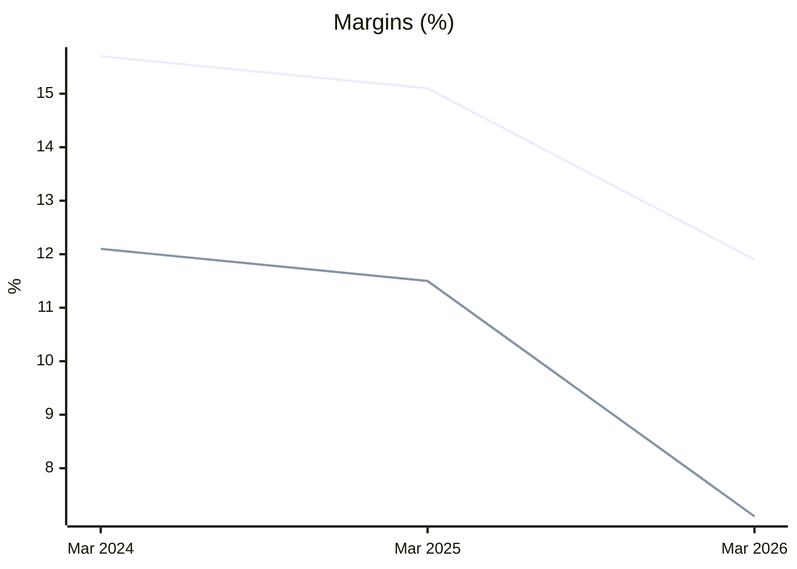

*Run 2026-11-24 · part of [SPINOFF_REPORT.md](../SPINOFF_REPORT.md) · the complete analysis of one company, with every management-call exchange in full.*

## SKFINDIA — SKF India Ltd.

### 1. SKF India Ltd. — CONFIRMED DEMERGER

**CONFIRMED** (a demerger scheme is on the exchange record) · **LISTED 1–2Y — the second-year window** · score 5.7/10 · spin-off · 9 filing(s) from CALLS, NSE, NSE-register · first 2025-10-15, latest 2026-08-20

**The separated entities — every one the documents name:**

| Entity | Scheme | Business | Listing | Who runs it |
|---|---|---|---|---|
| **SKF India (Industrial) Limited** | 2024-25 Scheme of Arrangement demerging the Industrial Busi… | Industrial Business: manufacturing, trading, marketing and dealing with rolling bearing, seals, rotating shaf… | listed 2025-12-05 as SKFINDUS (NSE) | not stated |

**What is being separated, as the documents put it:** SKF India's Industrial business (Demerged Undertaking) hived into SKF India (Industrial) Limited on going-concern basis — class `value_unlocking`.

### 2. Stages and dates

> **Listing:** LISTED — SKF India (Industrial) Limited (SKFINDUS) since 2025-12-05 (NSE equity list); record date 2025-10-15

| Date | Event | Source |
|---|---|---|
| 2024-09-17 | Other — Aktiebolaget SKF / SKF India Limited | as stated: Press Release filing dated 17th September 2024 enclosing AB SKF press… |
| 2024-10-08 | Stage reached: **announced** | [Outcome of Board Meeting](https://nsearchives.nseindia.in/corporate/SKFINDIA_08102024180012_NSE.pdf) |
| 2024-10-08 | Board approval — SKF India Limited | as stated: Outcome of Board Meeting / Acquisition filing dated 08th October 2024… |
| 2024-12-17 | Other — SKF India (Industrial) Limited | as stated: Acquisition filing dated 17th December 2024 – Certificate of Incorpor… |
| 2024-12-26 | Board approval — SKF India Limited and SKF India (Industrial) Limited | as stated: Outcome of Board Meeting and Demerger filings dated 26th December 202… |
| 2025-03-10 | Filed with exchanges — SKF India Limited | as stated: NSE Observation Letter Ref: NSE/LIST/46505 dated March 28, 2025 – "Ba… |
| 2025-03-27 | SEBI approval — SKF India Limited | as stated: BSE and NSE Observation Letters dated March 28, 2025 – "SEBI vide its… |
| 2025-03-28 | Exchange no-objection — SKF India Limited | as stated: Demerger filing dated 28th March 2025 – Observation Letters dated 28t… |
| 2025-04-09 | Other — SKF India Limited and SKF India (Industrial) Limited | as stated: Compliance Letter dated November 28, 2025 – "the application was file… |
| 2025-06-04 | NCLT order — SKF India Limited and SKF India (Industrial) Limited | as stated: Demerger filing dated 05th June 2025 – NCLT Order dated 04th June 202… |
| 2025-07-14 | Stage reached: **meetings** | [Shareholders meeting](https://nsearchives.nseindia.in/corporate/SKFINDIA23_14072025192642_NSE.pdf) |
| 2025-07-14 | Shareholders / creditors meeting — SKF India Limited | as stated: Shareholders meeting filings dated 14th July 2025 – NCLT-convened mee… |
| 2025-09-26 | NCLT order — SKF India Limited and SKF India (Industrial) Limited | as stated: Demerger filing dated September 26, 2025 – Order of Hon'ble NCLT, Mum… |
| 2025-09-30 | Other — SKF India Limited | as stated: Demerger filing dated 30th September 2025 – receipt of certified copy… |
| 2025-10-01 | Appointed date — SKF India Limited and SKF India (Industrial) Limited | as stated: Demerger filing dated 01st October 2025 – "The Appointed Date is open… |
| 2025-10-01 | Effective date — SKF India Limited and SKF India (Industrial) Limited | as stated: Demerger filing dated 01st October 2025 – "the Scheme is made effecti… |
| 2025-10-15 | **Record date** | NSE corporate-actions register |
| 2025-10-15 | Stage reached: **record date** | Record Date (corporate-actions register) |
| 2025-10-15 | Record date — SKF India Limited | as stated: Record Date filing dated 02nd October 2025 – Boards of the Company an… |
| 2025-10-17 | Stage reached: **listed** | [Demerger](https://nsearchives.nseindia.in/corporate/SKFINDIA22_17102025222058_NSE.pdf) |
| 2025-10-17 | Allotment — SKF India (Industrial) Limited | as stated: Demerger filing dated 17th October 2025 – Board of the Resulting Comp… |
| 2025-11-15 | Stage reached: **nclt sanction** | [Press Release](https://nsearchives.nseindia.com/corporate/SKFINDIA25_15112025132755_NSE.pdf) |
| 2025-11-27 | Other — SKF India (Industrial) Limited | as stated: Compliance Letter dated November 28, 2025 – newspaper advertisement d… |
| 2025-11-28 | Stage reached: **exchange noc** | [Updates](https://nsearchives.nseindia.com/corporate/SKFINDIA25_28112025194055_NSE.pdf) |
| 2025-12-05 | **SKF India (Industrial) Limited** listed (SKFINDUS) | NSE equity list |
| 2025-12-05 | Listing and trading — SKF India (Industrial) Limited | as stated: NSE's equity list (exchange record) – SKF India (Industrial) Limited … |

**The stages, as filed:** announced (2024-10-08) → meetings (2025-07-14) → record date (2025-10-15) → listed (2025-10-17) → nclt sanction (2025-11-15) → exchange noc (2025-11-28)

**Stated in the filings:** record date 2025-10-15; size hint: 15% of ebitda.

**When it lists, in the documents' words:** Shares allotted to holders on record date 15th October 2025; per NSE observation (letter 28 March 2025) listing and trading must commence "within sixty days of receipt of the order of the Hon'ble High Court/NCLT" (NCLT order 26th September 2025); Information Memorandum advertisement published 27 November 2025; by the 21st May 2026 call management refers to "the results of industrial separately".

### 3. Size of the separated business beside the parent — is institutional selling likely?

**Reading: LESS LIKELY on size alone — the piece is the larger part of the business.**

| Entity | Stated turnover | Stated share of the whole | Market cap (₹ cr) | Share of the whole by market cap | Segment revenue share | Index member | Selling on size |
|---|---|---:|---:|---:|---:|---|---|
| SKF India (Industrial) Limited | "The turnover of the Demerged Undertaking of the Company fo… | 63.0% (share of turnover) | 12,415 | 63.1% | 64.9% (FY2025) | yes | less likely |

*Stated figures are the documents' own (a turnover share, or the cost-of-acquisition split the company publishes for tax, which reflects relative value). The market-cap share is the entity's value over the whole — the parent plus every separated entity that trades (parent ₹7,246 cr, whole ₹19,661 cr, NSE bhavcopy of 2026-11-13); the segment share is the business's revenue over the parent's reported sales of that year. Both are computed here. The reading uses the market-cap share when the entity trades, else the stated share, else the segment share.*

**In the documents' words:** “The turnover of the Demerged Undertaking of the Company for the financial year ended 31st March 2024 was approximately Rs. 28,978.7 Million, representing 63% of the total turnover of the Company for the said year.”

**The judge's read of selling pressure:** likely — 1:1 mirror allotment pushed industrial shares onto holders of what is now a pure-play automotive company — a different industry.

### 4. Insider ownership — share swap, promoters' holding, management incentives

**Share swap / entitlement, entity by entity:**

- **SKF India (Industrial) Limited:** "1 (One) fully paid-up equity share of INR 10/- (Indian Rupees Ten only) each of the Resulting Company for every 1 (One) fully paid-up equity share of INR 10/- (Indian Rupees Ten only) each held in the Demerged Company."

**Promoters' holding, from the shareholding pattern:**

| Company | Promoters | FIIs | DIIs | Public | Quarter |
|---|---:|---:|---:|---:|---|
| SKF India Ltd. (SKFINDIA) | 52.58% | 7.14% | 25.51% | 14.77% | Sep 2026 |
| SKF India (Industrial) Limited (SKFINDUS) | 52.58% | 7.42% | 26.74% | 13.26% | Sep 2026 |

*Source: screener.in shareholding pattern, stored under `ShareholdingPattern/NiftyTotalMarket/`. In a mirror demerger each shareholder holds the same proportion of the new company as of the parent on the record date.*

- **Promoters in the parent, per the documents:** 52.58% – stated in the Regulation 30 disclosure dated 26th December 2024 as the post-Scheme (indicative) promoter shareholding of SKF Industrial, which mirrors SKF India ("Details as on 26th December 2024 … Promoters 100 / 52.58; Public - / 47.42"); the 14th July 2025 NCLT-convened meeting voting results show Promoter and Promoter Group holding 2,59,92,059 of 4,94,37,963 shares
- **What the promoters will hold in the separated entity:** 2024-25 demerger into SKF India (Industrial) Limited: "Upon the effectiveness of the Scheme, the shareholding of SKF Industrial will mirror the shareholding of the Company." and "The post Scheme shareholding pattern of SKF Industrial will replicate/ mirror the shareholding pattern of SKF India."; indicative post-Scheme shareholding of SKF Industrial: "Promoters 52.58 / Public 47.42". Share Entitlement Ratio Report: "the proposed demerger is a 'mirror image' demerger, i.e. all the shareholders of the Demerged Company shall become shareholders of the Resulting Company and the shareholding pattern of the Resulting Company shall mirror the shareholding pattern of the Demerged Company, on the Record Date."
- **What a public shareholder receives:** 2024-25 demerger: "Shareholders of the Demerged Company (as on the Record Date) will receive 1 fully paid-up share of the Resulting Company (INR 10/- face value) for every 1 fully paid-up share of the Demerged Company (INR 10/- face value) held." and "the demerger will not adversely impact the shareholding of the public shareholders. The new company will mirror the shareholding of the existing listed company with each shareholder of SKF India receiving one share of SKF Industrial as a consideration of the demerger." Public shareholders also retain their SKF India Limited shares, and "These new shares of the Resulting Company ("Resulting Company New Equity Shares") will be listed on BSE and NSE."
- **Management incentives:** not stated in the documents on file.
- **Insider actions around the separation:** Trading window closure on the promoter's separation announcement (17th September 2024): "The trading window for dealing in shares of the Company by Directors, Promoters, Designated Persons, and other insiders (including relatives thereof) is closed from the conclusion of this Board Meeting till 48 hours after the decision of the Board on this proposal." No promoter or management buying, selling or pledging around the separation is stated.
- **Insiders, per the checklist read:** Not stated — mirror-image demerger: all shareholders of the Demerged Company become shareholders of the Resulting Company, whose shareholding pattern mirrors it; no promoter stake figures or incentive terms given. · *option pricing date:* not stated

### 5. Why the demerger — point by point

SKF India separated its Industrial bearings business out of the listed company into SKF India (Industrial) Limited, leaving SKF India Ltd as a pure-play Automotive bearings company (management called it a "reverse carve-out" mirroring SKF AB's global split of Automotive, ~30% of group revenue versus 34-35% in India). Management's stated logic rested on three pillars: fundamentally different macro drivers (Automotive: EV/CAFE and BS-VII emission norms, 30% EV penetration target by 2030, premiumization/SUVs, last-mile commercial vehicles; Industrial: infrastructure spend, Make in India/NIP/PLI, China-Plus-One, railways/metro/Vande Bharat, wind and renewables doubling by 2030); different customer needs (a few large auto OEMs needing application-specific, longer-cycle engineered products — 60-65% engineered order in Auto versus ~25-30% in Industrial — against hundreds of industrial verticals wanting uptime, condition monitoring and remanufacturing); and a different manufacturing philosophy (Auto = large batch, small/medium bearings, automation and cycle-time efficiency; Industrial = wide assortment, small/large sizes, flexible lines with fast changeover plus a large traded component). The problems they said this solves: management attention split across two unlike businesses, capital allocation that could not be tailored (Auto was short of capacity, Industrial needed a brand-new Pune plant and localization from ~30-35% toward 70%), slow decision-making and launches, mismatched innovation cycles, and poor financial visibility for investors in a combined P&L. Operationally the split was defined down to the line: Bangalore 10 lines (7 Auto, 3 Industrial, with those 3 moving to Pune so Bangalore becomes 100% Auto), Pune 22 lines (12 Auto, 10 Industrial), Haridwar 4 lines all Auto; land 85:15 in Bangalore, 52:48 in Pune, 100% Auto in Haridwar; manpower 55-60% Auto versus 40-45% Industrial; cash allocated on the two businesses' last three years of profits. Shareholders received one SKF Industrial share of Rs 10 for every SKF India share held (PwC Business Consulting share entitlement report dated 24 December 2024; Saffron Capital fairness opinion 25 December 2024), with pre-demerger cost of acquisition apportioned 46.88% to SKF India and 53.12% to SKF Industrial. Pro forma FY24 economics shown to investors were Auto ~18% EBITDA and Industrial ~17%, both ~16% PBT, off a combined FY24 revenue of INR 45.7 billion; FY25 combined revenue was INR 4,919.9 crore (+7.65%) with PBT INR 763.1 crore (+3.71%). Nobody external demanded the separation — it was a group-level decision, with investors on the calls supportive (one explicitly "wholeheartedly supported" it) while pressing for structural clarity given SKF would still have three Indian entities including the unlisted SKF Engineering & Lubrication (Ahmedabad plant, global technical centre, lubrication and sealing factories); no lender or partner requirement was ever cited.

**Point by point, with the source:**

1. The stated purpose: two independent, fit-for-purpose companies that each accelerate growth and profitability, driven by three differences — industry dynamics, customer needs and manufacturing philosophy. “The intention of this demerger is to create 2 fit-for-purposes independent companies, which will accelerate both growth and profitability of both companies.” — *Apr 2025*
2. Management summarised the rationale as three separate axes of difference, with manufacturing efficiency and customer service as the payoff. “So to summarize, macro drivers are different. Customer drivers and innovation is different; and third, the manufacturing itself, the process of manufacturing itself is very different, what will make us most efficient and help us serve the customer needs.” — *Apr 2025*
3. Manufacturing philosophy was the concrete operating problem: Auto runs large batches of small/medium bearings for few OEMs with automation and economies of scale, while Industrial needs flexible lines, customised solutions and a large traded/regional component. “Automotive has a large batch sizes with small and medium-sized bearings.” — *Apr 2025*
4. Margin ambition attached to the separation: 2-3 percentage points of EBITDA upside in both businesses, from more efficient manufacturing, procurement and value-based pricing of premium products such as ceramic and energy-efficient bearings. “So I would say while the margins are typically relatively thin, we would hope that we can get at least 2 to 3 more points on our EBITDA going forward.” — *Apr 2025*
5. Shareholders were told the split was economically neutral — a mirror shareholding with a 1:1 share issue and listing of SKF Industrial on both exchanges. “The new company will mirror the shareholding of the existing listed company with each shareholder of SKF India receiving one share of SKF Industrial as a consideration of the demerger.” — *Apr 2025*
6. Investor visibility into the two businesses' separate performance was explicitly listed as one of the demerger benefits, alongside tailored capital deployment and two different manufacturing philosophies. “and finally, just more visibility for the -- our investors, all of you, to be able to see the performance of the 2 entities independently.” — *[May 2025](https://www.bseindia.com/stockinfo/AnnPdfOpen.aspx?Pname=78b3fd3b-6609-4f9b-ac56-5ec9fc26a320.pdf)*
7. Pro forma FY24 carve-out economics given to investors: Automotive ~18% EBITDA, Industrial ~17%, both around 16% PBT, with capex set to double from INR 130-150 crore as a new Industrial plant is built next to the existing Pune site. “So if you look at FY '24, our EBITDA margins for automotive was around 18%. And industrial was around 17%.” — *[May 2025](https://www.bseindia.com/stockinfo/AnnPdfOpen.aspx?Pname=78b3fd3b-6609-4f9b-ac56-5ec9fc26a320.pdf)*
8. The asset split was disclosed line by line — Bangalore 10 lines 70:30 with three lines moving to Pune so Bangalore becomes 100% Automotive, Pune 52:48 land, Haridwar 100% Automotive, manpower roughly 55:45. “There are three main plants, as we said, Bangalore, Pune and Haridwar. Bangalore, today there are 10 lines that will be split in the ratio of 70 to 30.” — *[Jul 2025](https://www.bseindia.com/stockinfo/AnnPdfOpen.aspx?Pname=3d94636c-b87c-4f11-91b6-556b4efcce20.pdf)*
9. Three-year guidance for the two entities: Automotive 10-12% growth, Industrial 8-10% (held back until the new Pune plant and localization land in FY27-28), with margins maintained at 17-19% and upside beyond FY28. “Next 3 years till '28, we expect growth in automotive to be in the 10 % to 12% range, industrial to be a little lower, 8% to 10% range.” — *[Jul 2025](https://www.bseindia.com/stockinfo/AnnPdfOpen.aspx?Pname=3d94636c-b87c-4f11-91b6-556b4efcce20.pdf)*
10. Capital allocation was the hard constraint being fixed: a brand-new Industrial-only Pune plant (DGBB, TRB, unitised bearings) costing INR 450-500 crore by 2028 plus INR 350-450 crore of additional lines, on top of INR 500-600 crore of Automotive capex to 2030. “Pune, we will be setting up a new plant, fully industrial, for industrial, making primarily DGBBs, which are deep groove ball bearings, tapered roller bearings, and unitized bearings, which are UCs.” — *[Jul 2025](https://www.bseindia.com/stockinfo/AnnPdfOpen.aspx?Pname=3d94636c-b87c-4f11-91b6-556b4efcce20.pdf)*
11. At the NCLT-convened shareholder meeting, management conceded the separation was complex precisely because the two businesses were deeply intertwined, and said the total demerger cost was still being accumulated. “As you know, it's a complex project primarily because the businesses both automotive and industrial, they are so deeply integrated that having two independent businesses is a complex process.” — *[Aug 2025](https://www.bseindia.com/stockinfo/AnnPdfOpen.aspx?Pname=6801dc1e-769f-42ac-9ea4-5ada85787e74.pdf)*
12. An existing institutional shareholder (Ravi Purohit) publicly backed the demerger while asking why India would still be left with three SKF entities when the group was simplifying structures; management said no merger of entities was contemplated until the demerger completed. “And first of all, we'd like to congratulate and have wholeheartedly supported this demerger initiative that SKF Group is undertaking.” — *[Aug 2025](https://www.bseindia.com/stockinfo/AnnPdfOpen.aspx?Pname=6801dc1e-769f-42ac-9ea4-5ada85787e74.pdf)*
13. First quantification of the cost: INR 184 million in Q1 FY26, mainly SAP and separate data infrastructure plus compliance consultants, with a 1.5-2% margin drag expected to run to H1 FY27 and extra stamp duty/registration cost on asset transfer in the Industrial entity. “So if you look at our current quarter, cost of demerger was around INR184 million.” — *[Aug 2025](https://www.bseindia.com/stockinfo/AnnPdfOpen.aspx?Pname=6801dc1e-769f-42ac-9ea4-5ada85787e74.pdf)*
14. At the FY25 AGM the Chairman framed the demerger as strategic repositioning to sharpen focus, improve execution agility and deepen customer alignment, with manufacturing roadmaps diverging (Automotive automation-led high throughput; Industrial modular and demand-responsive). “The announcement of our demerger, which is separating the automotive and industrial businesses into two focused publicly listed entities was a significant milestone.” — *[Aug 2025](https://www.bseindia.com/stockinfo/AnnPdfOpen.aspx?Pname=6801dc1e-769f-42ac-9ea4-5ada85787e74.pdf)*
15. Post-demerger, management clarified the direction of the carve-out — Industrial was hived off and the listed SKF India Limited is the automotive division, a reverse of the group-level split. “But in India, it is a reverse carve -out where industrial has gone out. So SKF India Limited remains as automotive division.” — *[May 2026](https://www.bseindia.com/stockinfo/AnnPdfOpen.aspx?Pname=fa739605-3c56-43bc-8950-6cc1db2e700e.pdf)*
16. The promised margin uplift did not appear: FY26 PBT fell 694 bps, EBITDA was 15.3%, and guidance was reset to 11-12% PBT, with Auto still buying medium DGBB and tapered roller bearings from SKF Industrial because of its own capacity shortage. “Now talking about the sustainable margin, we could be looking at 11 -12% kind of margin in the near future, while obviously in long term, the focus would be on improving it further, but the sustainable margin will be that.” — *[May 2026](https://www.bseindia.com/stockinfo/AnnPdfOpen.aspx?Pname=fa739605-3c56-43bc-8950-6cc1db2e700e.pdf)*
17. A long-term shareholder attacked the post-demerger communication gap, noting pre-demerger guidance of 16-19% (even 18-19%) EBITDA for a 95%-localised Auto business and a 50-70% valuation discount to Schaeffler and Timken; management replied royalty was unchanged and there is now no pure-play comparable. “Increasingly, our post demerger, what we are realizing is that the investor communication and the disclosures have dropped substantially.” — *[May 2026](https://www.bseindia.com/stockinfo/AnnPdfOpen.aspx?Pname=fa739605-3c56-43bc-8950-6cc1db2e700e.pdf)*
18. Management's closing framing still rested on focus and agility as the value-unlock, with restructuring costs described as a temporary hit. “The demerger positions us to unlock greater value by enabling sharper focus and agility in our business.” — *[May 2026](https://www.bseindia.com/stockinfo/AnnPdfOpen.aspx?Pname=fa739605-3c56-43bc-8950-6cc1db2e700e.pdf)*
19. The scheme transferred the Industrial business as a going concern into SKF India (Industrial) Limited under Sections 230-232, effective 1 October 2025 (NCLT order 26 September 2025, record date 15 October 2025), with pre-demerger cost of acquisition apportioned 46.88% to SKF India and 53.12% to SKF Industrial — i.e. Industrial was the larger half. “The Hon'ble National Company Law Tribunal, Mumbai Bench, vide its Order dated 26th September, 2025, sanctioned the Scheme of Arrangement between SKF India Limited ("the Company" or "Demerged Company") and SKF India (Industrial) Limited ("SKF Industrial" or "Resulting Company") and their respective shareholders and creditors under Sections 230 to 232 and other applicable provisions of the Companies Act, 2013 ("Scheme"), providing for the demerger of the Company's Industrial Business (Demerged Undertaking as defined in the Scheme ) into SKF Industrial on a going concern basis” — *Scheme*
20. The post-completion press release restated the purpose as two focused entities with independent boards and governance, and attached separate investment plans — Industrial INR 8,000-9,500 million by 2030 including a new Pune facility by 2028, Automotive INR 4,100-5,100 million by 2030 across EV, two-wheeler and wheel-end capacity in Haridwar, Pune and Bangalore. “The demerger, sanctioned by the National Company Law Tribunal (NCLT) and approved by shareholders earlier this year, has formally separated SKF India's business into two focused entities — SKF Industrial and SKF Automotive — each equipped with independent boards and governance structures.” — *Scheme*
21. The FY26 AGM presentation codified the five official reasons for the separation and rebranded the automotive entity as SKF Vertevo, reporting FY26 revenue of INR 21,295 million, 15% EBITDA margin and EPS of INR 23.7. “Why the Demerger? Different Market Dynamics Distinct Customer Needs Focused Capital Allocation Faster Decision Making Independent Growth Strategies” — *Scheme*

**How it evolved:** The demerger was announced in Q4 CY2024 and first explained in detail on a dedicated update call on 9 April 2025, which laid out the three macro/customer/manufacturing drivers, the six enablers (management focus, manufacturing efficiency, tailored capital, agility, innovation, investor visibility), pro forma FY24 carve-out financials and a 12-15 month timeline, plus an aspiration of "2 to 3 more points" of EBITDA. By the 19 May 2025 Q4 call the plant allocation had firmed up (Haridwar 100% Auto, Bangalore ~80-85% Auto, a new Industrial factory beside the Pune plant), and the 30 June 2025 investor meet added line-by-line, land and manpower splits, segment revenue mixes from FY22-FY25, three-year guidance (Auto 10-12%, Industrial 8-10% to FY28, margins held at 17-19%) and a step-up in capex from ~INR 150 crore to roughly INR 350-400 crore a year (INR 450-500 crore Pune industrial plant by 2028, INR 500-600 crore Auto capex to 2030); the NCLT-convened shareholder meeting on 14 July 2025 approved the 1:1 scheme, and the 6-7 August 2025 AGM and Q1 FY26 call quantified the cost for the first time (INR 184 million in Q1, mostly SAP/IT separation and consultants, 1.5-2% margin drag running into H1 FY27, plus stamp duty on asset transfer) while conceding the businesses were "so deeply integrated" that separation was complex. After NCLT sanction on 26 September 2025, effectiveness on 1 October 2025 and a 15 October 2025 record date, the story changed tone: the 21 May 2026 call presented SKF India as a standalone automotive company guiding to only 11-12% PBT margin (FY26 EBITDA 15.3%) with investors complaining that disclosure had "dropped substantially" post-demerger and that margins were far below what was promised in the run-up to the demerger vote, management answering that royalty was unchanged and this was a transition.

**What management expects from it:** Two fit-for-purpose entities growing faster and more profitably: automotive 10-12% and industrial 8-10% growth to FY28, both holding 17-19% EBITDA with 2-3 points of upside later; sharper management focus, tailored capital deployment and manufacturing efficiency, plus separate financial visibility attracting more aligned investors.

*Not explained on the calls:* Never quantified: total demerger cost, dis-synergies, inter-entity trading/rent/service charges, or why post-demerger margins (11-12% PBT) fall far below the 16-19% promised pre-demerger.

- *Stated reason, in one line:* Different market dynamics, distinct customer needs, focused capital allocation, faster decision making and independent growth strategies for the two businesses; strategic clarity to unlock greater value.
- *What it reveals:* Cost of acquisition apportioned 46.88% to SKF India (automotive) vs 53.12% to SKF Industrial — the industrial half carries more value. Parent's margins fell to ~15.3% EBITDA / 11-12% PBT guidance versus 16-19% pre-demerger commentary, blamed on one-offs.
- *Parent or spin:* parent · *Read next:* SKF India (Industrial) Limited's Information Memorandum and its standalone results — margins behind the 53.12% cost allocation.
- *In their words:* “The demerger gives us the strategic clarity to sharpen our priorities, accelerate growth, and unlock greater value for all stakeholders.”

### 6. On the calls, verbatim

8 call(s), oldest first: **26 question-and-answer exchange(s)** given in full — the question and every answer to it, nothing trimmed — and 22 passage(s) from management's prepared remarks (the complete sentences about it; the whole remarks are in the linked transcript). Text is as the transcript prints it.

#### Feb 2025 — [transcript](https://www.bseindia.com/stockinfo/AnnPdfOpen.aspx?Pname=458af4e6-8be5-4ce2-b4f1-119e53cd4c5a.pdf)

**Question and answer**

> **Mumuksh Mandlesha:** And sir, you mentioned auto margins being lower because -- but in India we have the auto more of a manufacturing than in India, while industrials have a lot of traded share. So also in India, do you see that margin in auto being lower than the industrial, sir?
>
> **Ashish Saraf:** So again, if you look at -- hi this is Ashish Saraf, CFO of SKF. So if you look at the carve-out financials, as you rightly said, the mix is different. The automotive currently is 95% localized, whereas industrial is around 40% localized. So because of a different mix, the margin based on the carve-out financials, which we recently submitted is going to be very similar for both the companies. Again, this is based on the analysis that we did on the historical results.
>
> **Mukund Vasudevan:** And just to add to what Ashish said, globally, what I said was the industrial margins tend to be higher. In India because of traded products being higher in industrial, it's a bit lower. But long term, as we localize more, we expect that to normalize.

**Question and answer**

> **Mukesh Saraf:** Right. Understood. So there was this scheme of arrangement that you had filed in the stock exchanges. When we look at that, it says that the industrial revenue is 63% of revenue in F '24. While in our commentary last few quarters and even this quarter, we're saying it's around 50%, 54% mark. So could you kind of help understand this difference here between the 63% and the 50% broadly that you have been mentioning on the industrial revenue side? SKF India Limited February 13, 2025
>
> **Ashish Saraf:** Yes. Yes. So currently, if you look at our automotive business, we have the tractor business, which is predominantly around agriculture and electricals. So once basically the separation happens, that business, which we are currently reporting under automotive will transfer to industrial. As per the -- our because in India, we've been reporting these numbers under automotive. Globally, agriculture and electricals are part of industrial. Hence, po st separation, we would transfer that business to industrial.

**Question and answer**

> **Viraj:** Okay. So sir, then this -- going back to one of the earlier questions on margins in industrial versus auto for parent globally, in auto they earn EBIT margins of somewhere around high single-digits. For us in SKF India listed entity, how would the margins compare at the EBIT level or the PBT level between auto and industrial? SKF India Limited February 13, 2025
>
> **Ashish Saraf:** So again, we generally do not prepare segmented financial statements, right, between -- at a statutory level for automotive and industrial, right? As I said, what you can refer because we did this analysis for the purpose of carve-out financial statements. And if you look at financial year '23, '24, the margins were similar, right? It kind of stood around 14%, 15% each for both of them.
>
> **Viraj Kacharia:** Okay. Just 2 more questions. You talked about rationalization, which is driving the impact on gross margin and pricing being constant. Generally, from a pricing approach point of view, especially in the industrial business, pricing and margin point of view, usually, how do we go about when you kind of decide the pricing strategy in the marketplace for the industrial piece?
>
> **Mukund Vasudevan:** I'm not sure I followed your question again. Can you repeat that again?
>
> **Viraj Kacharia:** So in terms of -- I think if I look at one of the earlier calls, we talked about having a transaction margin approach when it came to operating on traded business, especially in the industrial piece. So when it comes to pricing, you talk about pricing being constant in the last 1 year. So just trying to understand like what is -- usually how do you go about in terms of a pricing strategy?
>
> **Ashish Saraf:** Yes. So see, pricing strategy is relatively simple, right? Like if you look at financial year '22-'23 and '23-'24, we have had significant inflation, right, in the global economy, especially Europe, right, which basically pushed us significantly to increase end user pricing, right, in India for the traded products. Now since the pricing pressures have relatively stabilized, we have not taken significant price increases from our customers in this financial year, right? And that is where you don't see a significant variation in the pricing. In terms of the traded products margin, we continue to follow the transaction net method process in terms of arriving at the overall margins for the traded products. As I said, since in the previous 2 financial years, our end user pricing were constantly going up, right? We were able to generate a higher margin for the traded products in those 2 financial years, which -- because in financial year -- current financial year, the prices have more or less been stable. We have been able to maintain it at the mid-single-digit, which is -- which ideally should have been maintained, right, for the previous 2 financial years as well.
>
> **Viraj Kacharia:** So on a long-term basis, on a blended basis, both for auto and industrial, given the kind of mix we have in traded versus manufactured, the kind of margins we earned maybe not in '23 or so, but we have been reporting around 15%, 16% kind of operating margins. Given the kind of mix and our players, should we e xpect this kind of margin to sustain for us?
>
> **Ashish Saraf:** So again, the way we are looking at margin growth is through localization, right? So we do expect our margins to improve, right? Not -- again, currently -- the current year margins are going to be lower than -- are likely to be lower than what you have seen in the last 2 financial SKF India Limited February 13, 2025 years. But in the long term, we do expect our margins to improve as we kind of grow in the market and as we kind of continue to localize.
>
> **Viraj Kacharia:** Okay. Just last question. If you look at some of the competitors, they have announced and even commenced significant capex in SRB, CRB kind of bearings. When you look at SKF and in the industrial piece, you talked about 40% localization in the listed entity. So if you kind of look at the portfolio gaps globally versus what we have in India and in that sense, look at localization, can you give some perspective, kind of, what are the low-hanging fruits? Or how should one understand localization play for us in the listed entity over the next 3 to 4 years?
>
> **Mukund Vasudevan:** So I think our investment is going to be -- I mean, we have committed it's going to be largely this year in line with what it was last year. We are continuing to expand wherever there's capacity needed. So in the automotive, for example, we need more capacity, and we will invest fairly rapidly. Similarly, in the industrial, we also have to make the right decision whether -- or to make sure that the return on invested capital is good. So if we have capacity elsewhere in the larger SKF entity, we will try and utilize that if that makes the most sense for even the listed entity in India. So we're trying to optimize the supply chain to the extent possible. Where it makes sense, we will invest. Where it makes -- where it doesn't make sense, we'll continue to trade.
>
> **Viraj Kacharia:** Sir, but if you look at the parent presentation, they talk about in the rationalization grouping, which the India entity is. They talk about rationalization or localization in India plus Southeast Asia to the tune of close to 70% -- 68%, 70%. So in that sense, do you see any opportunities for localization, not just for the India market, but even for exports to other regions -- other countries in that region?
>
> **Mukund Vasudevan:** Yes, absolutely. We're continuing to explore that. I think there will be more opportunities coming up for those, whether it's for the local market or for exports. I think the global statement is, you're right, it says region for region. But it also if you see the full statement, it says region for region, but competitive supply chains also. So we want to make sure that we make the best decision and not just invest for the sake of investing in every region.

**Question and answer**

> **Ravi Purohit:** Just one request. Will it be possible for you to kind of give us at least 2-year or a 3-year pro forma numbers between industrial and automotive, just to get -- see because the thing is it's a big event that is happening and it will be useful if shareholders have all the information before. I don't know if there will be a vote for this. And if there is a vote, it will be easier for us to kind of take an informed decision once we have some clarity. We are not talking of audited numbers, but at least pro forma some idea of last 3 years?
>
> **Ashish Saraf:** That has already been shared as a part of the carve-out financials that we had to submit to SEBI, the same is available if I'm not wrong on SEBI website.

**Question and answer**

> **Ravi Purohit:** But those numbers indicate zero sales and zero profit numbers everywhere because this entity did not exist. This 100% subsidiary that we have been formed and if I look at the 3-year financials fo r that subsidiary, it will not reflect any revenue because there was no revenue for that subsidiary?
>
> **Ashish Saraf:** No, we have -- as a part of our demerger requirement, we had to share the carve-out financials of the previous 3 years.

**Question and answer**

> **Ravi Purohit:** I have checked, sir. I've checked three times. I could not find the numbers and the numbers that are given for the 3 years actually indicated zero revenues because...
>
> **Ashish Saraf:** You are checking for SKF industrial, you need to check for SKF India. There you will see the demerged accounts between industrial and automotive.

**Question and answer**

> **Bharat Sheth:** Hi, sir. Thanks for the opportunity. Sir to understand a little more about this scheme of demerger. So when we are talking of industrial side of 40% manufacturing, so that 40% which is currently being manufactured by SKF India or it also include our SKF technology sales?
>
> **Ashish Saraf:** This 40% is the products which are manufactured in SKF India.

**Question and answer**

> **Bharat Sheth:** Okay. So post demerger, how does this transaction between this SKF India and SKF Industrial unit will take place?
>
> **Ashish Saraf:** Can you repeat the question? It's not clear to me.

**Question and answer**

> **Mukund Vasudevan:** Yes. So to answer your question, we will come back to you. I think we are planning to have some kind of a call to talk about more -- in detail about the demerger. But the timing is not right, right now. It's more -- it's very -- as we said, it's right now high level in terms of what's the rationale. Specifics, we will share with you soon. So we will try and set up another meeting or a call for it.
>
> **Ashish Saraf:** And especially on the gross margin at an overall level, I don't see a significant change, right? We continue to be in the range of 35%, 36%. If -- because I don't know how you are calculating the gross margin, if you can come back to me with a specific question around that on an e-mail, I can come back to you with a response.

#### Apr 2025

**From the prepared remarks** *(the passage about it; the whole turn runs to 1,408 characters in the transcript)*

> **Ranjan Kumar:** Good afternoon, everyone, and thank you for joining us today. We appreciate your time and interest in this important update regarding the demerger process of our company. As indicated, I'm Ranjan Kumar, General Counsel and Company Secretary of SKF India Limited. And with us, we have Mukund Vasudevan, Managing Director, and our CFO, Ashish Saraf. The purpose of today's call is to provide a comprehensive update on the demerger process, its strategic rationale, expected benefits and next steps. We will take all your queries after the update is shared by us as a management team. This call is not expected to cover routine financial statements or results, and hence, the invitees are requested to confine their questions to the ongoing demerger transaction. Before we start the update, I would like to emphasize that some of the information that you will receive in this call may contain forward-looking statements, which are subject to risks and uncertainties. Such statements are based on management's belief as well as assumptions made by and on the information currently available to the management. The audience is cautioned not to place undue reliance on these forward-looking statements while making any future investment decisions. With this, let me turn the call over to Mukund for sharing update on demerger. As stated before, we will open the call for Q&A after this update. Over to you, Mukund.

**From the prepared remarks** *(the passage about it; the whole turn runs to 17,750 characters in the transcript)*

> **Mukund Vasudevan:** Thank you, Ranjan. This is Mukund Vasudevan, Managing Director of SKF India Limited. And as Ranjan said, we thought it's very important as we are going through this demerger process where we are segregating the Automotive and Industrial business to keep all our valued investors informed around the rationale, the process and the logic behind why we're doing this. With that in mind, I'll jump in, and we'll hold the Q&A until the end with disclaimer, as you have probably seen. So the topics we'll cover today, we'll talk about SKF India as it stands today so that you all get a grounding on what the current business is. Then we'll kind of pivot into the demerger and what's the logic and the rationale behind separating the automotive and the industrial businesses. We'll talk about pro forma financials as we -- for the 2 separated entities. And then finally, we'll talk about the demerger status and timeline, where we are today in that process. With that, let me jump in and first talk about SKF India, and both its current and past performance. So as you alkF SKF India Limited April 09, 2025 all know, most of you know, it's been over a 100-year journey for us in SKF India. We were established in 1923 as a ball-bearing manufacturing unit. […] It's had its ups and downs, but overall, a steady growth over the last 5 years. And as a company, we have maintained a strong dividend payout as well as capital performance of the stock price overall. I think whether it's our financial performance or our strategies or our operating discipline, all of that has helped us achieve these results and deliver strong shareholder returns. The reason I wanted to share this with you is this is a culture we want to continue even as we move into the demerger, both entities will aim to deliver strong performance as we have done in the past as a combined entity. If I now look at our strategy, it's the pillars of our strategy. We have looked at -- while our overall vision is towards the intelligent and clean future, the pillars have been around focusing on high-growth segments, whether it be the heavy industry like steel, power, mining, etc, or in automotive, whether it's SUVs, light commercial vehicles, etc, and drives new technologies where we are focused on energy efficiency, reliability, longer- lasting products or bearings and as well as the powertrain. Services and aftermarket to make sure that the products we sell are serviced to ensure service at the end customer to make sure that they perform up to expectations, and we can extend life. […] And finally, portfolio management, which is to ensure that we constantly prune businesses which are unprofitable, both at a product level as well as at the customer level. And all this has helped us or has been possible through a more regionalized and a competitive supply chain and manufacturing footprint. alkF SKF India Limited April 09, 2025 Technology development, which continues to be the pillar or the backbone of how we get our growth, an entire digitalized value chain and more efficient operations and manufacturing closer to our customer. So all of this has helped us achieve our goals and the numbers we spoke about in the last few pages. I'll now move to the next section, which is around the demerger and why we believe it makes a lot of sense to separate the Automotive and the Industrial business. The intention of this demerger is to create 2 fit-for-purposes independent companies, which will accelerate both growth and profitability of both companies. And why do we believe that this is possible? The reason is, first, there are 3 big macro drivers, which is, one, there is -- the dynamics of the industries are fundamentally different. Second, the customer needs themselves are different in the Automotive and Industrial. […] Just as an example, within a cement plant, one cement plant there are probably 30 different applications we have identified, each with different kinds of bearings, just one cement plant. And finally, because these there is a large assortment of bearings, we have to leverage not just the manufacturing footprint, which we have within SKF India, but also the regional manufacturing footprint. So it will be a combination of manufactured and traded for SKF India to actually serve the customer demand. So that's the difference in the manufacturing focus, which also is a reason for why this demerger makes sense. alkF SKF India Limited April 09, 2025 So to summarize, macro drivers are different. Customer drivers and innovation is different; and third, the manufacturing itself, the process of manufacturing itself is very different, what will make us most efficient and help us serve the customer needs. With that, I'm going to move to the pro- forma financials and hand it over to our CFO, Ashish Saraf.

**From the prepared remarks** *(the passage about it; the whole turn runs to 5,202 characters in the transcript)*

> **Ashish Saraf:** We are already almost 30% to 35% localized and we will continue to leverage our regionalization and increase our localization in this market to be more competitive. Lastly, we will continue to optimize our pricing with our customers, continue to prune our customers and we have done -- taken a lot of action in last year and we will continue to do this in this dynamic and challenging environment. These future drivers both for automotive and industrial will help us continue to deliver strong performance for both these companies. Lastly, I think it's important that we understand that the demerger will not adversely impact the shareholding of the public shareholders. The new company will mirror the shareholding of the existing listed company with each shareholder of SKF India receiving one share of SKF Industrial as a consideration of the demerger. Upon completion of the demerger, the shares of SKF Industrial will be listed on both the stock exchanges. I'll move to the next topic, which is demerger status and timeline. So, if you look at the overall time line, the overall timeline for demerger is around 12 months to 15 months. We already started the process in last year, Q4 '24. Currently, we are in end of Q1 where we have already received observation letters from stock exchange as well as SEBI and we are in the process of filing an application with NCLT. We are expecting approvals by end of Q3 from NCLT and we are targeting listing of the industrial business by end of Q4, subject to everything going as per the overall plan. As of now, we are pretty confident of achieving the overall demerger timeline. Thank you. I think with this, I'll hand it over to the host for any questions that we might have from the team.

**Question and answer**

> **Viraj:** Yes. Hi, thank you for the call and thank you for the presentation. First is just a request, I think you've just given a pro - forma numbers for both entities for FY '24, but if you can also give a much more longer historical data, say, last 3 years or 5 years for us to kind of understand the unit economics in each of o ur business, that will be very helpful. So that's a request. Just had a couple of queries. In the past, we've been communicating about capex of about INR 150 crores annually and that run rate to sustain for the next few years. Given that both the businesses will now be split, how should we understand the capex spend in each of the businesses for next couple of years. And this is a backdrop of the regionalization, which the parent keeps on talking about, looking at increasing the rationalization rates in India and other attractive markets. So that is one. Second is on the Industrial business, if I look at our different segments which we participate in the major ones, which we have shown. And if we compare the portfolio of the parent, there are still quite a few categories, applications where we are not there. So any thought process in terms alkF SKF India Limited April 09, 2025 of how we're going about bridging the portfolio gap and our play in those categories, either in India or globally? And third is on the portfolio pruning on a price correction part, both industrial and automotive. We have been talking about price correction, portfolio pruning for the last 1 or 2 years. Can you just give us some perspective of how much we have done, where are we in the journey and what more is for the -- if you could just give some color on this?
>
> **Mukund Vasudevan:** All right. So I'll let Ashish take the question, Go ahead, Ashish.
>
> **Ashish Saraf:** So I think the first question was on historical data. So again, what we have currently shared is the unaudited financial statements for financial year '23, '24. The historical financial statements would be shared with all the shareholders as a part of the shareholder notice when they are given invite for the shareholder meeting. So we would share the same at that time. Then the next question was on capex. So on capex, if you look at we have -- historically, we have communicated that we would spend around INR150 crores annually. We believe that both companies would definitely continue to spend around INR 150 crores going forward as well. Having said that, – currently automotive business is running out of capacity and space. We are internally evaluating additional investments that we need to make for both automotive and industrial businesses that they can further grow the business in this market. So there would be more investments, but we would share more information once we have detailed information available around the additional investments that we intend to make.
>
> **Ashish Saraf:** Sorry, what was your third question?
>
> **Mukund Vasudevan:** Yes, I think on the portfolio pruning, that's more of a financial question, not relevant to the demerger. We'll continue to do that continuously. So I would say let's hold that question for one of our regular investor calls around financials. It's not that relevant to the demerger. It's a regular exercise which we do both on Automotive and Industrial. And we continue to do it. We are seeing results from it. Yes.

**Question and answer**

> **Mumuksh Mandlesha:** Sir, firstly, on the demerger side, any thought, I mean other than what you mentioned in the presentation about the opportunities in both Auto and Industrial. Also, do you think being a separate entity now, will there be opportunity to do more M&A or anything on the product expansion line, which can happen? Any thoughts around that, sir?
>
> **Mukund Vasudevan:** So I can't give specifics on M&A, right? But I can say that's something which because there is more focus in both businesses on specific customer needs and the industry dynamics and better capital allocation possible, I would say it should spur more opportunities on both sides. I can't give any specifics at this time, but it should spur more opportunities on M&A as well as investments. I think the previous gentleman had asked a question around capex. It should spur more opportunity to do capex as well as M&A.

**Question and answer**

> **Mumuksh Mandlesha:** Got it, sir. And sir, to Ashish sir, any thought -- any decision-making has been taken for the division of the plants or the operations, sir?
>
> **Ashish Saraf:** We are currently in advanced stage of planning. Once we have more concrete information available at our end, we would share the same with everyone.
>
> **Mukund Vasudevan:** And just to add to that, I think as Ashish said, we do need more capacity, especially in Automotive, but also in Industrial. So there will be additional investment, irrespective of the demerger, there will be additional investment. And it will probably time well with what we do with our plants also.
>
> **Mumuksh Mandlesha:** Broadly to say, it would be, capital input would be…

#### May 2025 — [transcript](https://www.bseindia.com/stockinfo/AnnPdfOpen.aspx?Pname=78b3fd3b-6609-4f9b-ac56-5ec9fc26a320.pdf)

**From the prepared remarks** *(the passage about it; the whole turn runs to 1,081 characters in the transcript)*

> **Ashish Pruthi:** Good morning, everyone. Thank you for joining us today. With us, we have SKF India's Managing Director, Mr. Mukund Vasudevan; our CFO, Mr. Ashish Saraf; and our Legal Director, Company Secretary and Compliance Officer, Mr. Ranjan Kumar. The purpose of today's call is to share an update on our ongoing demerger, our Q4 results and our overall financial year's performance. Before I turn the call over to the management, I would like to remind you that, in this call, some of the remarks contain forward-looking statements which are subject to risks and uncertainties; and actual results may differ materially. Such statements are based on management beliefs as well as assumptions made by and on the information currently available to the management. The audience is cautioned not to place undue reliance on these forward-looking statements and making any investment decision. The purpose of today's call is to purely educate and bring awareness about the company's fundamental business and the financial quarter under review. Let me now turn the call over to Mr. Mukund Vasudevan.

**From the prepared remarks** *(the passage about it; the whole turn runs to 9,367 characters in the transcript)*

> **Mukund Vasudevan:** And after the 15 minutes, we will go into the Q&A. In the presentation, I will cover a very quick update on the economy, which I think is all of you are well aware of how the economy is doing, but we'll talk about relevant sectors. I will then talk about quarter, the Q4 '25; and then the full year -- FY 24 -25. We'll also talk very briefly about an update on our demerger, which we have promised to do in each one of our investor calls, as we continue the process on our split of the automotive and industrial business into 2 separate legal entities. And finally, we'll end with Q&A for around 30 minutes. So let me jump right in and start talking about the -- a very quick update on the macro economy. As all of you know, we are -- the GDP has been strong, 6% plus. […] Also exports were down significantly, related to global macro economy. And then profit -- but profit before tax was really up, related to strong operational performance but also related to catch-up on the transfer pricing. So overall, mixed bag in terms of financials. Let me now quickly switch and talk a little bit about the demerger. And this will be a brief update on what we have spoken about previously. We're still continuing on the demerger process. As you remember, the overall -- the reason for the demerger is we are creating 2 fit-for-purpose independent company, which will accelerate both growth and profitability in both companies. Both companies have different macros -- or both these businesses have different macros, have different customer needs and have a distinct manufacturing focus, so I will say that the logic for the demerger is largely related to that. And the way we are doing this demerger is we are creating 2 independent entities which will have better management focus, independent management focus, better value proposition for the customers; will create innovation specifically for automotive and specifically for industrial. Increased agility and responsiveness, increased manufacturing efficiency. The 2 entities will have different kind of manufacturing philosophy, 1 more batch processing, large batch processing; 1 more shorter cycle times, shorter cycles, smaller batches but more innovative products. Tailored capital deployment, which is very important also between the 2 SKF India Limited May 19, 2025 entities; and finally, just more visibility for the -- our investors, all of you, to be able to see the performance of the 2 entities independently. So that's the logic of the demerger. The quick update and -- we wanted to give you was, as we are continuing to do the split, we have more clarity now in the manufacturing plants. So we're looking at Page 16 now. And what we see there is that the manufacturing entities which will -- manufacturing plants which will go to automotive are Haridwar, which will fully go to automotive. […] We're waiting for the final approval. And then we'll take it to shareholders, and we'll have a creditor meeting also. So broadly on track to finish the listing by Q4 calendar year of this year or Q3 calendar year 25-26, okay. So that's the broad update on the demerger. I hope -- at this point, I'd like to hand it back to the moderator for Q&A.

**Question and answer**

> **Mumuksh Mandlesha:** Solid margin performance. And thanks for the detailed presentation. Sir, firstly, can you, I mean, share demand outlook for next year across the key segments? And just on the demerger side, if possible to share, for FY '25, how were the numbers for the EBITDA margins and the PAT for the auto and the industrial segments?
>
> **Mukund Vasudevan:** Okay, I'll let Ashish Saraf, our CFO, answer the second part of the question, right, which is the EBITDA and PAT for the 2 entities, but I will just answer one piece of that, that going forward with the 2 entities, we expect to see continued improvements in both EBITDA, PBT, yes; as well as higher growth with the demerged entities. That's the medium- to long-term aspiration we have and our expectation also. The first part of the question, in terms of different segments and the growth, I would say that we are -- I'll tell you what we are seeing right now. And I think this trend will continue for some time. Let me start with automotive. Automotive is seeing some fairly strong growth in commercial vehicles, especially smaller commercial vehicles, driven partly by the e-commerce and the quick delivery. So a lot of increase in commercial vehicles. We are also seeing good growth in tractors, which is -- which I think will continue. Given the good monsoon we are predicting, I think it will continue. Also the -- in the passenger vehicles, the larger passenger vehicles, which is the SUV growth, is continuing to increase. And the last piece is the EVs. EV trend is -- EVs is very small still, but SKF India Limited May 19, 2025 it is continuing to grow. And we have a solid presence there. So I would say, automotive, these are the major areas of good growth. In the industrial, I would say we're not expecting a huge amount in steel, in capex investment, but the production should continue, barring any challenges on pricing -- steel prices related to China or anything related to tariffs. But in general I would say flat to slightly up on steel. In terms of other sectors, I think food and beverage will continue at GDP rates. In terms of wind and renewable, we would say again it's going to continue at the rate it has been. It hasn't been a very good year for wind, but I think next year will be slightly better, maybe a 3% to 4% growth there. And then railways, again, is continuing to do well with some of the build-outs happening both in freight, passenger and in metro. So we see more and more -- the continued presence there. And especially in passenger and metro, our strength is -- we are very strong. Last one I would say is around if you look at this infrastructure growth and the government spending on infrastructure. That continues to be robust. And so I think we'll see a ripple effect of that also on our industrial side okay? Ashish, do you want to add something on the PBT and EBITDA?
>
> **Ashish Saraf:** Sure, Mukund. So again, for FY '25, the numbers are still being worked out for the carve-out financials for automotive and industrial. However, we expect the margins to be in line with FY '24. So if you look at FY '24, our EBITDA margins for automotive was around 18%. And industrial was around 17%. So we kind of expect similar numbers for FY 24-25. And similarly, PBT was in the range of 16% for both the businesses. We are expecting similar margins for FY '25, but the numbers are still under finalization. - we just closed the audit for financial year '25 for the consolidated entity.

**Question and answer**

> **Pramod Amthe:** Sure. The second one is with regard to the net working capital. So if I had to look at your inventory, it has been rising throughout the year and looks to be more first half loaded as compared to second half. What is really happening? And what gives you confidence -- why it has gone up. And what gives you confidence to bring it down? Or is it anything to do with the way you are aligning your production for demerger? That's one. Second, I think, if I had to look at -- your receivable days have also gone up drastically. So what is leading it at the end market? Or it's your policy related to the same. SKF India Limited May 19, 2025
>
> **Ashish Saraf:** Yes. So if you look at receivables. The receivables are pretty much in-line. It might have gone up by few days recently, but I would say that's pretty much temporary and it should kind of come back to normal levels. Now if you look at inventory, the predominant reasons for inventory is purely the buildup which we have done on the automotive side to support our OEM customers, right, in the subsequent quarters. Plus, since it was the end of the financial year, we were expecting higher demand to come in. And because of that, the inventory has been built up, but we expect that to normalize pretty much in the next 2 quarters.
>
> **Pramod Amthe:** Sure.
>
> **Mukund Vasudevan:** So just to add to what Ashish just said: not related to the demerger at all, not at all. So this is purely -- as we mentioned, we do need capacity. We're short of capacity, especially on automotive, so we built up some inventory to satisfy that demand, but also I would believe that on industrial side there were some customers, especially railways, etcetera, where we felt that the orders are going to come in, so we built up some inventory. We do have orders in hand actually, but those are just -- will be sold, will be invoiced over the next few months. The one other thing I will say is that overall we can get better at inventory. We're continuing to work on that through a more advanced forecasting and S&OP process and looking at how we can tighten our policies to make sure that inventory is managed better. I think that's an area of improvement for us, so it's a good point.

**Question and answer**

> **Ravi Purohit:** Okay, okay. And sir, the other thing is if you look at our global parent's presentations with respect to the demerger, right? And they have kind of called out the margins between -- the difference in margins between auto bearings and industrial bearings globally, right? And in that scale and size, the industrial bearings makes about 18% to 20% EBITDA margins, right? And I think, in the previous call, we had said that our industrial bearing piece is still making about 13%, 14% EBITDA margin. Would it be fair to say, over the next 3 to 4 years as this localization drive kind of takes shape and size for the industrial bearings space, our industrial margins will align with the bearings industrial margins?
>
> **Mukund Vasudevan:** Ashish, do you want to take that...
>
> **Ashish Saraf:** Sure, Mukund. So see. Broadly the margins should align, right? We -- because as I said, we are already operating at -- we -- for FY '25, we shared the results in our previous call. And we -- our EBITDA is around 16%- 17% for the industrial business, right? Broadly our margins should come in line with what the group would report. Yes, we would -- industrial, as of now, our plans is to be around 70% localized, right, in the region, so we will still buy a significant chunk of our products from other SKF companies, right? So to that extent, you will see some impact on the overall margins, but yes, broadly we should be pretty much in the range of 16%- 17%. SKF India Limited May 19, 2025

#### Jul 2025 — [transcript](https://www.bseindia.com/stockinfo/AnnPdfOpen.aspx?Pname=3d94636c-b87c-4f11-91b6-556b4efcce20.pdf)

**From the prepared remarks** *(the passage about it; the whole turn runs to 969 characters in the transcript)*

> **Ranjan Kumar:** So I will start again. Welcome all. Good afternoon and welcome all to this Investor Meet . As I indicated before, this call has been fixed primarily for giving you more insight on the demerger process we are on currently. We would not be discussing the quarterly performances which has not been still being made public. This, I mean the length of this call would be broadly around 45 minutes. The way we have structured is initial 20 minutes or 15 -20 minutes we have a small presentation for you all which would again be primarily focusing on the de merger where we have some of the financials. We would not be going more deep on the forward looking statement. It would be directional. You can make out from the presentation. The presentation has already been uploaded on the stock exchange, and we will not be discussing anything on that. It is in public domain now. So, that is how we have structure d that, but before getting into this, a quick intro from our side.

**From the prepared remarks** *(the passage about it; the whole turn runs to 1,480 characters in the transcript)*

> **Mukund Vasudevan:** So this is Mukund. We will go through SKF India as it stands today. Just a quick glance on '24- '25 results. And then we will cover the rationale for the demerger, which you have seen, but go a little bit deeper into how we are allocating assets across the two. We will talk about the automotive and the industrial business separately, something we haven't done before, in more detail, and then finally end with demerger timeline. Everybody please just note your questions, and then at the end, raise your hand if you have a question so that we can kind of go in the order you placed in . Next page. So as you can see, '24-'25 results , we have always been and will continue to be a strong performing company. We are on Rs. 5,000 crores with delivering 17.2% EBITDA and 11.5% PBT. Good cash flow as well as return on invested capital or return on equity, 29% RO CE and 22 % ROE. We've been in the country since 1923, one of the oldest bearing companies in India. 1923 initially as a trading company and then we set up three plants over time starting in 1956. We've set up SKF India Limited June 30, 2025 Pune, Bangalore and Haridwar. 1700 employees and we have great market coverage over 550 distributors about retailers, mecha nics and the tens of thousands. Next page. And if you look at our historical performance, we've always been a solid growth and margin company, 10% growth over the last CAGR over the last 4 years. EBITDA also continued to be in the range of 16 % to 19%.

**From the prepared remarks** *(the passage about it; the whole turn runs to 5,252 characters in the transcript)*

> **Mukund Vasudevan:** But we expect to kind of gain that back over time. Margins has been in the range meaning they were higher, lower margins, a little bit of a timing issue on this, but otherwise we expect in the 16 % to 19 % range of EBITDA. Next page. Now if you go to the demerger rationale, which is the next section, so now we spoke about historical, but why we even, we are doing well, we are still growing well as a company, we are also getting good margin. We are also getting good margin and good ROCE . But so why create a demerger at all in this situation? The key drivers are external, different macros. If you think about industrial, it's driven a lot by the infrastructure spent. It's also driven by China Plus One, things like that.

**From the prepared remarks** *(the passage about it; the whole turn runs to 890 characters in the transcript)*

> **Ranjan Kumar:** So demerger process is going as per the schedule which we shared before. Currently , we are at the stage where we have filed the application with NCLT. NCLT has ordered to convene the shareholders meeting which is on the 14th of July. The process we expect to conclude somewhere in October November, subject to for sure there is approvals which we need to take and like NCLT approval as you know it is not in control so if that deviates the time also deviates along with that. B ut our internal targe t you can say is somewhere October -November we get the NCLT approval and by December we want the new entity to get listed also. That' s the high level target time we are taking in our mind, and we are working towards that target. But overall we seem to be in time in the process. That's idea. So with this , we are done and with your permission , Mukund, we can open up the questions now?

**From the prepared remarks** *(the passage about it; the whole turn runs to 141 characters in the transcript)*

> **Ranjan Kumar:** As a process we have to get ready with the demerger . Kindly read the effectual date. We have to be ready with all two independent companies.

#### Aug 2025 — [transcript](https://www.bseindia.com/stockinfo/AnnPdfOpen.aspx?Pname=6801dc1e-769f-42ac-9ea4-5ada85787e74.pdf)

**From the prepared remarks** *(the passage about it; the whole turn runs to 7,457 characters in the transcript)*

> **Mukund Vasudevan:** Thank you, Ashish. This is Mukund Vasudevan, Managing Director of SKF India Limited. I will be going through a few topics, which I'm sure has been shared with you also in the presentation. I will go through a quick economic update of the macro in India, talk about the quarterly highlights for Q1 financial year 2026, a quick update on where we are on the demerger process and then end the call with a quick summary, and then we can go to Q&A. So if we talk about the economy, I will start there, right? Overall, GDP, as you all know, is still -- in India, still growing at 6% with the inflation, 6% plus with inflation at around -- with a manageable level at around 3%. Still the growth in the GDP has primarily been coming from government spending and has been coming from services. […] The Industrial growth, as I said, has come from mainly the heavy wind and railway sectors, and we expect this -- the Industrial growth to continue. Exports is down partly due to tariffs in some of the sectors, but also partly down due to specific industries in Southeast Asia or Americas being down. Our margin this quarter has come down by almost 530 basis points. The reasons for this are related to, one, demerger -related costs, onetime costs, both IT as well as IT -related costs as well as consultants. Now some of this may continue in the future as we -- over the next year, year and a half as we're expecting this demerger to continue until the point we are -- the demerger is fully done. The other reasons for increase in costs have been the employee -related costs, which have gone up due to annual increments. We have also started our process of investing more in our factories, so the depreciation costs have actually also gone up. And finally, FX has also had an impact on our business because of the weaker rupee. […] In net working capital, we have actually reduced a bit the net working capital from quarter -on-quarter, but up a bit from full year, primarily driven by accounts receivable, higher volume of business, but also partially the decline from fourth quarter '25 to now has come from a decline in our inventory. Cash flow continues to improve. We have a 13% improvement in our net cash flow. I will now talk a little bit about the demerger and so that we can kind of give you a quick update on where we stand on the demerger. As you know, we are trying to create 2 fit -for-purpose independent companies here, both of which can accelerate growth and profitability independently. alkF SKF India Limited August 07, 202 5 We believe the reasons for the demerger are the different macro environment in the Automotive versus Industrial, different customer needs from what Automotive needs given the macro situation and given what various Industrial customer needs. And second and last, the difference in manufacturing style or manufacturing philosophy of the 2 entities. All these together have been the reasons why we are creating 2 fit -for-purpose companies, which will have independent management focus, increased manufacturing efficiency on both sides, tailored innovation, capital allocation more efficiently done, more agility and responsiveness. And finally, more visibility for our investors in terms of how the 2 businesses are doing independently. As we announced in the demerger call, we are also now at a point where we know which manufacturing lines will go where. In manufacturing lines in Bangalore, where we have 10 lines totally, 7 will go to Automotive, 3 will remain with Industrial. In Pune, where we have 22 lines, 12 will remain with Automotive and 10 will go to Industrial. Haridwar, 4 lines, all will remain with Automotive. […] Industrial doing very well at 13%. Automotive slight decline or flat this quarter year -on-year. Excellent cash flow generat ion, 13% year -on-year increase. Margins have been soft year -on-year, 530% drop -- sorry, not percent, 530 basis points drop, 5.3%, PBT percent drop, primarily driven by demerger costs, some employee costs and FX. The demerger costs and the employee -related costs, which is the annual appraisal, will continue for the next year and a half . The others, hopefully, it's a onetime which will adjust like FX. That's it from my side in terms of the presentation. I will -- just one other comment. The shareholder meeting for the demerger is – has -- was done on 14th July, and they have approved the scheme as the demerger scheme. So -- and NCLT has noted that also, and the we should hear back from on the decision in the month of September. Thank you from my side. I now hand it back to the moderator.

**Question and answer**

> **Harshit Patel:** Thank you so much for the opportunity . Sir, you had guided for 8% to 10% revenue CAGR in FY 28 for the Industrial business in your last demerger discussion. Is this because of muted market conditions or us not having the sufficient capacities as fresh capacities in Pune will only come on board after FY 28?
>
> **Mukund Vasudevan:** Yes. So as you're seeing right now, I mean, if you take a 5 -year CAGR on our Industrial business, year -on-year, we are growing almost 15% year -on-year CAGR over the last 5 years. So we -- while in the recent past, we have had a little bit more muted , in the Industrial business where we have had a little bit more muted growth primarily due to portfolio cleanup, meaning we have dropped customers or products which are not profitable, we are -- we expect that growth to come back, right, in -- and then we're being cautiously optimistic here when we say 8% to 10% long -term growth. To your point, the main reason for that will be -- will -- one of the main reasons is more localized production both in the Ahmedabad plant and in the Pune plant. So that growth top line will make us more competitive and we'll get top line growth. And most of those are getting online in 27 and 28. That is one of the reasons. alkF SKF India Limited August 07, 202 5 The second is we are also working on the -- on new product innovations and creating fit -for- purpose products, both in terms of by segment in the Industrial but also in what will fit market conditions in India. So we're creating more engineered products, not just replicating products which are global, but creating more engineered products for India. And then the last reason is that we have significantly expanded our commercial excellence efforts, which includes everything from our distributor network or our after -sales network, whether it is mechanics in Auto or it is retail stores or distributors in Industrial. It also includes how do we value sell better, how do we include services in addition to the product sales. All these together, we expect our business to reach that double -digit growth in Industrial at least.

**Question and answer**

> **Krupashankar:** Good morning and thank you for the opportunity. My first question would be on the growth, what you had highlighted during this quarter coming in from the Industrial business. And you had primarily highlighted that railways, wind and some of the sectors were driving this growth. Can you expand a little bit more on it? Because you had highlighted in the earlier call -- one of the earlier calls that wind was not a market which we are focusing on. Has it come into flavor? And anything more on the Industrial piece, which gives us confidence on continued growth in this segment? Second is more of a bookkeeping question. I just wanted to get an understanding on what is the one -off cost due to demerger during this quarter?
>
> **Mukund Vasudevan:** Yes. Sure. I'll let my CFO, Ashish, answer the second question, specifics on the demerger costs. I can answer the where is the industrial growth coming from? First, if I think there may be a misunderstanding that wind is not a focus. Wind has always been a focus, one of our top 5 priorities, and it will continue to be. What we have done in the past is we have sold all applications in wind. There are many, many applications in wind -- not many, 3 or 4 main applications in wind, which all of it were not profitable. And so we just cut off unprofitable applications and focus on the applications where we thought -- where we believe we can be profitable and we can offer better value to the customer. And with that focused strategy, we have actually gained more share. Partly, it's a alkF SKF India Limited August 07, 202 5 focus, but partly also the fact that we have got a better manufacturing footprint, both in the region as well as in Ahmedabad for making these products. So we have gained share in wind, but specific applications. So it is a misunderstanding to say it is not a focus. It is a focus. It will continue to be in India, but we will pick and choose the applications within wind that we want to play in. Other sectors which have grown well in Industrial are, as I mentioned, railways with some of the high -speed rail projects, we are continuing to do well there and metros. In the heavy industry, we are primarily seeing some expansion in metals, mainly in aftermarket, not new projects, but aftermarket. So growth has been there. We have also seen some expansion in general machinery, which is everything from pumps, drives, gearboxes, etcetera. We're seeing some expansion there. And overall, our distribution market has actually -- it's not as much as the 13% average growth we've seen, but it's continued its steady growth of around 8% to 10%.
>
> **Ashish Saraf:** So just to add to or respond to the question on demerger costs. So if you look at our current quarter, cost of demerger was around INR184 million. A significant chunk of that cost was on IT implementation, which is as we are going through a demerger between Automotive and Industrial businesses, a significant spend has been made in creating and deploying SAP as well as other softwares that we use within SKF. Apart from that, ensuring that we have a separate data infrastructure in place both for the Automotive business as well as for the Industrial business. So that's where a significant amount of cost has been incurred on IT. And similarly to support the whole demerger process, we had to engage with or take support of consultants in terms of ensuring that it is being done in a compliant manner. And that is where you see a significant amount of cost incurred on consulting. We expect this cost to continue until first half of next year sorry First half of next financial year is when we kind of expect this cost to continue.

**Question and answer**

> **Mayank Bhandari:** Sir, just checking, you have given earlier margin guidance of 16% to 19%. And now this demerger cost will be continued for at least next couple of quarters. So what kind of margin we should anticipate for this particular year?
>
> **Mukund Vasudevan:** Ashish, if you could answer that? We are -- I mean, if you could answer that for the next -- I would say the demerger costs will continue for the next 1 year, right? So I would say, 4 quarters, and we're being cautious here because there, we expect that some of this will continue, not just IT but other costs related to the demerger. And then beyond that also, we will have some additional capex . So the depreciation will -- the new factories in Pune come on, the depreciation will start hitting us also, right, while we are taking actions to offset this as much as possible, right? We are -- I would say, we are expecting slightly muted margi n. 16% to 19% range is what we'll get to in the 2028 onwards time frame. So Ashish, if you can comment in more detail on this.
>
> **Ashish Saraf:** Yes, sure, Mukund. So I think as Mukund said, this demerger cost is going to continue till H1 of next financial year, right? And this demerger cost is going to impact around 1.5% to 2% on the margins. So you could expect at least a couple of percentage adverse impact on the margins on account of the demerger cost. Apart from that, there could be some additional cost which the industrial company might incur in first half of next financial year with respect to stamp duty and registration cost for the transfer of assets. That could also additionally impact the Industrial business margins in the first half of next financial year.

#### Aug 2025 — [transcript](https://www.bseindia.com/stockinfo/AnnPdfOpen.aspx?Pname=6801dc1e-769f-42ac-9ea4-5ada85787e74.pdf)

**From the prepared remarks** *(the passage about it; the whole turn runs to 1,908 characters in the transcript)*

> **Transformational Realignment:** FY2024-25 was also a year of strategic repositioning. The announcement of our demerger, which is separating the automotive and industrial businesses into two focused publicl y listed entities was a significant milestone. This move is designed to sharpen our business focus, improve execution agility and enable deeper customer alignment across both the segments. Each entity will now be better equipped to pursue growth strategies tailored to its market dynamics and customer needs. This strategic realignment positions us to capture emerging opportunities and create long-term value with greater clarity and speed.

**From the prepared remarks** *(the passage about it; the whole turn runs to 49,827 characters in the transcript)*

> **Our Purpose:** Mukund Vasudev to make a presentation to the shareholders. Mukund Vasudevan Thank you, Chairman. It is my pleasure to now share with you the performance and our strategy for SKF India Limited. Next page, during this presentation I will cover a little bit about SKF India how we are, our purpose, our values and our strategy, we will then talk a little bit about the demerger which is in progress, and we will talk about how we are creating two world class fit for purpose companies. Then we'll talk a little bit about SKF India and the key drivers in the business today, and we'll close the presentation with a summary of all the things we have discussed. Next page. So, let me start a little bit about SKF India. […] As they say, world-class companies deliver at least 2x GDP and that is exactly what we have done and that speaks volumes for our execution discipline, but also a strong team. Our earnings per share has also grown at around 17.5% annually over the last five years. So, great job and we consistently continue to perform at these levels. Next page, I will now talk a little bit about our demerger strategy. Next page, as we have said in the past and I would reiterate, this is about unlocking the power of two; building two high growth highly profitable companies. What it means for the automotive business is that we will enhance our position in e-mobility where we are a market leader, we will accelerate OEM as well as end customer innovation, we will also make faster decisions and quicker launches in taking -- to taking products to market, not to mention quicker decisions in expanding capacity for the Indian and export market. What it means for the industrial business is that we will grow even faster, we will deliver solutions tailored to each industry vertical, and we will strengthen our position in a global framework. All this will lead us to two powerful fit for purpose profitable growth companies in the future and that is the purpose of this demerger. Next page, if we look at the timeline we are well on our, are on the journey we have. We are now in Q2 of calendar year ‘25 and we have filed with NCLT. The shareholder meeting is what will happen next, sorry we're in Q3, shareholder meeting is due to happen this month and our journey to transform into two fit-for-purpose companies is well on track and if everything goes according to plan we should be looking at listing and trading by Q4 of 2025, calendar year 2025. […] That is a good thing. So, I am also interested in that, but you should optimise the portfolio. While the new portfolio will come. When demerger will be completed, what are the ratio, which two company will be, the one was industrial, one will automatic. If you can elaborate that, when this will be open. How shares will come to us? If you got 100 share of SKF there, how many share will come of the both company? […] I think we will physical AGM is something which is getting more and more difficult, difficult with our expanded shareholder base, but we will definitely noted your point and we will take this into consideration Car arrangement again, we will try and pool cars and see if we can something can be done, especially from Mumbai. And then as far as bonus is concerned, we will definitely noted your point. We will definitely look into it. The next two years are going to be a little CapEx heavy with the investments we are planning related to the demerger and setting up more capacity for growth. I'm sure all of you will agree that it is, it will be a good idea to reinvest in the business to expand growth and correspondingly give you more returns, but we have definitely noted your point and we'll come back to you. Mr. Hiranand Kotwani asked a question around growth and profit. […] In both in Pune and Bangalore factory, we are short of capacity to meet the existing demand. So, we will be setting up more capacity to meet the demand itself, and that its elf will create growth, but it will also help us localise a larger portion, especially in industrial, to help us meet the competitive price requirements in the region. The second piece is, as I mentioned, part of our core, part of our strategy, is innovation. And now with two demerged entities, we will be able to innovate better and set up a more fit-for-purpose manufacturing line both for industrial and for automotive, and that is part of the reason we are doing the demerger. To grow and to improve our profit in the future. The last and final thing is around commercial excellence, which includes everything from our market coverage through our distributors and mechanics for the aftermarket. It is also our market coverage through retail shops for small industry SMEs. […] Ranjan Kumar to answer that question. Ranjan Kumar Sure. So Mr. Kotwani, I mean this split, this demerger is happening on one is to one share allocation, which means that if you have one shares in SKF India Limited, once the demerger concludes, you will get one share of equal value in the new entity as well, and the new entity also, the shares of the new entity also is expected to get listed with the stock exchanges, which is BSE and NSE. So that's how the allocation of shares will happen. And the tentative timeline for that, as indicated in Mr. Mukund's presentation, we expect to get the new entity listed by Q4 ‘25 subject to receipt of all necessary approvals, which is required to be taken in the process.

#### Aug 2025 — [transcript](https://www.bseindia.com/stockinfo/AnnPdfOpen.aspx?Pname=6801dc1e-769f-42ac-9ea4-5ada85787e74.pdf)

**From the prepared remarks** *(the passage about it; the whole turn runs to 0 characters in the transcript)*

> **(speaker not labelled):** SKF India Limited Regi stered office : Chinchwad, Pune 411 033, Maharashtra, India Tel: +91 (20) 6611 2500, Fax no: +91 (20) 6611 2396, Web: www.sk f.com, Email id: investorIndia@sk f.com CIN: L29130PN1961PLC213113 Date: 21st July 2025 National Stock Exchange of India Limited, Exchange Plaza, 5th Floor, Plot No. C-1, G Block, Bandra - Kurla Complex, Bandra (East), Mumbai – 400051, Maharashtra, India BSE Limited, Phiroze Jeejeebhoy Towers, Dalal Street, Fort Mumbai – 400001, Maharashtra, India NSE Scrip Code – SKFINDIA BSE Scrip Code -500472 Subject: Intimation for transcript of NCLT Convened Meeting of Equity Shareholders held on 14th July 2025 at 11:30 AM (IST). Reference: Our Intimation dated 15th July 2025 for Video link of NCLT Convened Meeting of Equity Shareholders held on 14th July 2025. Dear Sir/Mam, Pursuant to Clause 15(b)(iii) of Schedule III, Part A, Para A read with Regulation 30 (2), Regulation 30 (6) of SEBI (Listing Obligations and Disclosure Requirements) Regulations, 2015 (as amended from time to time) (“SEBI LODR”), please find enclosed herewith transcript of NCLT convened meeting of Equity shareholders held on Monday, 14th July 2025 via VC/OAVM at 11:30 AM IST The same will be available shortly on the website of the company for the convenience of the shareholders at the below -mentioned link: https://www.skf.com/in/investors/shareholder - information . The above is for your information and record. You are hereby requested to disseminate the same on your respective websites. Thanking you, Yours faithfully, For SKF India Limited _____________ ______ Ranjan Kumar Company Secretary & Compliance Officer Mr. Kuldeep Kumar Kareer Good morning , everybody and good morning to all the shareholders who are present online. I welcome you all to this NCLT convened meeting of equity shareholders of SKF India Limited. I would like to mention that this meeting has been convened through video conferencing and other audio -visual modes in compliance of the orders of the NCLT Mumbai bench passed on 04th of June 2025 for the purpose of considering the scheme of arrangement between SKF India Limited, SKF India (Industrial ) Limited and the respective shareholders and creditors as per the provisions of Section 230 -232 and other applicable provisions of the Companies Act , 2013. I am Kuldeep Kumar Kareer . I have been appointed as chairperson of this meeting by the Honorable National Company Law Tribunal, Mumbai. Before beginning with the proceedings of the meeting, I would like to introduce the board of directors and other officers of the Company who are present online. I will call out their names and they will introduce themselves. Ms. Anu Wakhlu. Ms. Anu Wakhlu Namaste. I am Anu Wakhlu , Independent Director of the Company. I'm also the chairperson of the Audit Committee, the Nomination and Remuneration Committee, and a member of the Risk Management Committee, Stakeholder Relationship Committee, and Corporate Social Responsibility

**From the prepared remarks** *(the passage about it; the whole turn runs to 0 characters in the transcript)*

> **(speaker not labelled):** advertisement in newspapers on 09th June 2025 i.e. Financial Express all editions, Business Standard Pune edition, Economic Times and Mint in English language and Lok Satta Pune in Marathi edition. That was also in compliance with the relevant rules and the directions of the Honorable NCLT. Considering the same, with your permission, the notice of the meeting and other company documents is being taken as read. Let me now briefly apprise you with the scheme of arrangement which we are considering through this meeting, which has been placed upon the shareholders for your approval in this meeting. This meeting is placed in pursuance to the provisions of Section 230 to 232 and other applicable provisions of the Companies Act and inter alia provide for the following. Demerger includes transfer and vesting of the demerged undertaking i.e. industrial business from SKF India L imited , the demerged company, into the SKF India (Industrial ) Limited ., the resulting company, on a going concern basis and issue of equity shares by the resulting company to the equity shareholders of the demurred company in consideration thereof in accordance with the provisions of the Companies Act , 2013 and Section 2, Subsection 19A of the Income Tax Act 1961 and to, various other matters consequential or otherwise integrally connected therewith. Including reduction and cancellation of the entire pre - scheme share capital of the resulting company. The rationale of the scheme is mentioned on page number 29 and 30 of the notice and explanatory statement which has already been circulated to you. The app ointed date is the same as the effective date and or such other data may be mutually decided by the board of the demerged company and the resulting company. Effective date means the day on which the last of the conditions specified in clause 24, conditionality of this scheme is complied with or otherwise duly waived as applicable in accordance with this scheme. For the purpose of the demerger of the demerged undertaking from the merge company to resulting company, based on the share entitlement ratio report of M /S . PwC Business Consulting Services who are registered valuers and the report dated 24th December 2024. The resulting company will issue one fully paid -up equity share of Rs. 10/- each for every one fully paid -up equity share of Rs. 10/- held in the demerged company. M/S Saffron Capital Advisers Private Limited, an independent SEBI -registered merchant banker, in their fairness opinion dated 25th December 2024, has opined that the share entitlement ratio is fair and reasonable. Upon the effectiveness of the Scheme and subject to receipt of necessary approvals . The equity shares o f the resulting company issued as consideration to the shareholders of the company in terms of the scheme will also be listed on BSE Limited and National Stock Exchange of India Limited. The scheme is subject to receipt of approvals from the Honorable National Company Law Tribunal and other regulatory authorities. So, the a genda item on which your vote today is required is to approve the scheme of arrangement between the company and the resulting company and their respective shareholders and creditors under sections 23 0 to 232 and other applicable provisions of the companies at 2013. With this, as we have gone through the agenda items of this NCLT convened meeting, I thank the members for their participation. Now I will request the Company Secretary Mr. Ranjan Kumar to invite the members who have registered themselves as speakers. He will announce their names and on announcement of their names the audio and video facility of the respective members will be opened. I would like to request the members to be kindly brief and summarize their views and questions in just two minutes so that all the members get ample opportunity of expressing their views and raise their queries and questions. The questions raised by the speakers will be addressed once all the speakers have concluded with their queries. In interest of time, I request again to all the speakers to kindly confine their queries and questions only with respect to the agenda item which is there before us. That is the approval of the scheme. Now I would request Mr. Ranjan to kindly facilitate the question -and-answer session and call the shareholders in order of their registration as speakers to raise their queries. Thank you and over to Mr. Ranjan. Mr. Ranjan Kumar Thank you, Honorable Chairman. In the interest of time and for the benefit of other shareholders, I'll repeat again. I'll keep a time check as well and request the shareholders to confine their questions and you in two minutes. With this, let's go to our first speaker shareholder, which is Ms. Prakash ini Sh enoy. Can we have her on the screen, please? Ms. Prakashini Shenoy. Ms. Shenoy, are you able to hear me? Ms. Prakashini Shenoy Am I audible, sir? Am I audible? Mr. Ranjan Kumar Yes, ma'am. You are audible. Ms. Prakashini Shenoy Thank you, Thank you, sir. I'm Prakashini Ganesh Shenoy from Bombay. Chairman , sir, since we are meeting for the first time, I wish one and all happy, healthy, wealthy, and prosperous 2025. Respected Honorable Chairman appointed by the NCLT, other dignitaries on the board, and my fellow shareholders, good morning to all of you. I received the E GM report. EGM notice well in time, which is self-explanatory. I thank Mr. Ranjan Kumar, Company Secretary and Ms. Mayuri for the same. I should not forget to thank Ms. Mayuri once again for reminding me of today's meeting without which I wouldn't be in a position to speak. Thank you, Ms. Mayuri once again. The chairman has given a

**From the prepared remarks** *(the passage about it; the whole turn runs to 0 characters in the transcript)*

> **(speaker not labelled):** specially thank Mayuri Madam for being in touch always I am a regular speaker in the company, sir. Or I totally agree with my previous speakers, Bimal Kumar Agarwal, Prakashini Shenoy . Please continue video conference meeting in future. So , I strongly and wholeheartedly support the special resolution for today's meeting. Thank you so much . Mr. Ranjan Kumar Thank you so much, Ms. Shah . We noted your suggestion or request of plant visit and we'll organize that soon. Then we move to our next speaker shareholder, is Mr. Haritima Joshi. Can we have Mr. Joshi on the call, please? Female voice Sir, this speaker has not joined the meeting. Mr. Ranjan Kumar Okay. We move to the next speaker shareholder, which is Mr. Ravindra Purohit. Can we have him on call, please? Mr. Purohit, can you hear us? Mr. Ravindra Purohit Yes, I can. Am I audible? Mr. Ranjan Kumar Yes, sir, you're audible. Mr. Ravindra Purohit Yeah, hi. Good morning, gentlemen. And thanks for this. And first of all, we'd like to congratulate and have wholeheartedly supported this demerger initiative that SKF Group is undertaking. And also appreciate the initiatives that we've taken over the last one or two months where we've had a lot of con calls and analyst meets, and there are a lot of material already available. So just a couple of questions regarding this. So once this demerge r, our peer Schaeffler group actually merged everything into one single entity, whereas we are going the other way around. And of course, SKF group itself has decided on this breakup. we are totally OK with that. The question is, we will now have three entities in India. There is already an unlisted entity that we have in Ahmedabad, the SKF engineering and lubrication , right? And post this, you'll have two more entities. Does it really make sense when we are trying to uncomplicate structures globally? But in India, we will actually have three compani es and shareholders will always be kind of second guessing where , do you know, the company's interest lie, of course, the listed entity being the largest one, I'm assuming that will that's where the shareholder alignment and interest would also lie . But, it will just like life make life easier if , if there was more clarity on the structure and the path that the group is planning to take , right? And the second question was, you know, sir, between the six months back, right, when we had done a couple of con c alls and now when at the time of demerger, there has been a significant change in in our CAPEX outlook. Right. I think earlier we were effectively doing about 100, 150 odd crore CAPEX, but closer to the demerger and the last two calls that we have had specific to demerger, we have significantly raised our guidance on CAPEX from about, you know, 150 odd crores over the last three -year average to now taking it almost to 350 crores to 400 crore per annum basis, right? And we've put out in our presentation as well. So , what has kind of happened between then and now for us to kind of, know, warrant this very large change in our CAPEX? If you could address both of these questions, that would be very helpful for us. Thank you. And once again, I completely support the demerger and we have kind of voted in favor of the same. Thank you so much. Mr. Ranjan Kumar Thank you. Thank you, Mr. Purohit. And we really noted your question and also the suggestion of bringing more clarity and structure. We'll go back to this question. With this we move to our last speaker shareholder which is Mr. Jahangir Batiwala . Can we have him on the call please? Mr. Batiwala , can you hear us? Mr. Jahangir Batiwala Can you hear me? Mr. Ranjan Kumar Yeah, we can hear you now. Mr. Jahangir Batiwala Okay, sir. Nothing more to speak because already a has been spoken. Good morning to all the dignitaries on VC platform. Just one question is that now I was listening to the last speaker. Now, Schaeffler also is our group company. So now , what is the business model? What will be the business model? And how are we going to go ahead in the future? Like, we'll be holding shares of two companies. So kindly clarify this and if possible, a factory visit is if it is due. Thank you. Mr. Ranjan Kumar Thank you Mr. Batiwala . Well noted your request of factory visit and will speak about the clarity as to how would these two entities would look like you hold share in both entities. We'll address that now. Good with this. With this we are done with all sp eaker shareholders. Ref erence back to under the chairman.

**From the prepared remarks** *(the passage about it; the whole turn runs to 0 characters in the transcript)*

> **(speaker not labelled):** Female voice So, speaker number five has joined the meeting. Mr. Ranjan Kumar Oh, that's great. Then let's let him be let him be on the call. Mr. Hariti ma Joshi, can we have him on the call please? Mr. Joshi, can you hear us? Mr. Haritima Joshi Hello. Yeah, Mr. Joshi. Hi, this is Nikhil Upadhyay. I'm a joint account holder. I just had a couple of questions. One is on the structure, as one of the earlier participants highlighted, I think we have a range of other entities, group entities in India, and especially in industrial business. So, are there any thoughts in terms of simplifying the ownership structure and merging all under one single ownership? That is one. And secondly, if you look at in the auto also, you know, if you look at some of the o ther group, other competitors in the space, over a period they've expanded and added several other product categories, bearing, bearing allied , allied products in bearing and then other product categories in the auto space. So, post restructuring, is there any thoughts on portfolio addition, you know, for, you know, the residual auto business under SKF? That is second. Third is, you know, can you just give some more color in terms of the market position in major end segments for us? Both in automotive and indust rial, what kind of a market share we have now, you know, in major end applications or segments, be it industrial, automotive, versus three to five years back. So, parent in their presentation give out a very detailed market position, you know, be it an industrial, be it electronics, aerospace. So, for us, you know, can you give some sense, is our market position there? Other than that, I have a few questions on the aftermarket piece, whether it be auto and industrial. And the question here is, if I look at last three to five years, we have taken several initiatives, be it on distribution, network expansion or serviceability of product. if I look at the product segment growth, and if I compare to our competitive competitors, then we've seen some bit of muted performance there. So just trying to understand, know, what really transpires is pricing limitation for us or is it longer led times? Because somewhere we also had a dedicated distribution center based in India, but growth service not picked up to the level where we think, you know, an added question is, you know, if we can elaborate on t he value edge platform, which we have launched and how do it differentiate what is of other offering in the marketplace? And one more question is, if I look at a network, both be it automotive or industrial, how has it grown over the last three, four years, and how do we look to grow in coming years? In industry, if you look at parent, they were very leading positions globally in aerospace, defence , electronics, and semiconductor applications. So, for India, entity , do we have any presence in any of these segments? And if we do then what kind of revenue contribution these contribute currently ? And in the upcoming localization which we talk about, do we have any plans for localization for these segments? Last two questions I had, one is on the automotive. We talk about hybrid bearing, we also talk about advanced sensorized bearings now, especially in the solution offerings. So, what kind of a content we're talking about versus current product component sale of a bearing we would have to any OE. And are these localized? Last two questions w ere on the management. So, in terms of incentive structure for the top management, what would that be? Is there any ESO P plan for them? And what would be the KRAs these link to? And last is on the cash . How would the cash be distributed between the two entities? So just one more. Parent has established recently a global competency center in India for IT and digital solutions. So, will that be a part of the listed entities? These are the questions I just request you to answer each of them in detail. Mr. Ranjan Kumar Thank you. Thank you, Mr. Joshi. So, with this, we concluded all speaker shareholders who got themselves registered for the questions or sharing their views. I hand over back to you, Mr. Chairman . Mr. Kuldeep Kumar Kareer Thank you Mr. Ranjan and thank you all the shareholders who took time to raise very pertinent questions. Now I would request the Managing Director Mr. Mukun d Vasudevan to kindly respond to the questions raised by the shareholders. Mr. Mukund Vasudevan Thank you, Honorable Chairperson and thank you all shareholders for your questions. I will do my best now to answer these questions and I would request support from Mr. Ranjan Kumar and Mr. S hailesh Kumar Sharma to support me in some of these where they will have additional information to share. The first question I have listed down is what is the cost of this whole dem erger and the timeline. I'd request Mr. Ranjan Kumar if he could briefly touch upon this. Mr. Ranjan Kumar Sure. Sure. I'll start with the timeline. The way this was presented even in the last investor call as well, we are still targeting to conclude the process of demerger when we need to obtain the approval of NCLT by the by Q4 2025. We seem to be on track at this point of time. But as you know, NCLT process

**From the prepared remarks** *(the passage about it; the whole turn runs to 0 characters in the transcript)*

> **(speaker not labelled):** is something which is not in the control of the company. So, all the estimation, all the targets are subject to the approvals, which we expecting from NCLT. So, on a high -level timeline, we expect to the NCLT approval somewhere September and October months post which we go for the listing and we want to conclude the whole process before Q4 2025. That's the high -level target we have taken as a management team and we seem to be on track on that. Now coming on the cost of team merger, we are still in the process of accumulation. As you know, it's a complex project primarily because the businesses both automotive and industrial, they are so deeply integrated that having two independent businesses is a complex pr ocess. We are still in the process of really quantifying the cost of the demerger , but we'll soon come back to the shareholders when we have some clear data around that. Mukund, back to you. Mr. Mukund Vasudevan Yeah. So, the second question was, how will this be beneficial to shareholders, this demerger ? As you all know, and we have stated in our calls with investors and the shareholders and with to Sebi, the purpose of this demerger is to create two fit s for purpose companies, are independently world -class companies. So, both the automotive and industrial, the idea is that we will create two companies which are tuned to serve the market needs or the customer needs, tuned in their business model to serve the automotive or industrial segments. And also, the internal manufacturing processes will be tuned so that we can serve our customers better. And finally, even innovation will be tailored to what the customers want in industrial or automotive. The net result of all of that, our aspiration is that we will create two companies which are more profitable and can grow faster. So that is the overall intention and that as a result should create more shareholder values to both the automotive and industrial shareholders. If I move on, Mr. Bimal Agarwal didn't have any questions. Mr. Himanshu Trivedi had two questions. I'll take the second one first. Who will be paying for the legal charges for this demerger process? Mr. Ranjan Kumar, if you could answer that one. Mr. Ranjan Kumar No, sure. So currently what we are doing is the whole cost is being built by the SKF India Limited because it's the demerger is being initiated by the listed entity. However, since it doesn't matter where does the cost exist, be it in automotive or industrial entity, th e reason being the shareholders are getting one is to one. So technically with the same ownership, we are splitting the businesses too. But just to answer your question, currently the costs are being built in the listed entity, which is SKF I ndia Limited, which is in the process of demerger. Mr. Mukund Vasudevan Thank you, Mr. Kumar. And the first question from Mr. Trivedi was what steps will new management take for the old employees through the process of this demerger? As you know, SKF is a company which cares deeply for all its employees and values their contributions. As we said, in India, we are trying to create two companies which will grow faster and become more profitable. So, the intention here is to make sure that the employees are taken care of. are split in who is working with automotive and who is work ing with industrial. And they will take the company forward. And we really make sure that the two companies are fit for purpose and work towards what the customers need. There is no, I think the caring nature of the company towards its employees will continue whether it is automotive or industrial. Okay, Ms. Lek ha Shah did not have any questions other than continue with VCs and factory visits and encouraged for factory visits, which we will continue to do. Mr. Ravindra Purohit had a question that there will be once the demerger is done, there will be three entities. Does it make sense? And is there any plan in the future to merge these entities? The suggestion from Mr. Purohit was merging them will create some clarity in structure and also clarity on where the interests of the company lie. At this point, we are going through the demerger process. As you know, this is very complex process. are, especially because we are also splitting factories into automotive and industrial. So, we do not want to complicate this, any kind of the process at this point. We want to go through the demerger. Any future decisions on merging entities will be made at a lat er date once the demerger process is completed. But at this point, the demerger is the focus. There are no other thoughts to merge the entities. That said, we will come back to you if something, our thought changes on that. But at this point, there is no such intention. As far as where our interest lies, our interests clearly lie with the shareholders and we intend to continue to do that with both automotive and industrial shareholders in the future. will continue to work towards, our management will continue to work towards making sure that we build these two fits for purpose companies and we are aligned with our shareholders in where we want to take the companies. The second question from Mr. Purohit was there's a significant change in CAPEX outlook from around 150 crore a year going up to almost 400 crore a year. What has caused this change? There are two main reasons for this change. One is the macro in India where we believe we need more capacity to serve the growing demand, whether it is automotive demand or industrial demand. The infrastructure needs or the consumer needs or the commercial vehicle needs, all these are driving more demand and

**From the prepared remarks** *(the passage about it; the whole turn runs to 0 characters in the transcript)*

> **(speaker not labelled):** we need more capacit y. So, one of it is purely capacity expansion, which we are accelerating. The second is that we are building a second factory for the industrial business and that itself will involve a little bit of... Starting 27 -28 will increase the amount of CAPEX. So that will be as I said a fit for purpose industrial factory tailored specifically for industrial. So those are the two main reasons for the CAPEX Delta or the increase URC. Okay , Mr. Jehangir Batiwala had asked two questions. One is, what is the business model going to be like in the future? connected with that was, since all shareholders will be holding two shares in two companies, will the business model be different? And the answer to the question is, the business model will become more, as I said, fit for purpose, will become tailored more to automotive, tailored more to industrial for the two share s, for the two entities. So as, which means the business model includes eve rything from how do we, how do we manufacture? Automotive has, is larger batch sizes and more lean manufacturing. Industrial does a lot more different segments, different industry verticals, smaller batch sizes. So again, manufacturing processes will be different. Innovation in automotive is now tailored towards a lot more. As we see the macro industry trends there, electric vehicles are growing. The last mile delivery with commercial vehicles is growing. So those are macro drivers in automotive, whereas macro drivers in industrial are driven by infrastructure growth, which has a ripple effect on all the cement, steel, power. And again, there will be fit for purpose bearings, which will be created and manufactured for these industries. So, the business model should be slightly different. While we have been tailoring to both these industries, the business models will evolve to make both the entities world class and high performing. All right, I will then switch to Mr. Nikhil Upadhyay, who is representing Mr. Haritima Joshi. The first question was around the structure, and I think we have already answered that. Is there a thought to merge into one? The second question was automotive. Is there a plan to add more product categories in automotive ? Yes, there is. We are continuously looking at what additional product categories do we want to add in automotive. And I believe through this demerger, we will have more opportunity to look at it more closely and say, what else can we add to the portfolio in automotive so that we can add more value to our customers. Third question was around market share and how are we doing three years ago to now ? I don't have specific figures right now to share, but happy to discuss this more. overall, our d ata based on BMI, is the Bearing Manufacturing Index, it tells us that our market share has been fairly steady in India over the last three years. There are pockets where we have grown and pockets where we have probably not grown as much. But those are conscious calls. We have walked away from business where the profitability was not high. We have also gained business where we have localized more content and localized more manufacturing. So would say across all our major segments, we have been , we have take n conscious calls, but overall, if you look at it, our market share has been fairly steady, both in automotive and in industry over the last three years. Okay, aftermarket growth was the next question. Both on auto and industrial and the question was why has the growth been picked up or not? I think we have done a lot in both industrial and automotive and value edge, which was the next question was one of them in industrial. So, the value edge program is a program which encourages our distributors, our channel partners to do the right thing, which is to make sure that we are selling value to the customer and not just trading product that enables us to get premium, also to retain a customer, and also to make sure that our distributors are partners in this process. So, there are lots of examples of how Value Edge has actually helped convert or helped us gain market share or convert away from competitors to us, to SKF. It also ensures that the secondary sale is happening in the right way, not just based on price. Our aftermarket has obviously been growing well, driven by two things. One is our coverage of the market. Both in automotive and in industrial, we have added several new distributors to cover the market fully. But we have also added secondary distributors or retailers. We have an IPS progra m in industrial, which is retail shops , which sell into industrial markets. We have a mechanic program in automotive. So, we've added thousands and thousands of both IPS retail stores, as well as mechanics to our bucket to expand the aftermarket. And that has ensured a good coverage of the market. That is number one. The second is connected to Value Edge. How do we partner with our channel partners, whether it is the IPS or it is mechanics or it is our distributors. We partner with them with joint accountability, joint targets, but also sharing incentives and loyalty reward programs so that we can encourage them to do the right thing for our business. Overall, our growth has been good. Can it be better? Is there room for improvement? There is always room for improvement. Next question was around aerospace and defen ce. Do we have a plan to localize more? We do have some defence products being manufactured in India, defen ce related products being manufactured. Is there a plan to localize more? We are continuously evaluating that and seeing what else we can do to kind of localize. Aerospace has been less of a demand in India because most OEMs are outside of India. But that said, this is something we will continue to look at. And if, when the time is right, and if we believe th at the investment is justified, we will definitely look at it. All right, incentives for management were the next question. So, this was around what kind of

**From the prepared remarks** *(the passage about it; the whole turn runs to 0 characters in the transcript)*

> **(speaker not labelled):** incentives do the managers have for SKF, the managers in the two demer ged entity, what kind of incentives they have. All our managers are driven by growth and profitability. And while global does play a role in it, there is large content of local growth and profitability and networking capital. So those will continue to be a priority, which is, I believe, aligned with our shareholder interests. And the last question was around cash distribution. Ranjan, if you could take this question. Mr. Ranjan Kumar Sure. Sure. I mean, in the process of Dem erger , as you know, we have created the cardboard financials for both entities separately and each of the P&L item and balance sheet items have been addressed with a very logical principles of allocation. So, cash allocation, have largely gone for last three years profit which these two businesses have made and based on the last three -year profits we have evolved the principles of allocating cash also. So, for each of the P&L and balance sheet items there's a very logical principle which has been evolved with the help of the experts to split each of the elements. Yeah. Mr. Mukund Vasudevan Thank you, Mr. Ranjan Kumar. I think I have covered all the questions. I now hand it back to Mr. Ranjan Kumar. Mr. Ranjan Kumar Thank you. Mukund, one last question. think the last speaker also requested for a plan of localization, if you can speak something around that with automotive and industrial. Mr. Mukund Vasudevan So, both industrial and automotive, we are continuing to work on localization. Automotive is already around 95 % localized. Industrial is a little less and that is one of the reasons we are continuing to invest. You remember the CAPEX increasing. Industrial is localized to around 50%, a little less than 50%, but that we expect to continue to grow in the next three years and bring it back up to around 70% localized. It does not make sense to localize around 100 % because it's a trade -off between how much you invest versus what's the payoff you get for that investment. So , it may sometimes it makes sense to keep manufacturing else where and to trade the product through the listed entities in India. Mr. Ranjan Kumar Thanks. I think one question was also asked about the R &D center which has been set up in India. This demerger is of the listed company that R &D center continues to be with SKF engineering which is the non-listed entity of the promoter. So , no cha nge is proposed in that. It was existing in SKF engineering which was the non -listed entity. It continues to stay there. So, I think with this we have covered all the questions which was raised by our speaker shareholder. If you still feel some questions have not been answered appropriately, please feel free to write us back on the assigned email ID. We'll try our best to respond to your questions in more detail if you feel that has not been covered in that most detail for you. With this, thank you all shareholders. I will hand over back to Honorable Chairman . Mr. Kuldeep Kumar Kareer Thank you, Mr. Ranjit Kumar and Mr. Vasudevan, for responding to the question of the shareholders. I think all the questions have been reasonably answered and the company has tried to respond to all your questions to the extent possible and if you have any further queries, please feel free to write to the company and the company will definitely respond and address the issues raised by you. Now we are coming to the voting part of the meeting. The e -voting facility is already open and will continue to remain open for 15 minutes after we conclude this meeting to enable the shareholders to cast their votes. The resolution as set forth in the notice will be deemed to be passed today, subject to the receipt of the requisite number of votes. As we already noticed and declared that the quorum for the meeting is complete. Now I authorize the scrutinizer to declare the results of voting as per the prescribed timelines. The result of e -voting will be declared within two working days from the conclusion of the meeting today. And the same along with the consolidated scrutinizer’s report will be placed on the website of the company, on the website of NCLT and also on the website of BSE Limited and National Stock Exchange of India Limited. The company will also display the voting results on the notice board at the registered office of the company. So why once again, I thank all the board members of the company, shareholders, team of management and all the invitees for sparing their valuable time for attending this meeting. Since the business of the meeting is now complete, I declare this meeting as closed. However, the e - voting facility will continue for another 15 minutes. Thank you. Thank you everyone. Thank you very much.

#### May 2026 — [transcript](https://www.bseindia.com/stockinfo/AnnPdfOpen.aspx?Pname=fa739605-3c56-43bc-8950-6cc1db2e700e.pdf)

**From the prepared remarks** *(the passage about it; the whole turn runs to 1,579 characters in the transcript)*

> **Cilvina Pereira:** Good morning, everyone. Thank you for joining us today. With us, we have SKF India Managing Director, Mr. Shailesh Sharma; our CFO, Mr. Mayank Holani; our Strategy and Business Development Head, Mr. Girish Kumar; former Interim CFO, Ms. Aashi Arora; and Co mpany Secretary, Ms. Mayuri Kulkarni. The purpose of today's call is to share our quarter 4 results and our overall financial year's performance. Please note that financial information of previous years as reported in the presentation shared has been extracted from consolidated financial stat ements of erstwhile combined entity and may involve some assumptions by the management pertaining to the demerged industrial undertaking. These are prepared in accordance with the Appendix C of Ind AS 103 business combinations by using the financial information maintained by the SKF India Limited. Before I turn over the call to the management, I would like to remind you that in this call, s ome of the remarks contain forward -looking statements, which are subject to risks and uncertainties, and actual results may differ materially. Such statements are based on management beliefs as well as assumptions made by and on the information currently available to the management. The audience is cautioned not to place any undue reliance on these forward -looking statements and making any inves tment decisions. The purpose of today's call is to purely educate and bring awareness about the company's fundamental business and the financial quarter under review. Let me now turn over the call to Mr. Shailesh Sharma. Over to you.

**From the prepared remarks** *(the passage about it; the whole turn runs to 2,378 characters in the transcript)*

> **Mayank Holani:** Here, we'll talk about the profitability for the quarter. Our profitability for the quarter dropped to about 9%, which is primarily impacted by one -off factors, and these factors are expected to normalize as we move forward. It was lower mainly due to one-off gains in previous quarter, which is quarter 3 of financial year '26 related to interest on fixed deposits, forex gains and employee cost provision reversal . Now talking about year -on-year change in profit before tax, again, there were certain one -off factors, including costs related to demerger , mix impact as well as the comparability issue, as mentioned in the introductory statement. SKF India Limited May 21, 2026 Now let's move to Slide 12 and focus on our full year performance. Sales for financial year grew by about 12.7% and mainly it's contributed by OE sales, which grew by a strong 20%, while exports and distribution dropped a bit. Moving to Slide 13 on profitability. […] As mentioned earlier, similar reasons here also impacted full year profitability. Let's move to Slide 14 on cash flow. Our cash flow for the year stood at INR 4.05 billion, which represents a cash conversion ratio of about 85%. Cash flow during the year was also impacted by certain one -off factors related to the demerger and these are expected to smoothen as we move forward, and we look forward for the next fina ncial year. This brings us to the end of financial part of the presentation. And now I'll request Mr. Girish Kumar to talk about our strategy and success stories.

**Question and answer**

> **Krupashankar NJ:** Okay. Got it. Second question would be more on margin profile. What we have seen, of course, is a deterioration on a Y -o-Y basis. Just wanted to get a sense around what would be the one -off costs relating to the demerger in the fourth quarter of FY '26 and FY '26? And with respect to margins, what can be the sustainable margin expectation going ahead into FY '27?
>
> **Mayank Holani:** See if you look at -- in quarter 4 of financial year, there were not too much of demerger -related costs. And if you look at the one -off cos ts, which I mentioned in the Q3 , rather one-off gains in Q3, if we remove them, it was more or less at par. Now talking about the sustainable margin, we could be looking at 11 -12% kind of margin in the near future, while obviously in long term, the focus would be on improving it further, but the sustainable margin will be that.

**Question and answer**

> **Krupashankar NJ:** Thank you. Mod erator Thank you. Our next question comes from the line of Mumuksh Mandlesha from Anand Rathi Institutional Equities.
>
> **Mumuksh Mandlesha:** Thank you. Sir for the opportunity , firstly, on the cost side. In Q4, how much was the demerger - related impact in the other expenses? And going ahead, I mean, do you see further impact due to demerger -related costs, sir?
>
> **Mayank Holani:** We don't have much of the demerger -related costs in Q4 and going forward also, we don't see any demerger -related costs specifically to be in our future.
>
> **Mumuksh Mandlesha:** Got it, sir. Sir, we're seeing a lot of raw material prices going up. So just want to understand how are the pass -through happening in both aftermarket and OEM? How are kind of price hikes are being taken, sir?
>
> **Shailesh Sharma:** So that is on the way starting with the aftermarket. And as per agreement with OEM, whatever increase in steel price and something happens, we get it. As of now, we have taken only from a couple of customers and similar discussions are happening with some other OEMs.
>
> **Mumuksh Mandlesha:** Got it. So even aftermarket price hikes have started, right, sir?
>
> **Shailesh Sharma:** Aftermarket is a little bit different game altogether and that is also expected. And this is the existing information, but yes, it is started, that I can give you.
>
> **Mumuksh Mandlesha:** Got it. So maybe in transitory, sir, there could be slight more gross margin pain with the lag in the pass -through right, sir?
>
> **Shailesh Sharma:** Sorry, come again.
>
> **Mumuksh Mandlesha:** Just because the pass -through would happen with a lag, sir, on the cost inflation, so in near term, there could be pressure on the gross margin side.
>
> **Shailesh Sharma:** Yes, that's true. SKF India Limited May 21, 2026
>
> **Mumuksh Mandlesha:** Got it, sir. Sir, this year, we've seen exports and distribution being down Y -o-Y for full year. Any reason why both those areas are down, sir?
>
> **Shailesh Sharma:** I'm not sure which number you are saying, but listen, automotive, our aftermarket business is slightly down, yes, that's right. If we talk about volume, somehow, we are keeping it flat. But on a net sales point of view, it is a little bit down because of t he discounts we offered to remain in the market and to beat the competition. Export is mor e or less steady, I'm not sure. It is slightly lower with two reasons. One is India for India, our focus is first to serve our domestic customers, and there is a huge demand coming from all of our customers, so capacity is limited. For overseas customers, we are trying to fill that deman d from the nearby factories to the customer. But it is not very significantly dropped off also.
>
> **Mumuksh Mandlesha:** Got it, sir. Sir, for the FY '27, what kind of capex is expected, sir?
>
> **Shailesh Sharma:** So, from '26 to '28, we have around INR 500 crores investment, which will go through each year. This year, '26, will be around INR 200 crores.
>
> **Mumuksh Mandlesha:** Calendar year '26 you're saying that, right, or FY '26 -'27?
>
> **Shailesh Sharma:** '26 to '28, yes, up to INR 500 crores.
>
> **Mumuksh Mandlesha:** And INR200 crores already spent in FY '26 you are saying, sir?
>
> **Shailesh Sharma:** It's going to be spent, which will spill over to '27 a little bit in the first quarter. So , you can say in the financial year '26 -'27 is around INR 200 crores.
>
> **Mumuksh Mandlesha:** Got it Thank you so much for the opportunity.
>
> **Shailesh Sharma:** Thank you. Mod erator Thank you Our next question comes from the line of Viraj from SiMPL . Please go ahead
>
> **Viraj:** I have 2, 3 questions. Sir, just trying to understand on the gross margin piece a bit more in detail. Sir, if I look at our annual basis, the aftermarket, as you share, has not degrown. I mean, as such it has not degrown significantly. And if you look at o ur overall provision, right, we are already at 90%, 95% plus level, that is be it aftermarket or the OE things, right? So, what explains the drop in gross margin, say, from 25% to 26%. So, it has dropped from, say, around 55%, 60% level, now we're t alking about 46%, almost 9 to 10 percentage point drop. So that is one question. And similarly, if I look at other expenses, which is excluding the demerger, we have been seeing an increase in other expenses in last 2, 3 quarters. So, what are the key elements in other expenses, which is driving this increase? So that is one question. Mayank Ho lani: So, when you say aftermarket sales have not dropped much, you're right, but the growth, if you see, has all come from OEM. So, the full year, if you see, it's almost 20% growth coming from OEM which the margin again, there is a big difference between aftermarket and OEM. Now coming to other expenses and its comparison to previous years, I'll refer you to the opening SKF India Limited May 21, 2026 statement that we made because the previous year numbers at all places may not be exactly comparable because we split it from the combined entity. It is typically more expected to realize and you will see from last quarter onwards when after separation, it will be more clear because you will have stable performance.
>
> **Viraj:** Sir, just to follow -up on this. See if I look at pre -demerger also and if I look at if I compare about other industries, in auto given high localization and healthy mix of distribution, 16% to 18% in terms of EBITDA margin and gross margin, of course, of 55%. And this is what we had also pre -demerger earning in the auto business, right? So, I am just trying to understand that how should one look at the margin structure in our business going forward? You know what is the sustainable margin one should look at an d what to drive? So that is one. And second is, can you explain a little bit in detail what is the arrangement with SKF Industrial? So, what product segments or application we buy from them and what we sell to them? And similarly, any payout in terms of royalty or service charge to them?
>
> **Mayank Holani:** So, on margin, I already answered earlier in response to another question that we are looking at in terms of PBT about 11 -12%, which is what we expect in the near future. And probably I will request Shailesh to answer about the other question.
>
> **Shailesh Sharma:** So, what kind of product we deal? So generally, these are two very different businesses. Industrial makes larger size of bearings and automotive is slightly on lower size, when I'm talking about size range. But yes, there is some certain overlap in between where we are because of the kind of assets we have around both the companies, still we have certain amount of trading from each other, largely from industrial to auto because of certain product line like medium - sized DGBB and tapered roll er bearings. The capacity is a little higher side or I must say the demand and capacity point of view, we are short of , in automotive, we are short of little capaci ty. So, we are buying from Industrial. So, it is not a particular application for certain things. It is about basically what we can get from there and some of the customers.
>
> **Viraj:** And is there any other payout in other expenses which we would have to pay to Industrial or we receive from Industrial in terms of any manufacturing service charges or anything?
>
> **Shailesh Sharma:** Yes, yes. Because our plant is common as of now and this plant belongs to SKF India Limited. And right now, industrial assets are lying in this plant until the new factory of industrial comes in until then we receive rent from industrial. Also, there are s ome certain service charges, which we get from industrial.
>
> **Viraj:** Can you quantify what is it on an annual basis?
>
> **Shailesh Sharma:** No as of now. We don't have that exactly and this whole case started from last October, so it is too early, but that is there.

**Question and answer**

> **Ravi Purohit:** Sir, generally, I would like to share that we've been tracking just like the earlier participant was saying that we've been tracking our company for more than 10 years. And the Investor SKF India Limited May 21, 2026 Communication under Mr. Manish Bhatnagar was very transparent and very articulate. So, we were able to kind of understand where our margin structures are, what the gross margin levers are, where the new product introductions are ? Increasingly, our post demerger, what we are realizing is that the investor communication and the disclosures have dropped substantially . And there is absolutely no clarity amongst investors, both for the industrial company as well as for the auto bearings industry. So, what the normalized margins were premerger, what they are today, they look significantly lower than what they were premerger. Is it because we have started paying out more royalties to the parent? Is it because of the transfer pricing arrangement betwe en SKF Industrial and SKF India auto ? And in the last 6, 7 years, if you see our average EBITDA margin used to be 16% and 17% of the combined entity. And today, it looks like both the entities are much lower than that. So is there something changed during the demerger, which the shareholders s hould be aware of, but they are not being made aware of ? I will really appreciate if you could kind of share some thoughts about this and at least share this concern with SKF parent also that there was a lot of efforts being taken previously doing meetings and all for the demerger vote. But since the n, the commu nication has dropped, disclosures have dropped, and there's absolutely no clarity as to what the long -term sustainable margins for SKF because SKF is a global leader by far ? In India, SKF trades at a 50% to 70% discount to its peers from a market valuation point of view. From a margins point of view, it s margins are probably 200 to 400 basis points or even 500 basis points lower than the peers. This does not look like market leader's attributes . So just wanted to share this feedback. I missed the Industrial call, so could not share it with them. We are already existing shareholders, but we thought we should kind of air our views on this aspect. And we will really appreciate if you could kind of he lp us understand the numbers, overall numbers and margin structures better. And if you could just answer if there is a significant increase in royalty that has happened premerger and post demerger?
>
> **Shailesh Sharma:** Okay. Just before Mayank talks about, thanks for feedback. If you think so, that's good feedback for us. But I can just assure you, we would like to remain transparent as it was earlier, and we are very committed to that. SKF as a company always value our investors, our customers, our community and everything. So, we have no intention to hide anything. But if you feel so, that's a feedback. We will work on it. But in particular, if some information which you need, maybe if it's not kind of confidential in nature, we will be happy to share. Mayank, maybe...
>
> **Mayank Holani:** Okay. So, your feedback is well taken, and we'll see how to further improve the communication so that your this feeling goes away. We'll make effort towards that. Now as far as royalty is concerned, there is no change in any royalty or trademark fees from the earlier settlement. So, it remains the same, how it was pre -demerger.

**Question and answer**

> **Ravi Purohit:** So, is it fair to assume because pre -demerger when we had spoken on con calls, when the con calls were held and the meetings were held in the run -up to demerger, what was communicated SKF India Limited May 21, 2026 to us was the Auto on its own makes about 16% to 18% EBITDA margin, right? In fact, higher EBITDA margins as compared to the industrial business because it is 95% localized in India . Now if I take the average of the last 5, 6 years, the EBITDA margins used to be 16% to 17%. And if Industrial is basically 60% of the revenue and the margins of Industrial are significantly lower than the average because it is predominantly a trading busin ess as of now, then logically, mathematically, the auto bearings margins should be closer to 18%, 19% EBITDA level . So, if it is 18%, 19%, as of now, since the demerger, we've not seen those kinds of numbers. Can you help us or if you could kind of break it down for us as to when do we see those kinds of margins coming back? When does this arrangement between us and ind ustrial kind of change on the transfer pricing or whatever contract manufacturing that they are doing because they hold the land on which our line is kind of located or set up?
>
> **Shailesh Sharma:** In fact, it's other way around. It is SKF India land where Industrial is we have given on kind of rent to Industrial. SKF India Limited, the demerger, which happens at group level, the carve -out or in India, it's a reverse carve -out. Generally, automotive has come out of industrial. Overall, at group level, automotive is close to 30% of total revenue. In India, it is slightly higher. It is slightly 34%, 35% f rom revenue point of view. But in India, it is a reverse carve -out where industrial has gone out. So SKF India Limited remains as automotive division.
>
> **Mayank Holani:** The EBITDA margin, which you mentioned, okay, so last financial year, if you look at it, it's about 15.3% . So okay, slightly lower than the previous year, what 16%, something you were mentioning for automotive. But we hope it we should be ba ck to the level very soon.
>
> **Shailesh Sharma:** And this is a kind of transition, which is happening, onetime cost sitting here and there slowly, so maybe you may be seeing, but we are very hopeful and we are confident about going forward, maybe after a couple of quarters, we will become stable and we w ill be back to normal.

**Question and answer**

> **Ravi Purohit:** Sir, if I can just take this point forward. If someone from your team can actually read the transcripts of the con calls, which happened in '24, right, in '24 and maybe early part of '25 and '23, right? And if you see, particularly when the demerger was an nounced around that time, if you see the con call transcripts and if you see the numbers, right? And if you analyze the last 5 years, so 16% was the average of both the businesses combined. And Industrial is actually lower margin business, an d it is a 16% business, total revenue business. So automotive business, and it was this was on record set by Mr. Mukund, right, that we will basically move back to 16% to 19% EBITDA margin range, right? And in the earlier calls also, he had mentioned auto is significantly more profitable in India because it is fully localized, right? And sir, just also on this trade manufacturing contract manufacturing, on this year's P&L that we have reported for the results, there is a very large amount of purchase of traded goods. So, I'm assuming there must be something that the industrial piece is also manufacturing for us, right?
>
> **Shailesh Sharma:** Yes, yes, of course. Industrial, as I said earlier, industrial is definitely breaking and because of capacity shortage in automotive, after GST cut, we are seeing a huge growth in all sectors, all segments. And we have limited capacity, which we are anyway working on, as I said, already SKF India Limited May 21, 2026 two new product lines are coming in our Haridwar this year only. And some things are also in pipeline. So, because of that, Industrial is we are kind of trading from industrial. About EBITDA, see, this is true that in automotive, we have more localized product. But if you see automotive, it's very price -sensitive market, especially OEM. And distribution market, both in industrial as well as in automotive works on more or less in the same margin. But yes, maybe because of the cost, import c ost, maybe the margins somewhat get impacted in Industrial. But overall, as per me, Industrial is a little higher margin business than automotive. At a global level, if you see for any automotive industry, outside India, if you see 8% operating margin is considered to be very good margin for automotive, including OEMs. But in India, we work, of course, our plan is always to remain in double digit. And there may be some compression because of all this transition, and we are confident , we will go back.

**Question and answer**

> **Ravi Purohit:** So, sir, from next quarter onwards, if we can actually include in our presentation, right, the breakup of the cost or the margin compression, right? And this is because of one -off or merger - related costs, right? Or even this transfer contract manufacturing -related costs between industrial and us. So, it will help us understand and appreciate what our true business margins are, right . Because if you compare us to our peers like Schaeffler India or Timken, they are at much, much higher margin levels. They are your competitors. They sell products at a discount to SKF India's price because SKF India commands premium. SKF globally also commands a premium more Schaeffler and Timken, even if the premium is 2% or 3%, right . The point is, if they are making 20% EBITDA margins, and if we have communicated in the past, just a year back, if someone can actually read the con calls and understand and see the numbers and see the commentary that was provided to us in the run -up to de merger, it was very clearly communicated that our margins are going to be significantly higher once we localize more and auto already makes a significantly higher margin ? So there seems to be like a very, very distinct difference between the communication post demerger and pre demerger. So just a very, very sincere feedback, please have someone in the team to read the transcripts or the communication or the information that was provided to shareholders pre -demerger , and what we are communicating today. Is there a significant difference between the two? And if yes, can someone take the effort and initiative to bridge that gap?
>
> **Shailesh Sharma:** As I said, feedback taken. We will try to give even more detail. But just to extend the answer, first of all, after post demerger, if you see, we really don't have somebody to benchmark because now Industrial is purely industrial and Automotive is purely a utomotive. Timken and Schaeffler, both are still combined, the industrial plus automotive. So earlier, there was a good comparison, but now it is no more actually. Even if you want to compare, there is not a single listed company, which is bearing purely for automotive. There is no such company exist where we can compare. And probably same thing goes with industrial also. So, I'm just giving you a little bit heads up , so that you can think about it. It is not apple -to-apple comparison. SKF India Limited May 21, 2026 About localization, as I said, if Mukund has said, yes, there are a lot of investment which have been made in even an Ahmedabad factory and even in Pune factory for industrial, but I should not talk about industrial as such, if you must have attended that call. So, the statement which was made, that is true. We don't want to go back and we don't want to say, okay, that was not true. Everything is true, what we said. It's maybe a matter of time. It's just a transition time, which we are going through.

**Question and answer**

> **Ravi Purohit:** And please, I really appreciate if you could include some more information and data points on the margin breakup and one -of related demerger -related costs in the subsequent presentations that we make for the quarter.
>
> **Shailesh Sharma:** Okay.

**Question and answer**

> **Shailesh Sharma:** Okay. Thank you very much for your question and continued trust in SKF India. This year has been one of the transformations in SKF. While restructuring costs temporarily impacted our profitability, our strong revenue growth, robust demand across automotive and strategic focus on electric mobility and sustainability gives us confidence for the future. The demerger positions us to unlock greater value by enabling sharper focus and agility in our business. We remain committed to renovation , operational excellence and delivering consistent shareholder return. As we move forward, our priorities are clear margin recovery, sustainable growth and strengthening partnership with customers and stakeholders. We appreciate your support and look forwa rd to continue this journey together. Thank you very much.

### 7. The parent's financial statements

**The parent, last three fiscal years (consolidated)**

| | Mar 2024 | Mar 2025 | Mar 2026 |
|---|---:|---:|---:|
| Sales (₹ cr) | 4,570 | 4,920 | 3,763 |
| Sales growth (%) | +6.2% | +7.7% | -23.5% |
| Operating profit (₹ cr) | 718 | 745 | 449 |
| Operating profit growth (%) | -4.1% | +3.8% | -39.7% |
| Operating margin (%) | 15.7 | 15.1 | 11.9 |
| PAT (₹ cr) | 552 | 566 | 266 |
| PAT growth (%) | +5.1% | +2.5% | -53.0% |
| PAT margin (%) | 12.1 | 11.5 | 7.1 |
| EPS (₹) | 112 | 115 | 53.8 |

*Source: ProfitStatement/NiftyTotalMarket/SKFINDIA.csv (consolidated, screener.in); growth and margins computed here.*

```mermaid
xychart-beta
    title "Sales, operating profit and PAT (₹ cr)"
    x-axis ["Mar 2024", "Mar 2025", "Mar 2026"]
    y-axis "₹ crore"
    bar [4570, 4920, 3763]
    bar [718, 745, 449]
    bar [552, 566, 266]
```

*Series in order: Sales, Operating profit, PAT.*

*Series in order: Operating margin, PAT margin.*

**P/E:** 26.9 — close 2026-10-01 ÷ EPS 53.83 (Mar 2026) (price ₹1,450.20 as of 2026-10-01).

**Cash flows (₹ cr):**

| | Mar 2024 | Mar 2025 | Mar 2026 |
|---|---:|---:|---:|
| Cash from operations (₹ cr) | 624 | 203 | 363 |
| Cash from investing (₹ cr) | -158 | -60.0 | -706 |
| Cash from financing (₹ cr) | -204 | -650 | -76.0 |
| Net cash flow (₹ cr) | 262 | -507 | -418 |
| Free cash flow (₹ cr) | 496 | 72.0 | 134 |

*Source: CashFlow/NiftyTotalMarket/SKFINDIA.csv (consolidated, screener.in).*

### 8. The separated business's financial statements

**The business being separated — its own numbers**, entity by entity: its reported statements once it is listed and on file, and the segment numbers the annual reports and presentations carry for it before that.

**SKF India (Industrial) Limited (SKFINDUS) — as reported since listing**

| | Mar 2025 | Mar 2026 |
|---|---:|---:|
| Sales (₹ cr) | 721 | 3,440 |
| Sales growth (%) | — | +377.1% |
| Operating profit (₹ cr) | 161 | 390 |
| Operating profit growth (%) | — | +142.2% |
| Operating margin (%) | 22.3 | 11.3 |
| PAT (₹ cr) | 121 | 218 |
| PAT growth (%) | — | +80.2% |
| PAT margin (%) | 16.8 | 6.3 |
| EPS (₹) | 121,310 | 44.0 |

*Source: ProfitStatement/NiftyTotalMarket/SKFINDUS.csv (consolidated, screener.in); growth and margins computed here.*

**Industrial (Industrial Business / Demerged Undertaking demerged into SKF India (Industrial) Limited w.e.f. October 1, 2025)** · unit ₹ million (MINR) · Operating profit line is EBITDA as labelled in the demerger investor deck (EBITDA% 18/22/17/16 for FY22-FY25); PAT also disclosed (PAT% 13/15/12/11). Revenue is segment net sales to external customers, with exports allocated into the Automotive/Industrial split (Automotive 17,290 + Industrial 31,909 = company FY25 net sales 49,199; EBITDA 3,296 + 5,173 = 8,469; PAT 2,051 + 3,607 = 5,658, all matching the FY24-25 company totals on Presentation Jul 2025 page 5). Separately, AR2026 standalone presents the Industrial business as discontinued operations: profit attributable to shareholders 1,487.9 for Apr-Sep 2025 (part-year, pre-demerger period only) and 3,024.9 for FY2025 (Annual Report 2026 — page 288) — a different basis from the deck's 3,607.

| | FY2022 | FY2023 | FY2024 | FY2025 |
|---|---:|---:|---:|---:|
| Revenue (₹ million (MINR)) | 24,985 | 28,980 | 28,979 | 31,909 |
| Revenue growth (%) | — | +16.0% | -0.0% | +10.1% |
| Operating profit (₹ million (MINR)) | 4,430 | 6,421 | 4,987 | 5,173 |
| Operating profit growth (%) | — | +44.9% | -22.3% | +3.7% |
| Operating margin (%) | 17.7 | 22.2 | 17.2 | 16.2 |
| PAT (₹ million (MINR)) | 3,139 | 4,424 | 3,524 | 3,607 |
| PAT growth (%) | — | +40.9% | -20.3% | +2.4% |

*Sources:* Presentation Jul 2025 — page 8

*Not in the pages read:* No segment assets/liabilities, capex or depreciation; no FY2026 or quarterly figures for the industrial entity itself. 2025-30 capex (₹3,500-4,500 Mn channel; ₹4,500-5,000 Mn new Pune plant) is a plan, not actual.

*Businesses with no numbers in the pages read (3 annual report(s) and 10 presentation(s) on file):* All named variants refer to the single separated Industrial business (SKF India (Industrial) Limited), for which the pages carry FY2022-FY2025 revenue, EBITDA and PAT. No standalone financials of SIIL itself are on these pages.

*Documents on file:* [Annual Report 2026](https://www.bseindia.com/xml-data/corpfiling/AttachHis/eea31abf-a99b-40f8-94e3-19ff8f2e06d2.pdf); [Annual Report 2025](https://www.bseindia.com/xml-data/corpfiling/AttachHis/2ecd50c2-a585-400f-82a3-e93f9f67f010.pdf); [Annual Report 2024](https://www.bseindia.com/xml-data/corpfiling/AttachHis/129a5235-e25c-48a9-a345-f339b16b8513.pdf); [Presentation Nov 2026](https://www.bseindia.com/stockinfo/AnnPdfOpen.aspx?Pname=921a9654-3781-443c-b89a-de70c964ab75.pdf); [Presentation Aug 2026](https://www.bseindia.com/stockinfo/AnnPdfOpen.aspx?Pname=6fc8549d-ea2f-4cdf-a02f-c74f2f40e661.pdf); [Presentation May 2026](https://www.bseindia.com/stockinfo/AnnPdfOpen.aspx?Pname=22999b36-438c-4026-8b66-1302cdca34d0.pdf); [Presentation Aug 2025](https://www.bseindia.com/stockinfo/AnnPdfOpen.aspx?Pname=ea8b3635-5385-4cf7-a7e7-35986deec736.pdf); [Presentation Jul 2025](https://www.bseindia.com/stockinfo/AnnPdfOpen.aspx?Pname=15f86335-6c7e-44e0-ada0-bacaf0463f90.pdf); [Presentation May 2025](https://www.bseindia.com/stockinfo/AnnPdfOpen.aspx?Pname=2af85195-591f-45a4-bcfb-8dbfb10e3dcd.pdf)

### 9. Other financial differences — working capital, margins, returns, debt

| Metric (latest year) | Parent (SKFINDIA) | SKF India (Industrial) Limited (SKFINDUS) |
|---|---:|---:|
| *Basis* | *reported, consolidated* | *its own reported statements* |
| Sales (₹ cr) | 3,763 (Mar 2026) | 3,440 (Mar 2026) |
| Sales growth (%) | -23.5 (Mar 2026) | 377.1 (Mar 2026) |
| Operating margin (%) | 11.9 (Mar 2026) | 11.3 (Mar 2026) |
| Operating profit growth (%) | -39.7 (Mar 2026) | 142.2 (Mar 2026) |
| PAT margin (%) | 7.1 (Mar 2026) | 6.3 (Mar 2026) |
| ROCE % | 24 (Mar 2025) | 30 (Mar 2025) |
| Debtor Days | 70 (Mar 2026) | 88 (Mar 2026) |
| Inventory Days | 52 (Mar 2026) | 84 (Mar 2026) |
| Days Payable | 89 (Mar 2026) | 116 (Mar 2026) |
| Cash Conversion Cycle | 33 (Mar 2026) | 56 (Mar 2026) |
| Working Capital Days | 44 (Mar 2026) | 34 (Mar 2026) |
| Debt / equity (x) | 0 (Mar 2026) | 0 (Mar 2026) |
| Borrowings (₹ cr) | 3 (Mar 2026) | 5 (Mar 2026) |

*Each figure is the latest on file, with its year. Working-capital days and ROCE come from the stored working-capital file; segment figures from the pages cited in part 8. A dash means the documents do not carry it.*

**What stays with the parent — its segments, from the same pages:**

| Remaining segment | Revenue | Operating margin | ROCE | Segment assets / revenue | Unit | Year |
|---|---:|---:|---:|---:|---|---|
| Automotive | 21,296 | 19.1% | — | 0.28x | ₹ million (MINR) | FY2026 |
| Bearings (single reported business segment; geographical segment disclosure — whole company) | 21,296 | — | — | 0.28x | ₹ million (INR in Milli… | FY2026 |

**What the documents themselves say about the differences:**

- **operating margin** — parent / remaining: Automotive segment (globally): net sales SEK 30 billion with an adjusted operating margin of 5.6% for full-year 2023; SKF India Limited post-demerger PBT margin guidance of 11–12% in the near term and EBITDA margin of about 15.3% in FY2025-26; separated business: Industrial segment (globally): net sales SEK 73 billion with an adjusted operating margin of 15.4% for full-year 2023; "as per me, Industrial is a little higher margin business than automotive" “As a reference for the full-year 2023, net sales for the Automotive segment amounted to SEK 30 billion with an adjusted operating margin of 5.6%. The corresponding figures for the Industrial segment were SEK 73 billion and 15.4%, respectively.”
- **return on capital** — parent / remaining: Automotive's return on capital employed was slightly lower, because Automotive is more localized and so carries higher assets and gross block; separated business: Industrial's return on capital employed was higher than Automotive's on the pro forma allocation “Having said that, manufacturing, given that Automotive is more localized, there are going to be higher assets and gross block for Automotive. And that's where you see that the return on capital employed for Automotive was slightly lower than Industrial.”
- **capex and capital intensity** — parent / remaining: SKF Automotive: ₹4,100–5,100 million earmarked by 2030 to expand capacities across EV, two-wheeler and wheel-end bearing segments in Haridwar, Pune and Bangalore; INR 500 crores of investment from '26 to '28, around INR 200 crores in FY '26-'27; separated business: SKF Industrial: planned investments of ₹8,000–9,500 million by 2030, including a new manufacturing facility in Pune by 2028 “SKF Industrial will drive growth across manufacturing, railways, renewables, cement, and heavy engineering sectors, with planned investments of ₹8,000–9,500 million by 2030, including a new manufacturing facility in Pune by 2028.”
- **other** — parent / remaining: Automotive manufacturing: large batch sizes, small and medium-sized bearings, few OEM customers, high automation, more than 90% localized products; separated business: Industrial manufacturing: very wide product portfolio, small/medium/large sizes, flexible manufacturing lines, customised solutions, a combination of manufactured and traded product, around 30% to 35% localized “We are already almost 30% to 35% localized and we will continue to leverage our regionalization and increase our localization in this market to be more competitive.”
- **growth** — parent / remaining: SKF India Limited (Automotive) FY2025-26 sales grew 12.8% to INR 20.3 billion, with OE sales up about 20% while exports and distribution dropped; medium-term growth considered around 6% to 8% CAGR; separated business: SKF Industrial to drive growth across manufacturing, railways, renewables, cement and heavy engineering sectors; Industrial Business was 63% of turnover in FY ended 31st March 2024 “As I said, we had a sales growth of 3% with INR 5.6 billion of the sales.”
- **working capital** — parent / remaining: SKF India Limited: net working capital increased by about 4.6% in Q4 FY26 due to one-off factors and improved 3.7% year-on-year for the full year; cash flow for the year INR 4.05 billion, a cash conversion ratio of about 85%; separated business: not stated “Moving to our net working capital. It increased by about 4.6% due to one-off factors and this same is expected to normalize as we move forward.”
- **debt and leverage** — parent / remaining: "The Applicant Companies states that both the Demerged as well as Resulting Company does not have any Secured Creditors as on February 28, 2025."; 1,126 unsecured creditors aggregating Rs. 612,46,28,040 as on 28 February 2025; positive post-Scheme net worth of INR 956.29 crores; separated business: "There is 1 (One) Unsecured Creditor in the Second Applicant Company, having aggregate value of Rs. 40,000 (Rupees Forty thousand only) as on February 28, 2025." “Both Applicant Companies confirmed they have no secured creditors.”

**The checklist:**

| Item | Status | Evidence |
|---|---|---|
| Why the spin-off | yes | unrelated businesses separated; value unlocking for shareholders — “…merger? Different Market Dynamics Distinct Customer Needs Focused Capital Allocation Faster Decision Making Independent Growth Strategies SKF India (Industrial) Limited Focused on infrastructure and manufacturing, servi” |
| Institutional selling likely (small / different business) | yes | the demerged piece is 15% of ebitda; the businesses are described as distinct |
| Insider ownership and incentives aligned | unknown | no promoter-continuity or option-pricing language found *(next: the date the management options are priced; promoter holding in the resulting company)* |
| A hidden value revealed (pro-forma, leverage, comparables) | unknown | no pro-forma or market data on file *(next: pro-forma P&L of each piece × the peer P/E of its own industry)* |
| Parent before the spin (clean parent, takeover prelude) | no | stage record_date — the pieces trade separately now |
| Timing (first year sells, second year gains) | yes | 405 days since listing/record date; second year since listing — where the notes found the largest gains |
| Management discussing it on the calls | yes | 6 mention(s) in the last 12 months of calls — “…Mandlesha from Anand Rathi Institutional Equities. Mumuksh Mandlesha : Thank you. Sir for the opportunity , firstly, on the cost side. In Q4, how much was the demerger - related impact in the other expenses? And going a” |

**On the calls (last 12 months):**

- *May 2026* (backward) — “…ed has been extracted from consolidated financial stat ements of erstwhile combined entity and may involve some assumptions by the management pertaining to the demerged industrial undertaking. These are prepared in accordance with the Appendix C of Ind AS 103 business combinations by using the financial information maintained…”
- *May 2026* (backward) — “…e cost provision reversal . Now talking about year -on-year change in profit before tax, again, there were certain one -off factors, including costs related to demerger , mix impact as well as the comparability issue, as mentioned in the introductory statement. SKF India Limited May 21, 2026 Page 4 of 16 Now let's move to Slid…”
- *May 2026* (neutral) — “…INR 4.05 billion, which represents a cash conversion ratio of about 85%. Cash flow during the year was also impacted by certain one -off factors related to the demerger and these are expected to smoothen as we move forward, and we look forward for the next fina ncial year. This brings us to the end of financial part of the pre…”
- *May 2026* (forward) — “…profile. What we have seen, of course, is a deterioration on a Y -o-Y basis. Just wanted to get a sense around what would be the one -off costs relating to the demerger in the fourth quarter of FY '26 and FY '26? And with respect to margins, what can be the sustainable margin expectation going ahead into FY '27? Mayank Holani…”
- *May 2026* (backward) — “…be the sustainable margin expectation going ahead into FY '27? Mayank Holani : See if you look at -- in quarter 4 of financial year, there were not too much of demerger -related costs. And if you look at the one -off cos ts, which I mentioned in the Q3 , rather one-off gains in Q3, if we remove them, it was more or less at par…”

The filings

| Date | Category | Headline | Attachment |
|---|---|---|---|
| 2025-10-15 | Record Date (corporate-actions register) | Record date 2025-10-15 for Demerger — NSE corporate-actions register |  |
| 2025-11-15 | Press Release | In compliance with Regulation 30 of SEBI (Listing Obligations and Disclosure Requirements) Regulations, 2015, please find enclosed herewith the copy of Press Re | [pdf](https://nsearchives.nseindia.com/corporate/SKFINDIA25_15112025132755_NSE.pdf) |
| 2025-11-21 | Demerger | SKF India Limited has informed the Exchange about the communication for the attention of the shareholders of the Company for apportionment of cost of acquisitio | [pdf](https://nsearchives.nseindia.com/corporate/SKFINDIA25_21112025182518_19_SE_Intimation_on_Cost_apportionment_Signed.pdf) |
| 2025-11-28 | Updates | Compliance Letter w.r.t. Observation Letter dated March 28, 2025 issued by National Stock Exchange of India Limited ( NSE ) in the matter of Scheme of Arrangeme | [pdf](https://nsearchives.nseindia.com/corporate/SKFINDIA25_28112025194055_NSE.pdf) |
| 2026-02-06 | Press Release | In compliance with Regulation 30 of SEBI (Listing Obligations and Disclosure Requirements) Regulations, 2015, please find enclosed herewith the copy of Press Re | [pdf](https://nsearchives.nseindia.com/corporate/SKFINDIA25_06022026203743_NSE.pdf) |
| 2026-05-01 | Earnings call May 2026 | …profile. What we have seen, of course, is a deterioration on a Y -o-Y basis. Just wanted to get a sense around what would be the one -off costs relating to the | [pdf](https://www.bseindia.com/stockinfo/AnnPdfOpen.aspx?Pname=fa739605-3c56-43bc-8950-6cc1db2e700e.pdf) |
| 2026-05-01 | Earnings call May 2026 | …r onwards when after separation, it will be more clear because you will have stable performance. Viraj : Sir, just to follow -up on this. See if I look at pre  | [pdf](https://www.bseindia.com/stockinfo/AnnPdfOpen.aspx?Pname=fa739605-3c56-43bc-8950-6cc1db2e700e.pdf) |
| 2026-08-14 | Updates | We are enclosing herewith the Business Presentation made by Mr. Shailesh Kumar Sharma,Managing Director of the Company, during the 65th Annual General Meeting h | [pdf](https://nsearchives.nseindia.com/corporate/SKFINDIA22_14082026200419_NSE.pdf) |
| 2026-08-20 | Updates | We are enclosing herewith Transcript of the 65th Annual General Meeting of the company held on 14th August 2026. | [pdf](https://nsearchives.nseindia.com/corporate/SKFINDIA25_20082026163549_NSE.pdf) |

