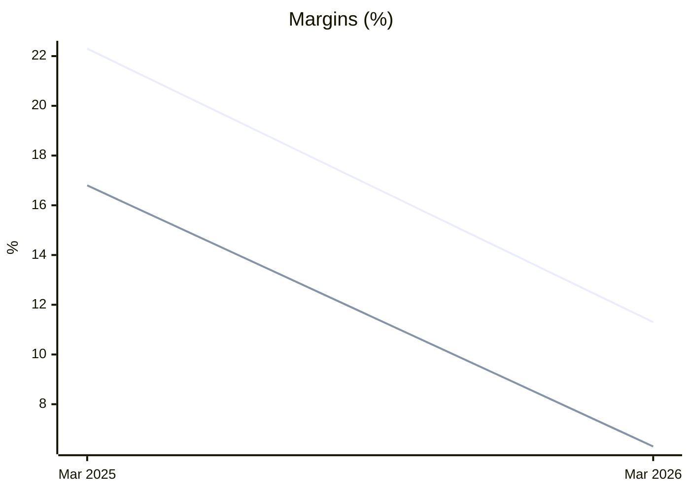

*Run 2026-11-24 · part of [SPINOFF_REPORT.md](../SPINOFF_REPORT.md) · the complete analysis of one company, with every management-call exchange in full.*

## SKFINDUS — SKF India (Industrial) Ltd.

### 1. SKF India (Industrial) Ltd. — THE SPIN-OFF ITSELF (the resulting company of a demerger)

**CONFIRMED** (this company IS the resulting company of SKF India Limited's demerger, listed on 2025-12-05 — the spun entity in its first year) · **LISTED <1Y — selling-pressure window; the bargain forms here** · score 5.0/10 · spin-off · 10 filing(s) from CALLS, NSE · first 2026-02-03, latest 2026-08-12

**The separated entities — every one the documents name:**

| Entity | Business | Listing | Who runs it |
|---|---|---|---|
| **SKF India Limited** | The Demerged Company retaining the automotive business; it also manufactures certain products for SKF India (… | listed 1999-01-27 as SKFINDIA (NSE) | not stated |

**What is being separated, as the documents put it:** SKF India's Industrial Undertaking — bearings and units, condition monitoring and services for industrial sectors — into SKF India (Industrial) Limited — class `value_unlocking`.

### 2. Stages and dates

> **Listing:** THIS COMPANY IS THE SPIN-OFF — the resulting company of SKF India Limited's demerger, listed on 2025-12-05 (354 days ago)

| Date | Event | Source |
|---|---|---|
| 1999-01-27 | **SKF India Limited** listed (SKFINDIA) | NSE equity list |
| 2024-12-17 | Other — SKF India (Industrial) Limited — incorporation of the Resulting Company | as stated: MCA Master Data enclosed with Updates filing dated February 09, 2026;… |
| 2025-09-26 | NCLT order — SKF India Limited (Demerged Company) and SKF India (Industrial) Limited (Resulting Company) | as stated: Updates filing dated February 09, 2026 ("the Order passed by the Hon'… |
| 2025-10-01 | Appointed date — SKF India (Industrial) Limited | as stated: Note 4 to Unaudited Financial Results, Outcome of Board Meeting filin… |
| 2025-10-01 | Effective date — SKF India (Industrial) Limited | as stated: Note 4 to Unaudited Financial Results, filing dated February 03, 2026… |
| 2025-10-15 | Record date — SKF India Limited (Demerged Company) shareholders | as stated: Note 5 to Unaudited Financial Results, Outcome of Board Meeting filin… |
| 2025-12-05 | **SKF India (Industrial) Ltd.** itself listed | NSE equity list |
| 2025-12-05 | Stage reached: **listed** | filing |
| 2025-12-05 | Listing and trading — SKF India (Industrial) Limited, on BSE and NSE Main Board | as stated: Updates filing dated February 09, 2026; Note 7 to Unaudited Financial… |
| 2026-02-09 | Stage reached: **nclt sanction** | [Updates](https://nsearchives.nseindia.com/corporate/SKFINDUS25_09022026164721_NSE.pdf) |
| 2026-02-09 | Other — SKF India (Industrial) Limited — CIN changed from U28140PN2024PLC236396 to L28140PN2024PLC236396 and status changed from "Unlisted" to "Listed" on MCA Master Data | as stated: Updates filing dated February 09, 2026 |

**The stages, as filed:** listed (2025-12-05) → nclt sanction (2026-02-09)

**Stated in the filings:** demerged undertaking: ) (as defined in; size hint: 2.6% of profit.

**When it lists, in the documents' words:** Said February 09, 2026: "the equity shares of the Company were listed on the Main Board of BSE Limited (“BSE”) and National Stock Exchange of India Limited (“NSE”) with effect from December 05, 2025"; the February 03, 2026 results note likewise says listed on BSE and NSE on December 5, 2025

### 3. Size of the separated business beside the parent — is institutional selling likely?

**Reading: LESS LIKELY on size alone — the piece is the larger part of the business.**

| Entity | Stated turnover | Stated share of the whole | Segment revenue share | Market cap (₹ cr) | Share of combined market cap | Index member |
|---|---|---:|---:|---:|---:|---|
| SKF India Limited | not stated | — | 100.0% (FY2026) | 7,246 | 36.9% | yes |

*Stated figures are the documents' own (a turnover share, or the cost-of-acquisition split the company publishes for tax, which reflects relative value); the segment share is this business's revenue over the parent's sales, and the market-cap share is the entity's value over the entity plus the parent (parent ₹12,415 cr, NSE bhavcopy of 2026-11-13), both computed here.*

**The judge's read of selling pressure:** unclear — Documents state only the 1:1 allotment to every parent shareholder and the December 5, 2025 listing; no index, size or shareholder-flow detail given

### 4. Insider ownership — share swap, promoters' holding, management incentives

**Share swap / entitlement:** not stated in the documents on file.

**Promoters' holding, from the shareholding pattern:**

| Company | Promoters | FIIs | DIIs | Public | Quarter |
|---|---:|---:|---:|---:|---|
| SKF India (Industrial) Ltd. (SKFINDUS) | 52.58% | 7.42% | 26.74% | 13.26% | Sep 2026 |
| SKF India Limited (SKFINDIA) | 52.58% | 7.14% | 25.51% | 14.77% | Sep 2026 |

*Source: screener.in shareholding pattern, stored under `ShareholdingPattern/NiftyTotalMarket/`. In a mirror demerger each shareholder holds the same proportion of the new company as of the parent on the record date.*

- **Promoters in the parent, per the documents:** not stated in the documents on file.
- **What the promoters will hold in the separated entity:** not stated in the documents on file.
- **What a public shareholder receives:** the Resulting Company has allotted 49,437,963 fully paid-up equity shares of face value Rs. 10/- each, to the shareholders of the Demerged Company as on the record date i.e. October 15, 2025, in the share exchange ratio 1:1 i.e. 1 (one) fully paid-up equity share of the Resulting Company having face value of Rs. 10/- each for every 1 (one) fully paid-up equity share of Rs. 10/- each of the Company
- **Management incentives:** not stated in the documents on file.
- **Insider actions around the separation:** not stated in the documents on file.
- **Insiders, per the checklist read:** not stated — documents disclose only 49,437,963 shares allotted 1:1 to all SKF India shareholders on record date October 15, 2025; no promoter stake or management incentive given · *option pricing date:* not stated

### 5. Why the demerger — point by point

The separation is the demerger of the Industrial undertaking of SKF India Limited (automotive remaining with SKF India Ltd.) into SKF India (Industrial) Limited, a company incorporated 17 December 2024 purely to receive it, sanctioned by NCLT Mumbai on 26 September 2025 with appointed/effective date 1 October 2025, a 1:1 share exchange (49,437,963 shares to SKF India holders on the 15 October 2025 record date) and listing on BSE/NSE from 5 December 2025. Management's stated reason is sector focus: the Q3 FY25-26 release frames it as 'SKF's demerger into two sector-focused, strategically independent organizations, enabling sharper market orientation, faster decision-making, and enhanced long-term value creation for shareholders,' a 'pivotal step in SKF's 102-year India journey,' with the industrial entity 'more agile and focused,' able to 'respond faster to market needs' and 'tailor it's manufacturing capabilities' for manufacturing, railways, renewables, cement and heavy engineering. On the 13 May 2026 call the operating logic is spelled out as the ACES strategy to 2028 (accelerate localization, commercial excellence, disciplined execution, one SKF) plus the point that industrial economics differ structurally from automotive — 'industrial business is all about flexibility in the channels... because the lot size, unlike automotive, is smaller' — and that localization lets it re-enter segments it had exited (wind, freight railways, agricultural tractors). Dedicated capacity is the second half of the logic: the Board approved a new Pune factory on 3 February 2026, part of INR 800 crore+ capex to FY29-30 (including INR 350-400 crore of DGBB/TRB channel additions), commissioning end-CY2028, because the business is 'running out of capacity' and currently relies on SKF India job work. The cost of separating was explicit: INR 1,800.8 million of exceptional demerger charges in Q3 FY26 (IT, professional fees, large stamp duty/transfer premium on the land transferred from SKF India), INR 1,961 million for nine months, and a further INR 183 million of demerger IT cost in Q4, which turned reported Q3 PBT to negative INR 671.4 million against INR 1,129.4 million before exceptionals. Management's payoff case is margin recovery to ~13% once demerger costs lapse by end-CY2026, ~15% by FY29-30 and an aspiration of 16-18%, on 8%+ growth; interim performance cited was Q4 FY26 sales INR 9,457.2 million (+9.8% QoQ, +31% YoY), PBT 9.5% reported and 11.5% ex-one-offs, net working capital down 2.8% to 18.7% of sales, then Q1 FY27 revenue INR 9,707.7 million (+18.3% YoY) at 9.0% PBT.

**Point by point, with the source:**

1. The Scheme of Arrangement between SKF India Limited (Demerged Company) and SKF India (Industrial) Limited (Resulting Company) transferred the Industrial Undertaking on a going-concern basis at carrying values, with the difference credited to Capital Reserve; NCLT order dated 26 September 2025, appointed and effective date 1 October 2025. “The Scheme, among other provisions, entails the demerger of the Demerged Undertaking from the Demerged Company into the Resulting Company on a going concern basis.” — *Scheme*
2. The only explicit statement of purpose in the filings: two sector-focused, independent organizations for sharper market orientation, faster decision-making and shareholder value, after 102 years of SKF in India. “The results come against the backdrop of SKF's demerger into two sector-focused, strategically independent organizations, enabling sharper market orientation, faster decision-making, and enhanced long-term value creation for shareholders, marking a pivotal step in SKF's 102-year India journey.” — *Scheme*
3. MD Mukund Vasudevan's rationale in the 4 February 2026 Q3 FY25-26 release: agility, speed of response and manufacturing tailored to industrial customers, serving manufacturing, railways, renewables, cement and heavy engineering. “As a more agile and focused industrial entity, SKF India (Industrial) is well-positioned to respond faster to market needs, tailor it's manufacturing capabilities, and support India's accelerating infrastructure and manufacturing build-out.” — *Scheme*
4. Separation cost quantified as exceptional items: INR 1,800.8 million in Q3 FY26 and INR 1,961 million for nine months for IT cost, professional services and stamp duty including transfer premium on land acquired under the Scheme — which pushed reported Q3 PBT to negative INR 671.4 million versus INR 1,129.4 million before exceptionals. “During the quarter and nine months ended 31 December 2025, the Company accounted certain demerger expenses for IT Cost, professional services and stamp duty, including estimated transfer premium payable to statutory authorities to effect transfer of registration of land acquired under the Scheme, aggregating to Rs. 1,800.8 million and Rs. 1,961 million, respectively, which have been included under "Exceptional items".” — *Scheme*
5. The Board meeting of 3 February 2026 — the same meeting that approved the first post-demerger results — approved a new standalone factory at Pune, the capacity leg of the separation. “We wish to inform you that the Board of Directors of the Company at its meeting held today, i.e. on February 03, 2026, has approved the setting up of a new factory /plant at Pune, Maharashtra.” — *Scheme*
6. Management re-stated the ACES strategy (accelerate localization, commercial excellence, disciplined execution, one SKF, defined through 2028) explicitly because the company is now separately listed and needs its own growth and profitability narrative. “I thought it's important to reiterate our strategy as we are now a separate listed entity as SKF India (Industrial) and I think it helps to kind of say what are we trying to do and how are we trying to grow and make our business more profitable.” — *[May 2026](https://www.bseindia.com/stockinfo/AnnPdfOpen.aspx?Pname=1289a753-236a-4201-9367-4432f4270674.pdf)*
7. The structural case for separate industrial management: industrial runs on small lot sizes and channel flexibility unlike automotive — the Pune TRB example raised capacity from 600,000 to 886,000 pieces, cut cost ~18% and improved changeover/flexibility 20% and new-product lead time 35%. “Flexibility, which is key, which is industrial business is all about flexibility in the channels, which means we can switch between one product and another because the lot size, unlike automotive, is smaller.” — *[May 2026](https://www.bseindia.com/stockinfo/AnnPdfOpen.aspx?Pname=1289a753-236a-4201-9367-4432f4270674.pdf)*
8. A concrete problem the focused, localized entity solves: segments previously abandoned on cost/margin grounds — wind, freight railways, agricultural tractors — are being re-entered via localization, including a 32.5 crore tractor OEM win and ZF/Suzlon wind orders that drove 91% QoQ wind growth. “The reason you are right, we did exit wind business . Because of localization we are now getting back into it.” — *[May 2026](https://www.bseindia.com/stockinfo/AnnPdfOpen.aspx?Pname=1289a753-236a-4201-9367-4432f4270674.pdf)*
9. Residual entanglement with the automotive entity persists: SKF India (Industrial) manufactures for SKF India Automotive (~4% of FY26 sales), pays royalty/trademark (up ~INR 60 million QoQ) and a transfer-pricing margin on services, and SKF India job-works for it until the new plant starts. “We are , till that new plant comes up , comes about, we are continuing to do some our SKF India entity is continuing to manufacture some for us on a job work basis.” — *[May 2026](https://www.bseindia.com/stockinfo/AnnPdfOpen.aspx?Pname=1289a753-236a-4201-9367-4432f4270674.pdf)*
10. The one-off separation charges continued into Q4 FY26 at INR 183 million, so reported PBT of 9.5% was 11.5% adjusted (versus 13.1% adjusted in Q3), with the remaining gap blamed on OEM mix (OEM up from 46% to 50%) and full bonus accrual. “In this quarter, we again had demerger -related IT costs, primarily that, totalling up to INR 183 million.” — *[May 2026](https://www.bseindia.com/stockinfo/AnnPdfOpen.aspx?Pname=1289a753-236a-4201-9367-4432f4270674.pdf)*
11. Margin roadmap post-separation: back to ~13% once demerger costs end around end-CY2026, ~15% by FY29-30 through localization, operational efficiency and S&A leverage, with 16-18% only an aspiration held back by OEM mix, competition and depreciation from the new plant. “So given the recent demerger expenses, right, by we would say towards the end of this calendar year, we see that mostly normalizing. We should get back to a little more around 13%.” — *[May 2026](https://www.bseindia.com/stockinfo/AnnPdfOpen.aspx?Pname=1289a753-236a-4201-9367-4432f4270674.pdf)*
12. Standalone capital plan: INR 800 crore+ capex FY26-27 to FY29-30, a large part for the new Pune plant plus DGBB and TRB channel additions (the INR 350-400 crore earlier flagged), operational mid-2028 and fully ramped by end-CY2028, with growth of ~8% in the interim. “So, on capex, the overall plan for the between FY 26, FY27 to FY 29, FY30, we are looking at doing a capex spend of around INR 800 crores plus, which includes a significant chunk of investment on the new Pune plant which we are in the process of setting up.” — *[May 2026](https://www.bseindia.com/stockinfo/AnnPdfOpen.aspx?Pname=1289a753-236a-4201-9367-4432f4270674.pdf)*
13. Q1 FY27 (12 August 2026) validates the focused-entity framing: revenue INR 9,707.7 million, up 18.3% YoY, PBT INR 869.2 million at 9.0%, with growth in Wind, General Machinery and Agriculture (Tractors) despite currency and residual demerger costs. “In our 3rd quarter as a focused, independent business, SKF India (Industrial) delivered 18.3% year-on-year Sales growth, while maintaining a healthy 9% PBT (in spite of headwinds from currency and demerger-related expenses).” — *Scheme*

**How it evolved:** These texts contain no pre-demerger call, so the origin of the idea is not on record here; the earliest document is the Scheme itself (NCLT order 26 September 2025, effective 1 October 2025, listing 5 December 2025). The 4 February 2026 press release, reporting the first post-demerger quarter, carries the only explicit rationale statement (two sector-focused independent organizations, sharper orientation, faster decisions, shareholder value) alongside INR 1,800.8 million of separation costs, and the same Board meeting on 3 February 2026 approved the new Pune factory — converting the rationale into standalone capacity. By the 13 May 2026 Q4/FY26 call the framing had shifted from justification to execution: the ACES strategy 'as we are now a separate listed entity,' INR 800 crore+ capex, re-entry into previously exited wind/railway/tractor business, and a margin path of 13% near term to 15% by FY29-30. The 12 August 2026 Q1 FY27 release continues the 'focused, independent business' framing with 18.3% YoY growth at 9% PBT.

**What management expects from it:** For SKF India (Industrial): sharper market orientation, faster decisions, agility and manufacturing tailored to industrial lot sizes; ~8% growth with PBT recovering to ~13% by end-CY2026, ~15% by FY29-30 (16-18% aspiration); net working capital 19-20% of sales; INR 800 crore+ own capex and a new Pune plant replacing SKF India job work; shareholder value via two independent listed entities.

*Not explained on the calls:* No pre-demerger call rationale; no named requester (investors, lenders, partners); no synergy loss, standalone-cost, tax or valuation quantification; nothing on the automotive entity's economics or arm's-length agreement terms.

- *Stated reason, in one line:* SKF's demerger into two sector-focused, strategically independent organizations, enabling sharper market orientation, faster decision-making and enhanced long-term value creation for shareholders; a more agile, focused industrial entity responding faster to market needs
- *What it reveals:* A clean, growing standalone bearings business: Q1 FY27 revenue +18.3% to Rs 9,707.7mn, underlying PBT 11.5–13.6% once Rs 1,961mn demerger costs are excluded, negligible finance cost, net assets credited to Capital Reserve; management guides ~13% near-term and 15% by FY29-30
- *Parent or spin:* spin · *Read next:* The Scheme of Arrangement's definition of the Demerged Undertaking, and SKF India Limited's post-demerger (automotive) standalone numbers
- *In their words:* “The results come against the backdrop of SKF's demerger into two sector-focused, strategically independent organizations, enabling sharper market orientation, faster decision-making, and enhanced long-term value creation for shareholders, marking a pivotal step in SKF's 102-year India journey.”

### 6. On the calls, verbatim

1 call(s), oldest first: **2 question-and-answer exchange(s)** given in full — the question and every answer to it, nothing trimmed — and 2 passage(s) from management's prepared remarks (the complete sentences about it; the whole remarks are in the linked transcript). Text is as the transcript prints it.

#### May 2026 — [transcript](https://www.bseindia.com/stockinfo/AnnPdfOpen.aspx?Pname=1289a753-236a-4201-9367-4432f4270674.pdf)

**From the prepared remarks** *(the passage about it; the whole turn runs to 1,514 characters in the transcript)*

> **Prabhsharan Kaur:** Good afternoon, everyone. Thank you for joining us today. With us, we have SKF India Industrial’s Managing Director, Mr. Mukund Vasudevan, and our CFO, Mr. Ashish Saraf. The purpose of today's call is to share our Q4 results and our overall financial year's performance. Please note that financial information from 17th December 2024 to 31st March 2025 and from 1st April 2025 to 30th September 2025 as reported in the presentation shared has been extracted and may involve some assumptions by the management from the financial information of SKF India Limited pertaining to the demerged industrial undertaking. These are prepared in accordance with the Appendix C of Ind AS 103 Business Combinations by using the financial information maintained by the SKF India Limited demerged company. Before I turn over the call to the management, I would like to remind you that in this call, some of the remarks contain forward -looking statements which are subject to risk and uncertainties and actual results may differ materially. Such statements are based on management beliefs as well as assumptions made by and on the information currently available to the management. The audience is cautioned not to place any undue reliance on these forward -looking statements and making any investment decision. The purpose of today's call is to purely educate and bring awareness about the company's fundamental business and the financial quarter under review. Let me now turn over the call to Mr. Mukund Vasudevan. Over to you.

**From the prepared remarks** *(the passage about it; the whole turn runs to 16,025 characters in the transcript)*

> **Mukund Vasudevan:** We had a sales growth of 9.8% with INR 9.5 billion of sales. We had a 1,731 basis points improvement in our profit before tax, that's at 9.5%. Caveat on that, which is the two bullets you can see at the bottom. Due to the demerger, there were some one -time expenses both in the previous quarter and in this quarter. If we remove that, remove the impact of that, this quarter we delivered a margin of 11.5% -- or profit before tax of 11.5%. Again, solid performance given all the changes which were going on in the demerger. And then in net working capital also, we came in strong, reduced our net working capital by 2.8% quarter -on-quarter and delivered 18.7% of sales net working capital. The one -time charges which happened in the previous quarter and in this quarter included, in the previous quarter, it included some IT -related costs related to the demerger, professional services, and a large stamp duty which was paid related to the land transfer from SKF India to SKF India (Industrial ) Limited. That was a total of around INR1.8 billion in the last quarter. In this quarter, we again had demerger -related IT costs, primarily that, totalling up to INR 183 million. These are all explained in detail in our detailed financials. But overall, very solid performance, proud to say that we had good growth and a solid margin improvement quarter - on-quarter . If I now go on to the economy update and I'll take you to the page titled macro update. […] If I move to the next slide, Slide 10, which is an analysis on margin. As you can see, if you look at, if you compare quarter -on-quarter , year-on-year comparison is not as advisable just because those involved some extractions from SKF India and some assumptions. But if you look at quarter -on-quarter , big jump from negative 7.8% to positive 9.5%. But that involved some demerger expenses both in the previous quarter and this quarter. And so, if you remove both of them, then the previous quarter, that is Q3 '26, would have been 13.1% and the current quarter would have been 11.5%. So that's the difference. alkFalkF SKF India (Industrial) Limited May 13, 202 6 If you ask what specifically caused the decline in margin from 13.1% to 11.5% if you remove the one -off demerger expenses, the biggest reason was the mix change. Our OEM business grew significantly and as a result, the mix of lower margin OEM business compared to higher margin distribution business accounted for most of this drop. Again, we expect that to normalize over the next few quarters. The other reason was a higher employee cost. […] But this quarter, we have seen a significant jump in the cash flow, partly due to the net working capital reduction as well as some t ax adjustments which were made. And then there were other exceptional items -- other items, which include interest incomes and some other current assets and liabilities which accounte d for a higher cash flow in Q4. I'll now move on to discuss our strategy and some success stories which tie well with our strategy. I thought it's important to reiterate our strategy as we are now a separate listed entity as SKF India (Industrial ) and I think it helps to kind of say what are we trying to do and how are we trying to grow and mak e our business more profitable. We call o ur strategy , the ACES strategy , and our strategy is defined through to 2028. And what we are trying to do here is each one of these ACES has multiple initiatives below it, but I'm highlighting some of the critical ones. The first one is to accelerate localization, which means both we will manufacture more in India for India, but also drive the work with our supplier base to make sure that we get more components also coming from India rather than imported.

**Question and answer**

> **Mumuksh Mandlesha:** Got it. Thank you for this, sir. Sir, just on the question part, just if you can help us understand how is the RM cost inflation happening, sir, and how much price hikes w e have taken from the OEM and distribution level? And also, I mean, the going ahead, sir, with the capacity additions and demerger transition impact, just how do you see the margin, sir, going ahead?
>
> **Mukund Vasudevan:** Let me try, let me answer that to the extent possible and then Ashish can add on. Let me answer your second question first, which is on how do we see the margins going ahead. So given the recent demerger expenses, right, by we would say towards the end of this calendar year, we see that mostly normalizing. We should get back to a little more around 13%. So, most of those demerger expenses will be done. We will also have some the mix, which we believe OEM is higher right now, we believe the distributor business will come back and the mix will normalize a bit more. So that will also account for some of the growth back to around 13 %. Over the next few years, which is '28 -'29 and '29 -'30, we are looking at more localization, so more production in India for India. We are looking at operational efficiencies as we are looking at how do we build a more local supplier base of our components, but also how do we manufacture, like we showed in the example, how do we manufacture more with less with less cost of manufacturing as well as more less manpower. How do we do that? And then finally, we see more drop down or leverage from our sales on the top from the top line with less S&A involved, Sales and Administration involved. So , all that we think will get us by around by '29 -'30, we believe we should be getting back to the 15 % range. That's the goal. But those kind of are subject to, of course, market conditions. But that's our goal. But near term, we expect to get back to where we were around 13 % after the demerger costs are over. In terms of cost escalations, this is very broad numbers right now. There are two things which have hurt us because which are challenges, but we are passing on price increases. One is the bigger one actually is FX. So , anything we are importing, right, and selling, there is an FX impact with the rupee depreciating. alkFalkF SKF India (Industrial) Limited May 13, 202 6 The second is around escalating costs. The escalating costs we are projecting around 3% to 4% right now, but that is still variable, right? And that involves some assumptions what we are seeing in oil prices right now, but it also involves some assumptions in steel prices going up. We are expecting to pass on most of it through price increases, some both the FX impact as well as the cost escalations. Obviously, with OEMs, it might be it's a little tougher, those are tougher negotiations. We are hoping to pass on most of it. With distributors, we will probably pass on a larger chunk. So that's our overall assessment right now.
>
> **Ashish Saraf:** Yes. And just to add, I think additionally to what Mumuksh said, we have already undertaken actions as we kind of started this quarter, especially with the distribution business, we have taken some pricing actions already in the market given the cost escalation that we are seeing both on the side of FX as well as raw material. Even with the OEMs, we are actively approaching them to get an appropriate price escalation to offset the additional cost.

**Question and answer**

> **Mumuksh Mandlesha:** Thank you. Thank you, sir, for the answer, sir. I'll come back to the queue, sir. Mod erator: Thank you. We will take our next question from the line of Viraj from SiMPL . Please go ahead.
>
> **Viraj:** Yes, hi. Thanks for the opportunity. Just two questions. See, if you look at in quarter 4, while we said that the mix is adverse, our gross margin even Q -on-Q has not seen that kind of a moderation. But actually, even if you adjust for the demerger expense of INR 18 crore s, the jump in other expenses is pretty sharp for us. So just trying to understand, you know, if you can quantify the major line items, you know, which is driving this. And the second part to this question is, see, before the demerger also, you know, in earlier press releases , we used to share the kind of margins industrial used to do. And even with the localization it had at that point in time, the business used to do 13 % to 15 % comfortably. Now with localization which you are targeting to increase, you know, with operational efficiency, ideally one would think that the blended margins for the industrial business would be close to say 16 % to 18 %, you know, by '28 -'29. So , I'm just trying to understand where is that disconnect or the gap coming to you from?
>
> **Mukund Vasudevan:** Yes. So, I will answer the second question from my side and then Ashish can answer the first question since I don't have all the details around other expenses. But so, on the second question, one of the reasons for the drag is additional investments which we are making in as we have announced earlier in Pune. These additional investments, including a new plant as we are running out of capacity, is going to add to our expense. So, I would say that is one. The second is we are under, you know, it is a competitive environment and we do face lots of competition. So, while as the especially at the OEMs, I think the competition is intense. Our railway mix has gone up, that has also brought down our margin a little bit. But we see this all recovering, but not before conservatively speaking, not before '29 -'30. So, our aspiration is to get to 16 % to 18 %, but right now up to 2030, both due to slightly higher OEM mix and a little higher depreciation charges, we see this, we have been alkFalkF SKF India (Industrial) Limited May 13, 202 6 conservative here in saying we are going to get to around 15 %. More increase is possible, but we can't commit to it right now.
>
> **Ashish Saraf:** Yes. Just to elaborate on other expenses, the big components of other expense cost was one was around royalty and trademark. We had we had to pay a royalty and trademark on our sales, on our higher sales to our group company. So that increased by around INR 60-odd million. Apart from that, there were other manufacturing -related costs, which was predominantly around repairs and maintenance, around power and fuel, and stores and spares, which had increased in this quarter compared to previous quarter. And over and above that, we have basically availing some services, manufacturing services from our group company SKF India, on which we have to pay or reimburse a small transfer pricing margin which we basically booked in this quarter. So that kind of led to an increase in the in the overall other expense.
>
> **Viraj:** Okay, sir. Just two parts on the first second part again. See, if you look at our white spaces, you know, in the past also, we have kind of vacated some segments in distribution either due to accessibility, affordability, or even in terms of wind, you know, where we have exited certain low margin, low profitability threshold segments for us. Now with localization coming through and you're still guiding a 15 % margin, I'm talking about the EBITDA level, you know, because the comes after that. So , you know, is would it be right to think that the focus would be more on achieving a much more higher rate of growth while margins may be, you know, around what we are saying in the interim? Would that be a right thing to, you know, look at? So that is one. And second is on the Capex, is there any I mean, if you can just confirm the timeline by which we expect it to commission?
>
> **Mukund Vasudevan:** Yes. So, you're partially right. Our goal or our strategy is growth while maintaining margin, right? So, if you remove the one -offs, we want to maintain margin, we want to get it back to around 15 %, that's what I mean by maintain, right? But we see a much higher potential for growth. The reason you are right, we did exit wind business . Because of localization we ar e now getting back into it. We did exit some railway business, especially around freight, now we are getting back into it, etcetera , right? So, there are many areas, even the agricultural tractor business, some of it was we exited and now we are getting back into it due to localization. So, we are winning more share, but if you compare it to it comes at the cost of some amount of margin. Our OEM business margin in general is lower, right? So, you can see that. But we don't expect that to kind of sustain, that low margin, that relatively lower margin. We will work both with operational efficiency as well as on pricing to t ry and get back to at least 15 %.
>
> **Viraj:** On capex sir? alkFalkF SKF India (Industrial) Limited May 13, 202 6
>
> **Ashish Saraf:** So, on capex, the o verall plan for the between FY 26, FY27 to FY 29, FY30, we are looking at doing a c apex spend of around INR 800 crores plus, which includes a significant chunk of investment on the new Pune plant which we are in the process of setting up.
>
> **Viraj:** No, my question was .

### 7. The parent's financial statements

**The parent, last three fiscal years (consolidated)**

| | Mar 2025 | Mar 2026 |
|---|---:|---:|
| Sales (₹ cr) | 721 | 3,440 |
| Sales growth (%) | — | +377.1% |
| Operating profit (₹ cr) | 161 | 390 |
| Operating profit growth (%) | — | +142.2% |
| Operating margin (%) | 22.3 | 11.3 |
| PAT (₹ cr) | 121 | 218 |
| PAT growth (%) | — | +80.2% |
| PAT margin (%) | 16.8 | 6.3 |
| EPS (₹) | 121,310 | 44.0 |

*Source: ProfitStatement/NiftyTotalMarket/SKFINDUS.csv (consolidated, screener.in); growth and margins computed here.*

```mermaid
xychart-beta
    title "Sales, operating profit and PAT (₹ cr)"
    x-axis ["Mar 2025", "Mar 2026"]
    y-axis "₹ crore"
    bar [721, 3440]
    bar [161, 390]
    bar [121, 218]
```

*Series in order: Sales, Operating profit, PAT.*

*Series in order: Operating margin, PAT margin.*

**P/E:** 62.1 — close 2026-10-01 ÷ EPS 44.03 (Mar 2026) (price ₹2,734.20 as of 2026-10-01).

**Cash flows (₹ cr):**

| | Mar 2025 | Mar 2026 |
|---|---:|---:|
| Cash from operations (₹ cr) | -18.0 | 164 |
| Cash from investing (₹ cr) | -2.0 | -46.0 |
| Cash from financing (₹ cr) | -0.0 | -2.0 |
| Net cash flow (₹ cr) | -20.0 | 116 |
| Free cash flow (₹ cr) | -28.0 | 70.0 |

*Source: CashFlow/NiftyTotalMarket/SKFINDUS.csv (consolidated, screener.in).*

### 8. The separated business's financial statements

**The business being separated — its own numbers**, entity by entity: its reported statements once it is listed and on file, and the segment numbers the annual reports and presentations carry for it before that.

**SKF India Limited (SKFINDIA) — as reported since listing**

| | Mar 2024 | Mar 2025 | Mar 2026 |
|---|---:|---:|---:|
| Sales (₹ cr) | 4,570 | 4,920 | 3,763 |
| Sales growth (%) | +6.2% | +7.7% | -23.5% |
| Operating profit (₹ cr) | 718 | 745 | 449 |
| Operating profit growth (%) | -4.1% | +3.8% | -39.7% |
| Operating margin (%) | 15.7 | 15.1 | 11.9 |
| PAT (₹ cr) | 552 | 566 | 266 |
| PAT growth (%) | +5.1% | +2.5% | -53.0% |
| PAT margin (%) | 12.1 | 11.5 | 7.1 |
| EPS (₹) | 112 | 115 | 53.8 |

*Source: ProfitStatement/NiftyTotalMarket/SKFINDIA.csv (consolidated, screener.in); growth and margins computed here.*

**Industrial Business / Demerged Industrial Undertaking (SKF India (Industrial) Limited, standalone) → SKF India (Industrial) Limited (the 'Resulting Company'; listed BSE 544572 / NSE SKFINDUS) — demerged from SKF India Limited (the 'Demerged Company')** · unit INR million (MINR) · Pages carry entity-level standalone P&L lines, not segment-result tables. The 'operating_profit' field below carries Profit Before Tax (PBT) exactly as disclosed — no EBIT/EBITDA or segment result is given on these pages. Revenue is 'Revenue from operations' (external; Q4FY26 mix shows ~9% is inter-company sales to SKF India, not separately deducted). FY2026 = year ended 31 March 2026. The 'FY2025' row is NOT a full year: it is the stub period 17 December 2024 (incorporation) to 31 March 2025, and those Industrial-undertaking figures were extracted by management from SKF India Limited's records under Appendix C of Ind AS 103. Quarterly revenue from operations (MINR, Presentation May 2026 page 10): 4QFY25 7,206; 1QFY26 8,206; 2QFY26 8,131; 3QFY26 8,610; 4QFY26 9,457. Appointed/Effective Date of demerger 1 October 2025; listed 5 December 2025.

| | FY2025 | FY2026 |
|---|---:|---:|
| Revenue (INR million (MINR)) | 7,206 | 34,404 |
| Revenue growth (%) | — | +377.4% |
| Operating profit (INR million (MINR)) | 1,644 | 2,213 |
| Operating profit growth (%) | — | +34.6% |
| Operating margin (%) | 22.8 | 6.4 |
| PAT (INR million (MINR)) | 1,213 | 2,177 |
| PAT growth (%) | — | +79.4% |
| Segment assets (INR million (MINR)) | — | — |
| Segment liabilities (INR million (MINR)) | — | — |
| Capital employed (INR million (MINR)) | — | — |
| Return on capital employed (%) | — | — |
| Segment assets / revenue (x) | — | — |
| Capex (INR million (MINR)) | — | 2,397 |

*Sources:* Annual Report 2026 — page 83 (stub period 17 Dec 2024 to 31 Mar 2025, not a full fiscal year); Annual Report 2026 — page 83

*Latest quarter (H1 FY2026-27 (six months to 30 Sep 2026; Q2 FY27 not disclosed standalone on these pages). Q1 FY27 alone: revenue INR 9.7 billion, PBT margin 9.0%, cash conversion 63% (Presentation Aug 2026 page 17)):* revenue 20140, operating profit None — Presentation Nov 2026 — page 16 (states 'Revenue from Operations INR 2014 Cr', PBT margin 11.0%, cash conversion 19.5%; 2,014 crore = 20,140 MINR, unit-converted only)

*Not in the pages read:* No segment assets, segment liabilities, depreciation, EBIT/EBITDA; no FY2025 capex; no FY2027 annual figures; H1 FY27 absolute PBT not given (margin only).

*Businesses with no numbers in the pages read (1 annual report(s) and 3 presentation(s) on file):* No numbers at all for the business remaining with the parent — SKF India Limited's Automotive business/segment. The pages contain no segment-reporting tables from older SKF India Limited annual reports, so no Automotive or remaining-segment revenue, profit, assets or capex appears.

*Documents on file:* [Annual Report 2026](https://www.bseindia.com/xml-data/corpfiling/AttachHis/14a18ae7-50d9-407c-b1f9-3fe2268b987e.pdf); [Presentation Nov 2026](https://www.bseindia.com/stockinfo/AnnPdfOpen.aspx?Pname=b92ae758-f964-4e87-b9c5-8d2f717774a9.pdf); [Presentation Aug 2026](https://www.bseindia.com/stockinfo/AnnPdfOpen.aspx?Pname=8956b8b9-d063-4638-be74-d543e3a7ddb6.pdf); [Presentation May 2026](https://www.bseindia.com/stockinfo/AnnPdfOpen.aspx?Pname=58c6120f-ab85-4d9e-a183-9d902375ccc1.pdf)

### 9. Other financial differences — working capital, margins, returns, debt

| Metric (latest year) | Parent (SKFINDUS) | SKF India Limited (SKFINDIA) |
|---|---:|---:|
| *Basis* | *reported, consolidated* | *its own reported statements* |
| Sales (₹ cr) | 3,440 (Mar 2026) | 3,763 (Mar 2026) |
| Sales growth (%) | 377.1 (Mar 2026) | -23.5 (Mar 2026) |
| Operating margin (%) | 11.3 (Mar 2026) | 11.9 (Mar 2026) |
| Operating profit growth (%) | 142.2 (Mar 2026) | -39.7 (Mar 2026) |
| PAT margin (%) | 6.3 (Mar 2026) | 7.1 (Mar 2026) |
| ROCE % | 30 (Mar 2025) | 24 (Mar 2025) |
| Debtor Days | 88 (Mar 2026) | 70 (Mar 2026) |
| Inventory Days | 84 (Mar 2026) | 52 (Mar 2026) |
| Days Payable | 116 (Mar 2026) | 89 (Mar 2026) |
| Cash Conversion Cycle | 56 (Mar 2026) | 33 (Mar 2026) |
| Working Capital Days | 34 (Mar 2026) | 44 (Mar 2026) |
| Debt / equity (x) | 0 (Mar 2026) | 0 (Mar 2026) |
| Borrowings (₹ cr) | 5 (Mar 2026) | 3 (Mar 2026) |

*Each figure is the latest on file, with its year. Working-capital days and ROCE come from the stored working-capital file; segment figures from the pages cited in part 8. A dash means the documents do not carry it.*

**What the documents themselves say about the differences:**

- **operating margin** — parent / remaining: not stated; separated business: Q3 FY25-26 PBT 13.6% excluding one-time demerger expenses; Q4 FY25-26 reported PBT margin 9.5%, 11.5% excluding demerger expenses (vs 13.1% in Q3 adjusted); Q1 FY26-27 PBT margin 9.0%, down 288 bps YoY; guidance of about 13% near term and about 15% by '29-'30, aspiration 16% to 18% “If you ask what specifically caused the decline in margin from 13.1% to 11.5% if you remove the one -off demerger expenses, the biggest reason was the mix change.”
- **working capital** — parent / remaining: not stated; separated business: Net working capital reduced 2.8% quarter-on-quarter to 18.7% of sales in Q4 FY25-26, driven by inventory reduction from 16.9% to 16.0% of sales; expected in the range of 19% to 20% of sales going forward “And then in net working capital also, we came in strong, reduced our net working capital by 2.8% quarter -on-quarter and delivered 18.7% of sales net working capital.”
- **growth** — parent / remaining: not stated; separated business: Q3 FY25-26 revenue Rs. 8,609.5 million, +5.9% QoQ; Q4 FY25-26 sales growth 9.8% QoQ (31% YoY) at INR 9.5 billion; Q1 FY26-27 revenue Rs. 9,707.7 million, +18.3% YoY and +2.6% QoQ; interim growth forecast around 8% “We had a sales growth of 9.8% with INR 9.5 billion of sales.”
- **capex and capital intensity** — parent / remaining: not stated; separated business: Capex of around INR 800 crores plus over FY26/FY27 to FY29/FY30, largely a new Pune plant approved by the Board on February 03, 2026 and expected to be commissioned by end of calendar year 2028; earlier INR 350 crores to INR 400 crores referenced for channel expansion (DGBB and TRB channels); higher depreciation charges expected as a drag “So, on capex, the o verall plan for the between FY 26, FY27 to FY 29, FY30, we are looking at doing a c apex spend of around INR 800 crores plus, which includes a significant chunk of investment on the new Pune plant which we are in the process of setting up.”
- **other** — parent / remaining: not stated; separated business: One-time demerger expenses (IT cost, professional services, stamp duty including estimated transfer premium on land transfer) of Rs. 1,800.8 million in the quarter and Rs. 1,961 million in the nine months ended December 31, 2025, plus INR 183 million in Q4 FY25-26, taking Q3 FY25-26 profit before tax to Rs. (671.4) million; Q1 FY26-27 PBT also carried demerger-related expenses “During the quarter and nine months ended 31 December 2025, the Company accounted certain demerger expenses for IT Cost, professional services and stamp duty, including estimated transfer premium payable to statutory authorities to effect transfer of registration of {and acquired under the Scheme, aggregating to Rs. 1,800.8 million and Rs. 1,961 million, respectively, which have been included under "Exceptional items".”
- **cash** — parent / remaining: not stated; separated business: Significant jump in cash flow in Q4 FY25-26, partly from net working capital reduction, tax adjustments and other items including interest income “But this quarter, we have seen a significant jump in the cash flow, partly due to the net working capital reduction as well as some t ax adjustments which were made.”
- **debt and leverage** — parent / remaining: not stated; separated business: Finance cost of Rs. 0.1 million for the quarter and Rs. 1.9 million for the nine months ended December 31, 2025 “(f) Finance cost 0.1 0.7 19 14”
- **tax** — parent / remaining: not stated; separated business: Total tax expense of Rs. (170.5) million for the quarter ended December 31, 2025 (current tax Rs. 151.9 million, deferred tax credit Rs. (322.4) million) and Rs. 326.0 million for the nine months “Total tax expense (170.5) _244.3 326.0 430.9”

**The checklist:**

| Item | Status | Evidence |
|---|---|---|
| Why the spin-off | yes | value unlocking for shareholders — “…pendent organizations, enabling sharper market orientation, faster decision -making, and enhanced long -term value creation for shareholders, marking a pivotal step in SKF’s 102 -year India journey. SKF India (Industria” |
| Institutional selling likely (small / different business) | partly | the demerged piece is 2.6% of profit |
| Insider ownership and incentives aligned | unknown | no promoter-continuity or option-pricing language found *(next: the date the management options are priced; promoter holding in the resulting company)* |
| A hidden value revealed (pro-forma, leverage, comparables) | unknown | no pro-forma or market data on file *(next: pro-forma P&L of each piece × the peer P/E of its own industry)* |
| Parent before the spin (clean parent, takeover prelude) | partly | stage nclt_sanction — the spin has not happened; the parent can still be bought whole |
| Timing (first year sells, second year gains) | partly | not yet listed — 294 days since the first filing, stage nclt_sanction |
| Management discussing it on the calls | yes | 6 mention(s) in the last 12 months of calls — “…e land transfer from SKF India to SKF India (Industrial ) Limited. That was a total of around INR1.8 billion in the last quarter. In this quarter, we again had demerger -related IT costs, primarily that, totalling up to” |

**On the calls (last 12 months):**

- *May 2026* (neutral) — “…presentation shared has been extracted and may involve some assumptions by the management from the financial information of SKF India Limited pertaining to the demerged industrial undertaking. These are prepared in accordance with the Appendix C of Ind AS 103 Business Combinations by using the financial information maintained…”
- *May 2026* (forward) — “…These are prepared in accordance with the Appendix C of Ind AS 103 Business Combinations by using the financial information maintained by the SKF India Limited demerged company. Before I turn over the call to the management, I would like to remind you that in this call, some of the remarks contain forward -looking statements w…”
- *May 2026* (backward) — “…e had a 1,731 basis points improvement in our profit before tax, that's at 9.5%. Caveat on that, which is the two bullets you can see at the bottom. Due to the demerger, there were some one -time expenses both in the previous quarter and in this quarter. If we remove that, remove the impact of that, this quarter we delivered a…”
- *May 2026* (backward) — “…f that, this quarter we delivered a margin of 11.5% -- or profit before tax of 11.5%. Again, solid performance given all the changes which were going on in the demerger. And then in net working capital also, we came in strong, reduced our net working capital by 2.8% quarter -on-quarter and delivered 18.7% of sales net working…”
- *May 2026* (backward) — “…e -time charges which happened in the previous quarter and in this quarter included, in the previous quarter, it included some IT -related costs related to the demerger, professional services, and a large stamp duty which was paid related to the land transfer from SKF India to SKF India (Industrial ) Limited. That was a total…”

The filings

| Date | Category | Headline | Attachment |
|---|---|---|---|
| 2026-02-03 | Outcome of Board Meeting | Pursuant to Regulation 30 and 33 of SEBI (Listing Obligations and Disclosure Requirements) Regulations, 2015 ( SEBI LODR ) (read with Schedule III) including ci | [pdf](https://nsearchives.nseindia.com/corporate/SKFINDUS25_03022026215638_NSE.pdf) |
| 2026-02-03 | Updates | Pursuant to Regulation 30 and 33 of SEBI (Listing Obligations and Disclosure Requirements) Regulations, 2015 ( SEBI LODR ) (read with Schedule III) including ci | [pdf](https://nsearchives.nseindia.com/corporate/SKFINDUS25_03022026221110_NSE.pdf) |
| 2026-02-04 | Press Release | Pursuant to Regulation 30 of SEBI (Listing Obligations and Disclosure Requirements) Regulations, 2015, we hereby submit the copy of Press Release in connection  | [pdf](https://nsearchives.nseindia.com/corporate/SKFINDUS25_04022026185842_NSE.pdf) |
| 2026-02-09 | Updates | We hereby inform you that pursuant to the Order passed by the Hon ble National Company Law Tribunal ( NCLT ) dated September 26, 2025 sanctioning the Scheme of  | [pdf](https://nsearchives.nseindia.com/corporate/SKFINDUS25_09022026164721_NSE.pdf) |
| 2026-05-01 | Earnings call May 2026 | …These are prepared in accordance with the Appendix C of Ind AS 103 Business Combinations by using the financial information maintained by the SKF India Limited | [pdf](https://www.bseindia.com/stockinfo/AnnPdfOpen.aspx?Pname=1289a753-236a-4201-9367-4432f4270674.pdf) |
| 2026-05-01 | Earnings call May 2026 | …extractions from SKF India and some assumptions. But if you look at quarter -on-quarter , big jump from negative 7.8% to positive 9.5%. But that involved some  | [pdf](https://www.bseindia.com/stockinfo/AnnPdfOpen.aspx?Pname=1289a753-236a-4201-9367-4432f4270674.pdf) |
| 2026-05-01 | Earnings call May 2026 | …ning, sir, and how much price hikes w e have taken from the OEM and distribution level? And also, I mean, the going ahead, sir, with the capacity additions and | [pdf](https://www.bseindia.com/stockinfo/AnnPdfOpen.aspx?Pname=1289a753-236a-4201-9367-4432f4270674.pdf) |
| 2026-05-01 | Earnings call May 2026 | …he extent possible and then Ashish can add on. Let me answer your second question first, which is on how do we see the margins going ahead. So given the recent | [pdf](https://www.bseindia.com/stockinfo/AnnPdfOpen.aspx?Pname=1289a753-236a-4201-9367-4432f4270674.pdf) |
| 2026-05-01 | Earnings call May 2026 | …right, by we would say towards the end of this calendar year, we see that mostly normalizing. We should get back to a little more around 13%. So, most of those | [pdf](https://www.bseindia.com/stockinfo/AnnPdfOpen.aspx?Pname=1289a753-236a-4201-9367-4432f4270674.pdf) |
| 2026-08-12 | Press Release | Pursuant to Regulation 30 of SEBI (Listing Obligations and Disclosure Requirements) Regulations, 2015, please find attached the Press Release issued by Company  | [pdf](https://nsearchives.nseindia.com/corporate/SKFINDUS25_12082026163401_NSE.pdf) |

