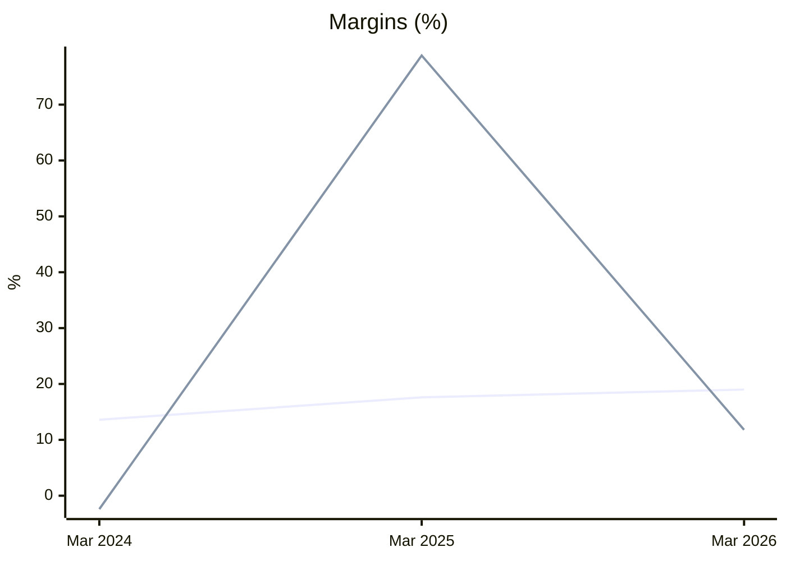

*Run 2026-11-24 · part of [SPINOFF_REPORT.md](../SPINOFF_REPORT.md) · the complete analysis of one company, with every management-call exchange in full.*

## STAR — Strides Pharma Science Ltd.

### 1. Strides Pharma Science Ltd. — CONFIRMED DEMERGER

**CONFIRMED** (a demerger scheme is on the exchange record) · **LISTED 1–2Y — the second-year window** · score 5.0/10 · spin-off · 6 filing(s) from NSE, NSE-register · first 2024-12-06, latest 2026-06-27

**The separated entities — every one the documents name:**

| Entity | Business | Listing | Who runs it |
|---|---|---|---|
| **OneSource Specialty Pharma Limited** | Identified CDMO Business and Soft Gelatin Business demerged from Strides, plus Identified CDMO Business demer… | listed 2025-01-24 as ONESOURCE (NSE) | Neeraj Sharma, CEO of OneSource (Anurag Bhagania,… |
| **Pivot Path Private Limited, India** | "Life Sciences business and Digital Innovations business of Arco Lab" — life sciences consulting, digital tra… | not to be listed | not stated (no CEO/MD/chair of Pivot Path is name… |

**What is being separated, as the documents put it:** Arco Lab's Life Sciences and Digital Innovation businesses, carved out into Pivot Path Private Limited — class `value_unlocking`.

### 2. Stages and dates

> **Listing:** LISTED — OneSource Specialty Pharma Limited (ONESOURCE) since 2025-01-24 (NSE equity list); record date 2024-12-06; not yet listed: Pivot Path Private Limited, India

| Date | Event | Source |
|---|---|---|
| 2023-09-25 | Board approval — OneSource (Strides board approving the Scheme of Arrangement) | as stated: Intimation dated May 22, 2024 ("our earlier intimations dated Septemb… |
| 2023-09-28 | Filed with exchanges — OneSource | as stated: NSE Observation Letter Ref: NSE/LIST/37742 dated May 21, 2024 ("vide … |
| 2024-04-01 | Appointed date — OneSource (demerged undertakings from Strides and Steriscience vest with OneSource) | as stated: Intimation dated November 27, 2024; NCLT approval intimation dated No… |
| 2024-05-17 | SEBI observations — OneSource | as stated: NSE Observation Letter dated May 21, 2024 ("SEBI vide its letter date… |
| 2024-05-21 | Exchange no-objection — OneSource | as stated: Intimation dated May 22, 2024 (BSE and NSE letters dated May 21, 2024… |
| 2024-05-22 | Stage reached: **exchange noc** | [Updates](https://nsearchives.nseindia.in/corporate/STAR_22052024173136_StridesSEIntimation.pdf) |
| 2024-07-26 | Other — OneSource (NCLT, Mumbai Bench order directing convening of shareholders' and secured creditors' meetings; received July 29, 2024) | as stated: Intimation dated July 30, 2024 |
| 2024-08-08 | Stage reached: **meetings** | [Shareholders meeting](https://nsearchives.nseindia.in/corporate/STAR_08082024154754_SEIntimation.pdf) |
| 2024-09-10 | Shareholders / creditors meeting — OneSource (Strides equity shareholders at 10:30 hrs and secured creditors at 12:00 hrs; Steriscience and OneSource meetings same day) | as stated: Outcome of NCLT Convened Meeting dated September 11, 2024; proceeding… |
| 2024-10-16 | Other — OneSource (equity commitments of INR 8,010 mn / USD 95 mn at pre-money equity valuation of USD 1.65 bn) | as stated: Press release dated October 16, 2024 |
| 2024-11-14 | NCLT order — OneSource (NCLT, Mumbai Bench order sanctioning the Scheme; uploaded on NCLT website November 19, 2024; certified copy received November 26, 2024) | as stated: Intimation dated November 19, 2024; intimation dated November 26, 2024 |
| 2024-11-21 | Other — OneSource (allotment of 6,277,909 equity shares at INR 1,276/- per share approved by Management Committee on November 21 and November 22, 2024; total consideration INR 8,010 million) | as stated: Intimation dated November 25, 2024 |
| 2024-11-27 | Effective date — OneSource (certified true copy filed with MCA/RoC by Strides, Steriscience and OneSource) | as stated: Intimation of Effective Date dated November 27, 2024 |
| 2024-12-06 | **Record date** | NSE corporate-actions register |
| 2024-12-06 | Stage reached: **record date** | Record Date (corporate-actions register) |
| 2024-12-06 | Record date — OneSource (fixed by the Strides Board on November 26, 2024) | as stated: Record Date intimation dated November 26, 2024 |
| 2024-12-10 | Allotment — OneSource | as stated: Intimation dated December 11, 2024 ("they have completed allotment of… |
| 2024-12-11 | Stage reached: **listed** | [Demerger](https://nsearchives.nseindia.in/corporate/STAR_11122024193707_StridesSEintimation.pdf) |
| 2025-01-24 | **OneSource Specialty Pharma Limited** listed (ONESOURCE) | NSE equity list |
| 2025-03-19 | Stage reached: **announced** | [General Updates](https://nsearchives.nseindia.in/corporate/STRIDES_532531_19032025114639_StridesSEIntimation.pdf) |
| 2025-03-19 | Board approval — Pivot Path (in-principle approval by Boards of Strides and Arco Lab for the proposed demerger of the Identified Business of Arco Lab) | as stated: Intimation dated March 19, 2025 |
| 2025-04-10 | Appointed date — Pivot Path (Demerged Undertaking of Arco Lab vests with Pivot Path) | as stated: Intimation dated May 15, 2025; intimation dated May 20, 2026 |
| 2025-05-15 | Board approval — Pivot Path (Boards of Arco Lab and Pivot Path approving the Scheme of Arrangement) | as stated: Intimation dated May 15, 2025 |
| 2026-05-18 | NCLT order — Pivot Path (NCLT, Bengaluru Bench pronounced order approving the Scheme; final order made available on NCLT portal May 20, 2026; certified copy received May 25, 2026) | as stated: Intimation dated May 20, 2026; intimation dated June 1, 2026 |
| 2026-05-20 | Stage reached: **nclt sanction** | [General Updates](https://nsearchives.nseindia.com/corporate/STRIDES_532531_20052026131652_SEintimationALDemerger.pdf) |
| 2026-06-01 | Stage reached: **effective** | [General Updates](https://nsearchives.nseindia.com/corporate/STRIDES_532531_01062026172449_SEIntimationEffectivedate.pdf) |
| 2026-06-01 | Effective date — Pivot Path | as stated: Intimation dated June 1, 2026 ("the Scheme of Demerger has become eff… |
| 2026-06-27 | Other — Pivot Path (Strides Board approves strategic investment / sale of majority stake to Ascent Capital-led consortium and Vintage Classic; Pivot Path to be reclassified as an Associate) | as stated: Intimation and press release dated June 27, 2026 |
| 2026-06-30 | Other — Pivot Path (definitive agreements "proposed to be executed before June 30, 2026"; "Sale of shares is expected to be completed by June 30, 2026") | as stated: Annexure A to intimation dated June 27, 2026 |
| 2026-07-31 | Other — Pivot Path ("Primary infusion by Ascent into Pivot Path is expected to be completed by July 31, 2026") | as stated: Annexure A to intimation dated June 27, 2026 |

**The stages, as filed:** exchange noc (2024-05-22) → meetings (2024-08-08) → record date (2024-12-06) → listed (2024-12-11) → announced (2025-03-19) → nclt sanction (2026-05-20) → effective (2026-06-01)

**Stated in the filings:** demerged undertaking: of Arco Lab Private Limited, a wholly owned subsidiary of Strides Pharma Science Limited; record date 2024-12-06; size hint: 20% of ebitda.

### 3. Size of the separated business beside the parent — is institutional selling likely?

**Reading: VERY LIKELY — the piece is under a tenth of the whole; index funds and large holders who receive it without choosing it tend to sell.**

| Entity | Stated turnover | Stated share of the whole | Segment revenue share | Market cap (₹ cr) | Share of combined market cap | Index member |
|---|---|---:|---:|---:|---:|---|
| OneSource Specialty Pharma Limited | not stated | — | — | 18,463 | 66.4% | yes |
| Pivot Path Private Limited, India | FY 2025-26, post-demerger basis: "Standalone Basis Turnover… | 3.0% | — | — | — | not listed |

*Stated figures are the documents' own (a turnover share, or the cost-of-acquisition split the company publishes for tax, which reflects relative value); the segment share is this business's revenue over the parent's sales, and the market-cap share is the entity's value over the entity plus the parent (parent ₹9,352 cr, NSE bhavcopy of 2026-11-13), both computed here.*

**In the documents' words:** “Pivot Path (Annexure A, June 27, 2026): "Turnover Nil [standalone] | Rs. 1,447 million (including revenues for services rendered to Strides) (Contributes 3% to Strides Turnover) [consolidated]; Networth Rs. 100 million (Contributes ~0.3% to Strides Networth) [standalone] | Rs. 360 million (Contributes 1% to Strides Networth) [consolidated]". For the OneSource demerger, no turnover/net-worth percentage of the listed entity is stated; the documents instead size it by value: "Delivering Strides' shareholders an embedded value of INR 663 per share for Strides' holding in OneSource, representing a ~82% premium over the previous embedded value of INR 364 per share as per the Scheme of Arrangement announced earlier in September '23" and "~₹78,800m Incremental Value Delivered for Strides' Shareholders with the Listing of OneSource" against "Strides market Capitalisation at the time announcement of the Scheme of Arrangement (Sept'23) ~₹53,000m".”

**The judge's read of selling pressure:** unlikely — Pivot Path shares allotted to Strides, not to its shareholders; no separate listing — majority stake sold privately to Ascent Capital consortium.

### 4. Insider ownership — share swap, promoters' holding, management incentives

**Share swap / entitlement, entity by entity:**

- **OneSource Specialty Pharma Limited:** "One fully paid-up equity share of Rs. 1/- each of Onesource, for every Two fully paid-up equity shares of Rs. 10/- each of Strides, held by such equity shareholder in Strides." (Share Entitlement Ratio 1:2)
- **Pivot Path Private Limited, India:** "1 (One) fully paid-up equity share of face value of INR 10 (Rupees Ten only) each of Pivot Path Private Limited ("Resulting Company"), for every 1 (One) fully paid-up equity share of face value of INR 10 (Rupees Ten only) each held in the Arco Lab Private Limited ("Demerged Company")" — "exchange ratio of 1:1"; shares issued to Arco Lab's shareholder, i.e. Strides. "There is no cash consideration payable under the Scheme."

**Promoters' holding, from the shareholding pattern:**

| Company | Promoters | FIIs | DIIs | Public | Quarter |
|---|---:|---:|---:|---:|---|
| Strides Pharma Science Ltd. (STAR) | 29.0% | 27.98% | 15.51% | 27.52% | Sep 2026 |
| OneSource Specialty Pharma Limited (ONESOURCE) | 30.47% | 19.45% | 24.2% | 25.86% | Sep 2026 |

*Source: screener.in shareholding pattern, stored under `ShareholdingPattern/NiftyTotalMarket/`. In a mirror demerger each shareholder holds the same proportion of the new company as of the parent on the record date.*

- **Promoters in the parent, per the documents:** Percentage not stated. The NCLT-convened meeting voting results (meeting date 10-09-2024; e-voting cut-off date September 3, 2024) show "Promoter and Promoter Group 2,37,67,542" shares held out of a "GRAND TOTAL" of 9,19,58,214 shares (Public-Institutions 4,42,41,607; Public-Non Institutions 2,39,49,065).
- **What the promoters will hold in the separated entity:** Not stated as such for OneSource; the Scheme allots to every Strides shareholder on the record date — "Onesource is required to issue and allot, to each shareholder of Strides whose name appears in the Register of Members of Strides and/ or in the Depositories as Equity Shareholder of Strides as on the Record Date, One fully paid-up equity share of Rs. 1/- each of Onesource, for every Two fully paid-up equity shares of Rs. 10/- each of Strides" (i.e. mirrored off the Strides register; the documents do not use the word "mirror" or give a promoter %). For Pivot Path, shares go to the listed parent, not to promoters: "Pivot Path shall become a wholly owned subsidiary of Strides"; after the Ascent transaction the "Resultant Capital Structure of Pivot Path" is "Strides' at 19.95%; Investors at 65.05%; ESOP Pool at 15%".
- **What a public shareholder receives:** OneSource: "In line with the Share Entitlement Ratio, OneSource has allotted One Equity Share of Re. 1/- each of OneSource for every Two Equity Shares of Rs. 10/- held by Strides' shareholders." Allotment in demat only; physical holders' shares consolidated as "unclaimed shares and credit them to a designated account titled 'OneSource – Unclaimed Securities – Suspense Escrow Account'"; "Fractional Entitlement, if any, shall be consolidated and held in trust by 'Catalyst Trusteeship Limited' on behalf of shareholders entitled to such fractional entitlements", to be sold "at any time within 90 days from the date of allotment by OneSource" with net proceeds distributed. Pivot Path: nothing is received directly by public shareholders of Strides — "Shareholders of Arco Lab (i.e., Strides) shall receive Equity Shares of Pivot Path as per the exchange ratio of 1:1 as a consideration for Demerger."
- **Management incentives:** Only item stated: the "Resultant Capital Structure of Pivot Path" after the Ascent Capital transaction includes "ESOP Pool at 15%". Treatment of existing options/RSUs/SARs under either scheme, any new plan in a resulting entity, exercise price or pricing date, and management/insider shareholding are not stated.
- **Insider actions around the separation:** No promoter or management buying, selling or pledging around either separation is stated. Related statements: on the Pivot Path stake sale — "Investors do not belong to the Promoter, Promoter Group or Group Companies of Strides Pharma Science Limited" and "The proposed transaction is not a related party transaction"; on the Strides CIS Limited divestment — "Buyers are not related to any of the Promoter/ Promoter Group/ Group Companies of Strides Pharma Science Limited." In the scheme vote, Promoter and Promoter Group polled 2,37,67,542 shares "100.0000" % in favour.
- **Insiders, per the checklist read:** Pivot Path capital structure: Strides 19.95%, Investors 65.05%, ESOP Pool 15%. Buyers (Ascent Growth Trust, Vintage Classic) do not belong to promoter/promoter group. Promoter stake not stated. · *option pricing date:* not stated

### 5. Why the demerger — point by point

The business being separated is not a pharma business at all: it is the Life Sciences business and Digital Innovation business that grew up inside Arco Lab Private Limited, Strides' wholly-owned Global Capability Centre, covering life-sciences consulting, digital transformation, quality and compliance, drug safety and technology-enabled operational services delivered by 400+ subject-matter experts. Management's account is that this began as a captive serving Strides — its FY26 revenue of ₹1,447 million explicitly 'including revenues for services rendered to Strides', with EBITDA of ₹169 million, 3% of Strides' turnover and ~1% of consolidated net worth — but that 'as demand from external pharmaceutical and life sciences companies grew, the business evolved into an independent platform serving industry-leading customers', which it could not remain inside a generics manufacturer's subsidiary. The filings name four specific problems the carve-out solves: supporting the next phase of growth, serving global customers effectively, building agentic-AI platforms, and enabling access to external capital — so the vehicle was created first (Scheme of Arrangement under Sections 230–232, appointed date April 10, 2025, NCLT Bengaluru approval May 18, 2026, effective June 1, 2026, making Pivot Path a direct wholly-owned subsidiary of Strides) and only then sold down. The sale values Pivot Path at ~₹2,300m post-money: Strides divests a majority for ~₹1,000m (₹750m at initial closing, ₹250m on the first anniversary), Ascent Growth Trust and co-investor Vintage Classic Limited take 65.05%, a 15% ESOP pool is carved for the team, Ascent infuses ₹500m of primary capital, Strides keeps 19.95% and reclassifies Pivot Path as an Associate. Strides frames this as a repeatable playbook rather than a distress exit — 'creating, scaling and unlocking value from high-potential businesses while retaining participation in their future growth' — and says it 'strengthens the Company's balance sheet and provides growth capital for Pivot Path', consistent with the three FY26 priorities Badree repeated on the calls (geographic diversification, profitability, balance sheet strength, with net debt at ₹1,437 crores and net debt/EBITDA 1.55x). The stated precedent is the Softgel/OneSource demerger, which Arun Kumar justified in exactly valuation terms — the softgel business was 'adjusting within the generic space at a suboptimal valuation' until its 'true value' was discovered through OneSource, with ₹78.8 billion distributed to shareholders. No investor, lender or partner is named as having asked for the Pivot Path separation; pricing rests on an independent valuation by a SEBI-registered merchant banker, and the deal is stated not to be a related-party transaction.

**Point by point, with the source:**

1. The separated unit is Arco Lab's Life Sciences business and Digital Innovation business, demerged into Pivot Path Private Limited under Sections 230–232 of the Companies Act, 2013; on effectiveness Pivot Path became a direct wholly-owned subsidiary of Strides, with the undertaking vesting from the appointed date of April 10, 2025. “The Scheme provides for the demerger of Arco Lab’s Life Sciences business and Digital Innovation business (the “Demerged Undertaking”) into Pivot Path, pursuant to Sections 230–232 of the Companies Act, 2013 and other applicable provisions of the Act and the Rules framed thereunder (“Scheme”).” — *Scheme*
2. The stated reason for the carve-out is four-fold and explicit: next-phase growth, serving global customers, building agentic-AI platforms, and access to external capital — i.e. things the business could not do while embedded in Strides' Global Capability Centre. “To support its next phase of growth, serve global customers effectively, build agentic-AI platforms, and enable access to external capital, the business was carved out into Pivot Path pursuant to a Scheme of Arrangement approved by the Hon'ble National Company Law Tribunal (NCLT) in May 2026.” — *Scheme*
3. The origin story management gives: a captive capability centre function (life sciences consulting, digital transformation, quality and compliance, technology-enabled operational services) that outgrew its captive role as third-party pharma demand arrived. “As demand from external pharmaceutical and life sciences companies grew, the business evolved into an independent platform serving industry-leading customers.” — *Scheme*
4. Size and profitability disclosed for the carved-out business for FY26 — and the admission that its revenue still includes intra-group work for Strides, which is why standalone turnover contribution is shown as Nil and consolidated contribution as only 3% of Strides' turnover and 1% of net worth. “For FY26, the carved-out business reported revenue of ₹1,447 million (including revenues for services rendered to Strides) and EBITDA of ₹169 million, demonstrating its operating scale and growth trajectory.” — *Scheme*
5. The deal terms: ~₹2,300m post-money valuation, ~₹1,000m to Strides (₹750m at initial closing, ₹250m on the first anniversary), ₹500m primary into the company, and a resultant cap table of Strides 19.95% / investors 65.05% / ESOP pool 15%, with Pivot Path becoming an Associate. “The transaction values Pivot Path at ~₹2,300m on a post-money basis, enables Strides to realise ~₹1,000m while retaining a ~20% stake, and includes a primary capital infusion of ₹500 million to accelerate Pivot Path's next phase of growth.” — *Scheme*
6. The corporate-strategy framing: a repeatable incubate-scale-monetise model in which Strides keeps a minority economic interest, with balance-sheet strengthening named as a direct benefit to the parent. “The transaction reflects Strides' strategy of creating, scaling and unlocking value from high-potential businesses while retaining participation in their future growth.” — *Scheme*
7. Badree's stated timing logic: the business needs a partner with capital and expertise that Strides itself does not bring, and the separation is what lets Pivot Path scale independently while Strides still participates. “As the business enters its next phase, we believe this is the right time to bring in a strategic investment partner with the expertise and capital to accelerate its growth.” — *Scheme*
8. The buyer's rationale is that independence itself is the enabler — combining technology and agentic AI with 400+ subject-matter experts for compliance, digital transformation and drug safety work for global customers. “As an Independent entity, Pivot Path is exceptionally well positioned to combine the power of technology and Agentic-AI with its 400+ subject matter experts in building purpose-built solutions that enable global customers to manage their compliance, digital transformation, and drug safety requirements with greater speed, precision, cost effectiveness and confidence.” — *Scheme*
9. Governance framing: pricing rests on an independent SEBI-registered merchant banker valuation, the buyers (Ascent Growth Trust and BVI-incorporated Vintage Classic Limited) are not promoter/promoter-group/group companies, and the transaction is declared not a related-party transaction and outside Regulation 37A. “The transaction has been undertaken based on an independent valuation conducted by a SEBI-registered merchant banker, reflecting the strength of Pivot Path's differentiated capabilities, established customer relationships and long-term growth potential.” — *Scheme*
10. The template for this separation — never applied to Pivot Path on any call, but stated for the Softgel/OneSource demerger: a niche business trapped inside the generics platform was being valued suboptimally, so carving it out revealed its true value. “And discussing its true value, while it was adjusting within the generic space at a suboptimal valuation, we discovered its true value of a niche business through OneSource.” — *[Feb 2025](https://www.bseindia.com/stockinfo/AnnPdfOpen.aspx?Pname=eb0f8605-df29-4b18-89a6-1981d2e97582.pdf)*
11. Management quantifies the prior unlock as the proof of its shareholder-value method — ₹78.8 billion distributed via demerger and listing — framing further separations as shareholder-value actions rather than disposals. “And the recent one being we distributed INR 78.8 billion back to shareholders in the form of demerger and listing.” — *[Aug 2025](https://www.bseindia.com/stockinfo/AnnPdfOpen.aspx?Pname=18a7ad25-fba0-4c37-a54f-e50372724d01.pdf)*
12. The only call reference to Arco Lab, the entity Pivot Path was carved out of: it is described merely as the wholly-owned subsidiary holding the retained OneSource stake, with no hint that a services business inside it was being prepared for separation. “So we retained this in Arco Lab, which is a wholly owned subsidiary of Strides.” — *[May 2025](https://www.bseindia.com/stockinfo/AnnPdfOpen.aspx?Pname=16b39100-202b-45a3-89a5-d7161626f0d6.pdf)*
13. On the Q4 FY26 call held the same day NCLT approved the Scheme, management restated the three priorities the Pivot Path monetisation serves (diversification, profitability, balance sheet strength — net debt ₹1,437 crores, 1.55x) but said nothing about the demerger or any intent to sell the business. “Over the last 3 years, we have been very clear on our priorities, geographical diversification, profitability and balance sheet strength.” — *[May 2026](https://www.bseindia.com/stockinfo/AnnPdfOpen.aspx?Pname=7147ef9f-bea3-419e-a8cf-c18af047bfce.pdf)*
14. Sequencing confirms a two-step design: the Scheme was made effective on June 1, 2026 after the certified NCLT order was filed with the RoC, and the stake sale was approved just 26 days later on June 27, 2026. “Further, pursuant to filing of the certified true copy of the Order with the Registrar of Companies by the participating entities, namely Arco Lab and Pivot Path, the Scheme of Demerger has become effective from June 1, 2026.” — *Scheme*

**How it evolved:** On none of the eight calls (Oct 2024 through May 2026) did management ever mention Pivot Path, Arco Lab's Life Sciences/Digital Innovation business or this Scheme; the only separation discussed was the Softgel-to-OneSource demerger (Oct 2024, Feb 2025, Aug 2025 calls), which established the 'unlock true value outside the generic space' template, and Arco Lab appeared only once, in May 2025, as the wholly-owned subsidiary parked with the retained 1.6% OneSource stake 'for a rainy day'. The Pivot Path track runs entirely through filings: the Scheme was intimated on May 15, 2025 with an appointed date of April 10, 2025, NCLT Bengaluru approved it on May 18, 2026 (the very day of the Q4 FY26 earnings call, which made no reference to it), the order reached the portal May 20 and the certified copy May 25, and the Scheme became effective June 1, 2026. Twenty-six days later, on June 27, 2026, the Board approved the majority-stake sale to the Ascent Capital consortium plus ₹500m primary infusion, with definitive agreements to be executed before June 30 and the share sale to complete by June 30, 2026 and the infusion by July 31, 2026. So the plan visibly changed shape only once: from an internal reorganisation creating a wholly-owned subsidiary into a control sale leaving Strides a 19.95% associate holder.

**What management expects from it:** Pivot Path: ₹500m primary capital, independence to serve global customers, build agentic-AI platforms, scale with a 15% ESOP pool for 400+ experts, and access external capital. Strides: ~₹1,000m cash (₹750m now, ₹250m deferred), a strengthened balance sheet, Associate accounting, continued ~19.95% participation in the upside, and sharper focus on its pharma core.

*Not explained on the calls:* Calls never mentioned Pivot Path, Arco Lab's carve-out or the Scheme; no stated investor, lender or partner request; no margin, valuation-gap or post-deal related-party pricing explanation.

- *Stated reason, in one line:* "To support its next phase of growth, serve global customers effectively, build agentic-AI platforms, and enable access to external capital"; strategy of creating, scaling and unlocking value from high-potential businesses
- *What it reveals:* A profitable services platform hidden inside the GCC: FY26 revenue ₹1,447m, EBITDA ₹169m, only 3% of Strides turnover and 1% of networth, yet valued ~₹2,300m post-money, realising ~₹1,000m cash.
- *Parent or spin:* parent · *Read next:* Definitive agreements and Q1FY27 results: gain on ~₹1,000m sale, ₹250m deferred receivable, Associate reclassification
- *In their words:* “Upon completion of the transaction, Pivot Path shall be reclassified as an Associate Company.”

### 6. On the calls, verbatim

13 call(s), oldest first: **60 question-and-answer exchange(s)** given in full — the question and every answer to it, nothing trimmed — and 15 passage(s) from management's prepared remarks (the complete sentences about it; the whole remarks are in the linked transcript). Text is as the transcript prints it.

#### Nov 2023 — [transcript](https://www.bseindia.com/stockinfo/AnnPdfOpen.aspx?Pname=ae220251-3a15-4d0c-8e95-b004dbd3c98c.pdf)

**From the prepared remarks** *(the passage about it; the whole turn runs to 8,605 characters in the transcript)*

> **Arun Kumar:** And again, the one -offs in Strides with all the work that we are done with network optim ization is complete. A loss picked up from our JV as we guided in Stelis from our associate company, Stelis from H2 will be very negligible. The business in H2 will be EBITDA positive. We continue to add significant new contracts in our CDMO business in OneSource and we expect to close to Syngene transaction as guided in this quarter. Consequently, our targeted debt reduction of about 700 crores between the two companies will fall in place but will also release a significant amount of corporate guarantees of Strides. So, in all, we are very close to achieving everything that we committed to would be our focus and I think we got the company back to a stage of continued growth. You would see significant upsides in terms of new product launches. […] Overall, a good result and we will continue to grow from here. Our focus obviously now is the conversion from EBITDA to free cash and to ensure that the PAT percentages increase, considering the one -offs are all sorted or solved for. That’s the general overview of the quarter. We are excited about t he prospects for the second half, and we continue to be very excited about OneSource that we announced recently. And we Strides Pharma Science Limited October 30, 2023 believe that there will be significant value accretion for all our stakeholders in the coming days. Thank you for your patience, and both Badree and I are very happy to take any questions that you may all have.

**Question and answer**

> **Aman Vij:** My first set of questions is on our GLP -1 portfolio. Sir, in the last call, you mentioned that we had made some solid investments in devices and are a leading drug device player globally. I would like you to elaborate more on this part. Are we saying that we have started manufacturing these self -injection drug delivery systems also, which is r equired for GLP -1?
>
> **Arun Kumar:** The GLP -1 is part of Stelis which is an associate company of Strides. We currently have about 15 customers and we partner with several companies worldwide and we have filed all the weight loss and diabetic drugs which are in drug device formats and a lot of other programs too. So, to Strides Pharma Science Limited October 30, 2023 answer your question, we are in a very strong position. But the patterns for this start going off partially in FY25 and the main patterns get off only in 2030. So, commercial supplies will not start quickly. But having said that, we do get a lot of R&D income and we do hold a very large order book for our contract manufacturing opportunities led by GLP in OneSource which in a company that we just announced is a carve-out in the last quarter. Aman V ij: The clarification was left on the comment of leading drug device manufacturer globally. You are saying we have started manufacturing the devices – the drug delivery system self injections – in the subsidiary, OneSource?
>
> **Arun Kumar:** Yes, what I am saying is that we have already started manufacturing products for several customers who have made their filings with the regulators, and once their products get approved and when the pattern regime opens up, we would start commercial production. At this time, t heir development and filing batches that we have done for companies.

**Question and answer**

> **Shantanu Maheshwari:** My question is regarding the other regulated markets ’ performance which has been quite strong. And we had mentioned in our other regulated markets slides in the investor presentation that we have a strong funnel for the European B2B partnerships under the SynergICE to drive growth. Can you please put a little bit of light on this?
>
> **Arun Kumar:** SynergIC E is the name of our B2B platform. It ’s a platform that sells capabilities for both OneSource and for Strides under one platform so that we offer multiple services to a customer, and SynergICE is only a logo of the B2B arm of Strides. And we partner with m ajor companies in Europe and out -license our products and that is how we get licensing income, profit shares, and all of that. And SynergICE is the logo that we use for the customers to differentiate our B2B business from our B2C business.

**Question and answer**

> **Nitin Agarwal:** And if I just take that forward, what does it really imply for your E BITDA targets for this business, the ex of the gelatin business that you will dispose of rather divesting to OneSource? If you look at Strides as a business, over the next 2- 3 years, where can net debt to EBITDA levels be for this business?
>
> **Arun Kumar:** You are talking about net debt to EBITDA levels?
>
> **Nitin Agarwal:** Yes, net debt to EBITDA levels.
>
> **Arun Kumar:** We firmly stand by our guidance that in spite of about 150 crores of EBITDA moving to OneSource, we will still achieve our current EBITDA. So, effectiv ely, we are telling you that like to like, our EBITDA will be closer to 950 crores in the next year. So, in spite of 150 crores of that moving away, we would still achieve our current EBITDA and revenues. There will be no drop in revenues and EBITDA. And we believe that in the next 2 years, our debt to EBITDA therefore will be much below 2 given the strong performance that we are now achieving through our reset.

**Question and answer**

> **Aman Vij:** Sir, if you can talk about where do we see our CDMO business in the next 2 years?
>
> **Arun Kumar:** The CDMO business, once OneSource is up and running, we had put up a detailed presentation. We said that the business will be about $160 odd million at the launch year which is next year after t he NCLT process is complete, and we expect the business to hit $400 million in FY27.

#### Feb 2024 — [transcript](https://www.bseindia.com/stockinfo/AnnPdfOpen.aspx?Pname=083aef0d-59d8-4be2-a93e-c019d848d812.pdf)

**From the prepared remarks** *(the passage about it; the whole turn runs to 7,434 characters in the transcript)*

> **Arun Kumar:** And this is nothing to do with Sputnik. We have already written off all the inventories related to Sput nik in Stelis. Having said that, we had several consumables that can be used for many years in our other plants . But we have provided for them such that we operate once they are listed as OneSource of pure-play CDMO. We have provided for all those inventories and there are no more onetime pickups of Stelis going forward. Q4, as you can see, Stelis has grown its business significantly. Last year, we had revenues of only INR 5 crores to now INR60 crores and we would have even a stronger quarter in Q4. […] And we have now -- our partners now received approved status or close to receiving approvals for the first GMP, and we have already received our first commercial order for a significant value in FY'25. And we are now more and more confident to guide that the business in Stelis will be PAT -positive from next year. We have also reduced our corporate guarantees issued by Strides by almost INR 600 crores and debt -- including new debt that is just being in the process of being secured, will mean that the net debt will come down quite significantly to about INR 450 crores, including DSRA deposits that we have. As regards to scheme for OneSource, we are in the process of addressing queries from the exchanges. We expect to hear more from them in the next couple of weeks. And we are confident that we'll still be in a position to file our NCLT applications for the demerger and listing -- merger, demerger listing in this quarter. We have received all the significant NOCs from lenders, which has now been secured, and we look positively forward to a great outcome from OneSource. That's a fairly longish introduction, and I'm very happy to take questions. And as always, if there are listeners who would want to ask these questions later, please do not hesitate to contact us separately. Thank you.

**Question and answer**

> **Sarvesh Gupta:** Congratulations on a decent set of numbers. Sir, first question is on the corporate guarantee, so we can see in the annexure that the corporate guarantees provided by Stelis stood at around INR500 crores. So I'm assuming that this is after the reduction of INR600 crores achieved on sale of the facility. So it was INR 1,100 crores going down to INR 500 crores. Strides Pharma Science Limited January 30, 202 4 Now there are two questions related to it. First of all, now, again, there is a proposal to increase the corporate guarantees by INR 350 crores. This is despite the fundraising at the Stelis level. So if you can throw some more light that why are we again going back on increasing the corporat e guarantees? And secondly, why are these corporate guarantees much in excess to the gross loan, which Stelis has got at its balance sheet level?
>
> **Arun Kumar:** Two questions. So corporate guarantees are a function of total loans outstanding, and we are in the process of getting our banks to reduce it to the level of outstanding, so the gross to net gap is almost about INR 250-odd crores. The second point is that we have not raised -- we have the ability to raise up to $100 million in OneSource relisting. At th is time, what we have now taken a new facility is only a bridge to the listing. And the corporate guarantees of Strides will completely go off the balance sheet in the next 12 months.

**Question and answer**

> **Sarvesh Gupta:** Okay. So this is just a temporary facility and, according to you, once this demerger takes place then all the corporate guarantees -- or basically, every liability that Strides has towards Stelis will vanish?
>
> **Arun Kumar:** Don't forget that the Strides shareholders are the biggest beneficiaries of OneSource. And obviously, all of this is one of the other reasons why it is the beneficiary, for which -- for having supported and sustained the company. But once it's listed all of these guarantees will go off the book.

**Question and answer**

> **Sarvesh Gupta:** So sir, as part of this demerger, lenders are okay with such an arrangement wherein Strides will no longer have any corporate guarantees towards Stelis?
>
> **Arun Kumar:** Because there will also be that much less loans in OneSource, right, the new company. Sarve sh Gupta: Understood. Understood. And secondly, you mentioned about the one -offs, which we have taken pursuant to that injectable business in Stelis. So now we have arrived at a INR 7 crores EBITDA loss as per the presentation. So what was the write -off tha t we have taken? And what would the EBITDA be ex of this write -off at Stelis level for this quarter?
>
> **Arun Kumar:** The write -offs are all discontinued business write -offs and has got nothing to do with the EBITDA. It is below the EBITDA line item.

**Question and answer**

> **Nitin Agarwal:** And in that, if you can take it further, the biologic CDMO is going to be one segment of that. I mean, that is right now probably the smallest portion in the OneSource business as it is Strides Pharma Science Limited January 30, 202 4 envisaged. I mean, how do you -- what kind of trajectory do you see for that business -- that segment rather?
>
> **Arun Kumar:** A lot of the growth is coming from biologics in the $400 million.

**Question and answer**

> **V.P. Rajesh:** Okay. And on this quarterly revenue that you have posted, how much of the business is going to go away to OneSource?
>
> **Arun Kumar:** Of the total revenue, so we guide -- when we announced OneSource, we did say that we would still, in spite of the business going close to about INR 150 cror es of EBITDA going -- moving away, we would still do INR 750 crores next year.

**Question and answer**

> **V.P. Rajesh:** Understood. Okay. And then lastly, on the timeline , from today, how many months before OneSource gets listed in your estimation?
>
> **Arun Kumar:** I think outer limit would be 12 months from now. We obviously are -- the results are subject to the exchanges giving us their approvals. And from there on, it could be 6 to 9 months and then the listing process.

**Question and answer**

> **Tushar Bohra:** Congratulations to the management for a good set of numbers. A quick clarification in the response to a previous participant, did we mention OneSource has $400 million revenue, which is guided earlier, but 50% EBITDA margin?
>
> **Arun Kumar:** So the question that Nitin was asking me what is the OneSource business, which is -- which we said we have already guided $400 million. The biologics part of the business is where the growth engine is a 50% margin business. The rest of the business is a 30% business. The bulk of the growth comes from biologics, so when we list -- when you -- when we carved out OneSource, we did mention that FY '25 revenues will be about $180 m illion with about $65 million of EBITDA. Strides Pharma Science Limited January 30, 202 4 We are now in a strong position to reconfirm those numbers. We also guided in that document that 4 years from there on, we should be a $400 million business with that bias to increased EBITDA. The EBITDA bias comes from the fact that the Biologics division delivers EBITDA of close to 50%.

#### May 2024 — [transcript](https://www.bseindia.com/stockinfo/AnnPdfOpen.aspx?Pname=8a6f4065-a876-4d2a-abca-c147ec5b563a.pdf)

**From the prepared remarks** *(the passage about it; the whole turn runs to 13,639 characters in the transcript)*

> **Arun Kumar:** But having said that, we are building the future Strides for the next decade. And I'm delighted to have with me today, Badree, who's been a long-standing CFO and Executive Director, as our MD designate, and our colleagues in the room who could address some of the questions. Overall, it's not often that the company gave guidance or an outlook with it because we were operating under difficult circumstances. And we continue to do that for the next year because we have OneSource announced. So, it was important that we guide inves tors of where the business is going. So, if you look at the FY '24 performance, this has been our highest -- this has been our best year, both for revenues and absolute EBITDA. So also, the best quarter. […] And of course, on a low base and that will continue to deliver very strong growth in the coming years. We committed to debt to E BITDA under three. Pleased to announce that we are now 2.7 2x of the outlook. The schemes with OneSource enab les us to push down debt of INR 300 crores into OneSource and we had a very significa nt free cash flow of almost INR 700 crores that means almost 95% of our EBITDA -to-cash conversion ratio. We now have one of the industry-leading cash-to-cash cycle times and we'll continue focusing on these elements as we improve our free cash generation. We target to reduce our debt by an additional INR500 crores after spending Strides Pharma Science Ltd May 2 2, 202 4 almost INR200 crores in c apex this year. We do not intend to achieve any of this with new borrowings. […] We have very ambitious targets around that. We have a gross block to asset turnover of almost 5x that again many of you will appreciate its industr y leading . We'll continue to sweat our assets by smart product selection, technology improvement s and automation that is our opex cost. So before I conclude on Strides and open the house for questions, a quick note OneSource. We have now received the name OneSource as official , Stelis is now called OneSource. OneSource, on completion, offers NCLT process will be India's first platform CDM O. We have 40 unique logos day one . We have 17 GLP partners including several first -to-file and sole exclusive players who are our partners. We believe that we are in a very strong position with our capabilities in drug product devices. Our erstwhile injectables business in CDMO business and the soft gelatine business the incoming two businesses into OneSource and met a 100% of its EBITDA of FY '24. FY '25 wi ll be similar with very marginal growth, and that is because we expect more product approvals in both these divisions only towards the last quarter of FY '25. We are pleased to confirm advise that we have now received as of late last night, all our approvals including that from the SEBI, for the scheme to now go on to the NCLT and we will now commence our NCLT filing in the next couple of weeks and we will keep all of you updated on progress. Before I hand over the – I mean take questions we have made some changes.

**Question and answer**

> **Vishal:** And second on OneSource , we talked about a GLP -1 that is going to supply to customers. Is that GLP -1 already commercialized? Or it ’s in clinical stages that you will be supplying?
>
> **Arun Kumar:** One of the GLPs, one of our partners have gone through – is expecting approvals, and we expect our first commercial supplies of GLP to commence in this financial year. Strides Pharma Science Ltd May 2 2, 202 4

**Question and answer**

> **Aman Vij:** Good afternoon. Continuing this OneSource – question on OneSource. So this CSA, we have gotten for GLP -1, it’s for Liraglutide, if my understanding is correct. And this -- if you can correct me on that if I'm wrong. And this is expected to come in H2 or in H1?
>
> **Arun Kumar:** H2 the product is correct.

**Question and answer**

> **Nitin Agarwal:** Okay. And lastly, on OneSource, the drug device play out -- I mean, will begin to play out that part of the business Liraglutide starting off and then Semglutide as and when patent will expire. The other pieces of the business, especially around biologics CDMO, I mean, how should we think about that piece and how that will evolve in terms of scale and size as we go through?
>
> **Arun Kumar:** So, we are winning. So as you know, our drug substanc e capability is really established about six months ago. I'm now actually pleased to report that we have won our first major NCE contract there. And we keep winning business. So we are adding new customers every month across the platforms. Of course, every body is excited about the GLPs, but our focus on non-GLP is as intense as it should be for a CDMO. So we are winning a lot of business in non-GLP programs, too. Overall, we have guided $400 million of revenues , three years from the time of listing of OneSo urce if I'm not mistaken in the last updates. We are very much on track to get there, both the GLP and non-GLP programs.
>
> **Nitin Agarwal:** Thank you, sir.
>
> **Arun Kumar:** Thank you, Nitin.

**Question and answer**

> **Aditya Sen:** All right. Thank you for correcting me rather. And also in OneSource, can you please mention how are we planning to achieve such targets? Will it be again product -driven or do we have other strategies there?
>
> **Arun Kumar:** So we already have contracts signed, right? So we only need our partners to get appr ovals.

**Question and answer**

> **Rupesh Tatiya:** My first question is, can you please tell me what is the capacity for GLP -1 across OneSource... Strides Pharma Science Ltd May 2 2, 202 4
>
> **Arun Kumar:** Rupesh, c an you just s peak up or you on a speaker phone or something? We can't hear you well.

**Question and answer**

> **Rupesh Tatiya:** Okay. Sir, my first question is what is our capacity for GLP -1 across OneSource network, manual injectors, auto injectors , I mean if you can give some color on that ?
>
> **Arun Kumar:** Our drug device combinations are about 40 million unit capacity and we will complete an expansion in FY'26 to take it to 200 million units.

**Question and answer**

> **Nitin Agarwal:** Okay. And with the strategy that you're following in the business, what is your assessment ex of the soft gelatine business what sort of a peak prof itability in this business can really get to?
>
> **Arun Kumar:** So I think minus OneSource also, we can comfortably grow at that 15% CAGR and our target then should be to get to 21% EBITDA and be debt free. This is our goal in the next three years.

**Question and answer**

> **Rahul Bharadwaj:** Yes. Any details that you can share in timeline for the demerger and how we plan to grow in the CDMO division over the next couple of years?
>
> **Arun Kumar:** So we got last night, the demerger approvals from SEBI, which was the last step , prior to the court process of the demerger, which is called the NCLT process. We expect to file in court , the necessary documentation this quarter. Typically, it can take anywhere from 3 to 4 quarters for the court process to get completed and about 60 days for the stock exchanges to list the stock. But because that's the last and most important step was the stock exchange approvals and SEBI approvals, which came in last night.

**Question and answer**

> **Vibha Ravi:** Could you tell me if OneSource can be expected to benefit in any way from the shift away from certain Chinese companies like Wuxi? I know it's still time for the Biosecure Act to come through. But is there any planning on that front? And can OneSource be expected to benefit?
>
> **Arun Kumar:** So clearly, the Biosecurity Act has been diluted quite significantly and there is a 7 to 8 year window for com panies dependent on China to find solutions or alternative solutions. But we are seeing significant amount of new RFPs for biologics. And I think the China Plus One on the biologics is playing through. Strides Pharma Science Ltd May 2 2, 202 4 We haven't seen so many RFPs in the last 1 year that we have seen in the last 2 quarters. So we believe that there is some momentum around this Biosecurity Act and at least new programs coming to India or in other nation as first choice. To answer your question, plain and simple . Yes, we are seeing that. We are seeing it benefiting Strides or OneSource.

#### Aug 2024 — [transcript](https://www.bseindia.com/stockinfo/AnnPdfOpen.aspx?Pname=6fa04c05-14fa-45b4-9eac-fe72ab115b76.pdf)

**From the prepared remarks** *(the passage about it; the whole turn runs to 798 characters in the transcript)*

> **Arun Kumar:** So just one other point before we take questions, please. On OneSource, we just wanted to give an update. T he matter on OneSource has been admitted by the NCLT court. We expect to have a credit meeting call out very soon, and we are on track to hope to have a positive outcome within this financial year. We also had a very strong outlook on OneSource, especially our Biologics Division has been winning several new contracts and CDMO injectables and platforms soft gelatin business are all on track. And we have guided for a $60- odd-million of EBITDA with an excess run rate of almost $20 million per quarter for this financial year. So that's going on track too, and I just thought I will give a quick update before we take questions. Abhishek Singhal It would be g ood to take the Q&A, please.

**Question and answer**

> **Aman Vij:** Sure, sir. So first question is on the OneSource only. So what was the run rate for Q1 in terms of top line and EBITDA?
>
> **Arun Kumar:** We don't give specifics. We have given you a guidance, and we are saying we are on track.

**Question and answer**

> **Aman Vij:** Okay. So Q1 numbers, you won't be able to disclose for OneSource?
>
> **Arun Kumar:** There is no OneSource form ed, right? It is a legal process that's ongoing. And we have guided that we will meet our outlook numbers.

**Question and answer**

> **Aman Vij:** Sure, sir. Continuing on OneSource, so we had signed around $70 million of MSA and then CSA is a much bigger number. And given one of the product is getting commercialized in this year. So out of this MSA, how much can we execute this year? Is it like 50% or is it like 30%? And similarly, for MSA, if you can't give the exact numbers, but what kind of range should we assume for the first commercial CSA that is going to happen this year?
>
> **Arun Kumar:** So we can't, but I can give you an indication that Stelis which delivered about $20 million of revenues last year and was still loss -making, will end up closer to $50 million and we'll have an EBITDA of almost 35%.

**Question and answer**

> **Nitin Agarwal:** Congratulations to the Strides team for the remarkable turnaround in the business. Arun, I had a question on the OneSource slide. We mentioned in a couple of places around the PTH DDC product. Can you just give us a little more colour on what is the opportunity here that we're talking about?
>
> **Arun Kumar:** Nitin, thank you, first of all, for your good words. But the -- and to add to your question on the DDC product, this is PTH, which we had European approval ea rlier, we now have the U.K. approval. So it's just being a different regulatory agency , just an update.

**Question and answer**

> **Yachna Bhatia:** My first question is on GLP -1 drugs. You mentioned that we're spending capacity from 4 0 million units to 200 million units. I just wanted to fir st understand on the existing capacity itself, what is the kind of peak revenues and margins that is possible from this facility at full utilization? Strides Pharma Science Limited July 29, 202 4
>
> **Arun Kumar:** We are not talking about the unit has got several other sterile suites outside of the cartridge facility. If you look at our first OneSource introduction to the market, we've guided that revenues will more than double to about $400 million in the next 4 to 5 years. And we are sticking to that guidance. So the group facilities amongst almost 4 or 5 of the units that operate under that OneSource will deliver those kind of numbers.

**Question and answer**

> **Yachna Bhatia:** Yes. But that was like across all the businesses of OneSource?
>
> **Arun Kumar:** Another investor question. We can't give a specific line revenue, obviously.

#### Aug 2024 — [transcript](https://www.bseindia.com/stockinfo/AnnPdfOpen.aspx?Pname=6fa04c05-14fa-45b4-9eac-fe72ab115b76.pdf)

**From the prepared remarks** *(the passage about it; the whole turn runs to 798 characters in the transcript)*

> **Arun Kumar:** So just one other point before we take questions, please. On OneSource, we just wanted to give an update. T he matter on OneSource has been admitted by the NCLT court. We expect to have a credit meeting call out very soon, and we are on track to hope to have a positive outcome within this financial year. We also had a very strong outlook on OneSource, especially our Biologics Division has been winning several new contracts and CDMO injectables and platforms soft gelatin business are all on track. And we have guided for a $60- odd-million of EBITDA with an excess run rate of almost $20 million per quarter for this financial year. So that's going on track too, and I just thought I will give a quick update before we take questions. Abhishek Singhal It would be g ood to take the Q&A, please.

**Question and answer**

> **Aman Vij:** Sure, sir. So first question is on the OneSource only. So what was the run rate for Q1 in terms of top line and EBITDA?
>
> **Arun Kumar:** We don't give specifics. We have given you a guidance, and we are saying we are on track.

**Question and answer**

> **Aman Vij:** Okay. So Q1 numbers, you won't be able to disclose for OneSource?
>
> **Arun Kumar:** There is no OneSource form ed, right? It is a legal process that's ongoing. And we have guided that we will meet our outlook numbers.

**Question and answer**

> **Aman Vij:** Sure, sir. Continuing on OneSource, so we had signed around $70 million of MSA and then CSA is a much bigger number. And given one of the product is getting commercialized in this year. So out of this MSA, how much can we execute this year? Is it like 50% or is it like 30%? And similarly, for MSA, if you can't give the exact numbers, but what kind of range should we assume for the first commercial CSA that is going to happen this year?
>
> **Arun Kumar:** So we can't, but I can give you an indication that Stelis which delivered about $20 million of revenues last year and was still loss -making, will end up closer to $50 million and we'll have an EBITDA of almost 35%.

**Question and answer**

> **Nitin Agarwal:** Congratulations to the Strides team for the remarkable turnaround in the business. Arun, I had a question on the OneSource slide. We mentioned in a couple of places around the PTH DDC product. Can you just give us a little more colour on what is the opportunity here that we're talking about?
>
> **Arun Kumar:** Nitin, thank you, first of all, for your good words. But the -- and to add to your question on the DDC product, this is PTH, which we had European approval ea rlier, we now have the U.K. approval. So it's just being a different regulatory agency , just an update.

**Question and answer**

> **Yachna Bhatia:** My first question is on GLP -1 drugs. You mentioned that we're spending capacity from 4 0 million units to 200 million units. I just wanted to fir st understand on the existing capacity itself, what is the kind of peak revenues and margins that is possible from this facility at full utilization? Strides Pharma Science Limited July 29, 202 4
>
> **Arun Kumar:** We are not talking about the unit has got several other sterile suites outside of the cartridge facility. If you look at our first OneSource introduction to the market, we've guided that revenues will more than double to about $400 million in the next 4 to 5 years. And we are sticking to that guidance. So the group facilities amongst almost 4 or 5 of the units that operate under that OneSource will deliver those kind of numbers.

**Question and answer**

> **Yachna Bhatia:** Yes. But that was like across all the businesses of OneSource?
>
> **Arun Kumar:** Another investor question. We can't give a specific line revenue, obviously.

#### Oct 2024 — [transcript](https://www.bseindia.com/stockinfo/AnnPdfOpen.aspx?Pname=5f3d350e-e9b9-41a3-96ce-a21a51d77b3e.pdf)

**From the prepared remarks** *(the passage about it; the whole turn runs to 13,238 characters in the transcript)*

> **Arun Kumar:** We are trending ahead of our run rate. We had $75 million of revenue this year. A lot of this growth is coming from the fact that we've been able to slowly but steadily relaunch products from the government portfolio that we acquired from Endo and taking significant market share and consequently improving revenues in the US, especially from our manufacturing operations in the US. Strides Pharma Science Limited October 24, 2024 EBITDA at INR236 crores is again our highest ever reported EBITDA and while our reported PAT INR93 crores adjusted for the loss pickup of depreciation and interest from OneSource at INR100 crores is again our highest ever reported PAT. I think we are on a very steady footing to grow our business from here on, and we are very confident about the quality of the business and the teams that are leading this business to its stated objectives. Quickly, taking through the numbers, you will see a tad reduction in our gross margin, which is because of the growth of our access market, which, as everybody knows, is a low gross margin number, but that's not material. Having said that, we are trending very close to the EBITDA range that we have guided. […] So if we go by specifics, the EBITDA to cash conversion has been very high and my colleague, Vikesh, will speak more in detail about that. I'm breezing through the H1 numbers. Revenues are trending strongly at 17% growth. EBITDA at INR452 crores is almost 45%, 47% of our range, and we're very confident of hitting our stated objective of INR950 crores to INR1,000 crores, including OneSource, and taking off OneSource business, we are very confident of hitting the INR750 crores to INR800 crores EBITDA range. And you will see that the retained business of Strides will continue to grow from that size. We now have one additional product where we are market leaders during the quarter in the US, and we now have -- we have increased our commercialized products to 71, two new products approved and one new product approved and three from our dormant product list that we have identified 60 products that meet our criteria, and obviously, the success of those launches are flowing through, are beyond ge nerics, beyond $400 million. So our $400 million strategy for FY '27-'28 is reaffirmed. […] Much better margin profile in these markets, but we are currently seeding them with investments of portfolio and foot soldiers. So obviously, you will see benefits coming through in the next several years. And I'm going to leave matters related to debt and balance sheet to my colleagues, support of Badree and Vikesh. I just want -- I'm sure that many of you would be interested in the updates on OneSource. So you will notice that we have updated our -- sorry. On 26th September, we updated an investor deck prior to our capital raise. We have guided -- we're now guiding for $160 million to $180 million with a 34% EBITDA margin. […] We are now very comfortable guiding, trending more towards the higher end of our guidance. In our investor meets, we have guided for $59 million to $60 million of EBITDA with an exit quarter EBITDA of $20 million. We are very comfortable staying -- reaffirming those numbers in today's call. We are very excited about the opportunities that we have signed up in OneSource. We continue to receive very significant RFPs and contract signing. We currently are fully sold out with our capacities. We are commercializing the liraglutide GLP starting from Q4. And we are backordered as some of our customers have forecasted significantl y lower volumes. But having said that, we're trying to do everything to debottleneck and take in as much business as we can. So we are reaffirming higher end of the guidance closer to the $59 million - $60 million guidance exit run rate of $20 million per quarter and a very strong order book where you will see growth at the annualized exit run rate of $80 million in the business. We've had a great response for our capital raise and we've got, we're very delighted to have marquee investors on our cap table at OneSource. This has also led in releasing close to about $700 million to Strides sharehol ders, and we are grateful for your patience while we build Stelis through its difficulties. An d I think the investment -- th e $100 million investment and the soft gelatine business has resulted in a si gnificant outcome to Strides’ shareholders, and we're delighted with that. Use of funds of this $95-odd million would be to reduce our debt, including paying bridge loans that we have taken in anticipation of this process. […] And that is a pleasing number for us to share with you today. And I'm also excited by the fact that we have completed our soft gela tine capsule capacity expansion. And all of the excess -- all of this additional capacity is now sold out, and we should be shortly increasing our capacity by another 1 billion units for the next year to meet continuously increasing demand for softgels. Overall, good product approvals in our injectables space, Health Canada approvals between the two facilities, and overall, it's been a strong comeback for the group, especially a great outcome for OneSource and what the future looks like. On the NCLT process, we are on track. We hope to have the NC LT a positive outcome, obviously, subject to regulatory approvals and the compliances that are required for us to get an NCLT order in place. We expect news -- positive news before the end of this calendar year. And typically, the 60 days from that is when the -- is the outer limit when we expect the stock to be listed. So yes, that's -- I'm now going to request Vikesh to speak about the financials, the ratios and our debt. And one -- just one last point on the debt. Obviously, we have a close to INR300 crores pushdown once OneSource happens. And consequently, we would be having -- we would have brought down debt in the last 3 years from a high of INR3,000 crores to INR1,500 crores just through internal operations -- I mean, operational efficiencies, which is also a testament to our teamwork here, our great focus on efficiencies and compliance. Thank you, and over to you, Vikesh, and then we'll open the house for questions. Vikesh Kumar: Thank you, Arun.

**Question and answer**

> **Rupesh Tatiya:** Okay. And then, sir, in the presentation we gave for OneSource, not this one but last one, you said you're also working on 10 non-GLP drug device combination projects. So maybe qualitatively, can you give some idea about these are biosimilars, biologics or these are some other products, some qualitative understanding of this?
>
> **Arun Kumar:** It's a combination of both biologics and non-peptide drug device combinations, long-acting injections and stuff like that. I mean, please try and understand we are a CDMO. We are bound by confidentialities. Our primary responsibility is to protect our clients' IP and protect the relationships. So we can't get into specifics, but yes, it is a combination of biologics and non- biologics.

**Question and answer**

> **Nitin Agarwal:** Congratulations on a pretty solid share of numbers. Arun, on the OneSource business, I just want to quickly check on the softgel part of the business. I mean you talked about significant improvement in momentum in the business. Any particular reasons, which are driving this improvement -- I mean, this pickup in momentum?
>
> **Arun Kumar:** So Nitin, we have been in soft gelatins for 20-odd years as you cover us well for so many years, but we've never offered soft gelatin as a CDMO opportunity at all. And given the disruption globally with capacities and there has been a very significant intake of capacity requests and RFPs that we are currently servicing, we have already onboarded one of the world's largest consumers of soft gelatins as ou r first customer and with commercial shipments Strides Pharma Science Limited October 24, 2024 starting from this year. And you'll see a full blast volume increase with this 1 single customer getting to closer to 1 billion units in the next 2.5 to 3 years. So we are building -- and as we move away from the current suppliers, it takes time because onboarding private labelers in softgels is a long-run process. But I'm delighted to say that we have secured our largest business there in a multiyear contract. And that will get to full blast volumes in about 2 years, but we are starting commercial supplies in about a few months -- few weeks rather. And it took us ever since we announced that we have become a CDMO to onboard them. So that's the time it takes to onboard a customer of that size and scale. But now that we are in the shipment phase, we're quite excited about the opportunity.

**Question and answer**

> **Abdulkader Puranwala:** Sir, just a couple of questions on the GLP-1 and the non-GLP-1 opportunity under OneSource. Sir, we have talked a lot about the GLP-1 opportunity. But how should we look at the capacity at OneSource, which is not GLP focused? How is the kind of ramp-up you expect there? Where in the past, you've talked about certain biologics, and you're now talking about doing some novel biologic work as well. So any color you could provide on that front would be helpful.
>
> **Arun Kumar:** Yes. So we do have -- I mean OneSource is a combination of complex and specialty injections, GLPs, but it also has lot of other parts of the business, right, like penicillin, where we are one of the largest penicillin manufacturers and other standard injectables, where we are partnered with. We see interest in all of our businesses gr owing. I think the Street is talking only about the GLPs, but we are excited about several subparts of our business, which is growing nicely. Of course, the GLPs take the limelight in terms of capital allocation capacities and the fact that we are first to file, it's now in the public domain that we and our partners have licensed the product to Viatris. And they have settled with th e innovator. We are first to file. We do have a profit share, which we split with our partner, Natco, in this. So it's all in the public domain. Obviously, there's a lot of excitement around it. But we are equally excited about the other parts of the business. You should look at us being completely full up on our approximately taking 7,000 to 8,000 liter mammalian and microbial capacity of increasing the microbial capacity to 4,000 liters to be fu lly sold out within the next 12 months. And then we have to probably look at this conversation later. So we are adding a lot of customers, the specialty products that are already approved. With the Chinese angle, we're already securing our first major European contract, which we should be in a position to give more granularity soon. But yes, we're winning businesses, and we will add capacities and like I told earli er colleague of yours that there would be participation of our partners in the investment program. And we are no w positioning ourselves as a global CDMO. Strides Pharma Science Limited October 24, 2024 For pricing, we are offering it a -- the pricing has a price. We are not leading contract winning by price but by service and therefore our pricing is not necessarily low. But we -- there is kind of interest that we didn't expect earlier until the Biosecurity Act came into play or is in play, of the nature of customers and RFPs that we are currently selling in and a number of RFPs. So I think, overall, you should strongl y believe that all engines are on fire and yes this is a good space to be. And I think we are all very excited about every small bit of our business in OneSource.

**Question and answer**

> **Aman Vij:** Good evening sir. Three questions. First on OneSource GLP-1. So you have talked about one commercialization in Q4 one CSA. So how many CSA do we expect in say FY '26 to get commercialized?
>
> **Arun Kumar:** In the GLPs?
>
> **Aman Vij:** Yes.
>
> **Arun Kumar:** Between 5 and 7.
>
> **Aman Vij:** 5 and 7.
>
> **Arun Kumar:** Yes.

**Question and answer**

> **Aman Vij:** Sure. And normally what is th e lag between say a CDMO player supplying versus the actual launch date? So if patent expiry is happening in say Jan 2026. Can we expect the 6 months before these...
>
> **Arun Kumar:** Yes. We can't give you specifics because there are confidential information around this product and the pattern regime. But it always has to be much before the launch date. So it depends upon customers and their risk appetite and production at risk and their launch capabilities, but yes you can see 5 to 7 unique customers, GLPs, commercial supplies from OneSource in the next financial year. Strides Pharma Science Limited October 24, 2024

**Question and answer**

> **Aman Vij:** Okay. So even the incremental 1 million you're talking about and you've talked about one customer who is scaling quite fast, that is also all outside Strides?
>
> **Arun Kumar:** Yes. But we also announced when we did this deal that outside of the businesses that are already contracted which Strides will only be the logistics partner. The economics stays with OneSource. We will not add any new products to avoid any related party issues going forward.

**Question and answer**

> **Aman Vij:** Makes sense sir. My final question is given Teri launch, Lira launch and you've talked about 5 to 7 launches CSA launches in FY '26, softgel expansion, SteriScience growth, can we expect maybe like the 300 milli on kind of number for OneSource in FY '26?
>
> **Arun Kumar:** No.

#### Oct 2024 — [transcript](https://www.bseindia.com/stockinfo/AnnPdfOpen.aspx?Pname=5f3d350e-e9b9-41a3-96ce-a21a51d77b3e.pdf)

**From the prepared remarks** *(the passage about it; the whole turn runs to 13,238 characters in the transcript)*

> **Arun Kumar:** We are trending ahead of our run rate. We had $75 million of revenue this year. A lot of this growth is coming from the fact that we've been able to slowly but steadily relaunch products from the government portfolio that we acquired from Endo and taking significant market share and consequently improving revenues in the US, especially from our manufacturing operations in the US. Strides Pharma Science Limited October 24, 2024 EBITDA at INR236 crores is again our highest ever reported EBITDA and while our reported PAT INR93 crores adjusted for the loss pickup of depreciation and interest from OneSource at INR100 crores is again our highest ever reported PAT. I think we are on a very steady footing to grow our business from here on, and we are very confident about the quality of the business and the teams that are leading this business to its stated objectives. Quickly, taking through the numbers, you will see a tad reduction in our gross margin, which is because of the growth of our access market, which, as everybody knows, is a low gross margin number, but that's not material. Having said that, we are trending very close to the EBITDA range that we have guided. […] So if we go by specifics, the EBITDA to cash conversion has been very high and my colleague, Vikesh, will speak more in detail about that. I'm breezing through the H1 numbers. Revenues are trending strongly at 17% growth. EBITDA at INR452 crores is almost 45%, 47% of our range, and we're very confident of hitting our stated objective of INR950 crores to INR1,000 crores, including OneSource, and taking off OneSource business, we are very confident of hitting the INR750 crores to INR800 crores EBITDA range. And you will see that the retained business of Strides will continue to grow from that size. We now have one additional product where we are market leaders during the quarter in the US, and we now have -- we have increased our commercialized products to 71, two new products approved and one new product approved and three from our dormant product list that we have identified 60 products that meet our criteria, and obviously, the success of those launches are flowing through, are beyond ge nerics, beyond $400 million. So our $400 million strategy for FY '27-'28 is reaffirmed. […] Much better margin profile in these markets, but we are currently seeding them with investments of portfolio and foot soldiers. So obviously, you will see benefits coming through in the next several years. And I'm going to leave matters related to debt and balance sheet to my colleagues, support of Badree and Vikesh. I just want -- I'm sure that many of you would be interested in the updates on OneSource. So you will notice that we have updated our -- sorry. On 26th September, we updated an investor deck prior to our capital raise. We have guided -- we're now guiding for $160 million to $180 million with a 34% EBITDA margin. […] We are now very comfortable guiding, trending more towards the higher end of our guidance. In our investor meets, we have guided for $59 million to $60 million of EBITDA with an exit quarter EBITDA of $20 million. We are very comfortable staying -- reaffirming those numbers in today's call. We are very excited about the opportunities that we have signed up in OneSource. We continue to receive very significant RFPs and contract signing. We currently are fully sold out with our capacities. We are commercializing the liraglutide GLP starting from Q4. And we are backordered as some of our customers have forecasted significantl y lower volumes. But having said that, we're trying to do everything to debottleneck and take in as much business as we can. So we are reaffirming higher end of the guidance closer to the $59 million - $60 million guidance exit run rate of $20 million per quarter and a very strong order book where you will see growth at the annualized exit run rate of $80 million in the business. We've had a great response for our capital raise and we've got, we're very delighted to have marquee investors on our cap table at OneSource. This has also led in releasing close to about $700 million to Strides sharehol ders, and we are grateful for your patience while we build Stelis through its difficulties. An d I think the investment -- th e $100 million investment and the soft gelatine business has resulted in a si gnificant outcome to Strides’ shareholders, and we're delighted with that. Use of funds of this $95-odd million would be to reduce our debt, including paying bridge loans that we have taken in anticipation of this process. […] And that is a pleasing number for us to share with you today. And I'm also excited by the fact that we have completed our soft gela tine capsule capacity expansion. And all of the excess -- all of this additional capacity is now sold out, and we should be shortly increasing our capacity by another 1 billion units for the next year to meet continuously increasing demand for softgels. Overall, good product approvals in our injectables space, Health Canada approvals between the two facilities, and overall, it's been a strong comeback for the group, especially a great outcome for OneSource and what the future looks like. On the NCLT process, we are on track. We hope to have the NC LT a positive outcome, obviously, subject to regulatory approvals and the compliances that are required for us to get an NCLT order in place. We expect news -- positive news before the end of this calendar year. And typically, the 60 days from that is when the -- is the outer limit when we expect the stock to be listed. So yes, that's -- I'm now going to request Vikesh to speak about the financials, the ratios and our debt. And one -- just one last point on the debt. Obviously, we have a close to INR300 crores pushdown once OneSource happens. And consequently, we would be having -- we would have brought down debt in the last 3 years from a high of INR3,000 crores to INR1,500 crores just through internal operations -- I mean, operational efficiencies, which is also a testament to our teamwork here, our great focus on efficiencies and compliance. Thank you, and over to you, Vikesh, and then we'll open the house for questions. Vikesh Kumar: Thank you, Arun.

**Question and answer**

> **Rupesh Tatiya:** Okay. And then, sir, in the presentation we gave for OneSource, not this one but last one, you said you're also working on 10 non-GLP drug device combination projects. So maybe qualitatively, can you give some idea about these are biosimilars, biologics or these are some other products, some qualitative understanding of this?
>
> **Arun Kumar:** It's a combination of both biologics and non-peptide drug device combinations, long-acting injections and stuff like that. I mean, please try and understand we are a CDMO. We are bound by confidentialities. Our primary responsibility is to protect our clients' IP and protect the relationships. So we can't get into specifics, but yes, it is a combination of biologics and non- biologics.

**Question and answer**

> **Nitin Agarwal:** Congratulations on a pretty solid share of numbers. Arun, on the OneSource business, I just want to quickly check on the softgel part of the business. I mean you talked about significant improvement in momentum in the business. Any particular reasons, which are driving this improvement -- I mean, this pickup in momentum?
>
> **Arun Kumar:** So Nitin, we have been in soft gelatins for 20-odd years as you cover us well for so many years, but we've never offered soft gelatin as a CDMO opportunity at all. And given the disruption globally with capacities and there has been a very significant intake of capacity requests and RFPs that we are currently servicing, we have already onboarded one of the world's largest consumers of soft gelatins as ou r first customer and with commercial shipments Strides Pharma Science Limited October 24, 2024 starting from this year. And you'll see a full blast volume increase with this 1 single customer getting to closer to 1 billion units in the next 2.5 to 3 years. So we are building -- and as we move away from the current suppliers, it takes time because onboarding private labelers in softgels is a long-run process. But I'm delighted to say that we have secured our largest business there in a multiyear contract. And that will get to full blast volumes in about 2 years, but we are starting commercial supplies in about a few months -- few weeks rather. And it took us ever since we announced that we have become a CDMO to onboard them. So that's the time it takes to onboard a customer of that size and scale. But now that we are in the shipment phase, we're quite excited about the opportunity.

**Question and answer**

> **Abdulkader Puranwala:** Sir, just a couple of questions on the GLP-1 and the non-GLP-1 opportunity under OneSource. Sir, we have talked a lot about the GLP-1 opportunity. But how should we look at the capacity at OneSource, which is not GLP focused? How is the kind of ramp-up you expect there? Where in the past, you've talked about certain biologics, and you're now talking about doing some novel biologic work as well. So any color you could provide on that front would be helpful.
>
> **Arun Kumar:** Yes. So we do have -- I mean OneSource is a combination of complex and specialty injections, GLPs, but it also has lot of other parts of the business, right, like penicillin, where we are one of the largest penicillin manufacturers and other standard injectables, where we are partnered with. We see interest in all of our businesses gr owing. I think the Street is talking only about the GLPs, but we are excited about several subparts of our business, which is growing nicely. Of course, the GLPs take the limelight in terms of capital allocation capacities and the fact that we are first to file, it's now in the public domain that we and our partners have licensed the product to Viatris. And they have settled with th e innovator. We are first to file. We do have a profit share, which we split with our partner, Natco, in this. So it's all in the public domain. Obviously, there's a lot of excitement around it. But we are equally excited about the other parts of the business. You should look at us being completely full up on our approximately taking 7,000 to 8,000 liter mammalian and microbial capacity of increasing the microbial capacity to 4,000 liters to be fu lly sold out within the next 12 months. And then we have to probably look at this conversation later. So we are adding a lot of customers, the specialty products that are already approved. With the Chinese angle, we're already securing our first major European contract, which we should be in a position to give more granularity soon. But yes, we're winning businesses, and we will add capacities and like I told earli er colleague of yours that there would be participation of our partners in the investment program. And we are no w positioning ourselves as a global CDMO. Strides Pharma Science Limited October 24, 2024 For pricing, we are offering it a -- the pricing has a price. We are not leading contract winning by price but by service and therefore our pricing is not necessarily low. But we -- there is kind of interest that we didn't expect earlier until the Biosecurity Act came into play or is in play, of the nature of customers and RFPs that we are currently selling in and a number of RFPs. So I think, overall, you should strongl y believe that all engines are on fire and yes this is a good space to be. And I think we are all very excited about every small bit of our business in OneSource.

**Question and answer**

> **Aman Vij:** Good evening sir. Three questions. First on OneSource GLP-1. So you have talked about one commercialization in Q4 one CSA. So how many CSA do we expect in say FY '26 to get commercialized?
>
> **Arun Kumar:** In the GLPs?
>
> **Aman Vij:** Yes.
>
> **Arun Kumar:** Between 5 and 7.
>
> **Aman Vij:** 5 and 7.
>
> **Arun Kumar:** Yes.

**Question and answer**

> **Aman Vij:** Sure. And normally what is th e lag between say a CDMO player supplying versus the actual launch date? So if patent expiry is happening in say Jan 2026. Can we expect the 6 months before these...
>
> **Arun Kumar:** Yes. We can't give you specifics because there are confidential information around this product and the pattern regime. But it always has to be much before the launch date. So it depends upon customers and their risk appetite and production at risk and their launch capabilities, but yes you can see 5 to 7 unique customers, GLPs, commercial supplies from OneSource in the next financial year. Strides Pharma Science Limited October 24, 2024

**Question and answer**

> **Aman Vij:** Okay. So even the incremental 1 million you're talking about and you've talked about one customer who is scaling quite fast, that is also all outside Strides?
>
> **Arun Kumar:** Yes. But we also announced when we did this deal that outside of the businesses that are already contracted which Strides will only be the logistics partner. The economics stays with OneSource. We will not add any new products to avoid any related party issues going forward.

**Question and answer**

> **Aman Vij:** Makes sense sir. My final question is given Teri launch, Lira launch and you've talked about 5 to 7 launches CSA launches in FY '26, softgel expansion, SteriScience growth, can we expect maybe like the 300 milli on kind of number for OneSource in FY '26?
>
> **Arun Kumar:** No.

#### Feb 2025 — [transcript](https://www.bseindia.com/stockinfo/AnnPdfOpen.aspx?Pname=eb0f8605-df29-4b18-89a6-1981d2e97582.pdf)

**From the prepared remarks** *(the passage about it; the whole turn runs to 3,512 characters in the transcript)*

> **Arun Kumar:** Appreciate your time today. So by far, this has been one of our better quarters, especially after we carved out our high -margin soft gelatin business. In spite of that, we've come up wit h very phenomenal results and across all parameters, be it revenue, gross margins, EBITDA in absolute terms, PAT. And many of you would be pleasantly pleased with the fact of the lack of adjustments, considering that we now don't carry any costs related to underlying investments in erstwhile Stelis, now OneSource. So we now have a very clean set of data points for us to work on. Most importantly, this quarter has been compelling from the point of us having very successfully delivered, once again, tremendous value when unlocking the soft gelatin business. And discussing its true value, while it was adjusting within the generic spac e at a suboptimal valuation, we discovered its true value of a niche business through OneSource. I'm also very delighted that Strides' shareholders, including, especially, minorities , have now benefited close to about $900 million of incremental value, whi ch all of you, as shareholders, are benefiting from your holdings in OneSource. So that's been a great outcome, a very pleasing outcome. I know we do this not very often, but when we do this, we do this in style, if I may. And it's a very pleasing time when we came back to reset and regrow this group, it's a very pleasing testimony of our continued ingrained value about stakeholder value creation.

**From the prepared remarks** *(the passage about it; the whole turn runs to 4,368 characters in the transcript)*

> **Vikesh Kumar:** It's a very pleasing quarter. And this quarter captures a very significant milestone in our journey. It's a milestone of value creation and resilience. As Arun mentioned earlier, we demerged a very high -margin soft gelatin business to help create a unique speci alty CDMO platform. And with the listing of OneSource, we have delivered a significant value to our shareholders. All this while we also continued with our persistent efforts on building the quality of our retained business, the resilience of which is refl ected in today's results across all the key financial metrics. Since the financials have been restated to incorporate the impact of this demerger, I just want to take a minute to explain them. As you are aware, the appointed date of this demerger was set at April 1, 2024, and therefore, the financials for the quarter and year -to-date, starting right from April 1, are now representative of the retained business. Q1 FY '25 and Q2 FY '25 have also been restated from our previously reported financials to incor porate the effect of this appointed date. All the line items of the P&L, even for the comparative period for FY '24, have also been restated so that they can be made comparable to the current retained business that we published for FY '25. Strides Pharma Science Limited January 30, 202 5 Moving to the o perational performance of the retained business. Our reported PAT for the quarter is at INR90 crores, with a reported EPS of INR9.56. It reflects one of our best quarterly performances despite the demerger of a very profitable soft gelatin business. Our EBITDA for the quarter at INR210 crores with an EBITDA margin of 18.2%. With this, our year -to-date EBITDA is at INR585 crores wit h an EBITDA margin of 17.3%. Our operational PAT for the 9 months is at INR232 crores, with an operational EPS of INR25.2. Our reported PAT is much higher for the 9 -month period at INR324 crores, with a reported EPS of INR35. This is on account of INR102 crores onetime gain that we recorded on account of the continuing investments that Strides hold in OneSource post the demerger. On the efficiency metrics, our cash -to-cash cycle has further improved to 190 days. It reflects a very strong operating cash ge neration. This has helped us invest growth capital for both our working capital needs and also capex using the cash generated from operations. Our net debt as at December '24 is at a very comfortable level of INR1,571 crores. Additionally, the investments in OneSource are now valued at INR300 crores. During this year, in this 9 -month period, we have reduced debt by INR464 crores, and this is after spending INR134 crores in growth capex . During this quarter alone, apart from the INR283 crores of debt that w e transferred to OneSource as part of the demerger, we have reduced debt by an additional INR48 crores. With this reduction, our net debt -to-EBITDA is at 2x. And with this, we have achieved our full year outlook one quarter ahead of time. As an update on the guarantees further to the release, all the guarantees that were given to OneSource from Stri des are now fully released, and we do not have any outstanding guarantees as of date. Our ROCE metric has now improved to 14.7% compared to 12.8% for FY '24, an d our fixed asset turnover is now at 4.8x. Covering specific cost line items. Our expenses for the quarter have remained steady as a percentage of sales. […] With the reduction in debt and improv ement in our borrowing costs, our gross interest costs have significantly reduced during this quarter. Our net interest costs are at INR47 crores for the quarter and at INR152 crores for year -to-date, which is representative of our current run rate on int erest costs. Our effective tax rate is at 18% year-to-date, and it is in line with our estimates, and we expect it to remain in this range of 18% to 20%. We have also accounted for the gain on account of the demerger, and this is at INR3,188 crores, and t his is reflected as part of our discontinuing operations. It has been a very comprehensive performance, and we remain focused on achieving the higher range of our outlook for the year across all our financial parameters. Thank you. And we are happy to take any questions that you may have.

**Question and answer**

> **Nitin Agarwal:** And second one on the Other Reg M arkets, there's been a year of consolidation for this business versus earlier expectations. I mean, when do you see this business sort of breaking out from the current $40 -odd million quarterly range?
>
> **Arun Kumar:** Yes. I know we've been stuck at these numbers for quite some time, Nitin. It frustrates us as much as it does people like you who cover us. But the point really is that, no, this is a pure B2B business. We work with very large partners who insist on getting their labels and MAs approved in every single EU market before they launch because we don't want the natural channels we work with a champion in the continent and the anticipated launch to launches, pushing out. The products are approved, but these companies take much longer than what we have hoped for. I think a breakout of this stagnant kind of bar chart would happen in the second half of next year onwards. And you'll see that coming out quite nicely with some of the -- so we have got all our products approved. We've got a contract signed. It's just the launch delays from our partners. And that's just because they're so organized with their priorities that when they launch, they do a good job. But until then, we wait. Moderat or: Next question comes from the line of Rupesh Tatiya with IntelSense Capital . Please go ahead.
>
> **Rupesh Tatiya:** I had two , three questions. One, sir, is this transfer pricing tax order that we received on, I think, January 20, I mean, you said the financia l impact cannot be assessed. But can you give some tentative range around that? It would be very helpful to just determine whether it's a material , I mean, materially large amount. Or it's just something we can manage? That is question number one. Second question is, I mean, in the past, you have said that nasal sprays and control technologies, these 2 kind s of like beyond gener ics will be able to replace INR 150 crore EBITDA that has gone off from the softgel oral technologies. So this process, I mean, whe n can we s tart to see Strides Pharma Science Limited January 30, 202 5 this additional INR30 crore, INR 40 crore quarterly run rate? Can we start seeing this from FY '26? Or we're to wait until FY '27 for some of those gains to come in? And then the final question is, I think Icosapent ethyl or Vascepa, that was, I think, a very good product that we had, but I think it got entangled in litigation. Do you have some update on that? Can this product make a comeback in FY '26? Those are my 3 questions.
>
> **Arun Kumar:** I think on Icosapent, I'll answer th at, and the rest, Badree will. Icosapent, effectively, you're right. It's not a legal issue with us, but it's also to do with the class action suits in terms of supply chain squeeze -outs. And we hope that there will be a positive resolution around that in favor of the generic companies. That's our belief. And that should then open up the market again. But remember that this product now is in the OneSource portfolio, and it's not so relevant to our conversations at Strides.
>
> **Badree Komandur:** I think, it's all in the normal course and the amount is very, very immaterial. It's all light. We have to make a disclosure because of some new disclosure norms that have come. And that is very, very minuscule, if I may, material impact. Thank you.
>
> **Rupesh Tatiya:** Yes, sir. Hello?
>
> **Badree Komandur:** Yes.
>
> **Rupesh Tatiya:** Yes. One more, sir, about that INR 150 crores EBITDA that we are expected to recoup from these nasal sprays and control substances. When can we see that process start?
>
> **Arun Kumar:** Yes. We didn't understand your question. Can you repeat?
>
> **Rupesh Tatiya:** No, sir, in the pas t ca lls, you have said that INR 150 crore EBITDA we are losing because of the soft gel business moving from Strides to OneSource. But you have also said this INR 150 crore s EBITDA, we can make up from nasal sprays and control substances vertical. So my question is when can we see this?
>
> **Arun Kumar:** Making up, happening in the last 2 quarters.
>
> **Rupesh Tatiya:** Sorry?
>
> **Arun Kumar:** Haven't you already seen the making up happening? Rupesh Ta tiya: So control substances are already contributing, sir, in our revenue?
>
> **Arun Kumar:** Yes, it is.

**Question and answer**

> **Sufiyan Mansuri:** Congratulations on the Q3 results. My question was following the OneSource demerger, could you clarify the Strides current subsidiary structure?
>
> **Arun Kumar:** We don't have a ny subsidiaries related to OneSource.

#### May 2025 — [transcript](https://www.bseindia.com/stockinfo/AnnPdfOpen.aspx?Pname=16b39100-202b-45a3-89a5-d7161626f0d6.pdf)

**From the prepared remarks** *(the passage about it; the whole turn runs to 3,113 characters in the transcript)*

> **Badree Komandur:** And what we want to say here is that t he U.S. business grew much faster than the overall company average by 22%. From a revenue perspective, we grew 17.2% overall revenue and gross margins at 20.5% and EBITDA at 37% and PAT is a multiplier growth almost 12x from previous year. And the most pleasing aspect of the last 2 quarters has been that we have been able to maintain the gross margins at 58% to 59% range. And this has been the second consecutive quarter post the demerger of the Softgel business. Coming to the U.S. business, we received 5 product approvals, and we launched 7 products, and we also sustained market share across the products. And we have market -leading positions in 36 out of 73 products which we commercialize. And we continue to enjoy great service levels compared to most of t he other people in the industry.

**From the prepared remarks** *(the passage about it; the whole turn runs to 3,549 characters in the transcript)*

> **Vikesh Kumar:** Our operational cash flow of INR684 crores for the year is 85% of our reported EBITDA. And this has helped us to deliver a free cash of INR230 crores. This is after spending INR242 crores in capex . This cash generation and with the debt we transferred to OneSource as part of the demerger has helped us significantly deleverage our balance sheet with our net debt reduc ing to INR1,522 crores. It is a reduction of INR513 crores during the year. We also had very focused efforts on reducing our high -cost loans, which has helped reduce our gross debt by INR619 crores during the year, and this has significantly improved our finance costs. Our finance cost has improved by almo st 27% from Q1 to Q4. […] As of today, we have no outstanding corporate guarantees to Stelis. All the INR705 crores of guarantees that were issued have been closed during this year. Coming to ROCE, our ROCE grew to 14.9% from a comparable 9.7%, a very strong growth. Last year, we had re ported an ROCE of 12.8%, which included the demerged Softgel business. So even after the demerger, we've been able to grow our ROCE very strongly, and this is also reflected in our fixed asset turnover, which is now at 4.95x. Our overall operating expense s for the quarter have remained steady for the year and these expenses have improved to 39% of sales from 40% last year. Our effective tax rate is at 18.7% for the year, and this is in line with our estimate of 18% to 20%. Overall, it has been a fantastic performance that we've had during the year, and we've demonstrated a very consistent quarter - on-quarter EBITDA growth for the last 8 quarters, and that continues to remain our focus going forward.

**Question and answer**

> **Sarvesh Gupta:** Congratulations on a very good set of numbers. Sir, just one question on the balance sheet. So, right now, we have a net debt of around INR1,500 -odd crores. And what we are g uiding is around INR500 crores odd reduction in this every year for the next couple of -- 2, 3 years, right? Is that the right understanding?
>
> **Arun Kumar:** No, we are not guiding anything. All we are saying is that this year has been a significant free cash generating year. Vikesh clearly articulated that he expects that to continue. This year, the INR500 crores or INR600 crores gross debt reduction also included a push down of INR280- odd-crores to OneSource. So, it will be fair to say that we don't want to b e a debt -free company. We wanted a good strong balance sheet, and we already have achieved that at 1.9x. Clearly, we think that we can reduce debt even more because we are -- we do have the ability to fund all our programs without any new investments. And yes, maybe INR300 crores to INR500 crores is a range that we can look. Some years it will be INR300 crores, some years it will be INR500 crores. It depends upon the R&D spend that we are investing for the beyond $400mn strategy in the U.S.

**Question and answer**

> **Sarvesh Gupta:** And this INR1,500 crores number does not include the INR300-crores -odd of retained interest in OneSource, right?
>
> **Arun Kumar:** No.

**Question and answer**

> **Anupam Jain:** I just wanted to understand your OneSource investment. What will you do with that? Hello?

**Question and answer**

> **Anupam Jain:** Yes. Sir, we have OneSource investments of INR305 crores. What is the rationale and when are we looking to exit this? Strides Pharma Science Limited May 22, 202 5
>
> **Arun Kumar:** What is the rationale means, rationale to keep the investment or what are you saying.

**Question and answer**

> **Anupam Jain:** Yes, rationale to keep the investment as you've demerged the company?
>
> **Arun Kumar:** Sorry?

**Question and answer**

> **Anupam Jain:** As we have already demerged that part, what is the rationale to keep that investment? When are we looking to exit that? Because with that we can prepay our debt also?
>
> **Arun Kumar:** Well, I think you need to be on not -- are you on a speaker phone because we can't hear you well.

**Question and answer**

> **Anupam Jain:** Yes. So why are we retaining this OneSource investment currently? And when are we planning to sell it? Because this can help us in reducing our debt. That's what my question, sir. Arun Kum ar: We don't need to reduce debt, and we think our investment in OneSource is a great strategic outcome. And the shareholders of Strides already benefited. And we had a small percentage in one of our associate companies, Arco Lab, and it would have complic ated the NCLT process. So that is why we informed shareholders, typically, we distribute 100% of all the economics. That's been the company's policy. In this particular case, it would have complicated the NCLT process. So, we retained this in Arco Lab, whic h is a wholly owned subsidiary of Strides. And it will stay there, and we also need to be sure that -- I mean, we should be using that when there is a need. At this time, we have no challenges on our balance sheet or on our growth or on our capex growth, and we keep that for a rainy day. Anupam Jai n: Okay. One last question. Your net finance cost ar ound INR 200 crores. Can we expect this around INR160 crores because your INR1,800 crores is your gross debt and 9% will cost around INR162 crores. So, can we expect next year it will be below INR160 crores or around INR160 crores?
>
> **Badree Komandur:** Yes. I mean our net finance cost for the year is INR195 crores, but we are exiting out at INR44 crores a quarter. And if you just extrapolate that, we will be within that range.

#### Aug 2025 — [transcript](https://www.bseindia.com/stockinfo/AnnPdfOpen.aspx?Pname=18a7ad25-fba0-4c37-a54f-e50372724d01.pdf)

**From the prepared remarks** *(the passage about it; the whole turn runs to 3,200 characters in the transcript)*

> **Vikesh Kumar:** Just for context, we were 33% on EBITDA to PAT conversion in Q1 of last year, and that operating leverage is clearly visible here. Wi th this, our operational EPS is at INR12.4 per share, which is an 81% growth year -on- year. In terms of reported PAT, we also had a very strong reported PAT of INR106 crores. I just want to call out that last year in Q1 FY '25, we had a very significant one -time gain on account of the 1.6% stake that Strides continues to own in OneSource. That was reflected in the Q1 results of last year. It was INR102 crores gain, and therefore, operational PAT is the right metric to really look at the PAT performance for this quarter. Our operational cash flow for this quarter is at about INR118 crores, and this helped us generate a free cash of INR26 crores, which has gone towards debt reduction. […] So if not for that impact, our net debt would have been further lower by another INR19 cror es. Our trailing 12 -month EBITDA to net debt ratio is at 1.8x. Our cash -to-cash cycle remains steady at 116 days and ROCE has improved by 20 basis points to 15.1% on a trailing 12-month basis. Our capital employed that we use to compute the ROCE, it inclu des the value of investments in OneSource, which is currently valued at INR360 crores. We have not adjusted this investment in either our net debt or our ROCE calculation. Touching on the operating expenses. Our operating expenses for the quarter are at 40.8% of sales.

**Question and answer**

> **Kiran:** Got it. Got it. Last question, sir, from a financial perspective, what is the expected debt pay down in FY '26?
>
> **Vikesh Kumar:** Our focus is on generating free cash, and we remain committed to that focus. And you already - - I mean, we also have INR360 crores worth of invest ments in OneSource, which is the 1.6% stake. So if you already adjust for that, we are at a very fairly comfortable position as far as net debt is concerned. I mean our focus remains to drive profitability and efficiency and a very calibrated growth, and t hat is what we will continue focusing on.

**Question and answer**

> **Shashi Kapoor:** First, congratulati ons to entire team, Badree, Arun, brilliant performance, both in terms of operations as well as the stock is doing quite good. Two questions. First is, we would be getting around 400 million to 500 million free cash now. How the allocation would be towards debt reduction and R&D? And second question is what are the two, three risks you foresee towards the guidance, which we have given of $400 million? And how we are planning to mitigate those risks? And lastly, if we see EV by EBITDA basis, we are one of the cheapest companies in the market. So maybe it's just a suggestion that we can look at strengthening our dies with especially Investor Relations team, we can strengthen that team?
>
> **Badree Komandur:** As far as the first question is concerned, I just want to say that the R&D and R&D efforts are going to be increased and the debt will be maintained within a particular range. And the intention is to pay off the debt. And we always stated that from a long-term perspective, we wan t to be net debt-free in the next three to four years. That's what we are working on. And if all the things pan out as per plan, it is achievable at this point of time, the way we see. As far as the risks are concerned, see, we are in generics. The things -- I think at this point of time, the $ 290 million to $400 million the path is clear. The products are known. 20 products will be launched every year. Plus there are also new opportunities which are coming through. I don't foresee any major risk at this point of time. And as far as compliance is concerned, that is something which each and every pharma company has to focus on to get there. And as far as the suggestion is concerned, we don't want to speak on the market dynamics that the stock price will go up and down. As far as we are concerned, we are focused on giving shareholder value, which we have demonstrated in a meaningful way and it's something which has been unforeseen for many years. Strides Pharma Science Limited July 29 , 202 5 And the recent one being we distributed INR 78.8 billion back to shareholders in the form of demerger and listing. And we'll continue to focus on the shareholder value.
>
> **Shashi Kapoor:** Thank you. Thanks a lot.

#### Nov 2025 — [transcript](https://www.bseindia.com/stockinfo/AnnPdfOpen.aspx?Pname=bb389025-5ce3-44c1-8940-cfd76882df76.pdf)

**From the prepared remarks** *(the passage about it; the whole turn runs to 4,468 characters in the transcript)*

> **Vikesh Kumar:** Our cash -to-cash cycle remains steady at 113 days. We've improved by 3 days quarter -on-quarter. And our ROCE has now improved to 16% co mpared to 14.9% in March '25. Both our capital employed and our ROCE does not include the investments in OneSource, which is currently Strides Pharma Science Limited October 31 , 202 5 valued at INR339 crores. This INR339 crores is also not adjusted in our net debt and EBITDA to net debt ratios. So overa ll, it has been a comprehensive performance across metrics, and that is clearly visible, both in the profitability and the strength of our balance sheet. We hope to continue and sustain this momentum as we focus on our growth levers for the future.

#### Feb 2026 — [transcript](https://www.bseindia.com/stockinfo/AnnPdfOpen.aspx?Pname=cc699e4f-05b6-40ff-90e4-86189ee75d00.pdf)

**From the prepared remarks** *(the passage about it; the whole turn runs to 10,501 characters in the transcript)*

> **Badree Komandur:** Strides Pharma Science Limited January 30, 2026 From a profita bility perspective, the major focus has been to rebuild and structurally enhance profitability. We are very happy with the result. Our gross margins have touched 60% plus in this quarter. Overall gross margins have reached about 59.8% and overall, if you r eally see from a profitability standpoint, post the OneSource , the Company has really bounced back on all metrics relating to the gross margins, EBITDA, PAT and as well as the EPS. EPS is very strong for us. It's currently at about Rs. 41.4 and expected to do well in the near term. As far as the geographical diversification is concerned, while the U.S. we had given a long -term outlook, the ex -U.S. markets is the important highlight of this quarter.

#### May 2026 — [transcript](https://www.bseindia.com/stockinfo/AnnPdfOpen.aspx?Pname=7147ef9f-bea3-419e-a8cf-c18af047bfce.pdf)

**From the prepared remarks** *(the passage about it; the whole turn runs to 7,368 characters in the transcript)*

> **Vikesh Kumar:** While we made significant investments in growth this year, our superior profitability and cash flows have helped improve our net d ebt-to-EBITDA ratio from 1.9x last year to 1.55x as we closed FY '26. This is despite a negative impact of the currency depreciation, which impacted our net debt by about INR112 crores for the year. Our reported net debt as of March '26 is at INR1,437 cror es. In addition, our investm ents in OneSource valued at INR 337 crores adds further strength to our balance sheet. In terms of debt reduction, our net debt on a constan t currency basis reduced by INR197 crores, which reflects the strong underlying cash generation and disciplined deleveraging in our operational business. While there may be near -term headwinds due to our cash -to-cash cycle, we remain confident of improving our net debt to EBITDA ratio over the next few quarters. Our ROCE continues to improve.

**Question and answer**

> **Pratik Kothari:** Yes hi, good evening and thank you. Sir, my first question on the US portfolio. I mean while we have reoriented and we are doing exceptionally well in our other regulated markets and the growth markets, one, if you can touch upon what is happening in the US market s in terms of , I mean, because you're seeing product discontinuations, even the product launches that we had anticipated or plans for didn’t go th rough. So just one comment on US , what is happening there?
>
> **Badree Komandur:** Yeah , sure. So Pratik, from a US perspective, I just want to give you some few things which did not happen in the last year. One is the seasonal aspect. Second is the , we have been telling that the controlled substances, we need a past history. Like we need a good stable year of controlled substance before the growth comes back because it depends on quota and then production and then the actual commercialization. And the third one is in terms of the portfolio, if you really see , we have got a lot of launches coming up from the second half of this year, which will continue until about '28. And we just don't want to lose profitabi lity discipline as far as the US business is concerned. And that has been a stated policy. And if you really see post the OneSource that happened, still the , our growth is quite good from a 11% perspective over the last 2 to 3 years. And overall, if you really see, this is a conscious effort to maintain the profitability at the marketplace. And we believe the growth should start from H2 onwards, with a higher trajectory.

**Question and answer**

> **Sarvesh Gupta:** Okay. Understood. And secondly, sir, just sorry to harp on this point again, but the U.S. guidance for FY '28 of now earlier, we were seeing $400 million. Now we're saying $375 million to $400 million. But is it an exit run rate sort of a guidance? Or is it what we want to achieve in FY '28, number one? And secondly, this translates broadly to 15% to 20% CAGR from the current base. So does it look achievable in the context of the kind of growth we are se eing currently?
>
> **Badree Komandur:** Yes. I just want to give you a perspective of this $400 million. This $400 million is there for the last 2 to 3 years, right? And post that, we had a demerger of our soft -gel business. That's number one. But we did not change the $400 million because we want to chase an aspiration. And we believe that we can be between $375 million to $400 million at this point of time, right? And we are working towards it. And what is more important is that while you harp on U.S. business, but there is also other regulated markets, which is also growing at a very healthy rate, and it is growing much faster than the U.S. market. So from our perspective, we look at the overall company and as a basket. And together, we should be able to give the economic long - term result. That's the way I look at it.

**Question and answer**

> **Sanjay Shah:** Badree, your opening remarks are really helpful to understand the company and congrats to Mr. Ramaraju. Sir, my question was regarding our top 37 products contribute around 75% of U.S. revenue. How vulnerable are these products? Can you highlight upon it or is the pricing erosion, competition side, and even customer concentration side?
>
> **Badree Komandur:** Yes. So one of the things I just want to highlight here is that, Sanjay, thanks for your question. And as far as the 37 products is concerned, it's widely spread across the entire U.S. revenue. That's the first thing. There is no great customer concentration. So second, in terms of the pricing Strides Pharma Science Limited May 18, 202 6 pressure, we have had marginal pricing pressures, but it has been offset by most of the other measures like we have some COGS improvements. And that's the reason we are able to keep the gross margin between that 58% to 60% range. And in fact, if you really see the last 3 years that disciplined approach has helped us to improve gross margins by more than 300 basis points and as well as the EBIT DA margins by almost 400 basis points when we started post OneSource, when you adjust for OneSource , from 15% to alm ost about 19%. As far as the customer is concerned, I just want to say that we have got a very wide customer base. In fact, the big customers contribute almost a reasonable portion, but there are also a lot of many customers which contribute to give the portfolio great support because these are the customers where we don't see price erosions much. And we are able to ma intain it within a range. And I think, overall, to answer your question, the vulnerability is not there from a customer or a product perspective. Second thing is the objective has been to maintain the gross margins. And that is what we have done consistently, you can see all the 8 quarters, we have demonstrated the gross margins between that 58% to 60%, and we wil l continue to work on it to get to that range.

### 7. The parent's financial statements

**The parent, last three fiscal years (consolidated)**

| | Mar 2024 | Mar 2025 | Mar 2026 |
|---|---:|---:|---:|
| Sales (₹ cr) | 3,890 | 4,565 | 4,859 |
| Sales growth (%) | +5.5% | +17.4% | +6.4% |
| Operating profit (₹ cr) | 528 | 803 | 925 |
| Operating profit growth (%) | +264.1% | +52.1% | +15.2% |
| Operating margin (%) | 13.6 | 17.6 | 19.0 |
| PAT (₹ cr) | -94.0 | 3,598 | 575 |
| PAT growth (%) | +55.7% | +3927.7% | -84.0% |
| PAT margin (%) | -2.4 | 78.8 | 11.8 |
| EPS (₹) | -7.7 | 390 | 60.3 |

*Source: ProfitStatement/NiftyTotalMarket/STAR.csv (consolidated, screener.in); growth and margins computed here.*

```mermaid
xychart-beta
    title "Sales, operating profit and PAT (₹ cr)"
    x-axis ["Mar 2024", "Mar 2025", "Mar 2026"]
    y-axis "₹ crore"
    bar [3890, 4565, 4859]
    bar [528, 803, 925]
    bar [-94, 3598, 575]
```

*Series in order: Sales, Operating profit, PAT.*

*Series in order: Operating margin, PAT margin.*

**P/E:** 18.0 — close 2026-10-01 ÷ EPS 60.34 (Mar 2026) (price ₹1,084.80 as of 2026-10-01).

**Cash flows (₹ cr):**

| | Mar 2024 | Mar 2025 | Mar 2026 |
|---|---:|---:|---:|
| Cash from operations (₹ cr) | 701 | 684 | 703 |
| Cash from investing (₹ cr) | -150 | -90.0 | -173 |
| Cash from financing (₹ cr) | -693 | -643 | -453 |
| Net cash flow (₹ cr) | -142 | -48.0 | 76.0 |
| Free cash flow (₹ cr) | 672 | 505 | 291 |

*Source: CashFlow/NiftyTotalMarket/STAR.csv (consolidated, screener.in).*

### 8. The separated business's financial statements

**The business being separated — its own numbers**, entity by entity: its reported statements once it is listed and on file, and the segment numbers the annual reports and presentations carry for it before that.

**OneSource Specialty Pharma Limited (ONESOURCE) — as reported since listing**

| | Mar 2024 | Mar 2025 | Mar 2026 |
|---|---:|---:|---:|
| Sales (₹ cr) | 172 | 1,445 | 1,422 |
| Sales growth (%) | +341.0% | +740.1% | -1.6% |
| Operating profit (₹ cr) | -82.0 | 467 | 304 |
| Operating profit growth (%) | +49.1% | +669.5% | -34.9% |
| Operating margin (%) | -47.7 | 32.3 | 21.4 |
| PAT (₹ cr) | -391 | -18.0 | -74.0 |
| PAT growth (%) | +51.1% | +95.4% | -311.1% |
| PAT margin (%) | -227 | -1.2 | -5.2 |
| EPS (₹) | — | — | — |

*Source: ProfitStatement/NiftyTotalMarket/ONESOURCE.csv (consolidated, screener.in); growth and margins computed here.*

**Bio-pharmaceutical business (research, development, manufacture and commercialisation of biological drug products and end-to-end CDMO services) — reported segment until FY2024, consolidated → OneSource Specialty Pharma Limited** · unit ₹ million · Profit line is the Ind AS 108 segment result: 'Profit/(loss) before exceptional items and tax' (nil for this segment) and 'Profit/(loss) before tax' after exceptional items and share of loss of joint ventures/associates — i.e. PBT, not EBITDA. Revenue is external segment revenue (reported as nil in both years; the business was held through an associate, OneSource/Stelis Biopharma, so its results came in only as share of loss of associates). Segment assets are split into assets other than equity-accounted investments and the equity-method investment (shown here as the equity-method investment, with the other-assets figure in notes). Standalone (Annual Report 2024 — page 404-405): Bio-pharmaceutical revenue nil both years; segment assets 5,161.36 (31-Mar-24) and 5,163.65 (31-Mar-23); segment liabilities nil. No segment disclosure from FY2025 onward — after the demerger the group reports a single 'Pharmaceutical' segment.

| | FY2023 | FY2024 |
|---|---:|---:|
| Revenue (₹ million) | 0.0 | 0.0 |
| Revenue growth (%) | — | — |
| Operating profit (₹ million) | 0.0 | 0.0 |
| Operating profit growth (%) | — | — |
| Operating margin (%) | — | — |
| PAT (₹ million) | -2,553 | -1,219 |
| PAT growth (%) | — | +52.2% |
| Segment assets (₹ million) | 3,026 | 1,807 |
| Segment liabilities (₹ million) | 0.0 | 0.0 |
| Capital employed (₹ million) | 3,026 | 1,807 |
| Return on capital employed (%) | 0.0 | 0.0 |
| Segment assets / revenue (x) | — | — |
| Capex (₹ million) | — | — |

*Sources:* Annual Report 2024 — pages 294-295

*Not in the pages read:* No revenue, EBITDA, capex or true PAT (tax is unallocated; 'PAT' shown is segment PBT). Other-than-equity-method segment assets: 5.10 (FY23), 2.81 (FY24). No post-FY2024 figures.

*Businesses with no numbers in the pages read (3 annual report(s) and 12 presentation(s) on file):* Arco Lab Private Limited / Arcolab's Life Sciences business, Identified CDMO Business, Identified Business and Digital Innovation business carry no financials — only Strides' investment carrying value in Arcolab (1,122.79; 1,339.27 after 216.48 invested in FY26).

*Documents on file:* [Annual Report 2026](https://www.bseindia.com/xml-data/corpfiling/AttachHis/9034cd74-11a8-4022-b264-1470d9c31d9f.pdf); [Annual Report 2025](https://www.bseindia.com/xml-data/corpfiling/AttachHis/7591369b-b3bf-458a-9e6e-710f89f6bd4b.pdf); [Annual Report 2024](https://www.bseindia.com/xml-data/corpfiling/AttachHis/f3fef37a-74ee-491f-87fe-2e2cc48005a0.pdf); [Presentation Nov 2026](https://www.bseindia.com/stockinfo/AnnPdfOpen.aspx?Pname=559ab198-3e4d-4ed5-8a98-745a31c03b71.pdf); [Presentation Aug 2026](https://www.bseindia.com/stockinfo/AnnPdfOpen.aspx?Pname=5c454bf8-5387-4dee-91d5-220cf0681c0a.pdf); [Presentation May 2026](https://www.strides.com/Upload/PDF/strides-q4fy26-investor-presentation.pdf); [Presentation Feb 2026](https://www.bseindia.com/stockinfo/AnnPdfOpen.aspx?Pname=3ada5c53-065b-4cf6-a49a-8e35f2171226.pdf); [Presentation Nov 2025](https://www.bseindia.com/stockinfo/AnnPdfOpen.aspx?Pname=b5e15d98-b7ee-4831-a7ba-e622041afc97.pdf); [Presentation Aug 2025](https://www.bseindia.com/stockinfo/AnnPdfOpen.aspx?Pname=97a20ca8-f543-4456-91e9-a60daa8508c0.pdf)

### 9. Other financial differences — working capital, margins, returns, debt

| Metric (latest year) | Parent (STAR) | OneSource Specialty Pharma Limited (ONESOURCE) | Pivot Path Private Limited, India |
|---|---:|---:|---:|
| *Basis* | *reported, consolidated* | *its own reported statements* | *no numbers on file* |
| Sales (₹ cr) | 4,859 (Mar 2026) | 1,422 (Mar 2026) | — |
| Sales growth (%) | 6.4 (Mar 2026) | -1.6 (Mar 2026) | — |
| Operating margin (%) | 19 (Mar 2026) | 21.4 (Mar 2026) | — |
| Operating profit growth (%) | 15.2 (Mar 2026) | -34.9 (Mar 2026) | — |
| PAT margin (%) | 11.8 (Mar 2026) | -5.2 (Mar 2026) | — |
| ROCE % | 18 (Mar 2026) | 1 (Mar 2025) | — |
| Debtor Days | 97 (Mar 2026) | 177 (Mar 2026) | — |
| Inventory Days | 305 (Mar 2026) | 360 (Mar 2026) | — |
| Days Payable | 244 (Mar 2026) | 307 (Mar 2026) | — |
| Cash Conversion Cycle | 157 (Mar 2026) | 230 (Mar 2026) | — |
| Working Capital Days | 38 (Mar 2026) | -29 (Mar 2026) | — |
| Debt / equity (x) | 0.6 (Mar 2026) | 0.3 (Mar 2026) | — |
| Borrowings (₹ cr) | 1,758 (Mar 2026) | 1,504 (Mar 2026) | — |

*Each figure is the latest on file, with its year. Working-capital days and ROCE come from the stored working-capital file; segment figures from the pages cited in part 8. A dash means the documents do not carry it.*

**What stays with the parent — its segments, from the same pages:**

| Remaining segment | Revenue | Operating margin | ROCE | Segment assets / revenue | Unit | Year |
|---|---:|---:|---:|---:|---|---|
| Pharmaceutical business (development, manufacture and commercialisation of pharmaceutical products other than biological drugs); sole reportable segment from FY2025 | 48,587 | 19.0% | 149.7% | 0.54x | ₹ million | FY2026 |
| Pharmaceutical business (standalone reportable segment; sole segment from FY2025) | 21,801 | 12.3% | 2.5% | 2.47x | ₹ million | FY2026 |

**What the documents themselves say about the differences:**

- **growth** — parent / remaining: Strides FY26 revenue ₹48,587 million, up 6.4% YoY (ex-US markets +21%); FY25 revenue ₹45,653m, +17.2% YoY; separated business: Pivot Path FY26 revenue ₹1,447 million (3% of Strides turnover), EBITDA ₹169 million “Pivot Path has established a profitable operating platform serving specialised, high-value segments within the life sciences industry. For FY26, the carved-out business reported revenue of ₹1,447 million (including revenues for services rendered to Strides) and EBITDA of ₹169 million, demonstrating its operating scale and growth trajectory.”
- **operating margin** — parent / remaining: Strides FY25 EBITDA ₹8,028m at 17.6% margin, up 252bps YoY, after losing the high-margin Softgel business to OneSource; FY26 EBITDA margin 19%; separated business: Pivot Path FY26 EBITDA ₹169m on revenue ₹1,447m; OneSource guidance in its corporate deck: EBITDA% ~34% for FY2025E rising to >40% over 3–4 years “We also surpassed our EBITDA outlook, delivering ₹8,028m in FY25, reflecting enhanced operational efficiency and margin resilience post-demerger.”
- **operating margin** — parent / remaining: Strides 9MFY25 EBITDA +43.3% YoY despite loss of the demerged business; separated business: Softgel (high margin) business demerged into OneSource “Our 9MFY25 revenue increased by 17.3% YoY and EBITDA grew by 43.3% YoY despite the demerger of high margin Softgel business.”
- **debt and leverage** — parent / remaining: Strides net debt reduced from ₹20,350m (Mar'24) to ₹15,222m (Mar'25), Net Debt/EBITDA 1.9x, and to ₹1,437 crores with 1.55x at FY26; separated business: ₹2,833m of debt pushed down to OneSource; ₹7,048m of Strides corporate guarantees to OneSource released “Reduced ₹5,128m of Net Debt (including ₹2,833m pushdown to OneSource) as per the outlook”
- **debt and leverage** — parent / remaining: Strides: "Corporate guarantees of ₹7,048m to OneSource released, Zero outstanding guarantees as on date"; separated business: OneSource — guarantees from the parent withdrawn after the demerger “Corporate guarantees of ₹7,048m to OneSource released, Zero outstanding guarantees as on date”
- **cash** — parent / remaining: Strides retained stake in OneSource carried outside net debt: ~₹3,050m (22 May'25), ₹3,672m (28 July'25), ₹3,386m (H1FY26), ₹337 crores (FY26); separated business: OneSource (Strides holds 1.6% shares in OneSource via Arco Lab Pvt Ltd, a 100% subsidiary of Strides) “Strides retained interest in OneSource is currently worth ₹ 3,386 m (not included in net debt)”
- **cash** — parent / remaining: Strides realises ~₹1,000 million cash from the Pivot Path stake sale (₹750 million at initial closing; ₹250 million on the first anniversary of closing) and retains ~20%; separated business: Pivot Path receives ₹500 million of primary capital from Ascent Capital; valued at ~₹2,300m post-money “The transaction values Pivot Path at ~₹2,300m on a post-money basis, enables Strides to realise ~₹1,000m while retaining a ~20% stake, and includes a primary capital infusion of ₹500 million to accelerate Pivot Path's next phase of growth.”
- **capex and capital intensity** — parent / remaining: Strides FY25 capex ₹2,425m funded from internal accruals; FY26 capex ₹418 crores (₹236 crores tangible, ₹182 crores intangible); separated business: Pivot Path: "₹500 million primary capital to accelerate growth and technology investments" “Capex of ₹2,425m* funded from internal accruals”
- **return on capital** — parent / remaining: Strides RoCE 4.48% (FY23), 12.83% (FY24), 14.86% (FY25), 16.0% (Q2FY26), 15.76%/15.8% (FY26); "FY23 and FY24 ratios include the demerged Softgel business to OneSource"; separated business: not stated for OneSource or Pivot Path “This is reflected in our return metrics as well with ROCE improving to 15.76% for FY '26 from single digits just 2 years back.”
- **working capital** — parent / remaining: Strides cash-to-cash cycle 140 days (FY23), 129 (FY24, including the demerged Softgel business), 117 (FY25), 124 days (FY26); separated business: not stated “FY23 and FY24 ratios include the demerged Softgel business to OneSource”

**The checklist:**

| Item | Status | Evidence |
|---|---|---|
| Why the spin-off | yes | attracting different investors / capital; value unlocking for shareholders — “…the demerger of Softgel business YoY growth are on ₹ reported numbers Other Regulated Markets 9$44 Growth and Access Markets Growth Market Revenue at $17m, Grew 7% YoY Access Market Revenue at $7m, Decreased by 25% YoY ” |
| Institutional selling likely (small / different business) | partly | the demerged piece is 20% of ebitda |
| Insider ownership and incentives aligned | unknown | no promoter-continuity or option-pricing language found *(next: the date the management options are priced; promoter holding in the resulting company)* |
| A hidden value revealed (pro-forma, leverage, comparables) | unknown | no pro-forma or market data on file *(next: pro-forma P&L of each piece × the peer P/E of its own industry)* |
| Parent before the spin (clean parent, takeover prelude) | no | stage record_date — the pieces trade separately now |
| Timing (first year sells, second year gains) | yes | 718 days since listing/record date; second year since listing — where the notes found the largest gains |
| Management discussing it on the calls | yes | 1 mention(s) in the last 12 months of calls — “…Komandur: Yes. I just want to give you a perspective of this $400 million. This $400 million is there for the last 2 to 3 years, right? And post that, we had a demerger of our soft -gel business. That's number one. But ” |

**On the calls (last 12 months):**

- *May 2026* (backward) — “…Komandur: Yes. I just want to give you a perspective of this $400 million. This $400 million is there for the last 2 to 3 years, right? And post that, we had a demerger of our soft -gel business. That's number one. But we did not change the $400 million because we want to chase an aspiration. And we believe that we can be betw…”

The filings

| Date | Category | Headline | Attachment |
|---|---|---|---|
| 2024-12-06 | Record Date (corporate-actions register) | Record date 2024-12-06 for Demerger — NSE corporate-actions register |  |
| 2025-10-31 | Press Release | Strides Pharma Science Limited has informed the Exchange regarding a press release dated October 31, 2025, titled "Strides Delivers a Robust Q2FY26 with Highest | [pdf](https://nsearchives.nseindia.in/corporate/STRIDES_532531_31102025130041_StridesSEIntimationPR.pdf) |
| 2026-05-20 | General Updates | Strides Pharma Science Limited has informed about Pronouncement of Order by the Hon ble NCLT, Bengaluru Bench regarding Scheme of Arrangement for Demerger of De | [pdf](https://nsearchives.nseindia.com/corporate/STRIDES_532531_20052026131652_SEintimationALDemerger.pdf) |
| 2026-06-01 | General Updates | STAR: Strides Pharma Science Limited has informed Effective Date for the Scheme of Demerger involving Arco Lab Private Limited ( Arco Lab ) and Pivot Path Priva | [pdf](https://nsearchives.nseindia.com/corporate/STRIDES_532531_01062026172449_SEIntimationEffectivedate.pdf) |
| 2026-06-27 | Press Release | Strides Pharma Science Limited has informed the Exchange regarding a press release dated Jun 27, 2026, titled "Strides Partners with Ascent Capital to Unlock Va | [pdf](https://nsearchives.nseindia.com/corporate/STRIDES_532531_27062026155642_StridesSEIntimation.pdf) |
| 2026-06-27 | Sale or disposal | Strides Partners with Ascent Capital to Unlock Value in Pivot Path | [pdf](https://nsearchives.nseindia.com/corporate/STRIDES_532531_27062026155835_SEIntimationReg30.pdf) |

