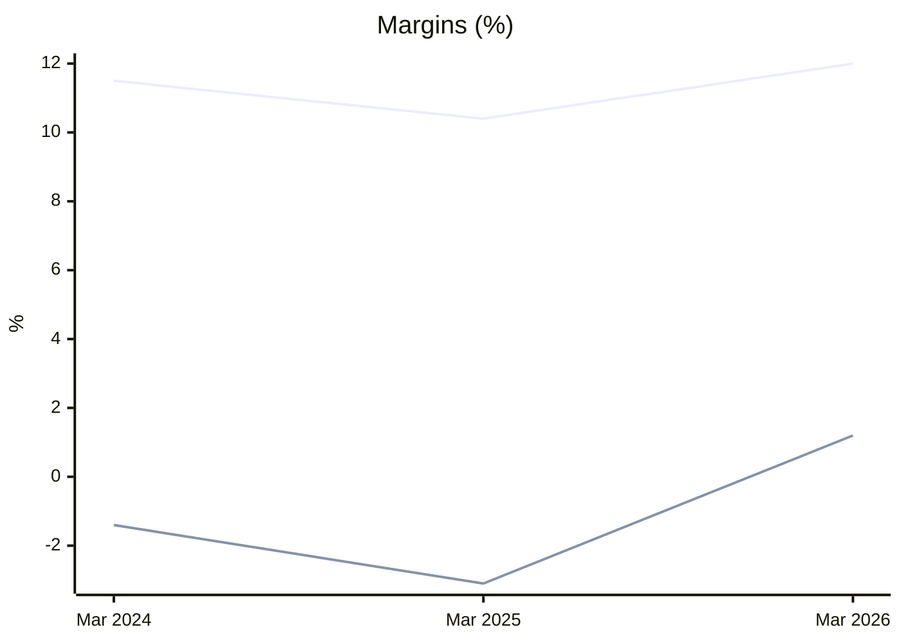

*Run 2026-11-24 · part of [SPINOFF_REPORT.md](../SPINOFF_REPORT.md) · the complete analysis of one company, with every management-call exchange in full.*

## STLTECH — Sterlite Technologies Ltd.

### 1. Sterlite Technologies Ltd. — CONFIRMED DEMERGER

**CONFIRMED** (a demerger scheme is on the exchange record) · **LISTED 1–2Y — the second-year window** · score 2.9/10 · spin-off · 2 filing(s) from NSE, NSE-register · first 2025-04-24, latest 2026-08-21

**The separated entities — every one the documents name:**

| Entity | Scheme | Business | Listing | Who runs it |
|---|---|---|---|---|
| **STL Networks Limited** | 2023 demerger of the Global Services Business into STL Netw… | Global Services Business: system integration telecom network solutions and laying/developing private network … | listed 2025-09-04 as STLNETWORK (NSE) | Mr. Pankaj Malik, CEO of STL Networks |

**What is being separated, as the documents put it:** STL's Global Services Business (system integration / services arm), demerged out of Sterlite Technologies into a separate company — class `unrelated`.

### 2. Stages and dates

> **Listing:** LISTED — STL Networks Limited (STLNETWORK) since 2025-09-04 (NSE equity list); record date 2025-04-24

| Date | Event | Source |
|---|---|---|
| 2023-04-01 | Appointed date | as stated: NCLT order dated February 14, 2025 ("The Appointed Date is fixed as 0… |
| 2023-05-17 | Board approval — Sterlite Technologies Limited and STL Networks Limited | as stated: NCLT order dated February 14, 2025 ("approved the Scheme in their res… |
| 2023-09 | Exchange no-objection | as stated: Q4 & FY25 earnings presentation, May 16, 2025 ("Stock Exchange Filing… |
| 2024-04-17 | Other | as stated: NCLT order dated February 14, 2025 — NCLT order in C.A.(CAA)/24/MB/20… |
| 2024-07-10 | Shareholders / creditors meeting — Sterlite Technologies Limited | as stated: Press release dated July 12, 2024 ("At the National Company Law Tribu… |
| 2024-12-03 | Other | as stated: NCLT order dated February 14, 2025 — Report of the Regional Director … |
| 2025-02-14 | NCLT order | as stated: Filing dated February 19, 2025 — NCLT, Mumbai Bench order C.P.(CAA)/1… |
| 2025-02-19 | Stage reached: **nclt sanction** | [Action(s) initiated or orders passed](https://nsearchives.nseindia.in/corporate/STLTECH_19022025170318_SEIntimationNCLTorder_signed.pdf) |
| 2025-03-31 | Other | as stated: Filing dated March 31, 2025 — "the certified copy of the said Order h… |
| 2025-03-31 | Effective date | as stated: Filing dated April 10, 2025 ("the Scheme is effective from the close … |
| 2025-04-24 | **Record date** | NSE corporate-actions register |
| 2025-04-24 | Stage reached: **record date** | Record Date (corporate-actions register) |
| 2025-04-24 | Record date — STL Networks Limited | as stated: Filing dated April 10, 2025 ("Thursday, April 24, 2025, has been fixe… |
| 2025-09-04 | **STL Networks Limited** listed (STLNETWORK) | NSE equity list |
| 2025-09-04 | Listing and trading — STL Networks Limited | as stated: NSE equity list (exchange record); the Q4 & FY25 earnings presentatio… |

**The stages, as filed:** nclt sanction (2025-02-19) → record date (2025-04-24)

**Stated in the filings:** record date 2025-04-24.

**When it lists, in the documents' words:** No listing date stated; the August 21, 2026 filing says the demerger was "effective from the close of business hours on March 31, 2025" under the NCLT Mumbai order dated February 14, 2025, and that STL Networks Limited "has filed a requisite disclosure ... on BSE Limited and National Stock Exchange of India Limited on August 20, 2026"

### 3. Size of the separated business beside the parent — is institutional selling likely?

**Reading: POSSIBLE — the piece is a sizeable minority of the whole; forced selling on size alone is weaker.**

| Entity | Stated turnover | Stated share of the whole | Segment revenue share | Market cap (₹ cr) | Share of combined market cap | Index member |
|---|---|---:|---:|---:|---:|---|
| STL Networks Limited | "Revenue From Operations" STL Networks (Resulting Co) Post … | — | 35.7% (FY2024) | 2,226 | 5.7% | no |

*Stated figures are the documents' own (a turnover share, or the cost-of-acquisition split the company publishes for tax, which reflects relative value); the segment share is this business's revenue over the parent's sales, and the market-cap share is the entity's value over the entity plus the parent (parent ₹36,537 cr, NSE bhavcopy of 2026-11-13), both computed here.*

**In the documents' words:** “Annexure P2 - Consolidated balance sheet as on March 31, 2023 (all figures are in INR crores): "Revenue From Operations" STL (Demerged Co) Pre Demerger 7,020 / STL (Demerged Co) Post Demerger 5,403 / STL Networks (Resulting Co) Post Demerger 1,617; "PAT" 127 / 107 / 19; "Total Assets" 8,864 / 5,830 / 3,034; "Total Equity" 2,095 / 972 / 1,123. Apportionment of cost of acquisition of equity shares consequent upon demerger: "1. Sterlite Technologies Limited 42.23" and "2. STL Networks Limited 57.77" (% of Cost of Acquisition of Equity Shares).”

**The judge's read of selling pressure:** unclear — Documents give no size, shareholding, index or float details for STL Networks Limited

### 4. Insider ownership — share swap, promoters' holding, management incentives

**Share swap / entitlement, entity by entity:**

- **STL Networks Limited:** "1 (one) fully paid-up equity shares of Rs. 2 (Two Rupees Only) each of the Resulting Company for every 1 (one) fully paid-up equity shares of Rs. 2 (Two Rupees Only) each held in the Demerged Company"

**Promoters' holding, from the shareholding pattern:**

| Company | Promoters | FIIs | DIIs | Public | Quarter |
|---|---:|---:|---:|---:|---|
| Sterlite Technologies Ltd. (STLTECH) | 42.29% | 17.76% | 13.73% | 26.21% | Sep 2026 |
| STL Networks Limited (STLNETWORK) | 44.12% | 0.98% | 2.53% | 52.37% | Sep 2026 |

*Source: screener.in shareholding pattern, stored under `ShareholdingPattern/NiftyTotalMarket/`. In a mirror demerger each shareholder holds the same proportion of the new company as of the parent on the record date.*

- **Promoters in the parent, per the documents:** "Pursuant to the QIP issue promoter's shareholding in the Company has been reduced from 53.98% to 44.18%." (disclosed in the audited financial results for the year ended March 31, 2025, filed May 16, 2025); no promoter and promoter group holding percentage as of any specific date is otherwise stated.
- **What the promoters will hold in the separated entity:** Mirror shareholding, stated as: "Further, pursuant to the Scheme, the shareholders of the Company on the record date have been issued equity shares of STL Networks Limited in the same proportion as their holding in The Company." and "Pursuant to the Scheme, all the shareholders of Demerged Company will get new shares in the Resulting Company, in the ratio of 1:1 i.e. 1 share of the Resulting Company for 1 share held in the Demerged Company, and there would be no change in the economic interest for any shareholder of Demerged Company pre and post Scheme in the Demerged Undertaking." The specific promoter percentage in STL Networks Limited is not stated.
- **What a public shareholder receives:** "1 (one) fully paid-up equity shares of Rs. 2 (Two Rupees Only) each of the Resulting Company for every 1 (one) fully paid-up equity shares of Rs. 2 (Two Rupees Only) each held in the Demerged Company", issued to shareholders "whose names were recorded in the register of members and / or records of the depository as on the Record Date (i.e. April 24, 2025)"; "with shareholders receiving 1:1 share entitlement based on holdings as of April 24, 2025"; shares "shall be issued in dematerialised form"; and "the demerger is tax neutral in the hands of shareholders of the Demerged Company under the IT Act in view of the exemption granted under Section 47(vid) of the IT Act."
- **Management incentives:** not stated in the documents on file.
- **Insider actions around the separation:** No promoter or management buying, selling or pledging around the separation is stated. The documents state only dilution through capital raising: "During the year ended March 31, 2025, the Company has issued 88,456,435 equity shares of face value 2 each at an issue price of INR 113.05 per equity share pursuant to Qualified Institutions Placement (QIP)... Pursuant to the QIP issue promoter's shareholding in the Company has been reduced from 53.98% to 44.18%. The management does not expect any material impact on account of the change in the promoter's shareholding." A later raise is reported on the Q1 FY27 call (July 24, 2026): "STL successfully completed a landmark QIP of INR 1,500 crores... strengthening our institutional holdings to a fresh historic high of 33%."
- **Insiders, per the checklist read:** Not stated for STL Networks. In the parent, promoter Twin Star Overseas Limited held 42.90%, rising to 47.75% fully diluted on exercise of 4,53,00,000 warrants at Rs.110; ultimate beneficial owner Mr. Anil Agarwal · *option pricing date:* not stated

### 5. Why the demerger — point by point

The business being separated is STL's Global Services (system integration / network-deployment) business, demerged out of Sterlite Technologies Limited (STLTECH) into a separate listed entity, STL Networks Limited, rebranded 'Invenia', leaving STL as a pure optical business (optical fibre, fibre cable, specialty cable, optical connectivity) plus the small STL Digital IT-services arm. Management's stated reason was portfolio simplification and focus: Ankit Agarwal said on the May 2025 call that the demerger 'aligns with our goal of portfolio simplification and sets the stage for focused growth in each of the businesses,' and in Jul 2026 placed it in a multi-year clean-up in which STL exited, sold or shut down wireless solutions, OSS/BSS, active components and other businesses to be 'very, very focused on the optical fiber cable connectivity side.' The second reason was capital and working-capital drag: the services business was a project business with large net fund involvement, and on the Jan 2025 call management's stated priority for it was 'select projects intake to improve the profitability and optimize the net fund involvement,' with Tushar Shroff conceding receivables and contract assets in state-government projects like T-Fiber and MahaNet were liquidating slower than planned because they depended on state budgetary allocation. The scale difference management cited: Global Services did INR 289 crores of revenue in Q3 FY25 at only INR 20 crores EBITDA (6.8% margin), versus the optical business at INR 924 crores and INR 119 crores (12.9%); consolidated net debt was INR 2,195 crores at Q3 FY25 and the retained (post-demerger) business reported net debt of about INR 1,350 crores at Q4 FY25, with a stated target of taking net debt/EBITDA from ~3x to 2x. Structurally, management wanted a clean break rather than a carve-out on paper: in Nov 2025 Ajay Jhanjhari said 'the entire thought process of doing demerger is that there should not be any intercompany guarantees because that is a separate company,' and 'No relationship between STL and STL networks from that perspective.' The INR 2,600 crore BharatNet Phase III Jammu & Kashmir package (3-year build plus 10-year maintenance) went with the demerged entity, and STL now supplies cable to it on an arm's-length basis — in Jan 2026 described as 'our group company, Invenia has secured Jammu Kashmir package, where we will be supplying the cable on arm's length basis.' Each entity also got its own leadership and identity: Pankaj Malik as CEO of STL Networks under the Invenia brand, with shareholders receiving a 1:1 share entitlement on holdings as of April 24, 2025. Across the calls, no investor, lender or partner is named as having demanded the separation; the only shareholder pressure visible is generic complaints about poor equity returns and past cash burn (Q4 FY25 and Q1 FY26 calls), which management answered by pointing to the business exits, the ~INR 1,000 crore QIP of April 2024, and the demerger as portfolio simplification.

**Point by point, with the source:**

1. Completing the demerger of the services business was listed as a formal FY26 strategic priority alongside building value-added services and cutting fund involvement in that business. “Concurrently we will work towards completing the demerger of the services business.” — *[Jan 2025](https://www.bseindia.com/stockinfo/AnnPdfOpen.aspx?Pname=98f6b077-32ee-41f8-b96d-a36366cf2a48.pdf)*
2. CFO Tushar Shroff gave the regulatory timeline — scheme approved by shareholders and creditors on July 10, 2024, petition admitted with NCLT in October 2024, final hearing January 30, 2025 — with listing of the resulting company to follow, and a target of completing the demerger by Q1 FY26. “The final approval is expected in Q4 FY25 after which resulting company is anticipated to be listed on a stock exchanges.” — *[Jan 2025](https://www.bseindia.com/stockinfo/AnnPdfOpen.aspx?Pname=98f6b077-32ee-41f8-b96d-a36366cf2a48.pdf)*
3. The services business was explicitly managed for lower capital absorption, not scale: Q3 FY25 revenue of INR 289 crores produced only INR 20 crores EBITDA (6.8%), and receivables/contract assets in state projects (T-Fiber, MahaNet) were stuck pending state budgetary allocation. “We will continue to build our capability towards value added services and system integration to improve our margins and reduce the fund involvement going forward.” — *[Jan 2025](https://www.bseindia.com/stockinfo/AnnPdfOpen.aspx?Pname=98f6b077-32ee-41f8-b96d-a36366cf2a48.pdf)*
4. Ankit Agarwal announced completion effective March 31, 2025, with the demerged Global Services business operating as STL Networks under the new Invenia brand, Pankaj Malik as CEO, and a 1:1 share entitlement to STL shareholders based on holdings as of April 24, 2025. “This move aligns with our goal of portfolio simplification and sets the stage for focused growth in each of the businesses.” — *[May 2025](https://www.bseindia.com/stockinfo/AnnPdfOpen.aspx?Pname=3a33a16d-778d-4047-8e61-79e95df6983b.pdf)*
5. The separation was framed as the last step of a multi-year pruning of the portfolio, after exiting wireless solutions and OSS/BSS, and alongside a ~INR 1,000 crore QIP to repair the balance sheet; the INR 2,600 crore BharatNet J&K package (deployment plus 10 years' maintenance) sat in the demerged entity, not in STL's reported order book. “This is part of the services business, which is now demerged.” — *[May 2025](https://www.bseindia.com/stockinfo/AnnPdfOpen.aspx?Pname=3a33a16d-778d-4047-8e61-79e95df6983b.pdf)*
6. CFO confirmed NCLT final approval was received in February 2025 and that STL Networks was a separate legal entity from March 31, 2025, with share listing still pending regulatory approvals and expected by end-August 2025 (versus the earlier Q1 FY26 / June target). “As of March 31, 2025, STL Networks Limited is now a separate legal entity.” — *[Jul 2025](https://www.bseindia.com/stockinfo/AnnPdfOpen.aspx?Pname=8111472f-4f00-4159-9e5a-70f93bf1b0d8.pdf)*
7. Asked about intercompany loans, advances or guarantees with STL Networks, management said the purpose of the demerger was precisely to have none, while conceding the operational transfer takes about a year to complete. “So, STL networks, the entire thought process of doing demerger is that there should not be any intercompany guarantees because that is a separate company.” — *[Nov 2025](https://www.bseindia.com/stockinfo/AnnPdfOpen.aspx?Pname=6103688c-1b5b-4922-b304-d2d348f60fea.pdf)*
8. The post-separation relationship is purely commercial: STL supplies optical fibre cable to Invenia's BharatNet Phase III Jammu & Kashmir package on an arm's-length basis, and also holds Manufacturing Authorization Forms with other BharatNet bidders. “And as you know, our group company, Invenia has secured Jammu Kashmir package, where we will be supplying the cable on arm's length basis.” — *[Jan 2026](https://www.bseindia.com/stockinfo/AnnPdfOpen.aspx?Pname=e0a51053-117e-457b-90f3-4487eed18370.pdf)*
9. A year later Ankit cited the demerger, alongside exits from active components and other businesses, as proof of a deliberate narrowing to glass-fibre-cable-connectivity, and ruled out adjacent areas like transceivers and semiconductors. “We've consciously chosen to exit, sell off or shut down many businesses. So -- and we've also demerged our system integration business into a separate entity.” — *[Jul 2026](https://www.bseindia.com/stockinfo/AnnPdfOpen.aspx?Pname=8a08fac5-bc05-4f79-acee-f6a5076525cd.pdf)*
10. The Aug 2026 filing records the legal mechanics: the Scheme of Arrangement was approved by NCLT Mumbai by order dated February 14, 2025, and the Global Services Business demerged into STL Networks Limited from the close of business hours on March 31, 2025, with litigation outcomes of that business (e.g. the Kakinada Smart City writ petition) now accruing to STL Networks. “Please note that pursuant to the Scheme of Arrangement approved by the Hon'ble National Company Law Tribunal, Mumbai, vide order dated February 14, 2025, STL's Global Services Business has been demerged into STL Networks Limited, effective from the close of business hours on March 31, 2025.” — *Scheme*

**How it evolved:** The idea is already in execution by the Jan 23, 2025 call, where it appears as a standing FY26 priority ('work towards completing the demerger of the services business') with the NCLT timeline laid out — scheme approved by shareholders and creditors July 10, 2024, petition admitted October 2024, final hearing January 30, 2025, listing targeted by Q1 FY26. On the May 16, 2025 call Ankit Agarwal declared it done, effective March 31, 2025, named the new entity STL Networks, the new brand Invenia, Pankaj Malik as CEO and the 1:1 share entitlement, and reported the retained business separately at INR 1,350 crores net debt. By Jul 25, 2025 the plan had slipped only on listing (NCLT approval received Feb 2025, shares expected to list 'by the end of August'), and by Nov 6, 2025 the emphasis shifted to completing the operational separation — no intercompany guarantees, a roughly year-long transition to transfer everything. Thereafter it is treated as finished history: Jan 23, 2026 references Invenia only as a BharatNet customer served at arm's length, and Jul 24, 2026 cites 'we've also demerged our system integration business into a separate entity' purely as evidence of focus.

**What management expects from it:** Focused growth in each entity: STL becomes a pure optical manufacturer chasing global top-3, 70-80% utilisation and 20% EBITDA versus ~13-14%, with net debt/EBITDA cut from ~3x to 2x (net debt INR 1,350 crores post-demerger versus INR 2,195 crores consolidated), no intercompany guarantees, and less capital tied up in project/working-capital-heavy services. Invenia gets its own brand, CEO and large-project mandate.

*Not explained on the calls:* No standalone Invenia financials, valuation, debt split, separation costs, or capital allocation given; no investor, lender or partner named as requesting it; listing-date slippage unexplained.

- *Stated reason, in one line:* Not stated in the scheme filing; on the Jul 2026 call management said it had "consciously chosen to exit, sell off or shut down many businesses" and demerged system integration to be "very, very focused on the optical fibre cable connectivity side"
- *What it reveals:* Leaves a pure-play optical parent: Q2 FY27 record revenue INR 2,529 Cr, EBITDA INR 846 Cr, PAT INR 517 Cr, order book INR 35,274 Cr, net debt-free, CRISIL AA/Stable. Any Kakinada writ contingent gain now belongs to STL Networks, not STL
- *Parent or spin:* parent · *Read next:* STL Networks Limited's own August 20, 2026 exchange disclosure and its standalone financials
- *In their words:* “Please note that pursuant to the Scheme of Arrangement approved by the Hon'ble National Company Law Tribunal, Mumbai, vide order dated February 14, 2025, STL's Global Services Business has been demerged into STL Networks Limited, effective from the close of business hours on March 31, 2025.”

### 6. On the calls, verbatim

12 call(s), oldest first: **5 question-and-answer exchange(s)** given in full — the question and every answer to it, nothing trimmed — and 39 passage(s) from management's prepared remarks (the complete sentences about it; the whole remarks are in the linked transcript). Text is as the transcript prints it.

#### Nov 2023 — [transcript](https://www.bseindia.com/stockinfo/AnnPdfOpen.aspx?Pname=ada3a160-f761-4b79-bd64-2b5f16f5d072.pdf)

**From the prepared remarks** *(the passage about it; the whole turn runs to 7,712 characters in the transcript)*

> **Ankit Agarwal:** The near-term downturn in North America is on account of inventory correction and is expected to correct in Q1 or Q2 of 202 4 calendar year. Service providers are already in t he process of participating in various government funded opportunities including the US$42.5 billion BEAD program. ST L’s focus markets of North America, Europe and India are high potential and is estimated to grow at a CAGR between 2023 -2028 of 10.1% , 4.7% and 9.5% respectively. This is something we wanted to share with all of you in terms of how the networks are evolving and the new way in which operators are looking at carpet coverage of fiber. Telcos on a global scale are prime d for substantial expansion of the 5 G subscriber base. Moreover, we now see 6 G technologies starting to create more and more noise in the market and it will be at the forefront by 2028 . From being linear with limited applications as you can see on t he left -k hand side of slide 8, fiber has now become denser and all pervasive .

**From the prepared remarks** *(the passage about it; the whole turn runs to 3,408 characters in the transcript)*

> **Tushar Shroff:** Open order book highlights , our open order book at the end of Q2 FY24 is Rs. 10,516 crores . Our order book is well diversified across our customer segments and across all our businesses . The financial abridged version is placed before you , the main highlight of the financial is with respect to the net debt of FY24 for 6 month period has reduced by Rs.111 crores from FY23 . We expect to complete the demerger of Global Service business by Q1 FY25. The curr ent demerger status is that we have recently received the NOC from both the stock exchanges for the demerger scheme and we will be filing the application with NCL T shortly. In summary, I would like to state that in optical network business we sha ll target to gain market share across our focus market particularly in India , EMEA, APAC markets to fill the volume gap from US markets . Ramp up of US plant to capitalize on demand surge in North America going forward that is 24-25 onwards . Increase in optical connectivity to drive the growth and the attach rate.

**From the prepared remarks** *(the passage about it; the whole turn runs to 141 characters in the transcript)*

> **Aditya Zaveri:** Okay, the next question is regarding the demerger. I had one question , how will be the debt restructure d there . Can you throw some light ?

#### Mar 2024 — [transcript](https://www.bseindia.com/stockinfo/AnnPdfOpen.aspx?Pname=a5000d23-d4f3-41f2-ac2e-af2d6ab05dd4.pdf)

**From the prepared remarks** *(the passage about it; the whole turn runs to 10,150 characters in the transcript)*

> **Ankit Agarwal:** While the near-term demand contraction, the medium -term demand volumes are revised upwards to 684million fiber kilometers by 2028, up from 577 million fiber kilometers in 2022. The global demand ex -China is expected to increase to 417 million fiber kilometers by 2028, up Page 3 of 15 from 293 million fiber kilometers in 2022. S TL focused markets of North America, Europe and India are high potential and estimated to grow at CAGR of 11.4 percent, 5.2% and 15.6% respectively during the period from 2023 to 2028. This is an imp ortant slide which shows how the global data consumption across traffic categories is expected to rise multi fold in coming years and there's simply no alternative than to expand fiber networks to support such massive traffic expansion. Be It network param eters such as bandwidth offered , latency, data loss or energy savings, and in fact even environmental friendliness and reliability , fiber is undoubtedly the most efficient and reliable data transfer technolog y. This is recognized and echoed by various industry experts and CEO's . We have shared examples of comments by the Airtel CEO, by Ericsson CEO and also Elon Musk talking about SpaceX and the comparison with terrestrial cellular networks. With the growing use of fiber in various applications, such as fib er to the home, AI in data centers, edge data centers, smart cities, small cells, and the smart enterprises, fiber demand is bound to increase manifold going forward. Coming to North America, there are certain strong d rivers which we believe will lead to sustained growth for the market. In North America, as per Om dia, the 5G subscriptions are forecasted to grow significantly from 173million currently to almost 600 million . 5G is expected to become the most dominant mobile access technology by 2028.

**From the prepared remarks** *(the passage about it; the whole turn runs to 3,512 characters in the transcript)*

> **Tushar Shroff:** Our order book at the end of Q3 FY24 is at 9, 849 crores . Our order book is well diversified across all our customer segments and our businesses. We have placed the abridged version of the reported numbers for your perusal, our net debt for 9M FY24 has reduced by rupees 174 crore from FY23. On Global Services, the business demerger status, we have filed the application with NCLT and awaiting the first hearing from NCLT which is expected to get scheduled somewhere in the month of February. In summary, I would like to say that in optical netw ork business, we will target to drive the cost leadership and pursue our ambition to be global top three. Increase the sales in EMEA, India and APAC market to fill short term volume gaps. Increase optical connectivity growth and attach rate.

**From the prepared remarks** *(the passage about it; the whole turn runs to 379 characters in the transcript)*

> **Sohan Joshi:** And when can we expect the right issue? W ill it be after demerger, or we may further delay it when the demand starts picking up ? Page 10 of 15 Tushar Shroff : We are exploring the various fundraise options at this point in time. A t an appropriate time when we see a larger engagement of investors , that is a point in time we will get into the market and launch the fundraise.

**From the prepared remarks** *(the passage about it; the whole turn runs to 2,542 characters in the transcript)*

> **Saket:** There are multiple bandwidth issues, latency issues, uplink downlink issues with fixed wireless and we don't see that as a threat . Anyways, up to the last 100 meters, you would need a very, very large and intensive fiber backbone. So from our business perspective, we don't see it as a threat to fiber demand. In fact, overall Connectoriza tion is a positive for us because it will mean more dense networks , both on long distance and ultimately within the metros. So we see this as a as a positive development and overall in terms of connectivity, as we shared in one of our slides as well, fiber continues to be the best medium by far compared to copper , compared to satellite , compared to fixed wireless and that gives us a lot of positivity and bullishness in terms of demand for fiber Page 13 of 15 going forward.

**From the prepared remarks** *(the passage about it; the whole turn runs to 335 characters in the transcript)*

> **Ankit Agarwal:** That is a number we have quoted from the research reports, but certainly we have seen that there continues to be investments in fiber networks by the telecom operators in India. On top of that, we will have Bharat Net networks getting deployed at large scale . So we continue to be quite bullish on fiber demand in India going forward.

#### May 2024 — [transcript](https://www.bseindia.com/stockinfo/AnnPdfOpen.aspx?Pname=ab8a5353-690d-44b9-9a2c-85e662c1313e.pdf)

**From the prepared remarks** *(the passage about it; the whole turn runs to 13,341 characters in the transcript)*

> **Ankit Agarwal:** On optical networking business , we shall continue to grow the optical business by increasing OFC market share and connectivity attach rate. We shall continue our efforts to drive our cost leadership in the optical business. On the Global Services business , we shall continue to build new capabilities and value added services. We will st ay focused on improving project mix to improve profitability and we will work towards successful demerger of our services business. Lastly, on STL digital business we shall continue to scale business t hrough focus ed investments in building new technologies capabilities and focus on profitable growth. Sterlite endeavors to be a responsible leader and ensuring a connected and inclusive world. This focus reflects in the way we have designed and implemented our ESG agenda . […] No wonder various industry reports suggesting 2/3rd of network traffic sh all involve AI by 2030 , for this high growth of AI and technology users who sustain and succeed the technology backbone shall need massive data center capacities with fiber rich interconnections that smoothly manage the data explosion. It is estimated that the fiber demand and AI data centers maybe 5x to 8x higher than normal data centers. To access these AI data centers and applications at the front end users shall need reliable connectivity through FT Tx or 5G or future generation like 6 G but fiber again shall be at the core of the connectivity. As we digest this further our belie f get stronger every day that denser fiber networks will be necessity for the success of the futuristic AI led digital society. Apart from A I, there are of course three other key t hemes that are playing out globally on the optical connectivity product demand mainly the global investment in 5 G network creation, FTT H deployments and new age data center buildouts. These demand drivers are expected to bring significant growth investments in the foreseeable future. 5 G is one of the fastest growing technologies in the world and tower fiberiz ation is at the core of 5 G. 5G subscribers are to grow at a very fast pace in the next few years and as we can see 5 G subscriber s in all key regions such as North America, Western Europe and India are expected to clock a CAGR of more than 30% for the next five years, with high tower fiberiz ation required for 5 G. Clearly 5 G global expansion should continue to drive demand for more optical fiber. […] Favorable project mix and effective execution resulted in improved full year FY24 EBITDA to Rs.110 crores and EBIT DA margins for FY24 to 7.6%. We continue to build our capability towards value added services to improve margin profile and reduce fund involvement . We made substantial progress on all the projects and as you can see on our slide among the major India public projects include our BharatNet project in the state of Telangana is now 68% c omplete including all the packages. The network modernization project is 74% complete the data center project with the PSU standard 88% complete and on the India private side fiber rollout for a large telecom operator phase t wo is 55% complete and fiber rollout for modern optical networks for other private customer is 94% complete. Coming to STL digital, we are continuing the growth momentum. We're continuously working with new customers for growing our business in US , Europe and India across technology and services verticals as observed during strong order flow during FY24. With more than 25 global customers at the end of Q4 FY24 we have 40 plus active technology partnerships.

**From the prepared remarks** *(the passage about it; the whole turn runs to 2,646 characters in the transcript)*

> **Tushar Shroff:** Our order book is well diversified across our customer segments and all our businesses. We now place abridged version of our reported numbers for your perusal. The net debt has reduced by Rs.334 crores during the financial year. Now let us understand the current status of the demerger of the service business . During the quarter , the first NCL T hearing was conducted in April 2024 NCL T has directed us to convene the meeting of the shareholders secured and unsecured creditors to approve the scheme of de merger and we are working on next steps in the approval process. In summary, I would like to say that in the optical network business we shall target to drive the cost leadership and pursue our ambition to be a global top three. We shall increase the sales of our focus market to grow our optical network business.

**From the prepared remarks** *(the passage about it; the whole turn runs to 1,687 characters in the transcript)*

> **Ashish Chopra:** And just the last couple of questions from my side , one was on the order booking how was it from the US in this quarter in terms of contribution , did you already see a pickup there. And lastly on the data center business how much would be our exposure and do you think that you need to build separate capabilities u nder acquisitions to be a significant player in that market. Page 13 of 17 Ankit Agarwal: So, I wou ld say we have normalized demand from US and probably some good long term orders particularly from Europe market, some from India market as well. T ypically , our customers in Europe and US would look at 2 -3 years contracts. So, as it depends on where some o f those opportunities come up. So that's where we see that and also from distributors those was opportunities will continue to start coming in including in Q1, Q2, etc. for the US . On the data center part I think, definitely, as we shared in our slides it's quite exciting and I think there is more and more of an understanding for the industry and ourselves that clearly these kinds of Gen AI enabling data centers will have fairly dense kind of fiber networks within them. Much more fibers required per rack, and it could be the magnitude of 5 - 6x or even more. So , we are trying to understand that more and we are trying to understand what is our own product portfolio required, literally starting from glass fiber, cable and even connectivity, and certainly we would look to increase our own capability and team to cater to this market . But this is something which will take little bit more time probably over the next 2 -3 years. We will look to build this and make more of a presence in this market.

#### Aug 2024 — [transcript](https://www.bseindia.com/stockinfo/AnnPdfOpen.aspx?Pname=fb5088c5-7916-4e9a-97b1-03812320978e.pdf)

**From the prepared remarks** *(the passage about it; the whole turn runs to 16,219 characters in the transcript)*

> **Ankit Agarwal:** We will focus on rapidly building data centers suite of products to tap the huge potential in that space. We shall continue to also drive our technology and cost leadership in the optical business . On the G lobal Services business we shall continue to buil d new capabilities for value added services. We shall stay focused on improving project mix to improve profitability, and we will work towards completing the demerger of our services business. Lastly, in our STL digital business, we shall continue to scale the business to conscious investments in building new technology and domain capabilities while we keep our focus on maintaining our profitability . STL has always endeavored to be a responsible leader and ensuring a connected and inclusive wor ld. Through our various initiatives in education, women empowerment and health care, we have positively impacted millions of lives since FY19.

**From the prepared remarks** *(the passage about it; the whole turn runs to 2,876 characters in the transcript)*

> **Tushar Shroff:** Our order book is well diversified across our customer segments and all of our businesses . We place before you an abridged version of reported numbers for your perusal. We are happy to share that the net debt has reduced by Rs. 769 crores from FY24. With reference to global service demerger , we are progress ing as planned on process of demerger . During the NCLT convened meeting on 10th July 202 4 the scheme of demerger received 99.98% approval from the equity shareholders and 100% approval from the secured and unsecured creditors. The final NCLT approval are expected in indicative timeline of next three to four months and the resulting company is expected to get listed by the year end. In summary, we have clear focus areas identified to drive business forward . In optical network business we shall target to drive the technology and cost leadership and p ursue our ambition to be a global top three. We will increase the sales in our focused market to grow our optical network business and fill the volume gap.

**From the prepared remarks** *(the passage about it; the whole turn runs to 180 characters in the transcript)*

> **Advait:** Sir congrats on a robust set of numbers. Just want to know how do you plan to structure your costs and is it across businesses and is the demerger a part of the cost restructuring.

#### Nov 2024 — [transcript](https://www.bseindia.com/stockinfo/AnnPdfOpen.aspx?Pname=46ac8e7e-9211-4d2f-beb8-498619b060ec.pdf)

**From the prepared remarks** *(the passage about it; the whole turn runs to 14,255 characters in the transcript)*

> **Ankit Agarwal:** On the optical networking business, we shall continue to driving growth by increasing optical fiber cable market share, as well as our connectivity attach rate. To achieve ambition of delivering significant revenue through data center and enterprise segments, we will focus on rapidly building data center suite of products to tap the huge potential in that area. We should also continue to focus on driving our technology and cost leadership in optical business. On our global services business, we shall continue to build new capabilities for value added services, while we stay focused on improving project mix and improving our profitability, we will also work towards completing the demerger of our Services business. Lastly, on our STL digital business, we shall continue to scale the business through conscious investments and building new technology on the main capabilities while keeping our focus on achieving profitability intact. STL has always endeavored to be a responsible leader in ensuring a connected and inclusive world. Through our various initiatives in education, women empowerment and healthcare, we have positively impacted millions of lives since FY2019.

**From the prepared remarks** *(the passage about it; the whole turn runs to 3,520 characters in the transcript)*

> **Tushar Shroff:** And our order book is well diversified across the customer segment and all our businesses. We place the abridged versions of our reported numbers for your perusal. The net debt of the business stands at Rs.2,169 crores. Let us go through the updates and the status on our global service demerger. We are progressing steadily on a demerger process. The shareholders and creditors of STL India have approved the scheme of arrangement in a meeting dated 10 July 2024 basis the approval, demerger petition has been filed with the NCLT, and the hearing was conducted on 11th October 2024 with NCLT. We are awaiting the order from this particular hearing from NCLT. The date for the final petition is pending with NCLT Mumbai bench, the final NCLT order is expected in an indicative timeline of next 3-4 months that is Q3, Q4 of FY25 and resulting companies can be expect to get listed on stock exchanges. However, we remain dependent on NCLT progressing on the hearing Page 8 of 18 of our matter. In summary, our focus areas for our business are clearly identified as in optical network business we shall target to drive the technology and cost leadership and pursue our ambition to be a global top three. We will increase the sales in our focus market to grow our optical network business and fill the volume gap.

**From the prepared remarks** *(the passage about it; the whole turn runs to 789 characters in the transcript)*

> **Sunny Gosar:** Got it, that is helpful. And one last question before I join back the queue. It's related to the debt level. So post the fundraise, in the first half, we have been able to bring down the deb t by about Rs.600 crores at a net debt level. So, there are two questions in this. One is when the demerger of the service business happens, I understand the capital employed in the service business, which is your segment assets minus segment liabilities is about Rs.1650 crores. So, at the time of demerger, what is the likely debt that could move with that demerged entity? And second question is, apart from the operating cash flow generated are there any further levers in terms of any non-core assets, or any sticky receivables, which can come back in terms of accelerating the debt repayment.

**From the prepared remarks** *(the passage about it; the whole turn runs to 2,211 characters in the transcript)*

> **Tushar Shroff:** So that's the topmost priority for us. Of the total capital Page 13 of 18 employed that you talk about, of service business, as of September we were expecting the net debt to be in the range of Rs.550-600 crores that is what based on the current capital employed. That is something that we are looking at and which will get transferred to the service business. So, these are the things and levers that we have been working on so that we have been able to generate cash and structurally, because this particular demerger is tax neutral process and from a tax neutral process perspective, we need to allocate debt in a certain proportion, in a certain way, in a certain manner, which has been prescribed under the Income Tax Act. So whatever the cash get generated till the time of demerger will help both the businesses in terms of improving the balance sheet of the respective business. So, our all focus and the entire commitment from the management team is to liquidate the working capital that we have blocked in the service business.

**From the prepared remarks** *(the passage about it; the whole turn runs to 459 characters in the transcript)*

> **Tushar Shroff:** So, yes in Q2, we have incurred one of the expenditures for the necessary approval that we have received from the bank for a demerger and the expenses or charges from the bank for giving the NOC that we have received, those are one of the charges. I would say the interest cost should be in the range of Rs.75-80 crores is something that we have been working on, saying that it should not go beyond Rs.75-80 crores in terms of a run rate of the interest cost.

**From the prepared remarks** *(the passage about it; the whole turn runs to 959 characters in the transcript)*

> **Ankit Agarwal:** So, as you know that the two large projects that we have been talking about, if we are even able to liquidate at least 50% of that in a next two quarters, substantially we should be able to reduce our interest costs, and that is what we are driving. What I have said is that with respect to the kind of interest cost that we are looking at or targeting is assuming, on a conservative basis, that probably whatever challenges that we have and because of any reason, we have not been able to liquidate then what will be the run rate Page 14 of 18 that we should be expecting, that is the plan. But having said, we are targeting to collect substantial part of the money in the next two quarters, having said that demerger is closure. So, structurally we are working to see that the benefit of reduction in a working capital and the reduction in our debt overall should help us in terms of bringing down the consolidated interest expenses for both the businesses.

#### Jan 2025 — [transcript](https://www.bseindia.com/stockinfo/AnnPdfOpen.aspx?Pname=98f6b077-32ee-41f8-b96d-a36366cf2a48.pdf)

**From the prepared remarks** *(the passage about it; the whole turn runs to 13,984 characters in the transcript)*

> **Ankit Agarwal:** Additionally, we will sustain our efforts to drive technology and cost leadership in the optical domain. On the Global Services business. We will build capabilities and value-added services while optimizing the project mix to boost profitability. Concurrently we will work towards completing the demerger of the services business. On STL digital, we aim to scale the business to strategic investments in new technology and domain capabilities, while maintaining a complete focus on the profitability. STL has always endeavored to be a responsible leader in ensuring we have a connected and inclusive world. Through our various initiatives in education, women empowerment and healthcare, we are very proud to share that we have positively impacted millions of lives since FY19. […] Featuring high density Celeste ribbon cables with IBR technology, advanced MPO panels, LC panels, patch panels and copper connectivity systems ensures high bandwidth, low latency as well as scalability. We are proud to report that 22% of this quarter's revenues came from our data center and enterprise Suite products. We have focused on driving rapid product development and significant revenue growth from AI data center and the enterprise ecosystem. Global Investments in 5G networks, FTTx deployments and cloud data centers continue to fuel strong demand for optical connectivity products. In Q2 FY24, capex amongst the top 10 telecom operators increased by 2.9% year on year, primarily driven by 5G fiber deployments and high-speed broadband expansion. Private players allocating substantial resources to enhance 5G infrastructure, achieving widespread 5G coverage. The number of global 5G operators has risen from 582 acr oss 173 countries in Q4 FY23 to more than 618 operators in 184 countries, and they expand the gigabit broadband access to both urban and rural areas. The growth is further supported by finalization of 5G advanced standards in June 2024 which is accelerating its adoption. FTTx deployments globally expected to grow by a CAGR of 7.1% from 2024 to 2029 with North America almost 14.6%, Middle East 11% and Eastern Europe almost 19% driving this expansion. North America is projected to become the largest FTTx market, with the US targeting 100% FTTx coverage by 2029, backed by government initiatives such as the BEAD program. In Europe, the transition to full fiber broadband is gaining momentum due to copper switch offs, with Portugal, Spain and Sweden leading the way, as per FTTH Council Europe, at least 14 countries in Europe are in different stages of transitioning from copper network to fiber networks, which would enable the demand for optical products in these countries. In India, telecom giants like Jio and Bharti aggressively pursuing 5G based fixed wireless and fiber to the home services, bundling broadband with pay TV offerings, Page 5 of 18 these programs could lock a significant 11-15 billion in annual revenue opportunity for them in India, underlining an immense potential or the fiber connectivity market in the region. Over the past three decades, we have developed deep technology expertise across the optical fiber value chain, offering a seamless glass to gigabit experience. Our advanced solutions include industry first innovations like India's first multi core fiber “Multiverse” and the ultra slim fibers with diameters of 180 and 160 microns, supported by robust 740 patent base.

**From the prepared remarks** *(the passage about it; the whole turn runs to 3,217 characters in the transcript)*

> **Tushar Shroff:** Based on our strong new order book addition during the last quarter, despite of the significant order de scoping, our open order book stands at Rs.9050 crores as of Q3 FY25. The order book is well diversified across the customer segment and business verticals. We have provided the abridged version of our reported numbers for your review; the net debt of the business stands at Rs.2195 crores. Let us now discuss the update and the status of global service demerger. We are making steady progress on the demerger process. The shareholders and creditors of STL India approved the scheme of arrangement in the meeting held on July 10, 2024. Following this, the demerger petition was filed admitted with NCLT during October 2024. The final hearing date is scheduled on January 30, 2025, with NCLT Mumbai bench. The final approval is expected in Q4 FY25 after which resulting company is anticipated to be listed on a stock exchanges. However, the progress remains contingent on NCLT scheduling and hearing. In summary, our focus areas for the business are clearly defined as, in optical networking business, we aim to drive the technology and cost leadership, with a goal of becoming one of the top global Top 3e. We will drive the sales in a focused market to expand our optical network business and close the volume gap. Our focus will remain on growing the optical connectivity business and increase the attach rate. Additionally, we will prioritize the rapid development of our data center product portfolio. In the global service business, we will continue to focus on the select projects intake to improve the profitability and optimize the net fund involvement. We also aim to complete the demerger by Q1 FY2026. In the STL digital, we will continue to scale the business and grow our revenue along with the focus profitability. With this, I now hand over the call back to Chetan.

**From the prepared remarks** *(the passage about it; the whole turn runs to 1,697 characters in the transcript)*

> **Tushar Shroff:** So Nikhil, as you are aware that for last couple of quarters, we have been working to ensure that our cost structure remains in our control. So, from that perspective, lot of efforts have gone on optical network business to set the cost structure right. So, as far as ONB business is concerned, these are sustainable in terms of profitability margin. With respect to service business, what we have seen is, in spite of lower revenue we have been able to more or less maintain the EBITDA margin that we have generated in last quarter. This is also on account of some kind of cost initiatives that we have gone ahead in that particular service business as well as we are expected to demerge this particular business to a separate entity in coming quarter. So from that perspective at STL level whatever the cost optimization efforts that we have been putting, which is yielding the results and in spite this quarter we have lower revenue we have been able to maintain the margin percentage as such. So that is something, I would say is on account of lot of other initiatives on a cost perspective. The digital business, more or less the way we have seen this particular business, we have a good long term order book which has happened in this particular quarter and the kind of the new orders that we have been executing are at the better margin as compared to Page 11 of 18 the earlier period. So, from that perspective, the overall margin from the existing contracts is much better as compared to the earlier period. So, the overall improvement in the project margin, the way we have been getting the new orders, is giving the positivity in terms of sustaining the margin for the digital business.

**From the prepared remarks** *(the passage about it; the whole turn runs to 950 characters in the transcript)*

> **Ankit Agarwal:** Rishikesh we actually don't give a guidance or forecast on annual basis. I can just share what we have been guiding is that as a business, particularly the optical business really, our vision is to make this a world Top 3 business. We have been talking about that from a growth perspective, in terms of, for example the optical connectivity business we have been talking about how we see a lot of potential in that, we want to scale up our attach rate between our cable and connectivity. We are in process of our services business demerger, and definitely continue to see lot of opportunity and pipeline to scale that up over the coming years. And of course, our focus is being ultimately to generate cash and reduce our debt thereby also reducing our interest costs on ongoing basis. So, these are some of the elements that we have been guiding, and we continue to stick to that. We don't have any specific numbers to guide at this point about FY26.

#### May 2025 — [transcript](https://www.bseindia.com/stockinfo/AnnPdfOpen.aspx?Pname=3a33a16d-778d-4047-8e61-79e95df6983b.pdf)

**From the prepared remarks** *(the passage about it; the whole turn runs to 3,043 characters in the transcript)*

> **Ajay Jhanjhari:** And going forward for the next nine months, it is around Rs.3,710 crores. We have provided the abridged version of our reported numbers for your review. The net debt for this business stands at around Rs.1,350 crore with a much improved debt to equity ratio of 0.68 times. I would like to tell you that the numbers which we are seeing here, is after the demerger, which has happened on the record date of 31st March. 2025. So all the P&L numbers reflect the numbers of ONB plus digital and services numbers will be reported separately in their board meeting. Talking about the demerger status, the shareholders and creditors of STL India approved the scheme of arrangement in the meeting held on July 10, 2024. Following this, the demerger petition was filed, admitted with NCLT during October 2024. The final hearing date was January 30, 2025 with NCLT Mumbai branch. The final approval is received, and the resulting company, STL Networks Limited is now a separate entity effective 31st March 2025. We are in the process of listing the resulting company shares. We expect to make it happen by June depending on the approval processes it may likely be extended maximum to July.

**From the prepared remarks** *(the passage about it; the whole turn runs to 1,718 characters in the transcript)*

> **Ankit Agarwal:** I am happy to share the successful completion of significant milestone of our journey, the strategic demerger of STL Global Services business into STL Networks, effective March 31, 2025. This move aligns with our goal of portfolio simplification and sets the stage for focused growth in each of the businesses. The demerged entity will now operate under a new and powerful brand entity, identity Invenia. With this rebranding Invenia will concentrate on delivering large scale digital infrastructure ecosystems, making a bold step into the future. We are also proud to announce the appointment of Mr. Pankaj Malik, a veteran in industry, as a CEO of STL Networks. His proven leadership and Page 8 of 19 execution expertise positions us strongly to accelerate growth in the next phase. The shareholders of STL networks have received a 1:1 share entitlement based on the holdings as of April 24, 2025. Together, these developments mark a new era of innovation and opportunity under the Invenia banner. As you move forward in our transformation journey, I would like to highlight the key focus areas across our core business segments. Starting with the optical business, our mission is to achieve technology and cost leadership and secure a spot in the global top three by targeting increased sales in focus markets, boosting optical connectivity attach rates and expanding our data center product portfolio rapidly. In the digital business, our direction is to grow revenue while maintaining a strong focus on profitability in ensuring the sustainable progress. Each of these focus areas align to deliver value innovation and long term success for all our stakeholders. With this, I now hand over the call back to Kunal.

**From the prepared remarks** *(the passage about it; the whole turn runs to 1,864 characters in the transcript)*

> **Ankit Agarwal:** And so we do expect a healthy demand in India as well. Overall on supply, I wouldn't say there is any major movement. We have seen lower demand locally in the China market since a lot of their 5G and maybe fiber to the home is done. There is a lot of replacement fiber that's happening because China built its networks more than 15-20 years ago, so we are seeing some of that demand. But from a supply side, actually we are seeing some consolidation in the China market. Some of the larger players are consolidating and we do see that the market should become healthy, probably in China over the next one to two years.

**From the prepared remarks** *(the passage about it; the whole turn runs to 774 characters in the transcript)*

> **Ankit Agarwal:** Just to clarify we have one project in Jammu Kashmir, which is cumulatively including the deployment as well as maintenance for 10 years, that is close to about Rs.2600 crores all included taxes everything. So, that is the project that we are taking onboard. This is part of the services business, which is now demerged. So just want to clarify that, and this project will be part of that business. So the order book that Ajay spoke of earlier, this is excluding that project and once we get the purchase order in that entity then it will be part of that order book. For this business, which is the manufacturing business, we will certainly speak with all the winners of the various packages and look to maximize Page 13 of 19 our share across cable, fiber and connectivity.

**From the prepared remarks** *(the passage about it; the whole turn runs to 486 characters in the transcript)*

> **Ajay Jhanjhari:** So on your first question regarding consolidation, I would like to make clear that we demerged on 31st March 2025 so the financials, the P&L piece of service business, will be reported under the new entity, which is STL Networks Limited. We are going to schedule a board meeting, which is more likely to happen in the next two to three weeks. Therefore the financials which you see currently consist of optical networking business and our digital business. Hope it answers the question.

**From the prepared remarks** *(the passage about it; the whole turn runs to 893 characters in the transcript)*

> **Aditya Jhawar:** Firstly, I would like to say to the management that as investors we are going through a lot of pain with STL tech from last five to six years and now we have demerged as a company. Now I understand this will be a manufacturing part of STL where we are having currently optical fiber and optical thing, which is utmost commodity because it is a global thing. So as an investor, how do you see we are shaping STL Tech going forward, that is my broader question. We will be focusing on the manufacturing part, I mean building hardware manufacturing because when you see Tata or HFCL, they are the late entrants in this market and they are capturing the market share. And we being the pioneers for the last 20 years, in the last 10 years, we have been burning cash, Rs.1000 crores of writes off, and we are going through this pain. So how would you take up the responsibility is my first question.

#### Jul 2025 — [transcript](https://www.bseindia.com/stockinfo/AnnPdfOpen.aspx?Pname=8111472f-4f00-4159-9e5a-70f93bf1b0d8.pdf)

**From the prepared remarks** *(the passage about it; the whole turn runs to 14,270 characters in the transcript)*

> **Ankit Agarwal:** In Q1FY26 we clocked Rs.1529 crores in order intake, nearly 3x from Rs.566 crores in Q1FY 25 and Rs. 588 crores in Q4FY 25. A few key wins include a three -year long- term contract with a leading European telecom player , strong inflows from top tier North American telecom operators expanding our global reach. With this momentum, STL is firmly on the path of accelerated growth . Being at the forefront of technology leadership , STL delivered key innovations like launching our next generation data center portfolio and India's first multi core fiber supporting high-capacity AI ready networks. Our innovation engine remains s trong, with 76 new patents filed last year taking a total of 740. Our pipeline includes building future ready capabilities like hollow core fiber and AI powered fiber sensing, which is also leading sustainability . While we are also leading a sustainability with green hydrogen pilots and the world's slimmest optical fiber at 160 microns . […] Our go to market partnership with Tech Data expands our reach to over 70 Indian cities, enabling efficient market access t hrough a robust distribution and financing network. A s our CEO Rahul Puri put it , “In today's AI driven era, data centers are about enabling intelligence at a scale.” With this launch, STL is leading the transformation. In another exciting launch showcasing STL leadership is next gen optical multi core Page 6 of 20 fiber, which offers 4-7x capacity of the same fiber footprint with lower deployment cost . Multi core fibers ideally suited for AI dat a centers and 5 G networks. Its performance has been validated through successful collaborations with C DOT and IIT Madras, demonstrating high speed transmission deployment across both aerial and underground environments in a secure way. STL is the first globally to deploy MCF across both areas, setting new benchmarks in fiber innovation. As per CRU data our market share has improved year on year in the global OFC market outside China, to 7% from 6% in Q1FY25.

**From the prepared remarks** *(the passage about it; the whole turn runs to 2,956 characters in the transcript)*

> **Ajay Jhanjhari:** Here, we have shared an abridged snapshot of our reported numbers for your reference. In line with our expectations, net debt stands at Rs. 1300 crore with debt -to-equity ratio of 0.64x and net debt to EBITDA at 2.3x . We are focused on bringing this below 2x going forward . On the demerger front shareholders and creditors approved the scheme on July 10, 2024, the petition was filed and admitted by NCLT in October, with final approval received in Feb 25 . As of March 31 , 2025, STL Networks Limited is now a separate legal entity . We are currently progressing towards listing its shares with necessary regulatory approvals. We expect this listing by the end of August. Over to you Ankit .

**From the prepared remarks** *(the passage about it; the whole turn runs to 857 characters in the transcript)*

> **Ankit Agarwal:** Thank you Ranjay . So as you may be aware, we have another entity which is demerged Page 12 of 20 from STL. That entity has one Jammu Kashmir project. So certainly for that project, we will be supplying the optic fiber cables at arm's length. In addition to that, there is a MAF, which is what gets submitted at the time of the bidding. So , we have our MAF as well with some of the bidders who have won some of the other projects. Some of those have already been awarded. Some are still to be awarded. So , I think still a little early for us to comment. And ultimately, even as those winners start executing th eir projects on Bharat Net phase III, we will get a better sense of what share of volume we will get from them. So , probably another quarter or so will be able to give you a better update as the execution for these projects starts kicking off.

#### Nov 2025 — [transcript](https://www.bseindia.com/stockinfo/AnnPdfOpen.aspx?Pname=6103688c-1b5b-4922-b304-d2d348f60fea.pdf)

**From the prepared remarks** *(the passage about it; the whole turn runs to 15,332 characters in the transcript)*

> **Ankit Agarwal:** Thank you. Good day, everyone. Thank you for joining us for STL's Quarter 2 FY '26 Earnings Conference Call. STL is a global leader in digital connectivity infrastructure, enabling advanced networks for telecom operators, data centers, citizen networks, and large enterprises. We operate through two core business segments, optical networking which includes our fiber, copper, and connectivity solutions; digital and technology solutions encompass cloud, cybersecurity, and AI-driven digital services. With a legacy of over 3 decades of industry leadership, we are proud to be India's first and only end-to-end optical fiber and cable manufacturer, holding approximately 7% share of the global optical fiber cable market. Our commitment to innovation and sustainability is reflected in our portfolio of 750 patents and our 10 plus sustainable manufacturing facilities, all operating with zero waste to landfill. Through innovation, scale, and sustainability, STL continues to power the world's digital future. At STL, we are one of the very few companies in the world to have mastered the journey from Glass to Gigabit. It starts with the purest grade silicon which we transform through advanced processes like silicon tetrachloride, chemical vapor deposition, high-precision sintering to create Sterlite Technologies Limited November 06, 2025 ultra-pure glass preforms, which is the backbone of the optical fiber. From there, we draw the highest-grade fiber, design high-density cables, and develop reliable connectivity solutions that power data centers and telecom networks worldwide. The full-stack integration right from raw material to network deployment gives STL a unique edge in quality, cost, efficiency, and innovation across the connectivity value chain. This deep integration enables us to engineer next- gen fiber cable and connectivity solutions that are redefining global connectivity. To highlight a few examples, Stellar is the world's first G657A2 compatible with legacy networks. With ultra-low splice loss, superior band performance, and future-ready resilience, Stellar extends network life for operators while cutting total cost of ownership. Celesta Ribbon Cables are purpose-engineered for hyperscale networks. Celesta Compact Intermittent Bonded Ribbons deliver high-density packing, faster installation, and superior duct utilization. Multiverse Multicore Fibers are truly industry game-changers. Multiverse multiplies the fiber capacit y by four times within the same footprint, unlocking exponential bandwidth for AI, cloud, and 5G60 workloads. […] Next, Data Centers are fueling strong fiber demand with global optical demand for AI data centers projected to grow at 28% CAGR between 2025 and 2030. In India, Data Center capacity is expected to grow almost 5x by 2030, supported by almost Rs. 30 billion in planned investments, while in North America, capacity is expected to expand from 21 GW in Q2 2025 to almost 80 GW by 2029, with the market surpassing $4 trillion by 2030. On the 5G front, the momentum remains robust, with 6.3 billion global 5G subscriptions expected by 2030, representing 67% of all mobile users. With 80% of global mobile traffic will be carried over 5G networks, driving the fiberization of the mobile sites itself from 38% in 2024 to 63% by 2029. This surge is being supported by record Big Tech CAPEX, projected to exceed $600 billion by 2027, along with two major government programs such as India's Rs. 1.3 trillion BharatNet Phase-III and US$97 billion broadband funding initiative, including the $42 billion program of BEAD which we have spoken before. All of these point to a multi-year network build cycle, and STL is strongly positioned to lead and enable this global digital transformation. Next, we have highlighted how global telecom and tech leaders are unanimously betting on optical fiber as a foundation layer for digital future, be it 5G, Broadband, Data Center, or AI infrastructure, the message is clear. […] The momentum is broad-based. We have secured multi-year supply agreements with leading European operators, and regained strong order inflows from top Tier US telecom players after the year's pause. With several large data center segment opportunities in the pipeline, we are entering the second half with strong momentum. Being at the forefront of technology leadership, STL delivered key innovations last quarter with the launch of our next-gen data center portfolio, and India's first multi-core fiber Multiverse for high-capacity, AI-ready networks. Extending this innovation wave into the current quarter, first, we expanded our US connectivity portfolio with CONCAT, a plug-and-play solution that simplifies broadband rollouts. Secondly, we made our FTTH solutions more efficient for Netomnia, enabling faster and more cost-effective deployments. And the third and most critical, we launched the world's slimmest 864-fiber IBR cable, specially designed for hyperscalers. […] The newly launched Celesta IBR cable packs 864 fibers in a very compact 11.7mm diameter, optimized for jetting in a 14mm inner duct, and demonstrated the fastest time on record for installation performance, achieving a whopping 4,700 feet of jetting in just under 20 minutes. This breakthrough marks STL's entry into the elite league of companies capable of delivering ultra-high-density optical fiber solutions for hyperscalers. Through our go-to-market partnership with Tech Data, we now reach 70 cities across India, ensuring strong market access through a robust distribution and financing network. Sterlite Technologies Limited November 06, 2025 Building on our progress in next-generation optical technologies, last quarter we introduced one of our most exciting innovations in optical networks, Multiverse, a multi-core fiber. Multiverse delivers 4-7 times more capacity with the same fiber footprint, enabling operators to scale bandwidth rapidly while keeping deployment costs low. The performance has already been proven through successful joint trials with CDOT and IIT Madras, validating secure high-speed transmissions across both aerial and underground networks, a milestone that marks STL as the first globally to deploy across both terrains. With this, STL is now playing the leading role in shaping global standards for multi-core fiber design and testing, placing us at the forefront of next-generation fiber innovation for AI data centers and 5G-ready networks. This quarter, we showcased our Multiverse portfolio at Connected Britain, one of the most influential digital infrastructure events globally. The solution received a strong and strategic response from multiple partners, including our POC pilot with a major alternate operator. This marks the beginning of commercial adoption discussions in key hyperscaler-driven markets.

**Question and answer**

> **Sunny Gosar:** Yes. Thanks for taking my question and congratulations on a stable set of numbers in a challenging environment. My first question is relating to the US market. It would be helpful if you can give us some understanding of the nature of the US market in terms of demand, like the telecom players, the data center demand, and also some color on how much of the overall fiber or cable in the US market is imported versus kind of sourced locally. That will be really helpful?
>
> **Ankit Agarwal:** Sure. Yes. Thanks, Sunny. Thanks for the wishes. As we said, I think we covered some of it through our slides. But look, in essence, clearly the US market continues to be strong and quite robust. The demand is coming certainly from the telecom operators. There is also private equity money coming in to build out fiber networks. And fiber is really starting to become viewed as an essential utility, just like power and roads. And on top of this, data center companies are building both within inside data centers, connecting data centers, as well as utilizing and leasing the fiber from telcos and others. As example, just yesterday or day before, Verizon also signed a deal with Amazon to build out fiber networks, which will be utilized by Amazon. So, these are the kinds of things that are happening at a pretty aggressive pace in the US. And all of this is still before the BEAD rollout for rural America, where still I think between 70%-80% of the rollout will be fiber based. So, this is why we think it is a multi-year build cycle in the US. I think the demand has probably been stronger or faster than what the suppliers expected. And we are seeing lead times now by suppliers across the market increase and hence, this is an interesting opportunity for us to service the market, both from our facility in India as well as our local Sterlite Technologies Limited November 06, 2025 facility. In terms of how much is made locally versus imported, I won't be able to comment on that specifically. But a large majority of what is supplied in the US market is manufactured locally.
>
> **Sunny Gosar:** Got it. Thanks.

**Question and answer**

> **Sunny Gosar:** Yes. Thanks for the follow-up. I have basically two questions. One is, what is the CAPEX outflow for FY '26 and FY '27? I understand we have spent about Rs. 80 crores on CAPEX in H1. So, what should we estimate for 26 and 27? And second question is, do we have any intercompany outstanding in terms of loans, advances or guarantees with STL networks?
>
> **Ankit Agarwal:** So, taking on the question to first on STL networks. So, STL networks, the entire thought process of doing demerger is that there should not be any intercompany guarantees because that is a separate company. Having said so, this demerger process itself is a transition process. It takes almost a year down the line to actually transfer everything there. So, that is still in process and everything being done at a standalone level. No relationship between STL and STL networks from that perspective. On the CAPEX side, what we are seeing currently and as you can see in our presentation, we have started investing on R&D. And therefore, for the current year, we are looking for a total CAPEX outlay of around Rs. 115 crores. Next year, I can't give any guidance at this point of time, Sunny. Sterlite Technologies Limited November 06, 2025

#### Jan 2026 — [transcript](https://www.bseindia.com/stockinfo/AnnPdfOpen.aspx?Pname=e0a51053-117e-457b-90f3-4487eed18370.pdf)

**From the prepared remarks** *(the passage about it; the whole turn runs to 14,625 characters in the transcript)*

> **Ankit Agarwal:** Good day, everyone. Thank you for joining STL's Q 3 FY '26 Earnings Call. I'll begin by walking you through the key highlights from our investor presentation, after which, Ajay, our CFO, will take you through the financials. STL is a global leader in digital connectivity infrastructure serving telecom operators, data centers, citizen networks as well as large enterprises. We operate through two business divisions, Optical Networking business, ONB, which gives us end -to-end play in optical fiber, fiber cable, specialty cables as well as connectivity. Our digital and technology solutions at cloud, cybersecurity, enterprise SaaS, AI and product engineering. We are #1 in India as an end-to -end optical manufacturer with almost 8% optical fiber cable market share outside of China. With 30 -plus years of leadership, more than 780 patents and 10 plus zero waste manufacturing facilities worldwide, STL is leading the next wa ve of global digital infrastructure. At STL, we are amongst very few companies in the world to have mastered the journey from glass to gigabit. It starts with the purest grade of silicon, which we transformed through advanced processes like silicon tetrachloride formation, chemical vapor Sterlit e Technologies Limited January 23, 2026 deposition and high-precision sintering to create ultra -pure glass preforms, which are the backbone of optical fiber. From there, we draw the highest -grade optical fiber, design high-density cables, and develop reliable connectivity products that power data centers and telecom networks around the world. This full -stack integration right from raw material, and network deployment gives STL a unique edge in qua lity, cost efficiency and innovation across the connectivity value chain. This deep integration enables us to engineer next -generation fiber cable and connectivity solutions that are redefining global connectivity. Our end- to-end innovation from material science to smart optical systems help global network builders create faster , denser and more reliable networks in the AI era. As we complete 9 M FY '26, our strategic direction in Optical Networking remains unchanged. We continue to focus on gaining market share in optical fiber cables, improving connectivity attach rates and expanding our dat a center portfolio to meet the growing demand from AI-le d infrastructure. At the same time, we are strengthening our technology and cost leadership in the optical domain. Beyond growth, our mission is to build for the future through STL Digital. We are investing in technology and domain capabilities to create long-term differentiation while ensuring all initiatives deliver profitable and sustainable growth. These priorities will guide us through the rest of FY '26 and beyond, enabling us to not only meet today's needs, but to shape the digital networks of tomorrow. Moving on, we will now speak about our performance in the Optical Networking business and our focused journey towards gaining our market share. We are at the intersection of 3 powerful multiyear investment cycles, FTTx, data centers and 5G, creating a strong structural tail wind of optical infrastructure. FTTx is accelerating globally, with deployments rising from 151 million fiber kilometers to 170 million fiber kilometers by 2030. […] We're also building future capability through Hollow -Core fiber for ultra -low latency and AI- enabled fiber sensing, which is seeing growing commercial adoption. STL won 4 major awards in 2025 across data center innovation, leadership cabling and social impact. We are delivering global first. India's first quantum secured networks, green hydrogen projects, the world's slimmest 160 -micron fiber showing STL leadershi p in high- performance and sustainable solutions. Overall, this reflects our focused approach in deep tech innovation, IP -led differentiation and long- term value creation. Sterlit e Technologies Limited January 23, 2026 Slide 15 of the presentation showcases our strengthened data center portfolio with the launch of the world's slimmest 864 fibers in a ribbon cable. We now offer full stack DC connectivity suite, fib er and copper cabling, pre -terminate systems and high- density IBR designed for faster deployment, low latency and scalability. The portfolio is AI and hyperscale ready, meeting global standards and sustainability requirements. It is supported by in- house future -ready manufacturing and a strong go- to partnership. Slide 16 highlights STL leadership in multi-core fiber, a key enabler in quantum -safe multi- terabit networks. Multi -core fibers allow 4 to 7x higher capacity with the same physical footprint, improving space efficiency while lowering deployment infrastructure cost s, making it ideal for AI data centers, long-haul 5G and high- performance interconnects. We h ave shown strong capability, enabling India's first quantum key distribution over multi- core fiber, completing live 100 -kilometer testing and becoming the first globally to deploy multicore fiber in both aerial and underground networks, further validat ing our successful trials with Colt in the U.K. Overall, this positions STL at the forefront of quantum -safe next -generation optical networks with strong relevance for global hyperscalers and carriers. Looking ahead to STL's next -generation fiber portfolio, we have 2 exciting launches coming up, G.654.E and Hollow -Core fiber. To start with, G.654.E delivers around 30% lower signal loss along with the larger core. This makes it ideal for AI-led high-power, long-distance networks such as 400-gig, 800-gig data center links, national backbone and subsea cables. At the same time, Hollow -Core fiber is truly a game changer because the light travel s through air filled core, it offers 30% to 47% lower latency, and it supports extremely high bandwidth. As a result, it opens up major opportunities in data center interconnect, sensing and quantum communications. Put together, these launches will place STL among a select group of very few global players ready for l arge-scale G.654.E deployment and early leadership in Hollow -Core fiber, exactly where the future of fast low latency networks is headed. Speaking of our market position and attach rate trends, our global ex- China OFC market share remains stable at 8% YTD FY '26, reflecting disciplined execution in a competitive market with clear focus on gaining our share over time through our technologies. Sterlit e Technologies Limited January 23, 2026 Our optical connectivity attaches rates moderated to 17% in year -to-date FY '26 from 22% in FY '25. This was primarily driven by product mix and project timing, along with a sharp acceleration in OFC revenues leading to a higher base.

**Question and answer**

> **Nikhil Choudhary:** Congratulations on very strong revenue growth. First question, Ankit, on AI opportunity. So, we have been talking about the portfolio we are creating, especially related to AI products. Where we are in that journey and the 30% revenue comment, which you gave earlier, any possible timeline where we can reach 30% revenue from enterprise business?
>
> **Ankit Agarwal:** Yes. So, I think definitely, as we have been speaking, this is a pretty interesting market dynamics where you have the telecom operators looking to build out networks for themselves. They are also building interconnects for the data center requirements. And then you got the data centers themselves putting fiber within the data centers and in between data centers. So clearly, fiber is the preferred medium. What we are clearly seeing is that the density requirements are increasing where space is clearly a constraint, and a lot of our focus on our product development, our IP and our technology has been to solve for some of these challenges. Happy to share that we conti nue to make good progress QoQ. If you would have seen the press release, we shared, we had almost INR 500 crores of orders broadly from the enterprise and data center segment. So, this is where our portfolio is now getting converted into good order wins. And as the demand continues, as our portfolio continues to improve, both on cable and connectivity, we do expect this ratio that we spoke about 20% to move towards 30% in probably next 12 to 18 months.

#### May 2026 — [transcript](https://www.bseindia.com/stockinfo/AnnPdfOpen.aspx?Pname=d9792f14-5da1-407c-988c-72dc2efbbfc7.pdf)

**From the prepared remarks** *(the passage about it; the whole turn runs to 12,527 characters in the transcript)*

> **Ankit Agarwal:** Yes. Good day, everyone, and thank you for joining STL's Q4 and FY26 earnings call. I'll begin by highlighting the key takeaways from our Investor Presentation, and then Ajay will wa lk you through the financials. STL is a global leader in digital connectivity infrastructure, serving telcos, data centers, citizen networks and large enterprises. Our portfolio spans fiber to fiber optic cables, specialty cables and connectivity products. We are India's No. 1 end-to-end optical manufacturer with over 8% global optical fiber cable market outside of China.And with more than 30-plus years of leadership, close to almost 800 patents and 10+ zero waste manufacturing facilities worldwide. STL is truly leading the next wave of global digital infrastructure. At STL, we are amongst very few companies in the world that have mastered the journey from Glass to Gigabit. It starts with the pure st grade of silicon, which we transform through advanced processes like silicon tetrachloride formation, chemical vapor deposition an d high-precision sintering to create Sterlite Technologies Limited April 29, 2026 ultra-pure glass preforms, which is truly the backbone of optical fiber around the world. From there, we draw the highest-grade fiber, design high-density cables and develop reliable connectivity products that power data centers and telecom networks around the world. This full-stack integration right from raw material to network deployment gives STL a unique edge in quality, cost efficiency and innovation across the connectivity value chain. This deep integration enables us to engineer next-generation fiber cable and connectivity solutions that are redefining global connectivity. Our end-to-end innovation from material science to smart optical systems, help global network builders create faster, denser and more reliable networks for the AI era. As we look forward to FY27, our priorities are defined. We are focused on expanding our OFC market share while meaningfully increasing connectivity attach rates across deployments. At the same time, we aim to scale the contribution from our enterprise and data center segments, underpinned by continued technology leadership and a relentless focus on cost optimization. […] Indian conglomerates like Adani and Reliance are anchoring gigawatt campuses, and even domestic majors like TCS are laying out long- term capacity plans. This is a diversified and resilient demand base. A supportive policy environment, state incentives, power availability and benefits and tax holidays extending 2047 is further derisking and accelerating the build-out. Every dollar of data center capex has a direct multiplier of fiber intensity across DCI, metro and long-haul networks with optical cable demand projected to grow at 11% Sterlite Technologies Limited April 29, 2026 CAGR through 2030. Th is is not a cyclical uptick. It is a du rable high visibility growth opportunity playing out right here in our home market in India. According t o CRU, global optical cable demand growth for 2026 has been upgraded to about 6.8% year-on-year, following stabilization in 2025, led by mainly the North America's data center build-out and improved execution in China. […] With pre-terminated fiber trunks, high-density arrays, Celesta IBR cable scaling up to close to 7,000 fibers and intelligent enclosures, Neuralis enables faster deployment and massive GPU clustering. Leveraging STL's full integration from glass preform to pre-terminate assemblies, Neuralis reduces deployment complexity and accelerates time to service, which is critical for data centers. Supported by local manufacturing in South Carolina, this launch strengthens our position within U.S. hyperscalers as well as the upcoming neo cloud providers. Slide 18 highlights STL leadership in Multi-Core Fiber, key enabled for quantum-safe as well as multi-terabit networks. Multi-Core Fiber allows between 4x to 7x higher capacity within the same physical footprint, improving space efficiency while lowering deployment infrastructure costs, making it ideal for AI-driven data center, long-haul 5G networks, and high-performance interconnects. W e have shown strong capability, enabling India's first quantum key distribution over multi-core, completing live 100-kilometer testing and becoming the first globally to deploy MCF in both aerial and underground networks, further validated by our latest successful trials with Colt, a leading operator in the U.K. Overall, this positions STL as the forefront of quantum- safe next-generation optical networks with strong relevance for global hyperscalers and carriers. As a continuation from our previous call, we have made successful progress on our two next-generation fiber platforms, 654E as well as Hollow Core Fiber, both designed to address the rapidly evolving requirements of modern connectivity network. Since then, 654E has been successfully launched and Sterlite Technologies Limited April 29, 2026 also secured our first commercial order, validating strong customer interest with a 30% lower signal loss, larger core, which will enable higher power ultra capacity DWDM DCI applications. In parallel, we have launched India's first Hollow Core Fiber, as I mentioned, cable with a true step change technology with light travel thr ough an air-filled core delivering 30% to 47% lower latency with supporting bandwidth from 800- gig to 106-Terabit and beyond. Together, these platforms significantly strengthen STL's leadership in high-performance optical networks and position us to be a select group of global players shaping the future of fast, low latency AI infrastructure. On market position and attach rate trends, our global ex-China OFC market share remained stable at around 8% in FY26, demonstrating resilient execution in a challenging environment marked by U.S. tariff impacts and germanium constraints that we spoke about earlier. We remain focused on steadily building our share over time. In optical connectivity, attach rates moderated to 15% from FY26 from 22% in FY25.

**From the prepared remarks** *(the passage about it; the whole turn runs to 3,645 characters in the transcript)*

> **Ajay Jhanjhari:** Operational EBITDA improved to 15.1% in Q4 FY26, driven by higher utilization, a stron ger product mix and operating leverage. While U.S. tariff headwinds have meaningfully moderated from peak levels, adding margins, we are seeing new near-term cost pressures from geopolitical disruption driven by war in West Asia, particularly impacting helium and polymer inputs. Despite these headwinds, our structural margin profile continu es to expand in line with our guidance of 20% at reported level by end of the current fiscal. On segment side, Telecom and Citizen Networks remains the core contributors, while enterprise and data centers moderated to 19% in FY26, primarily due to decline in our copper business because of higher LME prices. Looking ahead, with accelerating AI data center investments and pipeline visibility, we expect the Enterprise and Data Center segment to scale up to 30% of revenues in the current fiscal. From a geographic standpoint, our revenue mix continues to diversify. North America share increased from 25% in FY25 to 39% in FY26, while Europe remains a significant contributor at 40%.

#### Jul 2026 — [transcript](https://www.bseindia.com/stockinfo/AnnPdfOpen.aspx?Pname=8a08fac5-bc05-4f79-acee-f6a5076525cd.pdf)

**From the prepared remarks** *(the passage about it; the whole turn runs to 14,029 characters in the transcript)*

> **Ankit Agarwal:** Good day, everyone. Thank you for joining STL's Q1 FY 27 Earnings Call. I'll begin by highlighting the key takeaways from our investor presentation, and then Ajay will walk through the financials. STL is a global leader in digital connectivity infrastructure, serving data centers, telcos, citizen networks and large enterprises. Our optical connectivity solutions spans fiber to fiber cable, specialty cables and connectivity solutions. We are India's number 1 end -to-end optical manufacturer with 9% optical cable market share outside of China. With over 30 years of leadership, more than 785 patents and 10-plus zero waste to manufacturing facilities worldwide, STL is leading the next wave of global digital infr astructure. At STL, we are amongst the very few companies in the world to have mastered the journey from glass to gigabit. It starts with the purest grade of silicon, which we transform through advanced processes like silicon tetrachloride formation, chemical vapor de position and high precision sintering to create ultrapure glass preforms, which is the backbone of optical fiber. From there, we draw the highest grade fiber, design high-density cables and develop reliable connectivity products that power data centers and telecom networks worldwide. This full stack integration right from raw material to network deployment gives STL a unique edge in quality, cost efficiency and innovation across the connectivity value chain. This deep integration enables us to engineer next -generation fiber, cable and connectivity solutions that are redefining global connectivity. Our end-to -end innovation from material Sterlite Technologies Limited July 24, 202 6 science to smart optical systems help global network builders create faster, denser and more reliable networks for the AI era. As we step into FY 27, our core strategic priorities have evolved and are delivering tangible results. Beyond driving market share and attach rates in our core optical business, we are actively pivoting towards increasing our revenue share from integrated connectivity soluti ons in partnership with key customers. With data centers emerging as a critical growth engine for the entire industry, we're sharply focused on scaling this segment underpinned with our continued technology leadership. This commercial momen tum, paired with our disciplined focus on operational a nd cost efficiencies will drive margin expansion as we head into the rest of the fiscal year. Moving on, we'll now speak about the industry tailwinds and the growing market opportunity. As you all know, we are at the intersection of 3 powerful multiyear investment cycles, FTTx, Data Centers and 5G/6G networks, creating a strong structural tailwind for optical infrastructure. FTTx is accelerating globally with deployment rising from 151 million fiber kilometers in 2025 to about 171 million fiber kilometers by 2030. In the U.S. alone, more than 140 million homes will be served by fiber by 2030, supported by large government prog rams like BEAD in the U.S. and BharatNet in India. Data centers are the fastest -growing driver of fiber demand. CRU projects a massive 63% global growth in optical cable demand from this segment in the year 2026 alone, driven by hyperscale expansion and AI workloads. North America installed DC capacity is expected to double from 63 gigawatts in 2025 to 126 gigawatts by 2030. Morgan Stanley Investment Bank has again upgraded their forecast on hyperscaler capex from $765 billion to $805 billion, increasing the TAM of our optical connectivity. Concurrently, the scaling of 5G and 6G networks demand deep network densification with global 5G subscriptions expected to hit 6.4 billion by 2030. India's 5G subscriptions expected to hit 1.1 billion by 2031 and then the global 6G subscriptions forecasted to cross 180 million by the end of 2031, which is about 4 to 5 years away. Together, these 3 cycles are creating a structural multiyear tailwind fo r fiber and connectivity solutions, positioning STL at the center of the next global digital infrastructure build-out. Next, on Slide 10, you will see how some of the big global telecom and technology giants are aligned in backing optical fiber as the base of digital future across 6G broadband data centers and the AI infrastructure. […] Over the last quarter itself, we have seen new announcements coming from the likes of Meta and Reliance with their massive 3 gigawatt deployment plans in India. We've also seen Australia's AirTrunk coming in with almost, again, a multibillion -dollar commit ment in Maharashtra and Andhra Pradesh to build close to 5 gigawatts of data center capacity. A supportive policy environment state incentives, tax incentives, power availability and the holiday -- tax holidays that extended up to 2047 are further derisking and accelerating the build- out in India. Every dollar of data center capex has a direct multiplier on fiber intensity across DCI, metro and long -haul networks. With optical cable demand projected to grow at 11% CAGR through 2030, this is not a cyclical uptick, but a durable high visibility growth opportunity playing out in our home market in India. As for CRU, the global cable demand market for this year has strengthened significantly and is projected to accelerate to 8.2% year -on-year, led mainly by North America data center build -out and improving execution in India. Importantly, demand now consistently outpacing domestic supply in North America and on the lead times that are continuously getting tight.

**From the prepared remarks** *(the passage about it; the whole turn runs to 3,511 characters in the transcript)*

> **Ajay Jhanjhari:** We are now revising our EBITDA margin guidance upward to 23%. Finally, PAT came in at a record INR 197 crores, reaching 10% of revenue, our highest PAT margin ever, which represents a massive 3.5x expansion over full year of FY 26 PAT. Overall, this performance reflects our unwavering focus on disciplined growth, margin expansion and stronger bottom line outcomes as we enter the new financial year. On the segment side, while Telecom & Citizen Networks continue to be a core pillar, our Data Center segment saw a strong growth, contributing 21% this quarter, up from 1% in FY26. Looking ahead, we expect the combined data center and Enterprise segment to scale up to 50% of the revenues in the current fiscal, well above the 30% guidance provided in our previous earnings call. From a geographic standpoint, our revenue mix continues to reflect strong global momentum. North America share expanded significantly to 54% in the current quarter, up from 39% in FY 26, driven by robust demand.

**Question and answer**

> **Krish Mehta:** Ankit, my question was mainly -- it's more of a strategic question on how you view this entire AI versus telecom mix for the business. So given the excitement around AI and there's obvious supply crunch in the industry, right, from a more long- term capacit y standpoint, how do you think of the order book kind of from filling it more towards the traditional telecom customers where maybe the margin is low initially, but it gives us more long-term stability on the book versus your AI capacity, right, in terms o f your capacity and order book. If you could provide some clarity on how you're thinking about this long term?
>
> **Ankit Agarwal:** Yes, absolutely. I think that's absolutely spot on. I would almost add one more element to that is effectively rural connectivity projects. So we have 3 or 4 parallel demand centers. One has been the historical telecom requirements, which also are continui ng to grow in certain pockets and certainly in the U.S. Then you've got the data center part, which we're all aware of, and that's continuing to grow both from the hyperscalers as well as Neoclouds. And in fact, there is a middle ground between the 2 where the telecom operators or neutral fiber companies are also deploying long-haul fiber networks to ultimately serve or lease to the data centers. So they're interconnected in some way. And then you've got this third element of rural projects like BEAD, which is starting to kick off now in the U.S., which is 5 to 7-year build -out. And then you've got BharatNet in India, which is also a large 3- to 4-year build -out at least. So we are very conscious of -- we are in this business to be long term. We stated our ambitions to be top 3 in the world. And with that, we are very clear that w e want to have this balance of our customer base and our portfolio base. Sterlite Technologies Limited July 24, 202 6 So we're very conscious of that. What we broadly see is that our data center and enterprise segment will go towards 50% overall. And probably we will have telecom and the rural connectivity projects like BharatNet and others as a balance.

**Question and answer**

> **Ankit Agarwal:** Yes. I think there is some history here. We actually used to be in multiple businesses, including active components and many other things. We've consciously chosen to exit, sell off or shut down many businesses. So -- and we've also demerged our system int egration business into a separate entity. So there's a very conscious choice to be very, very focused on the optical fiber cable connectivity side. And that's where we are making sure that we're building the right product portfolio. So that's really our focus. We're not looking at the transceiver side or any other technologies. Anything that's linked to our fiber optics, things like hollow -core, multi -core, any of those elements or new types of fiber, those are all within our domain. But new products like transceivers is not something that we're looking at currently. And in terms of the upgrade or to the margins, I think it's a combination of 2, 3 things. I think it is certainly some amount of improvement in our capacity utilization, a good product mix and customer mix as well as from a product side, a good healthy rat io of cable and connectivity together.

### 7. The parent's financial statements

**The parent, last three fiscal years (consolidated)**

| | Mar 2024 | Mar 2025 | Mar 2026 |
|---|---:|---:|---:|
| Sales (₹ cr) | 4,083 | 3,996 | 4,745 |
| Sales growth (%) | -41.0% | -2.1% | +18.7% |
| Operating profit (₹ cr) | 471 | 416 | 569 |
| Operating profit growth (%) | -47.4% | -11.7% | +36.8% |
| Operating margin (%) | 11.5 | 10.4 | 12.0 |
| PAT (₹ cr) | -57.0 | -123 | 56.0 |
| PAT growth (%) | -144.9% | -115.8% | +145.5% |
| PAT margin (%) | -1.4 | -3.1 | 1.2 |
| EPS (₹) | -1.3 | -2.5 | 1.1 |

*Source: ProfitStatement/NiftyTotalMarket/STLTECH.csv (consolidated, screener.in); growth and margins computed here.*

```mermaid
xychart-beta
    title "Sales, operating profit and PAT (₹ cr)"
    x-axis ["Mar 2024", "Mar 2025", "Mar 2026"]
    y-axis "₹ crore"
    bar [4083, 3996, 4745]
    bar [471, 416, 569]
    bar [-57, -123, 56]
```

*Series in order: Sales, Operating profit, PAT.*

*Series in order: Operating margin, PAT margin.*

**P/E:** 830.7 — close 2026-10-01 ÷ EPS 1.15 (Mar 2026) (price ₹955.35 as of 2026-10-01).

**Cash flows (₹ cr):**

| | Mar 2024 | Mar 2025 | Mar 2026 |
|---|---:|---:|---:|
| Cash from operations (₹ cr) | 791 | 348 | 520 |
| Cash from investing (₹ cr) | -211 | -295 | -485 |
| Cash from financing (₹ cr) | -691 | 4.0 | -133 |
| Net cash flow (₹ cr) | -111 | 57.0 | -98.0 |
| Free cash flow (₹ cr) | 544 | 226 | 344 |

*Source: CashFlow/NiftyTotalMarket/STLTECH.csv (consolidated, screener.in).*

### 8. The separated business's financial statements

**The business being separated — its own numbers**, entity by entity: its reported statements once it is listed and on file, and the segment numbers the annual reports and presentations carry for it before that.

**STL Networks Limited (STLNETWORK) — as reported since listing**

| | Mar 2024 | Mar 2025 | Mar 2026 |
|---|---:|---:|---:|
| Sales (₹ cr) | 1,475 | 1,180 | 959 |
| Sales growth (%) | — | -20.0% | -18.7% |
| Operating profit (₹ cr) | 99.0 | 74.0 | 39.0 |
| Operating profit growth (%) | — | -25.3% | -47.3% |
| Operating margin (%) | 6.7 | 6.3 | 4.1 |
| PAT (₹ cr) | 7.0 | -32.0 | -99.0 |
| PAT growth (%) | — | -557.1% | -209.4% |
| PAT margin (%) | 0.5 | -2.7 | -10.3 |
| EPS (₹) | 449 | -2.0 | -2.0 |

*Source: ProfitStatement/NiftyTotalMarket/STLNETWORK.csv (consolidated, screener.in); growth and margins computed here.*

**Global service business (GSB) — fibre roll out, end to end system integration and network deployment ("Global Services Business" / STL's Global Services) → STL Networks Limited** · unit ₹ crore · Profit line is Segment Results = EBITDA, the CODM measure from continuing operations (excludes finance cost, depreciation/amortisation, exceptional items). Revenue shown is external turnover; GSB had no inter-segment revenue (external = total). Segment information was restated to exclude the active and passive infrastructure business given the proposed demerger. From FY2025 GSB is a discontinued operation and is no longer a reported segment, so no FY2025/FY2026 segment figures exist.

| | FY2023 | FY2024 | FY2025 | FY2026 |
|---|---:|---:|---:|---:|
| Revenue (₹ crore) | 1,511 | 1,456 | — | — |
| Revenue growth (%) | — | -3.6% | — | — |
| Operating profit (₹ crore) | 47.0 | 110 | — | — |
| Operating profit growth (%) | — | +134.0% | — | — |
| Operating margin (%) | 3.1 | 7.6 | — | — |
| PAT (₹ crore) | — | — | — | — |
| PAT growth (%) | — | — | — | — |
| Segment assets (₹ crore) | 2,930 | 2,681 | — | — |
| Segment liabilities (₹ crore) | 1,374 | 1,456 | — | — |
| Capital employed (₹ crore) | 1,556 | 1,225 | — | — |
| Return on capital employed (%) | 3.0 | 9.0 | — | — |
| Segment assets / revenue (x) | 1.9 | 1.8 | — | — |
| Capex (₹ crore) | — | — | — | — |

*Sources:* Annual Report 2024 — page 312; Annual Report 2024 — pages 311, 312; Annual Report 2025 — pages 303, 304 (GSB removed; discontinued operation, no segment figures); Annual Report 2026 — pages 316, 317 (only ONB and Digital reported)

*Not in the pages read:* No PAT, capex or depreciation by segment (depreciation not reported to CODM per segment); no quarterly GSB numbers; no standalone STL Networks Limited financials.

*Businesses with no numbers in the pages read (3 annual report(s) and 12 presentation(s) on file):* STL Networks Limited has no own/standalone financials in these pages — the only numbers for the separated business are the GSB segment figures (FY2023–FY2024). "System integration business" and "STL's Global Services" are the same GSB segment.

*Documents on file:* [Annual Report 2026](https://www.bseindia.com/xml-data/corpfiling/AttachHis/dd5015f0-cbf9-4237-b96c-b72ded707e24.pdf); [Annual Report 2025](https://www.bseindia.com/xml-data/corpfiling/AttachHis/9eba76df-44d9-4671-bf2d-295c595e3bc3.pdf); [Annual Report 2024](https://www.bseindia.com/xml-data/corpfiling/AttachHis/ee8fb42e-4384-4307-93a2-4d519f619064.pdf); [Presentation Oct 2026](https://www.bseindia.com/stockinfo/AnnPdfOpen.aspx?Pname=22dd005a-d464-49ac-a22a-db0a1eeeb0fa.pdf); [Presentation Jul 2026](https://www.bseindia.com/stockinfo/AnnPdfOpen.aspx?Pname=ffa18a79-e103-49db-ba78-2e6d478a9a9a.pdf); [Presentation May 2026](https://stl.tech/wp-content/uploads/2026/05/Investor-Earnings-Presentation.pdf); [Presentation Jan 2026](https://stl.tech/wp-content/uploads/2026/01/Investor-Earnings-Presentation-1.pdf); [Presentation Nov 2025](https://stl.tech/wp-content/uploads/2025/11/Earnings-call_Presentation-Q2_FY26.pdf); [Presentation May 2025](https://nsearchives.nseindia.com/corporate/STLTECH_17052025150212_SEintimationQ4FY25Earningscalloutcome_signed.pdf)

### 9. Other financial differences — working capital, margins, returns, debt

| Metric (latest year) | Parent (STLTECH) | STL Networks Limited (STLNETWORK) |
|---|---:|---:|
| *Basis* | *reported, consolidated* | *its own reported statements* |
| Sales (₹ cr) | 4,745 (Mar 2026) | 959 (Mar 2026) |
| Sales growth (%) | 18.7 (Mar 2026) | -18.7 (Mar 2026) |
| Operating margin (%) | 12 (Mar 2026) | 4.1 (Mar 2026) |
| Operating profit growth (%) | 36.8 (Mar 2026) | -47.3 (Mar 2026) |
| PAT margin (%) | 1.2 (Mar 2026) | -10.3 (Mar 2026) |
| ROCE % | 8 (Mar 2026) | 0 (Mar 2025) |
| Debtor Days | 82 (Mar 2026) | 377 (Mar 2026) |
| Inventory Days | 139 (Mar 2026) | 86 (Mar 2026) |
| Days Payable | 204 (Mar 2026) | 1,117 (Mar 2026) |
| Cash Conversion Cycle | 16 (Mar 2026) | -653 (Mar 2026) |
| Working Capital Days | -30 (Mar 2026) | 291 (Mar 2026) |
| Debt / equity (x) | 0.9 (Mar 2026) | 1 (Sep 2026) |
| Borrowings (₹ cr) | 1,942 (Mar 2026) | 783 (Sep 2026) |

*Each figure is the latest on file, with its year. Working-capital days and ROCE come from the stored working-capital file; segment figures from the pages cited in part 8. A dash means the documents do not carry it.*

**What stays with the parent — its segments, from the same pages:**

| Remaining segment | Revenue | Operating margin | ROCE | Segment assets / revenue | Unit | Year |
|---|---:|---:|---:|---:|---|---|
| Optical networking business (ONB) | 4,486 | 13.5% | 17.7% | 1.2x | ₹ crore | FY2026 |
| Digital and technology solutions (Digital) — STL Digital | 284 | 1.1% | -135.3% | 0.65x | ₹ crore | FY2026 |

**What the documents themselves say about the differences:**

- **growth** — parent / remaining: Optical networking business segment revenue INR 3,830 crores in FY24 and INR 3,741 crores in FY25; digital and technology solutions INR 298 crores FY24 and INR 290 crores FY25; separated business: Global services business segment revenue INR 1,456 crores in FY24 and INR 1,000 crores for the nine months ended December 31, 2024 (INR 1,133 crores in the nine months ended December 31, 2023) “Optical networking business 3,830 Global services business 1,456 Digital and technology solutions 298 Inter segment elimination (106) Revenue from operations 5,478”
- **operating margin** — parent / remaining: Optical networking business segment EBITDA INR 621 crores on revenue of INR 3,830 crores in FY24; INR 464 crores on INR 3,741 crores in FY25; digital and technology solutions EBITDA negative INR 83 crores FY24; separated business: Global services business segment EBITDA INR 110 crores on revenue of INR 1,456 crores in FY24 and INR 68 crores on INR 1,000 crores for the nine months ended December 31, 2024 “Optical networking business 621 Global services business 110 Digital and technology solutions (83) Total segment results 648”
- **working capital** — parent / remaining: Contract assets of INR 1,416 crores pre-demerger reduce to "-0" post demerger; trade receivables INR 1,822 crores pre-demerger reduce to INR 783 crores; trade payables INR 2,153 crores reduce to INR 996 crores (as on March 31, 2023); separated business: The whole of contract assets, INR 1,416 crores, plus trade receivables of INR 1,039 crores and trade payables of INR 1,156 crores and contract liabilities of INR 145 crores, go to STL Networks (Resulting Co) as on March 31, 2023 “Contract Assets 1,416 -0 1,416”
- **capex and capital intensity** — parent / remaining: Property, Plant and Equipment of INR 2,854 crores pre-demerger, of which INR 2,807 crores remains with STL (Demerged Co) Post Demerger, plus Capital work-in-progress INR 129 crores (as on March 31, 2023); separated business: Property, Plant and Equipment of only INR 47 crores and Capital work-in-progress of "-0" to STL Networks (Resulting Co) Post Demerger (as on March 31, 2023) “Property, Plant and Equipment 2,854 2,807 47”
- **debt and leverage** — parent / remaining: Consolidated debt equity ratio 0.68 at FY25 against 1.39 at FY24; net debt INR 1,350 crores at FY25; non-current borrowings of INR 1,002 crores pre-demerger of which INR 847 crores stays with STL and current borrowings INR 2,665 crores of which INR 2,296 crores stays (as on March 31, 2023); separated business: Borrowings of INR 155 crores (non-current) and INR 369 crores (current) transfer to STL Networks (Resulting Co) as on March 31, 2023 “Our Net Debt: Equity has improved to  0.68 times against 1.39 times post demerger and Post QIP (YoY).”
- **cash** — parent / remaining: Cash and cash equivalents at the year end INR 396 crores consolidated / INR 204 crores standalone as at March 31, 2025, after the transfer under the Scheme; separated business: Cash and cash equivalents of INR 212 crores (consolidated) / INR 200 crores (standalone) transferred pursuant to the Scheme of Demerger; Annexure P2 shows INR 50 crores of cash going to STL Networks (Resulting Co) as on March 31, 2023 “Less: Cash and cash equivalents transferred pursuant to Scheme of Demerger (refer note 5) (212)”
- **tax** — parent / remaining: Cost of acquisition of equity shares of Sterlite Technologies Limited apportioned at 42.23%; shareholders' date of acquisition of the Resulting Company shares is the date of acquisition of the original shares; separated business: Cost of acquisition of equity shares of STL Networks Limited apportioned at 57.77% “The above-mentioned demerger envisaged under the Scheme satisfies all conditions under Section 2(19AA) of the Income-tax Act, 1961 ("IT Act") and hence, the demerger is tax neutral in the hands of shareholders of the Demerged Company under the IT Act in view of the exemption granted under Section 47(vid) of the IT Act.”
- **other** — parent / remaining: Remaining business retains the Optical Network Business, which the Scheme rationale says benefits from BharatNet phase three and 5G deployment; STL has "10+ global manufacturing plants and a customer base spanning 100+ countries"; separated business: Separated business holds large-scale deployment and system integration work, including the BharatNet Jammu & Kashmir package; "Over 1.35 lakh km of Optical Fibre network have been deployed nationwide in 23 states" “The recently awarded INR ~2600 Cr Bharatnet project in Jammu and Kashmir will be part of STL Networks post demerger.”

**The checklist:**

| Item | Status | Evidence |
|---|---|---|
| Why the spin-off | unknown | no stated rationale in the filings on file *(next: read the scheme's rationale section / the board's press release)* |
| Institutional selling likely (small / different business) | unknown | size of the demerged piece not stated *(next: pro-forma statements: revenue / assets of the demerged undertaking vs the parent)* |
| Insider ownership and incentives aligned | unknown | no promoter-continuity or option-pricing language found *(next: the date the management options are priced; promoter holding in the resulting company)* |
| A hidden value revealed (pro-forma, leverage, comparables) | unknown | no pro-forma or market data on file *(next: pro-forma P&L of each piece × the peer P/E of its own industry)* |
| Parent before the spin (clean parent, takeover prelude) | no | stage record_date — the pieces trade separately now |
| Timing (first year sells, second year gains) | yes | 579 days since listing/record date; second year since listing — where the notes found the largest gains |
| Management discussing it on the calls | yes | 3 mention(s) in the last 12 months of calls — “…le businesses, including active components and many other things. We've consciously chosen to exit, sell off or shut down many businesses. So -- and we've also demerged our system int egration business into a separate e” |

**On the calls (last 12 months):**

- *Nov 2025* (neutral) — “…ces or guarantees with STL networks? Ankit Agarwal: So, taking on the question to first on STL networks. So, STL networks, the entire thought process of doing demerger is that there should not be any intercompany guarantees because that is a separate company. Having said so, this demerger process itself is a transition proces…”
- *Nov 2025* (neutral) — “…the entire thought process of doing demerger is that there should not be any intercompany guarantees because that is a separate company. Having said so, this demerger process itself is a transition process. It takes almost a year down the line to actually transfer everything there. So, that is still in process and everything…”
- *Jul 2026* (neutral) — “…le businesses, including active components and many other things. We've consciously chosen to exit, sell off or shut down many businesses. So -- and we've also demerged our system int egration business into a separate entity. So there's a very conscious choice to be very, very focused on the optical fiber cable connectivity si…”

The filings

| Date | Category | Headline | Attachment |
|---|---|---|---|
| 2025-04-24 | Record Date (corporate-actions register) | Record date 2025-04-24 for Demerger — NSE corporate-actions register |  |
| 2026-08-21 | General Updates | STLTECH: Sterlite Technologies Limited has informed the Exchange about General Updates | [pdf](https://nsearchives.nseindia.com/corporate/STLTECH_21082026115805_SE_Intimation_Writ_petition_update-Kakinada_-_GSB_signed.pdf) |

