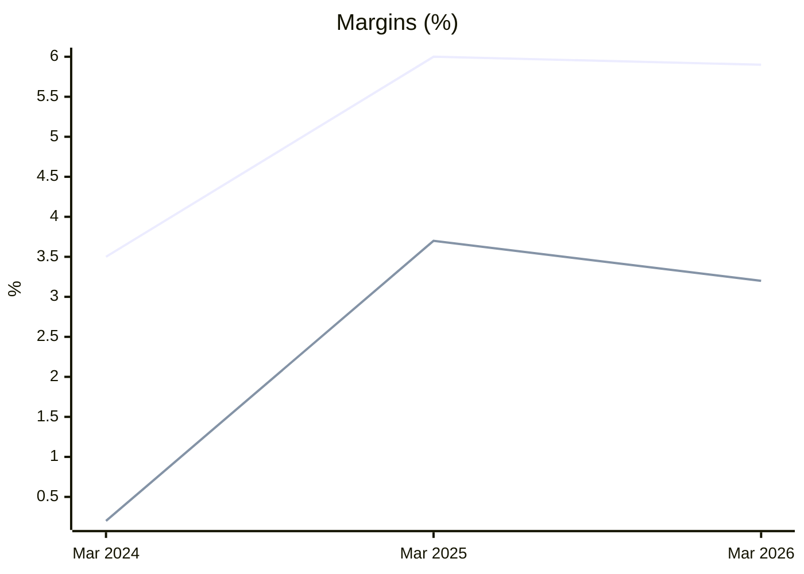

*Run 2026-11-24 · part of [SPINOFF_REPORT.md](../SPINOFF_REPORT.md) · the complete analysis of one company, with every management-call exchange in full.*

## THOMASCOOK — Thomas Cook (India) Ltd.

### 1. Thomas Cook (India) Ltd. — CONFIRMED DEMERGER

**CONFIRMED** (a demerger scheme is on the exchange record) · **PRE-SPIN — study the parent; the pieces do not trade yet** · score 4.3/10 · spin-off · 15 filing(s) from CALLS, NSE, NSE-BM · first 2026-03-20, latest 2026-11-05

**The separated entities — every one the documents name:**

| Entity | Scheme | Business | Listing | Who runs it |
|---|---|---|---|---|
| **Sterling Holiday Resorts Limited** | 2026 Composite Scheme of Arrangement – demerger of the Reso… | The Demerged Undertaking: "the resorts and resort management business of Demerged Company undertaken by way o… | to be listed | Mr. Vikram Lalvani – Managing Director and Chief … |

**The other parties to the scheme(s)** — not separated entities: TC Visa Services (India) Limited — merged in — no shares for the parent's holders; Jardin Travel Solutions Limited — merged in — no shares for the parent's holders; Borderless Travel Services Limited — merged in — no shares for the parent's holders; Nature Trails Resorts Private Limited — merged in — no shares for the parent's holders

**What is being separated, as the documents put it:** TCIL's Resorts and Resort Management business — 6 Nature Trails resorts — transferred to Sterling Holiday Resorts Limited — class `value_unlocking`.

### 2. Stages and dates

> **Listing:** NOT YET — scheme at 'nclt_sanction' stage; Sterling Holiday Resorts Limited will list only after NCLT sanction, effectiveness and a record date; indicated timeline: NSE observation letter (September 1, 2026): SHRL "shall ensure that steps for listing of specified securities are completed and trading in securities commences within sixty days of receipt of the order of the Hon'ble High Court/NCLT". On the May 13, 2026 earnings call Debasis Nandy said the demerger would take "12 to 15 months" and "We expect this process to get completed by Q1 of FY '28". March 20, 2026 filing: consolidation of share capital expected "within 15 to 18 months from the date of approval of the Scheme by the Board". NCLT first-motion order November 4, 2026 directs shareholder/creditor meetings within 60 days; final NCLT sanction still pending.

| Date | Event | Source |
|---|---|---|
| 2026-03-20 | Stage reached: **announced** | [Outcome of Board Meeting](https://nsearchives.nseindia.com/corporate/THOMASCOOK_20032026190710_SEBI_Intimation_Post_Board_meeting.pdf) |
| 2026-03-20 | Board approval — Thomas Cook (India) Limited | as stated: Outcome of Board Meeting filing dated March 20, 2026 — "the Board of … |
| 2026-03-20 | Board approval — Sterling Holiday Resorts Limited | as stated: Regulation 30(9) disclosure dated March 20, 2026 — approval of the Co… |
| 2026-03-20 | Board approval — All five Applicant Companies (TCIL, SHRL, TCVSL, JTSL, BTSL) | as stated: NCLT Mumbai Bench order dated 04.11.2026, para 14 — "The Board of Dir… |
| 2026-07-23 | Other — NSE / SEBI — draft scheme forwarded to SEBI | as stated: NSE Observation Letter Ref: NSE/LIST/54449 dated September 01, 2026 —… |
| 2026-08-27 | SEBI approval — SEBI comments on the draft scheme of arrangement | as stated: NSE Observation Letter dated September 01, 2026 — "SEBI vide its lett… |
| 2026-08-31 | Exchange no-objection — BSE Limited | as stated: Intimation dated September 1, 2026 — "observation letter from BSE Lim… |
| 2026-09-01 | Stage reached: **exchange noc** | [General Updates](https://nsearchives.nseindia.com/corporate/THOMASCOOK_01092026160534_Stock_Exchange_Intimation-_SE_Observation_Letter.pdf) |
| 2026-09-01 | Exchange no-objection — National Stock Exchange of India Limited | as stated: Intimation dated September 2, 2026 — "observation letter from Nationa… |
| 2026-11-04 | NCLT order — All five Applicant Companies — first-motion / procedural order in C.A. (CAA) No. 182 (MB)/2026 | as stated: Intimation dated November 5, 2026 — "the Hon'ble National Company Law… |
| 2026-11-05 | Stage reached: **nclt sanction** | [General Updates](https://nsearchives.nseindia.com/corporate/THOMASCOOK_05112026121223_Stock_Exchange_Intimation-_NCLT_order.pdf) |

**The stages, as filed:** announced (2026-03-20) → exchange noc (2026-09-01) → nclt sanction (2026-11-05)

**Stated in the filings:** resulting company **Sterling Holiday Resorts Limited**; demerged undertaking: Resort Business of TCIL (Demerged Company) are transferred to Sterling Holiday Resorts.

**When it lists, in the documents' words:** NSE observation letter (September 1, 2026): SHRL "shall ensure that steps for listing of specified securities are completed and trading in securities commences within sixty days of receipt of the order of the Hon'ble High Court/NCLT". On the May 13, 2026 earnings call Debasis Nandy said the demerger would take "12 to 15 months" and "We expect this process to get completed by Q1 of FY '28". March 20, 2026 filing: consolidation of share capital expected "within 15 to 18 months from the date of approval of the Scheme by the Board". NCLT first-motion order November 4, 2026 directs shareholder/creditor meetings within 60 days; final NCLT sanction still pending.

### 3. Size of the separated business beside the parent — is institutional selling likely?

**Reading: VERY LIKELY — the piece is under a tenth of the whole; index funds and large holders who receive it without choosing it tend to sell.**

| Entity | Stated turnover | Stated share of the whole | Segment revenue share | Market cap (₹ cr) | Share of combined market cap | Index member |
|---|---|---:|---:|---:|---:|---|
| Sterling Holiday Resorts Limited | SHRL FY26 total revenue INR 5,487 million; Q4 FY26 total re… | 0.4% | 6.6% (FY2026) | — | — | not listed |

*Stated figures are the documents' own (a turnover share, or the cost-of-acquisition split the company publishes for tax, which reflects relative value); the segment share is this business's revenue over the parent's sales, and the market-cap share is the entity's value over the entity plus the parent (parent ₹5,168 cr, NSE bhavcopy of 2026-11-13), both computed here.*

**In the documents' words:** “"The turnover of the Demerged Undertaking for the year ended 31st December 2025 was INR 70 Crores representing ~0.4% of the total standalone turnover of the Company for the year ended 31st December 2025." (Also, on the merger leg: "Paid up capital of following companies as on 31 March 2025: a) TCVSL : Rs. 0.05 cr b) JTSL : Rs. 1 cr c) BTSL : Rs. 0.05 cr d) TCIL : Rs. 47.04 cr. Turnover of following companies for the year ended 31 March 2025: a) TCVSL : Rs. 1.2 cr b) JTSL : Nil c) BTSL : Nil d) TCIL : Rs. 2,243.97 cr")”

**The judge's read of selling pressure:** likely — Every TCIL holder gets 81 SHRL shares per 100; hospitality is a different industry from travel/forex, management targets "differentiated investor cohorts".

### 4. Insider ownership — share swap, promoters' holding, management incentives

**Share swap / entitlement, entity by entity:**

- **Sterling Holiday Resorts Limited:** "for every 100 (One Hundred only) equity shares of Thomas Cook (India) Limited of face value of INR 1/- each credited as fully paid up, the issue and allotment by Sterling Holiday Resorts Limited of 81 (Eighty One only) equity shares of Sterling Holiday Resorts Limited of face value of INR 10/-each credited as fully paid up ("Share Entitlement Ratio")" — i.e. share entitlement ratio of 0.81 shares of SHRL for every share of TCIL

**Promoters' holding, from the shareholding pattern:**

| Company | Promoters | FIIs | DIIs | Public | Quarter |
|---|---:|---:|---:|---:|---|
| Thomas Cook (India) Ltd. (THOMASCOOK) | 64.77% | 5.8% | 6.61% | 21.77% | Sep 2026 |

*Source: screener.in shareholding pattern, stored under `ShareholdingPattern/NiftyTotalMarket/`. In a mirror demerger each shareholder holds the same proportion of the new company as of the parent on the record date.*

- **Promoters in the parent, per the documents:** "Fairbridge Capital (Mauritius) Limited, a subsidiary of Fairfax Financial Holdings Limited, is the promoter of TCIL with a shareholding of 63.83 % of its paid-up capital" (press release dated March 20, 2026). Pre-consolidation share count table in the same filing: Promoters 30,02,58,798 of 47,69,50,562 shares (post-consolidation 7,50,64,700 of 11,92,37,641)
- **What the promoters will hold in the separated entity:** 2026 scheme / SHRL: "SHRL is presently a wholly owned subsidiary of TCIL. Pursuant to the effectiveness of the Demerger, each shareholder of TCIL, subject to applicable law, will be issued equity shares of SHRL in the ratio of 81 shares for every 100 shares held in TCIL. The existing equity shares of SHRL held by TCIL would continue to be held by TCIL." Indicative post-Scheme shareholding of SHRL: "Promoters 100 → 65.55%* / ESOP Trust – → 2.16%** / Public – → 32.30% ... *Includes 7% held by TCIL." Press release: "The promoters and public shareholding pattern of TCIL and SHRL will remain similar post the demerger". In TCIL: "There will be no change in the shareholding pattern of the TCIL pursuant to the effectiveness of the Demerger except for accelerated shares issued to ESOP trust as per the Scheme"; on the merger and the capital reduction legs: "There will not be any change in the shareholding pattern of TCIL as no shares would be issued on such merger" and "There will not be any change in the shareholding pattern of TCIL pursuant to Reduction of Share Capital." 2025 NTRPL slump sale: cash consideration only, no shares — not applicable
- **What a public shareholder receives:** 2026 Composite Scheme: "TCIL shareholders will receive SHRL shares as consideration for the demerger and in accordance with the share entitlement ratio of 0.81 shares of SHRL for every share of TCIL" — i.e. "SHRL shall issue and allot 81 (Eighty One) fully paid up equity shares of face value of Rs. 10 each for every 100 (One Hundred) fully paid up equity shares of Re. 1 each to the equity shareholders of TCIL"; their TCIL holding is then consolidated ("4 (four) equity shares of TCIL of face value of Re. 1 each will be consolidated into 1 (one) equity share of TCIL of face value of Rs. 4 each") and the face value reduced from Rs. 4 to Rs. 3 per share "without any payment to the shareholders of TCIL", with "all shareholders will either receive shares of TCIL or equivalent compensation in case of fractional entitlements". No cash consideration: "The Scheme does not involve payment of any cash consideration for the demerger." 2025 NTRPL slump sale: nothing received by public shareholders — an intra-group cash purchase
- **Management incentives:** "** Pursuant to Scheme becoming effective, but 7 (seven) working days before Record Date 1, 65,70,000 options under ESOP Options 2024 (as defined in Clause 20.1 of the Scheme) of the Demerged Company shall stand accelerated in accordance with the ESOP Options 2024. Such shares of TCIL shall be entitled to the shares of SHRL." Resulting ESOP Trust holding in SHRL post-Scheme (indicative): 2.16%. "There will be no change in the shareholding pattern of the TCIL pursuant to the effectiveness of the Demerger except for accelerated shares issued to ESOP trust as per the Scheme." ESOP Trust holds 1,10,96,573 TCIL shares pre-consolidation / 27,74,143 post-consolidation. New grants: "The Nomination and Remuneration Committee of the Company has, at its meeting held on even date, approved grant of 454,529 stock options under the Thomas Cook Employees Stock Option Plan 2013, 431,200 stock options under the Thomas Cook Employees Stock Option Scheme 2018 -Execom and 3,478,824 stock options under the Thomas Cook Employees Stock Option Scheme 2024 -EXECOM. Each option entitles the participant to one share of the Company." (30 July 2025). Exercise price / pricing date: not stated. No new plan in SHRL stated. Also: "The Board of Directors, at its meeting held on 30 May 2025, approved (subject to shareholders approval at the ensuing Annual General Meeting) an ex-gratia payment of INR 171.0 Mn to Mr. Madhavan Menon, who retired as an Executive Chairman on 31 May 2025, in recognition of his 25 years of service." EPS of the Company is calculated after reducing 4,617,608 shares held by the Thomas Cook (India) Limited Employee Trust (quarter ended 30 June 2025)
- **Insider actions around the separation:** not stated in the documents on file.
- **Insiders, per the checklist read:** Promoters 100% of SHRL pre-scheme, 65.55% post (includes 7% held by TCIL); ESOP Trust 2.16% after 65,70,000 ESOP Options 2024 accelerate 7 working days before Record Date 1. Promoter: Fairbridge Capital (Mauritius)/Fairfax, 63.83% of TCIL. · *option pricing date:* not stated

### 5. Why the demerger — point by point

Thomas Cook (India) Ltd (TCIL) is carving out its Resorts and Resort Management business — the six resorts it owns/operates directly under the Nature Trails brand, which it had itself absorbed from Nature Trails Resorts Pvt Ltd by slump sale for Rs 522.5 mn (appointed date 1 March 2025) — and demerging it into its wholly owned subsidiary Sterling Holiday Resorts Ltd (SHRL), which will then be separately listed on BSE and NSE. Management's stated logic is twofold: operationally, the resorts "would reap more benefit from being owned and operated by SHRL in light of their vast expertise in the hospitality industry" (SHRL ran 75+ resorts/3,700+ rooms at scheme date, 78 resorts/~3,800 rooms across 65 destinations by FY26-end, FY26 revenue INR 5,487 mn, EBITDA INR 1,701 mn at 31%, PBT INR 1,142 mn at 21%, 25 straight profitable quarters, debt-free with ~INR 3,400 mn cash); and financially, the split is meant to "unlock value" and "attract differentiated investor cohorts for each business segment," leaving TCIL to "concentrate our resources on our core Travel and Financial Services business." The demerged undertaking is tiny in revenue terms — INR 70 crores for the year ended 31 December 2025, ~0.4% of TCIL standalone turnover — so the driver is structural, not scale: SHRL's board says it "has matured over the years and is well poised to chart its own growth path and operate as a separate listed entity in the fast-growing hospitality industry," with two listed entities each pursuing "growth opportunities that are more aligned with their own industry dynamics." Bolted onto the same composite scheme are three capital-structure fixes aimed squarely at EPS and optics: consolidating four Re 1 shares into one Rs 4 share (47,69,50,562 shares becoming 11,92,37,641) to "better reflect the true market value" and "convey stronger financial stability and valuation metrics"; absorbing three dormant subsidiaries — TC Visa Services (India), Jardin Travel Solutions and Borderless Travel Services — that are "incurring unnecessary compliance and administrative costs"; and cutting face value from Rs 4 to Rs 3 with no payout to "right size the balance sheet and capital structure." Consideration is 81 SHRL shares of Rs 10 for every 100 TCIL shares of Re 1, with no cash; TCIL keeps its existing SHRL shares (~7%), promoters end at 65.55% of SHRL and public at 32.30%. The initiative came from the Board on the recommendation of the Audit Committee and an Independent Directors Committee — no lender, partner or named investor demand is disclosed anywhere in the calls or filings, though analysts had repeatedly pressed management on deployment of the ~INR 780-800 crore net cash pile and on Sterling's EBIT failing to scale with its room additions.

**Point by point, with the source:**

1. First earnings-call disclosure of the March 2026 board approval, framed as a strategic divestment of the resort business into Sterling that unlocks shareholder value. “Before we move on to the segmental analysis, I will discuss the strategic divestment announcement that was made in March 2026, where the Board has granted in-principle approval for the demerger of our resort business into Sterling Holiday Resorts.” — *[May 2026](https://www.bseindia.com/stockinfo/AnnPdfOpen.aspx?Pname=d884e7c7-ee2e-41fb-b1b5-e6408e592685.pdf)*
2. Iyer's stated benefit for the remaining TCIL: a cleaner capital structure and resources concentrated on Travel and Financial Services (forex, corporate travel, MICE, DMS). “For Thomas Cook (India) Limited, this restructuring allows us to streamline our capital structure and concentrate our resources on our core Travel and Financial Services business.” — *[May 2026](https://www.bseindia.com/stockinfo/AnnPdfOpen.aspx?Pname=d884e7c7-ee2e-41fb-b1b5-e6408e592685.pdf)*
3. The face-value consolidation plus absorption of the three dormant subsidiaries is pitched explicitly as an EPS and corporate-structure simplification measure. “The consolidation of our face value per share, along with the merger of the three dormant subsidiaries, further simplifies our corporate structure and improves our Earnings Per Share, directly benefiting our shareholders.” — *[May 2026](https://www.bseindia.com/stockinfo/AnnPdfOpen.aspx?Pname=d884e7c7-ee2e-41fb-b1b5-e6408e592685.pdf)*
4. Lalvani places the demerger alongside Sterling's own next phase — brand re-architecture and expansion to 95 resorts/4,500 rooms in 2027 — as process already under way. “In parallel, as you are aware, the demerger process from Thomas Cook has also been initiated.” — *[May 2026](https://www.bseindia.com/stockinfo/AnnPdfOpen.aspx?Pname=d884e7c7-ee2e-41fb-b1b5-e6408e592685.pdf)*
5. Nandy gave the only timeline guidance: 12-15 months from board approval, NSE/BSE applications filed and queries being answered, completion expected Q1 FY28. “So when we took the Board approval for this particular demerger project, we said that it will take us 12 to 15 months.” — *[May 2026](https://www.bseindia.com/stockinfo/AnnPdfOpen.aspx?Pname=d884e7c7-ee2e-41fb-b1b5-e6408e592685.pdf)*
6. Sterling's readiness argument on the call: FY26 as an inflection year with revenue INR 5,487 mn, EBITDA 31%, PBT margin 21%, 25 consecutive profitable quarters and a debt-free balance sheet with ~INR 3,400 mn cash. “FY '25-'26 marks a defining year for Sterling, a decisive inflection point where scale, profitability and balance sheet strength have expanded simultaneously, not sequentially.” — *[May 2026](https://www.bseindia.com/stockinfo/AnnPdfOpen.aspx?Pname=d884e7c7-ee2e-41fb-b1b5-e6408e592685.pdf)*
7. Core operating rationale: the resorts belong with Sterling because Sterling has the hospitality operating expertise, catering to a different demographic with more curated experiences (adventure holidays, educational trips, corporate getaways). “TCIL and SHRL's Management believes that the Resort Business of TCIL would reap more benefit from being owned and operated by SHRL in light of their vast expertise in the hospitality industry.” — *Scheme*
8. Sterling is presented as having outgrown subsidiary status and ready for its own listed existence in a fast-growing sector — the justification for subsequently listing SHRL on BSE and NSE. “Further, SHRL's Management is of the view that SHRL has matured over the years and is well poised to chart its own growth path and operate as a separate listed entity in the fast-growing hospitality industry.” — *Scheme*
9. The value-unlock case is explicitly about attracting different investor bases to travel/financial services versus leisure hospitality, with each entity pursuing sector-specific growth strategies with agility. “Unlock value for the shareholders of TCIL by demerging the Resorts and Resort Management business into SHRL and to attract differentiated investor cohorts for each business segment” — *Scheme*
10. Segregating verticals is expected to improve operating efficiency and profitability at both entities because each faces different industry dynamics. “In this manner, the two listed entities can each pursue growth opportunities that are more aligned with their own industry dynamics, leading to improved operational efficiencies and profitability.” — *Scheme*
11. Scale of what is actually moving: the demerged undertaking's turnover was only INR 70 crores for the year ended 31 December 2025, about 0.4% of TCIL's standalone turnover — six Nature Trails resorts. “The turnover of the Demerged Undertaking for the year ended 31st December 2025 was INR 70 Crores representing ~0.4% of the total standalone turnover of the Company for the year ended 31st December 2025.” — *Scheme*
12. Consideration is all-paper at 81:100, no cash; TCIL retains its existing SHRL stake, leaving promoters at 65.55% (including 7% held by TCIL) and public at 32.30% of SHRL. “for every 100 (One Hundred only) equity shares of Thomas Cook (India) Limited of face value of INR 1/- each credited as fully paid up, the issue and allotment by Sterling Holiday Resorts Limited of 81 (Eighty One only) equity shares of Sterling Holiday Resorts Limited of face value of INR 10/-each credited as fully paid up ("Share Entitlement Ratio").” — *Scheme*
13. Three dormant shells (TC Visa Services, Jardin Travel Solutions, Borderless Travel Services — FY25 turnover Rs 1.2 cr, nil and nil) are folded into TCIL purely to cut compliance and overhead and free management attention. “TCVSL, JTSL and BTSL are dormant and non-operative companies, incurring unnecessary compliance and administrative costs.” — *Scheme*
14. The Rs 4-to-Rs 3 face-value reduction involves no payout to shareholders and no change in share count; it is a balance-sheet right-sizing aimed at EPS, and is stated not to prejudice creditors. “The Management of TCIL believes that the proposed reduction of share capital is required to right size the balance sheet and capital structure of TCIL such that TCIL has a more efficient capital structure and the shareholders also benefit in terms of improved earnings per share.” — *Scheme*
15. The 4-into-1 share consolidation is justified on ratio optics — making reported per-share metrics reflect intrinsic value and signal financial stability. “The Management of TCIL believes that the proposed consolidation of the face value of its equity shares will result in a significant improvement in certain key financial ratios.” — *Scheme*
16. Six weeks before the announcement, management told investors asking about the ~INR 1,000 crore gross cash pile that no cash-return or acquisition discussions were live — no separation was signalled on this call. “But currently, there are no conversations around either any kind of disbursement of cash to shareholders or for that matter, any acquisition.” — *[Feb 2026](https://www.bseindia.com/stockinfo/AnnPdfOpen.aspx?Pname=c7f0dda1-3b3e-4381-8413-8467a63a4eec.pdf)*
17. The opposite-direction precursor: in March 2025 TCIL bought the Nature Trails resorts business into itself by slump sale (three resorts near Mumbai, 80-90 rooms, INR 10-15 crores revenue) — the very undertaking now being demerged out to Sterling. “We completed this, the slump sale in March. Now this actually includes 3 resorts close to Bombay.” — *[May 2025](https://www.bseindia.com/stockinfo/AnnPdfOpen.aspx?Pname=450ff761-fa88-4aee-a8d9-dc9675000d91.pdf)*
18. Analyst pressure on Sterling's standalone performance versus listed hospitality peers, which Lalvani answered by citing the completed transformation from vacation-ownership to a hospitality model. “But if you see, if you see the revenue, we are quite underperforming the industry.” — *[May 2025](https://www.bseindia.com/stockinfo/AnnPdfOpen.aspx?Pname=450ff761-fa88-4aee-a8d9-dc9675000d91.pdf)*
19. Standing investor concern the separation does not address: Sterling's EBIT stayed around INR 129 crores for two years despite roughly 1,200-1,300 extra rooms, attributed to membership-revenue sunset, resort ramp-up lags and ROU depreciation. “But our EBIT continues to actually be steady in terms of INR 129 crores over the last 2 years, in fact, a decline from FY '24.” — *[May 2026](https://www.bseindia.com/stockinfo/AnnPdfOpen.aspx?Pname=d884e7c7-ee2e-41fb-b1b5-e6408e592685.pdf)*

**How it evolved:** Across the May 2025, Aug 2025, Nov 2025 and Feb 2026 calls there is no hint of a separation: the only structural move discussed is the opposite direction — the March 2025 slump sale pulling Nature Trails' three Mumbai-area resorts (80-90 rooms, INR 10-15 crores revenue) into TCIL — while analysts push on cash use and on why Sterling's EBIT stayed flat at ~INR 129 crores despite adding 1,200-1,300 rooms, and on 6 February 2026 Mahesh Iyer still says "there are no conversations around either any kind of disbursement of cash to shareholders or for that matter, any acquisition." The Board then granted in-principle approval on 20 March 2026 and the full composite scheme (demerger, 4:1 consolidation, merger of three dormant subsidiaries, Rs 4-to-Rs 3 capital reduction) was announced that day. It was discussed on an earnings call for the first time on 13 May 2026, where Iyer framed it as a "strategic divestment"/value unlock, Vikram Lalvani confirmed "the demerger process from Thomas Cook has also been initiated," and Debasis Nandy reaffirmed the original 12-15 month timeline with completion expected by Q1 FY28. Execution then tracked that guidance without the plan itself changing: BSE no-adverse-observation on 31 August 2026, NSE no-objection on 1 September 2026, SHRL's registered office shifted from Tamil Nadu to Maharashtra effective 13 July 2026, and an NCLT Mumbai procedural order dated 4 November 2026 admitting the application and directing TCIL shareholder and unsecured-creditor meetings.

**What management expects from it:** TCIL: streamlined capital structure, resources focused on travel and financial services, improved EPS from the 4:1 consolidation, Rs 4-to-Rs 3 reduction and dormant-subsidiary merger, lower admin cost. SHRL: separate listing on BSE/NSE, own growth path in fast-growing hospitality, hospitality-expert ownership of the resorts. Both: differentiated investor cohorts, sector-aligned strategies, improved operational efficiency and profitability.

*Not explained on the calls:* No valuation methodology or derivation of the 81:100 ratio, no quantified value unlock or SHRL financials post-demerger, no accounting treatment of the capital reduction, no shareholder-vote or listing-date specifics.

- *Stated reason, in one line:* Unlock value by separating resorts into SHRL, which has hospitality expertise; SHRL "matured over the years and is well poised to chart its own growth path and operate as a separate listed entity"; attract differentiated investor cohorts.
- *What it reveals:* The demerged undertaking is tiny — INR 70 Crores turnover, ~0.4% of TCIL standalone. The real asset is SHRL itself: 78 resorts, ~3,800 rooms, FY26 revenue INR 5,487 mn, EBITDA 31%, PBT INR 1,142 mn, debt-free, cash ~INR 3,400 mn, 25 straight profitable quarters.
- *Parent or spin:* spin · *Read next:* Shareholder meeting notice: SHRL abridged prospectus, valuation report, post-demerger balance sheets of TCIL and SHRL.
- *In their words:* “Accordingly, the Board of TCIL is of the view that for better focus and maximum result, it is better to divest the Resorts and Resort Management Business into SHRL and subsequently list SHRL.”

### 6. On the calls, verbatim

11 call(s), oldest first: **46 question-and-answer exchange(s)** given in full — the question and every answer to it, nothing trimmed — and 50 passage(s) from management's prepared remarks (the complete sentences about it; the whole remarks are in the linked transcript). Text is as the transcript prints it.

#### Nov 2023 — [transcript](https://www.bseindia.com/stockinfo/AnnPdfOpen.aspx?Pname=330e24b0-45cc-4a01-86e3-31f979bce549.pdf)

**From the prepared remarks** *(the passage about it; the whole turn runs to 239 characters in the transcript)*

> **Mr. Debasis Nandy:** President and Group Chief Financial Officer - Thomas Cook (India) Limited Mr Vikram Lalvani – Managing Director and Chief Executive Officer – Sterling Holidays Resorts Mr. Ramakrishnan - Managing Director and Chief Executive Offic er - DEI

**From the prepared remarks** *(the passage about it; the whole turn runs to 1,679 characters in the transcript)*

> **Debasis Nandy:** Thank you, Mahesh. On DMS side – Inbound and international , we registered a turnover of INR 662 crores, which is 40% up from what we did in the same quarter of last year. And it may be noted that it is 38% ahead of what we did in the pre -pandemic period. So, the business is back in full swing. I must add one point that this is no t the inbound season in many parts of the world, including India and Southeast Asia, where some of our major business die. And based on the foreign bookings of those specific territories, we can say the business outlook is pretty good. As far as the curren t quarter or the last quarter that's concerned, I think the unit s that did very well include East Africa. We have business in Kenya, which reported an increase in sales based on volume generated from traditional markets, US, UK and Germany. The Middle East witnessed higher sales despite of the fact that this was the summer season, but again, it is still higher than what it was last year. Strong growth came in from USA with a 26% increase in sales, largely driven by inbound passengers coming in from the Euro pean market. And coming to Southeast Asia sales, which splits across our nine countries in Southeast Asia, started recovering its volumes, specifically in countries like Thailand, Indonesia, Malaysia, Singapore and Vietnam. The next six months are critical for this business because that is where the maximum volume comes in. And we look forward to a similar trajectory of growth. That’s what I had to add on the Destination Management segment. And I would like to now hand over to Vikram so that he can talk a bit about the Sterling Resort, the leisure hospitality segment.

**From the prepared remarks** *(the passage about it; the whole turn runs to 5,632 characters in the transcript)*

> **Vikram Lalvani:** Thanks, Debasis. Good afternoon, ladies and gentlemen. My name is Vikram Lalvani, and I represent Sterling Holiday Resorts as its Managing Director and Chief Executi ve Officer. I'm also joined by my colleague, Mr. L. Krishna Kumar, who's the Chief Financial Officer at Sterling Holiday Resorts. It's a privilege to interact with all of you once again today. Traditionally, in the leisure business, the quarter that has go ne by, that is July to September of Q2, from a seasonality perspective is actually one of the leanest quarters of the year. During this quarter, we also witnessed dramatic issues and disruptive business in some of the regions that we operated. The heavy do wnfalls in Himachal, Uttarakhand, Delhi impacted at least 35% of our portfolio for nearly eight weeks out of 12 weeks this quarter. Despite the seasonality and the climatic disruptions, we are pleased to report that Sterling has yet and still continued to remain profitable, and this is the 11th consecutive profitable quarter that we have actually presented to you. Our supply has grown by 8% on a year -on-year basis given our thrust on asset -light expansions. This is on account of addition of 8 new resorts du ring the preceding 12 months cumulatively, and this has also enabled our Q2 supply growth as well. On a year -on-year basis, Sterling occupancy is still stable at 63% and we have grown the non -member business ratio from 60% to 66%. This has enabled growth i n room revenues by 11% in Q2 and 18% Year -on-year. We continue to realize average room rates upwards of 6,000 across all our resorts on a Y -on-Y basis at the end. Our overall growth in revenues also has come in from increased food and beverage income, grew by 11% year - on-year and 8% quarter -on-quarter basis.. This continues to reaffirm our growth strategy towards being a dominant player in the hospitality segment. Our distribution reach continues to grow with the help of our Sterling One platform that cater s to travel agents, holiday partners and corporates across the country. Our new non -member or ‘FIT’ product with the validity of one year was also launched this quarter called ‘Sterling One’. This new product giv es immense benefits to customers to holiday at any of our resorts with value adds on food and beverage and flexibility of multiple holidays across our portfolio through the year. With the launch of this new non -member FIT product, Sterling has also sun set on the long -duration membership products in Q2. So, we'll have no more acquisition of the long -term membership products going forward as well. The business continues to generate EBITDA margins of 30% and upwards based on seasonality, resulting in a healthy free cash flow of INR 542 million vs INR 4 63 million on a year -on-year basis. The company is also cash surplus of INR 1,580 million and considerably has also lowered its debt to less than INR 175 million. As part of a growth strategy in an asset -light mode, we've added four new resorts in H1 FY'24 . Shimla and Panchgani in Q1 and Vythiri and Vadodara in Q2. The addition of Vythiri strengthened the presence of Sterling in the Wayanad district in Kerala with its second resort in that district, and now we have a total of 8 resorts in Kerala, and we wil l continue to grow that piece again. Vadodara marks Sterling's foray in the resort management in the theme park segment. Sterling Aatapi being the largest theme park in Gujarat is spread over 70 acres. Some of our resorts like Nainital underwent a redevelo pment program in Q2 and has been subsequently relaunched in October 2023. Sterling has made its debut in Udaipur with two new resorts in October 2023. Hence, as on date, Sterling has 45 resorts across 41 destinations in India and is growing. Our pipeline i s strong with the addition of at least another six or eight more destinations in H2, both Q3 and Q4, taking our resort count to at least 50 to 52 by close of FY '24 and at least 48 destinations in the country. And we will further drive the scale even in FY '25. This reaffirms the strategy to position Sterling as a formidable hospitality brand in the country. During the quarter, Sterling has also upgraded some of its product profiles in some of its resorts, rooms, restaurants in some of our large format reso rts like in Ooty, Kodaikanal, Yercaud and Munnar to cater to the demand that have higher spend propensities into Q3 and Q4. The company has strengthened its IT system by moving to a cloud -based property management solution system tailored for hospitality b usiness in all our resorts during the current quarter. The cloud -based ERP solution Oracle NetSuite implemented within the previous quarter, further helped in bringing uniformity, processes across the resorts including better cost management views. The com pany continues to invest in various digitization or projects that will help bringing further efficiencies in the organization. All our resorts are now ranked 4+ on TripAdvisor with 19 resorts being ranked in the top three in the respective destinations. Si x of our resorts are on 5/5. Sterling has also been awarded the Best Domestic Leisure Hotel Chain by Today's Traveler. Sterling continues to remain upbeat for the remaining part of the year, one with the upcoming festive holiday in Q3. We also have all our destinations reopened post the monsoons in Q2. There is a strong sentiment of domestic demand and that's continuing and the Sterling's strong pipeline growth, a number of resorts in Q3 and Q4 helps build this confidence that we will close FY '24 with a st rong performance and also getting into FY '25. Thank you.

**Question and answer**

> **Senthil Manikandan:** My first question is with respect to Sterling Holidays. So just on the room addition, so le t's say, over the next three years to five years, what's the targeted room addition? And is it going to be 100% on the asset lead model? So that's my first question.
>
> **Vikram Lalvani:** Okay. Let me take that now. See, last year has been a year of transformati on for us. And we've recovered exceedingly well after the COVID period. And this year has been a year of sustained acceleration. Now apart from increasing the capacity utilization of our existing portfolio, we will continue to grow our portfolio. In fact, when we started off last year, we started off with about 32 -33 resorts. And today, we are 45 strong. We aim to be 50 to 52 by the end of this financial year. And we will continue to grow our footprint in India and also possibly in destinations where Indian s travel to. So we are exploring those as well. They will primarily be on asset light. Now, if there is a specific number you want me to attach to what I see three years from now, we are currently about 3,000 rooms with 45 resorts. Keeping the current pace of scale, we will see our portfolio growing significantly, and it will be mainly on an asset light model, right. So, our expansion is far more balanced and strategic rather than actually just blindly adding rooms across destinations. Where we are able to network with our existing destinations as well as ramp up business quickly in those markets, we will certainly be present in those markets. So that's the strategic focus going forward. If we close with 52 resorts this year, we are looking at building even FY '25 with the same pace of growth that we've done in FY '24 and so on. So that will be the focus primarily in Sterling going forward.

**Question and answer**

> **Hatim Broachwala:** Okay, okay. Last question is in the resort business, what are the ARR and occupancy?
>
> **Debasis Nandy:** Vikram, would you like to comment on this one?
>
> **Vikram Lalvani:** Yes, yes , sure. So the occupancy is about 63%, and the ARR is about INR 6,000 for H1. And H2 will also follow where our Q3 which is October, November and December shall kind of be in sync with what Q1 has been. And Q4 shall be in sync with what Q2 has been. Modera tor: Thank you. The next question is from Ashish Chauhan from RV Investments. Please go ahead.
>
> **Ashish Chauhan:** Sir, this question was regarding the India -UK. FT A. So is that FTADA happening and there will be a lot more students travelling and travel taking place. So, will there be a benefit?
>
> **Mahesh Iyer:** It should. Because as I mentioned in my commentary for the five segment, education product is a large segment for us. We've been growing steadfast in the current year with some issues around Canada. I think UK has become a very prominent market, so we'll see the demand going back to UK. And with this new F TA arrangement, we will expect a lot more students to travel. It's also important for them to note here that we also launched a prepaid product, specifical ly targeting the students, which is called ‘Study Buddy’. And clearly, we believe that there is more room for us to grow in the overall segment.
>
> **Ashish Chauhan:** Sir, and one more question was regarding Sterling resorts. In the last con call, we had spoken that there might be an increment to six or more resorts in H1 FY’24 to Sterling. So has that taken place already?
>
> **Vikram Lalvani:** Yes. In fact, we have added four, two in Q1, two in Q2 and we've already opened three in October. So, we have another five to six in the pipeline more during March end.
>
> **Ashish Chauhan:** Sir, now occupancy rate is somewhere close to 63%. So when do we look like reaching close to around 70% to 80%?
>
> **Vikram Lalvani:** Let me clarify this. One is there has actually been a growth in suppl y of almost 8%. And despite that the occupancy is actually at 63%. So actually, the number of room nights have gone up, number one. Number two, we are also in a seasonality business. So, in peak times, you can even hit 90%, 95%. In lean times, you are actu ally hitting 50% to 55%. So actually, that's how the weighted average actually goes between 60% to 70%. Traditionally, leisure business, for example, weekends, we are actually running with high capacity utilizations. And weekdays, Tuesdays, Wednesdays and Thursday, they're trying to bring volumes. So, I'll be very frank, the 70% to 80% for the leisure business looks slightly impact the year. So therefore, we are looking at about 60% to 70%. 270 days in a year are regular periods, 90 days in a year as super peak periods. So in that ratio, you're running actually between 60% to 70% in an increased supply mode. So that's where we are actually today.

#### Feb 2024 — [transcript](https://www.bseindia.com/stockinfo/AnnPdfOpen.aspx?Pname=bda2a9b3-d546-44be-9c65-072cbe44161d.pdf)

**From the prepared remarks** *(the passage about it; the whole turn runs to 75 characters in the transcript)*

> **Mr. Vikram Lalvani:** Managing Director - Sterling Holidays Resorts - Thomas Cook (India) Limited

**From the prepared remarks** *(the passage about it; the whole turn runs to 2,887 characters in the transcript)*

> **Madhavan Menon:** I've got Mr. Mahesh Iyer, Managing Director and CEO of Thomas Cook India, Mr. Vishal Suri, Managing Director and CEO of SOTC , Mr. Vikram Lalvani, Managing Director of Sterling Holidays , Mr. Ramakrishnan, MD and CEO of DEI , Mr. Debasis Nandy, Group CFO; and Mr. Brijesh Modi, CFO of Thomas Cook India Limited. Let me kick off by brief remarks in terms of the performance. I think when you look at it from a nine - month point of view or from the Q3 point of view, we've turned in a good set of results, reflective of the fact that, one, all the companie s in the Group have now returned to profitability. Some of our overseas units took a little longer, while the domestic units, specifically Thomas Cook , SOTC, TCI Sita and Sterling hav e started firing on all cylinders. If I look at the profitability -- let me address two points here. In terms of revenue, I believe that this performance has been achieved despite the fact that our volumes -- our sales numbers have not gone back to the 2019 numbers primarily because there are visa issues in certain market s. The IT companies are not firing on all cylinders as yet. […] We have set target in the next quarter as well as the financial year 24-25, where we will -- it will be one of the primary metrics that we will watch . In terms of performances of the various businesses across the group, if you look at income from operations, you will note that all the businesses are firing Very briefly on a 9M basis with the Foreign Exchange business has grown 29% from a period year - on-year. If you look at the travel and related services, which essentially represents Corporate Travel, Leisure Travel and MICE it's grown 62% from the previous year. If you look at Leisure hospitality -- Sterling Holidays resorts, which is the hospitality presence, it's grown 19%. And if you look at Digital Imaging Solutions, it's grown 21%. Final point I want to make is that if you look our margins, the EBITDA margins have actually grown 270 basis points to 8.46%. And this is a reflection of a variety of factors.

**From the prepared remarks** *(the passage about it; the whole turn runs to 1,366 characters in the transcript)*

> **Debasis Nandy:** Yes. Thank you. Thank you, Mahesh. I will talk a bit about the inbound or the DMS business, which is represented by TCI India as well as the five overseas company that we have . The DMS business, both in India as well as overseas faced a very sharp recovery. If you compare it to the -- on a quart er-on-quarter basis as compared to the December '22 quarter, sales grew from INR 642 crores to about INR 860 crores, that's a jump up of 34%. Major entities that were responsible for the growth were, of course, TCI in India, which came back to profitabilit y. Asian Trails , which manages the business in Southeast Asia and in Australia. Desert Adventures , which is the Middle East -based company and Horizon Travel, which is based in the US. Overall, operating margins also improved at an EBIT level. I think effectively, the overall margins improved by about 150 basis points as compared to last year, showing that the business has not only grow n in size, but is able to gain the benefits of cost optimization that has happened across the group, and therefore, is able to improve the EBIT margins as well. The business continues to be strong. We expect the same trend to continue in the year ahead. I would now like to wrap this up and hand it over to Vikram to -- and request him to talk about Sterling. Vikram, if you can come in and talk about Sterling, please?

**From the prepared remarks** *(the passage about it; the whole turn runs to 5,402 characters in the transcript)*

> **Vikram Lalvani:** Yes. Thanks, Debasis. Good afternoon, ladies and gentlemen. My name is Vikram Lalvani, and I represent Sterling Holidays Resorts Limited as its Managing Director and Chief Executive Officer. I'm joined by Mr. L. Krishna Kumar, who's the Chief Financial Officer at our company. It is a privilege to in teract with all of you once again today. Sterling has again delivered a strong performance in the current quarter of Q3, driven in part by customer demand in the holiday season and in part by the fact that Sterling supply has grown by 12% over the same quarter of the previous year, Q -o-Q, from 2,02,000 room nights to 2,27,000 room nights on account of eight new resorts being added during the preceding 12 months. Also, the non -member occupancy has grown further by 8% for the current quarter over the previous quarter. All these have driven a 21% Y -o-Y growth in revenues for Q3 FY24 at INR1,243 million. Sterling has maintained the occupancy levels at 60% despite Q3 FY24, where the room capacities have grown by 12% over the preceding period. EBITDA grew by 34% Q -o-Q from INR 352 million to INR 473 million. PBT grew by 74% for the quarter on account of lower interest and depreciation. Our debt has significantly been reduced from INR 491 million in FY22 to INR 100 million exit December '23. […] Operating free cash flow continues to be also healthy at 26% of the revenues YTD. EBITDA margins continue to be strong at 37%. And in this industry, 37% is far higher than many of the other brands as well. Sterling continues to foray into the hospitality space with key revenue drivers being room revenues, food and beverage revenues, income fee from managed resorts and other incidental resort income constituting almost 80% of the ove rall -- company's overall. The management fee income has grown by 28% Y -o-Y, which reaf firms our asset -light strategy. As mentioned before, the company has also sunset acquisition of long -term membership products and shall continue to focus on strengthenin g its position in the hospitality space. Sterling's portfolio currently constitutes 49 resorts in 46 destinations across the country. In the quarter gone by, Sterling has made its debut in a key market in Rajasthan, Udaipur, with two upscale results, Balic ha and Jaisinghgarh. Sterling has also re -launched its Nainital resort post renovation, which was closed in Q2, and we re -launched it in October of Q3. Sterling has launched resorts in three new destinations as well in early Jan 2024, Athirappilly, our ninth resort in Kerala, further strengthening our Rajasthan presence with two more resorts Pushkar and Sariska. We have a strong pipeline into growing our destination presence in 2024 with almost 900 incremental rooms in the pipeline. Our focus on distributio n has enabled us to tie up with over 3,600 partners in India using our proprietary distribution platform Sterling One and it has almost -- and it has yielded almost INR 680 million for this FY alone on room and F&B revenues. Sterling continues to add new r evenue streams that drive incremental business growth. The company has launched three new thematic restaurants in Q3 out of empty spaces in Puri, Wayanad and our Alleppey resorts. With this renewed food and beverage focuse , we have also upgrad ed our restaurants , at Ooty and Goa. And all this has generated almost INR 5 million in the quarter and shall continue to do so as we go forward. Our mobile food and beverage takeaway, Sterling On The Go was launched during the year, and it has also generated an incremental income of INR4 million. So Sterling is committed to growing new revenue streams, as we keep going along even in 2024. The implementation of the Oracle NetSuite ERP in the beginning of Q2 and our new hospitality pro perty management systems in the current year has now stabilized and continues to give benefits in standardization and centralization. All our resorts are on the customer front, all our resorts are rated four plus of Tripadvisor with 82% of our resorts rate d 4.5 and above. Five of our resorts are rated five on five. 29 resorts are ranked amongst the top five in their respective regions. 22 resorts are awarded the Tripadvisor's Travelers' Choice that is a top 10 resorts in the world. And Sterling Kanha has be en awarded the Tripadvisor best of best, the top one resorts in the whole world -- 1% of the resorts in the whole world. Six of our resorts have also been awarded in Q3 as Golden Circle award by Agoda for top guests reviews. Our resort in Alleppey , Sterling Alleppey is secured, the coveted Travel and Leisure IBA Best Emerging Resort award also in Q3. The macroeconomic factors continue to favour the hospitality industry. Sterling is confident of continuing to deliver superlative performance on account of robust demand, fast expanding portfolio, increasing brand strength of Sterling and Sterling's ability to leverage our growth in a sustainable and in a scalable manner in its business levers. So hence, we are looking at a very promisin g close to given FY24. Thank you so much.

**Question and answer**

> **Himanshu Nayyar:** But then just a follow -up, sir, there. I mean in terms of capex, then what are our capex plans now? Because I believe a major chunk of the investments and technology, etcetera, has been done. So would we expect significant capex going forward, given that we are in any which ways going asset light on the resorts business and other businesses? I would not think would require too much capital going forward..
>
> **Debasis Nandy:** Let me answer that question. Yes, you're absolutely right that we are very focused on asset -light model, and therefore, we will not need significant capex going forward. At a ballpark level, you can consider a capex of maybe about INR40 -- INR35 crores -INR40 crores at a consolidated level going forward. The capex will be largely on technology because technology will need continuous upgradation and therefore, we'll continue to spend on that. But I do not anticipate any -- and there will be some expenses for setting up branches, which is largely in India for the forex and the travel business. But other than that, I do not really anticipate any major capex.
>
> **Vikram Lalvani:** Yes. Let me also step in here. On the Sterling front in terms of acquisition of new rooms, it will be on a zero capex model for sure. The outlook for the next couple of -- at least for 2024 will be there. There will be a very small amount of capex towards upgrading -- setting up o ur facility because our customers are -- preferences and the average rates are going up. So there will be certain capex that will be put in only for upgradation of our own facilities and our own resorts. But primarily in terms of room expansions, it will b e on a zero capex mode.

**Question and answer**

> **Meet Shah:** First of all, congratulations on the excellent process. I have recently started covering your company. So I have a few questions and would like to have some clarity on that. My first question is on Sterling resort. In a previous confe rence call, you have mentioned that your focus is more on short -term memberships and you're taking down your long -term memberships. However, we did some general check, and we were offered long -term membership with no mention of short -term memberships. So h ave you changed your strategy? Also, I would like to know how do short -term and long -term membership affect your performance?
>
> **Vikram Lalvani:** Okay. Let me answer that. My name is Vikram. From our company's strategic point of view, we are more inclined towards repositioning ourselves as a hospitality player is what we've actually focused on. That's why the entire focus is on the room revenue, F&B revenue, like any other typical hotel or resort. Now when we have sunset the long -term membership program in a month of July. Now let me just rewind back to what happened last year. Last year, while we continued to acquire a long -term m embership as well as we had a 10 -year product, which is a shorter -term membership program. We upped the efficiencies last year in terms of the down payment moving up from 20% to 25% to 80%. The variable sales actually also moved up from about a 20%, 25% variable sales to approximately about 70% variable sales. So we upped the efficiencies last year. This year -- during the course of this financial year, we did sunset the 25 -year product. Now when we say sunset the 25 -year product, we have actually stopped acquiring new customers over there since July, but there must have been leakage that must have happened because of leads that were there. But in terms of numbers, we are very much reduced in terms of the long term. Short term are actually two clients . One is the 10 -year product, whose yield is actually far in line with the yields that we have in terms of what the average room rate s are selling at . And the third one is actually a one -year product, which is a circle, which we have actually soft launched it only in the month of October. We have actually not spent any money on that. And that's only sold actually at a resort at a very soft level . So that actually does not even impact the membership, that actually impacts more FIT business in resort , it’s a clear one year product . So the entire game has actually changed from what it was the DNA -- our membership DNA in '18, '19, even back to that, who actually is the hospitality leg, and that's the direction that we will take forward.

#### May 2024

**From the prepared remarks** *(the passage about it; the whole turn runs to 73 characters in the transcript)*

> **Mr Vikram Lalvani:** Managing Director and Chief Executive Officer - Sterling Holidays Resorts

**From the prepared remarks** *(the passage about it; the whole turn runs to 122 characters in the transcript)*

> **Mr. Krishna Kumar:** Chief Financial Officer - Sterling Holidays Resorts Mr. Ramakrishnan - Managing Director and Chief Executive Officer - DEI

**From the prepared remarks** *(the passage about it; the whole turn runs to 3,298 characters in the transcript)*

> **Madhavan Menon:** Mahesh Iyer, Managing Director and CEO of Thomas Cook (India) Limited; Mr. Vishal Suri, Ma naging Director of SOTC Limited; Mr. Dipak Deva , Managing Director of TCI Limited; Mr. Vikram Lalvani, Managing Director and CEO of Sterling Holidays; Mr. Ramakrishnan, President and CEO of DEI; we've got Mr. Debasis Nandy, who is Group CFO; we've got Mr. Brijesh Modi, who is the CFO for Thomas Cook (India) Limited; and Mr. Krishna Kumar, who is CFO for Sterling Holiday s. I think the numbers speak f or themselves. Effectively, this was the fourth successive quarter of profits in the post -pandemic era. Income from operations at a consolidated level, for the fourth quarter was 28% year -on- year. […] Having said that, some of our businesses have actually overtaken the pre -pandemic numbers even in terms of transactions and my colleagues will go into that detail. In terms of geography, some of our geographies have been a little slower. And I think, clearly , Hong Kong and Southeast Asia have been slower in recouping. But having said that, I think Thomas Cook, Sterling Holidays, SOTC and TCI have led the charge back to profitability. In the case of TCI, as my colleague, Dipak Deva will explain, though we star ted late in the year, we actually caught up very fast. And in terms of prospects going forward, I think we will continue to see a good environment, both from the travel as well as from the tourism angle, and I differentiate this because of the outbound, we are seeing adequate demand on the inbound, which is tourism into India, we're also seeing a lot of demand. We are seeing similar signals across our businesses.

**From the prepared remarks** *(the passage about it; the whole turn runs to 2,867 characters in the transcript)*

> **Debasis Nandy:** And so it's probably the beginning of a new future for us. Thank you. And I'll now hand over to Vikram. Over to you, Vikram, for Sterling.

**From the prepared remarks** *(the passage about it; the whole turn runs to 4,063 characters in the transcript)*

> **Vikram Lalvani:** Good morning. Thanks, Debasis. Good morning, ladies and gentlemen. My name is Vikram Lalvani, and I'm from Sterling Holiday Resorts Limited. I'm Managing Director and the Chief Executive Of ficer of Sterling. I'm joined by Mr. L. Krishna Kumar, who is the Chief Financial Officer at Sterling Holiday Resorts Limited. It's a privilege to interact with all of you again today. Sterling has delivered a strong performance in Q4, Jan -Feb-March with a growth of 39% in revenues to INR 1,179 million, driven primarily by the growth in ARR by 7%, an increase in non -member occupancies by 9% from 62% to 71% and higher room inventories also by 12%. During this quarter, Sterling has also launched 3 new r esorts Athirappilly in Kerala, Pushkar in Rajasthan and Sariska in Rajasthan, resulting in this increased room supply. Our food and beverage revenues also grew handsomely by 15% this quarter as well as the sale of room nights by 13%. All this resulted in a growth in EBITDA of 67% to INR 451 million, with a very healthy EBITDA margin of 38% in this industry. Sterling has ended the financial year FY '24 with its best -ever results again for the second time in a row. Sterling grew by 24% over the previous years to INR4,557 million on account of the growth in sale of room nights and resort spends. The EBITDA increased by 46% to close at INR1,711 million, while the EBITDA margins have also grown from 31.7% of FY '23 to 37.1% in FY '24. The operating free cash flow or OFCF also grew by 6% year -over -year. With strong cash collections and higher margins, the company is also happy to report that we've become completely debt -free as on March 31, 2024. The company's focus continues to strengthen its presence in the hospi tality space with a clear focus on organic growth in its current portfolio and adding new streams of revenues through asset -right expansions. As mentioned in the previous quarters, the company has also retired acquisition of long -term membership products in June – July of 2023. And despite this the company has been able to deliver a strong growth - oriented performance in FY '24 because of its direction towards hospitality. Sterling also continues to leverage it s technology -based proprietary distribution channels, SterlingOne to ramp up occupancies from various source markets in India in t he most scalable manner without adding fixed costs. We have over 4,500 active partners, resulting in a total of 25% of the roo m nights sold in FY '24 without adding any incremental fixed costs again. Sterling has also reengineered its back -end ERP and the front -end property management systems in FY '24, in line with the requirements of the hospitality industry with cloud -based sc alable solutions for future expansions. With the company's focus and direction as mentioned above, we are also happy to inform you that exit Q4 FY '24 , Sterling has remained profitable for 15 consecutive quarters. We are also glad, are delighted to keep you informed that we have for the second consecutive year, been featured as the best in customer ratings in TripAdvisor. Our brand has been featured for Sterling Kanha in the Boutique Hotels category and is rated as a top 1% globally out of 8.6 million lis tings, and this is the second time in a row. 26 of our resorts have been recognized as top 10 globally. This apart from the coveted recognition that Sterling's Alleppey resort received in the travel plus leisure for the best domestic resort during the past year. This is a testament to the growing strength of the Sterling brand. Sterling shall continue to expand its portfolio, and we have a healthy pipeline of over 20 resorts in India to be added in the next 15 months. The company shall continue to focus on balanced and a strategic expansion on an asset -right model. In FY '25, the company should continue to focus its stride in the hospitality space and leverage opportunities for both organic growth and expansion. With continued favorable macroeconomic factors , we continue to remain positive even into the FY '25.

**Question and answer**

> **Himanshu Nayyar:** Understood. And final question would be on the capex. We see INR 104 crores capex number for the yea r if you look at the cash flow statement. So if you could just give a broad breakup on where we are spending this money? And going forward with our asset -light strategy, I don't think we'll be spending this much going forward next couple of years. So with the strong cash generation, any color if you can give on future capital allocation plans, if you have thought about that? That's it from my side.
>
> **Debasis Nandy:** I'll take that question of yours. So this year, the spend that we have seen is largely on technology, especially in two key units, one is DEI and the other is Sterling. DEI, as you know, is embarking on their next phase of technology improvements. They are completely upgrading their technology. I won't say even upgrading, it's a completely new technology that they're introducing which should be available to them later this year. And this expenditure, INR100 crores, a large part of it actually is accounted for by DEI. The second unit, where technology up gradation happened is in Sterling, which is for the booking systems and for their back -end operations, and they have spent a good amount of money on that. We discussed this in the past that our spend is largely going to be on technology and a bit of the usual stuff of wherever there are branches being set up. We haven't done too much of branch set up this year. But our capex is not expected to be in this range. We expect it to go down, most of this technology development spends happen once in 3 or 4 years. So we don't expect to maintain this level of spend in the years coming.
>
> **Vikram Lalvani:** Let me just step in also for Sterling and add on to what Debasis has said. You are right. In Sterling, what has happened? Yes, our future approach is currently asset -right. We are adding on new hotels and inventories on the basis of either revenue shares, leases or management contracts. The capex that we had spent was about INR10 crores to INR15 crores during the year. That was primarily one apart from amount towards technology, but a larger part of the amount was actually towards upgrading our existing products, our existing rooms, repairing our existing room and upgrading our existing ro oms. . Because as you've seen in the entire shift that has taken place, we are getting new customers in the hospitality space. And we are competing with the rest of the brands. So to a large extent, our own resorts that were there, we did spend some amount of capex on adding new facilities in those resorts and upgrading the existing rooms in those resorts. So that's why even for the coming year, FY '25 to a large extent, the capex allocation would be only towards upgrading our existing products as well as adding new facilities within our existing products and it will be in this range. So that's how we are looking at even in FY '25. Going ahead, we could possibly even evaluate a coup le of greenfield projects but that could be towards the end of FY '25 or FY '26. So that's why from a Sterling perspective, I thought I'll add that on.
>
> **K.S. Ramakrishnan:** Yes, I can add a bit on the DEI perspective where this technology change, li ke Debasis mentioned on an average in the world it's one in three years but in our case it will be after 7 years. In fact, we have been very patient to make sure that we build something that's completely ahead of the curve as we build . And as I've mentioned in my earlier conversation, we are changing to an FR based solution. So any guest that comes to a park doesn't need to take a picture, turn and go off. He can just go and instantly access his images on his mobile just by facial recognition. So a large part of it has been done in '24 and some more that will be d one in '25 but we believe that this will be a robust investment for us for the next decade as such.

**Question and answer**

> **Dhaval Desai:** Interesting. My second question is on Sterling. So, we are doing phenomenal there. The tailwind is also helping us, now going forward, will the margin trajectory be broadly in this range if we change the model to more greenfield resorts rather than the partnership model, what we're doing right now? So, what is your sense on the margin side? And also, at any point in time in future, would we think of demerging Sterling and listing it separately?
>
> **Vikram Lalvani:** Let me take the first part of the question. Now generally, the margins in the hospitality space are about 30%, 35%, right? And in fact, several brands are eyeing to get towards 35% margins or EBITDA. And we have already reached that particular level. Now even going forward, it will be in this range of 34% to 36%. I think that's the right ran ge to actually be in. So that's to do with the entire margin set Now when we get into expansions in terms of an asset right, obviously, there is a balance that between -- when we say asset right is a balance between management contract rooms and taking P& L rooms, which are either on revenue shares or on lease. So that's the balance we will continue to maintain so that we are able to maintain this EBITDA of 34% to 36%. As far as potential Greenfields are concerned, which could possibly get into FY '26. We w ill do a careful evaluation of those Greenfields and the results that we would get and how fast we are able to turn them around . And then I would be able to comment on that. So that's my answer to that question.

**Question and answer**

> **Dhaval Desai:** Okay. Okay. Just last thing. What will be our ROCE for Sterling for '24?
>
> **Vikram Lalvani:** I'll have to just get back to you on that. Just give me a minute, all right? So we can probably proceed , and I'll come back on that.

#### Aug 2024 — [transcript](https://www.bseindia.com/stockinfo/AnnPdfOpen.aspx?Pname=66088286-1ffa-424a-9958-dcbc7b043810.pdf)

**From the prepared remarks** *(the passage about it; the whole turn runs to 73 characters in the transcript)*

> **Mr. Vikram Lalvani:** Managing Director and Chief Executive Officer – Sterling Holidays Resorts

**From the prepared remarks** *(the passage about it; the whole turn runs to 51 characters in the transcript)*

> **Mr. Krishna Kumar:** Chief Financial Officer – Sterling Holidays Resorts

**From the prepared remarks** *(the passage about it; the whole turn runs to 3,154 characters in the transcript)*

> **Madhavan Menon:** Let me just introduce the management who will participate in this call. Mahesh Iyer, the MD o f Thomas Cook India ; Mr. Ramakrishnan, the MD of DEI; Mr. Vikram Lalvani, MD of Sterling Holidays Resorts; and Debasis Nandy, the Group CFO. I would like to address several issues in today's call, so just bear with me. First of all, thank you very much fo r participating in this call. If I look at the results, the consolidated profit before tax was INR 107 crores, which is a growth of 17% year -on-year after excluding the mark -to-market numbers. […] If I look at the total income from operations, it was 11% at a consolidated level, and if I compar e that to the PBT, it will be very evident the productivity benefits that the company continues to carry as well as the benefits of the cash holdings across the group. In terms of travel services, and I'll talk briefly about each of our businesses, travel services and foreign exchange had a good quarter. The ir combined EBI T grew 20% over the previous year. As far as Sterling is concerned, I would like to draw your attention to a press release that was released to the exchanges this morning, which has a deta iled explanation of Sterling's performance. However, I will leave it to Vikram to address your questions on that. Having said that, I think I need to draw your attention to the fact that Sterling, in essence, is in an investment and expansion mode and has been in this state since the previous year. Just for the record, if I take the calendar year '24, they have already opened five resorts this year, and they are planning to open another eight to ten resorts during the rest of the year. You will appreciate that opening a resort has a gestation period. It doesn't mean that you open the doors and it will start doing business the very next day.

**From the prepared remarks** *(the passage about it; the whole turn runs to 3,064 characters in the transcript)*

> **Debasis Nandy:** This was necessitated by the sudden declaration of bankruptcy by a large European travel unit called FTI which happened to be one of our customers. And while the process of greater settlement, etc the resolution process is on we thought it's only prudent that we take this provision for doubtful debt at one go. So, the results that you see in this quarter is down by about INR 5 crores on account of this alone. So, on that note I wo uld like to hand over to Vikram Lalvani so that he can talk to you more about Sterling Holiday Resorts

**From the prepared remarks** *(the passage about it; the whole turn runs to 5,133 characters in the transcript)*

> **Vikram Lalvani:** Thanks, Debasis. Good morning, ladies and gentlemen. My name is Vikram Lalvani, and I'm the MD and CEO of Sterling Holiday Resorts. I'm joined by my colleague, L. Krishna Kumar, who is the CFO. It's a privilege to interact with all of you today. As we've seen, Sterling has delivered a Q1 revenue of INR 1,257 million. Despite some temporary headwinds due to the elections in April and heat wave conditions in some parts of the country, Sterling has been able to deliver a growth of 9% to 10% in its Q1 revenues over the previous year. With the addition of two resorts, one in Dehradun and the other in Udaipur during the quarter, I'm happy to inform you all that Sterling has now reached its first milestone of 50 resorts, hotels, and retreats in India. Just to repe at, about two years ago, we had about 30 resorts, and today we are at 50. Our presence has been strengthened with this expansion, including six resorts in Rajasthan. Last year, during the same quarter, we had only one resort in Rajasthan, and now we have s ix in Uttarakhand. Over the last 12 months, Sterling has added nine new resorts to its portfolio, and many of these resorts are in the ramp phase, with seasonality expected to impact from Q3 onwards of this financial year. This includes the five resorts th at we opened in the last five to six months, mostly in Rajasthan, which are all in the ramp phase. We did witness a temporary headwind in April because of the elections. April is a month where we have a large conferencing business, and many of these confer encing business blocks have actually moved to the future quarters of this financial year. […] We have a total of 20 new resorts in the lineup to be added to our portfolio, which is currently at 50, and a growth of 40 over the next 12 to 18 months, or 1,000 keys. These will start coming in phases on a monthly basis. We continue to remain debt- free with a healthy cash reserve of about INR 2,000 million. At this point, I would also like to reiterate that Sterling continues its tran sformation trajectory towards hospitality, having completely sunset the acquisition of long -term membership products from July 2023. Hence, the brand is growing aggressively using this combination of asset- light and low capital -i ntensive models for its exp ansion. As mentioned, we have a strong pipeline of 20 resorts and over 1,000 keys to be launched progressively in the next 12 to 15 months. I would also like to state that we have maintained our profitable streak for 16 consecutive quarters. […] This will become a multiplier in Q3 and Q4. Second, with the expansion of almost 20 res orts and 1,000 keys, it was necessary to start investing in leadership and manpower in advance, which is what has happened in Q1 of this financial year. Just a few other highlights I'd like to mention: 19 of our resorts are ranked number 1 in their respect ive locations on TripAdvisor, and 65% of our resorts are in the top 5. 42 out of our 50 resorts are ranked 4.5 and above out of 5 on TripAdvisor. Sterling Puri was also awarded the Best Resort for Destination Weddings at the second ET MICE & Wedding Touris m Awards 2024. All this is a testament to the growing strength of the Sterling brand in the hospitality space. Going forward, we expect the long -term demand to continue to grow in the hospitality sector. With many of our new resorts completing the ramp pha se, we anticipate a force multiplier effect from Q3 and Q4. This year is an important year where we will be investing in expanding our portfolio, as that is one of the key growth levers for us in the future.

**Question and answer**

> **Deepak Lalwani:** Okay. Understood. And sir, coming to the Sterling business. Again, you had a similar phenomenon in terms of occupancy because of election and heat wave , but an a dditional reason cited there was the muted wedding sales and the conferencing business. So can you please indicate what's the share of wedding -related business and the conferencing business in that revenue piece?
>
> **Vikram Lalvani:** So let me just elaborate on both these aspects. For example, last year, in April, I'm talking about the conferencing business right now. We did approximately about 15,000 room nights on conferencing. And this year it dropped by 15% to approximately about 12,000 mainly in April, that's when you have the capacities to take on conferencing. Most of the companies are starting new financial years. So that's why we tend to do the meetings in the month of April, which actually did impact by about 15% because of the impact of elections. Tam il Nadu went for election on April 19 and it was a very highly phased out election. But we managed to substitute that with individual FIT holiday goers because of the summer season having kicked in and we leveraged our portfolio in the hills for that. That 's number one, in terms of meetings and conferences. Number two, in terms of wedding. Wedding, let me tell you, two parts to it. Last year, in quarter 1, we had 23 Saya dates or auspicious dates. This year, we had only 3. Last year, we did a total wedding share of business of approximately INR 2 crores. And this year, we had approximately only INR 50 lakhs. So that is the drop that has happened in the wedding business. Now, having said that, a large portion of my portfolio has been ramped up in Rajasthan, w hich was not there last year in quarter 1. In Rajasthan, we had 5 new resorts in Rajasthan in quarter 1 this year, which was not there in quarter 1 last year. Rajasthan is a huge market for weddings , especially Udaipur, Pushkar. They are huge markets for w eddings. So therefore that also slowed down our ramp in Rajasthan. So we were expecting a wedding business to actually be far bigger in terms of a pie because of the expansion in Rajasthan. But having said that, let me tell you that the Saya days actually in Q3 and Q4, I am giving you the positive now. In Q3 and Q4 is up by 12 days over last year. Last year was about 41 days of the Saya wedding days and this time it's about 41 plus 12. So therefore many of them are actually coming in Q3 and Q4. And by then, we would complete the ramp phase in Udaipur as well. So which is where our wedding market is expanding. And that's why Rajasthan was actually critical for us. So this is how the wedding and the MICE business actually played out in quarter 1 when compared to what it was earlier. In terms of the component of business MICE I said, is about 40% of our overall room revenues comes actually from meetings and conferences. So that portion declined, but we managed to substitute that. But in the weddings which got affected in Rajasthan, especially, so that's where the ramp was slower in Rajasthan in Quarter 1. I hope I answered your question Deepak.

**Question and answer**

> **Deepak Lalwani:** Yes, sir, I had another question in Sterling. So the Wedding and this Conferencing business, which is 40% of your revenue piece. So is that sort of getting shifted to the next few quarters? Or is that a business which possibly won't come back? And the seco nd part question is on the margin guide because you are ramping up and putting up a lot of inventory, the expectation that we should have in terms of margins because we are at ramping up stage. Should be on the lower side Y -o-Y? So these are the 2 questions.
>
> **Vikram Lalvani:** Okay. So, the first question. Now there are some companies, especially in the pharma sector, they have pushed it out. They do come back in Q3, they will come back in Q3. But having said that, in Q2, Q3, and Q4, we would even generate new MICE business. So that component overall, from your perspective, should not get impacted. In fact, we see expanded inventory, it could infact grow . So while the share of the pie would be about 35% to 40%, but the overall quantum wise, it will grow in the subsequent quarters because of the fact that even our inventory size is growing, number one. So that's a big growth driver. Yes. Sorry, your second question was on -- if I remember...
>
> **Deepak Lalwani:** On the overall margins for the Sterling business.
>
> **Vikram Lalvani:** Okay. So yes, as I said, we are, in fact, expanding our portfolio. And in fact, we're expanding it almost 40% of what it is today. But having said that, yes, you will have -- so I'm considering this year as an investment year, but I we will still hold the EBITDA margins between 33% to 37% through the entire period, irrespective of these ramps that's happening, and that's a very, very healthy stable EBITDA. I would say that impact that probably in line, if not ahead of many of the other hospitality brands business.

**Question and answer**

> **Deepak Lalwani:** Sure sir. Sir because in the previous quarter we had clearly indicated that our tax rate should be around 22%, which we did in the full year of FY '24. So what has led to this increase in tax rate? And I was assuming that we had tax losses in the DMS enti ties and in the Sterling business. So this sharp increase in tax rate for this year was sort of surprising
>
> **Debasis Nandy:** Okay., maybe we are not very clear at that point of time. 22% obviously is not a sustainable rate of tax even that the rate of tax in India is minimum of 25% which is there for some of the companies and Thomas Cook is still the old regime because it's got MAT credits etcetera which need to be utilized over the next couple of years. So 22% is not sustainable. In addition, of course, you all know that the companies in Dubai have started paying tax from this financial year, actually from July onwards. Although it is a low rate of tax it does eat into the overall price. In addition, as far as Sterling is concerned Sterling we are probably looking only at the deferred tax asset part of it. There are two parts to this. One part, of course, is a deferred tax asset which has created on losses which is getting eaten away as the company makes more and more profits which is actually a very good thing. But there are also what we call deferred tax liabilities which is created on two things, on the valuation of the land that Sterling has and you know that it ha s substantial amount of land and that as a practice we revalue that every 3 years and every time we do that our deferred tax liability also goes up. There is a technical part in this. It's a deferred tax liability on the difference in depreciation between the companies Act rate and income tax rate. Now might sound complicated, but the long and short of it is that the deferred tax liabilities have started growing, okay? The deferred tax assets are shrinking. And therefore, the differences between the 2, which is about INR6.5 crores this quarter has come and hit the PAT line. But it should not be a concern because growth in PBT is what we aim for. Tax is something that the finance minister decides, we don't decide. I think we should target the growth in the PBT, the PAT would happen. If the growth in PBT happens, the PAT will also happen. Deepak La lwani: Sure. And the second I wanted to clarify from you is that the last year in Q3, you had a one -off other income, right? So can you just quantify that and what was it relating to and any possibility of it repeating again?
>
> **Debasis Nandy:** I can't off hand recall that what you are referring to, but let connect offline because last year Q3 is a long way , anything more than 3 months is nowadays gets irrelevant. So anyway we'll talk about it.
>
> **Deepak Lalwani:** Sure.

**Question and answer**

> **Prolin Nandu:** Right. Okay. Understood. Now lastly, on your Sterling business, right? Again, I'm a bit confused on your calling out that you opened 5 resorts in the last 5 months. Now if I do a quarter - to-quarter comparison, last year also in Q1, you opened 2 resorts, right, Shimla and Panchgani. So is there something specific in terms of the teams of the keys that we added or the average capex that we have done for these 2 resorts that we are adding with this quarter, which is higher than the average that we spend on any resort which is creating a drag or is there something else? Because we have been opening these 2, 3 resorts in a quarter every time most of the years. So anything specific that you want to call out that is different in this quarter versus in the past quarter?
>
> **Vikram Lalvani:** Okay. Let me clarify that, as and when we are growing our portfolio. I mentioned this earlier, and I 'll mention this again, as a first step from an intent point of view because, one, this is a growth lever for us. Number two, if you see even during the period of COVID what actually put a lot of risk on the company, was that the company was highly depende nt on only one season which was the summer season where almost 40% or 50% of its revenues would come only from those 2 or 3 months. And when COVID hits during those 2 or 3 months it in fact impacted the entire company for the year. So from a strategic stan dpoint we needed to derisk our presence only in the hills and start widening our presence across various holiday types. So that was the intent. Number three, the focus of expansion has always been using an asset -right model. And no capex model or a low cap ex model. So while we have our own lands as well, we have yet not taken our decision as to when we are going to use capex to build our routes. So therefore, what we are doing is we are actually partnering the expansion that's happening with various owners. Now the partnership can happen in 2 parts. Number one, it can happen in form , I will define it very simple. What is your P&L -related hotels? And what is your commission -related hotels? When you're going in for a management contract, typically, these are c ommission -related hotels. That means based on the top line and the bottom line results of that particular hotel, , Sterling is in charge of the operation of the hotel. Sterling is responsible for business into that hotel, but the P&L is in the owners' book s. So we are managing the entire property for the owner. So in that case, our capex is completely zero. The owner build the inventory for us and as per our specs , what does Sterling get out of it is the Sterlings makes a certain percentage at the top line or in percentage of the bottom line. So that's one. Number two is, the second model is the P&L -related model. The P&L -related model is where you're building your own inventory, your own capex. That's something that we've not got into it yet. Number two, it could be on a small fixed lease or it could be on a variable lease which is a revenue share. In both these cases, the P&L is in your books. So having said that, we've been incrementally adding resorts into our portfolio, depending on 2 things. One is th e destination and the importance of the destination. And number two, when the project is also complete, when the project starts getting complete is where the room start coming into our pace. Now in terms of number of keys, for example, when we started off last year, as we had indicated, we were approximately 2,100 keys. Now today, after all the expansion that we've done 8 or 9 resort, we are currently above 2,700 keys. So to that extent, in terms of number of keys has gone up. In terms of number of resorts, it's gone up to 50, in terms of number of destinations that we ha ve presented is now 45, in terms of the portfolio that we have, we have a far wider spread holiday -type portfolio. Apart from hills, beaches, river sites, heritage, culture and pilgramage and jungles as well which is where we also have become very strong. So what has happened is over a period of this 2 - 2.5 years and incrementally we are adding it on every quarter is to expand our portfolio and is to derisk our portfolio for being very present and very strong only in one holiday type and not present in any other holiday type. I'll give you another example of Rajasthan, when are focused on expansion, we've being a key leisure hospitality player. We could not not-be present in that and Rajasthan is a big market for weddings and etc. So therefore there is a c onscious effort to actually build your destination with presence in various states which have a very strong leisure component of business. So therefore we had 1 resort of Rajasthan probably a year ago exactly and now today we have 6. Our next focus of expa nsion is Karnataka. So we're going to be launching Badami very soon. That's on a managed model. We will be launching Sakleshpur very soon. So we are going area by area and actually strengthening our presence based on where the potential is and based on whe re the market demand we could actually drive it there. Does that answer your question?

**Question and answer**

> **Prolin Nandu:** Actually, it does not, but I'll take that offline, right? So let me ask the second question again on the Sterling business. Now food and beverage has grown at a slower pace than your overall top line revenue as well. And I remember you had mentioned in the past calls that you have got the bar license only in the last 1 year, right? And sometimes you have been applying a few places and then got the bar licens e there. Now in terms of your FY '24 revenue, it was close to 15% of overall revenue, right, food and beverage, 14.8% to be precise. And we know that this is a high margin kind of business, right, versus an overall business margin. So where should we look , what proportion of our overall revenue will eventually come from food and beverage? And why is it a lower growth and even the top line growth right in this quarter?
>
> **Vikram Lalvani:** Okay. Let me just clarify one thing. See, food and beverage in terms of m argins, what actually drives the profitability in our Resort business, frankly, is the room revenue. Because the fixed costs are sunk in there, but the marginal cost of selling an incremental room is not that high. In terms of food and beverage, they are actually the typical direct gross margins should be about 60%, but if you have to take the direct or the indirect cost to it like salary wages, heat light power etc it would be in the range of 20% to 25% in terms of margins. So therefore rooms will drive the overall margin to a large extent. Number two, food and beverage is a critical component especially in the leisure business. You're absolutely right on that. The total contribution on food and beverage if you say in a base of 100 , food and beverage i s 25%. Is there an opportunity to increase that size of the pie? Absolutely, there's an increase to the size of the pie. Also, let me tell you that weddings is a large component that actually drive revenue and we had a muted wedding season this this quart er. So typically, we grew 6% with, as I said, 5 or 6 hotels ramping up, if I had to eliminate those 5 or 6 hotels, we've actually grown at 11% to 12%. Is there an opportunity there? Yes, there is further opportunity there. And hence, the way we actually approach it food and beverage business is more towards an experience kind of food and beverage business those margins will eventually be higher. So there we re lot of work is going on in that aspect and it is a critical component, but rooms is the ones that d rives the GOP.

**Question and answer**

> **Mayur:** Thank you for taking my question. A little longish commentary before I go to the question and my sincere apologies if this is a question not to be asked on the concall, but it's a lit tle strategic question. I hope some color on that. The company is quite diversified in terms of various segments within that, each segment has got various levers, various aspects, whether it is travel whether it is forex, whether it is Sterling even in eac h of them, and we as analysts and fund managers are continuously focusing on the subsegments and segments and quarterly movements. I wanted to understand how does the management look at your overall strategic intent in terms of the overall travel and tourism space for the company? And can you guide us for instead of yearly, can you tell us what is the 3 - to 5-year vision from an overall perspective because if we get lost into the -- in some quarters, something is moving in some quarters, something else is m oving. So in terms of overall where do we stand in 3 - to 5-year vision? And does the management look at as the company has an integrated play or is it also looking at various sub segments I understand accounting and legal aspects of risk and how do you do the segmentation. But at a strategic level do you see as an integrated play and that is what you should encourage us to see and how do you see that 3 to 5 years? That's it.
>
> **Madhavan Menon:** Okay. I think let me try and take a stand that and then I'll get M ahesh to come in. I think the vision very clearly is to , while we have diversified businesses, we clearly see overlapping opportunities across businesses. And when I say across businesses, essentially, it is to focus on -- if I use the example of holidays and foreign exchange. Clearly, there is an opportunity for the foreign exchange business, as the Holiday business grows. Now be it short -- what we call short international travel, let me just classify that as international travel. If we look at Sterling H oliday resorts, an expansion that they undertake. It represents an opportunity to both Thomas Cook and SOTC as far as their domestic holiday business goes. If I look at the destination management businesses, then the outbound businesses out of India as wel l as the MICE businesses out of India, clearly offer an opportunity for our destination management businesses to integrate that business. While we don't come out and set targets for each of these businesses to integrate with each other. The reality is that is the priority. That is what we are continuously driving. Now it may not be evident from the data that we shared with you for various reasons. The reality is, it is the business needs to be integrated as far as possible while maintaining alignment with the laws in terms of arm's length . And you'll appreciate that we are governed by laws, and we have to therefore protect that. We have ensured that each business that is going to provide a service to another business within the company has got a first righ t of refusal if it believes that the margins do not meet their requirements. So there are multiple movements that happen at a strategic level, but that is our focus area. Obviously, there are markets where we don't have our own group companies. But again, here, we will try and see how, for example, Thomas Cook and SOTC. The integration of the back end was to give us the benefit of purchasing. The integration of the back end was to give us greater benefits as far as hotels as well as transport is concerned b ecause we push our entire volume through identical hotels. We use coaches that carry customers. So there is this constant process that is going on, and each of the MDs are focused on how they work with each other. Again, Sterling, if you look at it, as Ste rling has expanded its footprint around the country, both Thomas Cook and SOTC had been trying to do more and more room nights through the Sterling business. And this will continue. Now it has taken us time primarily because each is a profit center by itse lf, and therefore, they need to look after their interest while simultaneously trying to align themselves across our business. Ma hesh , you want to add?
>
> **Mahesh Iyer:** I think Madhavan you covered it all. I think it's just an additional point I'll mention here is that, look, in the 3 - to 5-year horizon, we are an experience provider, we are not component sellers. Our focus will remain on package holidays and creating th at memorable experience for the customer. And that core is never going to change. We'll remain true to that.

**Question and answer**

> **Andrey Purushottam:** Now what has happened is that I see some parts of the business doing well, other parts of the business doing relatively poorer. S o in the travel and business, for example, you've highlighted several destinations that have grown by more than 26%, but there must have been destinations also that have grown much less than that because your overall is 15%. When your Digi business degrew, your foreign exchange business was flat. So we are going through a transitional phase with some of the business are pulling northwards and some are pulling southwards? And do you see a change in the climate that all the businesses will move in a fashion t hat actually gives a mix for much higher growth rate overall? So this is somewhat related to the question that was previously asked from the previous participant, where we can look for growth which are much higher than what we've achieved in the recent pas t. And are there some underlying trends such as use of the unblocking of long -haul, the long -haul opportunity or any other opportunities that you see in terms of key mega trends relevance on your business that might enable that process of much higher growth than what you've achieved right now?
>
> **Debasis Nandy:** Okay. Thank you for the question. I'll try to answer this question. So I think probably you're only reading a little too much into one quarter event. As you know our business is highly seasonal and we h ave always mentioned that, that one quarter doesn't make or break the business. If we need to look at it as a 12 -month period to get the right-- business in a seasonality in place. That's number one. As far as some businesses is going northwards and some bu siness is going southwards. I do not see any business is growing southwards at all. As probably you're referring to Sterling when you say our business is going southwards, but as I think Vikram time and again explained during the last 1 hour or so that he is in the investment phase. First of all the business has got impacted because of certain climate conditions and elections and things like that. And the other thing which is the bigger thing is that he is an investment phase . This is the investment year where the results will be preparing for the next year because it will get impacted by that. However, once this investment phase is over, the benefits of that will obviously come into play .. As far as your question on some destinations yes some destinations show 20% growth and there are destinations that don't, say, for example, the easiest example, which all of us know about is Maldives. We have in the last 3 years or so post COVID, Maldives has drawn exceptional number of people . It has been all over the front pages, but this year post one particular incident the traffic has virtually gone down to zero, not completely but virtually zero. If I take the Middle East the weather conditions this year both in the first quarter as well as -- rather both in the Jan- March quarter as well as the April- June quarter have stopped people or sort of people have stopped going there or reduced their trips there because the weather conditions have not been favorable. People have been affected by that and so there is a drop and therefore the rise that you've seen in some destinations probably also because of the fall in other destinations. As an example of this is Vietnam. You see a huge growth in Vietnam, this year. And obviously, as I explained to somebody else like Thailand. So this will continue to happen. We should not try to read too much in individual destinations. I think what we should look at is the overall growth of the business rather than getting into individual destinations. And that's how we also look at it.

**Question and answer**

> **Madhavan Menon:** First of all, I just want to apologize to a couple of people who didn't get to ask their questions. I would request them to approach Urvashi and Debasis and we'll answer those questions. I think I just want to quickly ro und up what is being discussed today. I think a point that both Vikram and Debasis had explained at length, is that we are in an expansion investment mode at Sterling and to some extent, at DEI. Therefore, looking at a result of one quarter does not necess arily a reflection of what it is. In terms of margins, I want to reiterate that we are focused on maintaining stability of our margins. And while there may be opportunities which allow us to grow our margins going forward, we will exercise those options. A nd I think several of them have been discussed as we go forward. Productivity benefits from managing costs continue to be our focus and they will continue to be a focus in the current year. Current run rate will be steady and are expected to continue over the rest of the year. I also expect that the opportunities will appear as we go forward and we will capitalize on that. So there is potential for upward growth out there. I want to reiterate the diversity of the businesses and the geographical diversity be cause this is essentially a hedge against any tailwinds. You'll appreciate that we live in a highly unpredictable world where geopolitics and economics seem to be mixing at a much higher rate and therefore we need to be protective against that. Essentially, I want to say that there is a positive environment in the business . There has been no change in our outlook and we continue to operate in that environment. Just as a last point we are hosting a Capital Markets Day on August 23 at the Jio Conve ntion Center . If you're interested in participating all are welcome. Please contact Urvashi Butani to register yourselves. Thank you.

#### Nov 2024 — [transcript](https://www.bseindia.com/stockinfo/AnnPdfOpen.aspx?Pname=4ed73a7e-8d9c-424c-9f49-3148cc72cffd.pdf)

**From the prepared remarks** *(the passage about it; the whole turn runs to 73 characters in the transcript)*

> **Mr. Vikram Lalvani:** Managing Director and Chief Executive Officer – Sterling Holidays Resorts

**From the prepared remarks** *(the passage about it; the whole turn runs to 51 characters in the transcript)*

> **Mr. Krishna Kumar:** Chief Financial Officer – Sterling Holidays Resorts

**From the prepared remarks** *(the passage about it; the whole turn runs to 3,506 characters in the transcript)*

> **Madhavan Menon:** We have Mr. Mahesh Iyer – the Managing Director and CEO of Thomas Cook India Limited; Mr. Vishal Suri – Managing Director and C EO of SOTC Limited, Mr. Vikram Lalvani – Managing Director and CEO of Sterling Resorts; then we have got Mr. Ramakrishnan – President and CEO of DEI. We additionally have Mr. Deba sis Nandy, who is the Group CFO and Mr.

**From the prepared remarks** *(the passage about it; the whole turn runs to 10,777 characters in the transcript)*

> **Mahesh Iyer:** We look at the income from operations, we grew by about 9% as Madhavan said from Rs 1871 crores to Rs 2043 crores. And what worthy here is to look at the PBT number as Madhavan spoke about the PBT margins, we expanded from about 4.1% to 5.2% that's about 110 basis points improvement on the PBT margin. If you look at the absolute number, we delivered a PBT of Rs 106 crores, which is more comparable with what you look at a seasonally very str ong quarter, which is the April, June quarter. So, despite the fact that this is not a seasonally strong quarter, as a group we have delivered a strong set of numbers, led by the travel services and within the travel services, the DMS operations, Sterling Holiday Results, and of course, the MICE and the Corporate Travel Business within Thomas Cook and SOTC. Noteworthy what we also mentioned here is the foreign exchange services which has had a very good run in the current quarter. And I will give some synop sis of that in the segmental review. Moving on to the seg ment side of it.

**From the prepared remarks** *(the passage about it; the whole turn runs to 1,850 characters in the transcript)*

> **Debasis Nandy:** But overall, it's worthwhile saying that the DMS business has reall y sort of come back on its own. It has recovered greatly, and today as a group of companies, it's a far cry from what it was when we took them over in 2017, that has become profitable. And between the DMS and the inbound India business, they contribute to 50% of the overall travel sales and volume. With that, I would now like to hand over to Vikram Lalvani and his team in Sterling. Vikram can you take over from here?

**From the prepared remarks** *(the passage about it; the whole turn runs to 4,987 characters in the transcript)*

> **Vikram Lalvani:** Yes, sure thanks, Debasis. And good afternoon, ladies and gentleme n I am Vikram Lalvani, the Managing Director and CEO of Sterling Holiday Resorts Limited. I am based in Chennai, and I am also joined by Mr. L Krishna Kumar, our Chief Financial Officer of Sterling. It's such a privilege to speak with all of you again toda y. I am pl eased to announce that Q2 FY25 marks our 17th consecutive profitable quarter at Sterling. Q2 is typically the leanest quarter in the leisure business as we are all aware. Sterling has delivered a respectable EBITDA margin of 32.7% up from 31.9% i n the same quarter last year. Our EBITDA has grown by 25% from Rs 313 million to Rs 391 million, and our EBIT has increased by 24% in value terms, resulting in margin improvements of 80 basis points and 50 basis points respectively. From a turnover point o f view, we have grown by 22% reaching close to INR 1200 million. During this quarter we also took the opportunity to ramp up our inventory supply, and we have added and opened five new resorts in the previous 90 days. […] And we have a pipeline of another 23 resorts , slated to open in the next 18 months. We will continue to invest in strengthening our leadership, given the ramp that's comi ng in the next couple of months, investing in pre -opening leadership teams, and shall also continue to invest in the right opportunities involving technology and processes for efficiency and scalability. As you are aware in the past, we had putting a lot of investments in revamping our entire ERP system , the back end and changing our entire property management , the front end. Apart from that, we have also launched Sterling One, which is our proprietary digital distribution platform, and we are now investin g also in leads generation platforms as we go ahead. In Quarter 2, our occupancy rate was 49% which includes the new resorts added during this quarter in a staggered manner over these 90 days, with over 250 as a room base. So, therefore there was a increas e in 8% in the total inventory. We sold 124,000 room nights in the quarter, when compared to 113,000 room nights in the same quarter last year, and we maintained a healthy average rate despite a lean season of Rs 5400. […] We continu e to remain debt free and with healthy cash reserves, as previously communicated, we sunset the acquisition of members for a long term membership product that is the 25 years in July 2023 as part of our shift towards ramping our hospitality segment . This strategy also enabled us to expand our number of resorts quickly and on an asset right model, just to give you an indication again, that last year same time we had 41 resorts, and today we have 54. I would also like to share that with effect from Septembe r 2024 we have also sunset the acquisition of new members for our short term membership product, which is a 10 year term and have significantly reduced its member acquisition activities during this quarter. As a result, Sterling will no longer acquire new vacation ownership customers, but will continue to service our existing eligible member base by focusing also on growing our hospitality business. On the customer satisfaction front, we have seen significant improvements in our Trip Advisor ratings, 65% of our resorts are now ranked in the top five in their respective locations, and 25 resorts hold the number one position in the market. Looking ahead, we expect our Q3 to be a strong quarter, given the holiday season that's kicked in and the wedding season a s well. On a longer term basis, we continue to remain optimistic on a growth trajectory. We expect the demand to continue to grow at a CAGR of approximately 10% over the next few years and driven primarily by a strong domestic demand growth of 20% that's w here Sterling's major focus is. We are excited about our ongoing portfolio expansion plans as well. That adds on to new lines of businesses on the top line and shall continue to focus on delivering strong financial performance and enhanced customer experie nces as inclusive as well as –(inaudible 25:32 ). Thank you.

**Question and answer**

> **Neerav Savai:** Right. And lastly, what could be the total value of land which we are holding now?
>
> **Debasis Nandy:** Vikram would you like to answer that question, what is the total value of land held by Sterling?
>
> **Vikram Lalvani:** This is what we have, so close to Rs 500 crores.

**Question and answer**

> **Neerav Savai:** Okay. And Sterling would not be using it as the asset light model is something which will c ontinue going forward?
>
> **Vikram Lalvani:** Yes, we are using an asset right model right now, when we get into green fields, we will evaluate at the right time when to get into green fields, the opportunity is there right now to ramp the portfolio using an as set right model, because that's a faster way of ramping, number one. Number two, even in our existing resorts, our own resorts we have potential to sweat the asset. For example, in our Kodai valley, we have 108 rooms, but we have actually built the entire back end for 150 rooms. So, this incremental CAPEX that's required to expand even in so me of the current assets. So, those are the priorities right now, as and when we get into a green field, possibility of feasibility, we will certainly look into tha t. But right now the focus is on the first two.

**Question and answer**

> **Deepak Lalvani:** Sure. And thirdly, my question is on the Sterling business, we have done well on the cost side. Sequ entially, our cost are down despite opening new resort. So, how should one view the cost line item and the EBITDA margins for the segment?
>
> **Debasis Nandy:** Vikram you may like to answer the question?
>
> **Vikram Lalvani:** I am so sorry, can just repe at the question again please?

**Question and answer**

> **Deepak Lalvani:** Yes, sir. So, our cost in the Sterling business are down sequentially despite opening new resorts. So, how should one view the cost line item and the EBITDA for this segment?
>
> **Vikram Lalvani:** See, w e open five hotels this quarter. But a lot of these investments in those five hotels actually were executed in quarter one, I would say in the months of May and June, because lot of these hotels would open July, August and September. So, a lot of large por tion of these costs are actually consumed in quarter one, which gets reflected in quarter one. So, as and when we open the hotels, we don't incur that expense of pre -opening only on that day when you open it, we actually incur it at least 30, 60 days out. So, therefore, when you opened five this quarter, we actually did see that impact in May and June. And as you are aware, in quarter one April was a very bad month for various reasons. So, therefore, the most of the investments have actually happened in May and June in terms of pre -opening. So, similarly, this quarter we are looking at opening two or three hotels, which we have already taken that cost. In quarter four, we are looking at possibly five or six hotels to open, so which means that at least 30, 60 days out, the typical pre -opening cost starts kicking in until you open the resort, and then you are able to monetize that result. So, does that answer your question.

**Question and answer**

> **Mahesh Iyer:** The way I would look at it is that, our digital businesses will continue to grow that's our focus, that's g oing to be but it's a choice that the customer makes how he wants to come across to us. We will nudge the customer to go digitally and transact with us, but please understand for an experience business that we are, for an higher ATV business that we are, a lot of customer choose to work with us offline or through a contact center. And that's how this business is stacked up, but yes, if you look at from a trajectory point of view, our online adoption, or rather our online penetration on the holiday business in specific was in single digits prior to the pandemic we are currently closer to about 15%, 16% so, we kind of improved our journey there, and we will keep investing in growing that journey as we go along.
>
> **Sukant Garg:** Okay. Another question is for from Sterling Resorts, I believe you said that you are pausing some new customer acquisitions for the resort, have I heard it correctly?
>
> **Vikram Lalvani:** I am so sorry, I didn't get your question again can you repeat it, please?
>
> **Sukant Garg:** So, I ju st heard, while on this call only that you are pausing new customer acquisition for Sterling Resorts. Have I heard it correctly or is there some?
>
> **Vikram Lalvani:** That’s right, we had paused it for the long term membership last year in July, and we have not bought even the short term membership, which is a 10 year product.
>
> **Sukant Garg:** So, just wanted to know why we have done this in the light of where we have only 50% occupancy in those resorts there are lot more that needs to be covered. Is th ere any specific reasons for that?
>
> **Vikram Lalvani:** See, the idea is actually to move towards the hospitality segment, we understand that there is a headroom in occupancy and despite the fact that imagine the headroom we are able to actually mee t actually, our growth will be far more phenomenal. We believe that, the hospitality segment has room to grow that's how we have been able to even scale and expand and add new revenue streams and new revenue lines. We do have headroom’s and occupancies to that extent the upsides are there. Also number two is, this being the leanest quarter in those nine days we just had three days which are holiday dates, which are typically those Independence period. How leisure business works , out of 365, 9 0 to 95 days are the days where you access revenues through occupancy And in the remaining 270 days, you are actually filling up a volume using other segments, like MICE, weddings and various other demand generators to induce people to travel even during a week day. That's why you are attracting different market segments and et cetera. So, to that extent, the headroom is there. But we believe that the future growth in Sterling will be when we are in the hospitality sect or. And in fact, as we say that we have been recognized very much as part of a hospitality and more and more today, in fact we are even in the top 10 in the country as far as the number of hotels and locations are concerned, and we will continue to keep gr owing that route.
>
> **Sukant Garg:** So, are you saying that we will be in spite of holding down new customer acquisitions, we will be, still be moderating or still be moving into the resort like the hotel business kind of a thing?
>
> **Vikram Lalvani:** Yes, that’s the idea and only the member acquisitions have stopped. We are servicing the existing members that we have and in fact, if you see that is also an advantage for us, because fulfillment is happening even during weekdays which is traditionally a low demand period. So, we are well poised to that's how we have been able to transform and scale as well, if you have tracked us in the last two and a half to three years, and we believe that this is the route that will make us succeed.
>
> **Sukant Garg:** Thank you for that. Just want to have one remark, kind of a suggestion that we have, have asked a question on application, and my point with the application is that, because we have a very low kind of star ratings on applications of Thomas Cook with certainly, I am not say bad, but certainly not so good reviews. And if we can monitor that, we can get away with that. That would be a nice thing, as I have heard with my own friends that, using Thomas Cook they first go to the application reviews and then might cont act Thomas Cook for that, use it as a suggestion and nothing else, so that’s all.

**Question and answer**

> **Meet Shah:** Okay. And my last question is on the Sterling Resorts, while we have seen a healthy growth in the numbers, the average room rate is at multi quarter low. Is it onl y on the account of inventory, or is there any another reason and any guidance or any aspirational number which management would like to give ARR and occupancy rate?
>
> **Vikram Lalvani:** Okay. So, let me answer on the ARR as mentioned, Quarter 2 is the leanest quarter for leisure business, and we actually practically had only three or four long holidays out of the 90 days. But despite that, a Rs 5400, 5500 is still a very respectable number to maintain and hold. We operate in three diffe rent segments of hotels. One is the upper midscale, the upscale and the upper upscale, so depends on the seasonality. So, average rates also tend to start changing, like take for example in Q3 the average rates are bound to go up over Q2 because of the num ber of holidays that we have and the number of weddings also that we have. So, it's a lot of the seasonality factor that comes into play. So, the quarter three will have a stronger average rate realization when compared to Quarter 2. As far as the occupa ncies are concerned, the occupancy, as I said , we have ramped up five hotels which is almost 250 rooms over a staggered period of 90 days, and out of a base of 3000 that we have currently, that itself forms actually 8% so to that extent, the occupancy is actually slightly understated, because technically if I have to remove this 250 room, I would have done 49 plus 8. That would have been my occupancy percent. But in terms of number of rooms that we sold, as I mentioned, the number of room nights that we sold is 124,000 room nights versus 130,000 room nights. So, the demands gone up, the number of room nights sold has gone up, but just because there is a base increase in the 90 day period of opening. That's why it got impacted by 8%. Meet Sh ah: Okay, but sir I was comparing average room date on Y -on-Y basis, I feel that is comparable, if not Q -on-Q.
>
> **Vikram Lalvani:** Technically, if you see Y -on-Y, the entire first half it takes into account both a peak season and the leaner season , except for the fact that only this year April, when we had severe headwinds because of the elections. But technically, you see even in the month of May, I will just give you an example, we did an average rate of 7,448 . In the month of September , it wa s 5,166 and then it averaged out to what it is. So, it all breaks from the seasonality of the business and the month the average rates tent to fluctuate. This is because we have a dynamic rate system of management, numbe r one. The fungibility of the rate c an go from a 5000 level, even up to 8000, 9000 level depending on the demand and depending on the kind of season it is in. So, to that extent, the fungibility is huge, and that's the advantage that we have. We have a high rate fungibility, the mix of resul ts will keep changing as we keep ramping up. As I said that we ramped up the resorts in Rajasthan in the first half. Now they would start producing far better ARR even in winter, because that's where the Rajasthan Hotels work, and they don't work in summer s. But in summers, you have to actually try to gather volume as much as possible to cover your fixed cost and to gain an incremental amount so that you are able to get the EBITDA that you want. So, we have to look at it in totality for both what an occupan cy and an average rate can both in combined produce, and that's what the entire effect is in terms of room revenue.

#### Feb 2025 — [transcript](https://www.bseindia.com/stockinfo/AnnPdfOpen.aspx?Pname=f5dd506f-cee5-4b20-bea2-c0d0729a7b63.pdf)

**From the prepared remarks** *(the passage about it; the whole turn runs to 74 characters in the transcript)*

> **Mr. Vikram Lalvani:** Mana ging Director and Chief Executive Officer – Sterling Holidays Resorts

**From the prepared remarks** *(the passage about it; the whole turn runs to 51 characters in the transcript)*

> **Mr. Krishna Kumar:** Chief Financial Officer – Sterling Holidays Resorts

**From the prepared remarks** *(the passage about it; the whole turn runs to 5,730 characters in the transcript)*

> **Madhavan Menon:** So, I think the succession planning, which is a part of the group's psyche has been implemented down to the te e and ther efore , there should be no concerns regarding leadership transitions or replacements. The second important announcement that we made was obviously about the consolidation of the Nature Trails brand and its operations into TCIL's domestic operations. Post -COVID, we have witnessed dramatic surges in some of our businesses and the domestic business was a classic case of this situation. While Nature Trails was an integral part of Sterling, Sterling themselves over a period of time came to the realization that th ey wanted to focus on their business, which is effectively in the hospitality sector Considering Thomas Cook ’s growing interest across multiple segments of the population, starting with the 25 - to 35 -year -olds and all the way up to the 40 -, 50-year olds. W e thought this was an opportunity to consolidate three resorts that are coming with this and expand our offering. Now you will ask the question why it couldn’t have been done by Sterling. The very simple answer is that once it's in the Thomas Cook ’s table, we actually can get our distribution to focus on this and sell properties. So, I think that's the second most important thing. You will appreciate that Sterling Resorts is a 100% subsidiary, and Nature Trails is a wholly owned subsidiary of Sterling. Ther efore, doing this transaction did not require any regulatory requirements and hence it was the easiest option that we could have examined. It also was triggered by the fact that over a period of time, we have seen other companies asking us if we were inter ested in similar segments. And therefore, we thought that this would be an opportunity that we should pursue. […] And I just want to address a couple of points before I hand over to Mahesh and Debasis and of course, Ram and Vikram Lalvani, is the fact that if we look at the India businesses specifically in the quarter gone by, they actually led the growth. If you look at financial services, the turnover increased 16% year -on-year. If you look at DMS, it increased by 19% year -on-year. If you look at the B2C segment, was up by 29%, along with a 12% increase in leisure and, hospitality under Sterling holidays. Now the Indian businesses clearly saw strong demand, something that we've been talking about for some time. And therefore, I think that is in line with our expectations. Some of our businesses were impacted by one -offs that we had in the year gone by and some changes that we witnessed during the year.

**From the prepared remarks** *(the passage about it; the whole turn runs to 10,529 characters in the transcript)*

> **Mahesh Iyer:** Let me start off by first covering our performance for the quarter ended December 2024. As Madhavan said, our financial performance th is quarter was driven by some healthy performances of our India businesses. Noteworthy amongst them is the Financial Services business, the India travel business, which comprised of the B2C holidays. The India DMS business represented by the brand TCI and SITA and the Leisure Hospitality business by Sterling Holidays Resorts. And Vikram Lalvani, the Managing Director of Sterling, will talk about it in the subsequent conversation. Just to begin with, I want to give you some lens on our quarterly performance to begin with. And if you look at our income from operations (without MTM) for the quarter, we actually saw a 7% increase from INR 1,938 crores to INR 2,083 crores. I'd like to mention here that these are not strictly a comparable number.

**From the prepared remarks** *(the passage about it; the whole turn runs to 1,714 characters in the transcript)*

> **Debasis Nandy:** Thank you, Mahesh. So, on the India DMS part, this is the beginning of the 6 -month period -- the 6 -mon th season, and they have done pretty well during the quarter. They are up about 24% over last year in terms of top line, benefiting from rising foreign tourist arrivals. As far as overseas DMS is concerned, at an overall level, sales have improved by 18% y ear-on-year for the quarter. And if I try to give you a little more lens on that, we have seen very good growth in Asia - in Southeast Asia. In Asian Trails, the growth has been upwards of 30%. In South Africa, the growth has been about 35%. In Desert Adventure s in the Middle East, which as an area has been impacted by persistent geopolitical tensions, as you are aware of that. But despite that, the Desert Adventures has seen a 7% increase in sales during the quarter. As far as the U.S. market is conce rned, Allied T-Pro, they have had a fairly healthy growth of about 9% during the quarter. This is obviously not a season for them, as you can well appreciate. The only unit which has not done well, and we have been talking about this unit even in the earli er quarters, was East Africa. East Africa suffered because , one of their customers went bankrupt in the month of May. And that customer alone contributed to close to about 25% of the sales annually. And while they've been trying to get additional customers to make up for the deficit, that process takes time. It usually takes 12 to 18 months to replace that. And therefore, their sales have dropped by about 30%. However, overall, in spite of this setback, the overall increase has been 18% for the overseas DMS segment. I would now like to hand over to Vikram to talk about Sterling.

**From the prepared remarks** *(the passage about it; the whole turn runs to 5,402 characters in the transcript)*

> **Vikram Lalvani:** Thank you, Debasis. Good aft ernoon, ladies and gentlemen. I'm Vikram Lalvani, I'm the MD and CEO of Sterling Holiday Resorts. And I'm also joined by Mr. L. Krishna Kumar, the Chief Financial Officer of Sterling. I shall be happy to take you through the Sterling Holiday Resorts result s for Q3 FY '25 and also for the 9 months YTD FY '25. I'm pleased to report that Q3 FY '25 has been the strongest ever quarter performance for Sterling, following 18 consecutive quarters of profitable growth. This comes on the back of a quarter with strong holiday demand, coupled with our expansion of supply by Sterling. We are pleased to report double -digit growth in income, EBITDA and EBIT. Our income grew 12% in Q3 FY25 versus Q3 FY24 with a 14% growth in EBITDA and a 13% growth in EBIT. Our EBITDA margi ns for Q3 FY '25 has exceeded our intended threshold of 30% to 35% to close at 38.8%. Our income stood at INR 1,389 million, EBITDA at INR 539 million and EBIT at INR 427 million. We had a onetime exceptional expense of INR 37 million towards an Amnesty scheme that we had undertaken. Traditionally, ladies and gentlemen, Q1 has always been the most significant and the strongest quarter of any financial year for Sterling. This time, Q3 has exceeded Q1 on account of portfolio balancing that we had undertaken as part of our expansion plans, thus expanding our revenue base in quarters other than just Q1. It may also be noted basis my previous commentary that the investments we made in Q1 have fructified in terms of results in Q3 with the completion of the ramp up of the resort s that we launched in Q1. Our occupancies for Q3 were at 61%, also indicating the headroom available actually for us for further revenue expansion. This is despite our available room nights having gone up by 16% over Q3 FY '24. Our average room rate is healthy at INR 6,788, clearly depicting that Sterling now operates its portfolio of resorts in the upper mid , upscale and the upper upscale segments. Our other significant line of business, Food and Beverage has shown a healthy growth of 20% Y -o-Y and we shall continue to strive to increase our contribution in food and beverage as well. On a YTD basis, Sterling has had a 14% growth in income at INR 3,942 million and at an EBITDA of about 35%. During the quarter, Sterling launched three new reso rts, Sterling Lontano in Wayanad, Kerala. This takes us to the third resort in Wayanad, Sterling Coorg in Karnataka and Sterling Ranthambore in Rajasthan, thus also increasing our presence in Rajasthan already. This now takes our portfolio up to 48 locatio ns in India and 57 resorts, hotels and retreats across the above -mentioned various segments. Our expansion focus shall continue to be on an asset -right model with limited or no capex investments only to sweat our existing assets for scale. On an average, we have opened one resort a month in the last 18 months, and we have a healthy pipeline of additional destinations being made live in 2025. This wil l keep adding additional revenue stream to the company. Our focus shall also continue to be on scaling lines of businesses of additional revenues also driven by operational cost efficiencies, use of digital practices for process stability and scalability, and continuing to scale our distribution channels without significant addition of fixed costs. Investments towards leadership and some refurbishments in our own resorts to cater to scale and the new customer shall continue even in the future. Sterling has also launched Sterling Sankalp, our ESG initiative, having undertaken several initiatives under energy efficiency, waste management and water conservation. Some of the significant initiatives that we have undertaken in our resorts are as far as energy con servation is heat pumps, from a waste management, organic waste converters and rainwater harvesting and water recycling in some of our resorts. A testament of our growing brand strength of Sterling is reflected with the industry -wide recognition that some of our resorts have got over a period of time. And in Q3, we are also happy to inform that we've got such four significant recognitions . Our S terling Aravalli Udaipur won Travel + Leisure India's Best Awards for Best Emerging City Hotel. Sterling Lake Pa lace Alleppey won the Hospitality Horizon Hotel Awards, top 5 luxury resorts in India. For the first time, our restaurants have started getting prominence. Our restaurant Amo Odisha in Sterling Puri won the Food Food Awards as the Top 50 restaurants of Ind ia in 2024. And Sterling won the 27th Today's Traveler Award 2024 as one of the fastest -growing hospitality brand in India. On the people front, our focus continues to be on upskilling key potential talent within our resorts and to make them future -ready at various positions in the new resorts that we launch. Towards this, we have successfully completed a capability building exercise with the Indian School of Hospitality for our executive assistant managers, making them ready to run our future resorts as r esort managers or general managers independently. We have also groomed our almost 245 departmental trainers in Q3 across all our resorts for being the flag bearers of upskilling frontline talent.

**Question and answer**

> **Sani:** Thanks for taking my question. So, I'm just trying to understand what forms the other expenses, we could see some rise there. So, there is one component on the console basis, mark -to- market which is reported separately that is around INR 18.7 million, but otherwise also the other expenses have increased significantly. So, could you just throw some light on that?
>
> **Debasis Nandy:** Yes. This is Debasis Nandy. Let me try and answer your question on this one. So, the MTM thing that you see is actually a regular feature. It's on the holding of the small amount of Quess shares that we have for our employees. It's held in a trust. And the shar es will be there in the trust till such time they are given out to employees, but as per the accounting requirements, we need to do a mark -to-market and that entirely depends on how the share prices of Ques s move. So, some quarters, we get a gain out of th at, some quarters we get a loss out of that. Honestly, we cannot do anything about it really. But quite apart from that, I think the gap I'll try and explain that in four and five elements. One is the increase in in rent and utility expenses. This is about INR 8.5 crores. This is largely on account of the new airport counters that we have got in Delhi and in Goa. So obviously, the rent and utility expenses are being accounted for here, whereas the revenue will sit in the top line. There is an element of abo ut INR 3.5 crores on account of marketing spend, which is over and above last year. And that's obviously the increased focus on leisure travel, domestic tourism, so on and so forth has resulted in that increase. There is an increase of about INR 2 crores on account of items like power and fuel and such other establishment expenses. This is largely on account of Sterling. Now Sterling, as you know is setting up resort , expanding its footprint fairly quickly. And this is a result of enhanced busines s within Sterling. The fourth one is on account of repairs, which I think we undertook some repairs of some of our branches and offices, etc which is not only in Thomas Cook, but across the group and this is about INR 2.5 crores. Lastly, there is about cl os e to INR 8.5 crores and this can be split into two parts. One part is which Ram briefly spoke of US business closure, which happened earlier in the year. There is some inventory write -off consequent to that, and which has been considered in this quarter. And the balance is actually more like a regroup. Sterling pays some contract wages, obviously for contract work. This works out to about INR 5 crores. This has earlier been classified as employee benefit exp enses. That is how it was shown till last year. This year the auditors have said that it should be moved away from employee benefit expense because these do not represent full -time employees and should be clubbed as part of other expenses. So, all of this together, if you add up, it explains about INR 25 crores out of the INR 30 crores. I hope that answers your question.

**Question and answer**

> **Sani:** Yes. So, in terms of run rate, do we think this will be normalized a bit at least in the next quarter?
>
> **Debasis Nandy:** See, as I said, see some of these items bring in additional business, additional top line. For example, the increase in airport rentals, etc is obviously getting compensated by the additional top line. The increase in the -- if we talk about the expenses that increa sed in Sterling on account of power , fuel, etc, is obviously finds more than compensating effect in the top line. And marketing is something that is discretionary. We -- our marketing spends are very tightly controlled and it really depends on how much sal es we make. And if we see the -- do not see commensurate sales coming out of the marketing efforts, we tend to hold that back. So I think one -- the only one -time out of this is about INR 2.5 crores of the write - off or the provision I won't say write -off, provision that we have taken for the US business closure on account of inventory. That's the only one -time. Other than that, anything that will get spent will also find a reflection in the top line.

**Question and answer**

> **Deepak Lalwani:** I had a book -keeping question. Sir, on the tax rate, since you have utilized the DT A in Sterling, so what is stopping us from moving to the lower tax regime, at least in India?
>
> **Debasis Nandy:** It is not yet fully utilized. There is still something left, which will happen in this quarter, in the current quarter. And thereafter, the company will take a call on that. Nothing is preventing us. We want the DTA assets to be fully utilized. There is some amount which is still left out.

**Question and answer**

> **Deepak Lalwani:** Okay. Got it. And the takeaway for us should be that we are thinking about the lower tax regime nex t year, right?
>
> **Debasis Nandy:** Are you talking across the Group or are you talking about Sterling?

**Question and answer**

> **Deepak Lalwani:** No, I'm talking about across the Group, not specific to Sterling.
>
> **Debasis Nandy:** Across the Group, I can't commit like that. We are spread in 29 countries .

#### May 2025 — [transcript](https://www.bseindia.com/stockinfo/AnnPdfOpen.aspx?Pname=450ff761-fa88-4aee-a8d9-dc9675000d91.pdf)

**From the prepared remarks** *(the passage about it; the whole turn runs to 73 characters in the transcript)*

> **Mr. Vikram Lalvani:** Managing Director and Chief Executive Officer – Sterling Holidays Resorts

**From the prepared remarks** *(the passage about it; the whole turn runs to 51 characters in the transcript)*

> **Mr. Krishna Kumar:** Chief Financial Officer – Sterling Holidays Resorts

**From the prepared remarks** *(the passage about it; the whole turn runs to 11,041 characters in the transcript)*

> **Mahesh Iyer:** I also want to take this opportunity to thank you for the inputs that you have given from time to time, and you will appreciate that we tried to capture s ome of that in the investor deck that we presented to you. Before I begin to give you a commentary o n the Q4 and FY '25 performance, I'd like to introduce the management team who joins me on the call today. I have with me in the room, Vishal Suri, Managing Director and CEO of SOTC Limited. I have Debasis Nandy, Pr esident and Group CFO, Thomas Cook India Limited; Brijesh Modi, CFO of Thomas Cook India Limited; Vikram Lalvani, MD and CEO of Sterling Holiday Resorts; and K.S. Ramakrishnan, MD and CEO of DEI. I'm also joined by Urvashi Butani, whom you all know, manages the Investor Relations. As you can see, Thomas Cook India Limited delivered a robust set of numbers for the full year ended March 2025. […] Consequently, our profits before tax improved from INR 345 crores to INR 385 crores, which is a growth of 1 2%. As you will appreciate that this quarter typically is an investment quarter, but for 2 consecutive quarters in FY '24 and in FY '25, the quarter turned to be profitable. Goes on to reflect upon the fact that the seasonality of travel is beginning to ebb off and you will start seeing more of a flattened curve as we go along. Some of the factors that are driving our performance or drew our performance in Q4 and for the full year was strong performance in the travel and travel -related segments, foreign exchange, Sterling Holiday Resorts. The one business in our group that didn't do well is DEI, and Mr. Ramakrishnan will dwell upon that during his conversation. Let me first start talking about the quarterly performance.

**From the prepared remarks** *(the passage about it; the whole turn runs to 3,409 characters in the transcript)*

> **Debasis Nandy:** That's the only unit which lagged behind a bit, primarily due to the abs ence of the business that used to get from FTI. As we have mentioned in the past, FTI is a large customer, a German customer, which went bankrupt sometime during the first quarter, and that has affected the East African business. However, the company continues to make progress on strengthening the business from the existing partners and is also accessing new markets to make up for the shortfall. That's all I have, and I will now hand it over to Vikram Lalvani, who will talk to you about Sterling. Vikram, over to you.

**From the prepared remarks** *(the passage about it; the whole turn runs to 6,563 characters in the transcript)*

> **Vikram Lalvani:** Thanks, Debasis, and good morning to all of you. Thank you for joining us on this call today. My name is Vikram Lalvani. I'm the MD and CEO for Sterling Holiday Resorts. And I'm joined by my colleague, Krishna Kumar, who is the CFO, and we are joining in from our Chennai headquarters at Sterling. Sterling closed FY '25 with a 10% revenue growth from operation s and an EBITDA margin of 34%, underscoring the transformative journey and the turnaround the company has taken since FY '22. This has been a year of consolidation and strengthening our position in the hospitality sector, driven up by scaled -up room supply, completion of robust technology and distribution transformation that can now even sustain us for a scaled up 2 to 3x the num ber of resorts and destinations without much incremental fixed costs, the onboarding of critical leadership to support the significant expansion planned in FY '26 and what we had undertaken in FY '25. We crossed several key milestones during the year. The company's revenue crossed INR 5 billion for the first time. […] Total revenue, which includes other income, reached a figure of INR 5,200 million, marking a 12% year -on-year increase. EBITDA stood at INR1,697 million, reflecting a 34% margin, which is still above industry average. Absolute EBITDA remained in line with the previous year despite investment -related costs incurred during the ramp -up of new resorts and the sunset of our mem ber acquisition model and product. Profit before tax stood at INR 1,181 million, and Sterling now has remained profitable for 20 consecutive quarters. We are debt -free, and we continue to remain debt -free. We have strong cash reserves of over INR 2,700 million. Our operating performance was driven by a significant expan sion of our resort footprint in FY '25 , a 6% improvement in the guest ratio from 69% to 75%, even as the room supply grew through the year and a 16% increase in guest food and beverage spends. […] In Q4 FY '25, the revenue st ood at INR 1,164 million and EBITDA stood at INR 345 million. The quarterly EBITDA was impacted partly in Q4 FY '25 onetime, impacted by the sunset of membership acquisition approximately 20%, a onetime year -end provision reversals in FY '24, which is approximately 25%, 30%, onboarding of new leadership and investmen t in technology platforms and reskilling and transitioning of membership acquisition teams into new roles. From a customer experience and the brand recognition perspective, we continue to set benchmarks in our guest delight. We are pleased to announce that Trip Advisor Travelers' Choice Awards, our resort in Kanha, Sterling Kanha won the Best of the Best for the third consecutive year. That is the top 1% of the resorts being recognized globally amongst 8 million listings globally. 30 of our resorts were awarded the Trip Advisor's Travelers Choice Awards, which is top 10% globally. 10 of them won it for the third time in a row and 8 of them won it for 2 times in a row. Our flagship property, Sterling Puri, 121 rooms was awarded the Best Family Resort for the year at the CMO Asia Odisha Leadership Awards in 2025. In the last couple of quarters, Sterling has embarked on a journey called Sterling Sankalp, which defines our sustainability and ESG banner. Sterling's ESG initiative continues to focus on sustainability and community upliftment with several initiatives. E nergy efficiency, we've deployed heat pumps in most of our hill stations, EV charging stations and investments in solar and wind energy, waste management, plastic elimination via in -house water bottling plants in several of our resorts, water conservation initiatives in rail water harvesting and gr ey water recycling. From a CSR perspective, we have supported the project Dialysis in FY '25 through Fairfax India Charitable Foundation. Notably, Sterling Munnar was also awarded the gold winner in the 14th RCI Green Awards sector, becoming the first resort in the entire Middle East, Africa and Asia Pacifi c region to receive this prestigious honour from them. This award recognizes the excellence in environmentally sustained operations, spanning energy and water conservation, waste management and community engagement. As I look ahead, we believe that FY '26 marks a transition from a phase of transformative to a high growth. The year has already started strong with Q1 FY '26, tracking almost a double -digit growth and more. With strong demand tailwinds continuing in domes tic circuits and tourism, a strong robust pipeline of resorts, at least 1 3 more resorts that will have a year -round kick in of revenues this year. Core investments already done, we are confident that of delivering another year of strong growth and results and value creation for Sterling as a brand and as a company. Thank you so much.

**Question and answer**

> **Naveen Baid:** Sir, my question is on the Sterling and DEI segment. On Sterling, what is the guidance for room addition for FY '26?
>
> **Vikram Lalvani:** Okay. So, Vikram here, if I may just interject. So, in FY '25, we added 1 3 resorts that accounted to about 600 to 700 rooms. In FY '26, we are likely to open another 14 to 15 resorts and our room inventory should cross or should come close to 4,000.

**Question and answer**

> **Akshat Bairathi:** My question is on Sterling Resorts. So, sir, despite the increase in the number of rooms and increase in the F&B revenues, we have seen a flattish revenue for Q4 and a dip in EBIT margins. So, can you please explain that despite this growth, why ar e we flattish for Q4?
>
> **Vikram Lalvani:** . In fact, some of these aspects I did cover in my commentary, but I will repeat that. Now the inventory addition that's been happening, it's been happening in a phased manner, and it's not a full year inventory addition. As I said, we opened our 4 new res orts during even Q4, of which 1 was Jaisalmer, the other was in Amritsar .-So these are staggered inputs that come, number one. Number two, when you open a resort, it takes at least a good 60 -90 days to attain a complete ramp in the resort. So, for which you do incur a little bit of an input cost at least for the first 30, 60, 90 days before the whole thing ramps up. that's number two. Number three is the fact that we've also sunset the entire membership acquisition, which actually had an impact in Q4 of the previous year and Q4 of this year. And that affected us by actually 15% to 20%, but we managed to substitute that with the scale that we've managed to attain with the resort growth in FY '25. Number four is that normally in Q4, seasonality from a leisure point of view is a slightly weaker quarter unlike Q1 and Q3 . From an EBITDA margin point of view in Q4, while the entire year is in line, we still maintained a good margin of 34%. Now there was a slight change, as I said, from last year same quarter on account of the fact that we did make some investments in onboar ding leadership, number one. Number two, we completed our technology transformation journey in FY '25, which will enable us scale eve n to about 100 to 150 without adding incremental fixed costs. We had a onetime provision in Q4 last year, which accounted to about 20% of the differential. And most important, we also continued to transition or reskill a large team of membership acquisition into taking on new roles in the resorts that we were expandi ng into and in sales. So hence, these impacted the Q4 results marginally. Most of them are onetime issues. Fundamentally, we are absolutely on track.

**Question and answer**

> **Akshat Bairathi:** I have a question on Sterling again. Sir, what will be the impact of Nature Trails merger with TCIL and on the top line? And any timelines for that?
>
> **Vikram Lalvani:** All right. So, I'll start off with this and probably give it to my colleague, Krishna Kumar, as well. We completed this, the slump sale in March. Now this actually includes 3 resorts close to Bombay. They account to about 80 to 90 rooms in terms of supply. And they constitute probably about INR 10 crores to INR 15 crores in terms of a top line revenue. But having said that, from a Sterling perspective, this should be very easily substituted during the rest of the year.

**Question and answer**

> **Akshat Bairathi:** And just 1 bookkeeping question on the other income side. This quarter, we have seen a big jump in other income. So, is there any one -off?
>
> **Debasis Nandy:** No, no. I think that's a consolidation question. So, I'll take that . You're talking about the consolidated level , right?
>
> **Akshat Bairathi:** Yes, sir. Consolidated.
>
> **Debasis Nandy:** And not at the EBIT level, right? So, for the quarter, overall, it has gone up from about INR28 8 million to about INR 531 million . And there are 3 things, which contributed to this. One is the higher interest on the bank deposits. As you know that we have surplus cash, which we invest in, conservatively in bank deposits and mutual funds. So, on the bank there's a significant amount of interest on the bank deposits. That's about INR 7 crores. Another about INR 7 crores comes out of the exchange gain. You will recall that last quarter, which is the December quarter, we had explained during the analyst meeting that we had some exchange losses due to the strengthening dollar , due to the dollar versus the various currency fluctuations. We have made up for that during this quarter, and there is an overall gain of about INR 7 crores. There is also the miscellaneous income also includes some degree of write -b acks, which Vikram has already explained that there is about INR 5.3 crores of write -back that has happened in Sterling and that finds place in other income. So, between these 3, it's about INR 20 crores out of the INR 24 crores of increase.

**Question and answer**

> **Chetan Mahadik:** I have a couple of questions on Sterling. Firstly, we have a target of around adding 20 resorts, around 900 rooms in the next 1.5 years. Could you provide detail on the planned composition, basically the target geographic locations for this expansion ahead ? And the second question on Sterling again. So, as we are aggressively expanding our resort count, so what strategies are in place to ensure that the ARR and the occupancy levels are maintained or ideally say improve than being diluted by the new inventory?
>
> **Vikram Lalvani:** Okay. Thanks. This is Vikram here again. I think these are very good questions. Number one, as far as our expansion is concerned, we will continue to expand our network in the leisure space domestically. I think that's the priority that we have in mind. We have strengthened, as I say, the entire wildlife segment. We're very strong in the hills segment. We have strengthened ourselves in the spiritual segment. And we are also seeing success in moving in those markets where there is a cusp of leisure and business. For example, Madurai, Dehradun, Bokaro, Karwar, and we’ve also just recently launched Amritsar, but there has been a blip in the last 4 to 5 days. So, our strategy then is moving in that direction as well. So, we will continue to be India -focused, and we will go where we are able to strengthen our leisure network as well as the tier 2, tier 3 towns where there is a cusp of leisure and business. As far as the ARRs are concerned, as you are highlighting, just before I get into that, I just want to also reflect that if you see 2 years ago, Sterling had hardly any presence in Rajasthan. And Rajasthan is a key market for leisure, for weddings, for MIC E. But in the last 2 years, we have scaled up to having 9 resorts currently in Rajasthan in all the key markets. And we are also, for example, fast expanding in Rajasthan. Our focus will continue to be even in Karnataka, where we are fast expanding there as well. We are very strong in Tamil Nadu, Kerala. So, we are going where also in those markets where we have relative strength. So, to that extent, also the occupancies will start -- will be in line with supply growth and will not dip as a result. As far as the average rates are concerned, if we have been tracking Sterling over the last 2 to 3 years, in fact, pre -COVID, our average rates were close to about 3 ,000 to 3,500. We scaled it up to 6,200 as of today. So, we have moved, and we are moving the needle towards the upper mid upscale and the upper upscale segments and moving away from just the mid -scale segments that we have. While simultaneously ramping up the average rates, we have also ramped up the guest ratios over a period of time, and that will continue to happen. So, number three is the investments that we've made in technology in FY '25. All this is actually keeping in mind that if we are going to scale the company portfolio, we should not be adding incremental fixed costs. For example, the entire AI -generated chatbots, the entire lead management systems, the distribution systems, which will enable us to connect to every travel point across not only in India, but globally as well and connect it straight to our inventory and rate management system. So that's what we have actually put in place to ensure that these ramps happen quicker, and that's our actual focus going ahead. I hope that answers your question.

**Question and answer**

> **Meet Shah:** Sir, my question is on whole business. I mean, we are quite well diversified among in the whole travel ecosystem. We offer B2B, we offer B2C, we offer B2G. And we are geographically also well diversified. But sir, if you see, every quarter, there are some challenges which we are facing, right? In the first quarter we had heat waves and election. In third quarter we had foreign exchange loss. I mean, obviously it was minimal , but it did impact our bottom line. So, we were very confident in Q4 of FY '24 about the growth. But the kind of growth which we were expecting at that time didn't came this year. So, sir, despite us being so much d iversified, what are the other things you are looking to minimize the risk? I mean we have geopolitical risk also, which we are facing. And I just recall ed when we met on the Capital Market Day, you mentioned that there are lots of geopolitical risk, which we are facing, the Russia - Ukraine, we have Israel and Palestine and now India -Pakistan. So, despite us being so much diversified, there are impact which we are seeing. So, what are the strategy we are looking to minimiz e this kind of risk?
>
> **Mahesh Iyer:** Meet, thank you for the question. This is Mahesh here. And I think the answer to the question lies in your question itself. Look, we have a geographical and a business spread, and that kind of diversifies our risk if it has to come about. And that is what we've actually reflected time and again. If there is one market or one season in a particular market that doesn't work well, there are others in the group that stand out and deliver. I mean, take the case in point for the Q4 FY '25, the travel and the foreign exchange services fired very well. Sterling Holiday Resorts had an excellent set of numbers coming in for Q4, albeit in a nonseasonal quarter, and DEI continued to struggle for the full year. But as a group, you would see that despite all these challenges, our revenue grew by a healthy 1 2% for the full year and profitability grew by about 15%. And I think that reflects upon the strength of the brand, the diversification of our risk, both geographically and as well as in business . And I think that's how we will look at it. I would also like to add here that there are some of these factors which will be beyond us, like a black swan event that happened during the pandemic or some geopolitical tension that will come up or the recent incident that happened in India. And I think these are events one can't pla n for. I think as a responsible corporate citizen, our strategy is to keep ourselves abreast of what's happening, keep device strategies to minimize our risk, take care of our customers because we believe when a customer comes across to us, he is coming to book a holiday and create a great experience for him. And I think that's what we are focused on. There will be events like that, that will come and play out. I think as an organization, given the depth of our businesses and the strength of our leadership, we are much equipped to deal with situations as they come along.

**Question and answer**

> **Meet Shah:** Okay, sir. Got it. Sir, my last question is on Sterling. Sir, I do understand that we have been expanding since last couple of years. But if you see, in industry, there has been a lot of expansion. But the growth rate, if you see the revenue, we are quite underperforming the industry. There are lots of players in the industry growing above 15%, 20%, but still, we find it difficult. So, I understand that, obviously, when you open a resort, it takes 1.5, 2 years to break even. But sir, everyone in the industry is venturing into new hotels or resort. So, is there anything which we are facing and industry leaders or other players in the industry are not facing?
>
> **Vikram Lalvani:** Let me answer that. One is, yes, we also do compare ourselves with the other listed companies that do declare results. One of the key aspect s one needs to know is that Sterling has been a pure -play leisure player. And leisure does face seasonality pressures unlike a typical hotel in a city. Having said that, even another gentleman had asked what we are doing about risk etc. Having said that, we are also derisking and moving towards the Tier 2 markets where there is a cusp of leisure and business, where our strengths lie. And I mentioned that as well. Number three is, if we see Sterling over the last 4 to 5 years, we first transformed our business model from a vacation ownership membership -driven model into a hospitality model. And while we transformed the company's business model, we also transformed the business results in the company, and that has kicked in, and that will continue to kick in. Now in terms of percentage growth, obviously the portfolio variations will matter. We are not in the luxury segment. As I said, we have moved from a mid -market to an upper mid -market, some in upscale and some in upper -upscale segments as well. So that tran sformation has also taken place. Having said that, I don't think you need to look at only Q4. Even Q4, 1 0% is a healthy growth. 34% EBITDA is still solid and above industry average. Even if you see it from an average perspective, industry runs between 30% to 32%. And as I had mentioned before, we will continue to be in this range of 32% to 35%, and that's where we will be. So, while we are transforming, we've also grown. And we are also scaling and ramping. So, I think the effort has been phenomenal. The point over here in terms of comparing ourselves with others, I think if you have to see even in the first 9 months of the declared results amongst all listed companies, if you compare ourselves with what it was, say, 3 years or 4 years ago, today, in most of the parameters, we are in the top 10. And I think that's where the change has taken place, and that's where the change will take place. Our EBITDA margins will continue to be strong. Our EBITDA per room and PBT per room will continue to be strong, and we can have that even compared with some of the others who claim to have portfolio strengths even larger than us. I hope that answers your question.

**Question and answer**

> **Deepak Lalwani:** Sir, first question is on Sterling. We look at the revenues of the F&B that has grown. I'm assuming the room revenues also would have grown. So, is the accounting related aspect regarding the membership sales that -- is that the reason why the top line was flat this quarter? And if you can quantify how much of membership sales that have not been accounted for in this quarter?
>
> **Vikram Lalvani:** Yes. Hi, Deepak Lalwani. This is Vikram Lalwani here, and glad to speak with you again. I think your question was on 2 parts. One is, yes, there has been F&B growth of 16% . I also recollect your question in Q1 when we grew only at 6% in terms of F&B. Now for the entire year around, we grew at 16%. F&B actually has 2 components. One is, since we are mostly in leisure destinations, a large component of it comes from resident guests. And when we sell to resident guests, we sell it as a composite package, say, INR 6,000, INR 7,000, INR 8,000 depending on, which includes maybe 1 or 2 meals. So, to that extent, there is a dependency on the resident guests and which is why I said the in-house participation and the improvement of the in -house participation is one of the factors that led to this growth. Number two is in markets like Madurai, Bokaro, etc, which are a cusp of leisure and business, a lot of them also have non -residential F&B component in it, which has also now started kicking in. Obviously, weddings and MICE, which has impacted in Rajasthan because we've expanded in Rajasthan also has had an impact. So, F&B is continuing to be a strong focus. As far as the membership is concerned, the impact, if you're talking about, it could be approximately INR 3 crores to INR 4 crores take out from an IndAS perspective. But having said that, we are still servicing our existing members. We have only stopped the acquisition of new members. And when these members also travel into our resorts, they do spend on ancillary services, including F&B. Okay.

**Question and answer**

> **Mahesh Iyer:** Thank you, gentlemen. I'd like to once again reiterate that we had an excellent FY '25, aided by strong performances from our travel, foreign exchange , Sterling holidays and to some extent, from D EI also, albeit with some of the difficulties that they faced during the year. As I mentioned, we're committed to growing this business. We see opportunities. There will be some headwinds that will come along the way. But I think as a management, we are well diversified, both in terms of geography and in terms of product portfolio. And I believe that FY 2026 will be a good outcome similar t o what we delivered in FY 2025, irrespective of the some of the challenges that you will see in the near -term horizon. Thank you so much for joining our call. I really appreciate you talking to us. Thank you.

#### Aug 2025 — [transcript](https://www.bseindia.com/stockinfo/AnnPdfOpen.aspx?Pname=b97d4afd-5f17-408e-bff2-40bd9f89f000.pdf)

**From the prepared remarks** *(the passage about it; the whole turn runs to 73 characters in the transcript)*

> **Mr. Vikram Lalvani:** Managing Director and Chief Executive Officer – Sterling Holidays Resorts

**From the prepared remarks** *(the passage about it; the whole turn runs to 51 characters in the transcript)*

> **Mr. Krishna Kumar:** Chief Financial Officer – Sterling Holidays Resorts

**From the prepared remarks** *(the passage about it; the whole turn runs to 13,061 characters in the transcript)*

> **Mahesh Iyer:** Thank you, Chetan. Good morning, everyone, and thank you for joining us as we discuss the Q1 FY '26 financial and operating performance. Before I begin, I would like to introduce my management team who is joining the call with me today. With me in the room , I have Debasis Nandy, who is the Group CFO for the Thomas Cook (India) Group; I've got Vikram Lalvani, Managing Director and CEO of Sterling Holiday Resorts; Brijesh Modi, CFO at Thomas Cook (India) Limited; and Urvashi Butani, who you alrea dy know, manages Investor Relationships. Before I talk about the operating results, I just wanted to give you a little background to the quarter that went by. The period April to June quarter marked one of the most volatile periods for the travel and tourism industry since the COVID era, shaped by a convergence of global and domestic disruptions. On the domestic front, traveler sentiment was adversely impacted b y the tragic incident in Pahalgam and the ensuing cross -border tensions.

**From the prepared remarks** *(the passage about it; the whole turn runs to 6,792 characters in the transcript)*

> **Vikram Lalvani:** Thanks, Nandy. Good morning, ladies and gentlemen. My name is Vikram Lalvani. I'm the Managing Director and the CEO of Sterling Holiday Resorts Limited. I'm joined by my colleague, L. Krishna Kumar, who is our Chief Financial Officer. We are both based in Chennai. Thank you so much for joining us today as we present the Q1 Sterling performance of FY '26. We are pleased to share that Sterling has delivered actually its best ever Q1 perfo rmance this year, setting a robust foundation for FY '26 . This also marks our 21st consecutive profitable quarter, and it signifies the growing strength of Sterling brand in India's hospitality space. So with this, we can clearly state that our transformation is complete, and now we are in a phase of growth. We have successfully in Q1, capitalized on the tailwinds in Q1, a period where generally, the fundamentals of leisure travel is strong due to the h oliday season. Having said that, in Q1, we also witnessed some temporary headwinds. […] Our free cash flow generated during the quarter is a little over INR300 million. Our room revenue grew 11%. Our food and beverage re venues grew 16%, and this is despite a 21% increase in the available inventory. Our average rates also stood at close to INR7,100, reflecting strong pricing strength and positioning and the evolving positioning of Sterling in the upscale leisure segment. A little more details on some of the operational highlights. Our guest nights grew by 12%. The occupancy stood at 6 2% with an increased supply of nearly 50,000 room nights this quarter or approximately 540 rooms per day quarter -over -quarter. Having said that, we do have headrooms more in occupancy, and that will put Sterling in a position where we can actually grow furt her as we keep scaling the company. We also added two new resorts, one in Rudraprayag and the other in outer Lansdowne. This is in line with the fact that Sterling has, over the last couple of years, created new destinations, and we will continue to do so, thus having a first -mover advantage in this whole aspect of it. Our total network now is close to 3,300 rooms. In our partnered and managed resorts, we earned nearly 10% of the revenue generated during the quarter and amounts to almost 20% of the EBITDA, underscoring the strength of our operations in the capital -free segment of resorts. Little on the customer experience and the brand, we continue to be recognized as a preferred brand, predominantly in the leisure hospitality space. 30 resorts received TripAdvisor Travelers' Choice Awards with one of the resorts being top 10% globally and one of the resorts being the ‘Best of the Best’ for the third consecutive year that is top 1% globally amongst 8 million listings. Our average TripAdvisor ratings improved with 36 resorts now rated over 4.5 stars on 5 and 16 resorts of ours now rated 5 stars on 5. Our Net Promoter Score touched a new high of 81% with 40% of our resorts now scoring over 80%, a clear reflection of guest delight and consistent service delivery. This becomes important because as we keep scaling the company, we are also completely focuse d on the quality metrics at the resorts. A little bit about sustainability and community impact under our ESG initiative, Sterling Sankalp, we continue to embed sustainability and social responsibility into our operations. Heat pumps and solar installations are being installed in many of our hill resorts as we speak. Plastic bottled water has been replaced by in -house bottling plants at multiple properties, and we have a plan to actually ramp that up in more properties as we ll. Our partnership with Fairfax India Charitable Foundation has enabled the installation of dialysis machines across seven hospitals, furthering our social impact footprint.

**Question and answer**

> **Chetan Mahadik:** Congratulations on a healthy set of numbers. So my first question is on Sterling. So Sterling has rapidly expanded its resort footprint to around 62 resorts with plans to, say, add more 14 to 15 more in FY '26. What are the spec ific long -term average occup ancy and ARR targets for Sterling once these new resorts mature?
>
> **Vikram Lalvani:** This is Vikram Lalvani here. So typically, when we add resorts and especially if it's in the leisure space, it would take at least about 1 or 2 quarters to completely ramp. As I said that we've actually increased our inventory by almost 50,000 room nights quarter -over -quarter. And with that also, we have a 6 2% occupancy, which actually -- that means we have actually grown our occupancies by almost -- in terms of room nights by almost 19% to 21%. But because of the growth in supply, it's look ing at 6 2%. So typically, as I mentioned even in the past, at a steady state for leisure across the year, anything between 65% to 68% is actually an ideal occupancy to maintain. Having said that, I've also called out that we do have scope to up the occupancies as we k eep going up. The average rates will range in the -- if we are at a peak season about INR7,100 to INR7,500. And obviously, in an off -peak season, it could vary. But our focus has been more on growing the occupancy and the number of room nights more than typically trying to push up the average rates because of the growth in supply. Also, it depends on what kind of hotels open and which kind of season it opens. So yes, we will look at about 20 hotels over the next 3 to 4 quarters. And they will all be in ramp phases. If we are able to quicker ramp them, depending on the timing of open ing, I think then it could be more advantageous to us.

**Question and answer**

> **Anil Shah:** Yes, sure. I just wanted to ask you on Sterling Resorts. Just wanted to understand what's exactly our positioning? What kind of clientele do we see there coming? Is it a lot of more of corporates doing their events there along with, obviously, large employ ees? Is it more of families? And what -- I'm just not able to get clarity in terms of what exactly is the positioning? Is it premium? Is it luxury? Is it super -premium? Is it value? What exactly are we looking to target? And how do we get this occupancy to move up? And are we looking to do any promotional pushes there? And what kind of target audience are we looking to do it?
>
> **Vikram Lalvani:** This is Vikram Lalvani here. I'll answer your question. Now, in fact, let me eliminate certain points that you brought to us. We are certainly not luxury, and we are not ultra -luxury, okay? The way we have positioned ourselves in the last 4 years and when we started this transformation journey, we have positioned ourselves , as most of our mid -scale properties have actually moved up to an upper mid -scale level. Some of them have moved into an upscale level and some of the new ones are moving in the upper upscale level. So actually, the range that we are playing with is the upper mid -scale to an upper upscale level. Now, in this whole mix, if you have to see from a leisure perspective our strength is in families, right? And so, the family holiday er typically is the one where we tend to become the first choice. And since now we are present in over 55 destinations, the transferability or the osmosis of the customer from one location to the other actually becomes very much easier. Now, we also have a couple of hotels, as I said, that we are moving towards the business -cum - leisure, Tier 2, Tier 3 towns as of now, and we have approximately 5 or 6 of them, and they've been extremely successful. So those are hotels or resorts, our hotel s, which are typically run on an efficiency -led model. So they would attract a lot of the corporate travelers or people who are coming for both leisure an d corporate purpose. Having said that, in certain markets like Rajasthan, even in certain markets like Guruvayur, weddings play a large role. So the wedding business is typically the Rajasthan -led business, which is October to March. So the purpose of travel can vary, like, for example, a wildlife resort where we've got the ‘Best of the B est’ also, and we are opening -- we have the largest network of wildlife resorts in the country, the only brand to have almost 15 wildlife resorts will attract a different purpose of travel. Now, Tipeshwar would attract a more upper upscale. Maybe a Gir would attract a more upper mid -scale. That’s h ow it's actually getting classified. I hope that answers your question. We also have MICE, which is Meetings, incentives business, especially this time of the year, plays a large role. Our Corporate Plus program actually is a white listed solution using Sterling ONE, which is our proprietary distribution platform that actually gets into corporates where corporate employees can book their holidays or their corporate programs with us in a span of 30 seconds or less than a minute and fulfill the entire transaction. So that's how varied the entire model is. And that it's better to be this way because in the event like how this quarter, Himachal completely is down, we try to leverage other segments into other resorts so as to mitigate any risks that may happen in 1 or 2 segments or in 1 or 2 regions. I trust I answered your question.

**Question and answer**

> **Anil Shah:** Yes. Just as a follow -up on this. I mean, ex the members, and I know we don't take new members, but ex the old members who would still be the old Sterling members, is there a -- are we tracking in terms of a new client or a new individual family who comes in for one of our resorts and who is also a repeat customer, who's not a member, I repeat. And do we have that kind of analysis, which is done, which kind of tells you that someone who comes into your resort goes back with an experience and he wants to come back to different resorts all across?
>
> **Vikram Lalvani:** Right. It's a very good question. Let me answer this in two parts. Yes, we have stopped membership acquisition. And we are servicing our existing members, and we are servicing them exceedingly well, number one. Number two, just like , you take for example, any city hotel, they vie for the crew business, which is a stable business through the year. So our -- in a leisure model, the membership business actually fills in that particular gap and gives you a constant revenue flow through the year. Number three, in terms of , you keep the -- not the members, you keep the other segments. There are -- the way we actually measure it is in form of two parts. One, who are the repeat accounts for us. So like, for example, if it's a MICE account or a conferencing account, whether they do one, two, three Meetings, Incentives with us this year, are they repeating next year, probably in a different destination as well. So that is one way in which we see who are the repeat accounts. Number two, we see who are the repeat guests. Now they may stay with us in Ooty. The same guest could stay with us in a Rudr aprayag that we've just opened for a pilgrimage purpose. So when he wants to go on a pilgrimage, he may say to a Guruvayur, he may choose us in Guruvayur. And if he wants to go to a hill destination, he may choose a Munnar or an Alleppey if he wants a backwater experience. So we also track it that way. In terms of the accounts, we have almost a 90% hit rate. In terms of the guests, it's actually -- in the last 2 years, we've started measuring and managing it pretty well. So actually, our ratio is approx imately 15% to 18% today, and it's growing significantly.

#### Nov 2025 — [transcript](https://www.bseindia.com/stockinfo/AnnPdfOpen.aspx?Pname=d740ac3b-8c2c-4c18-b73e-c4d7bd14d2fa.pdf)

**From the prepared remarks** *(the passage about it; the whole turn runs to 73 characters in the transcript)*

> **Mr. Vikram Lalvani:** Managing Director and Chief Executive Officer – Sterling Holidays Resorts

**From the prepared remarks** *(the passage about it; the whole turn runs to 51 characters in the transcript)*

> **Mr. Krishna Kumar:** Chief Financial Officer – Sterling Holidays Resorts

**From the prepared remarks** *(the passage about it; the whole turn runs to 13,844 characters in the transcript)*

> **Mahesh Iyer:** Good morning, everyone, and thank you for joining us as we discuss the Q2 FY '26 financial and operating performance. Before I begin, I would like to introduce my management team who is joining with me on the call today. I have with me in the room, Vishal Suri, Managing Director and CEO of SOTC Travel Limited; K.S. Ramakrishnan, Managing Director, DEI; Vikram Lalvani, Managing Director, Sterling Holiday Resorts Limited; Debasis Nandy, Group CFO and President, Thomas Cook (India) Group; Brijesh Modi, CFO at Thomas Cook (India) Limited; Bhavik Bhimani, who is the Financial Controller; and Urvas hi Butani, who Heads, Investor Relationships. Before we go deeper into discussing the results of the quarter, I would like to highlight the key factors impacting our broader performance. The year so far has been a challenging one in the post - pandemic landscape, and Q2 continued to reflect this reality. Geopolitical flash points such as Operation Sindoor, Rising Lion, the global trade war and the escalations around H1B visas as well as the evolving political situation in Nepal have all continued to shape global and regional risk sentiment.

**From the prepared remarks** *(the passage about it; the whole turn runs to 5,278 characters in the transcript)*

> **Vikram Lalvani:** Thanks, Mahesh. Good morning, ladies and gentlemen. My name is Vikram Lalvani, I'm the Managing Director and CEO of Sterling Holiday Resorts Limited. I'm also joined by Mr. L Krishna Kumar, who is the Chief Financial Officer for Sterling. Thank you for joining us as we present the results for H1 FY '26 as well as for the second quarter. Despite Q2 being a traditionally lean quarter for leisure hospitality due to seasonality factors and the headwinds in the space. I'm happy to inform that Sterling has yet delivered its 23rd consecutive profitable quarter. In line with our transformative th rust on resort business, we have recorded a growth in resort revenue in Q2 of 13% and a RevPAR growth of 11% year -on-year against the backdrop primarily of a 28% Y -o-Y expansion in the resort portfolio with a milestone record of having launched 7 resorts in Q2 FY '26. Sterling’s financial position remains strong. Our cash reserves grew 51% year- on-year by another milestone of INR1,000 million to INR3,080 million so far and we remain completely a debt -free company. This reflects the robust cash generation as well as reserves in our books, while we are simultaneously also investing for future growth. Our H1 FY '26 was marked by a record Q1, but temporary headwind s impacted Q2. Sterling delivered a stable performance with a revenue of INR 2,400 million approximately versus INR 2,450 million of last year and an EBIT margin of 24.1% compared to 25.6% of last year in H1. The standalone EBITDA remained healthy and consistent at 32% for H1. Q2 was impacted primarily due to severe weather headwinds affecting almost 40% of our rooms. Coupled with the sunsetting of membership acquisition in Q2 of last year, the associated fixed costs of the impacted rooms and the ramp- up cost of the new rooms im pacted EBIT margins to a small extent. As a result, the revenue stood at INR 1,044 million with an EBIT margin of 16% for Q2. These are temporary effects and the underlying demand fundamentals still remain strong. As envisage with a record Q1 and a strong forward booking positions for H2. Our Sterling portfolio now has expanded to 56 destinations and 6 5 resorts , hotels and retreats, it's over 3,400 rooms. Our pipeline continues to grow with an expected number of 10 resort destinations in H2 and another 15 in the quarters to follow totalling an approximately of over 4,500 rooms. Our expansion continues to be on an asset - right, capital -light model. A re cent accredited industry survey of hospitality companies now ranked Sterling as 9th , up by one rank over last year on the number of locations, 12 th up by two points over last year on the number of properties and 16 th up three on the number of rooms. Guest satisfaction continues to be a defining strength of the Sterling brand. Our Tripadvisor ratings improved to 4.61 from 4.57 of last year, a testament to the exceptional experiences consistently delivered by our resort teams. In Q2, Sterling Lake Palace Alleppey, in Kerala, was awarded the Best Resort Spa by Hospitality Horizon at The Spa & Wellness Summit Awards. In Q2, we've also done a lot on the asset management side, which I will take a minute to explain that as well. On t he asset management side, we use Q2 to focus on capacity expansion by sweating incrementally our own assets where possible and product enhancements in some of our key resort portfolios, with an intent of building immediate future additional revenue streams . Sterling Puri is being expanded with 46 new suites, up from current 121 rooms and suites, with revenue contribution expected from Q3 FY '26 and having its full impact from Q4 in FY '26, and this is our own asset as well. We have completed expansion of Sterling Kodai Valley by another 32 suites from an existing 120 rooms and suites, which will have its full impact from H2 onwards. Sterling Kodai Lake, Sterling Nainital and Yercaud completed incremental plan ned upgradations in Q2, with impacts expected from Q3 FY '26 onwards, and hence, in H2. Sterling Munnar, we are also upgrading 51 rooms there. That's about 38% of the total inventory. On track for a mid -December completion before the peak holiday season and its expected impact in December last week and a full impact from Q4 FY '26 onwards. Under Sterling Sankalp, our ESG initiative, we have completed investments and deployments of heat pumps across our key resorts, including Kodai Valley, Yercaud, Ooty Elk Hill, Kodai Lake, Mussoorie , Darjeeling and Puri. This initiative is expected to reduce energy consumption by approximately 3,50,000 kilowatt -hour s annually while minimizing water wastage, reinforcing our commitment to sustainable and responsible tourism. These will also start showing its impact on cost efficiencies going forward. With weather conditions behind us, weather headwinds behind us, rather, I beg your pardon and a 30% increase in Saya dates with 14 of our jungle resorts having reopened and new revenue streams from recently opened resorts in Q2 and H1 and contribution from our new resorts and upgraded rooms, our business is well positioned for our renewed growth momentum and a successful closure of FY '26, consiste nt with the performance of the previous years and previous other 22 quarters.

**Question and answer**

> **Anil Shah:** Hi, sir. Good afternoon to all. My question is on Sterling Holiday Resorts. We have -- compared to last year, September '24 versus September '25, we had higher inventory rooms, obviously, because the number of resorts and number of rooms that we had on offer in September quarter of '24 versus '25, it's much higher in '25, almost 16% higher. We've talked about an ARR, which is up 10% from INR5,400 -odd to about INR5,900. And occupancy overall has remained constant at 49%. So if I look at your presentation last year in September '24, we talked about 49% occupancy, then and we now speak on 49% oc cupancy on the expanded inventory base. Yet our revenue has declined. So that's the first question. I'm just not able to fathom this. In the meanwhile, in your PPT, you have also mentioned that room revenues are up 22%. F&B is up 11%. Management contract revenue is up 22%. But overall, Sterling Holiday has seen a decline in revenue in Q2. So just not able to reconcile. That's the first question. The second question is that how EBIT has come down so substantially. Most of the weather conditions and the geopolitical, etcetera, actually hit utilization or occupancy, if I may say, which is any way constant. So what are the kind of costs which has hurt us primarily because of weather conditions and because of whatever else that may be?
>
> **Vikram Lalvani:** Let me just explain this again and in detail. The statement I had made was that we had about 40% of our rooms impacted even on an expanded base this year in Q2 because our hotels in Himachal, Uttarakhand where we have a very strong presence was in a large portion of the months and any which ways is being a lean season, was typically cut off from traffic, Mussoorie , Nainital, Corbett, Manali, Kufri, etcetera. Now -- that's number one. Number two is, hence, even on an expanded base of 40% of our rooms were out. In fact, the growth that we got in the resort revenue actually also speaks about the resilience in Sterling. It came about only with 50% to 60% of its remaining inventory. So imag ine if , the fact of the matter is that if we do not have these very strong headwinds, I think we would have been able to record a far higher and steady , in fact, a far higher growth in the resort income, number one. Then there is the fact that as we've been mentionin g, even in the past couple of quarters, we have been ramping down and we eventually sunset the membership business in Q2 of last year. So therefore, the revenues that we had from the membership income, including its subscription as a result, which was there until Q2 of last year is not there this year. Now having said that, we would have been able to substitute this gap very easily had we've been able to operate the remaining 40% of the rooms. So to that extent, the gap has been there in Q2, which should not be there from Q3 onwards because then that would be a like -to-like compare. So that is why t here has been a slight change in the revenue line. Now on the cost line, when many of our resorts are typically closed out, we still incur fixed costs in those resorts . While I may not be able to move the guest s in there, I still carry fixed costs without earning revenue there like salaries, wages maintenance , basic electricity and these are the costs that we will have to carry. So that's number one. Number two is even when we use this opportunity to ramp up another 7 resorts, which was a milestone we have ever done before. In the month of September, which impacted last portion of Q2 we actually leverage d a lot of the resources from these 40% of the rooms into actually opening these new resorts . So it's a question of how we leverage the resources internally when we are not able to actually utilize them in their current destinations because of the fact that we are not able to move the customers. So this is a onetime ramp -up costs also that tend to hit us , especially when we are ramping up. Now this -- all the revenue streams should start coming in from H2 onwards, and it's already started. Having said that, despite the issue of headwinds with 40% inventory as well as a onetime substitution that could not happen with the drop in the membership income because we curtailed , the H1 has still remained stable because of the Q1 numbers being buoyant. And we are very confident that the H2 numbers will actually - far surpass any kind of a negative trend that has happened in Q2. Having also said that, we've had 22 quarters of profitable growth. And this quarter of quarter 2 has been impacted with both these parameters as well as the fact that we've taken ramped up new inventory as well as upgraded our current resorts , we use this opportunity to do that to better our streams in H2. But still, our H1 actually still remained stable.

#### Feb 2026 — [transcript](https://www.bseindia.com/stockinfo/AnnPdfOpen.aspx?Pname=c7f0dda1-3b3e-4381-8413-8467a63a4eec.pdf)

**From the prepared remarks** *(the passage about it; the whole turn runs to 73 characters in the transcript)*

> **Mr. Vikram Lalvani:** Managing Director and Chief Executive Officer – Sterling Holidays Resorts

**From the prepared remarks** *(the passage about it; the whole turn runs to 51 characters in the transcript)*

> **Mr. Krishna Kumar:** Chief Financial Officer – Sterling Holidays Resorts

**From the prepared remarks** *(the passage about it; the whole turn runs to 12,514 characters in the transcript)*

> **Mahesh Iyer:** Thank you, Vijay. Good evening, everyone, and thank you for joining us as we discuss the Q3 and 9 M FY '26 financial and operating performance. Before I begin, I would like to introduce my management team, who is joining the call with me today. With me in the room, I have Debasis Nandy, who is the Group CFO for Thomas Cook (India) Limited; I have Vikram Lalvani, who is the Managing Director and CEO of Sterling Holiday Resorts; K.S. Ramakrishnan, Managing Director and CEO of DEI; Brijesh Modi, CFO at Thomas Cook (India) Limited; and Urvashi Butani, who heads Investor Relationships. Let me start with an overview of our consolidated performance and then walk you through th e details of our segment. Our consolidated total income for the 9 M FY '26 increased by 8% from the same period last year to INR67,523 million.

**From the prepared remarks** *(the passage about it; the whole turn runs to 8,428 characters in the transcript)*

> **Vikram Lalvani:** Thanks. Good afternoon, everyone and thank you for joining us once again. My name is Vikram Lalvani, and I'm the MD and CEO of Sterling Holiday Resorts based in Chennai. I'm also joined by Mr. L. Krishna Kumar, who is the CFO with me. Q3 FY '26 marks a rec ord quarter in Sterling, both in terms of absolute numbers and importantly, the quality of growth delivered. This was the highest ever quarter performance for revenue, EBITDA and PBT, and it reinforces that the business has entered a phase of scaled performance. We've had 24 quarters of profitable growth till now. As we walk through the numbers today, the key the me I would like you to keep in mind is that Sterling is demonstrating the ability to scale meaningfully while protecting margins and strengthening balance sheet numbers. Let me briefly set the broader context first. India continues to be one of the fastest growing large economies globally, supported by domestic consumption, favourable demographics, and sustained infrastructure investment. Travel and tourism remains structurally very strong with demand being overwhelmingly domestic in nature. Q3 also demonstrated strong tailwinds in domestic demand and an upswing in the wedding season. The macro conditions continued to be strong. In our previous discussions, I had mentioned that H2 this financial year shall be stronger than what H1 was, and Q3 performance did demonstrate the direction in this route. Turning to the quarter itself, Q3 FY26 delivered the strongest quarterly performance in Sterling. On a consol idated basis, our revenues grew 10% year -on-year to INR1,568 million. EBITDA grew 7% year -on-year to INR561 million. Profit before tax increased 11% year -on-year to INR426 million. […] ARR increased 5% year -on-year to INR6,976 on a consol idated basis in Q3, that demonstrates our strength in holding and increasing our pricing propositions. RevPAR grew 17% year -on-year on a consol idated basis in Q3, backed by a growth of 14% in food and beverage and 16% growth in rooms. Occupancy improved across the enterprise by 3% to 65% .This confirms that growth has been driven by a combination of our pricing discipline and improved utilization during the quarter. Sterling ONE, our proprietary distrib ution platform, is one of the bedrock s for this growth enablement and it has contributed over INR1,000 million this financial year nine months to the top line. Margins, costs and profitability discipline. Despite rapid scaling, margin discipline has been maintained. EBITDA margin for the quarter stood at 36% , 4 percentage points higher than that of what we did in H1. […] Excluding this exceptional item, the underlying profitability still remains robust. The key takeaway here is that the operating leverage is now clearly visible, and the business is demonstrating an ability to absorb growth without margin erosion. This shall continue as we look ahead in the next phase of leadership depth investments for growth and efficiency building through investments in the next wave of digitized platforms over the next two to three quarters. On the cash generation, this continue s to be one of Sterling's strongest attributes. Our operating free cash flow for Q3 stood at INR346 million that is a 52% growth year - on-year. Cash and investments, as mentioned earlier, is INR3.2 billion and the company continues to remain debt free. Net worth has continued to strengthen supported by a consistent profitability over the last couple of years. […] These factors for H2 FY26 outperform H1. Strategically, we remain aligned to our long -term roadmap, focusing on a disciplined expansion, improving returns on capital and strengthening our leadership position in several destinations across India. On the ass et management side, quickly during the quarter, we completed renovations and upgradations at our Munnar Resort, which is our own asset of 51 rooms with a new restaurant and activity facilities. We launched Sterling Arka Suites Puri of 46 suites, again our own asset. Our first all -suite model upper -upscale resort, adding to our already prevalent strength in Puri, with Sterling Puri now taking our presence to over 166 rooms and suites in that desti nation. We also launched Sterling Mount Olive Gangtok, strengthening our presence in Sikkim with our second hotel in Gangtok. Adding a new restaurant revenue stream, with the launch of Udaipur Katha in our award -winning hotel, Jaisinghgarh in Udaipur. We actually got 6 key recognitions in Q3. I'll just mention 2 or 3 of them right now. We were awarded the fastest -growing hospitality brand in Today's Traveler Awards 2025. We won The Economic Times Restaurant Awards, we got it for Amo Odisha at Sterling Puri, Top 50 Boutique Luxury Awards for Sterling Jaisinghgarh in Udaipur by Hospitality Horizon and NDTV Profit, Top 50 Restaurants of the Year for Slate & Pearl in Sterling Kodai Lake, again by Hospitality Horizon and NDTV Profit and the Best Family Resort 2025 for Sterling Fern Hill, Ooty by Travel and Leisure. To summarize, Q3 FY26 represents a record performance with strong execution. Growth is immensely net, yield -driven and supported by healthy demand. Margins remain resilient despite rapid scaling. Cash flows and balance sheet strengths provide long -term fle xibility. We believe Sterling is firmly in a scale -plus-leverage phase with a clear pathway to sustained growth and value creation. Thank you so much for your time.

**Question and answer**

> **Anil Shah:** Okay. And our own cash on hand other than the INR1,500 crores, which is part of the float, which would be in various banks and equivalents, our own cash on hand would now be -- our own profits which have been accrued and we are net cash...
>
> **Debasis Nandy:** : Yes. So total cash is about INR2,500 crores, out of which excluding the float, you have around INR1,000 crores. And that would be obviously between various entities, including Sterling. And that's the gross amount we have. And there are about INR220 crores of debt on our books. So, if you net that off, it's close to about INR780 crores.

**Question and answer**

> **Mukul Varma:** I've 2 questions. At the consolidated level, do you see FY '27 delivering double -digit earnings growth, assuming normal macro conditions? And the second question is on Sterling. With 22, 21 resorts in the pipeline by current calendar year '26, how do we think about incremental revenue and profitability contribution for the next 2 years?
>
> **Mahesh Iyer:** Mr. Varma, I'll take the first part of the question and then leave it to Vikram to come back on the Sterling side of it. First of all, thank you for the question. And we don't normally comment on a forward -looking statement as such. But if you look at our macroeconomics, GDP growth at about 7 -7.5%, currency by about 2 -3%, I think 10% is a given. So, a double -digit growth, I think from a business perspective, seems very realistic. And I think we will definitely be gunning for that kind of a growth going forward in FY 2027. So yes, I think what is going to be also important is the quality of our earnings because we are more focused on ensuring that while we grow our business, grow our top line, we also keep our focus on margin and prudence on our cost and invest in technologi es, which helps us get closer to the customer and improve his experience with us because ours is an experienced business, ours is an emotional business. We need to ensure that we catch the customer right and make the journey very seamless for them. So, we continue to be on that journey, and you will see progress as we go along.

**Question and answer**

> **Mukul Varma:** In a positive manner?
>
> **Debasis Nandy:** That's a positive for the company.
>
> **Vikram Lalvani:** Okay. Mr. Varma, this is Vikram here. I think you had asked the question for Sterling as well. Yes, thank you for asking this question. If we've seen in the last 2 years, we've been ramping approximately 15 hotels and resorts a year. Even in 2025, we did about 15 in a year. Now typically, they take about 6 months to complete the ramp and start getting into a steady state after one or two quarters. So, this is the same scenario that happened 2 years ago where we ramped up 15, 16. Last year, 15 to 16. And this year as well, we are looking at a similar number minimum. So typically, that's how the top line keeps growing with new addition as well as the org anic growth that we have, number one. Number two is most of these expansions that are happening this year are our asset -light model as well, number two. That's number three is the margins will continue to remain in that range - margins between 32% to 35% EBITDA, depending on the seasonality that we are in. Q3 was a great season because it had a lot of holidays out of the wedding season. And when compared to Q2, typically, Q3 become very good. But if you've seen that traditionally, quarter 1 has been a strong quarter for Sterling, where almost 40% of , revenues for the year used to come out of Q1. Because of this ramp in the inventory, and I maintained it years ago that Q3 would actually be one of our strongest quarters. And it has been demonstrated in the last 2 years. So , as we keep ramping, the margins will continue to remain 32% to 35%, but value -wise, it will keep growing as well as the revenue. So that's my answer to your question.

**Question and answer**

> **Mukul Varma:** One more question, nothing to do with the financial performance. Which of the 2 or 3 Sterling resorts you would want your investors to visit, which you feel?
>
> **Vikram Lalvani:** It's a very difficult . Actua lly, it's more difficult to answer this than any financial question because if we have three.

#### May 2026 — [transcript](https://www.bseindia.com/stockinfo/AnnPdfOpen.aspx?Pname=d884e7c7-ee2e-41fb-b1b5-e6408e592685.pdf)

**From the prepared remarks** *(the passage about it; the whole turn runs to 73 characters in the transcript)*

> **Mr. Vikram Lalvani:** Managing Director and Chief Executive Officer – Sterling Holidays Resorts

**From the prepared remarks** *(the passage about it; the whole turn runs to 51 characters in the transcript)*

> **Mr. Krishna Kumar:** Chief Financial Officer – Sterling Holidays Resorts

**From the prepared remarks** *(the passage about it; the whole turn runs to 17,276 characters in the transcript)*

> **Mahesh Iyer:** While this may not be a brief call, this may be a little longer as we have a lot of topics to speak about. So ple ase pardon me if this is going to be a little longer one. Before we begin, I would like to introduce the management team joining me on the call today. I have with me Vishal Suri, Managing Director of SOTC; Debasis Nandy, Group CFO of the Thomas Cook (India) Group; Vikram Lalvani, Managing Director of Sterling Holiday Resorts; and K.S. Ramakrishnan, Managing Director of DEI; Brijesh Modi, who is the CFO a t Thomas Cook (India) Limited; Urvashi Butani, who heads Investor Relations. B efore I walk you through our performance, I think it's important that I set the context because 2026 did not play out in a normal operating environment, and it was not anywhere close to what a normal year would be. The year opened with Pahalgam attack and the subsequent Operation Sindoor in April 2025 - events that led to airspace disruption, weakened traveller confidence and slower pace of business. […] During Q4 of FY '26, the group's revenue stood at INR 17,707 million, reflecting a 10% decrease against the same period last year. This is the number that carries the full weight of the external environment, the Middle East overhang, cost headwinds and the travel market that was recalibrating in a real -time basis. And the second lense is the geography where our India operations have shown resilience and maintained EBT for FY 2026 and grew by 16% in Q4 FY 2026, fuelled by a strong performance of the financial services, short -haul outbound, corporate travel, India inbound business and MICE. Sterling Resorts also contributed positively to the overall group's performance with 19% increase in top line during the quarter and 7% growth for the full year on the back of a growing resort network. Vikram will share more details on this when he speaks. Our overseas entities also remained resilient, except for the destinations which happened to be directly impacted by the war, and that’s Desert adventures, our destination managed unit in Middle East, and D EI - our digital imaging business, which has around 50% of its revenue attributed to the UAE markets. Ram will speak about this and give you a detailed perspective on DEI's performance in his remarks. On a full year basis, while our income increased to INR 83,982 million, a 3% increase on a consolidated basis, our EBT was impacted by the geopolitical crisis and was 14% lower than last year at INR 3,268 million. Before we move on to the segmental analysis, I will discuss the strategic divestment announcement that was made in March 2026, where the Board has granted in -principle approval for the demerger of our resort business into Sterling Holiday Resorts. This is a significant strategic move for our organization, one that we believe will unlock value for our shareholders. For Thomas Cook (India) Limited, this restructuring allows us to streamline our capital structure and concentrate our resources on our core Travel and Financial Services business. The consolidation of our face value per share, along with the merger of the three dormant subsidiaries , further simplifies our corporate structure and improves our Earnings Per Share, directly benefiting our shareholders. […] We acquired 8 new accounts in Q4 FY 2026 across financial services, automobile, telecom and energy sector, and 4 new large corporate accounts are in the pipeline. Our air volume recorded a growth of 7.3% Y -o-Y in Q4 FY 2026 and 4.8% for the full year of FY 2026, of which international air volume growing by 19% Y -o-Y in quarter and 7% for the full year. If you look at the non -air part of our business, hotel volumes and transaction grew 7.6% and 10.7%, respectively, Y -o-Y in Q4 FY 202 6. Before I hand over the call to Vikram, for his comments on Sterling Holiday, I just want to say the environment currently is very volatile with customer sentiments being very low and travel decisions shortened. We are witnessing a softened forward -booking pipeline, where in the near short -term the large volumes coming out of long -haul will not be completely substituted by short -haul and domestic. However , we continue to create offerings both from a product and pricing perspective, mindful of the elevated input costs and give more options for our customers to make that holiday decisions. Our focus continues on prudent revenue management and tactical cost optimizations to tide over the current geopolitical environment.

**From the prepared remarks** *(the passage about it; the whole turn runs to 6,462 characters in the transcript)*

> **Vikram Lalvani:** Thanks, Mahesh. Good afternoon, ladies and gentlemen. My name is Vikram Lalvani. I'm the Managing Director and CEO of Sterling Holiday Resorts Limited. I'm also joined by my colleague, Mr. L. Krishna Kumar, who is the Chief Financial Officer. It's a pleasu re speaking with all of you again and thank you for joining us today as we present Sterling's performance for the quarter and the year ended March 31, 2026. FY '25 -'26 marks a defining year for Sterling, a decisive inflection point where scale, profitability and balance sheet strength have expanded simultaneously, not sequentially. We are now operating at a sweet spot of scale, where incremental growth is incr easing margins and cash. Over the last few years, Sterling has consistently demonstrated sustained growth with improving operating leverage. This reflects the structural improvement in our business model and the benefits of scale now flowing through meaningfully into profitability and cash generation. I'm pleased to share that Q4 FY '26 was another record quarter for us across all key operating and financial metrics. Sterling delivered its best ever Q4 number, EBITDA and profit before tax. Just a few highlights on the Q4 FY '26. The total revenue for Q4 FY '26 stood at INR 1,408 million, registering a double -digit growth of 14% . EBITDA grew 10 % at INR 348 million. PBT increased 18% to INR 207 million. With this, we completed our 25th consecutive profitable quarter. Our cash reserve stands close to INR 3,400 million, while continuing to maintain a completely debt -free balance sheet. The resort business continues to be the key engine driver for Sterling's growth, clearly demonstrating the success of our strategic transformation that we've undertaken a couple of years ago towards a focused hospitality -led operating model. Room revenue f or the quarter grew nearly 40% at INR 672 million. Occupancy improved to 64%. ARR increased by 12% to INR 6,347 and the RevPAR increased 16% despite a 20% increase in overall room inventory. Despite weather conditions disrupting Q2 and this being our first full financial year after the sunset of the membership acquisition, for the full year FY '26, Sterling delivered a total revenue of INR 5,487 million. EBITDA stood at INR 1,701 million, and the margins are healthy at 31% . Our profit before tax is at INR 1,142 million with PBT margins of 21%. The core revenue generation of the company is now sustainably driven by the resort business and operating hospitality platform, reflecting strength, sustainability and maturity of our transform ed business model. […] Today, 62% of our rooms are P&L led, while 38% of our rooms are managed inventory. As we scale further, we are consciously optimizing our portfolio through a judicious mix of P&L -led growth and an asset -light expansion, which is what we've been saying in an asset -right model. This strategy is supported by disciplined sweating of our own ed assets as well over the last few years, which continues to drive sustained top -line and bottom -line acceleration. At the same time, Sterling remains future -ready for any kind of expansions, including in greenfield developments across our 3 land banks. Importantly, we have achieved this while maintaining healthy profitability metrics with an EBITDA margins of 31% and over and PBT margins of 21% combined with a debt -free balance sheet. Our cash reserves have grown at a multiyear CAGR of 55%. Delivering high growth with strong capital discipline remains a rare and differentiated combination, which we have attained. On the operational front, Sterling continues to strengthen its brand and customer propositions as well. Our customer experience metrics continues to remain strong despite scaling with 30 resorts and 11 restaurants earning TripAdvisor Excellence Awards. Sterling Kanha and Doon Diner, our restaurant at Sterling Mussoorie was also awarded the best of best in TripAdvisor, putting them in the worldwide top 1% in the category. We have significantly strengthened our operating frameworks, governance processes an d scalable systems. We have leveraged technology by developing first of its kind custom -built Sterling ONE, powered by Distributed Ledger Technology on a BHP application, providing direct access to 7,000 travel partners and 360 corporates and over in India at this point. Our technology is powered by AI to provide value -added interaction across the customer journey and provides us with deeper customer insights to improve our customer offerings. Having attained meaningful scale, we are now in a planning phase of a complete r e-architecture of the brand that should begin reflecting across customer touch points in the next 2 to 4 quarters. In parallel, as you are aware, the demerger process from Thomas Cook has also been initiated. While we remain watchful of short -term headwinds like weather and impacts on input costs that may impact us, we have the resilience to weather such headwinds, as demonstrated in FY '26, and are confident that our long -term drivers remain intact. Looking ahead, we believe the transformation phase is now largely behind us. We are entering the next phase of accelerated value creation. Sterling is now just not growing faster: it is growing better with greater predictability, stronger operating leverag e, increasing cash generation and disciplined capital allocation. We remain extremely optimistic and confident for the year ahead, including Q1 of FY '27, and look forward to creating long -term value for all the stakeholders. Thank you once again for your time to listen and for your continued support and trust. Thank you .

**Question and answer**

> **Soumya S.:** So, my question was regarding the Sterling Resort. As we have been adding hotels and number of rooms Q -on-Q and Y -o-Y, I just wanted to know if we expect a like -for-like improvement in occupancy in Q1 and how Q1 has been so far?
>
> **Vikram Lalvani:** Okay. Soumya, this is Vikram Lalvani. Thanks for your question. So , I'd like to split your question into 2 parts of answers. One is I'll answer it in form of a Q1 outlook that you're looking at. I think in general, as I said, we are extremely optimistic about Q1. As we are in Q1 as of now, we see no headwinds, fortunately. And I think we will have a good healthy Q1. Number two is, having said that in terms of the scale that we've attained, we added 14 resorts last year and another 14 or so year before last. And despite that, we have started showing improvements in occupancies from 61 to 64, even with the increased supply base. So that's the thing. From a leisure business, again, I've been maintaining that a good occupancy for the entire year , it will be approximately 65, closer towards 70. That's a good optimum occupancy to maintain and hold. Obviously, it will vary season to season as Q3 for us is the strongest season now since the last 2 years, it is the strongest quarter. Q1 is also a strong quarter. And Q4, which we just concluded, emerged a dark horse and a very strong quarter for us. So, I think the opportunity is further there to scale both in terms of supply and to get to the occupancy of 65% to 70% through the year. I hope that answers your question.

**Question and answer**

> **Anil Shah:** My question is related to Sterling. So Mr. Lalvani, I'm just looking at your presentation, Slide 39. At the end of FY '23, we had about 2,420 rooms. And in FY '24, which is for those 2,420 rooms and whatever addition that you would have done in '24 during the course of the year, we saw the highest EBIT of almost INR 137 crores, after which we've added almost 1,200 to 1,300 rooms from there, maybe even more . We are now at 3,800. But our EBIT continues to actually be steady in terms of INR 129 crores over the last 2 years, in fact, a decline from FY '24. So, I'm sure there are lots that's going on. One of the reasons which I obviously think probably is the guest ratio was 69%, which has gone to 75%. So, you would have some member fees, which are not there any longer. But we are not seeing growth. While we are seeing number of rooms, number of resorts, our footprint going up, I'm not seeing that percolating to EBIT. Could you just throw some light?
>
> **Vikram Lalvani:** Let me just tell you in 3 or 4 factors here. Now over a period of time, as I said, the revenue stream on member acquisition - actually we've stopped the member acquisition. So that revenue stream is down. Similarly, on the other hand, we've been trying to ramp up the number of resorts and each of these resorts do have a ramp -up time involved. I've explained this also a little earlier that whenever you open a resort, it takes 3 or 4 months to ramp up. And in fact, you get an upfront cost even before you start earning the revenues in these resorts. So, there is always a lag of 2 or 3 months there. In a ramp phase, you will face these aspects of lead and lag. And we've also substituted a lot of the business model, which is predominantly membership driven into now predominantly resort driven, which is now almost 85% -90% of the overall game. So, in these whole aspects of phase or scale , when we had a couple upfront costs quarter wise , we've actually maintained the EBITDA margin. That's the level there. As I said, now as we keep scaling, it's only going to increase because of the fact that we've actually transformed this whole model here, number one.
>
> **Krishna Kumar:** While the ramp -up of the new leased resorts happens over a time frame, some are seasonal in nature like Rajasthan, the depreciation on the ROU asset, which is actually affecting our EBIT actually is from month 1 itself. And the depreciation for these resor ts are quite on the higher side. So that is another reason why you will find the EBIT slightly dropping in FY '25. The other reason is , this is the first full year of where we don't have any membership acquisition -related revenues, first full year. So, the good news is that we're able to hold on to EBIT. We're also able to increase our cash flows without any of those membership acquisition -related revenues coming into our revenue stream. So, these are 2 reasons. But the good news is EBITDA margin at 31% and 24% of EBIT margin, I think we are holding on. That is something good for us, which is purely coming from resort business, we only build up from there.
>
> **Vikram Lalvani:** As we keep going ahead, the scale will start altering, yes.

**Question and answer**

> **Ananya Khanna:** I have a couple of questions. Firstly, I wish to understand why there was a drop in the performance of the financial services segment at both the top line and the bottom line level? Secondly, I want to understand how you plan to tide over the impact of mon soon as far as the resort segment is concerned? And third thing, if we could get some clarity on the timeline for the demerger, that would be great.
>
> **Mahesh Iyer:** Yes. So let me pass your questions, Ananya. And I think I'll take one part of the question. I'll let Debasis comment on the timelines for the demerger. And then I'll get Vikram to come back and talk about the effect of monsoon and stuff and how he's prepar ing for that. First, your question on foreign exchange and why the performance has been lower in the quarter. I think we spoke about it at great length, even in my opening commentary. If you look at for the quarter, I think it's a good performance. I think it's a growth both in terms of revenue as well as EBIT and an improvement in the EBIT margin. If you look for the full year, it's a little flattish, and that reflects the trend. And I think that I alluded to the point that we've operated in an environment where 2 of the conflicts that emerged, one, the domestic conflict, which is Operation Sindoor of the Pahalgam attack and the international conflict, which is the Israel -Iran-U.S. conflict. I think both of them ended up in some kind of peak of our travel seasons, one which is the inbound season, one which was the outbound season. In both this, foreign exchange is a byproduct for both. In one case, I buy foreign exchange. In one case, I sell foreign exchange. So, I think if you are looking at the full year, you are looking at more like a 9 - or 10 -month year rather than a 12 -month year because it was impacted. Now with that impact also, it's not just the impact to the business that would have done, it also impacted the sentiment. So obviously, people who are willing to travel, and I can't even anticipate what that number was, they didn't travel or they didn't make the decision to travel. And hence, the business got impacted. But I think the noteworthy part, if you look at the full year performance is that we held our EBIT at about INR 149 crores for the full year. And if you look for the quarter, we actually grew by about 17% despite the challenging environment in the current quarter. So, I think there are some positives that we have seen. At the same time, there are extern al challenges which we could not have done anything about. And a large part of our business, if I look and I kind of correlate this to the market data that I mentioned about, the LRS data, which showed a degrowth in the ov erall market, but our portfolio grew . On top of it, just to give a color to our float balances that we have, roughly about INR 16 billion. You compare it with what we had as of December, it's the same number, which means that our customers are not spending, the money is still living on the card. Customers are not traveling and such spends are not happening. And that's why the float are accumulating. So, I think it's a reflection that we haven't lost anything out there. It's just that the sentiment has been weak. I think despite that, the quarterly performance has been strong.
>
> **Debasis Nandy:** Yes. So when we took the Board approval for this particular demerger project, we said that it will take us 12 to 15 months. The project is currently on track. We have applied to the NSE and the BSE for relevant approvals, and we are in touch with them, ans wering the queries as we speak. We expect this process to get completed by Q1 of FY '28, which was the original timeline that we had intimated.
>
> **Vikram Lalvani:** Let me step in here , on the question on monsoons. Let me answer that. We can only hope that the rains are not too furious in quarter 2. But having said that, there are 2 parts to it. One is an asset protection. So we are undertaking spends to ensure that in the event of a terrible monsoon, our assets are protected first. That's number one because in case there is any issues pertaining to that, it would cost us a loss more, which will impact us in Q3 to get this repaired. So that is step number one that we are taking care of and we should be able to take care of that by mid of June. On the other aspect, if there is an issue, and what we've seen in the last 2 to 3 years, it normally tends to affect north of India. And especi ally Himachal, Uttarakhand, and maybe sometimes even Kerala. It does tend to impact them. But that's why we see over a period of time in the last 3 to 4 years, our approach has also been to derisk by having a sprea -out portfolio through the country to the maximum possible extent. That's why incrementally every year, we are derisking the aspects of overdependence on one quarter or overdependence on one region. In the previous earnings calls also I have mentioned that, during, the COVID time where Q1, for example, was the strongest quarter for Sterling, in the past maybe 4 -5 years ago, actually today is tilted to Q3 because of the fact , while the overall pie is growing because of the fact that the portfolio has expanded to other areas beyond the hills, say, for example. So therefore, as we go along, we are also derisking the portfolio dependence on one region or portfolio dependence only on one particular quarter.

### 7. The parent's financial statements

**The parent, last three fiscal years (consolidated)**

| | Mar 2024 | Mar 2025 | Mar 2026 |
|---|---:|---:|---:|
| Sales (₹ cr) | 5,048 | 7,299 | 8,140 |
| Sales growth (%) | +167.4% | +44.6% | +11.5% |
| Operating profit (₹ cr) | 178 | 437 | 478 |
| Operating profit growth (%) | +195.2% | +145.5% | +9.4% |
| Operating margin (%) | 3.5 | 6.0 | 5.9 |
| PAT (₹ cr) | 10.0 | 271 | 258 |
| PAT growth (%) | +103.9% | +2610.0% | -4.8% |
| PAT margin (%) | 0.2 | 3.7 | 3.2 |
| EPS (₹) | 0.1 | 5.5 | 5.4 |

*Source: ProfitStatement/NiftyTotalMarket/THOMASCOOK.csv (consolidated, screener.in); growth and margins computed here.*

```mermaid
xychart-beta
    title "Sales, operating profit and PAT (₹ cr)"
    x-axis ["Mar 2024", "Mar 2025", "Mar 2026"]
    y-axis "₹ crore"
    bar [5048, 7299, 8140]
    bar [178, 437, 478]
    bar [10, 271, 258]
```

*Series in order: Sales, Operating profit, PAT.*

*Series in order: Operating margin, PAT margin.*

**P/E:** 18.6 — close 2026-10-01 ÷ EPS 5.41 (Mar 2026) (price ₹100.70 as of 2026-10-01).

**Cash flows (₹ cr):**

| | Mar 2024 | Mar 2025 | Mar 2026 |
|---|---:|---:|---:|
| Cash from operations (₹ cr) | 829 | 717 | 643 |
| Cash from investing (₹ cr) | -437 | -325 | -408 |
| Cash from financing (₹ cr) | -291 | -183 | -189 |
| Net cash flow (₹ cr) | 101 | 210 | 46.0 |
| Free cash flow (₹ cr) | 730 | 609 | 566 |

*Source: CashFlow/NiftyTotalMarket/THOMASCOOK.csv (consolidated, screener.in).*

### 8. The separated business's financial statements

**The business being separated — its own numbers**, entity by entity: its reported statements once it is listed and on file, and the segment numbers the annual reports and presentations carry for it before that.

**Leisure Hospitality & Resorts business (consolidated reportable segment; labelled 'Vacation ownership and resorts business' in some tables; presentations call it 'Leisure Hospitality & Resorts' / 'Leisure Hospitality') → Sterling Holiday Resorts Limited (SHRL) — the Resulting Company receiving TCIL's Resorts and Resort Management business / Demerged Undertaking** · unit ₹ million · Profit line is the consolidated 'Segment result' = EBIT (before unallocated corporate expenditure, interest/finance costs, exceptional items and tax). Segment revenue is revenue from external customers (group segment revenue table). Presentations also show segment EBITDA (FY26 1,753; FY25 1,697; Q1 FY27 637; Q2 FY27 298) — not used as the operating_profit line here. No segment PAT, capex or depreciation disclosed.

| | FY2024 | FY2025 | FY2026 |
|---|---:|---:|---:|
| Revenue (₹ million) | 4,557 | 5,006 | 5,336 |
| Revenue growth (%) | — | +9.9% | +6.6% |
| Operating profit (₹ million) | 1,368 | 1,291 | 1,292 |
| Operating profit growth (%) | — | -5.6% | +0.1% |
| Operating margin (%) | 30.0 | 25.8 | 24.2 |
| PAT (₹ million) | — | — | — |
| PAT growth (%) | — | — | — |
| Segment assets (₹ million) | 15,559 | 16,722 | 18,601 |
| Segment liabilities (₹ million) | 8,732 | 8,718 | 8,552 |
| Capital employed (₹ million) | 6,826 | 8,003 | 10,048 |
| Return on capital employed (%) | 20.0 | 16.1 | 12.9 |
| Segment assets / revenue (x) | 3.4 | 3.3 | 3.5 |
| Capex (₹ million) | — | — | — |

*Sources:* Annual Report 2024 — page 178 (segment result), page 179 (segment revenue, assets, liabilities); confirmed Annual Report 2025 — page 187; Annual Report 2025 — page 187; Annual Report 2026 — page 212 (segment result, revenue), page 213 (assets, liabilities); also Presentation May 2026 — page 9 (revenue 5,336; EBIT 1,292)

*Latest quarter (Q2 FY27):* revenue 1259, operating profit 184 — Presentation Nov 2026 — page 48 (also page 7 and page 18)

*Not in the pages read:* No PAT, capex, depreciation, net worth or standalone SHRL entity accounts; only segment-level revenue, EBIT/EBITDA, assets, liabilities.

**Leisure hospitality & resorts business (standalone reportable segment of Thomas Cook (India) Ltd — 'Includes sale of room rentals and other allied services') → Sterling Holiday Resorts Limited (SHRL) — Resort Business acquired by TCIL from Nature Trails Resort Private Limited, reported inside TCIL's own (standalone) resorts segment, part of TCIL's Resorts and Resort Management business** · unit ₹ million · Standalone 'Segment Results' = segment result/EBIT before unallocated corporate expenditure, interest expense and exceptional items. Segment revenue is revenue from contracts with customers for that segment. FY2024 figure is the restated comparative shown in the FY2025 standalone accounts. Exceptional item of Rs 27.1 mn in FY2025 (stamp duty 18.4 + legal/professional 8.7) relates to the Nature Trails Resort Business acquisition but is not allocated to the segment.

| | FY2024 | FY2025 | FY2026 |
|---|---:|---:|---:|
| Revenue (₹ million) | 73.2 | 90.1 | 92.2 |
| Revenue growth (%) | — | +23.1% | +2.3% |
| Operating profit (₹ million) | -4.3 | -13.1 | -9.4 |
| Operating profit growth (%) | — | -204.7% | +28.2% |
| Operating margin (%) | -5.9 | -14.5 | -10.2 |
| PAT (₹ million) | — | — | — |
| PAT growth (%) | — | — | — |
| Segment assets (₹ million) | 530 | 584 | 640 |
| Segment liabilities (₹ million) | 34.0 | 53.0 | 63.4 |
| Capital employed (₹ million) | 496 | 531 | 577 |
| Return on capital employed (%) | -0.9 | -2.5 | -1.6 |
| Segment assets / revenue (x) | 7.2 | 6.5 | 6.9 |
| Capex (₹ million) | — | — | — |

*Sources:* Annual Report 2025 — page 147 (comparative column); Annual Report 2025 — page 147; Annual Report 2026 — page 172

*Not in the pages read:* No quarterly split of the standalone resorts segment; no PAT, capex, depreciation. Nature Trails' own absolute revenue/EBIT not given (only +10% y-o-y in Q2 FY27).

*Businesses with no numbers in the pages read (3 annual report(s) and 13 presentation(s) on file):* Nature Trails has no standalone absolute figures (only resort count and y-o-y growth). 'Demerged Undertaking', 'Resorts and Resort Management business', 'Resort Business', 'SHRL', 'Resulting Company' carry no separate numbers — all reported as the Leisure Hospitality & Resorts segment above.

*Documents on file:* [Annual Report 2026](https://www.bseindia.com/xml-data/corpfiling/AttachHis/660529cb-0f66-4622-94cb-f0639fe6e314.pdf); [Annual Report 2025](https://www.bseindia.com/xml-data/corpfiling/AttachHis/10e4b4e3-5735-4774-afd4-0b0e36e7e119.pdf); [Annual Report 2024](https://www.bseindia.com/xml-data/corpfiling/AttachHis/7adef6da-8458-4c97-ab71-33c6b2576d4e.pdf); [Presentation Nov 2026](https://www.bseindia.com/stockinfo/AnnPdfOpen.aspx?Pname=e3095f78-3c2b-4daa-819a-867e12c293bc.pdf); [Presentation Aug 2026](https://www.bseindia.com/stockinfo/AnnPdfOpen.aspx?Pname=ac39a52b-6db6-4b4f-940d-958dda273585.pdf); [Presentation May 2026](https://www.bseindia.com/stockinfo/AnnPdfOpen.aspx?Pname=ca184c94-1993-41be-af2c-93003c6bef36.pdf); [Presentation Feb 2026](https://www.bseindia.com/stockinfo/AnnPdfOpen.aspx?Pname=5358637c-9d96-4c24-b2ee-4997b7731dd2.pdf); [Presentation Nov 2025](https://www.bseindia.com/stockinfo/AnnPdfOpen.aspx?Pname=a5d21881-05a6-42e3-9788-a0d6f514cef7.pdf); [Presentation Aug 2025](https://www.bseindia.com/stockinfo/AnnPdfOpen.aspx?Pname=4bbf8894-cb45-4abd-bc8e-535540a89910.pdf)

### 9. Other financial differences — working capital, margins, returns, debt

| Metric (latest year) | Parent (THOMASCOOK) | Sterling Holiday Resorts Limited |
|---|---:|---:|
| *Basis* | *reported, consolidated* | *segment numbers (Leisure Hospitality & Resort…* |
| Sales (₹ cr) | 8,140 (Mar 2026) | — |
| Sales growth (%) | 11.5 (Mar 2026) | 6.6 (FY2026) |
| Operating margin (%) | 5.9 (Mar 2026) | 24.2 (FY2026) |
| Operating profit growth (%) | 9.4 (Mar 2026) | 0.1 (FY2026) |
| PAT margin (%) | 3.2 (Mar 2026) | — |
| ROCE % | 15 (Mar 2026) | 12.9 (FY2026) |
| Debtor Days | 29 (Mar 2026) | — |
| Cash Conversion Cycle | 29 (Mar 2026) | — |
| Working Capital Days | -75 (Mar 2026) | — |
| Debt / equity (x) | 0.2 (Mar 2026) | — |
| Borrowings (₹ cr) | 539 (Mar 2026) | — |
| Segment assets / revenue (x) | — | 3.5 (FY2026) |
| Sales (₹ million) | — | 5,336 (FY2026) |

*Each figure is the latest on file, with its year. Working-capital days and ROCE come from the stored working-capital file; segment figures from the pages cited in part 8. A dash means the documents do not carry it.*

**What stays with the parent — its segments, from the same pages:**

| Remaining segment | Revenue | Operating margin | ROCE | Segment assets / revenue | Unit | Year |
|---|---:|---:|---:|---:|---|---|
| Travel and related services (tour operations, travel management, visa services, travel insurance and related services) | 67,025 | 3.3% | 105.6% | 0.38x | ₹ million | FY2026 |
| Financial services (wholesale and retail purchase and sale of foreign currencies and paid documents) | 3,261 | 45.8% | 56.0% | 1.11x | ₹ million | FY2026 |
| Digiphoto imaging services / Digital Imaging Solutions (turnkey imaging solutions and related services — DEI) | 8,360 | 1.3% | 4.3% | 0.67x | ₹ million | FY2026 |

**What the documents themselves say about the differences:**

- **other** — parent / remaining: TCIL standalone turnover for the year ended 31st December 2025 is the base; the resort business being separated is a very small fraction of it; separated business: Demerged Undertaking turnover INR 70 Crores, ~0.4% of total standalone turnover; TCIL "owns and/ or operates 6 resorts directly under the brand name Nature Trails" “The turnover of the Demerged Undertaking for the year ended 31st December 2025 was INR 70 Crores representing ~0.4% of the total standalone turnover of the Company for the year ended 31st December 2025.”
- **growth** — parent / remaining: Group revenue fell 10% in Q4 FY26 to INR 17,707 million; FY26 consolidated income up 3% to INR 83,982 million with EBT 14% lower at INR 3,268 million; separated business: Sterling grew 19% on top line in the quarter and 7% for the full year; Q4 FY26 total revenue INR 1,408 million, up 14%, with room revenue up nearly 40% at INR 672 million “Sterling Resorts also contributed positively to the overall group's performance with 19% increase in top line during the quarter and 7% growth for the full year on the back of a growing resort network.”
- **operating margin** — parent / remaining: FY26 travel segment EBIT down 11% to INR 2,218 million with an EBIT margin of 3.3%; forex FY26 revenue and EBIT flat at INR 3,261 million and INR 1,493 million, EBIT margin 46%; DEI posted EBIT of negative INR 10 crores in Q4 FY26; separated business: Sterling FY26 EBITDA INR 1,701 million at 31% margin and PBT INR 1,142 million at 21% margin; Q4 FY26 EBITDA INR 348 million (up 10%), PBT INR 207 million (up 18%); 25th consecutive profitable quarter “EBITDA stood at INR 1,701 million, and the margins are healthy at 31%. Our profit before tax is at INR 1,142 million with PBT margins of 21%.”
- **debt and leverage** — parent / remaining: Group carries debt — "we have about INR 2,600 crores of cash and equivalents ... INR 1,600 crores of float minus the debt of INR 277 crores", net cash close to INR 730–740 crores (Q4 FY26); ECLGS of about INR 85–90 crores to be repaid over the next two years; separated business: Sterling is debt-free with cash reserves close to INR 3,400 million, grown at a multiyear CAGR of 55% “Our cash reserve stands close to INR 3,400 million, while continuing to maintain a completely debt-free balance sheet.”
- **cash** — parent / remaining: Group net cash moved from INR 405 crores (December '24) to about INR 780 crores (December '25); intended uses are technology capex, paying off long-term loans and inorganic opportunities; separated business: Sterling's operating free cash flow for Q3 FY26 was INR 346 million, up 52% year-on-year; cash and investments INR 3,243 million at December 31, 2025, up 54% over last year “So against the INR 780 crores that I talked about in December '25, the corresponding number for December '24 would have been INR 405 crores after taking out the float money and any debt that we had.”
- **capex and capital intensity** — parent / remaining: Parent's investment is directed at technology — "there will be increasing investment in technology"; capital structure to be "right sized" by reducing face value from Rs. 4 to Rs. 3 per share; separated business: Sterling expands on an asset-right model: 78 resorts/approx. 3,800 rooms across 65 destinations, targeting 95 resorts and 4,500 rooms in 2027, with 62% of rooms P&L led and 38% managed inventory, plus 3 land banks; cost of a typical incremental room approximately INR 12–13 lakhs “Today, 62% of our rooms are P&L led, while 38% of our rooms are managed inventory. As we scale further, we are consciously optimizing our portfolio through a judicious mix of P&L-led growth and an asset-light expansion, which is what we've been saying in an asset-right model.”
- **return on capital** — parent / remaining: Capital reduction is expected to improve the parent's key financial ratios and earnings per share: "a) More efficient capital structure of TCIL b) Improved earnings per share of TCIL"; separated business: Sterling reports growth with rising operating leverage and cash generation rather than stated return-on-capital figures “The Board of TCIL believes that the proposed reduction of share capital is required to right size the balance sheet and capital structure of TCIL such that TCIL has a more efficient capital structure and the shareholders also benefit in terms of improved earnings per share.”
- **tax** — parent / remaining: Parent will move to the new tax regime from FY27 and expects to utilise its entire MAT credit: "effective '26-'27 we'll move into that new regime"; the Scheme is to be implemented under Section 2(19AA), 2(1B) of the Income-tax Act, 1961; separated business: not stated for the separated business “So the government has now mandated that all companies have to move to the new tax regime if they want to utilize the MAT. And therefore, we will also do so. So effective '26-'27 we'll move into that new regime.”
- **working capital** — parent / remaining: TCIL has 1,233 unsecured creditors (Rs. 21,08,90,00,000/-) and 6 secured creditors with aggregate outstanding liability of Rs. 66,94,98,851/-; separated business: SHRL has 1,502 unsecured creditors (14,50,99,123) and no secured creditors “The unsecured creditors of the First, Second, Third, Fourth and Fifth Applicant Companies, as on 30.06.2026, are predominantly trade payables, including amounts payable on demand, which are proposed to be discharged in the ordinary course of business in accordance with the respective working capital cycles.”

**The checklist:**

| Item | Status | Evidence |
|---|---|---|
| Why the spin-off | yes | value unlocking for shareholders; a weak or capital-heavy business carved away — “…f its Resorts and Resort Management business into Sterling Holiday Resorts L imited •The d emerger will unlock value for TCIL shareholders by separating the Resorts and Resort M anagement business into SHRL - paving the” |
| Institutional selling likely (small / different business) | unknown | size of the demerged piece not stated *(next: pro-forma statements: revenue / assets of the demerged undertaking vs the parent)* |
| Insider ownership and incentives aligned | unknown | no promoter-continuity or option-pricing language found *(next: the date the management options are priced; promoter holding in the resulting company)* |
| A hidden value revealed (pro-forma, leverage, comparables) | unknown | no pro-forma or market data on file *(next: pro-forma P&L of each piece × the peer P/E of its own industry)* |
| Parent before the spin (clean parent, takeover prelude) | partly | stage nclt_sanction — the spin has not happened; the parent can still be bought whole |
| Timing (first year sells, second year gains) | partly | not yet listed — 249 days since the first filing, stage nclt_sanction |
| Management discussing it on the calls | yes | 5 mention(s) in the last 12 months of calls — “…ment has been weak. I think despite that, the quarterly performance has been strong. Debasis Nandy: Yes. So when we took the Board approval for this particular demerger project, we said that it will take us 12 to 15 mon” |

**On the calls (last 12 months):**

- *May 2026* (forward) — “…egmental analysis, I will discuss the strategic divestment announcement that was made in March 2026, where the Board has granted in -principle approval for the demerger of our resort business into Sterling Holiday Resorts. This is a significant strategic move for our organization, one that we believe will unlock value for our…”
- *May 2026* (neutral) — “…omplete r e-architecture of the brand that should begin reflecting across customer touch points in the next 2 to 4 quarters. In parallel, as you are aware, the demerger process from Thomas Cook has also been initiated. While we remain watchful of short -term headwinds like weather and impacts on input costs that may impact us,…”
- *May 2026* (forward) — “…w you plan to tide over the impact of mon soon as far as the resort segment is concerned? And third thing, if we could get some clarity on the timeline for the demerger, that would be great. Mahesh Iyer: Yes. So let me pass your questions, Ananya. And I think I'll take one part of the question. I'll let Debasis comment on the…”
- *May 2026* (neutral) — “…eat. Mahesh Iyer: Yes. So let me pass your questions, Ananya. And I think I'll take one part of the question. I'll let Debasis comment on the timelines for the demerger. And then I'll get Vikram to come back and talk about the effect of monsoon and stuff and how he's prepar ing for that. First, your question on foreign exchang…”
- *May 2026* (forward) — “…ment has been weak. I think despite that, the quarterly performance has been strong. Debasis Nandy: Yes. So when we took the Board approval for this particular demerger project, we said that it will take us 12 to 15 months. The project is currently on track. We have applied to the NSE and the BSE for relevant approvals, and we…”

The filings

| Date | Category | Headline | Attachment |
|---|---|---|---|
| 2026-03-20 | Outcome of Board Meeting | Outcome of Board Meeting held on March 20, 2026.. | [pdf](https://nsearchives.nseindia.com/corporate/THOMASCOOK_20032026190710_SEBI_Intimation_Post_Board_meeting.pdf) |
| 2026-03-20 | Scheme of Arrangement | Thomas Cook (India) Limited has informed the Exchange about Scheme of Arrangement. | [pdf](https://nsearchives.nseindia.com/corporate/THOMASCOOK_20032026192146_SEBI_Intimation_Post_Board_meeting.pdf) |
| 2026-03-20 | Amalgamation/Merger | Thomas Cook (India) Limited has informed the Exchange about Composite Scheme of Arrangement. | [pdf](https://nsearchives.nseindia.com/corporate/THOMASCOOK_20032026192706_SEBI_Intimation_Post_Board_meeting.pdf) |
| 2026-03-20 | Demerger | Thomas Cook (India) Limited has informed the Exchange about Composite Scheme of Arrangement. | [pdf](https://nsearchives.nseindia.com/corporate/THOMASCOOK_20032026193336_SEBI_Intimation_Post_Board_meeting.pdf) |
| 2026-03-20 | Other Restructuring | Thomas Cook (India) Limited has informed the Exchange about Consolidation of Share Capital. | [pdf](https://nsearchives.nseindia.com/corporate/THOMASCOOK_20032026194008_SEBI_Intimation_Post_Board_meeting.pdf) |
| 2026-03-20 | Other Restructuring | Thomas Cook (India) Limited has informed the Exchange about Reduction of Share Capital. | [pdf](https://nsearchives.nseindia.com/corporate/THOMASCOOK_20032026194322_SEBI_Intimation_Post_Board_meeting.pdf) |
| 2026-03-20 | Press Release | Thomas Cook (India) Limited has informed the Exchange regarding a press release dated March 20, 2026, titled "Thomas Cook (India) Limited announces the demerger | [pdf](https://nsearchives.nseindia.com/corporate/THOMASCOOK_20032026195128_Stock_Exchange_Intimation_-Press_Release.pdf) |
| 2026-03-20 | General Updates | Thomas Cook (India) Limited has informed the Exchange about approval of Composite Scheme of Arrangement by Board of Directors of Sterling Holiday Resorts Limite | [pdf](https://nsearchives.nseindia.com/corporate/THOMASCOOK_20032026211611_TCIL_SHRL_intimation_200326.pdf) |
| 2026-03-20 | Board Meeting (purpose) | Board Meeting Intimation THOMAS COOK (INDIA) LIMITED has informed the Exchange about Board Meeting to be held on 20-Mar-2026 to consider and approve Scheme of a | [pdf](https://nsearchives.nseindia.in/corporate/xbrl/500413_17032026-prior_intimation_PRIOR_INTIMATION_WebXMLFile_20260317_230812671.xml) |
| 2026-05-01 | Earnings call May 2026 | …egmental analysis, I will discuss the strategic divestment announcement that was made in March 2026, where the Board has granted in -principle approval for the | [pdf](https://www.bseindia.com/stockinfo/AnnPdfOpen.aspx?Pname=d884e7c7-ee2e-41fb-b1b5-e6408e592685.pdf) |
| 2026-05-01 | Earnings call May 2026 | …w you plan to tide over the impact of mon soon as far as the resort segment is concerned? And third thing, if we could get some clarity on the timeline for the | [pdf](https://www.bseindia.com/stockinfo/AnnPdfOpen.aspx?Pname=d884e7c7-ee2e-41fb-b1b5-e6408e592685.pdf) |
| 2026-05-01 | Earnings call May 2026 | …ment has been weak. I think despite that, the quarterly performance has been strong. Debasis Nandy: Yes. So when we took the Board approval for this particular | [pdf](https://www.bseindia.com/stockinfo/AnnPdfOpen.aspx?Pname=d884e7c7-ee2e-41fb-b1b5-e6408e592685.pdf) |
| 2026-09-01 | General Updates | Thomas Cook (India) Limited has informed the Exchange about receipt of Observation Letter from BSE Limited in relation to Composite Scheme of Arrangement. | [pdf](https://nsearchives.nseindia.com/corporate/THOMASCOOK_01092026160534_Stock_Exchange_Intimation-_SE_Observation_Letter.pdf) |
| 2026-09-02 | General Updates | Thomas Cook (India) Limited has informed the Exchange about receipt of Observation Letter from National Stock Exchange of India Limited in relation to Composite | [pdf](https://nsearchives.nseindia.com/corporate/THOMASCOOK_02092026135158_Stock_Exchange_Intimation-_NSE_Observation_Letter.pdf) |
| 2026-11-05 | General Updates | Thomas Cook (India) Limited has informed the Exchange about the Order of the Hon ble National Company Law Tribunal in relation to the Composite Scheme of Arrang | [pdf](https://nsearchives.nseindia.com/corporate/THOMASCOOK_05112026121223_Stock_Exchange_Intimation-_NCLT_order.pdf) |

