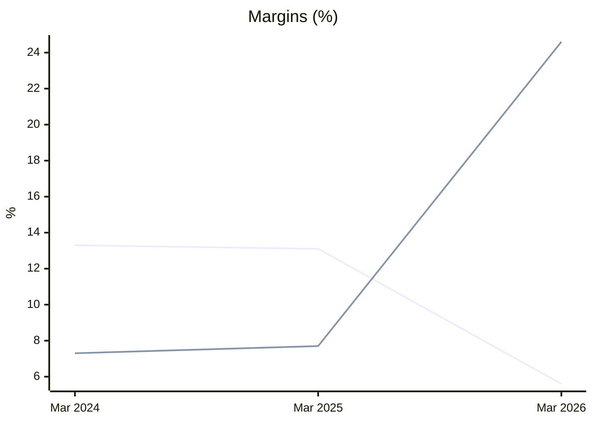

*Run 2026-11-24 · part of [SPINOFF_REPORT.md](../SPINOFF_REPORT.md) · the complete analysis of one company, with every management-call exchange in full.*

## TMPV — Tata Motors Passenger Vehicles Ltd.

### 1. Tata Motors Passenger Vehicles Ltd. — CONFIRMED DEMERGER

**CONFIRMED** (a demerger scheme is on the exchange record) · **LISTED 1–2Y — the second-year window** · score 5.7/10 · spin-off · 23 filing(s) from NSE, NSE-register · first 2025-10-14, latest 2026-11-01

**The separated entities — every one the documents name:**

| Entity | Scheme | Business | Listing | Who runs it |
|---|---|---|---|---|
| **Tata Motors Limited** (earlier TML Commercial Vehicles Limited) | 2024 Composite Scheme of Arrangement amongst Tata Motors Li… | The Commercial Vehicle undertaking: all assets, liabilities and employees relating to the Commercial Vehicle … | listed 2025-11-12 as TMCV (NSE) | Mr. Girish Wagh, Executive Director of Tata Motor… |

**The other parties to the scheme(s)** — not separated entities: Tata Motors Finance Limited — merged in — no shares for the parent's holders

**What is being separated, as the documents put it:** The Commercial Vehicles business of Tata Motors Limited, demerged into a separate listed entity — class `regulatory_strategic`.

### 2. Stages and dates

> **Listing:** LISTED — Tata Motors Limited (TMCV) since 2025-11-12 (NSE equity list); record date 2025-10-14

| Date | Event | Source |
|---|---|---|
| 2024-03-04 | Other — Tata Motors Limited | as stated: First intimation to the exchanges of the proposed demerger, letter sc… |
| 2024-08-01 | Board approval — Tata Motors Limited, TML Commercial Vehicles Limited and Tata Motors Passenger Vehicles Limited | as stated: Outcome of Board Meeting, letter sc no. 18374 dated August 1, 2024 ("… |
| 2024-08-05 | Stage reached: **nclt sanction** | [Scheme of Arrangement](https://nsearchives.nseindia.in/corporate/TATAMOTORS_05082024195129_NSEBSELETTER.pdf) |
| 2024-09-01 | Stage reached: **effective** | [Scheme of Arrangement](https://nsearchives.nseindia.in/corporate/TATAMOTORS_01092024131630_Reg30IntimationofEffectivenessoftheScheme01092024.pdf) |
| 2025-02-24 | Exchange no-objection — BSE Limited observation letter to Tata Motors Limited | as stated: NCLT Order dated August 25, 2025 (filed September 26, 2025) and Scrut… |
| 2025-02-25 | Exchange no-objection — National Stock Exchange of India Limited observation letter to Tata Motors Limited | as stated: NCLT Order dated August 25, 2025 (filed September 26, 2025) and Scrut… |
| 2025-03-25 | Other — NCLT, Mumbai Bench order in C.A.(CAA) No. 61/MB/2025 directing the meeting of equity shareholders of TML and dispensing with meetings of equity shareholders of TMLCV and TMPV and of secured and unsecured creditors of the second and third applicant companies | as stated: Notice of Court Convened General Meeting filed April 4, 2025 (sc no. … |
| 2025-05-06 | Shareholders / creditors meeting — Meeting of the Equity Shareholders of Tata Motors Limited (held 3:00 p.m. IST via VC/OAVM; resolution passed with 99.9995% of votes polled in favour) | as stated: Proceedings and Voting Results filed May 6, 2025 (sc no. 18656) |
| 2025-07-01 | Appointed date — Composite Scheme of Arrangement (opening of business hours of July 01, 2025) | as stated: Effectiveness intimation sc no. 18764 dated October 1, 2025; NCLT Ord… |
| 2025-08-25 | NCLT order — NCLT, Mumbai Bench-I, CP(CAA)/139/MB/2025 sanctioning the Composite Scheme | as stated: Intimation dated August 25, 2025 (sc no. 18733) and certified true co… |
| 2025-09-10 | Other — NCLT Rectification Order (COMP.APPL/269(MB)2025) correcting the August 25, 2025 order, including replacing the share entitlement para with the 1:1 TMLCV ratio | as stated: Certified true copy of Orders filed September 26, 2025 (sc no. 18755) |
| 2025-09-25 | Other — Certified true copies of both NCLT Orders received by the Company | as stated: Letter sc no. 18755 dated September 26, 2025 |
| 2025-09-26 | Other — Boards of the respective companies resolved to make the Scheme effective on October 1, 2025, and identified the NCDs to be transferred to TMLCV | as stated: Letter sc no. 18755 dated September 26, 2025 |
| 2025-10-01 | Effective date — Composite Scheme effective on filing of certified copies of the Orders in e-Form INC-28 with the Registrar of Companies, Mumbai, Maharashtra; TMPV stands amalgamated with the Company and ceases to exist | as stated: Scheme of Arrangement intimation sc no. 18764 dated October 1, 2025 |
| 2025-10-10 | Record date — Record Date for determining eligible Debenture Holders of identified NCDs (₹2,300 crore) to be transferred from the Demerged Company to the Resulting Company | as stated: Record Date intimation sc no. 18765 dated October 1, 2025, Annexure A |
| 2025-10-13 | Other — Change of name of the Company from Tata Motors Limited to Tata Motors Passenger Vehicles Limited, w.e.f. October 13, 2025 | as stated: Letter sc no. 18796 dated October 13, 2025, referred to in letter sc … |
| 2025-10-14 | **Record date** | NSE corporate-actions register |
| 2025-10-14 | Stage reached: **record date** | Record Date (corporate-actions register) |
| 2025-10-14 | Record date — Record Date (Tuesday, October 14, 2025) for shareholders of Tata Motors Limited entitled to 1 share of TMLCV for every 1 share held | as stated: Record Date intimation sc no. 18765 dated October 1, 2025 and shareho… |
| 2025-10-15 | Allotment — TMLCV allotted 3,68,23,31,373 fully paid equity shares of ₹2 each to equity shareholders of TML in the ratio 1:1; entire pre-Scheme paid-up capital of 5,00,000 shares cancelled; TMLCV ceased to be a wholly owned subsidiary | as stated: General Updates letter sc no. 18799 dated October 15, 2025 |
| 2025-10-29 | Other — Change of name of TML Commercial Vehicles Limited to Tata Motors Limited (fresh Certificate of Incorporation dated October 29, 2025) | as stated: General Updates letter sc no. 18808 dated October 30, 2025 and TMCV p… |
| 2025-11-12 | **Tata Motors Limited** listed (TMCV) | NSE equity list |
| 2025-11-12 | Listing and trading — Tata Motors Limited (formerly TML Commercial Vehicles Limited) — BSE and NSE approval for listing and trading of its equity shares effective November 12, 2025 | as stated: General Updates letter sc no. 18818 dated November 10, 2025 |
| 2025-11-28 | Stage reached: **meetings** | [Shareholders meeting](https://nsearchives.nseindia.com/corporate/TATAMOTORSSJS_28112025190050_Lettertoexchangesforpostalballotfinal.pdf) |

**The stages, as filed:** nclt sanction (2024-08-05) → effective (2024-09-01) → record date (2025-10-14) → meetings (2025-11-28)

**Stated in the filings:** demerged undertaking: , undertaking; record date 2025-10-14.

**When it lists, in the documents' words:** On November 10, 2025 the Company said TMCV "has received approval from BSE Limited and National Stock Exchange of India Limited for listing and trading of its equity shares, effective November 12, 2025"; on November 1, 2025 it had said "The process for listing is currently underway."

### 3. Size of the separated business beside the parent — is institutional selling likely?

**Reading: LESS LIKELY on size alone — the piece is the larger part of the business.**

| Entity | Stated turnover | Stated share of the whole | Market cap (₹ cr) | Share of the whole by market cap | Segment revenue share | Index member | Selling on size |
|---|---|---:|---:|---:|---:|---|---|
| Tata Motors Limited | "total income relating to Commercial Vehicles Business was … | 99.0% (share of turnover) | 159,667 | 60.1% | 20.5% (FY2025) | yes | less likely |

*Stated figures are the documents' own (a turnover share, or the cost-of-acquisition split the company publishes for tax, which reflects relative value). The market-cap share is the entity's value over the whole — the parent plus every separated entity that trades (parent ₹105,853 cr, whole ₹265,521 cr, NSE bhavcopy of 2026-11-13); the segment share is the business's revenue over the parent's reported sales of that year. Both are computed here. The reading uses the market-cap share when the entity trades, else the stated share, else the segment share.*

**In the documents' words:** “As per audited standalone financial statements as at March 31, 2024, Tata Motors Limited's ("the Company"/ "TML") total income relating to Commercial Vehicles Business was ₹ 73,116.64 crore, representing ~99% of the total income for FY 2023-24.”

**The judge's read of selling pressure:** likely — 1:1 shares pushed to all 64,60,243-shareholder base of a large parent; commercial vehicles is a different business from cars/SUVs.

### 4. Insider ownership — share swap, promoters' holding, management incentives

**Share swap / entitlement, entity by entity:**

- **Tata Motors Limited:** "1 (One) share of TMLCV (face value of INR 2/- each fully paid up), for every 1 (One) share of the Company (face value of INR 2/- each fully paid up) of the same class of shares outstanding and as held by such shareholder in the Company on the "Record Date"." Allotment of 3,68,23,31,373 fully paid equity shares of face value ₹2/- each in the ratio of 1:1

**Promoters' holding, from the shareholding pattern:**

| Company | Promoters | FIIs | DIIs | Public | Quarter |
|---|---:|---:|---:|---:|---|
| Tata Motors Passenger Vehicles Ltd. (TMPV) | 42.5% | 15.32% | 17.93% | 24.2% | Sep 2026 |
| Tata Motors Limited (TMCV) | 42.51% | 19.02% | 18.61% | 19.8% | Sep 2026 |

*Source: screener.in shareholding pattern, stored under `ShareholdingPattern/NiftyTotalMarket/`. In a mirror demerger each shareholder holds the same proportion of the new company as of the parent on the record date.*

- **Promoters in the parent, per the documents:** not stated as a percentage for the parent; the documents state only "TML: No change." in shareholding pattern pursuant to the Scheme, and "There will be no change in the shareholding pattern of TML pursuant to the Scheme coming into effect."
- **What the promoters will hold in the separated entity:** 2024 Composite Scheme (CV demerger): "Upon the effectiveness of the Scheme, the shareholding of TMLCV will mirror the shareholding of TML." and "The effectiveness of the Scheme would result in creation of two listed companies, forming part of the Tata Group, with identical shareholding (including common promoters) with the Resulting Company housing the Commercial Vehicles Business and the Amalgamated Company housing the Passenger Vehicles Business." TMLCV shareholding (details as on July 26, 2024): Promoters Pre-Scheme 100.00%, Post-Scheme (Indicative) 41.22%; Public Pre-Scheme nil, Post-Scheme 58.78% (*Considering Ordinary and 'A' Ordinary shares). Amalgamation of TMPV into TML: "There will be no change in the shareholding pattern of TML pursuant to the Scheme coming into effect." 2024 TMFL–Tata Capital scheme: "TCL will issue its equity shares to the shareholders of TMFL resulting in TML effectively holding a 4.7% stake in the merged entity." 2024 'A' Ordinary Shares scheme: promoter holding after is not stated.
- **What a public shareholder receives:** 2024 Composite Scheme (CV demerger): "each shareholder of Demerged Company whose name is recorded in the register of members and records of the depository as a shareholder of the Demerged Company as on the Record Date (ie. October 14, 2025) shall be issued and allotted 1 (one) share of the Resulting Company (face value of INR 2/- each fully paid up), for every 1 (one) share of the Demerged Company (face value of INR 2/- each fully paid up) of the same class of shares outstanding and as held by such shareholder in the Demerged Company, without any further application, act or deed ('Share Entitlement Ratio')." Shareholders also continue to hold their existing shares in TML (renamed Tata Motors Passenger Vehicles Limited), which "shall continue to be a listed entity". 2024 'A' Ordinary Shares scheme: "As per the Scheme, the Company shall issue 7 (seven) fully paid up New Ordinary Shares of the face value of ₹ 2 each for every 10 (ten) 'A' Ordinary Shares of the face value of ₹2 each, as consideration to the 'A' Ordinary Shareholders of the Company as on the Record Date ('Consideration')." 2024 TMFL–Tata Capital scheme: nothing is received by TML's own public shareholders; "the shareholders of TMFL shall receive 37 equity shares of Rs.10/- each in TCL for every 100 equity shares of Rs. 100 each held by them in TMFL."
- **Management incentives:** Treatment of existing grants under the Composite Scheme is not stated. Resolutions passed at the 79th AGM held on June 24, 2024 (both Special Resolutions): "Tata Motors Limited Share-based Long Term Incentive Scheme 2024 and grant of Performance Share Units to the Eligible Employees under the Scheme" and "Extending the Tata Motors Share-based Long Term Incentive Scheme 2024 to Eligible Employees of Subsidiary companies of the Company". No new plan in the resulting company, no exercise price or pricing date, and no management or insider shareholding are stated. Related manpower action at JLR: "About GBP 40 million of that was associated with a voluntary redundancy program as we resized our cost base" and "We are taking c.500 employees out of our admin base".
- **Insider actions around the separation:** not stated in the documents on file.
- **Insiders, per the checklist read:** Promoter and promoter group held 1,565,402,703 of 3,682,582,902 shares (~42.5%), receiving 1:1 shares in the Resulting Company. MD Shailesh Chandra holds 1,50,029 shares plus PSUs under Scheme 2024, subject to Scheme Clause 9. · *option pricing date:* not stated

### 5. Why the demerger — point by point

The business being separated is the Commercial Vehicles (CV) business of the erstwhile Tata Motors Limited, carved out under a Composite Scheme of Arrangement into TML Commercial Vehicles Limited (since renamed Tata Motors Limited), while the listed parent was renamed Tata Motors Passenger Vehicles Limited (TMPV) and simultaneously absorbed its wholly-owned subsidiary Tata Motors Passenger Vehicles Limited by amalgamation — the Scheme's stated purpose there being 'consolidating the Passenger Vehicles Business with TML'. The net effect, as the Scheme describes it, is that 'the Commercial Vehicle and Passenger Vehicle businesses of the Company are housed in two separate entities' from October 1, 2025, leaving TMPV with India PV, EV (Tata Passenger Electric Mobility) and JLR, plus Tata Technologies and Tata Motors Holdings Singapore in 'others'; segment reporting was recast accordingly and prior-period balance sheets declared non-comparable. Critically, across all six transcripts management never articulates a strategic reason for the split — no dis-synergy, focus, capital-allocation or value-unlock argument is given; the demerger appears only as a corporate action with dates, approvals, accounting and costs. The economics disclosed are: CV was valued at about Rs 94,000 Cr by third-party agencies against a transferred book value of about Rs 11,000 Cr, producing a Rs 83,000 Cr accounting profit on disposal of the CV undertaking that is 'only a notional gain' because of an equal contra deemed-dividend entry, so there is 'absolutely no impact on either distributable reserves or on our net worth'. Shareholders got one CV share for every one share held (1:1), the split is Section 2(19AA)-compliant so it is not a transfer in shareholders' hands, and cost of acquisition was apportioned 31.15% to CV and 68.85% to TMPV. Costs cited were a Rs 400 Cr stamp duty provision in Q3 FY26 (within Rs 1,600 Cr of exceptionals) rolling into the Rs 4,100 Cr of FY26 exceptionals alongside cyber and labour-code charges. Governance was split too — separate boards and KMP, Shailesh Chandra as MD & CEO of TMPV, P B Balaji moving to CEO of JLR — and capital structures now report separately (India PV net cash ~Rs 5,000 Cr at Q3 FY26 and ~Rs 7,000 Cr at year-end versus JLR net debt of ~Rs 33,000–39,000 Cr). No investor, lender or partner is named as having asked for the separation; the only constituency cited is shareholders, who approved it with 'overwhelming votes in our favor', plus SEBI/stock exchange NOCs and NCLT sanction.

**Point by point, with the source:**

1. The demerger is reported purely as a process milestone: regulatory no-objections from the exchanges and SEBI awaited, operational separation work advanced, appointed date July 1 and effective date around October 1, 2025. “We are expecting the NOC from the Stock Exchange and SEBI any time now, all filed and done.” — *[Feb 2025](https://www.bseindia.com/stockinfo/AnnPdfOpen.aspx?Pname=28345af3-7271-4146-8cf3-8da0f9c73222.pdf)*
2. Shareholder approval is confirmed as emphatic and the timetable reaffirmed; the only related substantive disclosure is that the Tata Capital stake goes with the CV business. “The demerger update: we had overwhelming votes in our favor and therefore we are on track for an appointed date of July 1st and an effective date of October 1st 2025.” — *[Jun 2025](https://www.bseindia.com/stockinfo/AnnPdfOpen.aspx?Pname=80350d5e-9578-469f-bf9f-31610098f897.pdf)*
3. The NCLT final hearing concluded on the day of the call with judgment reserved, and management still guided to an October 1 effective date, expecting completion within the quarter. “We had the NCLT final hearing today and it has been concluded and the judgment is reserved.” — *[Aug 2025](https://www.bseindia.com/stockinfo/AnnPdfOpen.aspx?Pname=2a91a004-4cbd-440e-93d3-2ca8967ff37b.pdf)*
4. First results as the post-demerger listed entity: CV is out of segment reporting, the automotive segment is now JLR plus Tata Passenger Vehicles, others is mainly Tata Technologies and Tata Motors Holdings Singapore, and prior-period balance sheets still include CV so are not comparable. “It's a pleasure speaking to you as we report our first quarterly earnings as a listed entity.” — *[Nov 2025](https://www.bseindia.com/stockinfo/AnnPdfOpen.aspx?Pname=e6684a03-5a4d-4c7a-8da0-d5b2c52ec7d1.pdf)*
5. The accounting: CV was independently valued at about Rs 94,000 Cr versus about Rs 11,000 Cr of net assets transferred, giving a Rs 83,000 Cr disposal profit that is purely notional because of an offsetting Rs 83,000 Cr deemed dividend. “As part of demerger accounting entries, we have recorded a profit of ~Rs. 83,000 Cr on disposal of the CV undertaking, which is essentially the fair value of the CV assets, less the book value of net assets transferred.” — *[Nov 2025](https://www.bseindia.com/stockinfo/AnnPdfOpen.aspx?Pname=e6684a03-5a4d-4c7a-8da0-d5b2c52ec7d1.pdf)*
6. Capital structures are now shown standalone — auto net debt moved from net cash to ~Rs 20,000 Cr (all at JLR) while India PV is net cash, which is the one place management links the standalone balance sheet to funding its product cycle. “Domestic India business is net cash which gives a lot of flex to fund the rich product investment cycle that will be coming through in the years.” — *[Nov 2025](https://www.bseindia.com/stockinfo/AnnPdfOpen.aspx?Pname=e6684a03-5a4d-4c7a-8da0-d5b2c52ec7d1.pdf)*
7. The demerger is now only a reporting and cost item: CV permanently out of segments, and a Rs 400 Cr stamp duty provision taken within Rs 1,600 Cr of quarterly exceptionals alongside Rs 800 Cr of cyber costs and a Rs 400 Cr wage-bill charge. “I would like to call out that this excludes exceptional for Rs. 1,600 Cr: Rs. 800 Cr at JLR - additional impact because of the cyber incident, Rs. 400 Cr one-time Wage bill impact for India business, and another Rs.400 Cr provision we have taken for the stamp duty impact.” — *[Feb 2026](https://www.bseindia.com/stockinfo/AnnPdfOpen.aspx?Pname=7907e958-7953-4b49-b831-aab03d6e2746.pdf)*
8. FY26 PBT of Rs 2,500 Cr is stated before Rs 4,100 Cr of exceptionals that include the demerger stamp duty, and the two entities' dividends are presented together as evidence shareholders are better off post-split. “So this actually represents a total dividend of Rs. 7 in the year when the demerger was undertaken and an increase over the Rs. 6 that we have paid for the last two years.” — *[Jun 2026](https://www.bseindia.com/stockinfo/AnnPdfOpen.aspx?Pname=b4d386d7-de53-4409-8e90-187e08cb4a91.pdf)*
9. The Scheme has two legs: the CV undertaking demerges out of Tata Motors into TML Commercial Vehicles Limited on a going-concern basis, and the PV subsidiary amalgamates into the parent so that the passenger business is consolidated in one listed company, with the subsidiary dissolved. “Amalgamation of TMLPV with TML with an objective of consolidating the Passenger Vehicles Business with TML and consequent dissolution of TMLPV without being wound up.” — *Scheme*
10. Shareholders received 1 CV share for every 1 share held, the demerger is Section 2(19AA)-compliant so not a transfer in their hands, and cost of acquisition splits 31.15% to the new Tata Motors (CV) and 68.85% to TMPV; separate boards and KMP were constituted for both entities, with CV shares listed from November 12, 2025. “the Commercial Vehicle and Passenger Vehicle businesses of the Company are housed in two separate entities” — *Scheme*

**How it evolved:** In the Feb 2025 (Jan 29, 2025) call the demerger appears only as a corporate-action status item — filings done, NOC from the exchanges and SEBI awaited, appointed date July 1 and effective date around October 1, 2025 — and by the Jun 2025 (May 13, 2025) call management reports 'overwhelming votes' from shareholders and reaffirms those dates. In the Aug 2025 (Aug 8, 2025) call the NCLT final hearing had concluded that same day with judgment reserved, with the October 1 effective date still 'on plan'; the Nov 2025 (Nov 14, 2025) call is the first reported as a post-demerger listed entity, dominated by mechanics: segment recast, non-comparable balance sheets, and the Rs 83,000 Cr notional disposal gain against the Rs 94,000 Cr valuation and Rs 11,000 Cr book value. Thereafter it shrinks to a cost line — a Rs 400 Cr stamp duty provision in Feb 2026 (Feb 5, 2026) and stamp duty inside Rs 4,100 Cr of FY26 exceptionals in Jun 2026 (May 14, 2026), where the only forward-looking framing offered is that TMPV's Rs 3 dividend plus TMLCV's Rs 4 equals Rs 7 against Rs 6 paid by erstwhile Tata Motors. At no point in that sequence does the stated rationale evolve, because none is ever stated.

**What management expects from it:** Little quantified. Post-separation TMPV holds PV, EV and JLR only; segments recast to automotive plus others. India PV stays net cash (~Rs 5,000–7,000 Cr), giving 'flex' to fund its product cycle toward double-digit EBITDA; CV lists separately with its own board and dividend. Combined dividend rose to Rs 7 from Rs 6; net worth unchanged.

*Not explained on the calls:* Calls never state the strategic rationale, value-unlock or synergy numbers, who asked for the split, total transaction costs beyond stamp duty, or post-demerger capital-allocation, margin and valuation targets.

- *Stated reason, in one line:* Scheme housed CV and PV businesses in two separate entities; stated objective of the amalgamation limb was "consolidating the Passenger Vehicles Business with TML". No further rationale stated.
- *What it reveals:* Cost apportionment implies 68.85% of value in TMPV versus 31.15% in CV. Parent keeps JLR plus India PV/EV: FY26 consolidated net debt Rs 30,000 Cr sits almost entirely at JLR (Rs 33,000 Cr) while India PV is cash positive Rs 7,000 Cr.
- *Parent or spin:* parent · *Read next:* Tata Motors Limited (formerly TML Commercial Vehicles) standalone results and its Rs 4 dividend — the spin's own profitability.
- *In their words:* “In this regard, we wish to inform that TMCV has intimated the Company today that it has received approval from BSE Limited and National Stock Exchange of India Limited for listing and trading of its equity shares, effective November 12, 2025.”

### 6. On the calls, verbatim

9 call(s), oldest first: **0 question-and-answer exchange(s)** given in full — the question and every answer to it, nothing trimmed — and 14 passage(s) from management's prepared remarks (the complete sentences about it; the whole remarks are in the linked transcript). Text is as the transcript prints it.

#### May 2024

**From the prepared remarks** *(the passage about it; the whole turn runs to 0 characters in the transcript)*

> **(speaker not labelled):** Mobility Limited; Mr. Adrian Mardell, CEO, Jaguar Land Rover; Mr. Richard Mo lyneux, CFO, Jaguar Land Rover and our colleagues from the Investor Relations team. Today we plan to walk you through the results presentation followed by Q&A. As a reminder, all participant lines will be in listen -only mode and we will be taking the qu estions via the Team's platform , which is already open for you to submit your questions. You are requested to mention your name and the name of your organization while submitting the questions. I now hand over to Balaji to take this forward. Over to you, sir. P.B. Balaji Thanks, Anish. Good evening everybody and good morning wherever you are from. Standard safe harbor statement coming up, nothing new to report here. Next. I think it's a year which has been pretty intense at all ends, be it on the business side or the Tata Motors Limited May 10, 2024 corporate action s side. And I'd particularly li ke to call out in the CV side , the BS VI Phase 2 transition that has been a roaring success for us in terms of product delivery and market share pickup. We also had a very good work happening on Fleet Edge in terms of connecting almost 600,000 vehicles. And on the EV side, host of actions and particularly to call out the new EV dedicated stores that are starting to open up and of course, launch of the next architecture in our framework, the Pure EV architecture, and of course commencing of production on the new facility in Sanand and the rest is there for you to see. So a very satisfying year from a product and the business side as well. Going on to JLR, equally intense actions at their end, where of course performance from a ■nancial perspective has really picked up and there's a level of stability into the performance coming throu gh. And Reimagine Transformation which Richard and Adrian are going to talk about is progressing quit e well. And we also announced , I think the big one was announcement of the Agratas battery manufacturing setup which will be a very key vendor to JLR. And of course, the products continue to do exceedingly well. And with the kind of cash that got generated, more than GBP 1.8 billion of debt has been repaid out of operating cash ■ows in JLR. Next slide, please. The corporate action side of course, equally intense there. The ADRs have been delisted, Tata Technolog ies had a very successf ul IPO. We picked up 27% stake in Freight Tiger, all of which you are well aware of. Additional one is the DVR EGM , where we had greater than 99.5% majority of minority approval for the scheme. It just tells you how well it has been received by the shareholders of both the “A” Ordinary and the O rdinary shareholders. And of course, on the demerger , we are working at frenetic pace to bring the scheme to the Board for approval . Next slide. Moving on to ■nancials, really a satisfying and a very pleasing performance after many years of challenging performances. And ■nally, on a full - year basis, revenue grew almost 27% with an EBITDA of 14.3% and an EBIT of 8.3%. In quarter, of course, it was Rs. 120,000 Cr of revenue. On a full -year basis, we're now touching the Rs. 4.4 lakh Cr of revenue, almost $50 billion of revenue starting to come through in this business. And call out your attention on the PBT numbers of before exceptional item of almost Rs. 29,000 Cr for the year, with the highest ever that we have done and I will talk about the numbe rs in context in a little while and of course, the reasons being the volume ramp up in JLR, as well as, India. Pricing actions across the board are done in a surgical manner and of course, mix continuing to play a very big role for this. And with Auto Free cash ■ow of almost Rs. 14,000 Cr for the quarter, another Rs. 27,000 Cr for the full year, that managed to help reduce the automotive debt. Next slide, please. Thanks to this performance, the Board has recommended a dividend of Rs. 3 for the ordinary shareholders, Rs. 3.1 for the DVR shareholder s, which is the normal divide nd and there is also a special dividend in lieu of the successful TTL IPO of Rs. 3 per share for Ordinary and Rs. 3.1 for the DVR holders . So together is about Rs. 6 and Rs. 6.2 resulting in a cash ■ow of almost Rs. 2,300 Cr, the highest ever dividend that Tata Motors has paid out. Next slide. Tata Motors Limited May 10, 2024 This is just to summarize of our performance, the slides are there for you to see, but maybe the next slide brings it alive even more. Why? This is really a year for all of us in Tata Mo tors to be

**From the prepared remarks** *(the passage about it; the whole turn runs to 0 characters in the transcript)*

> **(speaker not labelled):** May 10, 2024 Overall numbers, it's been again a very strong year, there's a highest ever revenues, highest ever pro■ts as far as this business is concerned as well. And we ended at Rs. 78,800 Cr revenue with a double -digit EBITDA that we had co mmitted. And for the quarter the EBITDA came in stronger at about 12%, and overall the business generated a PBT (bei) of almost Rs. 6,000 Cr. And it also delivered about $1 billion of EBITDA, which is also a new high for this business. And as we demerge th is business, you will start hearing more and more granular details about this as we go forward. Next slide, please. Source of margins, we speci■cally called out the pivot towards a demand -pull strategy and improving realization that ’s exactly what is you see in the numbers. So the English and the math are in tandem. Next slide, please. Girish, you want to cover this. Girish Wagh Thanks, Balaji. So I think the wholesale volumes grew by 14% over Q3. However, as we had indicated, there was a decline of 7% in Q4 and almost 4% on an entire year basis. Balaji spoke I think highest ever quarterly revenue also in Q4, surpassing the previ ous high which was in Q4 of FY 2 023. On the shares, I think we improved the market share quarter -on-quarter. SCV pickup I think seems to have bottomed out in Q3 and we started the movement up. The transformation in SCV pickup is underway and we should start seeing results as we go ahead. In the non -vehicle business, we grew the revenue by 13% in Q4 and almost 17% on a year -on-year basis. And we've also seen a healthy growth in the annual maintenance contracts, which is an attractive business. Some of the bright spots, I think heavy commercial vehicles grew 5% Y -o-Y. Passenger carriers grew once again 26% Y-o-Y. And just in Q4 , I think we had 38% growth, so the capacity increase actions that we have taken , have also started panning out. Going ahead on the customer sentiment index, I think they have remained ■rm and in fact, slightly grown in the Tipper segment, remained ■rm in ILCV. They dropped marginally, which is seasonal for HCV Cargo and SCV. Happy to report that the percent age of digitally generated leads and the sales grew to almost 26% now in Q4. So this is becoming a signi■cant part of our lead generation mechanism and we will continue to ramp this up. I think this is giving a signi■cant convenience to the customers. Net promoter score continued to improve and is now at a hi ghest -ever level of 72, so we'll continue to maintain and grow this. During the year we launch more than 140 new products, more than 700 variants, and we will continue the same momentum. We saw in the commodities, the ferrous metals had some softening , while barring aluminum which has gone up, I think all other non -ferrous metals have stabilized. And I think the cost optimization e■orts and realization improvement have helped to improve the margins. I think , during the year the ■eet utilizations also improved, freight rates also stabilized. I think so we actually e xited the year on a strong note. Go ing ahead we will continue our agenda of driving realization improvement by delivering more value to the custome rs and thereby have growth in the Vahan share. I think the demand generation, as we have been saying now will ha ve a judicious mix of ATL, BTL and Di gital , with digital becoming a key part of our demand generation. In electric vehicles, we are now looking at generating the demand in the post FAME environment, in the Tata Motors Limited May 10, 2024 sense for ACE kind of a segment. There is a pause in the FAME incentives. And to address that we've actually launched a new variant of AC E EV which can carry a payload of 1 tonne. So the price i n the hands of the customers will b e around 17% more without FAME for a 1 tonne variant as compared to the earlier 600 kg variant which had FAME incentives and it will deliver almost 30% better TCOs. So it's far better business proposition for the customer . So we were preparing for this post FAME environment and have launched an exciting range of products. In the downstream business, we will continue the growth with increase in the spares and service penetration which has been continuously growing now for t he last four years. Value added services penetration continues to grow and that will be our focus now. Essentially it also delivers higher customer value and also therefore helps us to improve the realizations. International markets, I think while the top line has remained ■at, we have been able to maintain the market shares and in fact improve pro■tability quite a bit and we will also continue to maintain the health of the channel in these countries. Next, slide. Coming to the Electr ic Mobility, I think d uring FY 20 24 we deployed more than 1,700 electric buses, so now we have more than 2,600 electric buses on the road covering more than 140 million kilometers cumulative. ACE EV , we improved the retails month -over -month during the year , and overall we hav e now more than 4,300 vehicles pl ying on the road. Here we have

#### Aug 2024 — [transcript](https://www.tatamotors.com/wp-content/uploads/2024/08/TML-Q1-FY25-Earnings-Call-Transcript.pdf)

**From the prepared remarks** *(the passage about it; the whole turn runs to 0 characters in the transcript)*

> **(speaker not labelled):** and of course, seasonally, for Tata Motors, Q1 is alwa ys a negative cash ■ow, which I wi ll show you subsequently as well. That's what's the net debt going up there. But no stress, it will come back under control, and JLR on track to go net debt free as well. Next slide. Spending a little bit time on the corporate action before I hand it over to the busi nesses to take them through the numbers. One is the demerger. Maybe take a minute to explain the transaction. The way the demerger will happen is in two steps. Step one, we are demerging the CV business undertaking out of the existing Tata Motors Company into the new CV List Co. Immediately after that, the Passenger Vehicle business, which is a subsidiary of the existing List Co called TML, will be merged into the TML existing Company. That is important to get done because you don't want the top Company to be construed as a CIC and hence this becomes a proper operating company. These will be the two listed companies and obviously along with the CV business undertaking, all its investments will also move and whatever is left behind will all be submerged into the TMPV Company . This is what i s happening. Along with that, the CV Company , the newly formed CV Company will be renamed as TML and the existing TML Company will be renamed as Tata Motors Passenger Vehicles. All of this is expected to happen in the next 12 months to 15 months and the appointed date for this tran saction we are targeting the 1st July, 2025. And when the demerger happens, whoever is on the record date, the shareholder of Tata Motors will be eligible for one share each of the CV Company , that is TML, and one share in the existing TML, which will be called TMPV. This is the nature of the transaction. One of the most important number in this entitlement ratio is obviously 1:1. One of the most important number is the asset ratio as on the appointed date, we expect it to be broadly 60:40, that is 60% as CV 40% as the residual PV that will be there. That is how the TML standalone will cut out and this will be tax -neutral for the CV and PV undertakings as well as the shareholders. And the next 12 months to 15 months is there. This share entitlement report has been ■led by PWC and the fairness opinion for the same given by SBI Capital Markets. Next slide. This is just the listing. I don't want to go through this. I will leave it to you. Reach out to us if there's anything that you would like us to clarify upon. Otherwise, it is just the listing out of all the companies where it is going to go. I am more than happy to clarify anything o■ine that you may require. Next slide please. Page 3 of 19 Tata Motors Limited August 01, 2024 Second set of corporate actions is the merger of Tata Motors Finance, the NBF C with Tata Capital. The Boards, as we announced in June, have already approved it. The scheme is already been ■led, it's with the stock exchanges and we expect to get this tran saction completed in the next nine to twelve months. We are in advanced discussions with RBI for securing their approvals as well as the stock exchanges. And the last one, which is the cancellation of DVRs and the issuance of ordinary sh ares. The NCLT hearing has been completed and the NCLT order is reserved for ■nal judgment. We have a hearing tomorrow, where we expect to receive the orders, ■ngers crossed. And upon ■nal judgment and of course, all other steps will start o■. And we are hoping to comple te this in the next two months, so that the DVRs get cancelled and we have ordinary shares issued in the return. So all the corporate actions are running at full speed and we intend to get all of them closed before the demerger. Next slide, please. With t his, let me hand it over to Richard to take you through the JLR performance. Richard, over to you. Richard Molyneux Okay, thank you, Balaji. And if we could move to the next chart. So, the bottom line for us is we continue to deliver strong and consi stent ■nancial results. This is based of wholesale number in the quarter, it was 97.8K, that's up 4.8% over the prior

**From the prepared remarks** *(the passage about it; the whole turn runs to 0 characters in the transcript)*

> **(speaker not labelled):** of asset ratio for demerger at 60:40 CV: PV. This is just for the India business and not including JLR. Absolutely correct. It is just the standalone entity of TML that is getting demerged. CV is coming out of that. So for whatever is remaining is the 40%, they are basically investments that company holds into the PV comp any, EV company JLR. It is the investment value which is all at book value. Next question is from Chandra mouli again, to JLR. Richard, what i s the quantum of price hike that was taken at the start of 20 25? And also can you give us some pointers on from this 8.9% that is there, how should we think about the journey to the 15%. How do you build the building blocks, any color on that? And maybe let me park and then take the remaining questions when you ■nish this. Or else I'll just be asking questions. Richard Molyneux Okay, so look, pricing, we haven't taken a great deal of net pricing. So within the numbers that I showed you in terms of the variance, pricing is not more than about 1% net. How should we think about the journey to 15% EBIT margin? I'll refer that to the comments that I made during the investor day, where we cover that o■ in some detail, driving the slight c ut in FCF outlook for JLR FY25 . What I've said is that we are going to hit net cash and we will work through the e■ects of the aluminum issue that I referenced in terms of free cash and update you next t ime around. P.B. Balaji Thank you. So I think next question I think is coming into CV , LCV segment growth potential after a period of ■atness, how are you seeing that? Girish Wagh So I think like we mentioned at the beginning of Q1, we see that for the year, the LCV, we call it a small commercial vehicle segment - SCV Pick-up should actually remain ■at wi th respect to the last year. We wi ll see higher growth or double digit growth in the CV passenger, that is, buses and van segment. And HCV and ILMCV is something we need to keep a watch on a quarterly basis. I think in ILCMV we do see growth continuing, which happened in the ■rst quarter also. HCV is something I think we need to keep a watch and how demand picks up. This is some of the factors that I spoke in the question which I Page 14 of 19 Tata Motors Limited August 01, 2024 answered before. Balaji. P.B. Balaji Yeah, thank you. I think this. I'll bring it into you Shailesh. EV softness in the ■eet segment. Can you just explain what's happening there? Shailesh Chandra Yeah. So, you know, there are many questions that I have been seeing around ■eet segment. So let me ■rst give some facts. Fleet segment is typically i n EV, 10% of the EV sales. That is how it had been in FY 20 24, which dropped to 5% to 6% in Q1. The reason is that in Q4, because FAME II was expiring , in Q4, we saw two to three times jump in the ■eet sales as a pre buy and that actually led to Q1 declining signi■cantly to the extent of 45-50%. And that has continued and over■own to July also because there is also an expectation of FAME III announcement, which ■eet owners would like to wait for. So this is what's really happening as far as ■eet segment is concerned. This was the question? P.B. Balaji Yeah, absolutely. Then questi on from Gunjan on electric business , can you give a better color on the volume break up between personal and ■eet? Go for it Shailesh. Shailesh Chandra So I already just mentioned that it is 10% is the ■eet segment, which currently has dropped to 5% to 6%. Also, the question asked for FAME policy continuity. It would not be right to speak about it. Although we have been in continuous discussion w ith the government, we are hoping that the same FAME II categories of vehicles which were given the FAME bene■t would continue. And it is very important that this segment is promoted because the direction of Niti Aayog, when they framed the EV policy, it was focused on connected , electric and shared mobility. So I think government is very much focused on shared mobility.

#### Aug 2024 — [transcript](https://www.tatamotors.com/wp-content/uploads/2024/08/TML-Q1-FY25-Earnings-Call-Transcript.pdf)

**From the prepared remarks** *(the passage about it; the whole turn runs to 0 characters in the transcript)*

> **(speaker not labelled):** Presentation Anish Gurav Good day and welcome to Tata Motors Q1 FY 2025 earnings call. Today, with us are Mr. P.B. Balaji, Group CFO, Tata Motors, Mr. Girish Wagh, Executive Director, Tata Motors , Mr. Shailesh Chandra, MD, Tata Motors Passenger Vehicles Limited and Tata Passenger Electric Mobility Limited, Mr. G.V. Ramanan, Vice President, Finance, Tata Motors Limited, Mr. Dhiman Gupta, Vice President, Finance, TMPVL and TP EML, Mr. Adrian Mardell, CEO, Jaguar Land Rover, Mr. Richard Molyneux, CFO, Jaguar Land Rover and we also have our colleagues from the Investor Relations team. Today, we plan to walk you through the results presentation followed by Q&A. As a reminder, all participant lines will be in listen -only mode and we will be taking questions via the Teams platform. The same is already open for you to submit your questions. You are requested to mention your name and the name of the organization while sub mitting the questions. I now hand over to Balaji sir to take over. Over to you, sir P.B. Balaji Thank you, Anish. Welcome to the call. Standard safe harbor statement. We will quickly run through the deck and then spend as much time as possible on the questions . It's been an intense, action packed quarter. The most exciting one coming up is the Tata Curvv, that is set to be launched, August 7th is the date , watch the space . And of course, last week, the most excit ing thing in JLR was the Jaguar TCS racing winning the World E -racing Championships. So, an exciting journey out there, a nd of course, the Defender OCTA coming up pretty soon. So lots of action underway and intend to keep this action at this level of intensity. Next slide please. Page 2 of 19 Tata Motors Limited August 01, 2024 From a revenue perspective, the quarter was a decent quarter with a revenue of 5.7% growth, though the volumes grew only 2.5%. Mix obviously comi ng to play. PBT before exceptional items showed a very strong increase to Rs. 8,800 Cr , driven by favorable commoditie s both in JLR and in Tata Motors here. EBITDA was ■at at 14.4% and obviously, the volume growth feeding into the EBIT numbers at 30 -odd bps operating leverage and very satisfying to see a positive cash ■ow in the ■rst quarter, which is seasonally our weake st quarter and therefore, that's come through well. Sources of growth where it came from, most of it coming from volume and mix. A little bit drop on pricing. Translation of the pound sterling going up at 1.6% and most of the businesses came to the party in terms of improving their pro■tability on the EBIT line. Net debt marginally up, basically, because of the dividends that went out from Tata Motors and of course, seasonally, for Tata Motors, Q1 is alwa ys a negative cash ■ow, which I wi ll show you subsequently as well. That's what's the net debt going up there. But no stress, it will come back under control, and JLR on track to go net debt free as well. Next slide. Spending a little bit time on the corporate action before I hand it over to the busi nesses to take them through the numbers. One is the demerger. Maybe take a minute to explain the transaction. The way the demerger will happen is in two steps. Step one, we are demerging the CV business undertaking out of the existing Tata Motors Company into the new CV List Co. Immediately after that, the Passenger Vehicle business, which is a subsidiary of the existing List Co called TML, will be merged into the TML existing Company. That is important to get done because you don't want the top Company to be construed as a CIC and hence this becomes a proper operating company. These will be the two listed companies and obviously along with the CV business undertaking, all its investments will also move and whatever is left behind will all be submerged into the TMPV Company . This is what i s happening. Along with that, the CV Company , the newly formed CV Company will be renamed as TML and the existing TML Company will be renamed as Tata Motors Passenger Vehicles. All of this is expected to happen in the next 12 months to 15 months and the appointed date for this tran saction we are targeting the 1st July, 2025. And when the demerger happens, whoever is on the record date, the shareholder of Tata Motors will be eligible

**From the prepared remarks** *(the passage about it; the whole turn runs to 0 characters in the transcript)*

> **(speaker not labelled):** for one share each of the CV Company , that is TML, and one share in the existing TML, which will be called TMPV. This is the nature of the transaction. One of the most important number in this entitlement ratio is obviously 1:1. One of the most important number is the asset ratio as on the appointed date, we expect it to be broadly 60:40, that is 60% as CV 40% as the residual PV that will be there. That is how the TML standalone will cut out and this will be tax -neutral for the CV and PV undertakings as well as the shareholders. And the next 12 months to 15 months is there. This share entitlement report has been ■led by PWC and the fairness opinion for the same given by SBI Capital Markets. Next slide. This is just the listing. I don't want to go through this. I will leave it to you. Reach out to us if there's anything that you would like us to clarify upon. Otherwise, it is just the listing out of all the companies where it is going to go. I am more than happy to clarify anything o■ine that you may require. Next slide please. Page 3 of 19 Tata Motors Limited August 01, 2024 Second set of corporate actions is the merger of Tata Motors Finance, the NBF C with Tata Capital. The Boards, as we announced in June, have already approved it. The scheme is already been ■led, it's with the stock exchanges and we expect to get this tran saction completed in the next nine to twelve months. We are in advanced discussions with RBI for securing their approvals as well as the stock exchanges. And the last one, which is the cancellation of DVRs and the issuance of ordinary sh ares. The NCLT hearing has been completed and the NCLT order is reserved for ■nal judgment. We have a hearing tomorrow, where we expect to receive the orders, ■ngers crossed. And upon ■nal judgment and of course, all other steps will start o■. And we are hoping to comple te this in the next two months, so that the DVRs get cancelled and we have ordinary shares issued in the return. So all the corporate actions are running at full speed and we intend to get all of them closed before the demerger. Next slide, please. With t his, let me hand it over to Richard to take you through the JLR performance. Richard, over to you. Richard Molyneux Okay, thank you, Balaji. And if we could move to the next chart. So, the bottom line for us is we continue to deliver strong and consistent ■nancial results. This is based of wholesale number in the quarter, it was 97.8K, that's up 4.8% over the prior year, we produced 100,000 vehicles and we retailed 111,000, including our joint venture in China. That 4.8% increase in wholesales turned into a 5.4% increase in revenue to GBP 7.27 billion. That is a record quarter one revenue level for JLR. It also turned into a really strong PBT number of GBP 693 million, which I will explain later. EBIT 8.9%. This is the 6th quarter in a row that we have had EBIT of over 6%. That's the consistency of our delivery, and also at this 8.9% level, it is consistent with our full year guidance of greater than 8.5% EBIT. In terms of cash ■ow, GBP 230 million favorable. This is our 7th consecutive quarter of free cash ■ow. That is something that JLR has never done in its history before. It's also the second highest ever Q1 cash ■ow behind the GBP 451 million that we recorded last year. We ha ve added ROCE to our metrics on a twelve -month rolling basis at 21.2%. That is consistent with our full year target of 22%. So next chart, please. And I won't go through this, this will get covered in entirety as I go through the rest of the pack. So next chart, please. There we go. So this looks at our wholesale and retail performance by brand. Range Rover, a strong success, wholesales were up 25% YoY and retail's up 20% YoY, driven largely by the removal of production constraints as we ■nished the ramp up at our Solihull plant. Defender a little bit weaker in terms of wholesales, but that is just the timing e■ect. If you look at the retail line for De fender, it is fairly ■at and fairly ■at at a very healthy level , signi■cantly over 100,000 units per year for us. Discovery retail is also fairly consistent and Jaguar, as expected, wholesales are down. We ceased production of XE, XF and F-TYPE during the quarter. That obviously translates into lower wholesales. The retail number is fairly ■at as we then start to sell through the stock levels. So no surprise in terms of where

**From the prepared remarks** *(the passage about it; the whole turn runs to 0 characters in the transcript)*

> **(speaker not labelled):** were ■attish. Any sense on demand outlook in China, as well as any market share indications you could give, as well as the EV penetration and luxury cars in China? Anything that you see in that? Richard Molyneux Sure. The wholesale volumes in Q1 for the domestic vehicles were 11,800. That's higher than Q4, although lower than the same quarter last year. So it's certainly more di■cult and more di■cult at the lower price points in China at the moment. However, the import business we still see as strong. We don't measure or refer to market share, but we note that our sales are increasing YoY in China. So it re ■ects the strength of the brands, particularly Range Rover and Defender. We are paying close attention to it as there are certainly signals that demand is not at the level that we would like to see it going forward and it will be a focal point for us for t he balance of the year to make sure that we take the necessary action. So it is absolutely a focal point for us. EV penetration is right at our end . To be honest, it is very limited at the moment. Chinese customers for Range Rover and Defender are st ill very much ICE customers. P.B. Balaji Got it. Thank you. I think the next question. Sorry, Richard, I'm going to stay with you again. This is from Gunjan, Bank of America. Couple of questions on JLR. How substantial can the impact of aluminum shortage in Q2 and Q3 be? And also, can you give some c olor Pag e 13 of 19 Tata Motors Limited August 01, 2024 on the CO2 emissions norms in EU in 2025 and how it a■ects us and how do you mitigate the risk . I think you already covered that. Richard Molyneux Yeah. So on the aluminium shortage, it is relatively new news and we are still working through how we can compensate. We a re normally fairly good at that. Our industrial operations team are very good at ■nding alternative sources and we are also leveraging the Tata ecosystem to he lp us in this. So we a re not going to give speci■c numbers. What I will say is within our full year number set, we are aiming to compensate for it such that we can still hit our EBIT and net cash position at the end of this year. We will work through it ov er the next few weeks. We wi ll give you a better update at the next quarterly meeting. But we recognize it's a problem and we have all resource focused on short term mitigation and then medium term mitigation to make sure we can hold our full year EBIT and net cash targets. P.B. Balaji Thank you. This next question probably I'll take it. This is from Jinesh Gandhi. Clari■cation of asset ratio for demerger at 60:40 CV: PV. This is just for the India business and not including JLR. Absolutely correct. It is just the standalone entity of TML that is getting demerged. CV is coming out of that. So for whatever is remaining is the 40%, they are basically investments that company holds into the PV comp any, EV company JLR. It is the investment value which is all at book value. Next question is from Chandra mouli again, to JLR. Richard, what i s the quantum of price hike that was taken at the start of 20 25? And also can you give us some pointers on from this 8.9% that is there, how should we think about the journey to the 15%. How do you build the building blocks, any color on that? And maybe let me park and then take the remaining questions when you ■nish this. Or else I'll just be asking questions. Richard Molyneux Okay, so look, pricing, we haven't taken a great deal of net pricing. So within the numbers that I showed you in terms of the variance, pricing is not more than about 1% net. How should we think about the journey to 15% EBIT margin? I'll refer that to the comments that I made during the investor day, where we cover that o■ in some detail, driving the slight c ut in FCF outlook for JLR FY25 . What I've said is that we are going to hit net cash and we will work through the e■ects of the aluminum issue that I referenced in terms of free cash and update you next t ime around. P.B. Balaji Thank you. So I think next question I think is coming into CV , LCV segment growth potential after a period of ■atness, how are you seeing that? Girish Wagh

#### Feb 2025 — [transcript](https://www.bseindia.com/stockinfo/AnnPdfOpen.aspx?Pname=28345af3-7271-4146-8cf3-8da0f9c73222.pdf)

**From the prepared remarks** *(the passage about it; the whole turn runs to 0 characters in the transcript)*

> **(speaker not labelled):** the PV side. Substantial amount of alternate powertrains, particularly on the Heav ies that were put Tata Motors Limited January 29, 2025 2 out and a lot of intelligent solutions , ADAS components that were also demoed on the CV side. And as far as the PV side, the standout was the launch of the all new Tata Sierra, as well as the Harrier EV that was there. And , of course, we showcased the concept, the next concept car on Avinya as well. So, a lot of action there, good excitement and the product o■ensive continues from our side. And of course, on the JLR side, who would have missed the Jaguar launch? And I'm sure Richard and Adrian are going to talk about it in the coming slides as well. Also on the Range Rover Electric, it's now getting closer and closer to the launch and a very, very exciting launch coming up on that front. Next slide, please. On the numbers side, as far as the year is concerned, we are looking at a strong performance for the full year. Therefore , this quarter was an important one to deliver as far as our internal plans are concerned and overall, happy that we managed to deliver on the internal plan that we had guided you towards. Revenue was up 2.7% as well as EBIT, up 60 bps, and pro■t before tax and exceptional items broadly ■at vis -a-vis last year, sequential improvement on these numbers and free cash ■ow was Rs. 4,700 crores, resulting in a net debt closing at Rs. 19,200 crores . And on a year -on-year basis, the PBT is now a very strong Rs. 22,300 crores, up almost Rs. 3,000 crores over last year. Next slide, please. Source of growth , coming in from volume , mix and of course a lot of translation also in that, thanks to the recent rupee depreciation that we had as well as pound versus the dollar as well. And , overall, PBT improvement , JLR contributed handsomely to those numbers and EBIT going from 8.3% to 8.9% this quarter. Net automotive debt is Rs. 19,000 crores of which the dome stic Indian business is back to net cash at Rs. 700 crores and JLR the remaining Rs. 12,300 crores, and Tata Motors Holdings Singapore. This debt reduction is obviously also translating into a sharp drop as far as the automotive ■nancing cost, interest cos t is concerned both on a gross and net basis. And this is reassuring in terms of the more levers coming into play as far as the overall PBT is concerned. Next slide, please. On the corporate action s, before I hand it over to the businesses, the demerger is progressing well. We are expecting the NOC from the Stock Exchange and SEBI any time now, all ■led and done. Operational activities are in an advanced stage and progressing as per plan. And , therefore, we are expecting to have the appointed date as July 1st. If all goes well in terms of just dates from the honorable NCLT and e■ective date is likely to be more like October this year. Tata Motors Finance, the creditors meeting completed. Final orders awaited from NCLT, and we do expect closure for this by en d of this ■nancial year. And , on production -linked incentives, PLI, which has been an area of a lot of questions and interest in the last meeting, happy to say that we have received the eligibility certi■cate , and on that basis, we also whatever we claimed for last year of Rs. 142 crores has been fully received as cash and this came in the beginning of the year. It also gives us now the reason to also accrue for the past. And , therefore, wherever the DVA criteria has been met and techno - commercial audit com pleted, we have accrued that . On that basis , we recorded Rs. 142 crores received and Rs. 209 crores for the accrual. And you also see on the slide, the contribution of that in the individual CV and PV. Let me now hand this over to Richard to take you throu gh the JLR performance. Richard, over to you. Richard Molyneux Let's stop on this chart. This stunning car was certainly one of the highlights of the quarter. Okay. So let's move to t he numbers. Next chart. So the summary for JLR is that Q3 was a solid robust quarter delivered in what's a very challenging market environment . At GBP7.5 billion, revenue is the highest Q3 revenue we have ever achieved o■ a wholesale volume of 104,000. EBIT at 9% is the highest Q3 Tata Motors Limited January 29, 2025 3 EBIT percent in a decade. PBT also remained strong, and we did deliver positive cash ■ow. It's also relevant, however, to the year -to-date numbers in the botto m row of the chart, as Q2 was impacted by a quality hold, and this did bene■t Q3. So looking at the bottom half of the chart, wholesales within 1% of last year, and revenue marginally up. EBIT is down 0.5 point, but PBT up. Cash ■ow is materially lower, and I'll talk about that speci■cally on a later chart. Next chart. So I won't go through this chart in detail, as per usual. All the points that are mentioned on it I'll cover

#### Jun 2025 — [transcript](https://www.bseindia.com/stockinfo/AnnPdfOpen.aspx?Pname=80350d5e-9578-469f-bf9f-31610098f897.pdf)

**From the prepared remarks** *(the passage about it; the whole turn runs to 0 characters in the transcript)*

> **(speaker not labelled):** these set of graphs. Next slid e please. And , this of course is translating into credit ratings , again two notches upgrade we received this year and we hope to get more as we go forward. Next slide please. The ■nal dividend . If you recollect last year we had a Rs. 3 ordinary dividend and we had a Rs. Tata Motors Limited May 13, 2025 3 3 special dividend . Delighted to say this year we have gone with a ■nal ordinary dividend of R s. 6 per share , total same as last year but all of this is now ■nal ordinary dividend , 300% of fa ce value . And obviously this will have to be approved in the shareholders meeting. The demerger update : we had overwhelming votes in our favor and therefore we are on track for an appointed date of July 1st and an e■ective date of October 1st 2025 . This year we also ha d the PLI bene■t . These are t he updates that you see : total for the year is almost R s. 500 crores of PLI bene■ts have been secured . Out of which R s. 142 crores we ha d it in the last quarter for FY 24 and for FY 25 we accounted about R s. 385 crores and the implications of margins are the re. Next slide. Just to take a minute on the Tata Motors ■nance merger that has just been concluded , it is a ■nancing company therefore it earns before interest and its costs are below EBIT and therefore that is why you see a 50 bps Delta in EBIT margin that is there. At the same time there is signi■cant shift in the liabilities line and the ■nance receivables line , where the balance sheet you will see almost a R s. 30,000 crores shift in ■nance receivables and the gross borrowing s is also down by almost Rs. 31,000 crores. So signi■cant shifts in the balance sheet because of this which makes this business less risky as we go forward. Next slide. Let me now hand this over to Richard to take us through the JLR p erformance. Richard over to Richard Molyneux: Can you hear me? PB Balaji : Yes, we can. Go ahead. Richard Molyneux : Right. So this chart summarises our ■nancial results for the full year on the right and for the quarter in the middle. Volumes and revenue were relatively ■at over both periods. EBIT was 10.7% in the quarter and just over 8.5% full year , aligned with our guidance. PBT for the quarter of GBP 875 million was the highest quarterly PBT we delivered in nine years and drove full year PBT to GBP2.5 billion. Cash ■ow GBP1.35 billion in the qua rter allowed us to end the year, GBP278 million in net cash. So our other main piece of guidance delivered. The main care point that I will refer to on a later chart is, however, EBITDA, which fell 1% Q-over -Q and 1.6% year -over -year. So to the next chart. As per usual, I'll skip over this chart as I'll cover all messages as we go through the pack. The key data is, however, here for your reference. Okay, so in terms of wholesales, wholesales in the quarter were ■at, 110,000 to 111,000 units, and for the full-year also at 401,000 units. In this chart and in the next c hart, Q4 will be at the top, FY 25 at the bottom. And because the full -year and the quarter in this particular case say the same story, I'll just refer to the bottom section of the chart. As we are ceasing the production of the legacy Jaguars, Jaguar volume essentially halved year - over -year from 50,000 to 27,000 units. With that volume moving into Defender and Range Rover, Defender had yet another record year, over 115,000 units. Than agai n, is the highest number of Defenders we have ever sold since 1947 when the car Tata Motors Limited May 13, 2025 4 started. And we also increased volume on Range Rover, Range Rover Sport and Evoque, which drove the Range Rover brand sales to 225,000 units, up 12% year -over -year. Next chart. So regionally, I'm looking at Q4 data ■rst, so I have the top half of the page. Our recovery in the UK continues from a couple of di■cult causes, closing the year ■at versus FY 24. Europe has been robust for us, up 12% quarter -over -quarter, although on a full-year basis, we're down 9,000 units, most of

**From the prepared remarks** *(the passage about it; the whole turn runs to 0 characters in the transcript)*

> **(speaker not labelled):** So, the cost impact on the biggest vehicle could b e somewhere around 0.5% to 0.6%. So, the cost impact for a, say, intermediate light commercial vehicle will be slightly higher, could be in the range of 1% to 1.2%. But as a co mpany, I think as we have been saying that we do not just comply to the regulations, but we always come up with some value enhancements and therefore, the product Tata Motors Limited May 13, 2025 16 makes sense for the customer. Beyond this, I think there is another question by Amin, which i s about what is the likely impact on the fuel e■ciency. So, by physics and engineering, yes, I think when you run the AC, the compressor will consume some power, so there will be some impact. But I am sure, I think like all OEMs, we will be working towards ensuring that this impact gets minimized. And the question whether this will turn out to be headwind, no, because I think in terms of price increase, it will be in the range of 1% to 1.5%. So, the fuel e■ciency impact will be lower single digits and as a company, we will ensure that there is a value enhancement being delivered to the customers. PB Balaji Thank you Girish. So, ■nal point on - post -demerger, will Tata Capital s take be part of CV business? The answer is yes. Question on Net worth and pro■t of Tata Capital , will take it o■ine. Okay, moving to Rakesh Kumar, BNP Paribas, we have already answered the question on US tari■s, I will leave that out. Let me get into the FCF, his point was, in FCF of FY25 working capital did play a big part, how do y ou see working capital trendin g in FY 26? Richard Molyneux Okay, so working capital is very seasonal for us, so Q4 is always very strong. That's partly because simply from a calendar bas is, our production levels are higher in Q4 and therefore our payables are higher. So, you would expect that to come back in Q1. For the full -year, you would also expect that to come back a little bit, although we will keep the diligence on receivables, we will keep the diligence on inventory levels, so we will continue to drive it down. Over the last two years, I think working capital has been about GBP1.35 billion favora ble. In the prior two years, FY22 and FY 23, it was GBP1.35 billion negative. So I would n't expect massive moves, but during the course of the year, there will be normal seasonal movements in working capital. PB Balaji Yeah, just to add one additional color on that, it obviously depends on how the total demand plays out in the year progressin g that, so let's watch the space is what I would say, just to add to what Richard just said. Richard, staying with you, this is Aditya Jhawar, from Investec . Update on the Chinese market, let's talk about that. Macro outlook, dealership consolidation, lau nch of EVs, Jaguar and RR, how do you see that? Richard Molyneux Okay, so I'll do the second one ■rst. Launch of EVs, I think I've already mentioned that we'll start taking reservations for Range Rover BEV this year. In relation to Jaguar, so you've seen the Type 00, which is the design vision for Jaguar. We'll unveil the ■rst actual car, the four -door GT Jaguar, later this year, before that car goes on sale in 2026. Remember , Gerry does say that he doesn't just do concept cars so you can expect the production car to be su■ciently similar, let me say. So that's the timing of Jaguar and Range Rover electric. Look, the China market, it is tough. It's tough for everybody. We are seeing at least a slowdown Tata Motors Limited May 13, 2025 17 in the rate of dealers leaving the premium western segments and are actually now moving to the scenario where we are looking to ■ll distrib

#### Aug 2025 — [transcript](https://www.bseindia.com/stockinfo/AnnPdfOpen.aspx?Pname=2a91a004-4cbd-440e-93d3-2ca8967ff37b.pdf)

**From the prepared remarks** *(the passage about it; the whole turn runs to 0 characters in the transcript)*

> **(speaker not labelled):** Mr. Richard Molyneux, CFO, Jaguar Land Rover, and we also have our colleagues from Investor Relations team. Today we plan t o walk you through the results presentation followed by Q&A. As a reminder, all participants will be in listen -only mode and we will be taking questions by the team's platform. The same is already open for you to submit the questions. You are requested to mention your name and the name of the organization while submitting the question. I now hand over to Mr. P .B. Balaji to take over. Over to you. Sir. P.B. Balaji Thank you. Good evening, everybody. First starting with the safe harbor statement, a slight shift here. So, with the sale of the Tata Motors Finance business , we have now removed that segment called vehicle ■nancing from our business and included in corporate / others. That's the only shift that is there. Some marginal shifts in the way free cash ■ow is de■ned where we have included mutual fund investments as well there. So that's the only shift there. Nothing material there. Next slide please, Quarter where a ctivity intensity continued domestically we had the air conditioned cabins being launched and on the JLR side, we had the Range Rover, Range R over Sport black versions getting through. On the EV side and I'm sure Shailesh is going to talk about it. The int roduction of the lifetime warranty on the high voltage batteries has been a blockbuster. That helped out very well in the sales. He will talk about that. And JLR's rating has been upgraded to Ba1 investment grade there, by Moody's. Tata Motors Limited August 08, 2025 2 Next slide, A few update s on the corporate actions. Hot of the press is the demerger. We had the NCLT ■nal hearing today and it has been concluded and the judgment is reserved. And that should help us complete this quarter. And the e■ective date for the demerger will be 1st Octob er, on plan. Then of course, last week we talked about the Iveco acquisition at length. So, I don't intend to go through it. It is there just to ensure that the details are w ell covered. The same slide you would have seen last time. Next slide please . A very intense quarter from the point of view of number of moving parts that we have to deal with in the ■nancial side. So, the wholesales were down 9.1% at 300,000 units. Revenues were down 2.5% at Rs. 104,000 crores . Pro■t before tax and exceptional item c ame in at Rs. 5,600 crores. A care point here if you look at the net pro■t line where there's a substantial pro■t from discontinued operations last year of almost Rs. 4,900 crores. That is basically the Tata Motors ■nance business when it was sold to Tata Capital. It is a discontinued business that had to be mark -to-market and that's what you see as a gain as a pro■t from discontinued operations , not the underlying basis. So this is before exceptional items is what you see as a number shift here. EBITDA 9.2 % was down 480 bps and we're going to talk about that both on the PV side and the JLR side . EBIT went down by 370 bps and free cash ■ow, nothing to worry there is a seasonal number that we are playing with . On top of it , of course, tari■s did impact. Next slide please . Where did growth declines come from? A lot of it coming out of volume and mix o■set by translation. Fundamentally pound sterling to the rupee and pro■tability wise, JLR declines, which Richard is going to talk about coming from the tari■ a s well as some one -o■s that we had. CV continued its performance of improving pro■ts despite revenue declines. So, now we're running at almost 12% plus EBITDA and that is what you see there. Net debt, domestic business, Rs. 3.6 K Cr minus Rs. 5.2K Cr, still at net cash. JLR is seasonal in terms of its net debt going up because the ■rst quarter and the real reassuring point is the net auto ■nance cost which is sharply declined, is also giving boost to the net pro■t line. Next slide please . Let me hand it o ver to Richard to take you through an engrossing quarter. Richard, over to you. Richard Molyneux Engrossing is one word for it. So, it's been a quarter that we've made actually a lot of progress, both in terms of evolving ou r brand, but also working with S ir Keir Starmer and his team in the UK government to get a more favorable trade deal with the US than virtually every other country. However, it would

#### Nov 2025 — [transcript](https://www.bseindia.com/stockinfo/AnnPdfOpen.aspx?Pname=e6684a03-5a4d-4c7a-8da0-d5b2c52ec7d1.pdf)

**From the prepared remarks** *(the passage about it; the whole turn runs to 0 characters in the transcript)*

> **(speaker not labelled):** Anish Gurav Good day and welcome to Tata Motors Passenger Vehicles Limited Q2 FY26 Earnings Call. Today we have with us Mr. P B Balaji, Group CFO , Tata Motors Passenger Vehicles Group; Mr. Shailesh Chandra, MD and CEO Tata Motors Passenger Vehicles Limited; Mr. Adrian Mardell, CEO Jaguar Land Rover; Mr. Dhiman Gupta, CFO Designate Tata Motors Passenger Vehicles Limited; Mr. Richard Molyneux, CFO Jaguar Land Rover. And we also have our colleagues from the Investor Relations team. Today we plan to walk you through the results presentation followed by Q&A. As a reminder, all participants will be in listen -only mode and we will be taking the questions via Teams platform. The same is already open to you to submit the questions. You are requested to mention your name and the name of organization while submitting the questions. I now hand over to Mr. Dhiman Gupta to take over. Over to you, sir. Dhiman Gupta Thank you, Anish. Good evening, everybody. And welcome to Tata Motors Passenger Vehicle Limited Analyst Call for Q2 FY26. It's a pleasure speaking to you as we report our ■rst quarterly earnings as a listed entity. Next slide, please. The Safe Harbor statement , as it's the ■rst quarter post the CV demerger , a few hygiene accounting related matters to get out of the way. Our segment reporting will now comprise of automotive segments and others. The automotive segment will now comprise of JLR and Tata Passenger Vehicles business. Other than CV segment moving out, there is no change there. Others will comprise the rest, the ■nancially material ones being Tata Technologies and Tata Moto rs Holdings Pte Limited Singapore. Next slide, please. For the purpose of statutory reporting, the published income statement has been reclassed to comprise only the TMPV group for prior periods for a like -for-like comparison. However, the balance sheet for prior periods will include CV business assets and lia bilities and hence not comparable. So, this TATA MOTORS Connecting Aspirations Tata Motors Passenger Vehicles Limited November 14, 2025 is something for you to know. Next slide, please. Another accounting matter related to the demerger. As part of demerger accounting entries, we have recorded a pro■t of ~Rs. 83,000 Cr on disposal of the CV undertaking, which is essentially the fair value of the CV assets, less the book value of net assets transferred. So, the business was valued at ~Rs. 94,000 Cr by third -party agencies. The book value that was transferred was ~Rs. 11,000 Cr, so the delta is about ~Rs. 83,000 Cr. But this is only a notional gain as there is a contra entry of ~Rs. 83,000 Cr as a deemed dividend. So, there is absolutely no impact on either distributable reserves or on our net worth. Next slide, please. Key highlights, while overall an extremely challenging quarter with the cyber incident at JLR , there continues to be several bright spots which we will continue to dial up as we progress out of this incident. The RR brand continues to have a strong brand recall. There has been a resurgence in the domestic demand post GST rate cuts and the Tata Passenger Vehicle business takes its ■rst bold steps in its international foray with the entry in South Africa. Next slide please. Coming to the consolidated ■nancial performance . With the loss of production for the entire month of September due to the cyber incident, the JLR revenues dropped by 24% , which was partially o■set by 15% top line growth in the India business and the translation bene■t in G BP INR . The loss in operating leverage, carryover of U.S. tari■ impact from Q1 and increased VME ■owed through every other ■nancial metric resulting in a PBT loss of ~Rs. 5,500 Cr for the quarter. There was an additional exceptional loss of ~Rs. 2,600 Cr for certain expenses related to cyber incident and the voluntary redundancy program at JLR. The FCF for ■rst six months of the year stood at negative ~Rs. 18,000 Cr and I'm sure Richard will talk about how the e■orts have been taken to keep liquidity at JLR at very comfortable levels. Next slide please. Revenue and pro■ts , we have already spoken in the last slide. The net auto debt has increased from a net cash position end of last ■scal to ~Rs. 20,000 Cr, increase primarily coming through at JLR. Other entities remain quiet. Domestic India business is net cash which gives a lot of ■ex to fund the rich product investment cycle that will be coming through in the years. Richard over to you to take on the JLR section please. Richard Molyneux Okay. Thank you, Dhiman and to the next page please.

#### Feb 2026 — [transcript](https://www.bseindia.com/stockinfo/AnnPdfOpen.aspx?Pname=7907e958-7953-4b49-b831-aab03d6e2746.pdf)

**From the prepared remarks** *(the passage about it; the whole turn runs to 0 characters in the transcript)*

> **(speaker not labelled):** Balaji, CEO, Jaguar Land Rover; Mr. Dhiman Gupta, CFO, Tata Motors Passenger Vehicles Limited and Mr. Richard Molyneux, CFO, Jaguar Land Rover and we also have our colleagues from the Investor Relations team. Today we plan to walk you through the results presentation followed by Q&A. As a reminder, all participants will be in listen -only mode and we will be taking the questions via Teams platform. The same is already open to you to submit the questions. You are requested to mention your name and the name of organization while submitting the questions. I now hand over to Mr. Dhiman Gupta to take over. Over to you, sir. Dhiman Gupta Thank you, Anish. Safe Harbor statement, nothing material to report here. Our reporting segments remain the same. Commercial vehicle business is out I think last quarter post the demerger , everything else is the same. Next slide please. In terms of key business highlights for the quarter, the domestic business has had a pretty busy launch calendar over the last couple of months, started with the launch of the Sierra, which got a phenomenal response. Punch, which is the leader in the subcompact SUV segment, received a phenomenal response in January. In between, we also had the launch of the 1.5 l itre Petrol engine for Harrier and Safari , in addition to the diesel and Harrier.ev versions we already have. We also crossed 2.5 lakh EVs on road, that's another milestone. And a lot more exciting stu■ that Shailesh is going to touch upon in the later half of the presentation. For Jaguar Land Rover, the topmost agenda for the quarter was to normalize the production post the cyber incident, but in between , there were also couple of exciting events, which showed the resilient and stre ngth of its brand. The Defender won the Dakar Rally in its debut, in its class. We also had very positive reviews from the first media drive of the new Jaguar on the media platforms. Next slide, please. In terms of consolidated ■nancial performance, obviously tempered by the continued impact of the cyber incident at JLR, where we lost almost a month of production in Q3 . Consolidated revenue came in at ~Rs. 70,000 Cr, 26% down year -on-year, and slightly declined quarter -on-quarter. The JLR Tata Motors Passenger Vehicles Limited February 5, 202 6 incident o■setting some of the strong robust topline growth that we saw in India post the GST rate cuts. And the EBIT margin still in the red. It was negative 4.7% for the quarter, slight improvement quarter -on-quarter, both at JLR and for the domestic business. The loss before tax for the quarter before exceptionals came in at ~Rs. 3,100 Cr. I would like to call out that this excludes exceptional for Rs. 1,600 Cr: Rs. 800 Cr at JLR - additional impact because of the cyber incident , Rs. 400 Cr one-time Wage bill impact for India busi ness, and another Rs.400 Cr provision we have taken for the stamp duty impac t. FCF for the quarter was at negative ~Rs.18,000 Cr, largely bec ause of adverse working capital movement and operating pro■ts at JLR. The cumulative cash out flow for the quarter is about ~ Rs. 37,000 Cr and that re■ects in the consolidated net debt as well. Next slide please. Already spoke about profit before tax for the quarter at negative ~Rs.3,000 Cr. The cumulative decline being ~Rs.9,000 Cr, almost all of it at JLR. The pro■t before tax for the India business flat on a year -on-year basis. Consolidated net debt for the group stands at ~Rs.39,000 Cr. The India business is cash positive at ~Rs.5,000 Cr, while JLR is at net debt of ~Rs.39,000 Cr. Next slide, please. Richard, over to you, take through the JLR business. Richard Molyneux I'll pause on this picture for a second, because although it wasn't a quarter full of highlights, this was de■nitely one. So, as Dhiman said, Defender won the Dakar Rally. It's the world's most grueling o■ - road endurance race, and to win it at our ■rst attempt shows the true class of the Defender vehicle. So, we're proud of that. We move on to the next page. So, the ■nancial summary is shown here. The cyber event cost us around 50,000 units of production, and that led to a wholesale result of 59,100 units in the quarter. The retails were almost 80,000 units . This drove revenue to GBP 4.5 billion, with average revenue per car, however, still rising. So, average revenue was GBP 76,000 per car, despite a weaker dollar environment. EBIT was minus 6.8%, better than Q2, though this is largely the e■ect of inventory build -down in Q2, relieving the balance sheet of som e manufacturing costs, and that e■ect reversing in Q3. I have already seen a couple of questions on this, so I will explain a little bit more later on. I mentioned at the end of Q2 that the main cyber -related cash burn would be in Q3, and it was. So, lower sales combined with recovering systems that allowed us to pay overdue invoices from the cyber stoppage, and we also settled and paid most supplier claims before their December year ends, which ampli■ed our cash burn in December. On a year -to-date basis below, including the e■ects of U.S. tari■s and cyber, we were minus 2.9% EBIT and negative just over GBP3 billion operating cash. As our plants are now back to

#### Jun 2026 — [transcript](https://www.bseindia.com/stockinfo/AnnPdfOpen.aspx?Pname=b4d386d7-de53-4409-8e90-187e08cb4a91.pdf)

**From the prepared remarks** *(the passage about it; the whole turn runs to 0 characters in the transcript)*

> **(speaker not labelled):** Dhiman Gupta Thank you, Anish. Let's start with the key highlights for the year, FY26. A story of two halves for the India business - started with muted volumes in H1 but a very strong comeback in H2 where we were consistently ranked number two in Vahan market share on the back of demand for our popular brands and the new launches. On the way, Punch also emerged as the fastest growing SUV to reach 6 lakh cars on road in four years. Moving on to JLR. A difficult year indeed for JLR, but one which also demonstrated the continued resilience of its House of Brands as it realizes and it prepares itself for adding exciting new products in its portfolio over the next 12 to 18 months, starting with Range Rover EV. Consolidated financials - with the normalcy of production at JLR, all the consolidated financial metrics are looking up. Revenue comes in at ~Rs. 105,000 Cr for the quarter , up 7% year -on-year on the back of strong India growth story and the currency appreciation. PBT before exceptionals for the quarter was Rs. 7,200 Cr and FCF was Rs. 11,000 Cr, as we managed to unwind some of the working capital reversals that we saw in Q2 and Q3. For the full year, all the metrics remained down as it was impacted due to two lost quarters of production at JLR. PBT for the year was Rs. 2,500 Cr, and this excludes about Rs. 4,100 Cr of except ionals for cyber, the labor code impact in India and the stamp duty charges for the demerger. Next slide, please. Tata Motors Passenger Vehicles Limited May 14, 202 6 The Board has approved a dividend of Rs. 3 per share. The cash outflow for the dividends will be about Rs. 1,100 Cr. This will have to be approved in the ensuing shareholders' meeting. Just to put the numbers in perspective, erstwhile Tata Motors paid Rs. 6 in dividends for the last two years. The TMLCV has announced Rs. 4 of dividend in the results meeting yesterday. So this actually represents a total dividend of Rs. 7 in the year when the demerger was undertaken and an increase over the Rs. 6 that we have paid for the last two years. Next slide. The net debt for the year ending March 2026 was Rs. 30,000 Cr, largely representing the Rs. 25,000 Cr of consol cash burn and the Rs. 2,200 Cr of dividends that we paid last year. PV remains cash positive at about Rs. 7,000 Cr, while the net debt at JLR stood at Rs. 33,000 Cr. Over to you, Richard. Richard Molyneux Thank you. Can you hear me okay? Dhiman Gupta Yes Richard, go ahead please. Richard Molyneux Let's go to the next chart, please. So as expected, we did recover strongly in Q4. We had 95,000 wholesales, revenue of nearly GBP7 billion and EBIT of 9.2%. That's only a little lower than our bumper Q4 last year , and is actually the same EBIT level as we achieved two years ago. FX revaluation did hold PBT back a little bit further, but we returned to being significantly cash positive, generating GBP829 million in the quarter. This performance allowed us to achieve our external guidance for the year. So we ended up with 0.7% EBIT , within our 0% to 2% guidance. And we ended up at the better end of our cash guidance , with full year cash loss just over GBP2.2 billion versus a minus GBP2.2 billion to minus GBP2.5 billion range. Having said that , and delivered what we promised in Q4, it is accepted that our full year financial performance is far from what we had intended when we started the year. So corrective action is necessary. Next page. So I won't go through this as per usual. It contains all the points I'll cover off in the presentation , here just in the summary form , in case you want to refer to it. Next page. You can see wholesale volumes here by brand. Defender, in particular, continues to defy industry norms and go from strength to strength through its life cycle, up quarter -on-quarter and year -over -year in Q4. And although Range Rover was down versus Q4 last year, almost all of this was accounted for by Evoque and Velar , with core Range Rover and Range Rover Sport fairly flat year -over -year. The biggest change , and one fully planned for , was Jaguar, down 5,700 units versus Q4 last year , as we progressed towards the new brand and the new product. On a full year basis, on the bottom row, we achieved 308,000 wholesales with again, Defender, Range Rover and Range Rover Sport showing the strongest performance. Next chart. So here's the same data by region , where actually the more interesting data is the full year data in the bottom row of the chart. The biggest change was the US, where tariffs made some derivatives and channels non -viable. But we also significantly reduced our retailer stock levels in the US and those are the ones that we had deliberately brought up at the end of last year , prior to the tariff introduction. So there's a bit of a pre -tariff, Tata Motors Passenger Vehicles Limited

### 7. The parent's financial statements

**The parent, last three fiscal years (consolidated)**

| | Mar 2024 | Mar 2025 | Mar 2026 |
|---|---:|---:|---:|
| Sales (₹ cr) | 434,016 | 366,094 | 335,582 |
| Sales growth (%) | +25.5% | -15.6% | -8.3% |
| Operating profit (₹ cr) | 57,809 | 47,993 | 18,719 |
| Operating profit growth (%) | +81.7% | -17.0% | -61.0% |
| Operating margin (%) | 13.3 | 13.1 | 5.6 |
| PAT (₹ cr) | 31,807 | 28,149 | 82,645 |
| PAT growth (%) | +1082.4% | -11.5% | +193.6% |
| PAT margin (%) | 7.3 | 7.7 | 24.6 |
| EPS (₹) | 94.5 | 75.6 | 224 |

*Source: ProfitStatement/NiftyTotalMarket/TMPV.csv (consolidated, screener.in); growth and margins computed here.*

```mermaid
xychart-beta
    title "Sales, operating profit and PAT (₹ cr)"
    x-axis ["Mar 2024", "Mar 2025", "Mar 2026"]
    y-axis "₹ crore"
    bar [434016, 366094, 335582]
    bar [57809, 47993, 18719]
    bar [31807, 28149, 82645]
```

*Series in order: Sales, Operating profit, PAT.*

*Series in order: Operating margin, PAT margin.*

**P/E:** 1.45 — live market file (screener.in), trailing (price ₹340.00 as of 2026-08-02).

**Cash flows (₹ cr):**

| | Mar 2024 | Mar 2025 | Mar 2026 |
|---|---:|---:|---:|
| Cash from operations (₹ cr) | 67,915 | 63,102 | 13,041 |
| Cash from investing (₹ cr) | -22,781 | -49,982 | -23,166 |
| Cash from financing (₹ cr) | -37,006 | -18,786 | -1,344 |
| Net cash flow (₹ cr) | 8,128 | -5,666 | -11,469 |
| Free cash flow (₹ cr) | 36,732 | 26,034 | -23,195 |

*Source: CashFlow/NiftyTotalMarket/TMPV.csv (consolidated, screener.in).*

### 8. The separated business's financial statements

**The business being separated — its own numbers**, entity by entity: its reported statements once it is listed and on file, and the segment numbers the annual reports and presentations carry for it before that.

**Tata Motors Limited (TMCV) — as reported since listing**

| | Mar 2026 |
|---|---:|
| Sales (₹ cr) | 58,217 |
| Sales growth (%) | — |
| Operating profit (₹ cr) | 6,172 |
| Operating profit growth (%) | — |
| Operating margin (%) | 10.6 |
| PAT (₹ cr) | 3,195 |
| PAT growth (%) | — |
| PAT margin (%) | 5.5 |
| EPS (₹) | 8.2 |

*Source: ProfitStatement/NiftyTotalMarket/TMCV.csv (consolidated, screener.in); growth and margins computed here.*

**Commercial Vehicles (segment: "Tata Commercial Vehicles" / "Commercial vehicle" under Tata and other brand vehicles) → TML Commercial Vehicles (renamed Tata Motors Limited, the Resulting Company)** · unit ₹ crore · Revenue = total segment revenue (external + inter/intra-segment); external revenue separately FY24 76,961.19, FY25 74,049. Operating profit = segment result = Earnings before other income (excl. incentives), finance costs, FX gain/(loss), exceptional items and tax (i.e. segment EBIT). No segment PAT disclosed. Capex and depreciation are segment-level.

| | FY2023 | FY2024 | FY2025 | FY2026 |
|---|---:|---:|---:|---:|
| Revenue (₹ crore) | 70,816 | 78,791 | 75,055 | — |
| Revenue growth (%) | — | +11.3% | -4.7% | — |
| Operating profit (₹ crore) | 3,693 | 6,483 | 6,814 | — |
| Operating profit growth (%) | — | +75.5% | +5.1% | — |
| Operating margin (%) | 5.2 | 8.2 | 9.1 | — |
| PAT (₹ crore) | — | — | — | — |
| PAT growth (%) | — | — | — | — |
| Segment assets (₹ crore) | 30,251 | 32,478 | 33,379 | — |
| Segment liabilities (₹ crore) | 22,543 | 24,449 | 25,147 | — |
| Capital employed (₹ crore) | 7,708 | 8,028 | 8,232 | — |
| Return on capital employed (%) | 47.9 | 80.8 | 82.8 | — |
| Segment assets / revenue (x) | 0.4 | 0.4 | 0.4 | — |
| Capex (₹ crore) | 2,202 | 2,052 | 2,103 | — |

*Sources:* Annual Report 2024 — page 373; Annual Report 2024 — page 372; Annual Report 2025 — page 408; Annual Report 2026 — page 422

*Not in the pages read:* No PAT any year. FY26: demerger effective Oct 1, 2025 (segments from Jul 1, 2025 exclude CV); pages carry only discontinued-operations PBT ₹1,658 crore (AR2026 p422). No CV quarterly data in TMPV presentations.

**Vehicle Financing → Vehicle Financing business (Tata Motors Finance Ltd., transferred to Tata Capital Ltd. from April 1, 2024 — entity not among those named above)** · unit ₹ crore · Revenue = total segment revenue. Operating profit shown as 'Earnings before other income, finance costs, FX, exceptional items and tax'; segment result after finance costs on borrowings sourced by the segment was FY24 (897.35)/(205) and FY25 (270). No PAT.

| | FY2023 | FY2024 | FY2025 | FY2026 |
|---|---:|---:|---:|---:|
| Revenue (₹ crore) | 4,595 | 4,099 | 51.0 | — |
| Revenue growth (%) | — | -10.8% | -98.8% | — |
| Operating profit (₹ crore) | 1,499 | 1,821 | -2.0 | — |
| Operating profit growth (%) | — | +21.4% | -100.1% | — |
| Operating margin (%) | 32.6 | 44.4 | -3.9 | — |
| PAT (₹ crore) | — | — | — | — |
| PAT growth (%) | — | — | — | — |
| Segment assets (₹ crore) | 35,651 | 33,288 | 8,172 | — |
| Segment liabilities (₹ crore) | 1,241 | 1,543 | 22.0 | — |
| Capital employed (₹ crore) | 34,410 | 31,745 | 8,150 | — |
| Return on capital employed (%) | 4.4 | 5.7 | -0.0 | — |
| Segment assets / revenue (x) | 7.8 | 8.1 | 160 | — |
| Capex (₹ crore) | 36.3 | 112 | 58.0 | — |

*Sources:* Annual Report 2024 — page 373; Annual Report 2024 — page 372; Annual Report 2025 — page 408; Annual Report 2026 — page 421

*Not in the pages read:* No PAT. FY26 figures absent — segment folded into Corporate/Unallocable and re-presented (AR2026 p421). FY25 re-presentation in AR2024 vs AR2025 differs (FY24 revenue 4,099 vs 141 re-presented).

*Businesses with no numbers in the pages read (3 annual report(s) and 11 presentation(s) on file):* All named entities map to the single separated Commercial Vehicles undertaking, for which numbers exist FY2023–FY2025; no separate standalone financials of TML Commercial Vehicles Ltd. as a legal entity appear on these pages.

*Documents on file:* [Annual Report 2026](https://www.bseindia.com/xml-data/corpfiling/AttachHis/b37e4ca4-826d-4b6c-b250-fcdf423e6bc4.pdf); [Annual Report 2025](https://www.bseindia.com/xml-data/corpfiling/AttachHis/18f91098-8691-409d-b771-808c48964a4f.pdf); [Annual Report 2024](https://www.bseindia.com/xml-data/corpfiling/AttachHis/0913b647-b205-4a3c-ad9b-8c493f97f972.pdf); [Presentation Nov 2026](https://www.bseindia.com/stockinfo/AnnPdfOpen.aspx?Pname=ad61cc44-2d46-43ca-b854-0a29ca81fda4.pdf); [Presentation Aug 2026](https://www.bseindia.com/stockinfo/AnnPdfOpen.aspx?Pname=0a68c514-96c1-4dc5-a628-3eda55a7b541.pdf); [Presentation Jun 2026](https://www.bseindia.com/stockinfo/AnnPdfOpen.aspx?Pname=10059fad-ae2a-4feb-acc2-09659bc3eb1f.pdf); [Presentation May 2026](https://www.bseindia.com/stockinfo/AnnPdfOpen.aspx?Pname=ee5addb0-24c8-45de-9071-c06bf3ba6daa.pdf); [Presentation Feb 2026](https://www.bseindia.com/stockinfo/AnnPdfOpen.aspx?Pname=dd254e14-5794-42bb-8d6f-1caf2bb991e9.pdf); [Presentation Nov 2025](https://www.bseindia.com/stockinfo/AnnPdfOpen.aspx?Pname=66609a3b-bf4c-44fb-936b-35980e120c69.pdf)

### 9. Other financial differences — working capital, margins, returns, debt

| Metric (latest year) | Parent (TMPV) | Tata Motors Limited (TMCV) |
|---|---:|---:|
| *Basis* | *reported, consolidated* | *its own reported statements* |
| Sales (₹ cr) | 335,582 (Mar 2026) | 58,217 (Mar 2026) |
| Sales growth (%) | -8.3 (Mar 2026) | — |
| Operating margin (%) | 5.6 (Mar 2026) | 10.6 (Mar 2026) |
| Operating profit growth (%) | -61 (Mar 2026) | — |
| PAT margin (%) | 24.6 (Mar 2026) | 5.5 (Mar 2026) |
| ROCE % | 3 (Mar 2026) | 36 (Mar 2025) |
| Debtor Days | 14 (Mar 2026) | 12 (Mar 2026) |
| Inventory Days | 85 (Mar 2026) | 35 (Mar 2026) |
| Days Payable | 158 (Mar 2026) | 101 (Mar 2026) |
| Cash Conversion Cycle | -59 (Mar 2026) | -54 (Mar 2026) |
| Working Capital Days | -81 (Mar 2026) | -89 (Mar 2026) |
| Debt / equity (x) | 0.7 (Mar 2026) | 0.4 (Mar 2026) |
| Borrowings (₹ cr) | 79,109 (Mar 2026) | 5,615 (Mar 2026) |

*Each figure is the latest on file, with its year. Working-capital days and ROCE come from the stored working-capital file; segment figures from the pages cited in part 8. A dash means the documents do not carry it.*

**What stays with the parent — its segments, from the same pages:**

| Remaining segment | Revenue | Operating margin | ROCE | Segment assets / revenue | Unit | Year |
|---|---:|---:|---:|---:|---|---|
| Tata Passenger Vehicles (segment: "Passenger vehicle" under Tata and other brand vehicles) | 58,465 | 1.4% | 9.1% | 0.47x | ₹ crore | FY2026 |
| Electric Vehicles (disclosed as amounts included in Passenger vehicles) | 23,596 | 1.7% | — | — | ₹ crore | FY2026 |
| Jaguar Land Rover | 273,303 | 1.0% | 2.5% | 0.99x | ₹ crore | FY2026 |
| Others (IT services; insurance broking up to FY25) | 5,513 | 13.1% | 22.7% | 1.28x | ₹ crore | FY2026 |

**What the documents themselves say about the differences:**

- **other** — parent / remaining: Passenger Vehicles Business retained in the listed entity; Tata Motors Passenger Vehicles Limited (the amalgamating wholly owned subsidiary carrying the PV business) had total income of ₹51,206.32 crore for the year ended March 31, 2024; separated business: Commercial Vehicles Business demerged into TMLCV with total income of ₹73,116.64 crore, ~99% of TML's standalone total income for FY 2023-24 “As per audited standalone financial statements as at March 31, 2024, Tata Motors Limited's ("the Company"/ "TML") total income relating to Commercial Vehicles Business was ₹ 73,116.64 crore, representing ~99% of the total income for FY 2023-24.”
- **other** — parent / remaining: 68.85% of a shareholder's total cost of acquisition of Ordinary Shares is apportioned to Tata Motors Passenger Vehicles Limited (formerly Tata Motors Limited); separated business: 31.15% of a shareholder's total cost of acquisition of Ordinary Shares is apportioned to Tata Motors Limited (formerly TML Commercial Vehicles Limited), being the proportion the net book value of assets transferred bears to the net worth of the demerged company “The total cost of acquisition of INR 4,00,000/- would be apportioned in the aforesaid ratio - INR 1,24,600/- (31.15% of INR 4,00,000/-) being the total cost of acquisition of 1,000 Resulting Company shares and INR 2,75,400/- (INR 4,00,000/- less INR 1,24,600) being the total cost of acquisition of 1000 original shares of Demerged Company.”
- **debt and leverage** — parent / remaining: TMPV group net debt of Rs. 30,000 Cr for the year ending March 2026; net auto debt had moved from a net cash position at end FY25 to ~Rs. 20,000 Cr at Q2 FY26; separated business: Identified Rated, Listed, Unsecured, Redeemable NCDs aggregating ₹2,300 crore transferred from the Demerged Company to the Resulting Company (NCD record date October 10, 2025) “The net debt for the year ending March 2026 was Rs. 30,000 Cr, largely representing the Rs. 25,000 Cr of consol cash burn and the Rs. 2,200 Cr of dividends that we paid last year.”
- **cash** — parent / remaining: PV remains cash positive at about Rs. 7,000 Cr while JLR net debt stood at Rs. 33,000 Cr (FY26); India business was net cash ~Rs. 5,000 Cr at Q2 FY26; separated business: not stated “PV remains cash positive at about Rs. 7,000 Cr, while the net debt at JLR stood at Rs. 33,000 Cr.”
- **growth** — parent / remaining: Passenger Vehicles sales in Q2 FY26 of 144,397 units vs 130,753 units in Q2 FY25, robust double-digit year-on-year growth of more than 10%; separated business: Commercial Vehicles sales in Q2 FY26 of 94,681 units vs 84,281 units in Q2 FY25, growth of 12% “Overall, in Q2 FY26, Tata Motors Commercial Vehicles delivered sales of 94,681 units, registering a growth of 12% over the same period last year.”
- **operating margin** — parent / remaining: TMPV India business ended FY26 with 9.4% EBITDA margin for the quarter and 4.7% EBIT margin; PBT before extraordinary expenses in Q4 of Rs. 1,100 Cr; separated business: not stated “We ended the year with 9.4% EBITDA margin for the quarter and 4.7% EBIT margin.”
- **capex and capital intensity** — parent / remaining: TMPV India capex for FY26 of about Rs. 4,300 Cr, about 7.5% of revenues (combined PV and EV); JLR full-year investment of GBP 3.57 billion, of which GBP 2.6 billion engineering; separated business: not stated “Capex for the year stood at about Rs. 4,300 Cr that translated to about 7.5% of revenues, well within the guidance range that we gave from the combined Capex for PV and EV.”
- **other** — parent / remaining: TMPV Board approved a dividend of Rs. 3 per share for FY26, cash outflow about Rs. 1,100 Cr; erstwhile Tata Motors paid Rs. 6 in dividends for the last two years; separated business: TMLCV announced Rs. 4 of dividend for FY26 “The TMLCV has announced Rs. 4 of dividend in the results meeting yesterday.”
- **tax** — parent / remaining: Cost of acquisition of original shares in the demerged company deemed reduced under Section 49(2D); amalgamation of TMPV complies with Section 2(1B) of the Income-tax Act, 1961; separated business: Demerger complies with Section 2(19AA) of the Income-tax Act, 1961; issue of shares by the Resulting Company is not regarded as transfer under Section 47(vid), and holding period of the demerged company's shares carries over “Therefore, the Demerger is not treated as a transfer in the hands of the shareholders.”
- **other** — parent / remaining: Reporting boundary split: "Passenger Vehicles (PV) businesses for the period 1 April 2025 to 31 March 2026"; the Chinchwad facility in Pune became part of the Company from October 2025; separated business: "Commercial Vehicles (CV) business for the period 1 April 2025 to 30 June 2025", disclosed in Annexure I to the BRSR “As per the Demerger Scheme, the CV business was transferred and vested into a separate entity with effect from the appointed date, being July 1, 2025, while the Passenger Vehicle (PV) business continued to remain with Tata Motors Passenger Vehicles Limited (formerly Tata Motors Limited) (Tata Motors Passenger Vehicles or 'TMPVL' or 'Company').”

**The checklist:**

| Item | Status | Evidence |
|---|---|---|
| Why the spin-off | yes | value unlocking for shareholders; a weak or capital-heavy business carved away; regulatory / strategic knot — “…imization, including initiatives that extend product life, improve reuse, refurbishment, and enable circular value creation across the product lifecycle. Additionally, the Company is in the process of setting revenue-ba” |
| Institutional selling likely (small / different business) | unknown | size of the demerged piece not stated *(next: pro-forma statements: revenue / assets of the demerged undertaking vs the parent)* |
| Insider ownership and incentives aligned | unknown | no promoter-continuity or option-pricing language found *(next: the date the management options are priced; promoter holding in the resulting company)* |
| A hidden value revealed (pro-forma, leverage, comparables) | yes | borrowings 79,109 cr (Mar 2026) = 0.63× market cap; P/E 1.5 on Mar 2026 profit vs industry median 41.6 (35 peers) |
| Parent before the spin (clean parent, takeover prelude) | no | stage record_date — the pieces trade separately now |
| Timing (first year sells, second year gains) | yes | 406 days since listing/record date; second year since listing — where the notes found the largest gains |
| Management discussing it on the calls | yes | 6 mention(s) in the last 12 months of calls — “…o years. The TMLCV has announced Rs. 4 of dividend in the results meeting yesterday. So this actually represents a total dividend of Rs. 7 in the year when the demerger was undertaken and an increase over the Rs. 6 that” |

**On the calls (last 12 months):**

- *Nov 2025* (neutral) — “…eaking to you as we report our ■rst quarterly earnings as a listed entity. Next slide, please. The Safe Harbor statement , as it's the ■rst quarter post the CV demerger , a few hygiene accounting related matters to get out of the way. Our segment reporting will now comprise of automotive segments and others. The automotive seg…”
- *Nov 2025* (neutral) — “…Aspirations Tata Motors Passenger Vehicles Limited November 14, 2025 is something for you to know. Next slide, please. Another accounting matter related to the demerger. As part of demerger accounting entries, we have recorded a pro■t of ~Rs. 83,000 Cr on disposal of the CV undertaking, which is essentially the fair value of t…”
- *Nov 2025* (neutral) — “…rs Passenger Vehicles Limited November 14, 2025 is something for you to know. Next slide, please. Another accounting matter related to the demerger. As part of demerger accounting entries, we have recorded a pro■t of ~Rs. 83,000 Cr on disposal of the CV undertaking, which is essentially the fair value of the CV assets, less th…”
- *Feb 2026* (backward) — “…afe Harbor statement, nothing material to report here. Our reporting segments remain the same. Commercial vehicle business is out I think last quarter post the demerger , everything else is the same. Next slide please. In terms of key business highlights for the quarter, the domestic business has had a pretty busy launch calen…”
- *Jun 2026* (neutral) — “…r the year was Rs. 2,500 Cr, and this excludes about Rs. 4,100 Cr of except ionals for cyber, the labor code impact in India and the stamp duty charges for the demerger. Next slide, please. Tata Motors Passenger Vehicles Limited May 14, 202 6 The Board has approved a dividend of Rs. 3 per share. The cash outflow for the divide…”

The filings

| Date | Category | Headline | Attachment |
|---|---|---|---|
| 2025-10-14 | Record Date (corporate-actions register) | Record date 2025-10-14 for Demerger — NSE corporate-actions register |  |
| 2025-10-30 | General Updates | Tata Motors Passenger Vehicles Limited has informed the Exchange about change of name of TML Commercial Vehicles Limited to Tata Motors Limited pursuant to the  | [pdf](https://nsearchives.nseindia.in/corporate/TATAMOTORSSJS_30102025175401_NSEBSENAMECHANGE.pdf) |
| 2025-11-01 | Press Release | Tata Motors Passenger Vehicles Limited has informed the Exchange regarding a press release dated November 01, 2025, titled "Tata Motors Limited (formerly known  | [pdf](https://nsearchives.nseindia.in/corporate/TATAMOTORSSJS_01112025150054_CVSALESRELEASE.pdf) |
| 2025-11-10 | General Updates | Tata Motors Passenger Vehicles Limited has informed the Exchange about the listing of equity shares of Tata Motors Limited (formerly TML Commercial Vehicles Lim | [pdf](https://nsearchives.nseindia.com/corporate/TATAMOTORSSJS_10112025220440_NSEBSELISTING.pdf) |
| 2025-11-12 | Updates | Tata Motors Passenger Vehicles Limited has informed the Exchange regarding 'Apportionment of cost of acquisition of Equity Shares of Tata Motors Passenger Vehic | [pdf](https://nsearchives.nseindia.com/corporate/TATAMOTORSSJS_12112025224654_NSEBSECOAFINAL.pdf) |
| 2025-11-28 | Shareholders meeting | Notice of Postal Ballot for Tata Motors Passenger Vehicles Limited (formerly Tata Motors Limited). | [pdf](https://nsearchives.nseindia.com/corporate/TATAMOTORSSJS_28112025190050_Lettertoexchangesforpostalballotfinal.pdf) |
| 2026-01-08 | General Updates | Tata Motors Passenger Vehicles Limited has informed the Exchange about General Updates | [pdf](https://nsearchives.nseindia.com/corporate/TATAMOTORSSJS_08012026190458_LetterNSEBSEPaarthav.pdf) |
| 2026-02-01 | Press Release | Tata Motors Passenger Vehicles Limited has informed the Exchange regarding a press release dated February 01, 2026, titled "Tata Motors Passenger Vehicles Limit | [pdf](https://nsearchives.nseindia.com/corporate/TATAMOTORSSJS_01022026100623_NSEBSEPVSALESRELEASE.pdf) |
| 2026-03-01 | Press Release | Tata Motors Passenger Vehicles Limited has informed the Exchange regarding a press release dated March 01, 2026, titled "Tata Motors Passenger Vehicles Limited  | [pdf](https://nsearchives.nseindia.com/corporate/TATAMOTORSSJS_01032026125037_NSEBSEPVSALES.pdf) |
| 2026-05-01 | Press Release | Tata Motors Passenger Vehicles Limited has informed the Exchange regarding a press release dated May 01, 2026, titled "Tata Motors Passenger Vehicles Limited (f | [pdf](https://nsearchives.nseindia.com/corporate/TATAMOTORSSJS_01052026120940_PVSalesRelease.pdf) |
| 2026-06-01 | Press Release | Tata Motors Passenger Vehicles Limited has informed the Exchange regarding a press release dated Jun 01, 2026, titled "Tata Motors Passenger Vehicles Limited (f | [pdf](https://nsearchives.nseindia.com/corporate/TATAMOTORSSJS_01062026142321_PVSALESRELEASE.pdf) |
| 2026-06-01 | Press Release (Revised) | Tata Motors Passenger Vehicles Limited has informed the Exchange regarding a revised press release dated Jun 01, 2026, titled "Tata Motors Passenger Vehicles Li | [pdf](https://nsearchives.nseindia.com/corporate/TATAMOTORSSJS_01062026152002_NSEBSEREVISED.pdf) |
| 2026-06-12 | Press Release | Tata Motors Passenger Vehicles Limited has informed the Exchange regarding a press release dated Jun 12, 2026, titled "Tata Motors Passenger Vehicles Limited (f | [pdf](https://nsearchives.nseindia.com/corporate/TATAMOTORSSJS_12062026112654_NSEBSEPricehike.pdf) |
| 2026-06-15 | Updates | Tata Motors Passenger Vehicles Limited has informed the Exchange regarding 'Business Responsibility and Sustainability Report for the Financial Year 2025-26'. | [pdf](https://nsearchives.nseindia.com/corporate/TATAMOTORSSJS_15062026221011_NSEBSEBRSR.pdf) |
| 2026-07-01 | Press Release | Tata Motors Passenger Vehicles Limited has informed the Exchange regarding a press release dated July 01, 2026, titled "Tata Motors Passenger Vehicles Limited ( | [pdf](https://nsearchives.nseindia.com/corporate/TATAMOTORSSJS_01072026142534_PVSALESRELEASE.pdf) |
| 2026-07-08 | Shareholders meeting | Tata Motors Passenger Vehicles Limited has informed the Exchange regarding Proceedings of Annual General Meeting held on July 08, 2026. Further, the company has | [pdf](https://nsearchives.nseindia.com/corporate/TATAMOTORSSJS_08072026195508_PVvotingresult.pdf) |
| 2026-08-01 | Press Release | Tata Motors Passenger Vehicles Limited has informed the Exchange regarding a press release dated August 01, 2026, titled "Tata Motors Passenger Vehicles Limited | [pdf](https://nsearchives.nseindia.com/corporate/TATAMOTORSSJS_01082026114014_NSEBSEJULYSALES.pdf) |
| 2026-08-21 | Press Release | Tata Motors Passenger Vehicles Limited has informed the Exchange regarding a press release dated August 21, 2026, titled "Tata Motors Passenger Vehicles Limited | [pdf](https://nsearchives.nseindia.com/corporate/TATAMOTORSSJS_21082026084714_NSEBSEPriceHike.pdf) |
| 2026-08-25 | Press Release | Tata Motors Passenger Vehicles Limited has informed the Exchange regarding a press release dated August 25, 2026, titled "Tata Motors Passenger Vehicles, Tata C | [pdf](https://nsearchives.nseindia.com/corporate/TATAMOTORSSJS_25082026170822_NSEBSEPressRelease.pdf) |
| 2026-09-01 | Press Release | Tata Motors Passenger Vehicles Limited has informed the Exchange regarding a press release dated September 01, 2026, titled "Tata Motors Passenger Vehicles Limi | [pdf](https://nsearchives.nseindia.com/corporate/TATAMOTORSSJS_01092026131220_AugSalesRelease.pdf) |
| 2026-10-01 | Press Release | Tata Motors Passenger Vehicles Limited has informed the Exchange regarding a press release dated October 01, 2026, titled "Tata Motors Passenger Vehicles Limite | [pdf](https://nsearchives.nseindia.com/corporate/TATAMOTORSSJS_01102026131705_NSEBSEQ2FY27.pdf) |
| 2026-10-12 | Press Release | Tata Motors Passenger Vehicles Limited has informed the Exchange regarding a press release dated October 12, 2026, titled "Stellantis and Tata Motors Passenger  | [pdf](https://nsearchives.nseindia.com/corporate/TATAMOTORSSJS_12102026155833_NSEBSETraverse.pdf) |
| 2026-11-01 | Press Release | Tata Motors Passenger Vehicles Limited has informed the Exchange regarding a press release dated November 01, 2026, titled "Tata Motors Passenger Vehicles Limit | [pdf](https://nsearchives.nseindia.com/corporate/TATAMOTORSSJS_01112026123417_NSEBSESalesRelease.pdf) |

