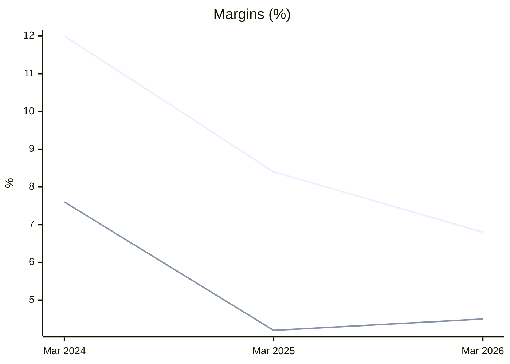

*Run 2026-11-24 · part of [SPINOFF_REPORT.md](../SPINOFF_REPORT.md) · the complete analysis of one company, with every management-call exchange in full.*

## TRIVENI — Triveni Engineering & Industries Ltd.

### 1. Triveni Engineering & Industries Ltd. — CONFIRMED DEMERGER

**CONFIRMED** (a demerger scheme is on the exchange record) · **LISTED <1Y — selling-pressure window; the bargain forms here** · score 3.6/10 · spin-off · 42 filing(s) from BSE-screener, CALLS, NSE, NSE-register · first 2025-10-29, latest 2026-10-09

**The separated entities — every one the documents name:**

| Entity | Scheme | Business | Listing | Who runs it |
|---|---|---|---|---|
| **Triveni Power Transmission Limited** | 2024 Composite Scheme of Arrangement — demerger of the PTB … | PTB Undertaking — power transmission business consisting of gears and defence business segments (Gears, Defen… | listed 2026-10-12 as TRIVENIPT (NSE) | Mr. Dhruv M. Sawhney (Non-Executive Chairman of t… |
| **Triveni Turbine Limited** | Earlier Scheme of Arrangement — demerger of TEIL's steam tu… | The Company's steam turbine division; industrial steam turbines and renewable energy-based applications | listed 2011-10-28 as TRITURBINE (NSE) | Mr. Nikhil Sawhney, Vice Chairman and Managing Di… |

**The other parties to the scheme(s)** — not separated entities: Sir Shadi Lal Enterprises Limited — merged in — no shares for the parent's holders

**What is being separated, as the documents put it:** Power Transmission Business: high-speed and niche low-speed gearboxes, gear internals, defence products, aftermarket and retro-fitment services — class `value_unlocking`.

### 2. Stages and dates

> **Listing:** LISTED — Triveni Power Transmission Limited (TRIVENIPT) since 2026-10-12; Triveni Turbine Limited (TRITURBINE) since 2011-10-28 (NSE equity list); record date 2026-07-22

| Date | Event | Source |
|---|---|---|
| 2011-10-28 | **Triveni Turbine Limited** listed (TRITURBINE) | NSE equity list |
| 2024-12-10 | Board approval — Triveni Engineering & Industries Limited (and SSEL, TPTL board resolutions dated 10.12.2024 / 09.12.2024) | as stated: Outcome of Board Meeting filing dated December 10, 2024 |
| 2025-03-21 | Filed with exchanges — NSE submission of draft scheme to SEBI | as stated: NSE Observation Letter Ref: NSE/LIST/46129 dated August 06, 2025 ("ou… |
| 2025-04-01 | Appointed date — Appointed date for the scheme (amalgamation of SSEL into TEIL) | as stated: Q4 FY26 earnings conference call transcript, June 04, 2026 |
| 2025-08-06 | SEBI approval — SEBI comments conveyed via NSE | as stated: NSE Observation Letter Ref: NSE/LIST/46129 dated August 06, 2025 (fil… |
| 2025-08-06 | Exchange no-objection — National Stock Exchange of India Limited — 'No objection' | as stated: TEIL letter dated 7th August, 2025 enclosing NSE Observation Letter N… |
| 2025-08-07 | Exchange no-objection — BSE Limited — 'no adverse observations' | as stated: TEIL letter dated 8th August, 2025 enclosing BSE letter DCS/AMAL/NB/R… |
| 2025-10-17 | NCLT order — First motion order (read with rectification order dated October 28, 2025) directing/dispensing meetings | as stated: Scheme of Arrangement filing dated 29th October, 2025 |
| 2025-11-04 | Stage reached: **meetings** | [General Updates](https://nsearchives.nseindia.com/corporate/TRIVENI_04112025163924_TEIL_Secured_Creditors_Intimation_Letter.pdf) |
| 2025-11-04 | Stage reached: **nclt sanction** | [General Updates](https://nsearchives.nseindia.com/corporate/TRIVENI_04112025163924_TEIL_Secured_Creditors_Intimation_Letter.pdf) |
| 2025-11-30 | Shareholders / creditors meeting — Sir Shadi Lal Enterprises Limited — equity shareholders 10:00 a.m., secured creditors 1:00 p.m., unsecured creditors 3:30 p.m. | as stated: Scheme of Arrangement filing dated 29th October, 2025 |
| 2025-12-07 | Shareholders / creditors meeting — Triveni Engineering & Industries Limited — equity shareholders 10:00 a.m., secured creditors 1:00 p.m., unsecured creditors 3:30 p.m. | as stated: Shareholders meeting filing dated 7th December, 2025 (proceedings of … |
| 2025-12-16 | NCLT order — Second motion petition allowed — CP (CAA) No.37/ALD/2025 | as stated: Scheme of Arrangement filing dated December 19, 2025 |
| 2026-04-01 | Appointed date — Demerger Appointed Date — PTB Undertaking into TPTL | as stated: Record Date intimation dated July 11, 2026 (filed 2026-07-14); Q4 FY2… |
| 2026-05-07 | Stage reached: **effective** | [Scheme of Arrangement](https://nsearchives.nseindia.com/corporate/TRIVENI_07052026193112_NCLT_ORDER_7_5_2026.pdf) |
| 2026-05-07 | NCLT order — NCLT Allahabad Bench order sanctioning the Scheme (pronounced) | as stated: Scheme of Arrangement filing dated May 07, 2026 |
| 2026-05-18 | NCLT order — Second NCLT order dated May 18, 2026 | as stated: Intimation about Effectiveness of the Scheme dated May 19, 2026 (file… |
| 2026-05-19 | Effective date — Scheme effective on filing of certified copies of NCLT Orders with the Registrar of Companies | as stated: Intimation about Effectiveness of the Scheme dated May 19, 2026 (file… |
| 2026-06-03 | Record date — Record date for issue of TEIL equity shares to SSEL shareholders | as stated: Record Date intimation dated May 20, 2026 |
| 2026-06-04 | Stage reached: **exchange noc** | [General Updates](https://nsearchives.nseindia.com/corporate/TRIVENI_04062026185550_TPTL_Material_Update.pdf) |
| 2026-06-09 | Allotment — 14,65,048 fully paid-up equity shares of Re.1/- each of TEIL allotted to eligible SSEL shareholders | as stated: Scheme of Arrangement filing dated June 9, 2026 |
| 2026-06-24 | Other — In-principle approval from NSE and BSE for listing of 14,65,048 additional TEIL equity shares | as stated: General Updates filing dated June 25, 2026 (NSE/LIST/55688 and DCS/AM… |
| 2026-07-22 | **Record date** | NSE corporate-actions register |
| 2026-07-22 | Stage reached: **record date** | Record Date (corporate-actions register) |
| 2026-07-22 | Record date — Demerger Record Date — eligibility of TEIL shareholders to receive TPTL equity shares | as stated: Record Date intimation dated July 11, 2026 (filed 2026-07-14) |
| 2026-07-28 | Allotment — TPTL allotted 7,34,54,338 fully paid-up equity shares of Rs.2/- each to eligible TEIL shareholders; TEIL holding diluted to 29.88% | as stated: TPTL letter dated July 28, 2026 annexed to TEIL filing dated July 29,… |
| 2026-08-03 | Other — Allocation of cost of acquisition — TEIL 86.60% / TPTL 13.40% | as stated: Ref: TEIL:SD:2026 letter dated August 3, 2026 |
| 2026-09-09 | Other — Distribution of sale proceeds of fractional entitlements completed (4,308 shares; net proceeds INR 12,24,787.00) | as stated: Audit Committee and Independent Directors reports dated September 16,… |
| 2026-09-16 | Stage reached: **announced** | [Scheme of Arrangement](https://nsearchives.nseindia.com/corporate/TRIVENI_16092026132125_AC_AND_ID_REPORTS_16_9_2026.pdf) |
| 2026-10-08 | Exchange no-objection — Listing and trading approvals for TPTL from BSE (DCS/AMAL/NB/269/2026-27) and NSE (NSE/LIST/208) | as stated: TPTL letter dated October 9, 2026 annexed to TEIL filing dated Octobe… |
| 2026-10-09 | Stage reached: **listed** | [Scheme of Arrangement](https://nsearchives.nseindia.com/corporate/TRIVENI_09102026133634_INTIMATION__TPTL_LISTING.pdf) |
| 2026-10-12 | **Triveni Power Transmission Limited** listed (TRIVENIPT) | NSE equity list |
| 2026-10-12 | Listing and trading — Triveni Power Transmission Limited — 10,47,54,338 equity shares of Rs.2/- each listed and admitted to dealings on BSE (544824) and NSE (TRIVENIPT); ISIN INE2WKEO01011 | as stated: Scheme of Arrangement filing dated October 9, 2026 |

**The stages, as filed:** meetings (2025-11-04) → nclt sanction (2025-11-04) → effective (2026-05-07) → exchange noc (2026-06-04) → record date (2026-07-22) → announced (2026-09-16) → listed (2026-10-09)

**Stated in the filings:** resulting company **Triveni Power Transmission Limited**; entitlement **100 for every 137**; record date 2026-07-22; appointed date 2025-04-01.

**When it lists, in the documents' words:** On 9 October 2026: “the equity shares of the Company shall be listed and admitted to dealings on BSE and NSE with effect from October 12, 2026” (BSE: 544824, NSE: TRIVENIPT); earlier, on the 4 June 2026 call, “one is anticipating that by the end of August, we will have a listing of Triveni Power Transmission s Limited.”

### 3. Size of the separated business beside the parent — is institutional selling likely?

**Reading: VERY LIKELY — the piece is under a tenth of the whole; index funds and large holders who receive it without choosing it tend to sell.**

| Entity | Stated turnover | Stated share of the whole | Segment revenue share | Market cap (₹ cr) | Share of combined market cap | Index member |
|---|---|---:|---:|---:|---:|---|
| Triveni Power Transmission Limited | "As per audited standalone financial statements as at March… | 4.75% | 5.7% (FY2026) | 4,680 | 45.8% | no |
| Triveni Turbine Limited | not stated | — | 5.7% (FY2026) | 16,205 | 74.5% | yes |

*Stated figures are the documents' own (a turnover share, or the cost-of-acquisition split the company publishes for tax, which reflects relative value); the segment share is this business's revenue over the parent's sales, and the market-cap share is the entity's value over the entity plus the parent (parent ₹5,544 cr, NSE bhavcopy of 2026-11-13), both computed here.*

**In the documents' words:** “"As per audited standalone financial statements as at March 31, 2024, of the Demerged Company, total turnover relating to PTB Undertaking was INR 291.81 crore, representing 4.75% of the total turnover of the Demerged Company, for financial year 2023-24." For cost-of-acquisition allocation purposes: "Triveni Engineering & Industries Limited 86.60% / Triveni Power Transmission Limited 13.40%"”

**The judge's read of selling pressure:** likely — Sugar/ethanol holders receive 1 engineering share per 3 held; 7,34,54,338 free shares, 13.4% of cost basis, unrelated industry.

### 4. Insider ownership — share swap, promoters' holding, management incentives

**Share swap / entitlement, entity by entity:**

- **Triveni Power Transmission Limited:** "For every 3(three) equity shares of the Demerged Company with a face value of INR 1 each held in the Demerged Company, every equity shareholder of the Demerged Company shall, without any application, act or deed, be entitled to receive 1 (One) equity share of the Resulting Company with a face value of INR 2 each, credited as fully paid up on the same terms and conditions of issue as prevalent in the Demerged Company"

**Promoters' holding, from the shareholding pattern:**

| Company | Promoters | FIIs | DIIs | Public | Quarter |
|---|---:|---:|---:|---:|---|
| Triveni Engineering & Industries Ltd. (TRIVENI) | 60.58% | 7.5% | 6.18% | 25.75% | Sep 2026 |
| Triveni Power Transmission Limited (TRIVENIPT) | 72.35% | 5.54% | 5.11% | 16.99% | Oct 2026 |
| Triveni Turbine Limited (TRITURBINE) | 55.84% | 18.39% | 17.84% | 7.93% | Sep 2026 |

*Source: screener.in shareholding pattern, stored under `ShareholdingPattern/NiftyTotalMarket/`. In a mirror demerger each shareholder holds the same proportion of the new company as of the parent on the record date.*

- **Promoters in the parent, per the documents:** Triveni Engineering & Industries Limited, before effectiveness of the Scheme (per board disclosure dated December 10, 2024): "Promoters 13,34,91,162 60.98%", Public 8,54,06,806 39.02%, Total 21,88,97,968; after effectiveness of the amalgamation: "Promoters 13,34,91,162 60.58%", Public 8,68,71,854 39.42%, Total 22,03,63,016
- **What the promoters will hold in the separated entity:** TPTL (2024 composite scheme, demerger leg): before effectiveness of the Scheme "Promoters 3,13,00,000 100%", Public nil; after effectiveness of the Scheme "Promoters 7,57,97,054 72.36%", "Public 2,89,57,285 27.64%", "Total 3,13,00,000 100%" / "10,47,54,339 100.00%". TEIL (amalgamation leg): promoter holding in the parent after effectiveness of the demerger "Promoters 13,34,91,162 60.58%", Public "8,68,71,854 39.42%" — unchanged by the demerger. SSEL: "the shares held by the Amalgamated Company in the Amalgamating Company shall stand cancelled" and the Scheme provides for "the cancellation of the SSEL Promoter Shareholding (as defined in the Scheme)". Post-allotment of TPTL shares: "the Company's holding in TPTL was diluted to 29.88%. Consequently, TPTL ceased to be a subsidiary and became an associate of the Company."
- **What a public shareholder receives:** Demerger leg: "For every 3(three) equity shares of the Demerged Company with a face value of INR 1 each held in the Demerged Company, every equity shareholder of the Demerged Company shall, without any application, act or deed, be entitled to receive 1 (One) equity share of the Resulting Company with a face value of INR 2 each, credited as fully paid up on the same terms and conditions of issue as prevalent in the Demerged Company" — 7,34,54,338 fully paid-up equity shares of Rs.2/- each were allotted on July 28, 2026 to eligible shareholders of TEIL as on record date July 22, 2026. Amalgamation leg: public shareholders of SSEL received 100 TEIL equity shares of Re.1 each for every 137 SSEL shares of INR 10 each — "The Company took necessary steps for allotment and listing of 14,65.048 (Fourteen Lakhs Sixty-Five Thousand Forty Eight) fully paid up equity shares of face value INR I each to the public shareholders of SSEL"; 4,308 shares arising from consolidation of fractional entitlements of 6,064 shareholders were sold by the trustee and net proceeds of INR 12,24,787.00 distributed on September 09, 2026
- **Management incentives:** not stated in the documents on file.
- **Insider actions around the separation:** TPTL shares allotted under the Scheme carry lock-in per NSE Annexure I: 20,950,868 shares locked in up to 15-Oct-2029, 10,349,132 shares up to 15-Oct-2027 and 73,454,338 shares free. Company (not promoter) acquisitions: "On March 11, 2024, the Company acquired 25.43% equity stake in Sir Shadi Lal Enterprises Limited, (SSEL), followed by further acquisition of additional 36.34% stake on June 20, 2024... The Company currently holds a 61.77% equity stake in SSEL." Earlier divestment: "The Company owned 21.85% of TTL's equity, until September 21, 2022, when the entire stake was divested with net proceeds of ₹ 1,593 crore." Scheme also provides for cancellation of the SSEL Promoter Shareholding. Board changes around the separation: Mrs. Geeta Bhalla and Mr. Suresh Taneja resigned as TPTL directors w.e.f. close of business on 28th July, 2026; Mr. Tarun Sawhney ceased to be KMP of TEIL on appointment as VC & MD of TPTL w.e.f. July 28, 2026. No promoter or management buying, selling or pledging of shares around the separation is stated.
- **Insiders, per the checklist read:** Promoter family runs TPTL: Dhruv M. Sawhney Non-Executive Chairman, Tarun Sawhney Managing Director for five years (subject to shareholder approval), Nikhil Sawhney director; 3,13,00,000 shares (29.9%) locked in to 2027/2029. · *option pricing date:* not stated

### 5. Why the demerger — point by point

Triveni Engineering & Industries Ltd. (TEIL) put through a single composite scheme of arrangement that does two things: it amalgamates its ~61.77%-owned listed subsidiary Sir Shadi Lal Enterprises Ltd. (SSEL, the Shamli sugar/distillery unit) into TEIL, and it demerges TEIL's Power Transmission Business (PTB — high-speed/turbo gearboxes at Mysuru, plus the incubating defence business) into Triveni Power Transmission Ltd. (TPTL) for separate listing, which management described on the Feb 2026 call as being done 'to unlock value and to drive operational efficiencies' and in Feb 2025 as 'value unlocking that the Board of Directors has felt very important.' The problem being solved is that PTB's economics look nothing like the rest of TEIL: PTB ran PBIT margins above 34% in FY25 (PBIT ₹126.8 crore, +18.4%, on turnover up 27%, order booking ₹475+ crore), about 36% in H1 FY26 and 41% in Q2 FY26, against sugar and alcohol businesses whose output and input prices are both administered (SAP up ₹300/tonne in UP, no ethanol price revision for two years, maize at ₹20–26/kg, MSP unrevised), and whose FY25 segment profits fell on a 69bps recovery decline. Investors made exactly this point on the call: Bharat Shah of ASK Investment Managers told management that 'barring the Power Transmission business, which is relatively more robust, predictable economics and predictable outcomes,' the other businesses 'produce a very mercurial kind of an outcome,' and Tarun Sawhney conceded TEIL had not met its return profile on ethanol capital. Separation is also meant to let PTB fund and run its own growth: a board-approved capex of ₹340 crore in three tranches (taking gears capacity from ~₹400 crore to ~₹700 crore of output by September 2026, with just over ₹100 crore sanctioned for the defence facility and ₹231 crore incurred by 31 March 2026, of which ₹78 crore on defence), an export-led order book just under ₹500 crore (+25%), a Swiss subsidiary (Triveni Power Transmission GmbH, acquired 100% by TPTL), aftermarket at ~40% of gears, and a global addressable high-speed/turbo gear market of about $650–700 million. Crucially, TEIL deliberately did not do a clean 100% separation: it retains roughly 30% of TPTL, and Sawhney justified this by the defence business — 'we are incubating a Defence business, which we have large aspirations for,' where establishing pre-qualifications and the ability to bid involves 'balance sheet considerations… from a Group perspective,' plus the precedent of the Triveni Turbine separation, which he called 'actually quite a positive one for the Company.' Post-approval TEIL said ICRA reaffirmed its long-term rating at AA+ Stable, lifting it off watch, and that TPTL goes out 'armed with sufficient cash flows and a balance sheet' to fund its capex and opex.

**Point by point, with the source:**

1. First call after the 10 December 2024 board approval; Sawhney introduced the composite scheme — amalgamation of ~61.77%-held SSEL into TEIL and transfer of the PTB undertaking to wholly-owned TPTL — explicitly as a value-unlocking exercise by the Board. “I also wanted to provide an update on the Scheme, as you're all aware, this is in conjunction with value unlocking that the Board of Directors has felt very important.” — *[Feb 2025](https://www.bseindia.com/stockinfo/AnnPdfOpen.aspx?Pname=32ebf539-4c61-4455-9d21-3cc24a97dd7a.pdf)*
2. Resham Jain of DSP Asset Managers challenged the structure, arguing TEIL's retained ~30% stake in TPTL would re-import a holdco discount and that a clean separation was needed for value to be unlocked. “It seems that Triveni Engineering will still be holding 30% stake even after demerger. So why such structure, if the value unlocking has to happen, it should have happened in a clean structure where Triveni would not be holding anything otherwise, the same Holdco discount will be applicable to the Power Transmission business once it gets demerged.” — *[Feb 2025](https://www.bseindia.com/stockinfo/AnnPdfOpen.aspx?Pname=32ebf539-4c61-4455-9d21-3cc24a97dd7a.pdf)*
3. Sawhney's two reasons for keeping ~30%: the positive precedent of the Triveni Turbine separation, and — decisively — that the incubating defence business needs group balance-sheet backing to win pre-qualifications and be allowed to bid, since defence is co-located with gears in Mysuru. “The second and very, very important is because we are incubating a Defence business, which we have large aspirations for. In establishing pre-qualifications (PQs) and the ability to be able to quote, there are balance sheet considerations that even from a Group perspective that are very, very important to allow us to be in contention.” — *[Feb 2025](https://www.bseindia.com/stockinfo/AnnPdfOpen.aspx?Pname=32ebf539-4c61-4455-9d21-3cc24a97dd7a.pdf)*
4. Bharat Shah of ASK Investment Managers made the investor case for separation directly — PTB is the predictable, brick-by-brick business while the regulated sugar/ethanol/water businesses swing unpredictably — and Sawhney conceded the ethanol capital had not met its return profile. “On a shorter-term basis, interplay of the other businesses always produces a very mercurial kind of an outcome, sometimes to delight, but other times to depress.” — *[Feb 2025](https://www.bseindia.com/stockinfo/AnnPdfOpen.aspx?Pname=32ebf539-4c61-4455-9d21-3cc24a97dd7a.pdf)*
5. Same call quantified why PTB deserves its own listing: incremental board-approved capex of ₹60 crore taking gears capacity to ₹700 crore by September 2026 from ~₹400 crore, order book at an all-time-high ₹377 crore, and a global high-speed/turbo gear market of about $650–700 million. “The Board meeting of the Directors concluded yesterday had an important announcement of an incremental capex of ₹60 crore for the enhancement of capacity in the Power Transmission business. This will take the gears capacity to ₹700 crore by September 2026.” — *[Feb 2025](https://www.bseindia.com/stockinfo/AnnPdfOpen.aspx?Pname=32ebf539-4c61-4455-9d21-3cc24a97dd7a.pdf)*
6. Initial timeline guidance: NCLT sanction expected by the end of calendar 2025. “As far as the Scheme of Arrangement is concerned, we anticipate approval from NCLT by the end of this calendar year.” — *[Feb 2025](https://www.bseindia.com/stockinfo/AnnPdfOpen.aspx?Pname=32ebf539-4c61-4455-9d21-3cc24a97dd7a.pdf)*
7. Q4 FY25 call showed the margin gap the demerger exposes — PTB turnover up 27% with PBIT ₹126.8 crore (+18.4%) and PBIT margins above 34%, record Q4 revenue of almost ₹140 crore and PBIT ₹46.5 crore — while the scheme itself sat pending at SEBI, with separation guided to Q4 FY26. “So we're expecting that by the middle of Q1 of next calendar year, Q4 of this fiscal year, we will have the separation of the PTB business.” — *[Jun 2025](https://www.bseindia.com/stockinfo/AnnPdfOpen.aspx?Pname=24085d8d-b7bb-42bb-bd4f-8cb00e75ea19.pdf)*
8. Resham Jain asked management to begin disclosing PTB in granular detail — customers, industry mix — precisely because it was about to be separately listed after being buried inside a much larger company; Sawhney accepted. “And since it was a part of a much larger company, the understanding of this business from the very granular perspective was much lower.” — *[Jun 2025](https://www.bseindia.com/stockinfo/AnnPdfOpen.aspx?Pname=24085d8d-b7bb-42bb-bd4f-8cb00e75ea19.pdf)*
9. Q1 FY26: approvals still outstanding, with continuous follow-up at SEBI and stock-exchange queries answered; slippage of about 30 days flagged but Q1-calendar-2026 timing maintained. PTB closing order book was a record ₹423 crore (+38%), with engineering order book just under ₹2,000 crore. “The amalgamation with Sir Shadi Lal and the demerger of the Power Transmission business. We are still awaiting regulatory approvals. We're following up continuously with SEBI.” — *[Aug 2025](https://www.bseindia.com/stockinfo/AnnPdfOpen.aspx?Pname=a50ea3c4-1d70-4e28-a663-9393cce6158b.pdf)*
10. Stock exchanges had cleared the scheme (observation letters of 7 and 11 August 2025) and NCLT stakeholder meetings were set for late November/early December; separately, TPTL bought 100% of Triveni Power Transmission GmbH in Switzerland, building the export engine inside the entity being listed. “The proposed scheme has been approved by the stock exchanges, and the process is obtaining approval of NCLT.” — *[Nov 2025](https://www.bseindia.com/stockinfo/AnnPdfOpen.aspx?Pname=ec578aab-464f-47c2-8bc5-cb3982d61b3e.pdf)*
11. PTB PBIT margins improved more than 400bps YoY on product mix and cost optimisation (about 36% PBIT for H1, 41% in the quarter), and TPTL was equipped with its own CRM, digital-factory/digital-twin and SAP HANA systems ahead of standing alone. “Triveni Power Transmission Limited, a wholly-owned subsidiary of the company, has acquired a 100% stake in Triveni Power Transmission GmbH, a Swiss company.” — *[Nov 2025](https://www.bseindia.com/stockinfo/AnnPdfOpen.aspx?Pname=ec578aab-464f-47c2-8bc5-cb3982d61b3e.pdf)*
12. Shareholders and creditors approved in December 2025 with an NCLT hearing in February; management stated the twin purpose as unlocking value and driving operational efficiencies, and said PTB was being equipped with the systems and skills to run as an independent company. “Lastly, with respect to the proposed scheme of amalgamation of SSEL and the demerger of the Power Transmission business to unlock value and to drive operational efficiencies, the scheme has been approved by shareholders of creditors, this was in December of 2025.” — *[Feb 2026](https://www.bseindia.com/stockinfo/AnnPdfOpen.aspx?Pname=2bc4c751-c2b8-4a3a-a75a-a00326d1ee32.pdf)*
13. Sawhney signalled the split was imminent and thanked participants for years of feedback, saying the next call would be with two separate companies; a lot of systems work was underway so TPTL could start at full speed with TEIL-level efficiencies. “I think the next time we speak in all probability, this will be two separate companies.” — *[Feb 2026](https://www.bseindia.com/stockinfo/AnnPdfOpen.aspx?Pname=2bc4c751-c2b8-4a3a-a75a-a00326d1ee32.pdf)*
14. Scheme effective 19 May 2026 after NCLT approval; amalgamation appointed date 1 April 2025 and demerger appointed date 1 April 2026; SSEL record date 3 June 2026, TEIL record date within four weeks, and listing of TPTL anticipated by end-August 2026 with separate board meetings, published results and earnings calls for both entities. “I'm delighted to inform you that the composite scheme of arrangement is effective from the 19th of May, 2026 after the approval of the NCLT.” — *[Jun 2026](https://www.bseindia.com/stockinfo/AnnPdfOpen.aspx?Pname=113e1acd-25ed-4260-8b7f-62ac04ca5fd6.pdf)*
15. Management argued the separated entity is self-funding: of the ₹340 crore board-approved capex in three tranches (output of about ₹700 crore of gears, excluding defence), ₹231 crore was spent by 31 March 2026 including ₹78 crore on defence, with ₹109 crore left to September 2026 — all fundable by TPTL itself. “Of course, as power transmission migrates into Triveni Power Transmission Limited, the company is armed with sufficient cash flows and a balance sheet to be able to incur all of this CapEx and OpEx and more.” — *[Jun 2026](https://www.bseindia.com/stockinfo/AnnPdfOpen.aspx?Pname=113e1acd-25ed-4260-8b7f-62ac04ca5fd6.pdf)*
16. A balance-sheet benefit of completion was cited: ICRA reaffirmed TEIL's long-term rating at AA+ Stable and removed the under-watch status that the pending scheme had caused, restoring Triveni's historical highest rating. “I am very proud to announce that post the scheme having been approved, ICRA has reaffirmed our long-term credit rating as AA+ Stable, lifting it from its previous under watch status.” — *[Jun 2026](https://www.bseindia.com/stockinfo/AnnPdfOpen.aspx?Pname=113e1acd-25ed-4260-8b7f-62ac04ca5fd6.pdf)*
17. Asked about post-demerger margins, CFO Suresh Taneja said PTB's own dynamics support continuation of the roughly 35% PBIT level it had been delivering inside TEIL; Sawhney also guided that exports of original equipment should exceed half of PTB sales in the near future. “As regards to the PTB business, it has got its own dynamics, as a matter of fact. So far, we have been maintaining about 35% PBIT. I think the same trend is expected to continue in future also.” — *[Jun 2026](https://www.bseindia.com/stockinfo/AnnPdfOpen.aspx?Pname=113e1acd-25ed-4260-8b7f-62ac04ca5fd6.pdf)*
18. Entitlement terms: TEIL shareholders receive 1 TPTL share of ₹2 face value for every 3 TEIL shares of ₹1; SSEL shareholders received 100 TEIL shares of ₹1 for every 137 SSEL shares of ₹10, with 4,308 consolidated fractional shares sold by a trustee and ₹12,24,787 net distributed to 6,064 shareholders by 9 September 2026. “For every 3(three) equity shares of the Demerged Company with a face value of INR 1 each held in the Demerged Company, every equity shareholder of the Demerged Company shall, without any application, act or deed, be entitled to receive 1 (One) equity share of the Resulting Company with a face value of INR 2 each, credited as fully paid up on the same terms and conditions of issue as prevalent in the Demerged Company” — *Scheme*
19. Demerger record date was 22 July 2026 and 7,34,54,338 TPTL shares were allotted to TEIL shareholders on 28 July 2026, at which point TPTL ceased to be a subsidiary and became an associate of TEIL — confirming the deliberately retained residual stake (3,13,00,000 locked-in shares of the 10,47,54,338 total). “Accordingly, the Company ceased to be a subsidiary and become an associate of TEIL.” — *Scheme*
20. TPTL was staffed as a standalone listed company on 28 July 2026: Tarun Sawhney as Vice Chairman & Managing Director, Dhruv M. Sawhney as Non-Executive Chairman, Raman Kumar S. as CFO, Rakesh Kumar Yadav as Company Secretary, EY as internal auditor, with Geeta Bhalla and Suresh Taneja resigning as TPTL directors because of the scheme's implementation. “I Suresh Taneja, hereby tender my resignation from the directorship of the Company with effect from closing of business hours on 28th July, 2026, due implementation of the Composite Scheme of Arrangement and the consequent reconstitution of the Board of Directors of the Company.” — *Scheme*
21. For tax purposes the cost of acquisition was split 86.60% to TEIL and 13.40% to TPTL — the only quantified indication in these documents of the relative value attributed to the demerged power transmission business. “Triveni Engineering & Industries Limited 86.60% 13.40% Triveni Power Transmission Limited” — *Scheme*
22. TPTL's 10,47,54,338 shares received BSE and NSE listing and trading approvals on 8 October 2026 and began trading on 12 October 2026 (BSE 544824, NSE TRIVENIPT) — roughly six weeks later than the end-August listing guided on the June 2026 call. “Accordingly, the equity shares of the Company shall be listed and admitted to dealings on BSE and NSE with effect from October 12, 2026” — *Scheme*

**How it evolved:** The board approved the composite scheme on 10 December 2024, and the Feb 2025 (5 Feb) call was the first investor call after it — there Sawhney framed it as value unlocking, guided to NCLT approval 'by the end of this calendar year,' and defended the retained ~30% stake against Resham Jain's push for a clean structure; Bharat Shah's 'mercurial' critique of the commodity businesses came on the same call. By Jun 2025 (28 May) the scheme was stuck with SEBI with NCLT next, guidance slipped to 'middle of Q1 of next calendar year, Q4 of this fiscal year,' and Resham Jain asked for granular PTB disclosure ahead of listing, which Sawhney accepted as a 'welcome suggestion'; on Aug 2025 (30 July) approvals were still pending with SEBI and stock-exchange queries, with Sawhney allowing it 'could add another 30-odd days.' Nov 2025 (7 Nov) reported stock-exchange approval (observation letters 7 and 11 August 2025) and NCLT stakeholder meetings set for late November/early December, plus TPTL's 100% acquisition of Swiss step-down subsidiary Triveni Power Transmission GmbH; Feb 2026 (2 Feb) reported shareholder/creditor approval in December 2025, an NCLT hearing in February, systems work to let TPTL 'hit the ground sprinting,' and Sawhney's line that 'the next time we speak in all probability, this will be two separate companies.' On Jun 2026 (4 June) he confirmed the scheme effective 19 May 2026 after NCLT approval (orders 7 and 18 May), appointed dates of 1 April 2025 for the amalgamation and 1 April 2026 for the demerger, the SSEL record date of 3 June 2026, and guided to a TPTL listing 'by the end of August' with separate results and earnings calls for both companies — in the event the demerger record date was 22 July 2026, 7,34,54,338 TPTL shares were allotted on 28 July 2026 (TPTL thereby ceasing to be a subsidiary and becoming an associate), and TPTL listed and began trading only on 12 October 2026.

**What management expects from it:** TPTL: independent listing of a ~35% PBIT, export-led gears and defence business, self-funding its ₹340 crore capex toward ~₹700 crore of gears output, exports above 50%, aftermarket-led margins. TEIL: a cleaner sugar-distillery-water commodity platform with SSEL absorbed, AA+ Stable restored off watch, and cash flows for brownfield/greenfield expansion. Both: unlocked value, operational efficiencies, separate reporting.

*Not explained on the calls:* No valuation basis for the 1:3 ratio, no standalone PTB balance sheet or financials, no quantified dis-synergies, demerger costs, TPTL dividend policy, or why exactly 30% was retained.

- *Stated reason, in one line:* Management: “the proposed scheme of amalgamation of SSEL and the demerger of the Power Transmission business to unlock value and to drive operational efficiencies”.
- *What it reveals:* PTB was only 4.45% of TEIL turnover but earned ~35-36% PBIT margins; cost-of-acquisition split gives it just 13.40%. Order book just under ₹500 crore (+25%), ₹340 crore capex, new defence facility, Swiss subsidiary, exports targeted above 50%.
- *Parent or spin:* spin · *Read next:* TPTL's first standalone quarterly results — whether ~36% PBIT margin holds on the ₹500 crore order book post-capex.
- *In their words:* “For every 3(three) equity shares of the Demerged Company with a face value of INR 1 each held in the Demerged Company, every equity shareholder of the Demerged Company shall, without any application, act or deed, be entitled to receive 1 (One) equity share of the Resulting Company with a face value of INR 2 each, credited as fully paid up on the same terms and conditions of issue as prevalent in the Demerged Company”

### 6. On the calls, verbatim

11 call(s), oldest first: **31 question-and-answer exchange(s)** given in full — the question and every answer to it, nothing trimmed — and 16 passage(s) from management's prepared remarks (the complete sentences about it; the whole remarks are in the linked transcript). Text is as the transcript prints it.

#### Nov 2023 — [transcript](https://www.bseindia.com/stockinfo/AnnPdfOpen.aspx?Pname=7f3b37d2-411b-4a10-b371-f1cee4eefe22.pdf)

**From the prepared remarks** *(the passage about it; the whole turn runs to 22,881 characters in the transcript)*

> **Tarun Sawhney:** The overall performance of the Company during the half year ended September 30, 2023, has been satisfactory. As you all know, H1 is generally muted as off -season expenses in the Sugar business are expensed off during this period. Our Alcohol business has grown very well , due to capacity expansions during FY 23 and the stabili sation of all operations since then. The Power Transmission business is charting new heights, contributing both in size and growth to the Company as a whole. We're all set for the new sugar season and an overall crop that seems healthier due to favourable climatic factors as well as due to the rigorous sugarcane development activities that has been undertaken by the Company 's teams. For the half year, revenue from operations stood at ■ 2,606 crore , an increase of 1.4% and Profit Before Tax stood at ■ 130.2 crore , an increase of 15%. While comparing profitability, we should note that Q2 / H1 FY 23 includes ■ 11 crore of dividend income received from the erstwhile associate company, Triveni Turbine Limited. As you may be aware, Triveni Engineering & Industries Limited has completely divested its stake in Triveni Turbine Limited last year. As such, there is no dividend income in the results under review. Furthermore, the profitability of the quarter at half year considers additional liability against levy molasses, which has impacted profitability of Q2 & H1 FY 24, by ■ 12.1 crore . The total impact being approximately ■ 18.2 crore for the full year. […] So pretty early start, not just compared to last year, but also compared to the last few years . And I think that is primarily to do with fantastic climatic factors, especially in West ern Uttar Pra desh. Turning to the Engineering business es. Q2 FY 24 saw the highest ever quarterly revenue and highest ever profitability in the Power Transmission business , which drove robust half year results. The order booking of the Power Transmission business was ■ 155 crore approximately during the quarter, an increase of 36.1% closing the order book at ■ 282 crore approximately , compared year -on-year it's an increase of 15%. During the quarter, the Water business has also won an important bid at RUDSICO , which is Greater Jaipur and the Letter of Intent (LOI) has been received after the end of the quarter. The outstanding order book for the Engineering businesses combined stood at ■ 1,573 crore . Looking at the financial performance on a consolidated basis . The net turnover increased by 4.7% and 1.4% in Q2 FY 24 and H1 FY 24, primarily driven by higher turnovers in the Alcohol and Power Transmission business. The sales volume in sugar, including exports were lower by 5.9% in Q2 compared to the previous fiscal year. However, the blended reali sations were higher by approximately 6%. Consequently, the turnover was flat during the quarter. Sales volumes for the current half year also include approximately 14,500 tonnes of sugar that was exported in Q1 of this fiscal year. The Alcohol business turnover, net of excise duty increased by 19.8% and 20.5% in Q2 and H1 FY 24. And this was due to higher sales volumes driven primarily by operational efficiencies achieved in the post stabili sation period of the new distilleries and an increase in activities in the Indian Made Indian Liquor (IMIL) business. The combined Engineering turnover increased by 8.7% in the quarter and this performance was boosted by a 28.4% increase in revenues in the Power Transmission business for the quarter under review. The Profit Before Tax and exceptional items increased by 60% in Q2 FY 24 to reach ■ 130 crore for the half year milestone. The gross debt on a stand -alone basis as of the 30th of September is approximately ■ 295.66 crore as compared to ■ 825 crore as on March 31, 2023. Considering operational surplus funds that have been held in fixed deposits tota lling ■ 285.5 crore , the net debt on September 30 th, 2023, stood at ■ 10 crore only and this is a major milestone for the Company . […] And of course, one can independently have the tender floated as well. And we ’re hoping that all of this will be resolved very soon by the Central Government. I’d like to turn now to the Engineering businesses. For the Power Transmission business, the increase in H1 FY 24 turnover and profitability was 44.8% and 58.2%, respectively, driven by high domestic sales across all the OEMs. The Defence business received an order recently of ■18 crore for the supply of propulsion gearboxes for fast patrol vessels of the Indian Coast Guard. This marks an entry of this business into the Marine Gearbox segment. The first entry into the Marine Gearbox segment. These gearboxes need to be highly engineered , compact and lightweight to meet the specific requirements of vessels and the Company would be undertaking this project with its own design, in -house manufacturing and testing and with over 90% indigenous content, which is a major step in line with Make in India policy of the Government of India. With this, the defence business will also be well placed to support the nation ’s future shipbuilding projects of similar nature with completely indigenous solutions. The total outstanding order book on the 30th of September stood at ■ 282 crore for the Power Transmission business. Important to point out some of the financial numbers. Revenues grew by 28.5% in the quarter. PBIT grew by 36.8% in the quarter. […] I believe that they will be announced with a reasonable increase in the very near future. And also , the tender floated by the OMCs will come to its conclusion so that one can start supplies as quickly as possible. We have successfully raised our capacities from 320 KLPD in FY 22 to 660 KLPD and we're on track to raise our capacity to 1,110 KLPD. I talked about the Engineering businesses, where the Power Transmission business has scaled massive new heights. The infrastructure growth and expansion of the steel and cement sectors for waste heat recovery have been huge sources of new demand for this business. W e also see massive demand not just today but continu ally in this decade in the oil and gas sector, especially for requirements of steam turbines, gas turbines, pumps and compressors, both domestically and internationally. The setting up of the dedicated multi -modal facility for defence products would also help gain business confidence with key customers and expand our service offerings.

**Question and answer**

> **Maulik Chaudhari:** Can you talk about the traction coming from overseas market? Like how is the demand over there ?
>
> **Tarun Sawhney:** The traction is extremely good. I think the demand is from across OEMs. So , we're seeing a big build -up with respect to turbine both steam and gas , pumps and of course, most importantly compressor OEMs from Western Europe, North Ame rica, Japan, other parts of the world, e tc. In terms of our extension of business relationships with them, we are in the process or have completed all the necessary qualification orders, et c., because these are new markets for us. And your qu estion, of course, is very, very well taken. And so , we see that over the next 12 months, we will see a reasonably good, a very encouraging order book increase from these customers internationally. In terms of attr ibuting numbers to this growth, I'm afrai d I can't do that at this particular point in time. But we're very well positioned as we embark on a brand -new chapter. Classically, we were restricted to the Indian Subcontinent and a few other countries. As far as our sales are concerned, now that the ca nvas is much broader, we have a huge market opportunity in canvas.

**Question and answer**

> **Tarun Sawhney:** Ladies and gentlemen, thank you very much for joining us this afternoon to discuss the Q2 / H1 FY 24 results with Triveni Engineering & Industries Limited. As one of the gentlemen on the call just commented, we are at a very exciting point across all four of our businesses. In the Engineering perspective, the Water business is at an excellent point in terms of new order generation, etc. It's a very exciting time for that business domestically and internationally. Our Power Transmission business is poised for very substantial growth that has already been demonstrated. We're h opeful with that trajectory continues. And all signs point that things are going rather well in that business. Turning towards the commodity part of our business. Again, this is a slight shortage year. We have some demand and supply balances to cont end with, etc. but it is a very exciting time , higher prices across the board . And it bodes well, especially for the UP sugar industry and for Triveni within Uttar Pradesh as a result of all the work that has been done by the teams over the last several years as far as cane development, and we are reaping those rewards. I look forward to discussing our results with you in the n ext quarter where we will be 40% of the way through the season. And it will give us a better opportunity to review the actual recoveries, pricing, et c. at that point in time. Thank you very much. Have a good day, and Happy Diwali.

#### Mar 2024 — [transcript](https://www.bseindia.com/stockinfo/AnnPdfOpen.aspx?Pname=74fd41dd-e8dd-4a18-9ff2-68d334c5e42e.pdf)

**From the prepared remarks** *(the passage about it; the whole turn runs to 20,321 characters in the transcript)*

> **Tarun Sawhney:** Thank you, Rishab. Good afternoon, ladies and gentlemen, and welcome to the Q3 & 9M FY 24 earnings conference call for Triveni Engineering & Industries Limited. The overall performance for the Company during the nine months ended December 31, 2023 , has b een satisfactory with a healthy performance in the Sugar and the Power Transmission business in particular. There were some challenges in the Alcohol business due to feedstock constraints and the profitability of the Water business was impacted due to a slower execution on some of the projects, and these are problems relating to some customers. For the nine months, the revenues from operation s (net of excise ) stood at ■ 3,918 crore with a Profit Before Tax (PBT) of ■ 312.3 crore and a Profit After Tax ( PAT) of ■ 234.1 crore . At the recently concluded Board meeting, the Board of Directors of the Company has declared an interim dividend of ■ 2.25 per fully paid equity share for the FY 2023-24 and a special dividend of ■ 2.25 per share. […] The total capital cost w ould be approximately ■ 25 crore , and it is subject to the necessary statutory clearances. The facility is expected to be ready for commencement of production by the end of Q1 FY 25. So, in a few months' time . It was also noted by the Board that the project for enhancement (in existing capacity) for the Power Transmission business for ■ 250 crore to ■ 400 crore is under progress and is expected to be completed by December 2024 instead of March 2024 as informed earlier . The Board has also further approved the CAPEX of ■ 180 crore for further enhancement in capacity from ■ 400 crore to just ab ove ■500 crore . It is important to note this is the reason and the rationale for this approval at this stage is because of the longer time period in acquiring some of the very highly specialized equipment s from some of the European vendors. Some of the highly specialized machines have order timelines of 12 -18 months , and therefore, the majority impact of the ■ 180 crore investment approved by the Board will be felt in FY 2025 -26. […] Alcohol sales of 13.8 crore litr es for the 9M FY 24 , an increase of 8.3% over the previous corresponding period. The segment profitability has been impacted due to low -margin maize operations in substitution of using the surplus food grains from the Food Corporation of India (FCI) . FCI rice is what was b eing used for in the previous corresponding period. Looking at the Engineering business es, t here's been a robust increase in both turnover and profitability in th e Power Transmission business growing at 34% and just under 45% Y-o-Y for turnover and profitability, respectively, for the nine-month period. The order booking also increased by just a shade under 25% increased by ■ 240.5 crore and closed at ■ 297.2 crore . The outstanding order book for the entire Engineering business, including our Water business stands at ■ 1,546 crore . The Profit Before Tax (PBT) for the Company declined by 8.4% in Q3 FY 24 and was flat for the nine-month period. This is because, as I mentioned, the Sugar business reported higher profitability due to higher realization prices. The Power Transmission business also reported significantl y higher profitability commensurate with the higher turnover. And there was a decline in profitability of the Distillery operations, as I mentioned with the substitution of maize for FCI rice, and the segment profitability of the Water business was in li ne with the lower turnover of the business. The gross debt of the Company (on standalone basis) as of December 31, 2023 is ■ 515 crore compared to ■ 389 crore . However, after considering surplus funds, which are held in Fixed Deposit (FD) of ■ 369 crore , the net debt is ■ 145.5 crore . […] Looking at the domestic scenario, the OMCs have announced an incentive of ■ 5.79 per litre for maize -based ethanol with the effect from January 5, 2024. However, I must point out that the majority of this increase, this incentive has been captured by higher maize prices, and maize prices are higher than ■ 24 per kilo touching almost ■ 25 per kilo on certain days as well. So , the majority of this increase unfortunately has been captured or rather taken away, the benefit has been taken away by increased raw mat erial prices. Turning quickly to the Power Transmission business, the increase in nine-month turnover and profitability were 33.9% and 44.8% respectively , driven primarily by improved product sales and excellent and favourable produc t mix, improved realisations and our continuing cost control measures. The order booking continues to be robust with higher domestic contribution. Our order book on December 31 , 2023, stood at just under ■ 300 crore , with long -duration orders of ■ 136 crore . Looking at the Water business, the revenues declined unfortunately due to the delay in execution of certain projects. […] The situation is under watch. And we hope these pricing situations are anomalies, and that the Government of India will relook at the Ethanol Blended Petrol (EBP) program over the next few months more favourably and give us a little more flexibility in th e industry. In my opening remarks, I had mentioned that our Rani Nangal new distillery facility will be operational by the end of this quarter by March 31, 2024. The Power Transmission business has a strong and robust outlook. We have seen brownfield and greenfield expansions domestic ally in a variety of sectors especially in metals, mining, cement, etc. There is high potential that is being witnessed in the aftermarket, and this is what is resulting in higher levels of profitabilit y. And this primarily comes from the oil and gas and API sector, the power sector and the fertili ser sector. The product business is mainly driven by growth in demand for steam turbine gearboxes, not just domestically, but globally as well. The potential of waste -to-energy through agricultural and municipal waste is going to be very encouraging as well for the Power Transmission business. On the export s front, there is enormous positive outlook in order bookings and gaining market share across product segments. We're seeing our OEM shares increase especially in Western Europe and in North America. Within the Defence segment, the business expects increased order booking from key segments of propulsion gas turbines, propulsion gearbo xes, propulsion shafting and special application pumps and this will happen hopefully over the next couple of quarters .

**Question and answer**

> **Rajesh Majumdar:** Right, sir. No, I understand that it is to reduce the cost of production because the crush already exists. Yeah. And there are possibly low -hanging fruits t here. But yeah, thanks for the answer. But my other question was when you give the capacity of the Power Transmission business, this excludes the after sales. Is it correct to assume? Because after sales and service is also a big chunk of your revenue, I understand. So, when you give the capacities of ■ 250 crore , etc., it excludes after sales?
>
> **Tarun Sawhney:** No, it includes after sales. However, this capacity is a rated capacity. And depending on what products coming from the defence side, t he same facility could potentially produce more but we are keeping the rated capacity at ■ 500 crore post these investments.

**Question and answer**

> **Rajesh Majumdar:** My last question is on the capital allocation. How would we go ahead in the future? Because we had a certain plan on ethanol, et c., which seems to be slightly in the back burner for the time being. So, if we look at the cash flows being generated in the future, how will we be able to allocate our capital, also dividend policy, etc., or buyback in this regard, if you could highlight?
>
> **Tarun Sawhney:** I think in terms of return to the shareholder s, the Board's policy remains unchang ed. And I think we've declared that, given on our website as well. In terms of allocation of capital towards growth, I think we're in a dynamic business environment, and things will change, things will come about at different points in time. So, I wouldn 't say that looking at our postponement of one distillery at Sabitgarh is any great shock to the system. It is just been postponed. And I think I'm quite confident that the Ethanol Blended Petrol (EBP) programme will surpass EBP20 in the very near future. And we're very bullish about that and all aspects of bioenergy for our nation. But allocation of capital will go towards the growth areas of the business. You've already seen the Board has allocated quite substantial amounts of capital towards the Power Transmission business. And from time to time, it will evaluate capital expansion within Sugar, Distillery and our Water business.

**Question and answer**

> **Tarun Sawhney:** Thank you very much, ladies and gentlemen, for joining us for the Q3 & 9M FY 24 results earnings call for Triveni Engineering & Industries Limited. As I mentioned, during the course of this call, I think that all the businesses have performed well, some much better than others. I think the performance of the Sugar business and the Power Transmission business is certainly notable. And I look forward to getting back to you about the growth that we have in these businesses at the next call, which will be for our full -year results. Plus, I do believe that there is a lot of upside within the Distillery business, and that Q3 is a mere anomaly in the longer -term picture. And we are very much on track for ethanol blending of 20% and the Government, is in full support of this particular business, and similarly, with the Water business as well, I think Q3 was an anomaly. And I think the full -year results will showcase that when we speak in a few months' time. Thank you again and have a good day.

#### May 2024 — [transcript](https://www.bseindia.com/stockinfo/AnnPdfOpen.aspx?Pname=84c93b5a-5f3e-49b2-92f9-949a10f21102.pdf)

**From the prepared remarks** *(the passage about it; the whole turn runs to 20,377 characters in the transcript)*

> **Tarun Sawhney:** Thank you, Rishab. Good afternoon, ladies and gentlemen, and welcome to the Q4 and FY 24 earnings conference call for Triveni Engineering & Industries Limited. The year that has gone by has presented several operating challenges to the Company , especially in the Sugar and Alcohol businesses, while our Power Transmission business has actually delivered another year of exceptional performance. It's heartening to note tha t the Company has reported satisfactory results , despite these challenges. The key financial numbers for the year are the following: Net Revenue from Operations stands at ■ 5,220 crore with a Profit Before Tax (PBT) and exceptional items at ■ 529 crore and a P rofit After Tax (PAT) of ■ 395 crore . The Board has recommended a final dividend of ■ 1.25 per equity share in addition to the interim dividend of ■ 2.25 per equity share and a special dividend of a similar amount of ■2.25 per equity share which was paid earlier during the year. […] The decline in crush is due to heavy rains, water logging and inclement weather in certain regions and the associated proliferation of red ro t disease in the plant can e of Co238 varieties. In the Alcohol business, in view of feedstock restrictions on the supply of Surplus Food Grains from FCI, this is FCI Rice that I'm talking about, and the limitation of the use of B-heavy molasses, the production and sales volumes were less than earlier estimated. The overall margins declined in view of lower margins on maize operations as well. The Power Transmission business recorded a record turnover and profitability. Turnover increased by 30% and segment profits by 40%. An intense capex program me is being executed currently. Segment pro fits in the Water business increased by 29%, due to cost optimi sation and savings in various projects that were executed during the year. […] After the restrictions th at were placed on B -heavy molasses, the sugar operations were carried out largely with C -heavy molasses as compared to our budgeting of B - heavy molasses. This has led to lower operating capacities and hence, lower production in t he distilleries. Further, the margins on maize operations were slightly lower despite the price corrections made by the Central Government. In our Engineering businesses, the Power Transmission business reported a remarkable performance with new milestone s with respect to revenues, profitability and order booking. This year also marked a period of extensive international customer outreach and continued investments in research and development and infrastructure aimed at enhancing our business share, our mar ket share and to capitali se on global trends and opportunities around the world within the power transmission landscape. Coupled with strides that we've made in Defence; Power Transmission business is on a sustained growth path. In the Water business, the year that has gone by was muted in terms of market activity and the finali sation of o rders. I think a great consequence was the general election, which we are still going through in the country, and the fact that no orders were finali sed for substantial periods of time. And even the start of this quarter has had the same kind of trend. But we're very hopeful that post the 4th of June, we will come back in an aggressive manner to a period of normalcy and all the backlog will be cleared. Looking at the detailed financial performance of the Company . The turnover during FY 24 has declined mainly due to Sugar (12% decline ) and Water business (30% decline ). And the turnover of the Alcohol business, net of excise and Power Transmission business has increased by 9% and 30%, respectively. Profit before share of profits for the associates and exceptional items is 3% lower at ■ 529 crore . Despite lower sales volume of 16%, the segment profit s of the Sugar business are at the same level as the previous year due to higher contributions arising from a 6% increase in average sugar prices. The profitability of the Alcohol business was adversely affected due to restrictions imposed by the Government. […] And t he OMCs have procured 270 crore litr es out of the required 82 5 litres for the Ethanol Supply Year (ESY) 2023-24. And within this procurement, the sugar sector has contributed approximately a little more than half, 145 crore lit res, while the balance is coming from the grain sector . And we've achieved blend percentage to higher than 12%, which is very much on track as of the end of April. Turning towards the Engineering businesses of the Company , the Power Transmission business has increased its turnover in FY 24 by 30%, driven by growth of products as well as the aftermarket segment. The PBIT of the business grew faster than revenues at just over 40% - 40.1% to ■ 107.1 crore with PBIT margins of 36.7%, up by almost 275 bps , compared on a Y-o-Y basis. A strong share of the aftermarket has been sustained, and this helps maintain the overall profitability of the business. The FY 24 order booking grew by 42.3% to ■ 375 crore , while the closing order book increased by over 10% compared to the previous fiscal year. The Company saw excellent demand for its products, including high technology compressor gearboxes, high power small hydro turbine applications and high power API, which is the American Petroleum Institute gearboxes, et c. The outstanding order book, as I mentioned, on the 31st of March stood at ■ 287 crore , including some loan duration orders of just under ■ 90 crore . The business is currently executing a capex program, which enhances the capacity of our gears business from ■ 250 crore to over ■ 500 crore . This does not include our defen ce production. The investments are aimed towards a new bay and equipment in that new bay to manufacture gear boxes , both for power transmission and for some defen ce products. The expansions include establishing a large dedicated multimodal manufacturing assembly and testing facility in Mysuru for defen ce products. Turning to our Water business. The revenues declined due to the delay and slow execution of certain projects and the delay in receipt of new projects, where our bids are the lowest and we are awaiting an award. […] I should also mention that the Rani Nangal distillery is now functioning at full capacity. It is commi ssioned at the very onset of this quarter and is running extremely well. We have started these operations on grain and intend to continue with this for the next few months. Looking at the Power Transmission business outlook, we are exercising our strong relationships with multinational companies that are present in India and have operation s internationally , and leveraging them to grow in the above markets. The potential to grow is immen se in Western Europe and the United States, where the maximum majority of OEM customers are based. In addition, the overall economic growth, the market share gains are likely to be major drivers of growth for new products within the power transmission por tfolio. Power Transmission business is looking at enhancing and adding value to all of our customers by reduction in life cycle costs. And there are several research and development initiatives underway to ensure that this offers sustained b enefits to our customers, both domestically and internationally, and it benchmarks ourselves to the very, very best standards globally. In the Defen ce segment, the business expect s increased order booking from the key segments of gas turbine s packaging, propulsion gearboxes, propulsion shafting and special application pumps . And we expect that post the elections, there will be several tenders that will come up and be opened, et c. and we hope to be placed favo urably across a large number of tho se tenders . Looking at the Water business, the long -term prospects of water and wastewater treatment in India and in international markets remain intact. And there is a tremendous positive outlook on this business.

**Question and answer**

> **Shailesh Kanani:** Anything on power division, where our order backlog is little lagging, I know the order booking is matching our revenue growth. Any i nput on that, if you can provide?
>
> **Tarun Sawhney:** Typically, the orders that we have, the execution is 6 months. I don't think it is necessarily lagging. And we've got fairly aggressive internal estimates for growth. And I mentioned it before, I don't think we see our growth levels disappointing at all, nor our profitability level is disappointing. But I think the orde r booking is in line with what we're investing.

**Question and answer**

> **Rohan Mehta:** My first question is, what is the reason for having a 70% domestic market sh are in the high-speed gear segment? And the second question is what exactly separates you from your listed peers on the EBIT margin front? So if you see your EBIT margins, they range about 35% - 37% compared to about 20% - 25%. So what exactly is the differentiating aspect? Thank you.
>
> **Tarun Sawhney:** Our market share is much higher than what you have mentioned , because we don't have any domestic competitors as far as turbo gears, also known as high-speed gears. I assume your question is related to our Power Transmission business. And therefore, the answer to that is our market share is higher than that, the high market share is in the high 90%. We only compete against exports. The companies that you're comparing us with, which do manufacture gears, typically manufacture industrial, low -speed gears, some catalog ue products, et c. The fundamental differentiation is on technology and uniqueness. So, the gears that Triveni manufactur es are all made -to-order. They are highly engineered. They are high speed engineered products v/s what some of the other companies do, which are low speed products, multi stage products, catalog ue products, et c which offer a different margin profile , it’s a different business.

#### Aug 2024 — [transcript](https://www.bseindia.com/stockinfo/AnnPdfOpen.aspx?Pname=bb23a689-684e-47fa-a5ca-14787169e0a3.pdf)

**From the prepared remarks** *(the passage about it; the whole turn runs to 17,862 characters in the transcript)*

> **Tarun Sawhney:** For the quarter under review, the revenue from operations stood at ■1,301 crore . The PBT just a shade under ■42 crore and the PAT was ■31 crore . The net turnover increased by 8.6%, mainly due to a higher Sugar turnover of 12% due to similar increases in sales volumes and approximately a 5% increase in realisation pr ice. The turnover of the Power Transmission business improved marginally by 1%, whereas there was a marginal decline of 2% in the turnover of the Alcohol business due to lower sales volumes despite higher production. However, the turnover of the Water bus iness has declined by 21% due to certain delays in the award of contracts or projects. The PBT is 54% lower at ■41.8 crore , segment profitability was lower across the businesses with the exception of the water business, where cost savings led to a higher profitability. The profitability of the Sugar business, despite higher contribution on sugar sold was low er due to lower production and higher charge of off -season expenses owing to the earlier closure of the Sugar Season (SS). […] This was because of improved domestic realizations. In the Alcohol business, it reported the highest ever quarterly production of 5.5 crore litr es, an increase of 8.3% over the previous corresponding period due to the additional capacities being commissioned. The Company's IMFL busin ess commenced its operations in the month of July 2024, with the launch of two brands in the state of Uttar Pradesh, THE CRAFTERS STAMP which is in the super premium category and MATSYA which is in the premium category. The Power Transmission business rep orted a 12% increase in order booking this quarter and a record closing order book of ■306 crore , which is an improvement of 12.5% over the corresponding period. And of course, it's import ant to mention that we've crossed an important milestone of ■300 crore order book for the first time in our history. In the Water business, we are happy to report that the business has been favourably placed for a project in Europe , it's about ■250 odd crore , and we are eagerly anticipating the Letter of Award in the immediate future. We will update more details on this in due course. […] I must say that while the target was given at 15%, the achievement of 13%, given the challenges that have existed across the country, given the fact that we were in the middle of an elec tion year , and given the fact that there were several infrastructure issues that needed to be hurdled, 13% achievement is most commendable. And I think that we are certainly on the anvil of achieving even higher blending percentages. The thought process at this particular point is development will try to achieve 18% blending in the next supply year moving quickly to the 20%, which was targeted by the Honourable Prime Minister for many, many years. Looking at the Power Transmission business (PTB) : PTB has been on a sustained growth path over the year s, and this quarter has also performed extremely well, and there were several breakthrough orders, especially with international eminent customers and OEMs. The Company continues to witness excellent de mand for its product s, including in the high technology compressor gearbox market and a recent addition once again, has been a demand for the high power, small hydro turbine applications both domestically and internationally. Other very promising segment i nclude high power API, which is adhering to the requirements of the oil and gas and petrochemical sector, integrally geared gearboxes as well also adhering to the same sector as well. The outstanding order book, as I mentioned in my opening rem arks, stands above the ■300 crore milestone, at ■306 crore with longer duration orders of approximately a third of that portion. This is a record for us, and I hope that we will be achieving a continuous record in subsequent quarters coming forward. Turning to the Water busines s: Revenues have declined because of delay in execution in certain projects and the delayed award of certain projects. […] And going forward, I expect some small increases in pricing. It could be because of increases in MSP, it could be because of very rational releases that have been given by the DFPD and it could also be due to other factors. But I do see that sugar price stability is something that is not of a concern certainly to us at Triveni. Looking at the Power Transmission business grou p outlook : Indian economic activity has continued its momentum and we b elieve that both India and export markets are very nicely primed with a lot of replacement orders, a lot of new fresh projects that are coming up especially in the sectors of oil and gas and petrochemicals and some basic industry sectors as well contributi ng to significant growth . Our international customer outreach efforts have been extensive, and we have made continuous investments in Research and Development (R&D) . A lot of which , which has resulted in a material cost decreases as we've seen in this quarter that has gone by, and it has to do with the R&D programme s and the successful outlook of those R&D programme s. And of course, the R&D initiatives do continue, and we're hopeful to have even more improvements, both on the cost side and the addressable market si de as far as our gearboxes from the Power Transmission Business are concerned. The Government of India 's contin uing thrust o n Atmanirbhar Bharat and Make - in-India has directly opened up a plethora of opportunities for indigeni sation of imported gearboxes, and we expect this to be a growth driver for both the industry as well as the aftermarket business and including defence as well. In the Defen ce segment, the business expects increased order booking from some critical segments, and we have progressed quite a long way . Of course, during the course of the election s, there were a few orders that were finali sed again , and we're anticipating that over the next few weeks and quarters, we will be able to get back to the solut ion, and there's a lot of business that is awarded where we are contending.

**Question and answer**

> **Rayan Dalal:** My question is on the Power Transmission and Defence business. So, are we on track to commission the facility expansion in December?
>
> **Tarun Sawhney:** So, the expansion in the existing facility is very much on trac k. In fact, I anticipate that this facility will be commissioned six weeks in advance. So, we're hoping that in the month of November itself, just after Diwali we will be able to commission the new gearbox facility. As far as the Defence facility is concerned, we've had a slippage, and we will be about a quarter late. So, we're looking at the commissioning of that facility in the first half of the next calendar year.
>
> **Rayal Dalal:** Got it. And the incremental capacity that will com e on in the power business, could you give a sense of the end industry use and the demand growth that you're seeing maybe in the domestic market and maybe on an int ernational level as well?
>
> **Tarun Sawhney:** Absolutely. I'll talk ab out OEM (Original Equipment Manufacturer) segments and then I'll talk about industry and customer segments as well. As far as OEMs are concerned, we've seen huge growth domestically and internationally. In fact, all of our OEMs are global OEMs. And we've s een an enormous growth in order booking and deliveries and the future forecasts are for even better rates of growth from these levels. Now this covers segments such as steam turbines, it covers compressors, it covers the pump segment as well. The one sect or, which is a little bit of a dampener, which has always been tiny little sector for us , given that the infrastructure does not really exist in India is on the gas side. So that has been kind of muted, but it accounts for such a small amount, it doesn't r eally matter. The three sectors that I've mentioned have been absolutely outstanding in terms of growth from the OEM side. Looking at the final user segments, we're seeing huge opportunities domestically and internationally in the API segment, so oil and gas, petrochemicals, across the board, both onshore and offshore are looking extremely exciting as far as the gearbox requirements are concerned. We're seeing huge developments in the mining sector as well as in cement and steel , both domestically and inte rnationally. Funnily enough, the demand has been mirrored in export orders as what we're experiencing in India. I think the one sector that is where we've seen orders decline is the distillery sector in India, which accounted for a lot of gearboxes in th e past. But distillery orders have stood muted. But again, it's such a tiny segment now compared to our overall business that it doesn’t really feature .
>
> **Rayal Dalal:** Got it. And if I may ask another question. On the Defence segment, our tie -up with General Electric, just wanted to know like maybe the work that we have done on the LM2500 engine, maybe just an idea of like how things are going on that end, do we expect any sort of delivery soon on that product or anything of that sort?
>
> **Tarun Sawhney:** So that programme is a two -decade programme . The first few orders are yet to even be allocated. I think as far as nomination of the order, it's already gone , for the core to come from GE, the assembly will happen at HAL and the packaging will happen at T riveni. So, we're hopeful that for the next generation of warships, these orders will be placed relatively soon. But our Defence portfolio goes well beyond just the packaging of gas turbines. We're looking at several orders in the smaller GTG space, gas turbine space, very excited that should be included during the course of this calendar year. We have several live projects. We're the only company in the country which builds shaft lines. And as you know, we're building shaft lines for subsea platforms. W e're also building shaft lines for micro submarine. So, it is a whole spectrum. And we're anticipating several new orders there. We are doing a lot of work on gearboxes for the coast guard and the Navy. Orders has been won. A lot of orders on pumps for the Navy as well, and the products go on. So, what we have tried to do is expand our exposure for the mechanical equipment and tie -up where we need tie -ups, or develop technology where we need to develop our own in -house technology. It's a dual-pronged p rocess that is centred around a Aatmanirbhar India programme .

#### Nov 2024 — [transcript](https://www.bseindia.com/stockinfo/AnnPdfOpen.aspx?Pname=72a31abe-4f36-4e2d-b192-c1b78ee28444.pdf)

**From the prepared remarks** *(the passage about it; the whole turn runs to 22,607 characters in the transcript)*

> **Tarun Sawhney:** We have completed the highest ever quarterly Alcohol sales of 5.62 crore litr es, which is an increase of 9% over corresponding period du ring the period under review. And the results of the Company also include ■12.4 crore loss pertaining to the re cently acquired subsidiary, Sir Shadi Lal Enterprises. Looking at the highlights of the Engineering business. I am delighted to report that the Power Transmission business has witnessed a 30% plus increase in revenues during Q2 FY 25 and crossing of a qua rterly turnover of ■100 crore for the first time in the history of this business. The business reported 57.8% increase in order booking and a record closing order book of ■345 crore in Q2 FY 25 , which has improved by 22.5% over the corresponding period. The Defen ce business received a prestigious order during the quarter under review for propulsion shafting valued at ■33.8 crore for Mazagon Dock Shipbuilders Limited at the year. The Water business also saw improved performance during Q2 with order booking aggregating ■450-odd crore , including new EPC projects for Uttar Pradesh Jal Nigam at Prayagraj and the Rajasthan Urban Drinking Water Sewerage & Infrastructure Corporation Limited, which is also known as RUDSICO in Jaipur. […] For the following year, we're looking at a change, and we're looking at the total quantums to be about 60:40, 60% for sugar and 40% for grain , a higher percentage of sugar. And this is a function of our projected performance of our various businesses and the quantums of sugarcane -based feedstock that we will have available for the Distillery business. Turning towards our Engineering businesses. I'll first cover our Power Transmission business, where I had previously mentioned at the start of this call that we saw very strong growth across its KPIs. The order booking, which grew at 57. 8% during the quarter, included prestigious breakthrough orders in the gears and defence business. The Company saw good demand for its products, including high -technology compressor gearboxes, high -power small hydro turbine gearboxes, high -power API, that' s oil and gas gearbox es, integr ally geared compressor gears, etc. The aftermarket segment is also generating very strong interest from the compressor , gas turbine and test rig industries, which is very interesting and different to previous quarters and le ads us to believe that, that part of the business, the afterm arket part of the business is now attracting new customers domestically and internationally. Overall, the business is witnessing very strong growth in exports, driven by increased engagement wit h customers and receiving qualification orders across product lines, and I'll cover that a little bit later. The outstanding order book reached an all -time high for the Power Transmission business at ■345 crore on the 30th September 2024, which includes so me long duration orders of approximately ■105 crore . In the Water business, the revenues declined due to the delay in execution of certain projects and the delay in water sub orders where we had submitted the lowest bids. The business expects the H2 FY 25 performance to be better than H1 FY 25 . I would like to mention that the way that we recognise revenues is based on completion. […] The product quality has been appreciated by consumers across the board. I will mention that this does take time, and we will be supporting the growth of this business as we go forward. Turning to the outlook of th e Engineering businesses. For the Power Transmission business, India's economic growth is continuing to provide momentum. Their major investments in infrastructure, steel, cement, oil and gas, process industries are fuelling growth, and India is becoming a n attractive hub for global majors. All of this bodes very well for the Power Transmission business as a critical supplier of gearboxes. In addition to the overall economic growth, we have market share gains and venturing into new product applications, an d these are going to be new drivers for the business, both internationally as well as domestically. And international markets have offered very high potential. And we're seeing that even now in our aftermarket business, which is what we refer to as our ret rofitting business in our existing installations. […] As a result, we have received some critical orders in the API segment from oil and gas customers in the Middle East, this is very encoura ging. We have a long way to go, but the business has invested in people and in presence, etc, in global marketing as well. And all of that bodes very well for the business going forward. There has also been a more deliberate focus on Research and Developme nt at the Power Transmission business with initiatives on further improvements on efficiency, setting global standards on those parameters and on the development of new products for our customers. In the Defence business, the business expects increased or der booking from key segments going forward, well progressed quite substantially, and we're very encouraged by the orders that we have recently achieved. We're anticipating disclosure of certain tenders over the next two quarters as well. I hope to come back to you with more positive news on that front.

**Question and answer**

> **Souresh Pal:** My question is regarding our recent acquisition of Sir Shadi Lal. What are our plans r egarding Sir Shadi Lal? And when do we think that this company can post a PAT positive number or anything regarding the capex or the land bank that is available with Sir Shadi Lal? That's my question.
>
> **Tarun Sawhney:** Okay. Let me talk, yes, of course, on t he 20th of June is when we have taken over management control of Sir Shadi Lal Enterprises. The factory will start its commercial, will start its operations at some point next week very much in line with our predictions, etc. We've had a good amount of wor k and repair and maintenance that has happened at the Sugar facility at Sir Shadi Lal. With respect to any disposal of assets of the Company , there has been no discussion of that at all amongst the Board, the new Board of Sir Shadi Lal and this is the bes t of my knowledge, it is a separate listed company as you're very well aware. And as a 60 -plus percent shareholder of Sir Shadi Lal Enterprises and a group company of Triveni Engineering, we're very hopeful that we will turn this business around very, very quickly. The last quarter and the loss that is reflected in our results of T EIL for the quarter under review. This is a quarter where there's no production. There's absolutely no production, and there was very little sugar that was left with Sir Shadi La l. All of what was left was sold and the funds were utilised and therefore, that resulted in a loss at that level. But we're very hopeful that this will turn around very, very quickly. This season is expected to be a good turnaround season for that busines s.

**Question and answer**

> **Tarun Sawhney:** Ladies and gentlemen, thank you very much for joining us for the Q2 FY 25 results call f or Triveni Engineering & Industries Limited. The last quarter and half year has been more challenging. But the future looks extremely promising across all the businesses. I'm very hopeful that the Sugar season will be substantially better vs. last year. Th e start has been very good. The signs are extremely good. As a result, we will have more feedstock, better quality feedstock, etc for feeding into the Distillery business, which will do well. Within that, both the branded liquor businesses of country liquo r (IMIL) and IMFL continue to do well, and we are hopeful that they will spur very positive financial performance for the Company . On the Engineering side, both Power Transmission as well as Water are looking extremely positive at this particular point, and I'm looking forward to our next conversation in three months, but I hope to come back with even more positive news for all the businesses. Thank you very much, and have a good day. Disclaimer: This transcript is the ou tput of transcribing from an audio recording and has been edited for clarity, consistency with published information. Although efforts have been made to ensure a high level of accuracy, in some cases it may be incomplete or inaccurate due to inaudible pass ages or transcription errors. The Company takes no responsibility for such inaccuracies or errors. It is compiled as an aid to understanding the proceedings of the event but should not be treated as an authoritative record.

#### Feb 2025 — [transcript](https://www.bseindia.com/stockinfo/AnnPdfOpen.aspx?Pname=32ebf539-4c61-4455-9d21-3cc24a97dd7a.pdf)

**From the prepared remarks** *(the passage about it; the whole turn runs to 5,490 characters in the transcript)*

> **Tarun Sawhney:** The Department of Food and Public Distribution (DFPD) has issued directions for sale of rice in the open market through the open market sales scheme for 2024 -25, where the reserve price of rice sol d to distilleries for ethanol production has been fixed at ■2,250 per quintal, therefore, improving the availability all feedstocks at slightly better prices. The Cabinet Committee of Economic Affairs (CCEA) has approved the revision of ethanol procuremen t price for Oil Marketing Companies (OMCs) derived from C -heavy molasses for the Ethanol Supply Year (ESY) of 2024 -25 from ■56.28 to ■57.97 per litre. Turning to our Engineering business es. The order book ing for our Power Transmission and Water business h as registered a strong growth in Q3 FY 25 and 9M FY 25. The combined closing order book stands at ■2,356 crore for the Engineering business es, an increase of a handsome 52. 4% on a year -on- year basis, signifying an all -time high for the Company. The Board meeting of the Directors concluded yesterday had an important announcement of an incremental capex of ■60 crore for the enhancement of capacity in the Power Transmission business . This will take the gears capacity to ■700 crore by September 2026. The exist ing capacity , just for abundant clarification as of today is approximately ■400-odd crore , and the project for enhancement of the gears capacity is for ■500 crore , and it's underway and should be completed in the next few months. I also wanted to provide an update on the Scheme, as you're all aware, this is in conjunction with value unlocking that the Board of Directors has felt very important. And this is also the first investor call following our announcement on the 10th of December 2024, where the Boar d approved this Composite Scheme of Arrangement proposing , firstly , an amalgamation of Sir Shadi Lal Enterprises (SSEL) with Triveni Engineering & Industries Limited (TEIL) . SSEL, Sir Shadi Lal is a subsidiary of Triveni E ngineering, where Triveni owns ~61.77% stake. And second ly, the transfer and vesting of the Power Transmission Business , PTB undertaking of Triveni Engineering to Triveni Power Transmission Limited (TPTL ). Triveni Power Transmission Limited is a wholly owned subsidiary of the TEIL presentl y. Looking at the balance sheet. On a consolidated basis, the net debt after considering surplus funds is ■960 crore as on December 3 1, 2024. And it includes ■126 crore pertaining to the subsidiary, Sir Shadi Lal.

**From the prepared remarks** *(the passage about it; the whole turn runs to 13,149 characters in the transcript)*

> **Tarun Sawhney:** The achieved blending percentage for 2024-25 as of the 31st of December stood at 16. 4%, while the blending percentage for the month of December was much higher, it was 18.2%. And I think there are parts of the c ountry where we will be touching 20% blending in this supply year. Uttar Pradesh could be a clear example of such a state. Turning to our Engineering businesses, I will very quickly; cover both the Power Transmission business, the revenue growth in Q3 was a little bit lower than expected , at about 3.3%. And this was due to two reasons. I've spoken and written about the shifting of certain large orders include this Q4, but also because we had one of our important profile grinding machines, which was under r epair. We have three very sophisticated profile grinding machines. […] While we welcome the price increase for ethanol der ived from C -heavy molasses, there is much more that needs to be done in terms of ethanol price from potentially B -heavy as well as from grain operations. And in order to make grain operations viable for today and for the future. And we are hopeful that's t he Ministry of Petroleum and Natural Gas (MOP&NG) and Central Government will look upon this and suitable revisions , especially for ethanol derived from grain. Our Power Transmission business outlook continues unabated, and this is due to major investment s in infrastructure. Domestically, we are seeing investments in Steel, Cement, Oil and Gas, other key process industries, which are likely to see growth for us as well. In addition to the overall economic growth, there has been market share gains and vent uring its new product applications. And this will be a key driver for growth for the future for the B2B business.

**Question and answer**

> **Bharat Shah:** Hi Tarun. My question is not really about this quarter, but over a little longer span. If you look at the composition of vari ous businesses that we are in, barring the Power Transmission business, which is relatively more robust, predictable economic s and predictable outcomes over a period of time, brick - by-brick being built. On a shorter -term basis, interplay of the other busin esses always produce s a very mercuria l kind of an outcome , sometimes to delight , but other times to depress. And it becomes really hard to make any predictable long-term outcome of the rest of the business is even though verticality have been added like et hanol value chain and sugar and related businesses more, so to say secure. So, I'm aware that operational excellence of Triveni, very disciplined financial management of the business a ll that remains, but challenges and perversities of these businesses, w hat do you make of that? And what do you think about it? Other than the Power Transmission business, there's a lot of flux all the time.
>
> **Tarun Sawhney:** So, Bharat, you've asked an important fundamental question which merits an answer. You're right. Even i n our Power Transformation business, it's a technology bus iness. It is because we were developing new technologies. I gave an example of the marine gearbox order that we've got with our own indigenous technology. So, it's based on a lot of hard work, a lot of R&D that is happening and expanding markets, expanding customers, et c. So, you're right. it's a function of the efforts that you put in. Of course, as long as your technology development pace goes hand -in-hand and technology improvement goes hand in ha nd. You remain best -in-class. One can expect positive outcomes repea tedly quarter -on-quarter, year -on-year. As far as the other businesses are concerned, and I'll sort of bucket them, it include s our Water business , which unfortunately, because we're prim arily looking at municipalities and Government orders, large Government orders, etc, there is volatility. It is not easily determinable. You don't know both domestically and internationally, exactly when tenders will close and when awards will happen. So, there is some flexibility over there, which is why I've always said that investors in that business should look at it over a longer time horizon, not quarter -to-quarter , look at it year -on-year, look at much couple years. look at it in terms of the capabil ities that the Company has, the PQs (pre-qualifications) that the Company has and how does that position it? Because water is a fundamental problem. Now assessing it as an investor is a difficult issue, as I understand, but it is a fundamental problem for the nation and for the world. And companies that are addressing that problem, will be f ew and far between that have the knowledge and PQs in place. Turning then to large businesses, as far as Sugar and Ethanol are concerned, you are absolutely right. The y are regulated industries, they are regulated from every corner. The pricing of your raw material and the pricing of your end product. There are differences because we in Uttar Pradesh also have policies that the State Government to contend with as far as sugarcane price is concerned. And on a national basis, of course, we have the Central Government adjudicating on what the sugar price should be, what the ethanol price should be, what the ethanol feedstock price should be as well. But I want you to look ba ck over the last 6-7 years. Yes, you are asking a question, Bharat at a point in time where there is a little bit of pain in the industry. Where because the decisions that have been taken by the Government have not been as much or as high as the industry expected , it had a negative connotation and consequence and didn't leave a great taste in everybody's m outh. But if you go back and look at the last seven years, policy making as far as both these sectors, I'm talking about ethanol as well as sugar , has b een outstanding. It has been timely. It has been vastly different from the 90 -year history of this industry, and it is pretty much done away with the sugar cycle. So, I understand your hesitation in terms of painting this with a clean brush stroke. But I w ould like you to reflect on these two or three things. Number one, we're nowhere near a cyclical business that we were a few years ago. By a few years ago I'm saying a decade ago and decade plus ago. There is far more certainty now that ever existed. Yes, the last year is a very poor example of what I'm trying to say but look at it over a longer time span. Look at it over 7-8 years, there's been reasonable amounts of policy certainty and very productive, accurate positive decision - making that has been done by the authorities well in time that has allowed industry and investors in the industry to take advantage of Government policy. I do believe that's the second point; the Government policy is not going to abate. We want it, frankly speaking. The industry wants it. The industry does not want the Government intervention to willy -nilly go away because then you're competing with much larger sector s. The ethanol sector is still the sunrise sector. It's a baby sector compared to the petroleum sector overall and the standing on a standalone basis will be, of course, much more muted. And therefore, with one hand of the Government, with one hand of senior people in the BJP Government supporting and the Honourable Prime Minister himself, of course, supporting the et hanol blending program. I would say that over a medium to long -term horizon, even just until the end of this decade. There are a lot of positive things that are in place. What do I anticipate for the future. If we look back in the 7-8 year period, we have seen the Indian sugar gross production and sort of tapered at about 34 million metric tonnes approximately 34-34.5 million metric tonnes. That's the total quantum of sugar. Our consumption has increased. We may take 28 million tonnes, last year it was 29 million tonnes. We will, with our natural growth rate, we will be 30 million tonnes very, very soon. And so, you will then see again, we will come to a point in time where the country is making just about sufficient amount of sugar to be able to supply to the ethanol blending program and for human consumption. And so, our efforts have to be on productivity , on new varieties , on gains on the ground, farm improvement, etc . to further enhance the availability of cane coming into the sector. And that itself th rows open a whole host of new possible businesses, new opportunities and predictability and health of the returns of your core business. So, I think that is what the future has in store. I'm happy to take this conversation o ffline. I can go on talking abou t this and free to call at any point, we can take this conversation of fline. But I would like to say that you a sked a question at the worst possible time in the last 8 years. So, I understand why you asked it, but it is not totally reflective of how much w e have accomplished as an industry.

**Question and answer**

> **Resham Jain:** Yeah, hi. Good afternoon. So, I have two questions. The first one is on the Power Transmission and the investment which you have announced ■60 crore . Is it just related to the pure Gear business? Or does it include investment related to Defence as well?
>
> **Tarun Sawhney:** Hello, Resham. The investments announced by the Board yesterday, whic h is just a shade under ■ 60 crore (■59 point something crore ) is only for the Gears business. As you may know, a lot of this equipment takes a certain time duration between 12 to 18 months to order , some equipment s do. So, we need to sort of plan ahead su bstantially in advance. And so, the increase in capacity have tried to be very specific is for the Gears business only, not for Defence.

**Question and answer**

> **Maulik Chaudhari:** Just I have two questions on Power Transmission business . First is can you please share an estimated timeline for the demerger to happen? And secondly, can you talk about the total addressable market for this segment globally?
>
> **Tarun Sawhney:** Right. As far as the Scheme of Arrangement is concerned, we anticipate approval from NCLT by the end of this calendar year. So that is the timeline that we anticipate for the Scheme of Arrangement. And in answer to your second question, which was the overall market for just high speed and turbo gears, globally the market is about $650 -$700 -odd million.

**Question and answer**

> **Resham Jain:** Thanks for taking my question again. So, my other question was related to the demerger which you have announced. It seems that Triveni Engineering will still be holding 30% stake even after demerger. So why such structure, if the value unlocking has to happen, it should have happened in a clean structure where Triveni would not be holding anything otherwise, the same Holdco discount will be applicable to the Power Transmission business once it gets demerged. Like what used to h appen in Triveni Turbine s earlier, it will get into a similar structure?
>
> **Tarun Sawhney:** Right. So, Resham, two reasons. And w e can be on opposing side s of this argument over here. I think the experience with Triveni Turbine s was actually quite a positive one for the Company . It was not a negative one. But that's my personal view. And I appreciate your sharing your view on this subject, which can of course, be different to mine . The second and very, very important is because we are incubating a Defence business, which we have large aspirations for. In establishing pre-qualifications (PQs) and the ability to be able to quote, t here are balance sheet considerations that even from a Group perspective that are very, very important to allow us to be in contentio n. That was a very fundamental consideration in this determination by the Board of Triveni Engineering that we should not handicap a business just because we're separating the business, the Power Transmission business because it's the right time, we are separating it with the Defence business, which is co -located in the same city and utilising the same facility and offices that exist today. And therefore, there should be nothing that has handicapped the success of that business, which is very, very positive and will continue to deliver value for all shareholders, existing and future.

#### Jun 2025 — [transcript](https://www.bseindia.com/stockinfo/AnnPdfOpen.aspx?Pname=24085d8d-b7bb-42bb-bd4f-8cb00e75ea19.pdf)

**From the prepared remarks** *(the passage about it; the whole turn runs to 18,545 characters in the transcript)*

> **Tarun Sawhney:** So, this was a very interesting year, one with certainly some challenges for our larger businesses, but clearly some very bright sparks coming from Engineering and from Q4. The Q4 results under review were particularly good. I'm happy to report record revenues of ■1,925 crore plus for the quarter, for Q4, which is a record for the Company, coupled with a PAT for the quarter of ■187.1 crore, whic h is also amongst the highest quarters historically for the Company. As I mentioned, there were several challenges, especially in the Sugar and Alcohol business, whereas the Power Transmission business delivered another year of stellar performance in reven ues, profitability and in order booking. And I will cover all of this in much greater detail as we progress through the call. Starting with our Sugar business. There's a general trend of lower yields and recovery in Uttar Pradesh for the Sugar Season 24-25, where the overall crush was lower by about 3% with a net recovery lower by 90 basis points year -on- year according to our estimates. […] However, for the upcoming season, we will have the flexibility to run all the sugar factories at C -heavy molasses should we choose to do so. And of course, that function will be dependent on pricing amongst other factors, and it will be under consideration later as this year progresses. Turning towards the Engineering business. The Power Transmission business reported a remarkable pe rformance with new milestones being achieved with respect to revenues, profitability and order booking in FY 25. The water business declined slightly due to slow execution of certain projects, but the order booking during the year was strong at ■ 586 plus crore with a closing order book of ■1,600 crore plus at the end of fiscal year, an increase of over 30%. The Board of Directors of the company has recommended a final dividend of 250% for FY 24-25, which is subject to shareholder approval in the ensuing Annual General Meeting. The gross position of debt for the company on the 31st of March on a stand - alone basis stood at ■1,689 crore compared to ■1,325 crore in March 2024. […] As we know, Brazil for many years at 26% blending, which they've announced to 30% blending. And of course, there is the possibility of blending ethanol with diesel as well to a very small percent, about 2% without any problems. Turning to our Engineering businesses. The Power Transmission business reported recor d turnover and profitability. Turnover increased by 27% and profitability increased by almost 19%. The order booking for the year was very impressive at over ■475 crore. And the closing order book stood at approximately ■390 crore on the 31st of March. […] N et landed price is about ■23 landed as of today, which is a stark difference from the ■24.5 per kilo average price for the previous fiscal year. And signs are that they can reduce a little bit further as well. And that, of course, will be a welcome expansi on in margins, but nowhere near to what the margins were when we were processing FCI rice at ■20 per kilo in the past. Turning towards the Power Transmission business. Our intensified marketing efforts globally, coupled with the capacity enhancements are positioning us well for sustained growth. India's economic growth is likely to sustain the momentum. Major investments are being seen in infrastructure development. […] Overall, the Company has unde rtaken several well -thought measures to address key challenges in Sugar and Alcohol . And we hope that in this year, we are able to leverage all of those efforts in terms of expanding our margins, improving our operations and our efficiencies across the bus inesses, growing our Engineering business with respect to new clients, with respect to new geographies and new products. And the development reflects an ongoing commitment that we have towards sustainable growth and long -term returns for our shareholders. With respect t o the scheme of arrangement that is underway, I'd like to just briefly comment that this lies with SEBI at this particular point in time. We are awaiting the approval for SEBI. The next course of action is for us to approve NCLT, that is the regular course. We are proceeding as per plan thus far.

**Question and answer**

> **Resham Jain:** Understood. Very clear. The second question is with respect to the Power Transmission business, given that it will get demerged in the next one year. And since it was a part of a much larger company, the understanding of this business from the very granular perspective was much lower. So I would request maybe if you can s tart giving more colo ur on the Power Transmission business from like what kind of customers you are targeting ? What kind of mix you have between various industries going forward? That would be very helpful , given that this is going to get separately listed in the next one year.
>
> **Tarun Sawhney:** Welcome suggestion, Resham. We will certainly do that. And we plan to do that as well.
>
> **Resham Jain:** Thank you so much.
>
> **Tarun Sawhney:** Thank you.

**Question and answer**

> **Tarun Sawhney:** No, no. So the defen ce facility will be completed by the end of this calendar year now. It is delayed by almost 6 months. But it has not impacted any of the orders under execution at all.
>
> **Udit Gupta:** Get your point. And th e demerger and the merger that we're talking about, what is the kind of timeline that we're expecting right now going forward?

#### Aug 2025 — [transcript](https://www.bseindia.com/stockinfo/AnnPdfOpen.aspx?Pname=a50ea3c4-1d70-4e28-a663-9393cce6158b.pdf)

**From the prepared remarks** *(the passage about it; the whole turn runs to 965 characters in the transcript)*

> **Rishab Barar:** Thank you. Good day, everyone and a warm welcome to all of you participating in the Triveni Engineering & Industries Q 1 FY 26 earnings conference call. We have with us today Mr. Tarun Sawhney, Vice Chairman and Managing Director; Mr. Suresh Taneja, Group CFO; Mr. Sameer Sinha, CEO of Sugar Business Group ; Mr. Rajiv Rajpal, CEO, Power Transmission Business as well as other members of the senior management team. Before we begin, I would like to mention that some statements made in today's discussion may be forward -looking in nature, and a statement to this effect has been included in the invite, which was shared with everyone earlier. I would also like to emphasi se that while this call is open to all invitees, it may not be broadcasted or reproduced in any form or manner. We will commence the call with opening remarks from the management following an interactive question - and-answer session. May I now hand it over to Mr. Tarun Sawhney. Over to you.

**From the prepared remarks** *(the passage about it; the whole turn runs to 18,218 characters in the transcript)*

> **Tarun Sawhney:** Good afternoon, ladies and gentlemen, and welcome to the Q1 FY 26 earnings conference call for Triveni Engineering & Industries Limited. The key consolidated financial numbers for the quarter were the r evenue from operations stood at ■1,598 crore with a PBT of ■2.9 crore and a PAT of ■2.1 crore . The net turnover increased by 23%, which was supported by a 53% increase in alcohol dispatches and a 14% increase in the consolidated sugar dispatches as well as improved sugar reali sations. In the Power Transmission business, we reported a 15% increase in order booking and a record closing order book of ■423 crore which has improved by 38% over the corresponding previous period. At an overall level, the closing order book of the engineering business stood a shade under ■2,000 crore at ■1,975 crore , up by 32% compared to the previous corresponding quarter. The debt position of the company on a stand -alone basis stood at ■1,385 crore v/s ■1,150 crore on the 30th o f June 2024. The stand -alone debt for the period under review comprises of term loans of ■320 crore , of which ■180 crore are with interest subvention. […] I also believe that E85, which has been launched across 400 petrol pumps across the nation, will offer another substantial alternative for other ethanol production across the country. You're looking at 1,000 crore litres being absorbed this year and with the maximum of what I've talked about could be well ahead of double that quantity in the coming few years. Of course, not all of that will be produced, so one will see an investment in additional distillation capacity across the country. Turning to the outlook of our Power Transmission business. The economic growth is really very positive. And we're seeing sectoral -based investments and in manufacturing across India and across certain economies around the world. The company is venturing into new products and has received encouraging results for these products. And for example, it would be in terms of compression gearbox technologies, looking at new developments, new research projects and commissioning new products that will be in the marketplace and will hopefully add to the entire basket and addressable market segment for the company. The international market continues to be a key thrust area. Our quality leadership in the domestic market has paved the way for many overseas customers to qualify Triveni for steam turbine pump and compressor gearboxes. Our acceptability in the overseas market has risen bec ause of continuous marketing efforts and an opening of a European sales office in Switzerland. And also, of course, as a result, the recent enlistment on ABLs, which are known as approved vendor lists of certain OEMs as well as third parties. In the Defen ce segment, we've recently completed the order for gearboxes for fast patrol vessels of the Indian coast guard, and we've secured more orders for gearboxes. […] It is on the 20th of October, very early this year. And so soon after that, we anticipate that sugar mills will start their operations. Regarding the proposed scheme, I think it's important to just close out my opening remarks with a few comments on that. The amalgamation with Sir Shadi Lal and the demerger of the Power Transmission business. We are still awaiting regulatory approvals. We're following up continuously with SEBI. We've received some in course and regular questions from the stock exchanges, which have been answered to our knowledge, they will meet the satisfaction, and we are hoping that we will get that permission very, very soon.

**Question and answer**

> **Rehan Saiyyed:** Good evening and thank you for giving me the opportunity. I have a couple of questions. First on the power transmission side. The PT B order book has grown strongly, especially with the export traction. How much of the ■423 crore order book you expect to convert into revenue in FY 26? And do you see margins improving in the export heavy mix going forward for the going quarter.
>
> **Tarun Sawhney:** I'm sorry, the second part of your question was inaudible. You'll have to speak a little slower and louder, please.

**Question and answer**

> **Rehan Saiyyed:** Sorry. I have a question regarding a power transmission business .
>
> **Tarun Sawhney:** No, I got the first one about what is executable in this year. What was the second part of your question?

**Question and answer**

> **Rajesh Majumdar:** Yeah. If I could sneak in a last question. Although you've been sounding optimistic on the ethanol blending going at 27% extra, there's also a negative sentiment coming in from India's ongoing trade negotiations with the U.S. to ease the restrictions on Ethanol imports. While that may be debatable, then you may have a different point of view. I was just wondering as a company, post demerger, do we have any thoughts on the sugar alcohol business beyond Ethanol where we can see some kind of growth areas other than ethanol, if you have thought about any ? Thank you.
>
> **Tarun Sawhney:** You asked two questions. I'll answer both. With respect to the ongoing trade policies, the industry associations have written to the government. We too have written to the government and said that we would like to see maize imports if possible. Now even if it is GMO maize, the DDGS from that, it is actually -- it was being considered that the GMO is going to be non -GMO. But frankly speaking, talking to the poultry associations, et c., they're very happy to buy that DDGS. So , if we can import DDGS maize at competitive rates, it will allow us then to have more utilization of our plants and perhaps even some more plants to be set up across the country. I don't see that as a negative , unless you have direct Ethanol imports. If you have direct ethanol imports, it's a competing product. That is a bit of a pickle. I don't see that happening so easily at all. And I think from what I'm hearing and understanding, it is the direct maize imports that could possibly happen. The government is trying to work out the modalities of GMO, which, as you know, in India is a very ticklish subject. Now with respect to Triveni, after the demerger, looking at other things, we have some time for that demerger to happen, yet the thought process is on and the Board is going to conduct workshops, et c., and evaluate a series of different options. I don't have anything concrete to share with you right now, just that the intent is certainly there to look at all available options that are in front of us today because, yes, we do have good cash flows from the business that are investable. And we have to do something to regain as well as the previous person mentioned the margin structures that we had in 2022-23.

**Question and answer**

> **Nitin Awasthi:** Yes. Understood. Second question that I had was something interesting you spoke about earlier when a question was asked to you about how would you be increasing margins. You spoke about a cost component within which you specifically mentioned steam. Now steam for any grain distillation is a very heavy cost, the biggest cost after raw material cost. And of course, a lot of work is going on in this space. But would it be correct to understand, given the engineering excellence that your company holds, you will be able to make waves faster within this space? And is that some way where you're moving about? Like what is the current consumption per litr e and which way do you see it moving?
>
> **Tarun Sawhney:** I'm not going to give you the consumption per litr e because then I'm going to have to give it every quarter. But I will say there are two things. Firstly, with respect , there are things that are low -hanging fruit. And then as I had mentioned in an earlier comment, we have just completed a consulting exercise to look at what can we do with small investments, small capital investments to further improve the steam economies in the distillation. Reduce our power cost effectively. So, let’s understand the low -hanging fruit you ’re going to see immediately . But in terms of the most significant and telling reductions that will then have a lasting impact on our profitability, you should also see that in the near future, but we will have to time it. Firstly, we have to consider everything, which we ’ll be doing immediately over the next couple of weeks. Then, of course, the timing of this is dependent on when you take those little shutdowns at the distillery. Because as you can imagine, you cannot do any welding work at a distillery that operates 24 hours a day because of the alcohol , fumes, et c., the hazardous nature prevents you from doing that. So , then we will have to look at what are our schedules, when will this equipment, the tag along equipment, the vessels, et c., that need to be potentially added be in place and post which we will have the reduction in that. But yes, you can certainly see this as a short -term measure over the next few quarters that we will be be executing.

**Question and answer**

> **Maulik Choudhari:** I just have one bookkeeping question regarding power transmission busines s. Out of this long duration order of ■182 crore , how much is related to defen ce?
>
> **Tarun Sawhney:** The largest pie is related to defen ce. I don't have the exact number. Actually, Rajiv is on the call. Rajiv, of the ■182 crore , what percentage would be defen ce, what percentage would be gears, if you could answer that, please?
>
> **Rajiv Rajpal:** Roughly about 80% would be defen ce.

#### Nov 2025 — [transcript](https://www.bseindia.com/stockinfo/AnnPdfOpen.aspx?Pname=ec578aab-464f-47c2-8bc5-cb3982d61b3e.pdf)

**From the prepared remarks** *(the passage about it; the whole turn runs to 988 characters in the transcript)*

> **Rishab Barar:** Thank you. Good day , everyone , and a warm welcome to all of you participating in the Triveni Engineering & Industries Q2 and H1 FY26 earnings conference call. We have with us today, Mr. Tarun Sawhney , Vice Chairman and Managing Director , Mr. Suresh Taneja , Group CFO , Mr. Sameer Sinha , CEO of Sugar Business Group , Mr. Rajiv Rajpal, CEO of Power Transmission Business as well as other members of the senior management team. Before we begin, I would like to mention that some statements made in today's discussion may be forward -looking in nature and a statement to this effect has been included in the invite which was shared with everyone earlier . I would also like to emphasize that while this call is open to all invitees, it may not be broadcasted or reproduced in any form or manner. We will commence this call with opening remarks from the management fo llowing an interactive question - and-answer session . May I now hand it over to Mr. Tarun Sawhney . Over to you, sir.

**From the prepared remarks** *(the passage about it; the whole turn runs to 27,690 characters in the transcript)*

> **Tarun Sawhney:** The net turnover for H1 increased, as I mentioned, by 18 %, supported by a 21% increase in Sugar and its allied businesses , and an 8 % increase in the Engineering Businesses of the company . In Q2, the net turnover increased by 14%, which was supported by a healthy double -digit growth across both business segments. There's a healthy increase in profitability in H1 and Q2 FY26 , supported mainly by improvements in the Distillery operations, which is something that we discussed on the last earnings conference cal l, which we stepped right and managed to really emerge quite well as far as our Distillery performance is concerned, and also encouraging performances from our engineering business. The Power Transmission Business secured another successful healthy quarter. The Sugar Business profitability remained a little subdued, however, in this quarter, in view of the major period of the half year off -season and no manufacturing happening during the quarter under review . The gross debt of the company has, on the 30th of September 2025, increased to ■505 crore , compared to ■383 crore a year -ago. The standalone debt for the period under review compromises of term loans of ■310 crore , out of which approximately ■160 crore are with interest subvention . […] Both, of course, were very important for the performance of the sugar part of our busi ness. The substantial period of H1 FY26 and the entire Q2 FY26 represents the off - season period and no manufacturing operations takes place during Q2 FY26. And, therefore , all expenses relating to that have been expensed out . The results also include income of ■16.81 crore of the Sugar business arising from the upward revision of the power tariff announced by UPERC with ef fect for the 1st of April 2024. The increase in the cost of sugar sold could not be ful ly offset by higher sugar realis ation price and higher sales volume is the most notable point for the Sugar business for this quarter under review . Our inventory from the 3 0th of September stood at 16.9 lakh quintals , which is valued at ■37.4 per kilo. I’ll just to give you some data points , the previous quarter , 30th of June quarter , we had 44.55 lakh quintals valued also at ■37.4 per kilo . […] We do need to secure certain , a few crore of supplies in cycle 2 , 3, and 4, which we anticipate broadly speaking , distributed equitably will be in molasses and grain , are just north of about 4 crore litres . So it's not a huge amount, but it is an important amount that we need to secure and supply. And that will allow us to actually produce at the most efficient capacity, which is something that the units across the group are completely focused on, and allow us actually to lower our cost of production and cost of conversion as well, which is something that, as I mentioned, even in the last quarterly call, that we are looking at with a very, very fine tooth comb for Triveni . Turning quickly to the Power Transmission Business , and firs t of our Engineering Businesses . The order book, during the quarter under review, was definitely a little subdued . However, our visibility, our inquiries, has been quite remarkable. I'm very happy, I believe there is an anomaly in terms of the particular quarter under review . […] In fact , the second is the most important point that coupled with a projected increase in recovery we're looking at a substantial increase in the total sugar this year v/s last year. I'm hesitant to give a n actual number in terms of the increase in sugar , but I would like to just share that it will be a very handsome amount in terms of overall sugar production and that would be very good , because it will mean a relative lower cost of production and spreading out of our costs over a larger number of facts , etc.. As far as the Alcohol business is concerned , I've talked a little bit about the outlook already in terms of securing about 4 crore litres of orders through cycles 2 through 4 as well as through the private marketing companies as well , we're very confident we should be able to receive achieve all of that and have our distilleries run at peak capacities in this supplier . Turning quickly to the Power Transmission Business . From an Indi a perspective , we're looking at strong manufacturing and investment demand as of today . I think there's a broad feeling that on bal ance, we're seeing India Inc. move forward quite steadily . The inquiry book is looking very encouraging , in fact, it is far more encouraging than it was 3 months ago , I think that works quite well . On a global basis , I think , we're a very small fish as far as our Power Transmission Business is concerned , but we're seeing massive inquiries that are coming from all parts of the world . Europe is particularly strong . We're seeing other parts of Asia . Both West Asia and Central Asia inquiries that are ballooning and we have started seeing very encouraging si gns from North America as well. […] And I think these new marketing efforts pay massive dividends in terms of our perception, in terms of forging new contacts and managing to enhance our global footprint, et c., we are definitely recognized as a global competitor to other high speed gear manufacturing firms . I had already talked about the very positive profitability performance in the quarter under review and that was primarily due to cost optimization as well as an optimal product mix. And , I think that realisation is a very important one and we're going to look at enhancing that further improving that as quotas go by to ensure that we eke out profitability levels very much in line with what I've been saying at these investor calls over the l ast few quarters and few years. Triveni Power Transmission Limited , a wholly -owned subsidiary of the company, has acquired a 100% stake in Triveni Power Transmission GmbH , a Swiss company . With the fed acquisition, TPTGmBH becomes a subsidiary of TPTL which is effectively a step-down subsidiary of T EIL. As far as the outlook is concerned what can I share with you that will, as I mentioned , there were the 2 levers and there are several other levers that play a very critical role . There is a concerted effort to focus on large gearboxes and we're receiving fantastic orders in the Steam Turbine segment, Gas Turbines , of course , are reasonably large but in the Steam Turbine segment and Compressor segment of larger and larger units . Now, this is where the technical competence , etc., of Triveni gets recognized by our customers. There is a concerted effort to focus beyond steam turbines, there are focus on compressors, gas turbines and other high-speed gearboxes has been critical in terms of diversifying our product scope and supply . Design and development has taken on a new form and , I think , there's been a huge amount of work that is being done right now , which where we e xpect impacts in the next financial year in terms of cost improvements and also reduction in terms of time at standardized models, the development of more standardized models to be able to further improve the manufacturing time of a lot of our gearboxes . From an IT perspective and this is absolutely crucial , and this is also for all Triveni , but I'll talk about a few extra things that are happening at Triveni Power Transmission . There's been a significant amount of development in the last quarter. For the group as a whole, there's a massive migration in terms of our enterprise resource planning solution that is happening, which will be over . It will allow us massive, in terms of our digital advocacy and migration initiatives, it will allow us to be able to use data in a very powerful form by Q4. […] We are evaluating international opportunities and intend on participating in several more tenders in water and wastewater treatment projects internationally . At an overall level, the company has implemented a series of strategic and well-considered initiatives to tackle the key challenges across all of our business segments. We remain optimistic about delivering an improved performance in FY26 , given all the various situations that our various businesses are incurring . Lastly, I'd like to comment on the scheme of arrangement, the proposed amalgamation with SSEL and the demerger of the Power Transmission business. The proposed scheme has been approved by the stock exchanges, and the process is obtaining approval of NCLT . The meetings of stakeholders under the NCL T process has been scheduled for the end of November and early December for the 2 companies. And that means that we're very much on track as far as I've said for this culmination in Q4 of this fiscal year .

**Question and answer**

> **Shailesh Kanani:** Okay . That's useful . So, my second question is on the PTB division . So this is the second quarter there is slowdown in topline growth . Can you throw some light further, right, what ha s happened? Because last time you had mentioned that there was some difference from the client side in terms of execution. Are we getting impacted because of any other reason s which you would like to know?
>
> **Tarun Sawhney:** If you t rack the last 20 quarters of PTB , because we've always given PBIT results for the Power Transmission Business . And if you track the last 20 -odd quarters, you will always see that Q1 and Q2, Q1 more than Q2 is usually a little bit weak . Q1, while it came as a little bit of a surprise, Q2 is actually better. It's not in line with what I would like to be delivering and I recognize that straight at the very start of this course, but it is still better than the previous corresponding quarter. And from a profitability perspective is actually pretty good, to be absolutely honest. I see that with the orders that we have planned for Q3 and Q4 were very much on track . I mentioned that during my opening remarks that I stand behind my internal estimates. While I've not shared it with you, my internal estimates for growth for this business, for this annual year. And I anticipate that Q3 is going to be pretty good and Q4 is going to be absolutely fantastic . And that is just the way that classically every year i t follows that type of a cycle. I do think that when we have more export business, when it becomes a very meaningful portion, then Q3 will become even more substantial . Because the year-end for our global customers is typically the calendar year -end. And the more dome stic business we have, the year -end is Q4, therefore, to capture depreciation, the people want delivery of their gearboxes in Q4, of the Indian financial year, which is March . You may see that dynamic over the next few years that will change, but I'm not concerned about t he performance of the business.

**Question and answer**

> **Unidentified Analyst:** Hi, everyone. Could you please provide a brief overview of the ethanol production in litres at Triveni through the B -heavy, C -heavy route derived from a kg of sugarcane?
>
> **Tarun Sawhney:** I'm afraid we don't provide those details .
>
> **Tarun Sawhney:** Thank you. Next question is from Maulik Chaudhari from Monarch Networth Capital . Please go ahead.
>
> **Maulik Chaudhari:** I have a few questions on our Power Transmission Business . Say, particularly on the domestic side, over the last 2 to 3 quarters, our order inflows have been relatively subdued. Could you please provide some clarity on this? Second, given our H1 order inflows were subdued, but what kind of ordering flow are we expecting in H2 both in domestic and export market? And third question is, could you share the breakup of current closing order book between short - tenure and long -tenure? And within long -tenure, how much is attributed to defence?
>
> **Tarun Sawhney:** Absolutely. Let me answer your first question . You see, I think it's important to also note that our large domestic OEMs have at least the 2 large domestic OEMs in the steam turbine space have now converted their business to supply to the world from India . And as a result, while there may have been some softness in Q1 and Q2, and there definitely was, with respect to domestic order build -up, I think from a global perspective, things were moving along a little bit better . I don't see that as the case. We are almost halfway through Q3. I think there has been a real change in the last 5-6 weeks in terms of domestic order inflows for domestic customers. For global customers, I think that is moving along reasonably well . And y es, we're seeing a change in demand domestically as well. Of course, internation ally I've already spoken about. Could you rem ind me of your second question?
>
> **Maulik Chaudhari:** A break up of closing order book between short -tenure and long -tenure .
>
> **Tarun Sawhney:** Yeah. I thought that was your third question. In terms of the break up of short - tenure and long -tenure, as of September 2026, our short -tenure is ■210 crore and long is ■185 crore . Total is about ■395 crore . The previous corresponding year, the shorter was ■239 crore , the longer was ■106 crore , about ■345 crore . There's been an increase in the total order book of abo ut 15% from quarter to quarter.
>
> **Maulik Chaudhari:** And sir, within long -tenure, how much is attributed to defen ce?
>
> **Tarun Sawhney:** As far as the long tenure, as far as that is concerned, the vast majority of that is defen ce. And in the short -tenure, there's very little defen ce. The exact numbers you can perhaps contact us offline and we'll share it with you. It's just that I don't have it on hand with me right now.

**Question and answer**

> **Sanjay Manyal:** Yes, just one question I have on the PT B business. I think this is what you have seen almost 400 basis point plus kind of a margin improvement . And you have mentioned that this is because of the favourable product mix. But what could be the normative margin in this business, EBITDA or EBITDA margin? And, specifically , from the defen ce part, you will be commencing your facility in December . So, what can we expect from this defen ce facilities in FY27, now, what kind of an order, we have the bigger order if we have from the defen ce and on what can we expect in FY27.
>
> **Tarun Sawhney:** So For the half year, the Power Transmission Business has a PBIT margin of about 36% . I think it's part of our results , it’s given in terms of the segmental break up. Your second question, as far as defen ce is concerned, yes, a lot of the long-term order books that we have, we get executed . The facility will be up and running in December of this year which is exactly what I had mentioned 3 months ago when we spoke. I think in terms of what you can expect in the following year , while I don't give estimates in terms of production, I think it will go a long way to have a facility on the ground, showcasing not just to the Navy and to the armed forces but also to partners around the world . And in our presentations and in our participation in global defenc e events and exhibitions, et c., we're seeing a lot of traction. So , I think that the defence facility will be off the ground, will be a massive sales point in terms of attracting partners to us . Now, in terms of, what does that mean for financial year 2026-2027, I think that is very difficult, Sanjay. It's very difficult because , defen ce orders now with the way the world is, some of it you're seeing a little bit more urgency . You're seeing a little more advancement of orders. You're seeing a little more acceleration. So , it's not necessarily everything is long-term. You're seeing a lot of short -term stuff that is also coming up . But it's very difficult to ascertain. It's a younger business for us a s well. These numbers can vary quite dramatically. I' d be hesitant to give a number. But to have the facility off the ground is a very, very big step in terms of the credibility, in terms of the footprint and the manufacturing capability of our business .

#### Feb 2026 — [transcript](https://www.bseindia.com/stockinfo/AnnPdfOpen.aspx?Pname=2bc4c751-c2b8-4a3a-a75a-a00326d1ee32.pdf)

**From the prepared remarks** *(the passage about it; the whole turn runs to 986 characters in the transcript)*

> **Rishab Barar:** Thank you. Good day, everyone, and a warm welcome to all of you participating in the Triveni Engineering & Industries Q3 and 9M FY 2026 earnings conference call. We have with us today , Mr. Tarun Sawhney, Vice Chairman and Managing Director , Mr. Suresh Taneja, Group CFO , Mr. Sameer Sinha, CEO Sugar Business Group , and Mr. Rajiv Rajpal, CEO of Power Transmission business as well as other members of the senior management team. Before we b egin, I would like to mention that some statements made in today's discussion may be forward -looking in nature and a statement to this effect has been included in the invite, which was shared with everyone earlier. I would also like to emphasi se that while this call is open to all invitees, it may not be broadcasted or reproduced in any form or manner. We will commence this call with opening remarks from the management, follow ed by an interactive question -and-answer session. May I now hand it over to Mr. T arun Sawhney. Over to you.

**From the prepared remarks** *(the passage about it; the whole turn runs to 24,667 characters in the transcript)*

> **Tarun Sawhney:** So not sure how much B -heavy and C molasses will make its way through to Q3, Q4. However, there's plenty of rice available acros s the cou ntry, et c albeit at a slightly lower margin. I'd like to turn towards the engineering businesses now. The Power Transmission business has seen a significant uptick in our inquiry levels, I would say at least 75% as compared to last year , driven b y growth, especially in the export market , so I think that has been the primary focus . Despite a reasonably tough operating environment , after absorbing incremental costs related to capacity increase, our PBT margins improved by 90 bps YoY on the back of better gross margins and favo urable product mix and a strong focus on cost optimi sation. And this was also during the period , in fact, in the last quarter, we had a very significant amount of development that happened to the digital transf ormation of the business at power transmission, including the initiation of implementation of a CRM solution, a smart factory solution and of course, the migration of our ERP to a much more cutting -edge SAP HANA platform. So a lot of activities that are happening on that front. The export growth is primarily driven by market share gains in the Compressors and Pump segment, and we continue to focus on relationship building efforts with high -profile customers. And I think that has shown a lot of development. […] Towards the water business, yes, we are looking at a large number of orders both domestically and internationally because of the significant gap that exists between the demand and current availability of water and wastewater treatment, and there are new opportunities that are emerging in the recycle, reuse and Zero LD in the form of EPC and HAM models. So that's quite interesting to see that there are more tenders coming in those 2 niche areas and we hope to certainly benefit from those that we are tendering on several jobs as far as that is concerned. On an overall level, we have implemented a series of strategic and well - considered initiatives, a lot of which is playing out and a lot of which, as I mentioned on the last conference call will have had a benefit, and you've seen that benefit in this quarter's results. Lastly, with respect to the proposed scheme of amalgamation of SS EL and the demerger of the Power Transmission busine ss to unlock value and to drive operational efficiencies, the scheme has been approved by shareholders of creditors, this was in December of 2025. We have another hearing in front of NCLT in the month of February. And we find that we are very much on track , as I have previously said, for this to happen during under this quarter, this calendar quarter. So on that front, nothing really stands unchanged. We are, of course, as we get closer to this demerger. Looking at the Power Transmission business, gaining a lot of skill set s in terms of ability to operate as a separate company. A lot of systems work is being done as we speak to let them hit the ground sprinting, frankly speaking, and have the same kind of efficiencies that we've had at Triveni Engineering an d any of the other businesses that the company has run. With that, I'd now like to open th e call to questions.

**Question and answer**

> **Vishal Prasad:** Tarun, we had signed MoU for 4-megawatt marine gas turbine generators with Rolls Royce. So could you provide an update on our marine GTG partnership?
>
> **Tarun Sawhney:** Certainly. So this is for the next -generation vessels being considered by the Indian Navy. And this is at the architectural stage right now. The main decision point for the Indian Navy is whether they would like to go for a gas turbine propulsion engine v/s a diesel generated engine. And at this particular point, we have made a number of presentations, et c. We expect that decision to be taken reasonably soon. However, the decision is not in our domain, it is with the India Navy. I believe that if it is a gas turbine option that is considered, you could only consider one or the other because there's too much work that will go in. The solution then being offered by Triveni and Rolls Royce becomes a very compelling one, where there is a large amount of indigeni sation that will occur. That is the kind of conversation that we've had, and therefore, creating, for the first time in our country's history, a gas turbine technical solution being available indigenously and having that technology in it. So it would be a big technological tick mark. However, that decision really isn't ours. It is one which is with the Navy and their designers, and they will be taking that ve ry soon.

**Question and answer**

> **Vishal Prasad:** Fair. And could you speak about opportunities that you see in steam a nd gas turbines? It seems some of our customers are fully booked in '32, '33, so 5 years, 6 years, 7 years down the line. And I believe we have a good play there.
>
> **Tarun Sawhney:** I don't know anybody who's 4-5-6 years down the line, unless it's gas.
>
> **Vishal Prasad:** That's right, gas turbines.
>
> **Tarun Sawhney:** Yeah. So in the gas space, we're seeing a lot of traction. You'll have to understand that our journey as a gearbox manufacturer for gas centred applications in the Western Hemisphere is a relatively recent one. Now we've completed and supplied several unit s. And therefore, when I say that I see great traction coming, we have excellent relationships with the larger gas turbine manufacturers globally. And I'm hoping that a lot of that is alre ady on our inquiry book, and it will translate into regular ordering across sciences, across facilities across the world. The growth in the export business will be driven by compressors and gas.

**Question and answer**

> **Tarun Sawhney:** Ladies and gentlemen, thank you very much for joining us today for the Q3 nine month s fiscal 2026 results earnings conference call for Triveni Engineering. I think the next time we speak in all probability, this will be two separate companies. And with that, I would like to thank everybody that has participated over the years of this call for your valuable feedback and constructiv e feedback and guidance to the management team of Triveni Engineering. Thank you very much, ladies and gentlemen. We are deeply appreciative of your constructive commentary. Over the next few months, we anticipate very good news as far as the Power Transm ission business is concerned in terms of order booking, in terms of new wins in export markets, et c. We also book for a big rebound that we see domestically. As far as sugar is concerned, I think all the bad news is pretty much out of the picture across t he Distillery and Sugar segment. And anything that happens for here will have a direct positive impact on pricing and therefore improve margins further. That is my hope for the next few months. How much of that converts to the reality we will see. And it i s very much in line, even with the last question asked by the last speaker about Sir Shadi Lal . Frankly speaking, if sugar prices rise by 5%, then yes, it will be a profitable year for every single factory, a very big difference and a big bounce back even for our subsidiary today. So all of those things are possibilities, and we hope that they all fructify. Thank you again for your time. We look forward to speaking to you in about three and half months. Disclaimer: This transcript is the output of transcribing from an audio recording and has been edited for clarity, consistency with published information. Although efforts have been made to ensure a high level of accuracy, in some cases it may be incomplete or inaccu rate due to inaudible passages or transcription erro rs. The Company takes no responsibility of such inaccuracies or erro rs. It is compiled as an aid to understanding the proceedings of the event but should not be treated as an authoritative record.

#### Jun 2026 — [transcript](https://www.bseindia.com/stockinfo/AnnPdfOpen.aspx?Pname=113e1acd-25ed-4260-8b7f-62ac04ca5fd6.pdf)

**From the prepared remarks** *(the passage about it; the whole turn runs to 847 characters in the transcript)*

> **Gavin Desa:** Thank you. Good day everyone , and a warm welcome to everyone participating in the Triveni Engineering & Industries Q 4 and FY26 earnings call. We have with us today, Mr. Tarun Sawhney, Vice Chairman and Managing Director; Mr. Suresh Taneja, Group CFO; Mr. Sameer Sinha, CEO Sugar Business; and Mr. Rajiv Rajpal, CEO of Power Transmission business as well as other members of the senior management team. Before we begin, I would like to mention that some statements made in today's discussion may be forward -looking in nature and a statement to this effect has been included in the invite, which was shared with you earlier. I would also like to emphasi se that while this call is open to all invitees, it may not be broadcasted or reproduced in any manner. I would like now to hand over to Mr. Tarun Sawhney to make opening remarks. Over to you.

**From the prepared remarks** *(the passage about it; the whole turn runs to 23,860 characters in the transcript)*

> **Tarun Sawhney:** It's a great pleasure to be with you today. Unusually, for the first time, we're having this call a few days after the results due to certain business exigencies and travel commitments. We wanted all the senior management team to be present for this very important and in some ways, historic call. I'm delighted to inform you that the composite scheme of arrangement is effective from th e 19th of May, 2026 after the approval of the NCLT. The revenues from operations of the company net of excise stood at ■6,291 crore , and the PBT stood at ■378 crore . There was a strong turnaround in the operating performance of the Distillery segment. In the Power Transmission Business, the highlight was an order booking of 25% higher than previously, a significant increase of enquiries as well during this period. However, the engineering business's Q4 was impacted by global and domestic uncertainty, especially in a wide variety of industrial sectors. And I will be talking more about that and the future through this call. The board has also recommended a final dividend of ■1.25 per equity share. Looking at the consolidated financial results, I'd like to mention that the ■6,291 crore of revenues was a growth of 10.6% versus the previous fiscal year. This expansion was propelled by stronger sales volumes in our sugar and distillery verticals, along with better sugar reali sations. For the quarter under review, revenue stood at over ■1,500 crore , which was slightly down from the previous corresponding quarter, primarily due to a calibrated scale -down of some ethanol dispatches aligning with the OMC's delivery timelines and also because of some short delivery deferment in the Power Transmission Bu siness. The EBITDA margins for the business rose to 16.9%, to approximately ■624 crore , up from ■533 crore in the previous fiscal year. We have accounted for an exceptional charge of ■14 crore in FY26 , which reflects the estimated retroactive impact of the new labo ur codes on employee benefit provisions. The net profit as a result for the full -year reached ■268.7 crore , which was up by 12.8% versus the previous corresponding year. […] The higher recoveries and cost optimi sation measures insulated our margins against the ■300 per metric ton ne increase in cane pricing in the state of Uttar Pradesh. So, I think was a very well -absorbed hit because the cane price increase, as I had mentioned on previous calls was higher than what we had anticipated certainly at Triveni and by the industry at large. We were able to compensate that through better efficienc ies in the system. Furthermore, an upward revision of export power tariffs with effective 1st of April 2024 under the UPERC regulations brought an additional ■31 crore of income during the fiscal year. The inventory of sugar as on the 31st of March 2026 stood at a shade under 60 lakh quintals, and it was valued at ■38.1 per kilo, absorbing the impact of the increase of ■300 per metric ton ne. Currently, ex -mill prices for refined sugar are approximately ■42.20 with sulphitation sugar being about ■1 per kilo to ■0.75 per kilo lower than these average prices. Turning quickly to the distillery business. […] I cannot certify as to where and when, et c. But t hese are certainly press reports that have gone out and it kind of makes sense at a point in time where the rupee has created a little bit of havoc, and the import bill is only rising in one direction. Our branded IMIL business outperformed the broader industry growth metrics in Uttar Pradesh as well, solidifying its position amongst the top five players in this business within the state of Uttar Pradesh. Turning very quickly to our engineering businesses, I'd like to focus first on the power transmission business. Our power transmission business has experienced a challenging quarter under review, and this was because of some order finali sation issues in the steam t urbine and other turbine markets for domestic pro jects as well as for some European and Middle Eastern projects, especially in the fourth quarter. And t his was the geopolitical inactivity in West Asia. And in fact, I think that would be the most significant contributor. Actually, it had some delays in terms of our customers and OEMs accepting completed or near -complete gearboxes and also had an impact on some finali sation. […] It actually gives a broader scope of just beyond just the gearbox and adds a newer dimension of adding more bells and w histles and of great value to the gearbox value proposition, not just for this stream, but also for other gearbox streams going forward. This test facility will support indigenous gas engine development and reduce the reliance on foreign test facilities. And w e are hopeful that other such test facilities, not just in India, but also around the world, will be promising targets for this business. They're high -value orders, and they represent the pinnacle of high-speed gas turbine technology. Our success here actually is a validation of the technology that we have in -house. Key machinery items have been commissioned at our defen ce manufacturing facility, which has been completely launched during the fourth quarter, including our lathe machines, deep hole drilling m achines, floor boring machines, et c. The testing facility will be installed sequentially over the next couple of quarters as well. […] As you can quickly do the backward calculation, about ■109 crore will be incurred in this quarter and the next quarter, completing the ■340 crore . A lot of that is already planned, executed, underway, things being delivered at various stages of final execution, frankly speaking. So w e are exactly in plan with what we had targeted, pretty much with a small slip up in the defen ce facility, but the rest of the targets are pretty much as planned and having no material impact on the operations of the company, which actually has been very very important. Of course, as power transmission migrates into Triveni Power Transmission Limited, the co mpany is armed with sufficient cash flows and a balance sheet to be able to incur all of this CapEx and OpEx and more. Turning quickly to the water business. The consolidated revenues of our water business increased by 15% to ■270 odd crore , driven by an acceleration in execution of our EPC portfolio. The prior year's PBIT also included a one -time favourable arbitration award, making the normal ised underlying operational profitability for FY26 quite encouraging. […] You will be happy to know that one of the leading car manufacturers this year has had a very important launch of their flex fuel vehicles. And I'm delighted to inform you that we are one of the first five purchasers of sai d vehicle, and we hope to get officers of Triveni to be able to drive it around with suitable advertising across the streets of New Delhi. So w e're, of course, very supportive of this entire program me. The ATF norms, airline turbine fuel norms, have been redefined to include synthetic hydrocarbons enabling sustainable aviation fuel integration, which includes the ethanol -to-jet pathway. So it is laying the grounds, of course, for investment into that very important industry. Again, these are roots taking pl ace, ladies and gentlemen, and I think it actually gives an insight to what can be anticipated over the next few years from this particular industry. We look forward to well -coordinated policy action, effectively utili sing the existing capabilities of the country. We expect the government to follow a rational policy regarding the pricing of ethanol from sugarcane -based feedstocks to match cane price, and also of grain -based feedstocks to match the pricing of grain in the country. And t he hope is that as we approach October and the next tender, there is a good deal of review that happens in a sector which actually has not benefited from any pricing increa se of note over the last two years. Within the Power Transmission Business, our strategic push to clearly move towards, of course, the independent listing of TPTL. Our capital expenditure program mes are progressing very smoothly and I've already covered that in my opening remarks. The export market continues to be the major growth driver of the business. The establishment of our Swiss subsidiary has provided huge engine of growth, as we're seeing in terms of our order book as well as our enquiry book. The qualification orders for pumps and compressors supplied to major customers will increase the Power Transmission business es presence in the oil and gas sector, a lot of which is under commissioning now, already having been dispatched from the business. So w e're very hopeful for that also to be adding another significant push to the business. Compressor test rig is emerging as a promising growth segment for suppliers in Europe especially, and in the Middle East and as you are aware, there's a very important pipeline being built urgently in the Middle East, and there's quite a lot of refurbishment of pipelines that are happening. We hope to be a beneficiary of this CapEx over the next couple of years. Finally, in the Water segment, the market remains buoyant. Stricter environmental clients, including the liquid discharge management rules and the expanding corporate ZLD norms, are driving commercial demand for water recycle and reuse infrastructure, an area where our technological excellence is highly competitive. So I'm hopeful that we will be receiving more orders in the very near future in this business. Before I open up the floor for questions, I'd like to just offer a comment on the demerger. As I mentioned at the very outset of this call, the approval of NCLT has been granted on the 19th of May and has been informed to the stock exchanges and the ROC. T he appointed date for the scheme is the 1st of April 2025, and the appointed date for the demerger is the 1st of April 2026. In respect to the record date, we have two record dates. The issuance of shares for Sir Shadilal, a group company of Triveni is the 3rd of June. That is the record date for the issuance of shares to Sir Shadi Lal shareholders. For the issuance of shares for Triveni Engineering shareholders, I anticipate that over the next four weeks, we will be able to set the record date. This is subject to the approvals of the stock exchange for the dispersal of shares to the shareholders. In a nutshell, one is anticipati ng that by the end of August, we will have a listing of Triveni Power Transmission s Limited. I do want to assure all those on this call and other investors of Triveni Engineering that the end of August 2026 will probably be after our Q1 board meetings for TEIL as well as TPTL, and we fully intend on publishing our results in the papers and on our web pages and holding earnings conference calls for both companies so that our shareholders are fully knowledgeable about the progress that the businesses have made in Q1 of FY27. With that, ladies and gentlemen, I'd like to open up the floor for questions.

**Question and answer**

> **Lakshminarayanan KG:** Thank you. My questions are pertaining to the Power Transmission Business. If I just look at the business that is a part of.

**Question and answer**

> **Tarun Sawhney:** Okay. I'm going to answer the question in terms of the way that we actually disclose data. It is slightly different with the way that you've asked the question. But I do appreciate how you've asked it. It is the way that one should actually look at sales, frankly speaking. We don't typically give out data to segment between original equipment sales as well as replacement sales of original equipment. Okay? Because, I'l l tell you why. The customer of ours is typically the same. For a new projec t, if we are selling to either a Siemens or a Mitsubishi or a Triveni Turbine s, or to Atlas Copco or a BHEL, and the list can go on. Typically, it is our OEMs that are securing the overall order with the end customer for a new gearbox. For aftermarket, the end third -party users, like a said cement company, contacts us and asks us for replacement. It could be of something that we had installed 20-30 years ago, even earlier. It could also be of a replacement of somebody else's make. The vast majority are other people's makes. If I look at FY26 , actually the percentages, typically about in previous years, historically, it has just been above 30 -odd% that has been the aftermarket share. However in FY26 , the aftermarket share was about 40% of overall gears. So that is part of the reason why even with slightly lower revenues, our profitability margins, et c are very good and remain unabated despite a slightly lower revenue and higher overheads, obviously as time has elapsed. That's one. Looking at this particular market globally, it remains exactly the same. You mentioned resellers and retailers. So u nlike low -speed gearboxes, which are catalog unit products are sold on an axis, frankly speaking, and can be stocked etc. Ours are heavily engineered gearboxes, which are customi sed to a particular requirement and a set of conditions, and therefore it has to be engineered and then supplied uniquely. So w e can't operate within the same type of retail type system that other companies within the industrial landscape comply. How ever how we operate this, and it's a very good question, I'm happy to answer it, is through a different type of structure. The first thing, of course is that our OEMs are the same, broadly speaking. So if we are selling to the said OEMs, be it Triveni Turbine s, Siemens, Atlas Copco, Mitsubishi, Sulzer, I'm giving you a smattering of names. The list is very , very extensive. It is the same OEMs that will buy in Germany, in France, in the U.K., in the United States, in Korea, in Japan. Wherever their offices are, wherever their plants are, they will be buying. So it is about marketing to the supply chain teams in said geographies. That is something that we do aggressively, and we do that internally. We don't outsource that. That is a critical part of our value proposition and something that actually creates a lot of s tickiness. Why does it create stickiness? Because we are able to give responses to enquiries in the shortest possible time. And a huge part of our IT development continuously is about reducing the time it takes to give very complex quotations so that an OEM of ours has that comfort that they can get it so much faster than anybody else that this is the firm to partner with going forw ard. That has been part of our USP. Now g etting on to third -party AVLs is very important, especially when we look at the oil and gas segment. People who buy on A merican Petroleum Institute compliance norms. That, of course, is an ongoing process. We have had a huge amount of success. In the last 3 years, it has been massive, much more than I personally anticipated. However w e are not fully there. There are still some critical companies around the world. We don't disclose names, but I would just assure you that we are working on, and we expect even more success this year. Hopefully the next couple of years, we should be covered with pretty much everybody of note around the world or anybody of importance around the world. Having said that, our aftermarket business globally is one where we can work with partners. And w e have accelerated agencies, so having agents in local countries that can go out and do. These are small mechanical companies that have engineers, et c that can go out, do dimensions, have relationships with third-party users, and secure aftermarket business for us because a ftermarket business needs proximity. It needs somebody to be at the site, take dimensions and convince end users that Triveni is the solution provider for any problem, especially when it's a gearbox of somebody else's make. That is a program me that is ongoing. That is a program me that needs a lot of strategic attention by the business and by the marketing teams. Yes, we've had successes, but there is a long way to go as far as that is concerned. Domestically, our aftermarket business is handled by a very professional and strong te am in Mysore, which has decades of relationships with OEMs. So w e don't need anybody else to be able to do that. In fact, we're the first port of call for not just our gearboxes, but everybody's gearb oxes pretty much across the country. I hope that answers your question. Lakshminarayanan K .G.: Yeah, that's helpful. Just one more question. If I just do a cursory glance across some of the results by steel companies, cement companies, and paper companies, et c, I get a mixed view that some of the cement companies are reducing their CapEx, even the large ones, and some of the steel companies want to sharpen their CapEx, and they want to actually debottleneck and things like that. How much of that is actually, whic h from your vantage point you are seeing, that potentially would g ive some kind of a pathway into one or two years ahead?

**Question and answer**

> **Siddharth Shah:** Yeah, thanks. I just had one question on the aftermarket business. I just broadly wanted to understand why are the OEMs, why are the other manufacturers we are competing with letting this business go and letting us kind of replace or refurbish their gears? Is it just a question of cost or are there some other factors at play?
>
> **Tarun Sawhney:** I'll answer your question in detail. It really depends on what the aftermarket solution is , okay . So w hat exactly is aftermarket solution? It could be, and it's not limited to, is a gearbox that fails , okay . What you do is you get the exact same gearbox with the same dimensions and replace it. A second solution could be that your bull gear or some of your gear teeth get chipped off, and during the annual maintenance, you do some replacement of parts, or perh aps the entire gear train, or you d o a bearing replacements, et c., or wear and tear. That's the second. The third could be a speed upgrade and a speed downgrade. The fourth could be a complete refurbishment because the footprint of where the gearbox actually sits does not change. It adds value, and you can go out and put in a much bigger gearbox in the same footprint designed by a company like Triveni, for example. It's part of our compelling value proposition. And t hen there are other variants of aftermarket sales and service. What distinguishes us in each one of these various segments is different . In the classical aftermarket that you probably were thinking about, there, what our value proposition is that we can deliver much faster than anybody, anywhere in the world. Even if we have to ship this 3,000 miles, 4,000 miles, we can do it delivered fas ter than anybody, which means our time to manufacture sometimes, because of our supply chain initiatives, because o f our stocking policies, et c., can be 2-3 months. We have the capacity. We are able to do it. For global firms, I am led to understand by my teams that this could be as high as 12 months. So there's a substantial difference in terms of the time period. To get mission -critical, as you can appreciate, a gearbox is tied to a turbine or a compressor or a pump or an alternator. It is a much smaller value than what it is coupled to at either end, but it is just as mission -critical. So if a gearbox goes down, a plant goes down. It's just as bad as if a compressor goes down or a turbine goes down or an alternator goes down, the plant goes down. So it is the same type of criticality, frankly speaking. And t herefore, for a customer that has broken gear teeth, for example, for them to find a time, an appropriate solution is very very important. We have some other tricks of the trade in terms of how we do dimension ready sites, and we do a lot of pre -activity work, and we work with our third -party users in helping them with predictions, et c. All of these things are more on the relationship side, and they work very beautifully, which is why domestically we have such a fantastic market share because of the service that we can provide. That is not product. Now I'm coming to the service side of i t. Internationally, it's going to be a challenge. Obviously, because we're based in India. We don't have somebody sitting in Arg entina. We don't have somebody sitting in South Korea. I'm just taking two countries' names as examples. And h ow we're going to develop solutions around that will be with local partners, and then as the business progresses with other Triveni staff that sit in international locations, et c. But t hat is something that we will have to bridge. Not just on the product side, but also being able to add the service, which then leads into guaranteeing product orders. But it's a complex arrangement. I think the fact t hat we can do it at a lower price point also plays a very significant part of the value proposition. Sometimes we are a fraction of what is usually offered by the original equipment gearbox manufacturer to a client. A fraction and y et, it's a highly profitable business for us.

**Question and answer**

> **Tarun Sawhney:** Ladies and gentlemen, thank you very much for joining us for this earnings conference call. I think we've had a productive discussion. We're at a very important inflection point for Triveni. The growth trajectory for TPTL looks extremely robust. We're very excited about the new journey, as that company and that business also completes its 50th year, a year worth being celebrated. As far as Triveni Engineering is concerned, there's a lot of excitement in both the commodities parts of the business. I think it's unfortunate that El Ni no has such a devastating impact, but for the sugar industry, it can only be considered positive in some respects. As far as the distillery business is concerned, we've seen with what's happened with oil prices, with the rupee, and with the government's ren ewed push and look at higher blends and more ethanol. I'm personally very excited about the next path of that business as well. Our water business, too, continues very , very well in terms of its progress as well. I look forward to discussing both Triveni Engineering and Triveni Power Transmission with you separately in August. Thank you very much. Disclaimer: This transcript is the output of transcribing from an audio recording and has been edited for clarity, consistenc y with published information. Although efforts have been made to ensure a high level of accuracy, in some cases it may be incomplet e or inaccurate due to inaudible passages or transcription errors. The Company takes no responsibility of such inaccuracies or errors. It is compiled as an aid to understanding the proceedings of the event but should not be treated as an authoritative reco rd.

### 7. The parent's financial statements

**The parent, last three fiscal years (consolidated)**

| | Mar 2024 | Mar 2025 | Mar 2026 |
|---|---:|---:|---:|
| Sales (₹ cr) | 5,220 | 5,689 | 5,952 |
| Sales growth (%) | -7.1% | +9.0% | +4.6% |
| Operating profit (₹ cr) | 627 | 479 | 407 |
| Operating profit growth (%) | +1.5% | -23.6% | -15.0% |
| Operating margin (%) | 12.0 | 8.4 | 6.8 |
| PAT (₹ cr) | 395 | 238 | 269 |
| PAT growth (%) | -78.0% | -39.7% | +13.0% |
| PAT margin (%) | 7.6 | 4.2 | 4.5 |
| EPS (₹) | 18.1 | 11.1 | 12.3 |

*Source: ProfitStatement/NiftyTotalMarket/TRIVENI.csv (consolidated, screener.in); growth and margins computed here.*

```mermaid
xychart-beta
    title "Sales, operating profit and PAT (₹ cr)"
    x-axis ["Mar 2024", "Mar 2025", "Mar 2026"]
    y-axis "₹ crore"
    bar [5220, 5689, 5952]
    bar [627, 479, 407]
    bar [395, 238, 269]
```

*Series in order: Sales, Operating profit, PAT.*

*Series in order: Operating margin, PAT margin.*

**P/E:** 18.8 — close 2026-10-01 ÷ EPS 12.28 (Mar 2026) (price ₹230.92 as of 2026-10-01).

**Cash flows (₹ cr):**

| | Mar 2024 | Mar 2025 | Mar 2026 |
|---|---:|---:|---:|
| Cash from operations (₹ cr) | 100 | -106 | 188 |
| Cash from investing (₹ cr) | -359 | -319 | -163 |
| Cash from financing (₹ cr) | 263 | 395 | -16.0 |
| Net cash flow (₹ cr) | 4.0 | -30.0 | 9.0 |
| Free cash flow (₹ cr) | -255 | -404 | 6.0 |

*Source: CashFlow/NiftyTotalMarket/TRIVENI.csv (consolidated, screener.in).*

### 8. The separated business's financial statements

**The business being separated — its own numbers**, entity by entity: its reported statements once it is listed and on file, and the segment numbers the annual reports and presentations carry for it before that.

**Triveni Power Transmission Limited (TRIVENIPT) — as reported since listing**

| | Mar 2026 |
|---|---:|
| Sales (₹ cr) | 0.0 |
| Sales growth (%) | — |
| Operating profit (₹ cr) | -0.3 |
| Operating profit growth (%) | — |
| Operating margin (%) | — |
| PAT (₹ cr) | -0.1 |
| PAT growth (%) | — |
| PAT margin (%) | — |
| EPS (₹) | — |

*Source: ProfitStatement/NiftyTotalMarket/TRIVENIPT.csv (consolidated, screener.in); growth and margins computed here.*

**Triveni Turbine Limited (TRITURBINE) — as reported since listing**

| | Mar 2024 | Mar 2025 | Mar 2026 |
|---|---:|---:|---:|
| Sales (₹ cr) | 1,654 | 2,006 | 2,181 |
| Sales growth (%) | +32.5% | +21.3% | +8.7% |
| Operating profit (₹ cr) | 321 | 439 | 449 |
| Operating profit growth (%) | +36.6% | +36.8% | +2.3% |
| Operating margin (%) | 19.4 | 21.9 | 20.6 |
| PAT (₹ cr) | 269 | 359 | 349 |
| PAT growth (%) | +39.4% | +33.5% | -2.8% |
| PAT margin (%) | 16.3 | 17.9 | 16.0 |
| EPS (₹) | 8.5 | 11.2 | 11.0 |

*Source: ProfitStatement/NiftyTotalMarket/TRITURBINE.csv (consolidated, screener.in); growth and margins computed here.*

**Power transmission / Power Transmission Business (PTB) — the PTB Undertaking demerged into TPTL → Triveni Power Transmission Limited** · unit ₹ crore · operating_profit = Segment Profit (PBIT / segment result) as reported in segment reporting = segment revenue less segment expenses; excludes unallocated expenses, finance cost and interest income. Revenue shown is total segment revenue from operations (external + inter-segment); external-only revenue was 288.71 (FY24), 369.20 (FY25), 338.90 (FY26). Figures are standalone (same as consolidated for this segment). No segment PAT is disclosed. FY2024 figures taken from the ₹ crore comparative column of AR2025 (AR2024 reports the same segment in ₹ lakhs: revenue 29180.90, segment profit 10708.88, assets 22641.80, liabilities 7305.85, capex 1108.68, depreciation 1093.94).

| | FY2024 | FY2025 | FY2026 |
|---|---:|---:|---:|
| Revenue (₹ crore) | 292 | 370 | 340 |
| Revenue growth (%) | — | +26.8% | -8.1% |
| Operating profit (₹ crore) | 107 | 127 | 120 |
| Operating profit growth (%) | — | +18.4% | -5.0% |
| Operating margin (%) | 36.7 | 34.3 | 35.4 |
| PAT (₹ crore) | — | — | — |
| PAT growth (%) | — | — | — |
| Segment assets (₹ crore) | 226 | 373 | 542 |
| Segment liabilities (₹ crore) | 73.1 | 104 | 125 |
| Capital employed (₹ crore) | 153 | 269 | 417 |
| Return on capital employed (%) | 69.8 | 47.2 | 28.9 |
| Segment assets / revenue (x) | 0.8 | 1.0 | 1.6 |
| Capex (₹ crore) | 11.1 | 102 | — |

*Sources:* Annual Report 2025 — page 145 (standalone segment note, comparative year); also Annual Report 2024 — pages 146-147 in ₹ lakhs; Annual Report 2025 — page 145 (standalone); PTB turnover 369.89 / PBIT 126.80 also in Annual Report 2025 — page 89; Annual Report 2026 — page 162 (standalone revenue/result); Annual Report 2026 — page 215 (segment assets/liabilities)

*Latest quarter (Q3 FY26 (quarter ended 31-Dec-2025)):* revenue 79.86, operating profit 28.69 — Presentation Feb 2026 — page 15 (standalone segment results)

*Not in the pages read:* FY2026 capex and depreciation; segment PAT for all years; Q4 FY26 and Q1 FY27 PTB figures (Q1 FY27 statements show it only as discontinued operations, 572.27 assets / 127.25 liabilities at 31-Mar-26).

**Gears/Gear Boxes (including spares) — product revenue line of the Power Transmission Business → Triveni Power Transmission Limited** · unit ₹ crore · Revenue only: sale of finished goods 'Gears/Gear Boxes (including spares)' from the break-up of revenue by major product, recognised at a point in time. This is a product-level disclosure inside the Power transmission segment, not a separate segment, so no profit, assets, liabilities, capex or depreciation are given for it. FY2024 also reported in ₹ lakhs (28328.06) in AR2024.

| | FY2024 | FY2025 | FY2026 |
|---|---:|---:|---:|
| Revenue (₹ crore) | 283 | 363 | — |
| Revenue growth (%) | — | +28.2% | — |
| Operating profit (₹ crore) | — | — | — |
| Operating profit growth (%) | — | — | — |
| Operating margin (%) | — | — | — |
| PAT (₹ crore) | — | — | — |
| PAT growth (%) | — | — | — |

*Sources:* Annual Report 2025 — page 146 (standalone, comparative); Annual Report 2024 — page 147 in ₹ lakhs; Annual Report 2025 — page 146 (standalone; consolidated 360.78 on page 196)

*Not in the pages read:* FY2026 revenue; all profit, PAT, assets, liabilities, capex, depreciation and quarterly figures for this product line.

*Businesses with no numbers in the pages read (3 annual report(s) and 12 presentation(s) on file):* No numbers on these pages for Triveni Turbine Limited, Triveni Power Transmission GmbH / TRIVENIPT, or the steam turbine business; TPTL itself has no standalone financials here (only TEIL's ₹6.30 crore investment in it, AR2025 page 90).

*Documents on file:* [Annual Report 2026](https://www.bseindia.com/xml-data/corpfiling/AttachHis/407be97b-dc62-4396-b07c-783e877e1296.pdf); [Annual Report 2025](https://www.bseindia.com/xml-data/corpfiling/AttachHis/b50a1aeb-2a73-46a1-8a98-a02a3b91bbf3.pdf); [Annual Report 2024](https://www.bseindia.com/xml-data/corpfiling/AttachHis/ff2b2236-baa5-4913-9cf6-987eda36a8cb.pdf); [Presentation Nov 2026](https://www.bseindia.com/stockinfo/AnnPdfOpen.aspx?Pname=1d2eb358-63e7-40dd-84aa-ab498d5f88f6.pdf); [Presentation Aug 2026](https://www.bseindia.com/stockinfo/AnnPdfOpen.aspx?Pname=d7460914-cd28-419f-9573-467254e60bd9.pdf); [Presentation Jun 2026](https://www.bseindia.com/stockinfo/AnnPdfOpen.aspx?Pname=29af85f6-ae3c-4c0a-b775-2eb6311ada5f.pdf); [Presentation May 2026](https://www.bseindia.com/stockinfo/AnnPdfOpen.aspx?Pname=aa015718-7a18-4501-aa00-7962ad1a1aac.pdf); [Presentation Feb 2026](https://www.bseindia.com/stockinfo/AnnPdfOpen.aspx?Pname=5f544e48-7cab-42de-a92a-5e79b66f2eec.pdf); [Presentation Nov 2025](https://www.bseindia.com/stockinfo/AnnPdfOpen.aspx?Pname=ad08b66a-3a4c-4631-a99c-589d7b653b65.pdf)

### 9. Other financial differences — working capital, margins, returns, debt

| Metric (latest year) | Parent (TRIVENI) | Triveni Power Transmission Limited (TRIVENIPT) | Triveni Turbine Limited (TRITURBINE) |
|---|---:|---:|---:|
| *Basis* | *reported, consolidated* | *its own reported statements* | *its own reported statements* |
| Sales (₹ cr) | 5,952 (Mar 2026) | 0 (Mar 2026) | 2,181 (Mar 2026) |
| Sales growth (%) | 4.6 (Mar 2026) | — | 8.7 (Mar 2026) |
| Operating margin (%) | 6.8 (Mar 2026) | — | 20.6 (Mar 2026) |
| Operating profit growth (%) | -15 (Mar 2026) | — | 2.3 (Mar 2026) |
| PAT margin (%) | 4.5 (Mar 2026) | — | 16 (Mar 2026) |
| ROCE % | 7 (Mar 2026) | -8.5 (Mar 2025) | 36 (Mar 2026) |
| Debtor Days | 34 (Mar 2026) | — | 107 (Mar 2026) |
| Inventory Days | 243 (Mar 2026) | — | 77 (Mar 2026) |
| Days Payable | 36 (Mar 2026) | — | 176 (Mar 2026) |
| Cash Conversion Cycle | 241 (Mar 2026) | — | 8 (Mar 2026) |
| Working Capital Days | 75 (Mar 2026) | — | 118 (Mar 2026) |
| Debt / equity (x) | 0.7 (Mar 2026) | 0 (Sep 2026) | 0 (Mar 2026) |
| Borrowings (₹ cr) | 2,161 (Mar 2026) | 2.5 (Sep 2026) | 36 (Mar 2026) |

*Each figure is the latest on file, with its year. Working-capital days and ROCE come from the stored working-capital file; segment figures from the pages cited in part 8. A dash means the documents do not carry it.*

**What stays with the parent — its segments, from the same pages:**

| Remaining segment | Revenue | Operating margin | ROCE | Segment assets / revenue | Unit | Year |
|---|---:|---:|---:|---:|---|---|
| Sugar (Sugar & Allied Businesses) | 4,477 | 6.1% | 8.2% | 0.84x | ₹ crore | FY2026 |
| Distillery (Sugar & Allied Businesses) | 2,883 | 4.1% | 8.4% | 0.53x | ₹ crore | FY2026 |
| Water / Water & Waste Water Treatment (Engineering Businesses) | 268 | 8.7% | 9.9% | 1.53x | ₹ crore | FY2026 |
| Other Operations (branded/private-label sugar, fuel station retailing) | 219 | 0.0% | 0.8% | 0.05x | ₹ crore | FY2026 |

**What the documents themselves say about the differences:**

- **operating margin** — parent / remaining: Sugar & allied: FY26 sugar revenues grew ~13% with PBIT of about ₹272 crore; group EBITDA margin rose to 16.9% (~₹624 crore) from ₹533 crore in the previous fiscal year; separated business: Power Transmission has maintained about 35% PBIT margin and is expected to continue at that level; H1 FY26 PBT margins improved by more than 400 basis points and the quarter PBIT margin reached ~41% “As regards to the PTB business, it has got its own dynamics, as a matter of fact. So far, we have been maintaining about 35% PBIT. I think the same trend is expected to continue in future also.”
- **capex and capital intensity** — parent / remaining: Sugar capex limited to lowering cost of production: "the CapEx that are presently being incurred is only to lower the cost of production within sugar", funded by internal accruals with "nothing substantial"; separated business: ₹340 crore board-approved capex for the gearbox business in three tranches, of which ₹231 crore incurred up to March 31, 2026 (₹78 crore for the defence facility) and ~₹109 crore to be incurred in Q1/Q2 FY27, completion by September 2026 “the CapEx that the board of Triveni Engineering has approved in three tranches totals exactly ₹340 crore. For the gearbox business, this represents an output of about ₹700 crore based on the product mix.”
- **debt and leverage** — parent / remaining: Consolidated debt ₹2,148 crore on March 31, 2026 vs ₹1,969 crore on March 31, 2025; long-term debt ₹472 crore vs ₹506 crore; ICRA reaffirmed long-term rating AA+ Stable after the scheme; separated business: TPTL stated to have sufficient cash flows and balance sheet strength to fund all of the approved capex and opex; TPTL had no secured or unsecured creditors (its NCLT creditor meetings were dispensed with) “Of course, as power transmission migrates into Triveni Power Transmission Limited, the company is armed with sufficient cash flows and a balance sheet to be able to incur all of this CapEx and OpEx and more.”
- **growth** — parent / remaining: FY26 consolidated revenues ₹6,291 crore, growth of 10.6%, propelled by stronger sugar and distillery volumes and better sugar realisations; Q4 revenue slightly down from the previous corresponding quarter; separated business: Power Transmission closing order book just under ₹500 crore, 25% higher year on year; exports targeted at more than half of original equipment sales in the near future; enquiry levels up at least 75% year on year “We concluded this year with a very strong order book of just under ₹500 crore, 25% higher than the previous year, providing distinct revenue visibility for the coming quarters.”
- **working capital** — parent / remaining: Short-term borrowings higher due to the increase in cane price; total receivables about ₹500 crore of which water business is ₹125–150 crore; short-term borrowings expected to fall to almost zero by September/October; separated business: not stated “Now as far as the cash credit is concerned, you must realise that there has been an increase in the cane price also. As a result of increase in cane price, you require a higher working capital.”
- **tax** — parent / remaining: 86.60% of the cost of acquisition of equity shares allocated to Triveni Engineering & Industries Limited under Sections 73(1) (Table Serial Nos. 14 and 15) of the Income-Tax Act, 2025; separated business: 13.40% of the cost of acquisition allocated to Triveni Power Transmission Limited “riveni Engineering & Industries Limited 86.60% 13.40% riveni Power Transmission Limited”

**The checklist:**

| Item | Status | Evidence |
|---|---|---|
| Why the spin-off | yes | regulatory / strategic knot; value unlocking for shareholders; a weak or capital-heavy business carved away — “…Page 3 of 6 Exchange Board, the Registrar , the respective stock exchanges, the Official Liquidator , the Competition Commission of India established under sub -section (1) of section 7 of the Competition Act, 2002, if ” |
| Institutional selling likely (small / different business) | unknown | size of the demerged piece not stated *(next: pro-forma statements: revenue / assets of the demerged undertaking vs the parent)* |
| Insider ownership and incentives aligned | unknown | no promoter-continuity or option-pricing language found *(next: the date the management options are priced; promoter holding in the resulting company)* |
| A hidden value revealed (pro-forma, leverage, comparables) | unknown | no pro-forma or market data on file *(next: pro-forma P&L of each piece × the peer P/E of its own industry)* |
| Parent before the spin (clean parent, takeover prelude) | no | stage listed — the pieces trade separately now |
| Timing (first year sells, second year gains) | partly | 46 days since listing/record date; first year since listing — the selling-pressure window; watch, size the entry |
| Management discussing it on the calls | yes | 9 mention(s) in the last 12 months of calls — “…anuj Na ngalia from SKP Securities. Please go ahead. Tanuj Na ngalia : Thanks for the opportunity. Can I get to know what is the EBITDA margin impact after the demerger? Do we see any positive side or negative side in t” |

**On the calls (last 12 months):**

- *Nov 2025* (forward) — “…ut delivering an improved performance in FY26 , given all the various situations that our various businesses are incurring . Lastly, I'd like to comment on the scheme of arrangement, the proposed amalgamation with SSEL and the demerger of the Power Transmission business. The proposed scheme has been approved by the stock exchanges, and the…”
- *Nov 2025* (forward) — “…us situations that our various businesses are incurring . Lastly, I'd like to comment on the scheme of arrangement, the proposed amalgamation with SSEL and the demerger of the Power Transmission business. The proposed scheme has been approved by the stock exchanges, and the process is obtaining approval of NCLT . The meetings…”
- *Feb 2026* (forward) — “…l will have had a benefit, and you've seen that benefit in this quarter's results. Lastly, with respect to the proposed scheme of amalgamation of SS EL and the demerger of the Power Transmission busine ss to unlock value and to drive operational efficiencies, the scheme has been approved by shareholders of creditors, this was…”
- *Feb 2026* (neutral) — “…this to happen during under this quarter, this calendar quarter. So on that front, nothing really stands unchanged. We are, of course, as we get closer to this demerger. Looking at the Power Transmission business, gaining a lot of skill set s in terms of ability to operate as a separate company. A lot of systems work is being…”
- *Jun 2026* (backward) — “…We wanted all the senior management team to be present for this very important and in some ways, historic call. I'm delighted to inform you that the composite scheme of arrangement is effective from th e 19th of May, 2026 after the approval of the NCLT. The revenues from operations of the company net of excise stood at ■6,291 crore , and…”

The filings

| Date | Category | Headline | Attachment |
|---|---|---|---|
| 2025-10-29 | Scheme of Arrangement | Triveni Engineering & Industries Limited has informed the Exchange about Scheme of Arrangement | [pdf](https://nsearchives.nseindia.in/corporate/TRIVENI_29102025161925_NCLT_ORDER_SE.pdf) |
| 2025-11-01 | Earnings call Nov 2025 | …ut delivering an improved performance in FY26 , given all the various situations that our various businesses are incurring . Lastly, I'd like to comment on the | [pdf](https://www.bseindia.com/stockinfo/AnnPdfOpen.aspx?Pname=ec578aab-464f-47c2-8bc5-cb3982d61b3e.pdf) |
| 2025-11-01 | Earnings call Nov 2025 | …us situations that our various businesses are incurring . Lastly, I'd like to comment on the scheme of arrangement, the proposed amalgamation with SSEL and the | [pdf](https://www.bseindia.com/stockinfo/AnnPdfOpen.aspx?Pname=ec578aab-464f-47c2-8bc5-cb3982d61b3e.pdf) |
| 2025-11-04 | General Updates | Triveni Engineering & Industries Limited has informed the Exchange about Notice of meeting of the Secured Creditors of Triveni Engineering & Industries Limited  | [pdf](https://nsearchives.nseindia.com/corporate/TRIVENI_04112025163924_TEIL_Secured_Creditors_Intimation_Letter.pdf) |
| 2025-11-04 | General Updates | Triveni Engineering & Industries Limited has informed the Exchange about Notice of meeting of the Unsecured Creditors of Triveni Engineering & Industries Limite | [pdf](https://nsearchives.nseindia.com/corporate/TRIVENI_04112025164324_TEIL_Unsecured_Creditors_Intimation_Letter.pdf) |
| 2025-11-04 | Shareholders meeting | Triveni Engineering & Industries Limited has informed the Exchange regarding Notice of Court Convened General Meeting to be held on December 07, 2025 | [pdf](https://nsearchives.nseindia.com/corporate/TRIVENI_04112025171536_TEIL_Equity_Shareholder_Intimation_Letter.pdf) |
| 2025-12-07 | Shareholders meeting | Triveni Engineering & Industries Limited has informed the Exchange regarding Proceedings of Court Convened General Meeting held on December 07, 2025 | [pdf](https://nsearchives.nseindia.com/corporate/TRIVENI_07122025170828_TEIL_PROCEEDINGS_NCLT.pdf) |
| 2025-12-19 | Scheme of Arrangement | Triveni Engineering & Industries Limited has informed the Exchange about Scheme of Arrangement | [pdf](https://nsearchives.nseindia.com/corporate/TRIVENI_19122025144154_NCLT_ORDER_16_12_2025.pdf) |
| 2025-12-22 | Press Release | Triveni Engineering & Industries Limited has informed the Exchange regarding a press release dated December 22, 2025, titled "With reference to the subject matt | [pdf](https://nsearchives.nseindia.com/corporate/TRIVENI_22122025111846_TEIL_PRESS_RELEASE_22DEC_2025.pdf) |
| 2026-01-30 | Outcome of Board Meeting | Triveni Engineering & Industries Limited has submitted to the Exchange, the financial results for the period ended December 31, 2025. | [pdf](https://nsearchives.nseindia.com/corporate/TRIVENI_30012026175727_TEIL_OUTCOME_BM_DEC25.pdf) |
| 2026-01-30 | Record Date | Triveni Engineering & Industries Limited has informed the Exchange that Record date for the purpose of Dividend is 06-Feb-2026. | [pdf](https://nsearchives.nseindia.com/corporate/TRIVENI_30012026183329_TEIL_OUTCOME_BM_DEC25.pdf) |
| 2026-02-01 | Earnings call Feb 2026 | …l will have had a benefit, and you've seen that benefit in this quarter's results. Lastly, with respect to the proposed scheme of amalgamation of SS EL and the | [pdf](https://www.bseindia.com/stockinfo/AnnPdfOpen.aspx?Pname=2bc4c751-c2b8-4a3a-a75a-a00326d1ee32.pdf) |
| 2026-05-07 | Scheme of Arrangement | Triveni Engineering & Industries Limited has informed the Exchange about Scheme of Arrangement | [pdf](https://nsearchives.nseindia.com/corporate/TRIVENI_07052026193112_NCLT_ORDER_7_5_2026.pdf) |
| 2026-05-14 | Scheme of Arrangement | Triveni Engineering & Industries Limited has informed the Exchange about Scheme of Arrangement - Intimation of receipt of certified copy of Order sanctioning th | [pdf](https://nsearchives.nseindia.com/corporate/TRIVENI_14052026115402_NCLT_ORDER_7_5_2026_INTIMATION.pdf) |
| 2026-05-19 | Scheme of Arrangement | Triveni Engineering & Industries Limited has informed the Exchange about Scheme of Arrangement - Submission of certified copy of Rectification Order passed by t | [pdf](https://nsearchives.nseindia.com/corporate/TRIVENI_19052026130144_TEIL_NCLT_ORDER_18_5_2026.pdf) |
| 2026-05-20 | Scheme of Arrangement | Triveni Engineering & Industries Limited has informed the Exchange about Scheme of Arrangement | [pdf](https://nsearchives.nseindia.com/corporate/TRIVENI_20052026001610_TEIL_Effectiveness.pdf) |
| 2026-05-20 | Scheme of Arrangement | Triveni Engineering & Industries Limited has informed the Exchange about Scheme of Arrangement - Record Date for issue of equity shares pursuant to Composite Sc | [pdf](https://nsearchives.nseindia.com/corporate/TRIVENI_20052026172713_RECORD_DATE_SSEL_3_JUNE_2026.pdf) |
| 2026-05-20 | General Updates | Triveni Engineering & Industries Limited has informed the Exchange about General Updates - Record Date for issue of equity shares pursuant to Composite Scheme o | [pdf](https://nsearchives.nseindia.com/corporate/TRIVENI_20052026173021_RECORD_DATE_SSEL_3_JUNE_2026.pdf) |
| 2026-05-29 | Outcome of Board Meeting | Triveni Engineering & Industries Limited has submitted to the Exchange, the financial results for the period ended March 31, 2026. | [pdf](https://nsearchives.nseindia.com/corporate/TRIVENI_29052026160842_TEIL_OUTCOME_BM_MAR26.pdf) |
| 2026-05-29 | Record Date | Triveni Engineering & Industries Limited has informed the Exchange that Record date for the purpose of Dividend is 31-Aug-2026. | [pdf](https://nsearchives.nseindia.com/corporate/TRIVENI_29052026163817_TEIL_OUTCOME_BM_MAR26.pdf) |
| 2026-05-29 | General Updates | Triveni Engineering & Industries Limited has informed the Exchange about General Updates about appointment of Cost Auditors of the company for FY 2026-2027 | [pdf](https://nsearchives.nseindia.com/corporate/TRIVENI_29052026165213_TEIL_OUTCOME_BM_MAR26.pdf) |
| 2026-06-01 | Earnings call Jun 2026 | …at we will be receiving more orders in the very near future in this business. Before I open up the floor for questions, I'd like to just offer a comment on the | [pdf](https://www.bseindia.com/stockinfo/AnnPdfOpen.aspx?Pname=113e1acd-25ed-4260-8b7f-62ac04ca5fd6.pdf) |
| 2026-06-04 | General Updates | Triveni Engineering & Industries Limited has informed the Exchange about General Updates - Material update in connection with the Composite Scheme of Arrangemen | [pdf](https://nsearchives.nseindia.com/corporate/TRIVENI_04062026185550_TPTL_Material_Update.pdf) |
| 2026-06-09 | Scheme of Arrangement | Triveni Engineering & Industries Limited has informed the Exchange about Scheme of Arrangement | [pdf](https://nsearchives.nseindia.com/corporate/TRIVENI_09062026161816_Allotment_of_Equity_Shares.pdf) |
| 2026-06-25 | General Updates | Triveni Engineering & Industries Limited has informed the Exchange about General Updates | [pdf](https://nsearchives.nseindia.com/corporate/TRIVENI_25062026193036_Intimation_In_Principle_approval.pdf) |
| 2026-07-11 | Scheme of Arrangement | Triveni Engineering & Industries Limited has informed the Exchange about Scheme of Arrangement - Intimation under Regulation 30 & 42 of the SEBI (LODR) Regulati | [pdf](https://nsearchives.nseindia.com/corporate/TRIVENI_11072026100700_TEIL_RECORD_DATE.pdf) |
| 2026-07-11 | Updates | Triveni Engineering & Industries Limited has informed the Exchange regarding ' Intimation under Regulation 30 & 42 of the SEBI (LODR) Regulations, 2015 about fi | [pdf](https://nsearchives.nseindia.com/corporate/TRIVENI_11072026100950_TEIL_RECORD_DATE.pdf) |
| 2026-07-14 | Record Date | Triveni Engineering & Industries Limited has informed the Exchange that Record date for the purpose of Board of Directors of the Company has, in consultation wi | [pdf](https://nsearchives.nseindia.com/corporate/TRIVENI_14072026103410_TEIL_RECORD_DATE.pdf) |
| 2026-07-14 | Record Date | Triveni Engineering & Industries Limited has informed the Exchange that Record date for the purpose of Merger/HiveOff is 22-Jul-2026. | [pdf](https://nsearchives.nseindia.com/corporate/TRIVENI_14072026105638_TEIL_RECORD_DATE.pdf) |
| 2026-07-22 | Record Date (corporate-actions register) | Record date 2026-07-22 for Demerger — NSE corporate-actions register |  |
| 2026-07-29 | General Updates | Material update in connection with the Composite Scheme of Arrangement amongst Triveni Engineering & Industries Ltd. (TEIL) and Sir Shadi Lal Enterprises Limite | [pdf](https://nsearchives.nseindia.com/corporate/TRIVENI_29072026171231_TPTL_Disclosure_28_07_2026.pdf) |
| 2026-07-29 | Outcome of Board Meeting | Triveni Engineering & Industries Limited has submitted to the Exchange, the financial results for the period ended Jun 30, 2026. | [pdf](https://nsearchives.nseindia.com/corporate/TRIVENI_29072026175304_TEIL_RESULT_JUNE2026.pdf) |
| 2026-07-29 | General Updates | Pursuant to the allotment of equity shares by Triveni Power Transmission Ltd. (TPTL) on July 28, 2026, to the eligible shareholders of the Company as on the rec | [pdf](https://nsearchives.nseindia.com/corporate/TRIVENI_29072026184210_TEIL_RESULT_JUNE2026.pdf) |
| 2026-07-29 | General Updates | Mr. Tarun Sawhney has ceased to be a Key Managerial Personnel. | [pdf](https://nsearchives.nseindia.com/corporate/TRIVENI_29072026185252_TEIL_RESULT_JUNE2026.pdf) |
| 2026-08-03 | Scheme of Arrangement | Allocation of cost of acquisition of Equity Shares of Triveni Engineering & Industries Ltd. and Triveni Power Transmission Ltd. | [pdf](https://nsearchives.nseindia.com/corporate/TRIVENI_03082026144221_COST_OF_ACQUISITION_TPTL.pdf) |
| 2026-08-03 | General Updates | Allocation of cost of acquisition of Equity Shares of Triveni Engineering & Industries Ltd. and Triveni Power Transmission Ltd. | [pdf](https://nsearchives.nseindia.com/corporate/TRIVENI_03082026144712_COST_OF_ACQUISITION_TPTL.pdf) |
| 2026-09-16 | Scheme of Arrangement | Triveni Engineering & Industries Limited has informed the Exchange about Scheme of Arrangement - Reports from Audit Committee and Independent Directors of the C | [pdf](https://nsearchives.nseindia.com/corporate/TRIVENI_16092026132125_AC_AND_ID_REPORTS_16_9_2026.pdf) |
| 2026-09-16 | General Updates | Triveni Engineering & Industries Limited has informed the Exchange about General Updates - Reports from the Audit Committee and Independent Directors | [pdf](https://nsearchives.nseindia.com/corporate/TRIVENI_16092026132329_AC_AND_ID_REPORTS_16_9_2026.pdf) |
| 2026-09-16 | Announcement under Regulation 30 (LODR)- | Audit Committee and Independent Directors certified ₹12.25 lakh fractional share proceeds distribution completed on 9 Sept 2026. | [pdf](https://www.bseindia.com/xml-data/corpfiling/AttachLive/2757a087-edfc-460f-8685-a143575f9359.pdf) |
| 2026-09-16 | Announcement under Regulation 30 (LODR)- | Audit Committee and Independent Directors certified ₹12.25 lakh fractional share proceeds distributed on September 9, 2026. | [pdf](https://www.bseindia.com/xml-data/corpfiling/AttachLive/ea7b2594-89ef-423f-8a3d-05fa594a1bd4.pdf) |
| 2026-10-09 | Scheme of Arrangement | Triveni Engineering & Industries Limited has informed the Exchange about Scheme of Arrangement -Receipt of Listing and Trading Approvals of TPTL from BSE and NS | [pdf](https://nsearchives.nseindia.com/corporate/TRIVENI_09102026133634_INTIMATION__TPTL_LISTING.pdf) |
| 2026-10-09 | Updates | Triveni Engineering & Industries Limited has informed the Exchange regarding 'Receipt of Listing and Trading Approvals of TPTL from BSE and NSE'. | [pdf](https://nsearchives.nseindia.com/corporate/TRIVENI_09102026133828_INTIMATION__TPTL_LISTING.pdf) |

