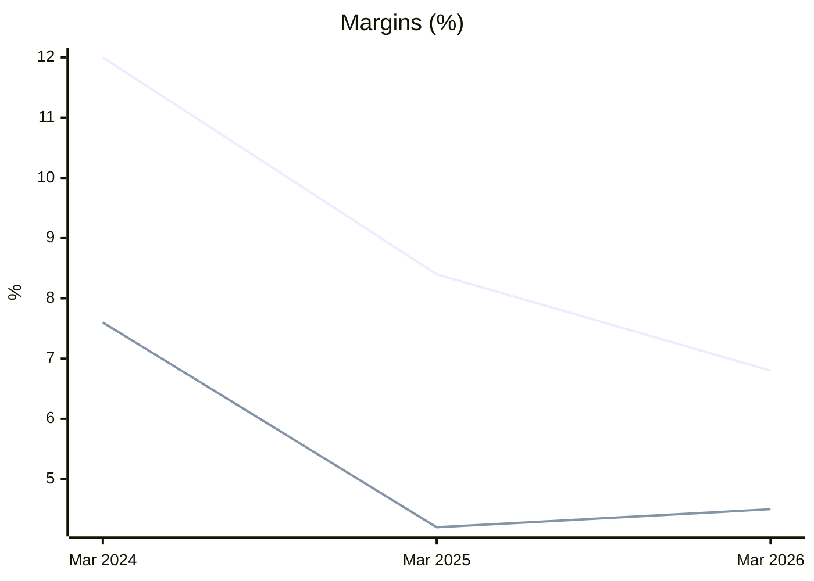

*Run 2026-11-24 · part of [SPINOFF_REPORT.md](../SPINOFF_REPORT.md) · the complete analysis of one company, with every management-call exchange in full.*

## TRIVENI — Triveni Engineering & Industries Ltd.

### 1. Triveni Engineering & Industries Ltd. — CONFIRMED DEMERGER

**CONFIRMED** (a demerger scheme is on the exchange record) · **LISTED <1Y — selling-pressure window; the bargain forms here** · score 3.6/10 · spin-off · 42 filing(s) from BSE-screener, CALLS, NSE, NSE-register · first 2025-10-29, latest 2026-10-09

**The separated entities — every one the documents name:**

| Entity | Scheme | Business | Listing | Who runs it |
|---|---|---|---|---|
| **Triveni Power Transmission Limited** | 2024 Composite Scheme of Arrangement — demerger of the PTB … | PTB Undertaking — power transmission business consisting of gears and defence business segments (Gears, Defen… | listed 2026-10-12 as TRIVENIPT (NSE) | Mr. Dhruv M. Sawhney (Non-Executive Chairman of t… |

**The other parties to the scheme(s)** — not separated entities: Sir Shadi Lal Enterprises Limited — merged in — no shares for the parent's holders; Triveni Turbine Limited (TRITURBINE) — an earlier separation — listed 2011-10-28

**What is being separated, as the documents put it:** Power Transmission Business: high-speed and niche low-speed gearboxes, gear internals, defence products, aftermarket and retro-fitment services — class `value_unlocking`.

### 2. Stages and dates

> **Listing:** LISTED — Triveni Power Transmission Limited (TRIVENIPT) since 2026-10-12 (NSE equity list); record date 2026-07-22

| Date | Event | Source |
|---|---|---|
| 2024-12-10 | Board approval — Triveni Engineering & Industries Limited (and SSEL, TPTL board resolutions dated 10.12.2024 / 09.12.2024) | as stated: Outcome of Board Meeting filing dated December 10, 2024 |
| 2025-03-21 | Filed with exchanges — NSE submission of draft scheme to SEBI | as stated: NSE Observation Letter Ref: NSE/LIST/46129 dated August 06, 2025 ("ou… |
| 2025-04-01 | Appointed date — Appointed date for the scheme (amalgamation of SSEL into TEIL) | as stated: Q4 FY26 earnings conference call transcript, June 04, 2026 |
| 2025-08-06 | SEBI approval — SEBI comments conveyed via NSE | as stated: NSE Observation Letter Ref: NSE/LIST/46129 dated August 06, 2025 (fil… |
| 2025-08-06 | Exchange no-objection — National Stock Exchange of India Limited — 'No objection' | as stated: TEIL letter dated 7th August, 2025 enclosing NSE Observation Letter N… |
| 2025-08-07 | Exchange no-objection — BSE Limited — 'no adverse observations' | as stated: TEIL letter dated 8th August, 2025 enclosing BSE letter DCS/AMAL/NB/R… |
| 2025-10-17 | NCLT order — First motion order (read with rectification order dated October 28, 2025) directing/dispensing meetings | as stated: Scheme of Arrangement filing dated 29th October, 2025 |
| 2025-11-04 | Stage reached: **meetings** | [General Updates](https://nsearchives.nseindia.com/corporate/TRIVENI_04112025163924_TEIL_Secured_Creditors_Intimation_Letter.pdf) |
| 2025-11-04 | Stage reached: **nclt sanction** | [General Updates](https://nsearchives.nseindia.com/corporate/TRIVENI_04112025163924_TEIL_Secured_Creditors_Intimation_Letter.pdf) |
| 2025-11-30 | Shareholders / creditors meeting — Sir Shadi Lal Enterprises Limited — equity shareholders 10:00 a.m., secured creditors 1:00 p.m., unsecured creditors 3:30 p.m. | as stated: Scheme of Arrangement filing dated 29th October, 2025 |
| 2025-12-07 | Shareholders / creditors meeting — Triveni Engineering & Industries Limited — equity shareholders 10:00 a.m., secured creditors 1:00 p.m., unsecured creditors 3:30 p.m. | as stated: Shareholders meeting filing dated 7th December, 2025 (proceedings of … |
| 2025-12-16 | NCLT order — Second motion petition allowed — CP (CAA) No.37/ALD/2025 | as stated: Scheme of Arrangement filing dated December 19, 2025 |
| 2026-04-01 | Appointed date — Demerger Appointed Date — PTB Undertaking into TPTL | as stated: Record Date intimation dated July 11, 2026 (filed 2026-07-14); Q4 FY2… |
| 2026-05-07 | Stage reached: **effective** | [Scheme of Arrangement](https://nsearchives.nseindia.com/corporate/TRIVENI_07052026193112_NCLT_ORDER_7_5_2026.pdf) |
| 2026-05-07 | NCLT order — NCLT Allahabad Bench order sanctioning the Scheme (pronounced) | as stated: Scheme of Arrangement filing dated May 07, 2026 |
| 2026-05-18 | NCLT order — Second NCLT order dated May 18, 2026 | as stated: Intimation about Effectiveness of the Scheme dated May 19, 2026 (file… |
| 2026-05-19 | Effective date — Scheme effective on filing of certified copies of NCLT Orders with the Registrar of Companies | as stated: Intimation about Effectiveness of the Scheme dated May 19, 2026 (file… |
| 2026-06-03 | Record date — Record date for issue of TEIL equity shares to SSEL shareholders | as stated: Record Date intimation dated May 20, 2026 |
| 2026-06-04 | Stage reached: **exchange noc** | [General Updates](https://nsearchives.nseindia.com/corporate/TRIVENI_04062026185550_TPTL_Material_Update.pdf) |
| 2026-06-09 | Allotment — 14,65,048 fully paid-up equity shares of Re.1/- each of TEIL allotted to eligible SSEL shareholders | as stated: Scheme of Arrangement filing dated June 9, 2026 |
| 2026-06-24 | Other — In-principle approval from NSE and BSE for listing of 14,65,048 additional TEIL equity shares | as stated: General Updates filing dated June 25, 2026 (NSE/LIST/55688 and DCS/AM… |
| 2026-07-22 | **Record date** | NSE corporate-actions register |
| 2026-07-22 | Stage reached: **record date** | Record Date (corporate-actions register) |
| 2026-07-22 | Record date — Demerger Record Date — eligibility of TEIL shareholders to receive TPTL equity shares | as stated: Record Date intimation dated July 11, 2026 (filed 2026-07-14) |
| 2026-07-28 | Allotment — TPTL allotted 7,34,54,338 fully paid-up equity shares of Rs.2/- each to eligible TEIL shareholders; TEIL holding diluted to 29.88% | as stated: TPTL letter dated July 28, 2026 annexed to TEIL filing dated July 29,… |
| 2026-08-03 | Other — Allocation of cost of acquisition — TEIL 86.60% / TPTL 13.40% | as stated: Ref: TEIL:SD:2026 letter dated August 3, 2026 |
| 2026-09-09 | Other — Distribution of sale proceeds of fractional entitlements completed (4,308 shares; net proceeds INR 12,24,787.00) | as stated: Audit Committee and Independent Directors reports dated September 16,… |
| 2026-09-16 | Stage reached: **announced** | [Scheme of Arrangement](https://nsearchives.nseindia.com/corporate/TRIVENI_16092026132125_AC_AND_ID_REPORTS_16_9_2026.pdf) |
| 2026-10-08 | Exchange no-objection — Listing and trading approvals for TPTL from BSE (DCS/AMAL/NB/269/2026-27) and NSE (NSE/LIST/208) | as stated: TPTL letter dated October 9, 2026 annexed to TEIL filing dated Octobe… |
| 2026-10-09 | Stage reached: **listed** | [Scheme of Arrangement](https://nsearchives.nseindia.com/corporate/TRIVENI_09102026133634_INTIMATION__TPTL_LISTING.pdf) |
| 2026-10-12 | **Triveni Power Transmission Limited** listed (TRIVENIPT) | NSE equity list |
| 2026-10-12 | Listing and trading — Triveni Power Transmission Limited — 10,47,54,338 equity shares of Rs.2/- each listed and admitted to dealings on BSE (544824) and NSE (TRIVENIPT); ISIN INE2WKEO01011 | as stated: Scheme of Arrangement filing dated October 9, 2026 |

**The stages, as filed:** meetings (2025-11-04) → nclt sanction (2025-11-04) → effective (2026-05-07) → exchange noc (2026-06-04) → record date (2026-07-22) → announced (2026-09-16) → listed (2026-10-09)

**Stated in the filings:** resulting company **Triveni Power Transmission Limited**; entitlement **100 for every 137**; record date 2026-07-22; appointed date 2025-04-01.

**When it lists, in the documents' words:** On 9 October 2026: “the equity shares of the Company shall be listed and admitted to dealings on BSE and NSE with effect from October 12, 2026” (BSE: 544824, NSE: TRIVENIPT); earlier, on the 4 June 2026 call, “one is anticipating that by the end of August, we will have a listing of Triveni Power Transmission s Limited.”

### 3. Size of the separated business beside the parent — is institutional selling likely?

**Reading: POSSIBLE — the piece is a sizeable minority of the whole; forced selling on size alone is weaker.**

| Entity | Stated turnover | Stated share of the whole | Market cap (₹ cr) | Share of the whole by market cap | Segment revenue share | Index member | Selling on size |
|---|---|---:|---:|---:|---:|---|---|
| Triveni Power Transmission Limited | "As per audited standalone financial statements as at March… | 4.75% (share of turnover) | 4,680 | 45.8% | 5.7% (FY2026) | no | possible |

*Stated figures are the documents' own (a turnover share, or the cost-of-acquisition split the company publishes for tax, which reflects relative value). The market-cap share is the entity's value over the whole — the parent plus every separated entity that trades (parent ₹5,544 cr, whole ₹10,225 cr, NSE bhavcopy of 2026-11-13); the segment share is the business's revenue over the parent's reported sales of that year. Both are computed here. The reading uses the market-cap share when the entity trades, else the stated share, else the segment share.*

**In the documents' words:** “"As per audited standalone financial statements as at March 31, 2024, of the Demerged Company, total turnover relating to PTB Undertaking was INR 291.81 crore, representing 4.75% of the total turnover of the Demerged Company, for financial year 2023-24." For cost-of-acquisition allocation purposes: "Triveni Engineering & Industries Limited 86.60% / Triveni Power Transmission Limited 13.40%"”

**The judge's read of selling pressure:** likely — Sugar/ethanol holders receive 1 engineering share per 3 held; 7,34,54,338 free shares, 13.4% of cost basis, unrelated industry.

### 4. Insider ownership — share swap, promoters' holding, management incentives

**Share swap / entitlement, entity by entity:**

- **Triveni Power Transmission Limited:** "For every 3(three) equity shares of the Demerged Company with a face value of INR 1 each held in the Demerged Company, every equity shareholder of the Demerged Company shall, without any application, act or deed, be entitled to receive 1 (One) equity share of the Resulting Company with a face value of INR 2 each, credited as fully paid up on the same terms and conditions of issue as prevalent in the Demerged Company"

**Promoters' holding, from the shareholding pattern:**

| Company | Promoters | FIIs | DIIs | Public | Quarter |
|---|---:|---:|---:|---:|---|
| Triveni Engineering & Industries Ltd. (TRIVENI) | 60.58% | 7.5% | 6.18% | 25.75% | Sep 2026 |
| Triveni Power Transmission Limited (TRIVENIPT) | 72.35% | 5.54% | 5.11% | 16.99% | Oct 2026 |

*Source: screener.in shareholding pattern, stored under `ShareholdingPattern/NiftyTotalMarket/`. In a mirror demerger each shareholder holds the same proportion of the new company as of the parent on the record date.*

- **Promoters in the parent, per the documents:** Triveni Engineering & Industries Limited, before effectiveness of the Scheme (per board disclosure dated December 10, 2024): "Promoters 13,34,91,162 60.98%", Public 8,54,06,806 39.02%, Total 21,88,97,968; after effectiveness of the amalgamation: "Promoters 13,34,91,162 60.58%", Public 8,68,71,854 39.42%, Total 22,03,63,016
- **What the promoters will hold in the separated entity:** TPTL (2024 composite scheme, demerger leg): before effectiveness of the Scheme "Promoters 3,13,00,000 100%", Public nil; after effectiveness of the Scheme "Promoters 7,57,97,054 72.36%", "Public 2,89,57,285 27.64%", "Total 3,13,00,000 100%" / "10,47,54,339 100.00%". TEIL (amalgamation leg): promoter holding in the parent after effectiveness of the demerger "Promoters 13,34,91,162 60.58%", Public "8,68,71,854 39.42%" — unchanged by the demerger. SSEL: "the shares held by the Amalgamated Company in the Amalgamating Company shall stand cancelled" and the Scheme provides for "the cancellation of the SSEL Promoter Shareholding (as defined in the Scheme)". Post-allotment of TPTL shares: "the Company's holding in TPTL was diluted to 29.88%. Consequently, TPTL ceased to be a subsidiary and became an associate of the Company."
- **What a public shareholder receives:** Demerger leg: "For every 3(three) equity shares of the Demerged Company with a face value of INR 1 each held in the Demerged Company, every equity shareholder of the Demerged Company shall, without any application, act or deed, be entitled to receive 1 (One) equity share of the Resulting Company with a face value of INR 2 each, credited as fully paid up on the same terms and conditions of issue as prevalent in the Demerged Company" — 7,34,54,338 fully paid-up equity shares of Rs.2/- each were allotted on July 28, 2026 to eligible shareholders of TEIL as on record date July 22, 2026. Amalgamation leg: public shareholders of SSEL received 100 TEIL equity shares of Re.1 each for every 137 SSEL shares of INR 10 each — "The Company took necessary steps for allotment and listing of 14,65.048 (Fourteen Lakhs Sixty-Five Thousand Forty Eight) fully paid up equity shares of face value INR I each to the public shareholders of SSEL"; 4,308 shares arising from consolidation of fractional entitlements of 6,064 shareholders were sold by the trustee and net proceeds of INR 12,24,787.00 distributed on September 09, 2026
- **Management incentives:** not stated in the documents on file.
- **Insider actions around the separation:** TPTL shares allotted under the Scheme carry lock-in per NSE Annexure I: 20,950,868 shares locked in up to 15-Oct-2029, 10,349,132 shares up to 15-Oct-2027 and 73,454,338 shares free. Company (not promoter) acquisitions: "On March 11, 2024, the Company acquired 25.43% equity stake in Sir Shadi Lal Enterprises Limited, (SSEL), followed by further acquisition of additional 36.34% stake on June 20, 2024... The Company currently holds a 61.77% equity stake in SSEL." Earlier divestment: "The Company owned 21.85% of TTL's equity, until September 21, 2022, when the entire stake was divested with net proceeds of ₹ 1,593 crore." Scheme also provides for cancellation of the SSEL Promoter Shareholding. Board changes around the separation: Mrs. Geeta Bhalla and Mr. Suresh Taneja resigned as TPTL directors w.e.f. close of business on 28th July, 2026; Mr. Tarun Sawhney ceased to be KMP of TEIL on appointment as VC & MD of TPTL w.e.f. July 28, 2026. No promoter or management buying, selling or pledging of shares around the separation is stated.
- **Insiders, per the checklist read:** Promoter family runs TPTL: Dhruv M. Sawhney Non-Executive Chairman, Tarun Sawhney Managing Director for five years (subject to shareholder approval), Nikhil Sawhney director; 3,13,00,000 shares (29.9%) locked in to 2027/2029. · *option pricing date:* not stated

### 5. Why the demerger — point by point

Triveni Engineering & Industries Ltd. (TEIL) put through a single composite scheme of arrangement that does two things: it amalgamates its ~61.77%-owned listed subsidiary Sir Shadi Lal Enterprises Ltd. (SSEL, the Shamli sugar/distillery unit) into TEIL, and it demerges TEIL's Power Transmission Business (PTB — high-speed/turbo gearboxes at Mysuru, plus the incubating defence business) into Triveni Power Transmission Ltd. (TPTL) for separate listing, which management described on the Feb 2026 call as being done 'to unlock value and to drive operational efficiencies' and in Feb 2025 as 'value unlocking that the Board of Directors has felt very important.' The problem being solved is that PTB's economics look nothing like the rest of TEIL: PTB ran PBIT margins above 34% in FY25 (PBIT ₹126.8 crore, +18.4%, on turnover up 27%, order booking ₹475+ crore), about 36% in H1 FY26 and 41% in Q2 FY26, against sugar and alcohol businesses whose output and input prices are both administered (SAP up ₹300/tonne in UP, no ethanol price revision for two years, maize at ₹20–26/kg, MSP unrevised), and whose FY25 segment profits fell on a 69bps recovery decline. Investors made exactly this point on the call: Bharat Shah of ASK Investment Managers told management that 'barring the Power Transmission business, which is relatively more robust, predictable economics and predictable outcomes,' the other businesses 'produce a very mercurial kind of an outcome,' and Tarun Sawhney conceded TEIL had not met its return profile on ethanol capital. Separation is also meant to let PTB fund and run its own growth: a board-approved capex of ₹340 crore in three tranches (taking gears capacity from ~₹400 crore to ~₹700 crore of output by September 2026, with just over ₹100 crore sanctioned for the defence facility and ₹231 crore incurred by 31 March 2026, of which ₹78 crore on defence), an export-led order book just under ₹500 crore (+25%), a Swiss subsidiary (Triveni Power Transmission GmbH, acquired 100% by TPTL), aftermarket at ~40% of gears, and a global addressable high-speed/turbo gear market of about $650–700 million. Crucially, TEIL deliberately did not do a clean 100% separation: it retains roughly 30% of TPTL, and Sawhney justified this by the defence business — 'we are incubating a Defence business, which we have large aspirations for,' where establishing pre-qualifications and the ability to bid involves 'balance sheet considerations… from a Group perspective,' plus the precedent of the Triveni Turbine separation, which he called 'actually quite a positive one for the Company.' Post-approval TEIL said ICRA reaffirmed its long-term rating at AA+ Stable, lifting it off watch, and that TPTL goes out 'armed with sufficient cash flows and a balance sheet' to fund its capex and opex.

**Point by point, with the source:**

1. First call after the 10 December 2024 board approval; Sawhney introduced the composite scheme — amalgamation of ~61.77%-held SSEL into TEIL and transfer of the PTB undertaking to wholly-owned TPTL — explicitly as a value-unlocking exercise by the Board. “I also wanted to provide an update on the Scheme, as you're all aware, this is in conjunction with value unlocking that the Board of Directors has felt very important.” — *[Feb 2025](https://www.bseindia.com/stockinfo/AnnPdfOpen.aspx?Pname=32ebf539-4c61-4455-9d21-3cc24a97dd7a.pdf)*
2. Resham Jain of DSP Asset Managers challenged the structure, arguing TEIL's retained ~30% stake in TPTL would re-import a holdco discount and that a clean separation was needed for value to be unlocked. “It seems that Triveni Engineering will still be holding 30% stake even after demerger. So why such structure, if the value unlocking has to happen, it should have happened in a clean structure where Triveni would not be holding anything otherwise, the same Holdco discount will be applicable to the Power Transmission business once it gets demerged.” — *[Feb 2025](https://www.bseindia.com/stockinfo/AnnPdfOpen.aspx?Pname=32ebf539-4c61-4455-9d21-3cc24a97dd7a.pdf)*
3. Sawhney's two reasons for keeping ~30%: the positive precedent of the Triveni Turbine separation, and — decisively — that the incubating defence business needs group balance-sheet backing to win pre-qualifications and be allowed to bid, since defence is co-located with gears in Mysuru. “The second and very, very important is because we are incubating a Defence business, which we have large aspirations for. In establishing pre-qualifications (PQs) and the ability to be able to quote, there are balance sheet considerations that even from a Group perspective that are very, very important to allow us to be in contention.” — *[Feb 2025](https://www.bseindia.com/stockinfo/AnnPdfOpen.aspx?Pname=32ebf539-4c61-4455-9d21-3cc24a97dd7a.pdf)*
4. Bharat Shah of ASK Investment Managers made the investor case for separation directly — PTB is the predictable, brick-by-brick business while the regulated sugar/ethanol/water businesses swing unpredictably — and Sawhney conceded the ethanol capital had not met its return profile. “On a shorter-term basis, interplay of the other businesses always produces a very mercurial kind of an outcome, sometimes to delight, but other times to depress.” — *[Feb 2025](https://www.bseindia.com/stockinfo/AnnPdfOpen.aspx?Pname=32ebf539-4c61-4455-9d21-3cc24a97dd7a.pdf)*
5. Same call quantified why PTB deserves its own listing: incremental board-approved capex of ₹60 crore taking gears capacity to ₹700 crore by September 2026 from ~₹400 crore, order book at an all-time-high ₹377 crore, and a global high-speed/turbo gear market of about $650–700 million. “The Board meeting of the Directors concluded yesterday had an important announcement of an incremental capex of ₹60 crore for the enhancement of capacity in the Power Transmission business. This will take the gears capacity to ₹700 crore by September 2026.” — *[Feb 2025](https://www.bseindia.com/stockinfo/AnnPdfOpen.aspx?Pname=32ebf539-4c61-4455-9d21-3cc24a97dd7a.pdf)*
6. Initial timeline guidance: NCLT sanction expected by the end of calendar 2025. “As far as the Scheme of Arrangement is concerned, we anticipate approval from NCLT by the end of this calendar year.” — *[Feb 2025](https://www.bseindia.com/stockinfo/AnnPdfOpen.aspx?Pname=32ebf539-4c61-4455-9d21-3cc24a97dd7a.pdf)*
7. Q4 FY25 call showed the margin gap the demerger exposes — PTB turnover up 27% with PBIT ₹126.8 crore (+18.4%) and PBIT margins above 34%, record Q4 revenue of almost ₹140 crore and PBIT ₹46.5 crore — while the scheme itself sat pending at SEBI, with separation guided to Q4 FY26. “So we're expecting that by the middle of Q1 of next calendar year, Q4 of this fiscal year, we will have the separation of the PTB business.” — *[Jun 2025](https://www.bseindia.com/stockinfo/AnnPdfOpen.aspx?Pname=24085d8d-b7bb-42bb-bd4f-8cb00e75ea19.pdf)*
8. Resham Jain asked management to begin disclosing PTB in granular detail — customers, industry mix — precisely because it was about to be separately listed after being buried inside a much larger company; Sawhney accepted. “And since it was a part of a much larger company, the understanding of this business from the very granular perspective was much lower.” — *[Jun 2025](https://www.bseindia.com/stockinfo/AnnPdfOpen.aspx?Pname=24085d8d-b7bb-42bb-bd4f-8cb00e75ea19.pdf)*
9. Q1 FY26: approvals still outstanding, with continuous follow-up at SEBI and stock-exchange queries answered; slippage of about 30 days flagged but Q1-calendar-2026 timing maintained. PTB closing order book was a record ₹423 crore (+38%), with engineering order book just under ₹2,000 crore. “The amalgamation with Sir Shadi Lal and the demerger of the Power Transmission business. We are still awaiting regulatory approvals. We're following up continuously with SEBI.” — *[Aug 2025](https://www.bseindia.com/stockinfo/AnnPdfOpen.aspx?Pname=a50ea3c4-1d70-4e28-a663-9393cce6158b.pdf)*
10. Stock exchanges had cleared the scheme (observation letters of 7 and 11 August 2025) and NCLT stakeholder meetings were set for late November/early December; separately, TPTL bought 100% of Triveni Power Transmission GmbH in Switzerland, building the export engine inside the entity being listed. “The proposed scheme has been approved by the stock exchanges, and the process is obtaining approval of NCLT.” — *[Nov 2025](https://www.bseindia.com/stockinfo/AnnPdfOpen.aspx?Pname=ec578aab-464f-47c2-8bc5-cb3982d61b3e.pdf)*
11. PTB PBIT margins improved more than 400bps YoY on product mix and cost optimisation (about 36% PBIT for H1, 41% in the quarter), and TPTL was equipped with its own CRM, digital-factory/digital-twin and SAP HANA systems ahead of standing alone. “Triveni Power Transmission Limited, a wholly-owned subsidiary of the company, has acquired a 100% stake in Triveni Power Transmission GmbH, a Swiss company.” — *[Nov 2025](https://www.bseindia.com/stockinfo/AnnPdfOpen.aspx?Pname=ec578aab-464f-47c2-8bc5-cb3982d61b3e.pdf)*
12. Shareholders and creditors approved in December 2025 with an NCLT hearing in February; management stated the twin purpose as unlocking value and driving operational efficiencies, and said PTB was being equipped with the systems and skills to run as an independent company. “Lastly, with respect to the proposed scheme of amalgamation of SSEL and the demerger of the Power Transmission business to unlock value and to drive operational efficiencies, the scheme has been approved by shareholders of creditors, this was in December of 2025.” — *[Feb 2026](https://www.bseindia.com/stockinfo/AnnPdfOpen.aspx?Pname=2bc4c751-c2b8-4a3a-a75a-a00326d1ee32.pdf)*
13. Sawhney signalled the split was imminent and thanked participants for years of feedback, saying the next call would be with two separate companies; a lot of systems work was underway so TPTL could start at full speed with TEIL-level efficiencies. “I think the next time we speak in all probability, this will be two separate companies.” — *[Feb 2026](https://www.bseindia.com/stockinfo/AnnPdfOpen.aspx?Pname=2bc4c751-c2b8-4a3a-a75a-a00326d1ee32.pdf)*
14. Scheme effective 19 May 2026 after NCLT approval; amalgamation appointed date 1 April 2025 and demerger appointed date 1 April 2026; SSEL record date 3 June 2026, TEIL record date within four weeks, and listing of TPTL anticipated by end-August 2026 with separate board meetings, published results and earnings calls for both entities. “I'm delighted to inform you that the composite scheme of arrangement is effective from the 19th of May, 2026 after the approval of the NCLT.” — *[Jun 2026](https://www.bseindia.com/stockinfo/AnnPdfOpen.aspx?Pname=113e1acd-25ed-4260-8b7f-62ac04ca5fd6.pdf)*
15. Management argued the separated entity is self-funding: of the ₹340 crore board-approved capex in three tranches (output of about ₹700 crore of gears, excluding defence), ₹231 crore was spent by 31 March 2026 including ₹78 crore on defence, with ₹109 crore left to September 2026 — all fundable by TPTL itself. “Of course, as power transmission migrates into Triveni Power Transmission Limited, the company is armed with sufficient cash flows and a balance sheet to be able to incur all of this CapEx and OpEx and more.” — *[Jun 2026](https://www.bseindia.com/stockinfo/AnnPdfOpen.aspx?Pname=113e1acd-25ed-4260-8b7f-62ac04ca5fd6.pdf)*
16. A balance-sheet benefit of completion was cited: ICRA reaffirmed TEIL's long-term rating at AA+ Stable and removed the under-watch status that the pending scheme had caused, restoring Triveni's historical highest rating. “I am very proud to announce that post the scheme having been approved, ICRA has reaffirmed our long-term credit rating as AA+ Stable, lifting it from its previous under watch status.” — *[Jun 2026](https://www.bseindia.com/stockinfo/AnnPdfOpen.aspx?Pname=113e1acd-25ed-4260-8b7f-62ac04ca5fd6.pdf)*
17. Asked about post-demerger margins, CFO Suresh Taneja said PTB's own dynamics support continuation of the roughly 35% PBIT level it had been delivering inside TEIL; Sawhney also guided that exports of original equipment should exceed half of PTB sales in the near future. “As regards to the PTB business, it has got its own dynamics, as a matter of fact. So far, we have been maintaining about 35% PBIT. I think the same trend is expected to continue in future also.” — *[Jun 2026](https://www.bseindia.com/stockinfo/AnnPdfOpen.aspx?Pname=113e1acd-25ed-4260-8b7f-62ac04ca5fd6.pdf)*
18. Entitlement terms: TEIL shareholders receive 1 TPTL share of ₹2 face value for every 3 TEIL shares of ₹1; SSEL shareholders received 100 TEIL shares of ₹1 for every 137 SSEL shares of ₹10, with 4,308 consolidated fractional shares sold by a trustee and ₹12,24,787 net distributed to 6,064 shareholders by 9 September 2026. “For every 3(three) equity shares of the Demerged Company with a face value of INR 1 each held in the Demerged Company, every equity shareholder of the Demerged Company shall, without any application, act or deed, be entitled to receive 1 (One) equity share of the Resulting Company with a face value of INR 2 each, credited as fully paid up on the same terms and conditions of issue as prevalent in the Demerged Company” — *Scheme*
19. Demerger record date was 22 July 2026 and 7,34,54,338 TPTL shares were allotted to TEIL shareholders on 28 July 2026, at which point TPTL ceased to be a subsidiary and became an associate of TEIL — confirming the deliberately retained residual stake (3,13,00,000 locked-in shares of the 10,47,54,338 total). “Accordingly, the Company ceased to be a subsidiary and become an associate of TEIL.” — *Scheme*
20. TPTL was staffed as a standalone listed company on 28 July 2026: Tarun Sawhney as Vice Chairman & Managing Director, Dhruv M. Sawhney as Non-Executive Chairman, Raman Kumar S. as CFO, Rakesh Kumar Yadav as Company Secretary, EY as internal auditor, with Geeta Bhalla and Suresh Taneja resigning as TPTL directors because of the scheme's implementation. “I Suresh Taneja, hereby tender my resignation from the directorship of the Company with effect from closing of business hours on 28th July, 2026, due implementation of the Composite Scheme of Arrangement and the consequent reconstitution of the Board of Directors of the Company.” — *Scheme*
21. For tax purposes the cost of acquisition was split 86.60% to TEIL and 13.40% to TPTL — the only quantified indication in these documents of the relative value attributed to the demerged power transmission business. “Triveni Engineering & Industries Limited 86.60% 13.40% Triveni Power Transmission Limited” — *Scheme*
22. TPTL's 10,47,54,338 shares received BSE and NSE listing and trading approvals on 8 October 2026 and began trading on 12 October 2026 (BSE 544824, NSE TRIVENIPT) — roughly six weeks later than the end-August listing guided on the June 2026 call. “Accordingly, the equity shares of the Company shall be listed and admitted to dealings on BSE and NSE with effect from October 12, 2026” — *Scheme*

**How it evolved:** The board approved the composite scheme on 10 December 2024, and the Feb 2025 (5 Feb) call was the first investor call after it — there Sawhney framed it as value unlocking, guided to NCLT approval 'by the end of this calendar year,' and defended the retained ~30% stake against Resham Jain's push for a clean structure; Bharat Shah's 'mercurial' critique of the commodity businesses came on the same call. By Jun 2025 (28 May) the scheme was stuck with SEBI with NCLT next, guidance slipped to 'middle of Q1 of next calendar year, Q4 of this fiscal year,' and Resham Jain asked for granular PTB disclosure ahead of listing, which Sawhney accepted as a 'welcome suggestion'; on Aug 2025 (30 July) approvals were still pending with SEBI and stock-exchange queries, with Sawhney allowing it 'could add another 30-odd days.' Nov 2025 (7 Nov) reported stock-exchange approval (observation letters 7 and 11 August 2025) and NCLT stakeholder meetings set for late November/early December, plus TPTL's 100% acquisition of Swiss step-down subsidiary Triveni Power Transmission GmbH; Feb 2026 (2 Feb) reported shareholder/creditor approval in December 2025, an NCLT hearing in February, systems work to let TPTL 'hit the ground sprinting,' and Sawhney's line that 'the next time we speak in all probability, this will be two separate companies.' On Jun 2026 (4 June) he confirmed the scheme effective 19 May 2026 after NCLT approval (orders 7 and 18 May), appointed dates of 1 April 2025 for the amalgamation and 1 April 2026 for the demerger, the SSEL record date of 3 June 2026, and guided to a TPTL listing 'by the end of August' with separate results and earnings calls for both companies — in the event the demerger record date was 22 July 2026, 7,34,54,338 TPTL shares were allotted on 28 July 2026 (TPTL thereby ceasing to be a subsidiary and becoming an associate), and TPTL listed and began trading only on 12 October 2026.

**What management expects from it:** TPTL: independent listing of a ~35% PBIT, export-led gears and defence business, self-funding its ₹340 crore capex toward ~₹700 crore of gears output, exports above 50%, aftermarket-led margins. TEIL: a cleaner sugar-distillery-water commodity platform with SSEL absorbed, AA+ Stable restored off watch, and cash flows for brownfield/greenfield expansion. Both: unlocked value, operational efficiencies, separate reporting.

*Not explained on the calls:* No valuation basis for the 1:3 ratio, no standalone PTB balance sheet or financials, no quantified dis-synergies, demerger costs, TPTL dividend policy, or why exactly 30% was retained.

- *Stated reason, in one line:* Management: “the proposed scheme of amalgamation of SSEL and the demerger of the Power Transmission business to unlock value and to drive operational efficiencies”.
- *What it reveals:* PTB was only 4.45% of TEIL turnover but earned ~35-36% PBIT margins; cost-of-acquisition split gives it just 13.40%. Order book just under ₹500 crore (+25%), ₹340 crore capex, new defence facility, Swiss subsidiary, exports targeted above 50%.
- *Parent or spin:* spin · *Read next:* TPTL's first standalone quarterly results — whether ~36% PBIT margin holds on the ₹500 crore order book post-capex.
- *In their words:* “For every 3(three) equity shares of the Demerged Company with a face value of INR 1 each held in the Demerged Company, every equity shareholder of the Demerged Company shall, without any application, act or deed, be entitled to receive 1 (One) equity share of the Resulting Company with a face value of INR 2 each, credited as fully paid up on the same terms and conditions of issue as prevalent in the Demerged Company”

### 6. On the calls, verbatim

7 call(s), oldest first: **7 question-and-answer exchange(s)** given in full — the question and every answer to it, nothing trimmed — and 6 passage(s) from management's prepared remarks (the complete sentences about it; the whole remarks are in the linked transcript). Text is as the transcript prints it.

#### Nov 2024 — [transcript](https://www.bseindia.com/stockinfo/AnnPdfOpen.aspx?Pname=72a31abe-4f36-4e2d-b192-c1b78ee28444.pdf)

**Question and answer**

> **Souresh Pal:** My question is regarding our recent acquisition of Sir Shadi Lal. What are our plans r egarding Sir Shadi Lal? And when do we think that this company can post a PAT positive number or anything regarding the capex or the land bank that is available with Sir Shadi Lal? That's my question.
>
> **Tarun Sawhney:** Okay. Let me talk, yes, of course, on t he 20th of June is when we have taken over management control of Sir Shadi Lal Enterprises. The factory will start its commercial, will start its operations at some point next week very much in line with our predictions, etc. We've had a good amount of wor k and repair and maintenance that has happened at the Sugar facility at Sir Shadi Lal. With respect to any disposal of assets of the Company , there has been no discussion of that at all amongst the Board, the new Board of Sir Shadi Lal and this is the bes t of my knowledge, it is a separate listed company as you're very well aware. And as a 60 -plus percent shareholder of Sir Shadi Lal Enterprises and a group company of Triveni Engineering, we're very hopeful that we will turn this business around very, very quickly. The last quarter and the loss that is reflected in our results of T EIL for the quarter under review. This is a quarter where there's no production. There's absolutely no production, and there was very little sugar that was left with Sir Shadi La l. All of what was left was sold and the funds were utilised and therefore, that resulted in a loss at that level. But we're very hopeful that this will turn around very, very quickly. This season is expected to be a good turnaround season for that busines s.

#### Feb 2025 — [transcript](https://www.bseindia.com/stockinfo/AnnPdfOpen.aspx?Pname=32ebf539-4c61-4455-9d21-3cc24a97dd7a.pdf)

**From the prepared remarks** *(the passage about it; the whole turn runs to 5,490 characters in the transcript)*

> **Tarun Sawhney:** The Board meeting of the Directors concluded yesterday had an important announcement of an incremental capex of ■60 crore for the enhancement of capacity in the Power Transmission business . This will take the gears capacity to ■700 crore by September 2026. The exist ing capacity , just for abundant clarification as of today is approximately ■400-odd crore , and the project for enhancement of the gears capacity is for ■500 crore , and it's underway and should be completed in the next few months. I also wanted to provide an update on the Scheme, as you're all aware, this is in conjunction with value unlocking that the Board of Directors has felt very important. And this is also the first investor call following our announcement on the 10th of December 2024, where the Boar d approved this Composite Scheme of Arrangement proposing , firstly , an amalgamation of Sir Shadi Lal Enterprises (SSEL) with Triveni Engineering & Industries Limited (TEIL) . SSEL, Sir Shadi Lal is a subsidiary of Triveni E ngineering, where Triveni owns ~61.77% stake. And second ly, the transfer and vesting of the Power Transmission Business , PTB undertaking of Triveni Engineering to Triveni Power Transmission Limited (TPTL ). Triveni Power Transmission Limited is a wholly owned subsidiary of the TEIL presentl y. Looking at the balance sheet. On a consolidated basis, the net debt after considering surplus funds is ■960 crore as on December 3 1, 2024. And it includes ■126 crore pertaining to the subsidiary, Sir Shadi Lal.

**Question and answer**

> **Maulik Chaudhari:** Just I have two questions on Power Transmission business . First is can you please share an estimated timeline for the demerger to happen? And secondly, can you talk about the total addressable market for this segment globally?
>
> **Tarun Sawhney:** Right. As far as the Scheme of Arrangement is concerned, we anticipate approval from NCLT by the end of this calendar year. So that is the timeline that we anticipate for the Scheme of Arrangement. And in answer to your second question, which was the overall market for just high speed and turbo gears, globally the market is about $650 -$700 -odd million.

**Question and answer**

> **Resham Jain:** Thanks for taking my question again. So, my other question was related to the demerger which you have announced. It seems that Triveni Engineering will still be holding 30% stake even after demerger. So why such structure, if the value unlocking has to happen, it should have happened in a clean structure where Triveni would not be holding anything otherwise, the same Holdco discount will be applicable to the Power Transmission business once it gets demerged. Like what used to h appen in Triveni Turbine s earlier, it will get into a similar structure?
>
> **Tarun Sawhney:** Right. So, Resham, two reasons. And w e can be on opposing side s of this argument over here. I think the experience with Triveni Turbine s was actually quite a positive one for the Company . It was not a negative one. But that's my personal view. And I appreciate your sharing your view on this subject, which can of course, be different to mine . The second and very, very important is because we are incubating a Defence business, which we have large aspirations for. In establishing pre-qualifications (PQs) and the ability to be able to quote, t here are balance sheet considerations that even from a Group perspective that are very, very important to allow us to be in contentio n. That was a very fundamental consideration in this determination by the Board of Triveni Engineering that we should not handicap a business just because we're separating the business, the Power Transmission business because it's the right time, we are separating it with the Defence business, which is co -located in the same city and utilising the same facility and offices that exist today. And therefore, there should be nothing that has handicapped the success of that business, which is very, very positive and will continue to deliver value for all shareholders, existing and future.

#### Jun 2025 — [transcript](https://www.bseindia.com/stockinfo/AnnPdfOpen.aspx?Pname=24085d8d-b7bb-42bb-bd4f-8cb00e75ea19.pdf)

**From the prepared remarks** *(the passage about it; the whole turn runs to 18,545 characters in the transcript)*

> **Tarun Sawhney:** Overall, the Company has unde rtaken several well -thought measures to address key challenges in Sugar and Alcohol . And we hope that in this year, we are able to leverage all of those efforts in terms of expanding our margins, improving our operations and our efficiencies across the bus inesses, growing our Engineering business with respect to new clients, with respect to new geographies and new products. And the development reflects an ongoing commitment that we have towards sustainable growth and long -term returns for our shareholders. With respect t o the scheme of arrangement that is underway, I'd like to just briefly comment that this lies with SEBI at this particular point in time. We are awaiting the approval for SEBI. The next course of action is for us to approve NCLT, that is the regular course. We are proceeding as per plan thus far.

**Question and answer**

> **Resham Jain:** Understood. Very clear. The second question is with respect to the Power Transmission business, given that it will get demerged in the next one year. And since it was a part of a much larger company, the understanding of this business from the very granular perspective was much lower. So I would request maybe if you can s tart giving more colo ur on the Power Transmission business from like what kind of customers you are targeting ? What kind of mix you have between various industries going forward? That would be very helpful , given that this is going to get separately listed in the next one year.
>
> **Tarun Sawhney:** Welcome suggestion, Resham. We will certainly do that. And we plan to do that as well.
>
> **Resham Jain:** Thank you so much.
>
> **Tarun Sawhney:** Thank you.

**Question and answer**

> **Tarun Sawhney:** No, no. So the defen ce facility will be completed by the end of this calendar year now. It is delayed by almost 6 months. But it has not impacted any of the orders under execution at all.
>
> **Udit Gupta:** Get your point. And th e demerger and the merger that we're talking about, what is the kind of timeline that we're expecting right now going forward?

#### Aug 2025 — [transcript](https://www.bseindia.com/stockinfo/AnnPdfOpen.aspx?Pname=a50ea3c4-1d70-4e28-a663-9393cce6158b.pdf)

**From the prepared remarks** *(the passage about it; the whole turn runs to 18,218 characters in the transcript)*

> **Tarun Sawhney:** It is on the 20th of October, very early this year. And so soon after that, we anticipate that sugar mills will start their operations. Regarding the proposed scheme, I think it's important to just close out my opening remarks with a few comments on that. The amalgamation with Sir Shadi Lal and the demerger of the Power Transmission business. We are still awaiting regulatory approvals. We're following up continuously with SEBI. We've received some in course and regular questions from the stock exchanges, which have been answered to our knowledge, they will meet the satisfaction, and we are hoping that we will get that permission very, very soon.

**Question and answer**

> **Rajesh Majumdar:** Yeah. If I could sneak in a last question. Although you've been sounding optimistic on the ethanol blending going at 27% extra, there's also a negative sentiment coming in from India's ongoing trade negotiations with the U.S. to ease the restrictions on Ethanol imports. While that may be debatable, then you may have a different point of view. I was just wondering as a company, post demerger, do we have any thoughts on the sugar alcohol business beyond Ethanol where we can see some kind of growth areas other than ethanol, if you have thought about any ? Thank you.
>
> **Tarun Sawhney:** You asked two questions. I'll answer both. With respect to the ongoing trade policies, the industry associations have written to the government. We too have written to the government and said that we would like to see maize imports if possible. Now even if it is GMO maize, the DDGS from that, it is actually -- it was being considered that the GMO is going to be non -GMO. But frankly speaking, talking to the poultry associations, et c., they're very happy to buy that DDGS. So , if we can import DDGS maize at competitive rates, it will allow us then to have more utilization of our plants and perhaps even some more plants to be set up across the country. I don't see that as a negative , unless you have direct Ethanol imports. If you have direct ethanol imports, it's a competing product. That is a bit of a pickle. I don't see that happening so easily at all. And I think from what I'm hearing and understanding, it is the direct maize imports that could possibly happen. The government is trying to work out the modalities of GMO, which, as you know, in India is a very ticklish subject. Now with respect to Triveni, after the demerger, looking at other things, we have some time for that demerger to happen, yet the thought process is on and the Board is going to conduct workshops, et c., and evaluate a series of different options. I don't have anything concrete to share with you right now, just that the intent is certainly there to look at all available options that are in front of us today because, yes, we do have good cash flows from the business that are investable. And we have to do something to regain as well as the previous person mentioned the margin structures that we had in 2022-23.

#### Nov 2025 — [transcript](https://www.bseindia.com/stockinfo/AnnPdfOpen.aspx?Pname=ec578aab-464f-47c2-8bc5-cb3982d61b3e.pdf)

**From the prepared remarks** *(the passage about it; the whole turn runs to 27,690 characters in the transcript)*

> **Tarun Sawhney:** And I think these new marketing efforts pay massive dividends in terms of our perception, in terms of forging new contacts and managing to enhance our global footprint, et c., we are definitely recognized as a global competitor to other high speed gear manufacturing firms . I had already talked about the very positive profitability performance in the quarter under review and that was primarily due to cost optimization as well as an optimal product mix. And , I think that realisation is a very important one and we're going to look at enhancing that further improving that as quotas go by to ensure that we eke out profitability levels very much in line with what I've been saying at these investor calls over the l ast few quarters and few years. Triveni Power Transmission Limited , a wholly -owned subsidiary of the company, has acquired a 100% stake in Triveni Power Transmission GmbH , a Swiss company . With the fed acquisition, TPTGmBH becomes a subsidiary of TPTL which is effectively a step-down subsidiary of T EIL. As far as the outlook is concerned what can I share with you that will, as I mentioned , there were the 2 levers and there are several other levers that play a very critical role . There is a concerted effort to focus on large gearboxes and we're receiving fantastic orders in the Steam Turbine segment, Gas Turbines , of course , are reasonably large but in the Steam Turbine segment and Compressor segment of larger and larger units . Now, this is where the technical competence , etc., of Triveni gets recognized by our customers. There is a concerted effort to focus beyond steam turbines, there are focus on compressors, gas turbines and other high-speed gearboxes has been critical in terms of diversifying our product scope and supply . Design and development has taken on a new form and , I think , there's been a huge amount of work that is being done right now , which where we e xpect impacts in the next financial year in terms of cost improvements and also reduction in terms of time at standardized models, the development of more standardized models to be able to further improve the manufacturing time of a lot of our gearboxes . From an IT perspective and this is absolutely crucial , and this is also for all Triveni , but I'll talk about a few extra things that are happening at Triveni Power Transmission . There's been a significant amount of development in the last quarter. For the group as a whole, there's a massive migration in terms of our enterprise resource planning solution that is happening, which will be over . It will allow us massive, in terms of our digital advocacy and migration initiatives, it will allow us to be able to use data in a very powerful form by Q4. […] We are evaluating international opportunities and intend on participating in several more tenders in water and wastewater treatment projects internationally . At an overall level, the company has implemented a series of strategic and well-considered initiatives to tackle the key challenges across all of our business segments. We remain optimistic about delivering an improved performance in FY26 , given all the various situations that our various businesses are incurring . Lastly, I'd like to comment on the scheme of arrangement, the proposed amalgamation with SSEL and the demerger of the Power Transmission business. The proposed scheme has been approved by the stock exchanges, and the process is obtaining approval of NCLT . The meetings of stakeholders under the NCL T process has been scheduled for the end of November and early December for the 2 companies. And that means that we're very much on track as far as I've said for this culmination in Q4 of this fiscal year .

#### Feb 2026 — [transcript](https://www.bseindia.com/stockinfo/AnnPdfOpen.aspx?Pname=2bc4c751-c2b8-4a3a-a75a-a00326d1ee32.pdf)

**From the prepared remarks** *(the passage about it; the whole turn runs to 24,667 characters in the transcript)*

> **Tarun Sawhney:** Towards the water business, yes, we are looking at a large number of orders both domestically and internationally because of the significant gap that exists between the demand and current availability of water and wastewater treatment, and there are new opportunities that are emerging in the recycle, reuse and Zero LD in the form of EPC and HAM models. So that's quite interesting to see that there are more tenders coming in those 2 niche areas and we hope to certainly benefit from those that we are tendering on several jobs as far as that is concerned. On an overall level, we have implemented a series of strategic and well - considered initiatives, a lot of which is playing out and a lot of which, as I mentioned on the last conference call will have had a benefit, and you've seen that benefit in this quarter's results. Lastly, with respect to the proposed scheme of amalgamation of SS EL and the demerger of the Power Transmission busine ss to unlock value and to drive operational efficiencies, the scheme has been approved by shareholders of creditors, this was in December of 2025. We have another hearing in front of NCLT in the month of February. And we find that we are very much on track , as I have previously said, for this to happen during under this quarter, this calendar quarter. So on that front, nothing really stands unchanged. We are, of course, as we get closer to this demerger. Looking at the Power Transmission business, gaining a lot of skill set s in terms of ability to operate as a separate company. A lot of systems work is being done as we speak to let them hit the ground sprinting, frankly speaking, and have the same kind of efficiencies that we've had at Triveni Engineering an d any of the other businesses that the company has run. With that, I'd now like to open th e call to questions.

#### Jun 2026 — [transcript](https://www.bseindia.com/stockinfo/AnnPdfOpen.aspx?Pname=113e1acd-25ed-4260-8b7f-62ac04ca5fd6.pdf)

**From the prepared remarks** *(the passage about it; the whole turn runs to 23,860 characters in the transcript)*

> **Tarun Sawhney:** It's a great pleasure to be with you today. Unusually, for the first time, we're having this call a few days after the results due to certain business exigencies and travel commitments. We wanted all the senior management team to be present for this very important and in some ways, historic call. I'm delighted to inform you that the composite scheme of arrangement is effective from th e 19th of May, 2026 after the approval of the NCLT. The revenues from operations of the company net of excise stood at ■6,291 crore , and the PBT stood at ■378 crore . There was a strong turnaround in the operating performance of the Distillery segment. In the Power Transmission Business, the highlight was an order booking of 25% higher than previously, a significant increase of enquiries as well during this period. […] As you can quickly do the backward calculation, about ■109 crore will be incurred in this quarter and the next quarter, completing the ■340 crore . A lot of that is already planned, executed, underway, things being delivered at various stages of final execution, frankly speaking. So w e are exactly in plan with what we had targeted, pretty much with a small slip up in the defen ce facility, but the rest of the targets are pretty much as planned and having no material impact on the operations of the company, which actually has been very very important. Of course, as power transmission migrates into Triveni Power Transmission Limited, the co mpany is armed with sufficient cash flows and a balance sheet to be able to incur all of this CapEx and OpEx and more. Turning quickly to the water business. The consolidated revenues of our water business increased by 15% to ■270 odd crore , driven by an acceleration in execution of our EPC portfolio. The prior year's PBIT also included a one -time favourable arbitration award, making the normal ised underlying operational profitability for FY26 quite encouraging. […] Finally, in the Water segment, the market remains buoyant. Stricter environmental clients, including the liquid discharge management rules and the expanding corporate ZLD norms, are driving commercial demand for water recycle and reuse infrastructure, an area where our technological excellence is highly competitive. So I'm hopeful that we will be receiving more orders in the very near future in this business. Before I open up the floor for questions, I'd like to just offer a comment on the demerger. As I mentioned at the very outset of this call, the approval of NCLT has been granted on the 19th of May and has been informed to the stock exchanges and the ROC. T he appointed date for the scheme is the 1st of April 2025, and the appointed date for the demerger is the 1st of April 2026. In respect to the record date, we have two record dates. The issuance of shares for Sir Shadilal, a group company of Triveni is the 3rd of June. That is the record date for the issuance of shares to Sir Shadi Lal shareholders. For the issuance of shares for Triveni Engineering shareholders, I anticipate that over the next four weeks, we will be able to set the record date. This is subject to the approvals of the stock exchange for the dispersal of shares to the shareholders. In a nutshell, one is anticipati ng that by the end of August, we will have a listing of Triveni Power Transmission s Limited. I do want to assure all those on this call and other investors of Triveni Engineering that the end of August 2026 will probably be after our Q1 board meetings for TEIL as well as TPTL, and we fully intend on publishing our results in the papers and on our web pages and holding earnings conference calls for both companies so that our shareholders are fully knowledgeable about the progress that the businesses have made in Q1 of FY27. With that, ladies and gentlemen, I'd like to open up the floor for questions.

**Question and answer**

> **Tarun Sawhney:** Ladies and gentlemen, thank you very much for joining us for this earnings conference call. I think we've had a productive discussion. We're at a very important inflection point for Triveni. The growth trajectory for TPTL looks extremely robust. We're very excited about the new journey, as that company and that business also completes its 50th year, a year worth being celebrated. As far as Triveni Engineering is concerned, there's a lot of excitement in both the commodities parts of the business. I think it's unfortunate that El Ni no has such a devastating impact, but for the sugar industry, it can only be considered positive in some respects. As far as the distillery business is concerned, we've seen with what's happened with oil prices, with the rupee, and with the government's ren ewed push and look at higher blends and more ethanol. I'm personally very excited about the next path of that business as well. Our water business, too, continues very , very well in terms of its progress as well. I look forward to discussing both Triveni Engineering and Triveni Power Transmission with you separately in August. Thank you very much. Disclaimer: This transcript is the output of transcribing from an audio recording and has been edited for clarity, consistenc y with published information. Although efforts have been made to ensure a high level of accuracy, in some cases it may be incomplet e or inaccurate due to inaudible passages or transcription errors. The Company takes no responsibility of such inaccuracies or errors. It is compiled as an aid to understanding the proceedings of the event but should not be treated as an authoritative reco rd.

### 7. The parent's financial statements

**The parent, last three fiscal years (consolidated)**

| | Mar 2024 | Mar 2025 | Mar 2026 |
|---|---:|---:|---:|
| Sales (₹ cr) | 5,220 | 5,689 | 5,952 |
| Sales growth (%) | -7.1% | +9.0% | +4.6% |
| Operating profit (₹ cr) | 627 | 479 | 407 |
| Operating profit growth (%) | +1.5% | -23.6% | -15.0% |
| Operating margin (%) | 12.0 | 8.4 | 6.8 |
| PAT (₹ cr) | 395 | 238 | 269 |
| PAT growth (%) | -78.0% | -39.7% | +13.0% |
| PAT margin (%) | 7.6 | 4.2 | 4.5 |
| EPS (₹) | 18.1 | 11.1 | 12.3 |

*Source: ProfitStatement/NiftyTotalMarket/TRIVENI.csv (consolidated, screener.in); growth and margins computed here.*

```mermaid
xychart-beta
    title "Sales, operating profit and PAT (₹ cr)"
    x-axis ["Mar 2024", "Mar 2025", "Mar 2026"]
    y-axis "₹ crore"
    bar [5220, 5689, 5952]
    bar [627, 479, 407]
    bar [395, 238, 269]
```

*Series in order: Sales, Operating profit, PAT.*

*Series in order: Operating margin, PAT margin.*

**P/E:** 18.8 — close 2026-10-01 ÷ EPS 12.28 (Mar 2026) (price ₹230.92 as of 2026-10-01).

**Cash flows (₹ cr):**

| | Mar 2024 | Mar 2025 | Mar 2026 |
|---|---:|---:|---:|
| Cash from operations (₹ cr) | 100 | -106 | 188 |
| Cash from investing (₹ cr) | -359 | -319 | -163 |
| Cash from financing (₹ cr) | 263 | 395 | -16.0 |
| Net cash flow (₹ cr) | 4.0 | -30.0 | 9.0 |
| Free cash flow (₹ cr) | -255 | -404 | 6.0 |

*Source: CashFlow/NiftyTotalMarket/TRIVENI.csv (consolidated, screener.in).*

### 8. The separated business's financial statements

**The business being separated — its own numbers**, entity by entity: its reported statements once it is listed and on file, and the segment numbers the annual reports and presentations carry for it before that.

**Triveni Power Transmission Limited (TRIVENIPT) — as reported since listing**

| | Mar 2026 |
|---|---:|
| Sales (₹ cr) | 0.0 |
| Sales growth (%) | — |
| Operating profit (₹ cr) | -0.3 |
| Operating profit growth (%) | — |
| Operating margin (%) | — |
| PAT (₹ cr) | -0.1 |
| PAT growth (%) | — |
| PAT margin (%) | — |
| EPS (₹) | — |

*Source: ProfitStatement/NiftyTotalMarket/TRIVENIPT.csv (consolidated, screener.in); growth and margins computed here.*

**Power transmission / Power Transmission Business (PTB) → Triveni Power Transmission Limited (TPTL) — the Resulting Company receiving the PTB Undertaking** · unit ₹ crore · Profit line is 'Segment Profit/(loss)' = PBIT (segment revenue less segment expenses), before unallocated expenses, finance cost and tax; no segment-level PAT disclosed. Revenue shown is total revenue from operations including inter-segment sales (external-customer revenue: FY2024 288.71, FY2025 369.20, FY2026 338.90). FY2024 taken in ₹ crore from the AR2025 comparative column (AR2024 carried the same data in ₹ lakhs: revenue 29180.90, profit 10708.88, assets 22641.80, liabilities 7305.85, capex 1108.68, depreciation 1093.94). FY2026 assets/liabilities are the consolidated segment figures; standalone FY2026 segment assets/liabilities for PT are not shown (PTB reported as discontinued operations in the Q1 FY27 statement, assets 572.27 / liabilities 127.25 as at 31-Mar-2026).

| | FY2024 | FY2025 | FY2026 |
|---|---:|---:|---:|
| Revenue (₹ crore) | 292 | 370 | 340 |
| Revenue growth (%) | — | +26.8% | -8.1% |
| Operating profit (₹ crore) | 107 | 127 | 120 |
| Operating profit growth (%) | — | +18.4% | -5.0% |
| Operating margin (%) | 36.7 | 34.3 | 35.4 |
| PAT (₹ crore) | — | — | — |
| PAT growth (%) | — | — | — |
| Segment assets (₹ crore) | 226 | 373 | 542 |
| Segment liabilities (₹ crore) | 73.1 | 104 | 125 |
| Capital employed (₹ crore) | 153 | 269 | 417 |
| Return on capital employed (%) | 69.8 | 47.2 | 28.9 |
| Segment assets / revenue (x) | 0.8 | 1.0 | 1.6 |
| Capex (₹ crore) | 11.1 | 102 | — |

*Sources:* Annual Report 2025 — page 145; Annual Report 2026 — page 162 (revenue, profit); Annual Report 2026 — page 215 (assets, liabilities)

*Latest quarter (Q3 FY26 (quarter ended 31-Dec-2025)):* revenue 79.86, operating profit 28.69 — Presentation Feb 2026 — page 15

*Not in the pages read:* No segment PAT any year; FY2026 capex and depreciation absent; Q1 FY27 PTB revenue/result not shown (reported only as discontinued operations).

**Gears/Gear Boxes (including spares) → Triveni Power Transmission Limited (TPTL) — product line of the PTB Undertaking** · unit ₹ crore · Revenue-only product disclosure within 'break-up of revenue from major products and services' (sale of finished goods, recognised at a point in time, external revenue). No profit, asset, liability, capex or depreciation data at product level. FY2024 in ₹ crore from the AR2025 comparative column (AR2024 showed 28328.06 ₹ lakhs for FY2024 and 21928.52 ₹ lakhs for FY2023).

| | FY2024 | FY2025 | FY2026 |
|---|---:|---:|---:|
| Revenue (₹ crore) | 283 | 363 | — |
| Revenue growth (%) | — | +28.2% | — |
| Operating profit (₹ crore) | — | — | — |
| Operating profit growth (%) | — | — | — |
| Operating margin (%) | — | — | — |
| PAT (₹ crore) | — | — | — |
| PAT growth (%) | — | — | — |

*Sources:* Annual Report 2025 — page 146

*Not in the pages read:* Profit, PAT, assets, liabilities, capex, depreciation and any quarterly split; FY2026 revenue not on the pages.

*Businesses with no numbers in the pages read (3 annual report(s) and 12 presentation(s) on file):* Triveni Power Transmission GmbH / TRIVENIPT: pages carry no financials (only a ₹6.30 crore investment in newly formed Triveni Power Transmission Limited, AR2025 p90). No standalone TPTL entity accounts on these pages.

*Documents on file:* [Annual Report 2026](https://www.bseindia.com/xml-data/corpfiling/AttachHis/407be97b-dc62-4396-b07c-783e877e1296.pdf); [Annual Report 2025](https://www.bseindia.com/xml-data/corpfiling/AttachHis/b50a1aeb-2a73-46a1-8a98-a02a3b91bbf3.pdf); [Annual Report 2024](https://www.bseindia.com/xml-data/corpfiling/AttachHis/ff2b2236-baa5-4913-9cf6-987eda36a8cb.pdf); [Presentation Nov 2026](https://www.bseindia.com/stockinfo/AnnPdfOpen.aspx?Pname=1d2eb358-63e7-40dd-84aa-ab498d5f88f6.pdf); [Presentation Aug 2026](https://www.bseindia.com/stockinfo/AnnPdfOpen.aspx?Pname=d7460914-cd28-419f-9573-467254e60bd9.pdf); [Presentation Jun 2026](https://www.bseindia.com/stockinfo/AnnPdfOpen.aspx?Pname=29af85f6-ae3c-4c0a-b775-2eb6311ada5f.pdf); [Presentation May 2026](https://www.bseindia.com/stockinfo/AnnPdfOpen.aspx?Pname=aa015718-7a18-4501-aa00-7962ad1a1aac.pdf); [Presentation Feb 2026](https://www.bseindia.com/stockinfo/AnnPdfOpen.aspx?Pname=5f544e48-7cab-42de-a92a-5e79b66f2eec.pdf); [Presentation Nov 2025](https://www.bseindia.com/stockinfo/AnnPdfOpen.aspx?Pname=ad08b66a-3a4c-4631-a99c-589d7b653b65.pdf)

### 9. Other financial differences — working capital, margins, returns, debt

| Metric (latest year) | Parent (TRIVENI) | Triveni Power Transmission Limited (TRIVENIPT) |
|---|---:|---:|
| *Basis* | *reported, consolidated* | *its own reported statements* |
| Sales (₹ cr) | 5,952 (Mar 2026) | 0 (Mar 2026) |
| Sales growth (%) | 4.6 (Mar 2026) | — |
| Operating margin (%) | 6.8 (Mar 2026) | — |
| Operating profit growth (%) | -15 (Mar 2026) | — |
| PAT margin (%) | 4.5 (Mar 2026) | — |
| ROCE % | 7 (Mar 2026) | -8.5 (Mar 2025) |
| Debtor Days | 34 (Mar 2026) | — |
| Inventory Days | 243 (Mar 2026) | — |
| Days Payable | 36 (Mar 2026) | — |
| Cash Conversion Cycle | 241 (Mar 2026) | — |
| Working Capital Days | 75 (Mar 2026) | — |
| Debt / equity (x) | 0.7 (Mar 2026) | 0 (Sep 2026) |
| Borrowings (₹ cr) | 2,161 (Mar 2026) | 2.5 (Sep 2026) |

*Each figure is the latest on file, with its year. Working-capital days and ROCE come from the stored working-capital file; segment figures from the pages cited in part 8. A dash means the documents do not carry it.*

**What stays with the parent — its segments, from the same pages:**

| Remaining segment | Revenue | Operating margin | ROCE | Segment assets / revenue | Unit | Year |
|---|---:|---:|---:|---:|---|---|
| Sugar (Sugar & Allied Businesses) | 4,477 | 6.1% | 8.2% | 0.84x | ₹ crore | FY2026 |
| Distillery (Sugar & Allied Businesses) | 2,883 | 4.1% | 8.4% | 0.53x | ₹ crore | FY2026 |
| Water / Water & Waste Water Treatment (Engineering Businesses) | 268 | 8.7% | 9.9% | 1.53x | ₹ crore | FY2026 |
| Other Operations (branded/private-label sugar and fuel station retailing) | 219 | 0.0% | 0.8% | 0.05x | ₹ crore | FY2026 |

**What the documents themselves say about the differences:**

- **operating margin** — parent / remaining: Sugar & allied: FY26 sugar revenues grew ~13% with PBIT of about ₹272 crore; group EBITDA margin rose to 16.9% (~₹624 crore) from ₹533 crore in the previous fiscal year; separated business: Power Transmission has maintained about 35% PBIT margin and is expected to continue at that level; H1 FY26 PBT margins improved by more than 400 basis points and the quarter PBIT margin reached ~41% “As regards to the PTB business, it has got its own dynamics, as a matter of fact. So far, we have been maintaining about 35% PBIT. I think the same trend is expected to continue in future also.”
- **capex and capital intensity** — parent / remaining: Sugar capex limited to lowering cost of production: "the CapEx that are presently being incurred is only to lower the cost of production within sugar", funded by internal accruals with "nothing substantial"; separated business: ₹340 crore board-approved capex for the gearbox business in three tranches, of which ₹231 crore incurred up to March 31, 2026 (₹78 crore for the defence facility) and ~₹109 crore to be incurred in Q1/Q2 FY27, completion by September 2026 “the CapEx that the board of Triveni Engineering has approved in three tranches totals exactly ₹340 crore. For the gearbox business, this represents an output of about ₹700 crore based on the product mix.”
- **debt and leverage** — parent / remaining: Consolidated debt ₹2,148 crore on March 31, 2026 vs ₹1,969 crore on March 31, 2025; long-term debt ₹472 crore vs ₹506 crore; ICRA reaffirmed long-term rating AA+ Stable after the scheme; separated business: TPTL stated to have sufficient cash flows and balance sheet strength to fund all of the approved capex and opex; TPTL had no secured or unsecured creditors (its NCLT creditor meetings were dispensed with) “Of course, as power transmission migrates into Triveni Power Transmission Limited, the company is armed with sufficient cash flows and a balance sheet to be able to incur all of this CapEx and OpEx and more.”
- **growth** — parent / remaining: FY26 consolidated revenues ₹6,291 crore, growth of 10.6%, propelled by stronger sugar and distillery volumes and better sugar realisations; Q4 revenue slightly down from the previous corresponding quarter; separated business: Power Transmission closing order book just under ₹500 crore, 25% higher year on year; exports targeted at more than half of original equipment sales in the near future; enquiry levels up at least 75% year on year “We concluded this year with a very strong order book of just under ₹500 crore, 25% higher than the previous year, providing distinct revenue visibility for the coming quarters.”
- **working capital** — parent / remaining: Short-term borrowings higher due to the increase in cane price; total receivables about ₹500 crore of which water business is ₹125–150 crore; short-term borrowings expected to fall to almost zero by September/October; separated business: not stated “Now as far as the cash credit is concerned, you must realise that there has been an increase in the cane price also. As a result of increase in cane price, you require a higher working capital.”
- **tax** — parent / remaining: 86.60% of the cost of acquisition of equity shares allocated to Triveni Engineering & Industries Limited under Sections 73(1) (Table Serial Nos. 14 and 15) of the Income-Tax Act, 2025; separated business: 13.40% of the cost of acquisition allocated to Triveni Power Transmission Limited “riveni Engineering & Industries Limited 86.60% 13.40% riveni Power Transmission Limited”

**The checklist:**

| Item | Status | Evidence |
|---|---|---|
| Why the spin-off | yes | regulatory / strategic knot; value unlocking for shareholders; a weak or capital-heavy business carved away — “…Page 3 of 6 Exchange Board, the Registrar , the respective stock exchanges, the Official Liquidator , the Competition Commission of India established under sub -section (1) of section 7 of the Competition Act, 2002, if ” |
| Institutional selling likely (small / different business) | unknown | size of the demerged piece not stated *(next: pro-forma statements: revenue / assets of the demerged undertaking vs the parent)* |
| Insider ownership and incentives aligned | unknown | no promoter-continuity or option-pricing language found *(next: the date the management options are priced; promoter holding in the resulting company)* |
| A hidden value revealed (pro-forma, leverage, comparables) | unknown | no pro-forma or market data on file *(next: pro-forma P&L of each piece × the peer P/E of its own industry)* |
| Parent before the spin (clean parent, takeover prelude) | no | stage listed — the pieces trade separately now |
| Timing (first year sells, second year gains) | partly | 46 days since listing/record date; first year since listing — the selling-pressure window; watch, size the entry |
| Management discussing it on the calls | yes | 9 mention(s) in the last 12 months of calls — “…anuj Na ngalia from SKP Securities. Please go ahead. Tanuj Na ngalia : Thanks for the opportunity. Can I get to know what is the EBITDA margin impact after the demerger? Do we see any positive side or negative side in t” |

**On the calls (last 12 months):**

- *Nov 2025* (forward) — “…ut delivering an improved performance in FY26 , given all the various situations that our various businesses are incurring . Lastly, I'd like to comment on the scheme of arrangement, the proposed amalgamation with SSEL and the demerger of the Power Transmission business. The proposed scheme has been approved by the stock exchanges, and the…”
- *Nov 2025* (forward) — “…us situations that our various businesses are incurring . Lastly, I'd like to comment on the scheme of arrangement, the proposed amalgamation with SSEL and the demerger of the Power Transmission business. The proposed scheme has been approved by the stock exchanges, and the process is obtaining approval of NCLT . The meetings…”
- *Feb 2026* (forward) — “…l will have had a benefit, and you've seen that benefit in this quarter's results. Lastly, with respect to the proposed scheme of amalgamation of SS EL and the demerger of the Power Transmission busine ss to unlock value and to drive operational efficiencies, the scheme has been approved by shareholders of creditors, this was…”
- *Feb 2026* (neutral) — “…this to happen during under this quarter, this calendar quarter. So on that front, nothing really stands unchanged. We are, of course, as we get closer to this demerger. Looking at the Power Transmission business, gaining a lot of skill set s in terms of ability to operate as a separate company. A lot of systems work is being…”
- *Jun 2026* (backward) — “…We wanted all the senior management team to be present for this very important and in some ways, historic call. I'm delighted to inform you that the composite scheme of arrangement is effective from th e 19th of May, 2026 after the approval of the NCLT. The revenues from operations of the company net of excise stood at ■6,291 crore , and…”

The filings

| Date | Category | Headline | Attachment |
|---|---|---|---|
| 2025-10-29 | Scheme of Arrangement | Triveni Engineering & Industries Limited has informed the Exchange about Scheme of Arrangement | [pdf](https://nsearchives.nseindia.in/corporate/TRIVENI_29102025161925_NCLT_ORDER_SE.pdf) |
| 2025-11-01 | Earnings call Nov 2025 | …ut delivering an improved performance in FY26 , given all the various situations that our various businesses are incurring . Lastly, I'd like to comment on the | [pdf](https://www.bseindia.com/stockinfo/AnnPdfOpen.aspx?Pname=ec578aab-464f-47c2-8bc5-cb3982d61b3e.pdf) |
| 2025-11-01 | Earnings call Nov 2025 | …us situations that our various businesses are incurring . Lastly, I'd like to comment on the scheme of arrangement, the proposed amalgamation with SSEL and the | [pdf](https://www.bseindia.com/stockinfo/AnnPdfOpen.aspx?Pname=ec578aab-464f-47c2-8bc5-cb3982d61b3e.pdf) |
| 2025-11-04 | General Updates | Triveni Engineering & Industries Limited has informed the Exchange about Notice of meeting of the Secured Creditors of Triveni Engineering & Industries Limited  | [pdf](https://nsearchives.nseindia.com/corporate/TRIVENI_04112025163924_TEIL_Secured_Creditors_Intimation_Letter.pdf) |
| 2025-11-04 | General Updates | Triveni Engineering & Industries Limited has informed the Exchange about Notice of meeting of the Unsecured Creditors of Triveni Engineering & Industries Limite | [pdf](https://nsearchives.nseindia.com/corporate/TRIVENI_04112025164324_TEIL_Unsecured_Creditors_Intimation_Letter.pdf) |
| 2025-11-04 | Shareholders meeting | Triveni Engineering & Industries Limited has informed the Exchange regarding Notice of Court Convened General Meeting to be held on December 07, 2025 | [pdf](https://nsearchives.nseindia.com/corporate/TRIVENI_04112025171536_TEIL_Equity_Shareholder_Intimation_Letter.pdf) |
| 2025-12-07 | Shareholders meeting | Triveni Engineering & Industries Limited has informed the Exchange regarding Proceedings of Court Convened General Meeting held on December 07, 2025 | [pdf](https://nsearchives.nseindia.com/corporate/TRIVENI_07122025170828_TEIL_PROCEEDINGS_NCLT.pdf) |
| 2025-12-19 | Scheme of Arrangement | Triveni Engineering & Industries Limited has informed the Exchange about Scheme of Arrangement | [pdf](https://nsearchives.nseindia.com/corporate/TRIVENI_19122025144154_NCLT_ORDER_16_12_2025.pdf) |
| 2025-12-22 | Press Release | Triveni Engineering & Industries Limited has informed the Exchange regarding a press release dated December 22, 2025, titled "With reference to the subject matt | [pdf](https://nsearchives.nseindia.com/corporate/TRIVENI_22122025111846_TEIL_PRESS_RELEASE_22DEC_2025.pdf) |
| 2026-01-30 | Outcome of Board Meeting | Triveni Engineering & Industries Limited has submitted to the Exchange, the financial results for the period ended December 31, 2025. | [pdf](https://nsearchives.nseindia.com/corporate/TRIVENI_30012026175727_TEIL_OUTCOME_BM_DEC25.pdf) |
| 2026-01-30 | Record Date | Triveni Engineering & Industries Limited has informed the Exchange that Record date for the purpose of Dividend is 06-Feb-2026. | [pdf](https://nsearchives.nseindia.com/corporate/TRIVENI_30012026183329_TEIL_OUTCOME_BM_DEC25.pdf) |
| 2026-02-01 | Earnings call Feb 2026 | …l will have had a benefit, and you've seen that benefit in this quarter's results. Lastly, with respect to the proposed scheme of amalgamation of SS EL and the | [pdf](https://www.bseindia.com/stockinfo/AnnPdfOpen.aspx?Pname=2bc4c751-c2b8-4a3a-a75a-a00326d1ee32.pdf) |
| 2026-05-07 | Scheme of Arrangement | Triveni Engineering & Industries Limited has informed the Exchange about Scheme of Arrangement | [pdf](https://nsearchives.nseindia.com/corporate/TRIVENI_07052026193112_NCLT_ORDER_7_5_2026.pdf) |
| 2026-05-14 | Scheme of Arrangement | Triveni Engineering & Industries Limited has informed the Exchange about Scheme of Arrangement - Intimation of receipt of certified copy of Order sanctioning th | [pdf](https://nsearchives.nseindia.com/corporate/TRIVENI_14052026115402_NCLT_ORDER_7_5_2026_INTIMATION.pdf) |
| 2026-05-19 | Scheme of Arrangement | Triveni Engineering & Industries Limited has informed the Exchange about Scheme of Arrangement - Submission of certified copy of Rectification Order passed by t | [pdf](https://nsearchives.nseindia.com/corporate/TRIVENI_19052026130144_TEIL_NCLT_ORDER_18_5_2026.pdf) |
| 2026-05-20 | Scheme of Arrangement | Triveni Engineering & Industries Limited has informed the Exchange about Scheme of Arrangement | [pdf](https://nsearchives.nseindia.com/corporate/TRIVENI_20052026001610_TEIL_Effectiveness.pdf) |
| 2026-05-20 | Scheme of Arrangement | Triveni Engineering & Industries Limited has informed the Exchange about Scheme of Arrangement - Record Date for issue of equity shares pursuant to Composite Sc | [pdf](https://nsearchives.nseindia.com/corporate/TRIVENI_20052026172713_RECORD_DATE_SSEL_3_JUNE_2026.pdf) |
| 2026-05-20 | General Updates | Triveni Engineering & Industries Limited has informed the Exchange about General Updates - Record Date for issue of equity shares pursuant to Composite Scheme o | [pdf](https://nsearchives.nseindia.com/corporate/TRIVENI_20052026173021_RECORD_DATE_SSEL_3_JUNE_2026.pdf) |
| 2026-05-29 | Outcome of Board Meeting | Triveni Engineering & Industries Limited has submitted to the Exchange, the financial results for the period ended March 31, 2026. | [pdf](https://nsearchives.nseindia.com/corporate/TRIVENI_29052026160842_TEIL_OUTCOME_BM_MAR26.pdf) |
| 2026-05-29 | Record Date | Triveni Engineering & Industries Limited has informed the Exchange that Record date for the purpose of Dividend is 31-Aug-2026. | [pdf](https://nsearchives.nseindia.com/corporate/TRIVENI_29052026163817_TEIL_OUTCOME_BM_MAR26.pdf) |
| 2026-05-29 | General Updates | Triveni Engineering & Industries Limited has informed the Exchange about General Updates about appointment of Cost Auditors of the company for FY 2026-2027 | [pdf](https://nsearchives.nseindia.com/corporate/TRIVENI_29052026165213_TEIL_OUTCOME_BM_MAR26.pdf) |
| 2026-06-01 | Earnings call Jun 2026 | …at we will be receiving more orders in the very near future in this business. Before I open up the floor for questions, I'd like to just offer a comment on the | [pdf](https://www.bseindia.com/stockinfo/AnnPdfOpen.aspx?Pname=113e1acd-25ed-4260-8b7f-62ac04ca5fd6.pdf) |
| 2026-06-04 | General Updates | Triveni Engineering & Industries Limited has informed the Exchange about General Updates - Material update in connection with the Composite Scheme of Arrangemen | [pdf](https://nsearchives.nseindia.com/corporate/TRIVENI_04062026185550_TPTL_Material_Update.pdf) |
| 2026-06-09 | Scheme of Arrangement | Triveni Engineering & Industries Limited has informed the Exchange about Scheme of Arrangement | [pdf](https://nsearchives.nseindia.com/corporate/TRIVENI_09062026161816_Allotment_of_Equity_Shares.pdf) |
| 2026-06-25 | General Updates | Triveni Engineering & Industries Limited has informed the Exchange about General Updates | [pdf](https://nsearchives.nseindia.com/corporate/TRIVENI_25062026193036_Intimation_In_Principle_approval.pdf) |
| 2026-07-11 | Scheme of Arrangement | Triveni Engineering & Industries Limited has informed the Exchange about Scheme of Arrangement - Intimation under Regulation 30 & 42 of the SEBI (LODR) Regulati | [pdf](https://nsearchives.nseindia.com/corporate/TRIVENI_11072026100700_TEIL_RECORD_DATE.pdf) |
| 2026-07-11 | Updates | Triveni Engineering & Industries Limited has informed the Exchange regarding ' Intimation under Regulation 30 & 42 of the SEBI (LODR) Regulations, 2015 about fi | [pdf](https://nsearchives.nseindia.com/corporate/TRIVENI_11072026100950_TEIL_RECORD_DATE.pdf) |
| 2026-07-14 | Record Date | Triveni Engineering & Industries Limited has informed the Exchange that Record date for the purpose of Board of Directors of the Company has, in consultation wi | [pdf](https://nsearchives.nseindia.com/corporate/TRIVENI_14072026103410_TEIL_RECORD_DATE.pdf) |
| 2026-07-14 | Record Date | Triveni Engineering & Industries Limited has informed the Exchange that Record date for the purpose of Merger/HiveOff is 22-Jul-2026. | [pdf](https://nsearchives.nseindia.com/corporate/TRIVENI_14072026105638_TEIL_RECORD_DATE.pdf) |
| 2026-07-22 | Record Date (corporate-actions register) | Record date 2026-07-22 for Demerger — NSE corporate-actions register |  |
| 2026-07-29 | General Updates | Material update in connection with the Composite Scheme of Arrangement amongst Triveni Engineering & Industries Ltd. (TEIL) and Sir Shadi Lal Enterprises Limite | [pdf](https://nsearchives.nseindia.com/corporate/TRIVENI_29072026171231_TPTL_Disclosure_28_07_2026.pdf) |
| 2026-07-29 | Outcome of Board Meeting | Triveni Engineering & Industries Limited has submitted to the Exchange, the financial results for the period ended Jun 30, 2026. | [pdf](https://nsearchives.nseindia.com/corporate/TRIVENI_29072026175304_TEIL_RESULT_JUNE2026.pdf) |
| 2026-07-29 | General Updates | Pursuant to the allotment of equity shares by Triveni Power Transmission Ltd. (TPTL) on July 28, 2026, to the eligible shareholders of the Company as on the rec | [pdf](https://nsearchives.nseindia.com/corporate/TRIVENI_29072026184210_TEIL_RESULT_JUNE2026.pdf) |
| 2026-07-29 | General Updates | Mr. Tarun Sawhney has ceased to be a Key Managerial Personnel. | [pdf](https://nsearchives.nseindia.com/corporate/TRIVENI_29072026185252_TEIL_RESULT_JUNE2026.pdf) |
| 2026-08-03 | Scheme of Arrangement | Allocation of cost of acquisition of Equity Shares of Triveni Engineering & Industries Ltd. and Triveni Power Transmission Ltd. | [pdf](https://nsearchives.nseindia.com/corporate/TRIVENI_03082026144221_COST_OF_ACQUISITION_TPTL.pdf) |
| 2026-08-03 | General Updates | Allocation of cost of acquisition of Equity Shares of Triveni Engineering & Industries Ltd. and Triveni Power Transmission Ltd. | [pdf](https://nsearchives.nseindia.com/corporate/TRIVENI_03082026144712_COST_OF_ACQUISITION_TPTL.pdf) |
| 2026-09-16 | Scheme of Arrangement | Triveni Engineering & Industries Limited has informed the Exchange about Scheme of Arrangement - Reports from Audit Committee and Independent Directors of the C | [pdf](https://nsearchives.nseindia.com/corporate/TRIVENI_16092026132125_AC_AND_ID_REPORTS_16_9_2026.pdf) |
| 2026-09-16 | General Updates | Triveni Engineering & Industries Limited has informed the Exchange about General Updates - Reports from the Audit Committee and Independent Directors | [pdf](https://nsearchives.nseindia.com/corporate/TRIVENI_16092026132329_AC_AND_ID_REPORTS_16_9_2026.pdf) |
| 2026-09-16 | Announcement under Regulation 30 (LODR)- | Audit Committee and Independent Directors certified ₹12.25 lakh fractional share proceeds distribution completed on 9 Sept 2026. | [pdf](https://www.bseindia.com/xml-data/corpfiling/AttachLive/2757a087-edfc-460f-8685-a143575f9359.pdf) |
| 2026-09-16 | Announcement under Regulation 30 (LODR)- | Audit Committee and Independent Directors certified ₹12.25 lakh fractional share proceeds distributed on September 9, 2026. | [pdf](https://www.bseindia.com/xml-data/corpfiling/AttachLive/ea7b2594-89ef-423f-8a3d-05fa594a1bd4.pdf) |
| 2026-10-09 | Scheme of Arrangement | Triveni Engineering & Industries Limited has informed the Exchange about Scheme of Arrangement -Receipt of Listing and Trading Approvals of TPTL from BSE and NS | [pdf](https://nsearchives.nseindia.com/corporate/TRIVENI_09102026133634_INTIMATION__TPTL_LISTING.pdf) |
| 2026-10-09 | Updates | Triveni Engineering & Industries Limited has informed the Exchange regarding 'Receipt of Listing and Trading Approvals of TPTL from BSE and NSE'. | [pdf](https://nsearchives.nseindia.com/corporate/TRIVENI_09102026133828_INTIMATION__TPTL_LISTING.pdf) |

