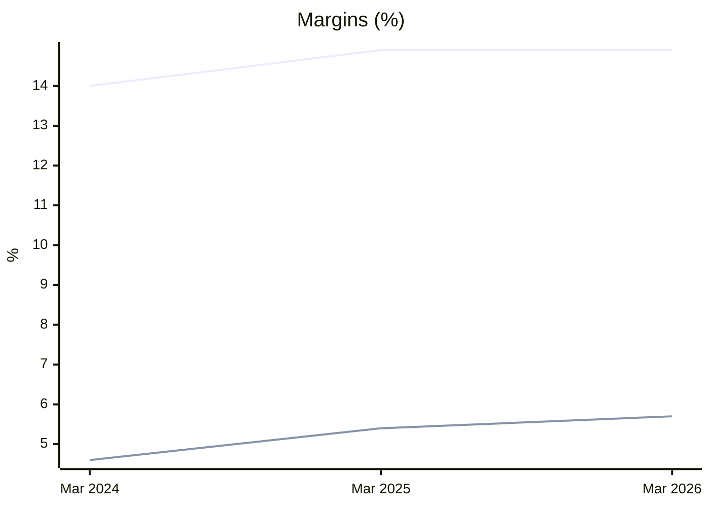

*Run 2026-11-24 · part of [SPINOFF_REPORT.md](../SPINOFF_REPORT.md) · the complete analysis of one company, with every management-call exchange in full.*

## TVSMOTOR — TVS Motor Company Ltd.

### 1. TVS Motor Company Ltd. — CONFIRMED DEMERGER

**CONFIRMED** (a demerger scheme is on the exchange record) · **PRE-SPIN — study the parent; the pieces do not trade yet** · score 5.0/10 · spin-off · 8 filing(s) from NSE · first 2026-03-06, latest 2026-10-28

**The separated entities — every one the documents name:**

| Entity | Scheme | Business | Listing | Who runs it |
|---|---|---|---|---|
| **Harita ARC Limited** (earlier Harita ARC Private Limited) | 2026 Composite Scheme of Arrangement — demerger of the cons… | Consumer finance and related business: lending and investment activities, consumer finance business, leasing … | to be listed | not stated |

**The other parties to the scheme(s)** — not separated entities: TVS Motor Services Limited — merged in — no shares for the parent's holders; Sundaram Auto Components Limited — merged in — no shares for the parent's holders; Home Credit India Finance Private Limited — merged in — no shares for the parent's holders; STPL Trading and Services Private Limited — merged in — no shares for the parent's holders; TVS Housing Finance Private Limited — merged in — no shares for the parent's holders

**What is being separated, as the documents put it:** TVS Motor's consumer finance and related business — lending, investment, leasing and ancillary services, held via subsidiaries — class `value_unlocking`.

### 2. Stages and dates

> **Listing:** NOT YET — scheme at 'nclt_sanction' stage; Home Credit India Finance Private Limited will list only after NCLT sanction, effectiveness and a record date; indicated timeline: Stated 28 October 2026: "Yes, subject to receipt of requisite approvals from statutory and regulatory authorities, the equity shares of the Resulting Company will be listed and admitted to trading on the Stock Exchanges pursuant to the Scheme"; no date given

| Date | Event | Source |
|---|---|---|
| 2025-03-05 | Stage reached: **meetings** | [Shareholders meeting](https://nsearchives.nseindia.in/corporate/TVSMOTOR_05032025133057_SEINTIMATIONONNCLTMEETINGSD.pdf) |
| 2026-05-08 | Stage reached: **nclt sanction** | [Amalgamation/Merger](https://nsearchives.nseindia.com/corporate/TVSMOTOR_08052026165807_TVSMNSEBSE_SACLMERGER_sd.pdf) |
| 2026-08-05 | Other — TVS Credit Services Limited, Home Credit India Finance Private Limited, STPL Trading and Services Private Limited, TVS Housing Finance Private Limited — board approvals of the Composite Scheme of Amalgamation consolidating the Group's NBFCs, described as the step preceding the demerger | as stated: Amalgamation/Merger intimation, 5th August 2026 ("The intimation of t… |
| 2026-10-28 | Board approval — TVS Motor Company Limited (Composite Scheme of Arrangement: demerger into Harita ARC Limited and amalgamation of TVS Motor Services Limited) | as stated: Outcome of Board Meeting / Scheme of Arrangement intimation and press… |
| 2026-10-28 | Other — Harita ARC Limited — acquisition of entire stake (100%, 2,500 equity shares) by TVS Motor Company Limited completed, to carry on the consumer finance business after the demerger | as stated: Annexure A to the Board Meeting outcome, 28th October 2026 ("The acqu… |
| 2026-10-28 | Other — Harita ARC Limited — valuation report of M/s. Bansi S. Mehta Valuers LLP determining the share entitlement ratio, with fairness opinion from M/s. JM Financial Limited | as stated: Annexure C (Demerger) to the Scheme of Arrangement intimation, 28th O… |
| 2026-12-31 | Other — STPL Trading and Services Private Limited — indicative outer date for completion of the Rs. 530.08 Cr acquisition by TVS Motor Company Limited | as stated: Annexure D to the Board Meeting outcome, 28th October 2026 ("The acqu… |

**The stages, as filed:** meetings (2025-03-05) → nclt sanction (2026-05-08)

**Stated in the filings:** resulting company **Home Credit India Finance Private Limited**; appointed date 2025-04-01.

**When it lists, in the documents' words:** Stated 28 October 2026: "Yes, subject to receipt of requisite approvals from statutory and regulatory authorities, the equity shares of the Resulting Company will be listed and admitted to trading on the Stock Exchanges pursuant to the Scheme"; no date given

### 3. Size of the separated business beside the parent — is institutional selling likely?

**Reading: VERY LIKELY — the piece is under a tenth of the whole; index funds and large holders who receive it without choosing it tend to sell.**

| Entity | Stated turnover | Stated share of the whole | Segment revenue share | Market cap (₹ cr) | Share of combined market cap | Index member |
|---|---|---:|---:|---:|---:|---|
| Harita ARC Limited | "The turnover of the Demerged Undertaking for the period en… | — | 0.0% (FY2026) | — | — | not listed |

*Stated figures are the documents' own (a turnover share, or the cost-of-acquisition split the company publishes for tax, which reflects relative value); the segment share is this business's revenue over the parent's sales, and the market-cap share is the entity's value over the entity plus the parent (parent ₹213,552 cr, NSE bhavcopy of 2026-11-13), both computed here.*

**In the documents' words:** “The turnover of the Demerged Undertaking for the period ended 30th September 2026 was Rs. 3,921  Crore out of the total turnover of Rs. 35,770 Crore of the Company .”

**The judge's read of selling pressure:** likely — Every TVS Motor holder gets 1 share of an unlisted financial-services holding company in a different industry from auto; index status not stated

### 4. Insider ownership — share swap, promoters' holding, management incentives

**Share swap / entitlement, entity by entity:**

- **Harita ARC Limited:** "the Resulting Company will issue and allot 1 (One) fully paid -up equity share of face value of INR 1/ - (Rupee One only) each of the Resulting Company for every 1 (One) fully paid -up equity share of face value of INR 1/ - (Rupee One o nly) each of the Company, aggregating to 47,50,87,114 (Forty Seven Crore Fifty Lakh Eighty Seven Thousand One Hundred and Fourteen) equity shares"

**Promoters' holding, from the shareholding pattern:**

| Company | Promoters | FIIs | DIIs | Public | Quarter |
|---|---:|---:|---:|---:|---|
| TVS Motor Company Ltd. (TVSMOTOR) | 50.27% | 21.39% | 20.3% | 8.04% | Sep 2026 |

*Source: screener.in shareholding pattern, stored under `ShareholdingPattern/NiftyTotalMarket/`. In a mirror demerger each shareholder holds the same proportion of the new company as of the parent on the record date.*

- **Promoters in the parent, per the documents:** Promoter and Promoter Group held 23,88,12,786 of 47,50,87,114 equity shares as at the record date 14/02/2025 for the meeting of 12th April 2025 (per the voting results annexure); the Scheme's post-Scheme mirror table dated as on 30th September 2026 shows Promoters at 23,88,12,786 shares and 50.27%
- **What the promoters will hold in the separated entity:** 2026 demerger into Harita ARC Limited: "Upon the Scheme becoming effective, the Resulting Company will issue and allot its fully paid -up equity shares to the eligible shareholders of the Company, in proportion to their respective shareholding in the Company as on the Record Date (as defined in the Scheme)  such that the shareholding pattern of the Resulting Company will mirror that of the Company." Post-Scheme table for the Resulting Company: Promoters 23,88,12,786 shares — 50.27%; Public 23,61,77,311 — 49.71%; Non Promoter-Non Public 97,017 — 0.02%; Total 47,50,87,114 — 100.00%. Amalgamation of TVS Motor Services Limited: "There will not be any change in the existing shareholding pattern of the Company pursuant to the proposed Scheme." 2025 bonus NCRPS scheme: "Thus, there would be no change in shareholding of TVSM." 2026 NBFC amalgamation: "Not applicable. TVS Motor Company Limited  is not a party to the Composite Scheme of Amalgamation and consequently, there will be no change in the shareholding pattern of TVS Motor Company  Limited."
- **What a public shareholder receives:** 2026 Composite Scheme of Arrangement: "Under the proposed Scheme, shareholders of the c ompany will receive equal number of shares in the resulting company  as in TVS Motor , enabling them to participate in the future growth of both the mobility and consumer finance  businesses" — i.e. "1 (One) fully paid -up equity share of face value of INR 1/ - (Rupee One only) each of the Resulting Company for every 1 (One) fully paid -up equity share of face value of INR 1/ - (Rupee One o nly) each of the Company". 2025 Scheme of Arrangement: "the Company shall issue and allot, by way of bonus, 4 Preference Shares of face value of INR 10 each fully paid up to each equity shareholder of the Company holding every 1 equity share of INR 1 each fully paid up" (6% Cumulative Non-Convertible Redeemable Preference Shares, redeemed 1 September 2026 for Rs. 2,014.36 Cr including dividend). Amalgamation of TVS Motor Services Limited and of Sundaram Auto Components Limited: no consideration, both being wholly owned subsidiaries.
- **Management incentives:** not stated as to treatment of grants in the Scheme or any new plan in the resulting entity. The only related disclosures are financial: "Share based payment expense 4.33" (standalone) / "5.59" (consolidated) for the half year ended 30.09.2026, and "Changes in treasury shares by ESOP Trust 1.46" in financing activities.
- **Insider actions around the separation:** The Company acquired 100% of Harita ARC Limited (2,500 equity shares of Rs. 10 each) for Rs. 25,000/- in cash from TVS Credit Services Limited, a material subsidiary: "Yes, the proposed transaction is a related party transaction.  The Company has  acquire d shares  of TVSM WOS  from TVS Credit Services Limited, a material subsidiary of the Company." The Board also approved acquiring 100% of STPL Trading and Services Private Limited (18,89,47,551 equity shares) for Rs. 530.08 Cr in cash: "The shares are acquired  from various stakeholders  who are related parties." and "The transfer of shares will be done at “arms -length” based on a valuation report." No promoter or management buying, selling or pledging of TVS Motor shares is stated.
- **Insiders, per the checklist read:** Shareholding mirrors parent 1:1; promoters hold 50.27% (23,88,12,786 shares) post-Scheme, public 49.71%. Chairman Sudarshan Venu; TVS Motor's own shares in Resulting Company cancelled · *option pricing date:* 28th October 2026 — valuation report of M/s. Bansi S. Mehta Valuers LLP fixing the 1:1 share entitlement ratio (record date only 'as defined in the Scheme', not stated)

### 5. Why the demerger — point by point

TVS Motor is carving its consumer finance and related business undertaking — the lending, investment, leasing and ancillary/support activities it runs directly and through subsidiaries, principally the NBFC TVS Credit Services — out of the listed automotive company into Harita ARC Limited, a shell wholly-owned subsidiary bought from TVS Credit Services for Rs 25,000 on 28th October 2026, with TVS Motor shareholders getting 1 share of the resulting company for every 1 TVS Motor share (47,50,87,114 shares, valuation by Bansi S. Mehta Valuers LLP, fairness opinion by JM Financial), and the resulting company to be listed; the same Composite Scheme also amalgamates the dormant wholly-owned TVS Motor Services Limited (total assets Rs 251.44 Cr, net worth Rs 198.93 Cr, nil turnover) into TVS Motor 'to streamline the group corporate structure', after which it is dissolved without winding up. Management's stated problem is that finance has outgrown its host: the demerged undertaking already turned over Rs 3,921 Cr of TVS Motor's Rs 35,770 Cr consolidated revenue in H1 FY27, and the Financial segment carries Rs 43,003 Cr of assets and Rs 33,288 Cr of liabilities against Automotive's Rs 23,868 Cr, which is why consolidated net debt/equity sits at 2.90x versus 0.37x standalone. The Scheme says the consumer finance business 'needs a separate strategy suited to its industry-specific risks, market dynamics and growth path', that 'the nature of, and competition in, the consumer finance and related business differ from those of the other businesses', and — the capital-structure crux — that 'a financial services company can have a higher leverage (as compared to the Demerged Company) for its growth'. The second stated problem is investor mismatch: a standalone entity 'can attract different sets of investors, strategic partners, lenders and other stakeholders having a specific interest in the consumer finance and related business', and the demerger will 'unlock the value of the Demerged Undertaking for the shareholders of the Demerged Company'. Chairman Sudarshan Venu framed it as 15 years of sustained investment reaching scale — TVS Credit plus Home Credit India serving 'more than 45 million customers across 100,000 touchpoints', plus the Varthana education-finance acquisition and the Jana Small Finance Bank stake — so the platform should now allocate capital to its own priorities while TVS Motor 'remain[s] focused on strengthening its leadership in mobility globally'. It follows the August 2026 step in which the group's NBFCs approved merging STPL Trading and Services into Home Credit India Finance (155.79 shares per 200) and then Home Credit India Finance and TVS Housing Finance into TVS Credit Services (9.94 per 180), expressly for 'consolidating the NBFCs within the group in terms of RBI directions'; alongside the demerger the board also bought STPL outright for Rs 530.08 Cr to pick up ~2.4% more of TVS Credit post-merger. No lender, partner or named investor is cited as having asked for the split.

**Point by point, with the source:**

1. The 28 Oct 2026 Composite Scheme demerges the consumer finance and related business undertaking from TVS Motor into Harita ARC Limited and simultaneously amalgamates wholly-owned TVS Motor Services Limited into TVS Motor. “The Scheme, inter alia, provides for: (i) the amalgamation of the Transferor Company with the Company; and (ii) the demerger of the Demerged Undertaking (as defined in the Scheme) from the Company into the Resulting Company on a going concern basis, in consideration for which the Resulting Company shall issue its shares to the shareholders of the Company in proportion to their shareholding in the Company.” — *Scheme*
2. Stated rationale #1: structural simplification into two independent standalone platforms, each with its own strategy and capital plan. “The demerger will simplify the group structure and create focused businesses, with a clear segregation of the Demerged Undertaking and the Remaining Business.” — *Scheme*
3. Stated rationale #2: the lending business has risk, competitive and growth characteristics unlike the vehicle business, so it needs its own strategy. “The consumer finance and related business needs a separate strategy suited to its industry-specific risks, market dynamics and growth path;” — *Scheme*
4. The capital-structure crux — an NBFC can run far more balance-sheet leverage than a manufacturer; consolidated net debt/equity was 2.90x at 30 Sep 2026 against 0.37x standalone. “a financial services company can have a higher leverage (as compared to the Demerged Company) for its growth .” — *Scheme*
5. Investor/lender mismatch is named explicitly: a pure-play finance entity can draw capital providers who want finance exposure, and this unlocks value for existing holders. “the independent company can attract different sets of investors, strategic partners, lenders and other stakeholders having a specific interest in the consumer finance and related business .” — *Scheme*
6. Size of the carve-out: the demerged undertaking produced Rs 3,921 Cr of revenue in the period ended 30 Sep 2026 against TVS Motor's Rs 35,770 Cr consolidated turnover; shareholders get 1:1 shares and the new entity will be listed. “The turnover of the Demerged Undertaking for the period ended 30th September 2026 was Rs. 3,921 Crore out of the total turnover of Rs. 35,770 Crore of the Company .” — *Scheme*
7. Press release frames the trigger as scale reached after 15 years of investment — TVS Credit plus Home Credit India at 45 million customers and 100,000 touchpoints, plus Varthana and Jana Small Finance Bank — needing a dedicated structure for capital allocation. “The consumer finance and related business have expanded in scale and scope and a dedicated st ructure will provide greater strategic focus, flexibility in capital allocation and the ability to pursue opportunities across the consumer finance and related sector s.” — *Scheme*
8. Chairman Sudarshan Venu's framing: full value realisation for the finance platform while TVS Motor concentrates on global mobility leadership, with shareholders participating in both. “It positions them to realise the full potential of their assets and capabilities while enabling TVS Motor Company to remain focused on strengthening its leadership in mobility globally .” — *Scheme*
9. The precursor step (5 Aug 2026): STPL merges into Home Credit India Finance, then Home Credit India Finance and TVS Housing Finance merge into TVS Credit Services — partly driven by regulator-led NBFC consolidation; TVS Motor separately paid Rs 530.08 Cr for STPL to gain ~2.4% more of TVS Credit. “consolidating the NBFCs within the group in terms of RBI directions.” — *Scheme*
10. The only investor-side prod in three years of calls: an analyst asked about earlier plans to monetise or IPO TVS Credit Services, and the CFO said the board had not taken it up — no mention of a demerger. “And as far as the question is all about IPO, not yet even discussed at the Board level.” — *[Aug 2025](https://www.bseindia.com/stockinfo/AnnPdfOpen.aspx?Pname=fd52c6c1-59d2-406d-9bf3-2381f22aa01d.pdf)*
11. Scale of the business being separated, as management last described it on a call: book up 19% to Rs 32,053 Cr, PBT Rs 283 Cr for the quarter, ~2.6 crore customers, ~62,000 touchpoints. “The book size of TVS Credit grew by 19%. Now it is at INR 32,053 crores as against INR 26,898 crores last year.” — *[Jul 2026](https://www.bseindia.com/stockinfo/AnnPdfOpen.aspx?Pname=e99280ca-79c3-4fa1-8188-f0f34294abfa.pdf)*
12. FY26 record finance earnings quantified on the call — the profit stream now leaving the listed automotive entity. “PBT has grown by 22%, INR 1,248 crores as against INR 1,027 crores during last year.” — *[May 2026](https://www.bseindia.com/stockinfo/AnnPdfOpen.aspx?Pname=d60c3c01-cbb0-4df1-9cba-9e23ccc6fc27.pdf)*
13. TVS Motor was repeatedly injecting equity into the finance arm while it sat inside the parent — Rs 200 Cr in Q3 FY26, and Rs 711 Cr in Q2 FY27 per the quarterly filing — the capital drain the separate structure is meant to re-route. “Now coming back to the second question on INR 900 crores, the delta this quarter has been TVS Credit Services, we have invested about INR200 crores.” — *[Feb 2026](https://www.bseindia.com/stockinfo/AnnPdfOpen.aspx?Pname=53c3b829-4568-4cca-a559-e584d7253eed.pdf)*

**How it evolved:** Strikingly, the separation is absent from all seven earnings calls in the window (Jan 2025 through Jul 2026): management discussed TVS Credit only as a performance line — book Rs 26,647 Cr and PBT Rs 1,027 Cr in FY25 (28 Apr 2025 call), Rs 30,631 Cr and Rs 1,248 Cr in FY26 (13 May 2026), Rs 32,053 Cr and 2.6 crore customers in Q1 FY27 (21 Jul 2026) — while repeatedly describing fresh equity infusions into it (Rs 200 Cr in Q3 FY26 per the 28 Jan 2026 call, Rs 200 Cr across FY26, Rs 711 Cr in Q2 FY27 per the filing). The only hint of structural intent came from an analyst on the 31 Jul 2025 call asking about monetising or IPO-ing TVS Credit, which CFO Gopala Desikan shut down as 'not yet even discussed at the Board level'. The plan then surfaces entirely in filings: the 5 Aug 2026 NBFC-consolidation scheme (STPL → Home Credit India Finance → TVS Credit Services, citing RBI directions), then the 28 Oct 2026 board approval of the Composite Scheme of Arrangement that demerges the undertaking into Harita ARC Limited 1:1 and folds TVS Motor Services into TVS Motor, with the press release calling the demerger 'the next step in this strategic process'.

**What management expects from it:** For the finance platform: strategic autonomy, sharper capital allocation, freedom to run higher NBFC-style leverage, a dedicated investor/lender/partner base, and value unlocked via a 1:1 listed entity. For TVS Motor: a simplified group structure, operational synergies from absorbing TVS Motor Services, and undiluted focus on automotive/mobility leadership globally. Shareholders participate in both.

*Not explained on the calls:* No call ever discusses the demerger; no margin, ROE, capital-release, cost, tax, debt-allocation or timeline numbers for either entity; no promoter-control or future-stake-sale intent disclosed.

- *Stated reason, in one line:* Simplify group structure and create focused standalone platforms; consumer finance needs separate strategy, unlocks value, attracts different investors, and allows higher leverage than the auto company
- *What it reveals:* Financial segment carries Rs 43,003 Cr of the Rs 66,871 Cr consolidated assets vs automotive Rs 23,868 Cr, H1 segment PBT Rs 782 Cr on Rs 3,921 Cr turnover; separation reveals a leveraged NBFC platform (45 million customers) that can gear up independently of the auto balance sheet
- *Parent or spin:* both · *Read next:* The Scheme itself on www.tvsmotor.com — Demerged Undertaking's assets/liabilities, record date, and TVS Credit/Home Credit merger terms
- *In their words:* “The turnover of the Demerged Undertaking for the period ended 30th September 2026 was Rs. 3,921  Crore out of the total turnover of Rs. 35,770 Crore of the Company .”

### 6. On the calls, verbatim

No call in the last 36 months carries a statement about it (or no transcript is on file).

### 7. The parent's financial statements

**The parent, last three fiscal years (consolidated)**

| | Mar 2024 | Mar 2025 | Mar 2026 |
|---|---:|---:|---:|
| Sales (₹ cr) | 38,779 | 44,089 | 56,070 |
| Sales growth (%) | +21.3% | +13.7% | +27.2% |
| Operating profit (₹ cr) | 5,435 | 6,588 | 8,352 |
| Operating profit growth (%) | +35.0% | +21.2% | +26.8% |
| Operating margin (%) | 14.0 | 14.9 | 14.9 |
| PAT (₹ cr) | 1,779 | 2,380 | 3,186 |
| PAT growth (%) | +35.9% | +33.8% | +33.9% |
| PAT margin (%) | 4.6 | 5.4 | 5.7 |
| EPS (₹) | 35.5 | 47.1 | 63.5 |

*Source: ProfitStatement/NiftyTotalMarket/TVSMOTOR.csv (consolidated, screener.in); growth and margins computed here.*

```mermaid
xychart-beta
    title "Sales, operating profit and PAT (₹ cr)"
    x-axis ["Mar 2024", "Mar 2025", "Mar 2026"]
    y-axis "₹ crore"
    bar [38779, 44089, 56070]
    bar [5435, 6588, 8352]
    bar [1779, 2380, 3186]
```

*Series in order: Sales, Operating profit, PAT.*

*Series in order: Operating margin, PAT margin.*

**P/E:** 59.2 — live market file (screener.in), trailing (price ₹4,313.00 as of 2026-08-02).

**Cash flows (₹ cr):**

| | Mar 2024 | Mar 2025 | Mar 2026 |
|---|---:|---:|---:|
| Cash from operations (₹ cr) | -1,253 | 3,503 | 1,867 |
| Cash from investing (₹ cr) | -1,481 | -2,899 | -2,964 |
| Cash from financing (₹ cr) | 3,239 | 1,155 | 909 |
| Net cash flow (₹ cr) | 505 | 1,759 | -189 |
| Free cash flow (₹ cr) | -2,363 | 1,044 | -1,280 |

*Source: CashFlow/NiftyTotalMarket/TVSMOTOR.csv (consolidated, screener.in).*

### 8. The separated business's financial statements

**The business being separated — its own numbers**, entity by entity: its reported statements once it is listed and on file, and the segment numbers the annual reports and presentations carry for it before that.

**Financial Services (consolidated reportable segment) → TVS Credit Services (consumer finance and related business / Demerged Undertaking transferring to the Resulting Company — TVSM WOS, the dedicated consumer finance platform)** · unit ₹ crore · Consolidated segment reporting. Revenue = net revenue (external, after eliminating inter-segment: ₹6.10 cr in FY2024, nil FY2025, ₹15.10 cr FY2026; includes segment other income from FY2025 presentation). operating_profit = 'Segment-wise results before interest and tax' (segment result / EBIT, before segment interest). pat = segment 'Profit after tax'. Assets/liabilities are segment assets/liabilities; depreciation is segment depreciation/amortisation. No capex or EBITDA disclosed by segment.

| | FY2024 | FY2025 | FY2026 |
|---|---:|---:|---:|
| Revenue (₹ crore) | 5,784 | 6,559 | 7,187 |
| Revenue growth (%) | — | +13.4% | +9.6% |
| Operating profit (₹ crore) | 766 | 960 | 1,242 |
| Operating profit growth (%) | — | +25.3% | +29.4% |
| Operating margin (%) | 13.2 | 14.6 | 17.3 |
| PAT (₹ crore) | 572 | 701 | 916 |
| PAT growth (%) | — | +22.6% | +30.7% |
| Segment assets (₹ crore) | 28,486 | 31,675 | 35,451 |
| Segment liabilities (₹ crore) | 24,277 | 26,133 | 29,011 |
| Capital employed (₹ crore) | 4,209 | 5,542 | 6,441 |
| Return on capital employed (%) | 18.2 | 17.3 | 19.3 |
| Segment assets / revenue (x) | 4.9 | 4.8 | 4.9 |
| Capex (₹ crore) | — | — | — |

*Sources:* Annual Report 2024 — page 169 (restated in Annual Report 2025 — page 181: net revenue 5,785.74, result 758.10, PAT 564.45, assets 28,683.78); Annual Report 2025 — page 180 (also Annual Report 2026 — page 201); Annual Report 2026 — page 200

*Not in the pages read:* Capex and EBITDA not disclosed for the segment; quarterly presentations carry no Financial Services segment split (only consolidated/company totals).

**TVS Credit Services Limited (entity financials, Form AOC-I)** · unit ₹ crore · Subsidiary entity-level figures from Form AOC-I. revenue = 'Turnover' (continuing operations in FY2025). operating_profit = 'Profit before taxation' (PBT, after interest — not EBIT/EBITDA). pat = 'Profit after taxation'. segment_assets/liabilities = total assets / total liabilities of the entity. Holding: 80.97% (FY2024), 81.12% (FY2025), 81.18% (FY2026).

| | FY2024 | FY2025 | FY2026 |
|---|---:|---:|---:|
| Revenue (₹ crore) | 5,790 | 6,630 | 7,196 |
| Revenue growth (%) | — | +14.5% | +8.5% |
| Operating profit (₹ crore) | 762 | 1,025 | 1,238 |
| Operating profit growth (%) | — | +34.6% | +20.8% |
| Operating margin (%) | 13.2 | 15.5 | 17.2 |
| PAT (₹ crore) | 572 | 767 | 913 |
| PAT growth (%) | — | +34.2% | +19.0% |
| Segment assets (₹ crore) | 28,138 | 31,052 | 35,068 |
| Segment liabilities (₹ crore) | 24,272 | 26,105 | 29,000 |
| Capital employed (₹ crore) | 3,865 | 4,948 | 6,068 |
| Return on capital employed (%) | 19.7 | 20.7 | 20.4 |
| Segment assets / revenue (x) | 4.9 | 4.7 | 4.9 |
| Capex (₹ crore) | — | — | — |

*Sources:* Annual Report 2024 — page 170; Annual Report 2025 — page 182; Annual Report 2026 — page 202

*Not in the pages read:* AOC-I gives no depreciation, capex, EBITDA or quarterly figures for the entity.

**TVS Housing Finance Private Limited (entity financials, Form AOC-I)** · unit ₹ crore · Subsidiary entity-level figures from Form AOC-I. revenue = 'Turnover'; operating_profit = 'Profit before taxation' (PBT); pat = 'Profit after taxation'; assets/liabilities = total assets / total liabilities. Share capital ₹12.00 cr throughout; step-down subsidiary held 80.97%/81.12%/81.18%.

| | FY2024 | FY2025 | FY2026 |
|---|---:|---:|---:|
| Revenue (₹ crore) | 1.0 | 1.1 | 1.1 |
| Revenue growth (%) | — | +12.5% | -0.9% |
| Operating profit (₹ crore) | 1.0 | 1.1 | 1.0 |
| Operating profit growth (%) | — | +12.5% | -11.1% |
| Operating margin (%) | 100 | 100 | 89.7 |
| PAT (₹ crore) | 0.7 | 0.8 | 0.7 |
| PAT growth (%) | — | +11.0% | -14.8% |
| Segment assets (₹ crore) | 15.7 | 16.6 | 17.2 |
| Segment liabilities (₹ crore) | 0.2 | 0.3 | 0.3 |
| Capital employed (₹ crore) | 15.5 | 16.3 | 17.0 |
| Return on capital employed (%) | 6.2 | 6.6 | 5.7 |
| Segment assets / revenue (x) | 16.4 | 15.3 | 16.1 |
| Capex (₹ crore) | — | — | — |

*Sources:* Annual Report 2024 — page 170; Annual Report 2025 — page 182; Annual Report 2026 — page 202

*Not in the pages read:* No depreciation, capex, EBITDA or quarterly data; not a separate reportable segment.

**Harita ARC Private Limited (entity financials, Form AOC-I) → Harita ARC Limited (Harita ARC Private Limited)** · unit ₹ crore · Dormant entity in Form AOC-I: turnover, PBT, PAT and total assets all shown as nil ('-'); share capital ₹25,000; reserves & surplus (0.02); total liabilities 0.02 in each year. operating_profit line is 'Profit before taxation'.

| | FY2024 | FY2025 | FY2026 |
|---|---:|---:|---:|
| Revenue (₹ crore) | 0.0 | 0.0 | 0.0 |
| Revenue growth (%) | — | — | — |
| Operating profit (₹ crore) | 0.0 | 0.0 | 0.0 |
| Operating profit growth (%) | — | — | — |
| Operating margin (%) | — | — | — |
| PAT (₹ crore) | 0.0 | 0.0 | 0.0 |
| PAT growth (%) | — | — | — |
| Segment assets (₹ crore) | 0.0 | 0.0 | 0.0 |
| Segment liabilities (₹ crore) | 0.0 | 0.0 | 0.0 |
| Capital employed (₹ crore) | -0.0 | -0.0 | -0.0 |
| Return on capital employed (%) | — | — | — |
| Segment assets / revenue (x) | — | — | — |
| Capex (₹ crore) | — | — | — |

*Sources:* Annual Report 2024 — page 170; Annual Report 2025 — page 182; Annual Report 2026 — page 202

*Not in the pages read:* Entity is dormant: no revenue, profit, depreciation, capex or quarterly figures; only share capital, reserves and ₹0.02 cr liabilities.

*Businesses with no numbers in the pages read (3 annual report(s) and 7 presentation(s) on file):* Home Credit India: no figures on these pages. Scheme labels — 'Demerged Undertaking', 'TVSM WOS', 'Resulting Company', 'dedicated consumer finance platform' — carry no standalone numbers; their financials appear via the Financial Services segment and TVS Credit Services Limited above.

*Documents on file:* [Annual Report 2026](https://www.bseindia.com/xml-data/corpfiling/AttachHis/4e988d1e-e2c9-40c8-aa8d-8760675c59d6.pdf); [Annual Report 2025](https://www.bseindia.com/xml-data/corpfiling/AttachHis/23df052a-7d0d-4f73-acf1-3170d353957e.pdf); [Annual Report 2024](https://www.bseindia.com/xml-data/corpfiling/AttachHis/4dacb4b8-66a7-43eb-bec5-e18324b2fcd5.pdf); [Presentation Jul 2026](https://www.bseindia.com/stockinfo/AnnPdfOpen.aspx?Pname=5243fdf7-e6b2-4831-b9e1-5aff8df27a9c.pdf); [Presentation May 2026](https://nsearchives.nseindia.com/corporate/TVSMOTOR_13052026133518_NSEBSEIntimation_sd.pdf); [Presentation Feb 2026](https://www.bseindia.com/stockinfo/AnnPdfOpen.aspx?Pname=70fe38d8-643d-4326-8111-c1d4c3262896.pdf); [Presentation Oct 2025](https://www.bseindia.com/stockinfo/AnnPdfOpen.aspx?Pname=fa27c602-e52e-43dc-98dd-805ee47faa82.pdf); [Presentation Aug 2025](https://nsearchives.nseindia.com/corporate/TVSMOTOR_31072025135214_NSEBSEIntimation_sd.pdf); [Presentation May 2025](https://www.bseindia.com/stockinfo/AnnPdfOpen.aspx?Pname=61ca9a7e-7506-42be-8fb6-f9e1839ecae3.pdf)

### 9. Other financial differences — working capital, margins, returns, debt

| Metric (latest year) | Parent (TVSMOTOR) | Harita ARC Limited |
|---|---:|---:|
| *Basis* | *reported, consolidated* | *segment numbers (TVS Housing Finance Private …* |
| Sales (₹ cr) | 56,070 (Mar 2026) | — |
| Sales growth (%) | 27.2 (Mar 2026) | -0.9 (FY2026) |
| Operating margin (%) | 14.9 (Mar 2026) | 89.7 (FY2026) |
| Operating profit growth (%) | 26.8 (Mar 2026) | -11.1 (FY2026) |
| PAT margin (%) | 5.7 (Mar 2026) | — |
| ROCE % | 17 (Mar 2026) | 5.7 (FY2026) |
| Debtor Days | 17 (Mar 2026) | — |
| Inventory Days | 26 (Mar 2026) | — |
| Days Payable | 103 (Mar 2026) | — |
| Cash Conversion Cycle | -60 (Mar 2026) | — |
| Working Capital Days | -37 (Mar 2026) | — |
| Debt / equity (x) | 3.4 (Mar 2026) | — |
| Borrowings (₹ cr) | 32,791 (Mar 2026) | — |
| Segment assets / revenue (x) | — | 16.1 (FY2026) |
| Sales (₹ crore) | — | 1.1 (FY2026) |

*Each figure is the latest on file, with its year. Working-capital days and ROCE come from the stored working-capital file; segment figures from the pages cited in part 8. A dash means the documents do not carry it.*

**What stays with the parent — its segments, from the same pages:**

| Remaining segment | Revenue | Operating margin | ROCE | Segment assets / revenue | Unit | Year |
|---|---:|---:|---:|---:|---|---|
| Automotive vehicles & parts (consolidated reportable segment) | 48,905 | 8.0% | 91.7% | 0.43x | ₹ crore | FY2026 |
| Automotive components (consolidated reportable segment — FY2024 only; Sundaram Auto Components business reported as discontinued operations from FY2025 and no longer a separate segment) | 365 | 11.0% | 28.6% | 1.08x | ₹ crore | FY2024 |
| Others (consolidated reportable segment — TVS Digital Limited; nil/not reported from FY2025) | 4 | 9.6% | 8.9% | 1.51x | ₹ crore | FY2024 |

**What the documents themselves say about the differences:**

- **debt and leverage** — parent / remaining: Standalone (automotive/remaining) Net Debt to Equity 0.37 times as at 30.09.2026 (0.24 at 31.03.2026); standalone total debts to total assets 0.17 times; separated business: The consumer finance business can carry higher leverage; consolidated Net Debt to Equity 2.90 times as at 30.09.2026, total debts to total assets 0.57 times “(d) a financial services company can have a higher leverage (as compared to the Demerged  Company) for its growth .”
- **other** — parent / remaining: Automotive segment revenue and other income Rs. 31,927.75 Cr for the half year ended 30.09.2026; segment assets Rs. 23,867.50 Cr; segment liabilities Rs. 21,287.66 Cr; separated business: Financial segment revenue and other income Rs. 4,120.42 Cr for the half year ended 30.09.2026; segment assets Rs. 43,003.19 Cr; segment liabilities Rs. 33,287.60 Cr “On a standalone basis, the Company operates in (a) Automotive – comprising Automotive Vehicles, Parts and related investments and (b) Financial – comprising Consumer Finance and Related Business Segments.”
- **operating margin** — parent / remaining: Standalone Operating Margin (Operating EBITDA / Turnover) 13.0% for the quarter and 12.9% for the half year ended 30.09.2026; separated business: not stated separately; consolidated (including the financial segment) Operating Margin 11.3% for the quarter and 11.4% for the half year ended 30.09.2026 “The Company’s EBITDA margin improved by 30 bps at 13.0% during the quarter ended September  2026 as against 12.7% in the quarter ended September  2025.”
- **return on capital** — parent / remaining: Automotive segment profit before tax, finance cost and exceptional items Rs. 2,826.29 Cr on segment assets of Rs. 23,867.50 Cr (half year ended 30.09.2026); separated business: Financial segment profit before tax, finance cost and exceptional items Rs. 782.47 Cr on segment assets of Rs. 43,003.19 Cr (half year ended 30.09.2026) “a) Automotive 1,593.79        1,232.50       1,059.59       2,826.29          1,843.41         4,043.79          b) Financial 351.15            431.32           246.83           782.47            516.80            1,164.62”
- **working capital** — parent / remaining: Standalone Current ratio 0.75 times as at 30.09.2026; standalone long term debt to working capital nil; separated business: not stated separately; consolidated Current ratio 1.09 times and Long term debt to working capital 1.83 times as at 30.09.2026 “Current ratio   (Times) [Current Assets / Current Liabilities ]0.75 0.54 0.54 0.75 0.54 0.54”
- **growth** — parent / remaining: not stated for the remaining business separately; standalone revenue grew 41% to Rs. 30,999 Crores in the half year ended September 2026; separated business: TVS Credit book size grew by 19% to Rs. 32,053 crores (Q1 FY27 call) and PBT for the quarter grew by 16% to Rs. 283 crores “The book size of TVS Credit grew by 19%. Now it is at INR 32,053 crores as against INR 26,898 crores last year. Profit before tax for the quarter grew by 16%, INR 283 crores as against INR 243 crores during first quarter of last year.”
- **cash** — parent / remaining: Standalone cash and cash equivalents Rs. 374.65 Cr as at 30.09.2026; net cash from operating activities Rs. 3,844.33 Cr for the half year; separated business: not stated separately; consolidated cash and cash equivalents Rs. 4,968.36 Cr and net cash from operating activities Rs. 358.15 Cr for the half year, after "Loans given by Financial enterprise (Net) ... (3,351.70)" “Cash and cash equivalents at the end of the period 374.65                 850.19                 4,968.36              4,719.85”
- **other** — parent / remaining: Remaining Business: TVS Motor to "sharpen its focus on its continuing automotive and mobility businesses" and "remain focused on strengthening its leadership in mobility globally"; separated business: "The consumer finance and related business needs a separate strategy suited to its industry -specific risks, market dynamics and growth path" and serves, with Home Credit India, "more than 45 million customers  across 100,000 touchpoints  in India" “(iii)The nature of, and competition in, the consumer finance and related b usiness differ from those of the other businesses;”

**The checklist:**

| Item | Status | Evidence |
|---|---|---|
| Why the spin-off | yes | regulatory / strategic knot; value unlocking for shareholders; a weak or capital-heavy business carved away; attracting different investors / capital — “…m the statutory, regulatory and customary approvals, including approvals from the Reserve Bank of India, the Competition Commission of India, the National Stock Exchange of India Limited , the Securities and Exchange Bo” |
| Institutional selling likely (small / different business) | unknown | size of the demerged piece not stated *(next: pro-forma statements: revenue / assets of the demerged undertaking vs the parent)* |
| Insider ownership and incentives aligned | partly | …n the Company as on the Record Date (as defined in the Scheme) such that the shareholding pattern of the Resulting Company will mirror that of the Company. Simultaneously, all equity shares of the Resulting Comp… *(next: the date the management options are priced; promoter holding in the resulting company)* |
| A hidden value revealed (pro-forma, leverage, comparables) | partly | borrowings 32,791 cr (Mar 2026) = 0.16× market cap; P/E 64.3 on Mar 2026 profit vs industry median 40.7 (35 peers) *(next: pro-forma P&L of each piece × the peer P/E of its own industry)* |
| Parent before the spin (clean parent, takeover prelude) | partly | stage nclt_sanction — the spin has not happened; the parent can still be bought whole |
| Timing (first year sells, second year gains) | partly | not yet listed — 263 days since the first filing, stage nclt_sanction |

The filings

| Date | Category | Headline | Attachment |
|---|---|---|---|
| 2026-03-06 | General Updates | TVS Motor Company Limited has informed the Exchange about receipt of listing and trading approval from National Stock Exchange of India Limited and BSE Limited  | [pdf](https://nsearchives.nseindia.com/corporate/TVSMOTOR_06032026213826_BSENSEIntimationListingofNCRPSSD.pdf) |
| 2026-05-08 | Amalgamation/Merger | TVS Motor Company Limited has informed the Exchange about Compliance under Regulation 30 and 51(1) of the Securities and Exchange Board of India (LODR) Regulati | [pdf](https://nsearchives.nseindia.com/corporate/TVSMOTOR_08052026165807_TVSMNSEBSE_SACLMERGER_sd.pdf) |
| 2026-08-05 | Amalgamation/Merger | TVS Motor Company Limited has informed the Exchange about Composite Scheme of Amalgamation amongst Home Credit India Finance Private Limited and STPL Trading an | [pdf](https://nsearchives.nseindia.com/corporate/TVSMOTOR_05082026151929_Reg30TVSCSMERGER_sd.pdf) |
| 2026-10-28 | Outcome of Board Meeting | TVS Motor Company Limited has submitted to the Exchange, the financial results for the period ended September 30, 2026. | [pdf](https://nsearchives.nseindia.com/corporate/TVSMOTOR_28102026145930_TVSMQ2FY27ResultsoutcomeSD.pdf) |
| 2026-10-28 | Outcome of Board Meeting | TVS Motor Company Limited has informed the Exchange regarding Outcome of Board Meeting held on October 28, 2026. | [pdf](https://nsearchives.nseindia.com/corporate/TVSMOTOR_28102026150348_TVSMQ2FY27ResultsoutcomeSD.pdf) |
| 2026-10-28 | Scheme of Arrangement | TVS Motor Company Limited has informed the Exchange about Scheme of Arrangement | [pdf](https://nsearchives.nseindia.com/corporate/TVSMOTOR_28102026151355_TVSM_SchemeSD.pdf) |
| 2026-10-28 | Acquisition | TVS Motor Company Limited has informed the Exchange about Acquisition | [pdf](https://nsearchives.nseindia.com/corporate/TVSMOTOR_28102026151607_TVSM_SchemeSD.pdf) |
| 2026-10-28 | Press Release | TVS Motor Company Limited has informed the Exchange regarding a press release dated October 28, 2026, titled "Press release on the Composite Scheme of Arrangeme | [pdf](https://nsearchives.nseindia.com/corporate/TVSMOTOR_28102026194328_TVSM_PRESSRELEASESD.pdf) |

