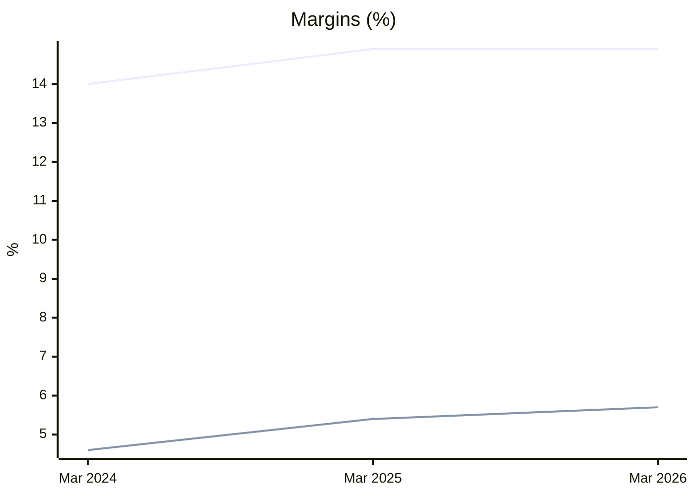

*Run 2026-11-24 · part of [SPINOFF_REPORT.md](../SPINOFF_REPORT.md) · the complete analysis of one company, with every management-call exchange in full.*

## TVSMOTOR — TVS Motor Company Ltd.

### 1. TVS Motor Company Ltd. — CONFIRMED DEMERGER

**CONFIRMED** (a demerger scheme is on the exchange record) · **PRE-SPIN — study the parent; the pieces do not trade yet** · score 5.0/10 · spin-off · 8 filing(s) from NSE · first 2026-03-06, latest 2026-10-28

**The separated entities — every one the documents name:**

| Entity | Business | Listing | Who runs it |
|---|---|---|---|
| **Harita ARC Limited** | Consumer finance and related business of TVS Motor: lending and investment activities, consumer finance, leas… | to be listed — "subject to receipt of requisite approvals f… | not stated |
| **TVS Motor Services Limited** | Wholly owned subsidiary incorporated for buying, selling, leasing, servicing and dealing in automobiles, auto… | not to be listed — it "will be dissolved without being woun… | not stated |
| **Home Credit India Finance Private Limited** | — | not stated | — |

**What is being separated, as the documents put it:** TVS Motor's consumer finance and related business — lending, investment, leasing and ancillary services, held via subsidiaries — class `value_unlocking`.

### 2. Stages and dates

> **Listing:** NOT YET — scheme at 'nclt_sanction' stage; Home Credit India Finance Private Limited will list only after NCLT sanction, effectiveness and a record date; indicated timeline: Stated 28 October 2026: "Yes, subject to receipt of requisite approvals from statutory and regulatory authorities, the equity shares of the Resulting Company will be listed and admitted to trading on the Stock Exchanges pursuant to the Scheme"; no date given

| Date | Event | Source |
|---|---|---|
| 2025-03-05 | Stage reached: **meetings** | [Shareholders meeting](https://nsearchives.nseindia.in/corporate/TVSMOTOR_05032025133057_SEINTIMATIONONNCLTMEETINGSD.pdf) |
| 2026-05-08 | Stage reached: **nclt sanction** | [Amalgamation/Merger](https://nsearchives.nseindia.com/corporate/TVSMOTOR_08052026165807_TVSMNSEBSE_SACLMERGER_sd.pdf) |
| 2026-10-28 | Board approval — TVS Motor Company Limited — Composite Scheme of Arrangement (amalgamation of TVS Motor Services Limited and demerger of the consumer finance and related business into Harita ARC Limited) | as stated: Regulation 30 / 51 intimation and Outcome of Board Meeting, both date… |
| 2026-10-28 | Other — acquisition of the entire stake of Harita ARC Limited (Resulting Company) from TVS Credit Services Limited completed, in connection with the proposed demerger — Harita ARC Limited | as stated: Annexure A to the Scheme of Arrangement filing dated 28th October 202… |
| 2026-10-28 | Other — valuation report fixing the share entitlement ratio (M/s. Bansi S. Mehta Valuers LLP), with fairness opinion from M/s. JM Financial Limited — TVS Motor Company Limited / Harita ARC Limited | as stated: Annexure C (Demerger) to the Scheme of Arrangement filing dated 28th … |

**The stages, as filed:** meetings (2025-03-05) → nclt sanction (2026-05-08)

**Stated in the filings:** resulting company **Home Credit India Finance Private Limited**; appointed date 2025-04-01.

**When it lists, in the documents' words:** Stated 28 October 2026: "Yes, subject to receipt of requisite approvals from statutory and regulatory authorities, the equity shares of the Resulting Company will be listed and admitted to trading on the Stock Exchanges pursuant to the Scheme"; no date given

### 3. Size of the separated business beside the parent — is institutional selling likely?

**Reading: LIKELY — the piece is small beside the parent; mandates with size limits tend to sell.**

| Entity | Stated turnover | Stated share of the whole | Segment revenue share | Market cap (₹ cr) | Share of combined market cap | Index member |
|---|---|---:|---:|---:|---:|---|
| Harita ARC Limited | Turnover of the Demerged Undertaking for the period ended 3… | — | 12.8% (FY2026) | — | — | not listed |
| TVS Motor Services Limited | Turnover Nil as on 30th September 2026 | — | 12.8% (FY2026) | — | — | not listed |
| Home Credit India Finance Private Limited | — | — | — | — | — | not listed |

*Stated figures are the documents' own (a turnover share, or the cost-of-acquisition split the company publishes for tax, which reflects relative value); the segment share is this business's revenue over the parent's sales, and the market-cap share is the entity's value over the entity plus the parent (parent ₹213,552 cr, NSE bhavcopy of 2026-11-13), both computed here.*

**In the documents' words:** “The turnover of the Demerged Undertaking for the period ended 30th September 2026 was Rs. 3,921 Crore out of the total turnover of Rs. 35,770 Crore of the Company.”

**The judge's read of selling pressure:** likely — Every TVS Motor holder gets 1 share of an unlisted financial-services holding company in a different industry from auto; index status not stated

### 4. Insider ownership — share swap, promoters' holding, management incentives

**Share swap / entitlement, entity by entity:**

- **Harita ARC Limited:** "the Resulting Company will issue and allot 1 (One) fully paid-up equity share of face value of INR 1/- (Rupee One only) each of the Resulting Company for every 1 (One) fully paid-up equity share of face value of INR 1/- (Rupee One only) each of the Company, aggregating to 47,50,87,114 (Forty Seven Crore Fifty Lakh Eighty Seven Thousand One Hundred and Fourteen) equity shares"; no cash consideration; share entitlement ratio per valuation report dated 28th October 2026 of M/s. Bansi S. Mehta Valuers LLP with fairness opinion from M/s. JM Financial Limited
- **TVS Motor Services Limited:** Not Applicable — "Since the Transferor Company is a wholly owned subsidiary of the Company, no consideration is being discharged for the amalgamation."

**Promoters' holding, from the shareholding pattern:**

| Company | Promoters | FIIs | DIIs | Public | Quarter |
|---|---:|---:|---:|---:|---|
| TVS Motor Company Ltd. (TVSMOTOR) | 50.27% | 21.39% | 20.3% | 8.04% | Sep 2026 |

*Source: screener.in shareholding pattern, stored under `ShareholdingPattern/NiftyTotalMarket/`. In a mirror demerger each shareholder holds the same proportion of the new company as of the parent on the record date.*

- **Promoters in the parent, per the documents:** Not stated directly for the parent. The demerger annexure's shareholding table, headed "As on 30th September 2026", shows the Resulting Company's Post-Scheme pattern — which "will mirror that of the Company" — as Promoters 23,88,12,786 shares / 50.27%, Public 23,61,77,311 / 49.71%, Non Promoter-Non Public 97,017 / 0.02%, Total 47,50,87,114 / 100.00%. (The 12th April 2025 NCLT-meeting voting results also record Promoter and Promoter Group holding of 23,88,12,786 of 47,50,87,114 shares.)
- **What the promoters will hold in the separated entity:** "Upon the Scheme becoming effective, the Resulting Company will issue and allot its fully paid-up equity shares to the eligible shareholders of the Company, in proportion to their respective shareholding in the Company as on the Record Date (as defined in the Scheme) such that the shareholding pattern of the Resulting Company will mirror that of the Company." Post-Scheme table: Promoters 23,88,12,786 equity shares / 50.27%. "Simultaneously, all equity shares of the Resulting Company held by the Company as on the Effective Date shall stand cancelled." In the parent: "Pursuant to the Scheme, there will be no change in the shareholding pattern of the Company."
- **What a public shareholder receives:** "Under the proposed Scheme, shareholders of the company will receive equal number of shares in the resulting company as in TVS Motor, enabling them to participate in the future growth of both the mobility and consumer finance businesses." One fully paid-up equity share of INR 1 each of the Resulting Company for every one equity share of INR 1 each of the Company held on the Record Date; Post-Scheme Public holding 23,61,77,311 shares / 49.71%.
- **Management incentives:** not stated in the documents on file.
- **Insider actions around the separation:** No promoter or management buying, selling or pledging of listed shares is stated. Related-party steps around the separation: the Company acquired 100% of Harita ARC Limited — "2,500 equity shares of Rs. 10 each" for "Rs. 25,000/-" cash — from TVS Credit Services Limited, a material subsidiary ("Yes, the proposed transaction is a related party transaction"; "done on an 'arm's length' basis"), completed 28th October 2026. At the same board meeting the Company approved acquiring 100% of STPL Trading and Services Private Limited (18,89,47,551 equity shares) for Rs. 530.08 Cr cash, expected on or before 31st December 2026: "The shares are acquired from various stakeholders who are related parties" and "the company will effectively get an additional ~2.4% holding in TVS Credit Services post the consummation of merger."
- **Insiders, per the checklist read:** Shareholding mirrors parent 1:1; promoters hold 50.27% (23,88,12,786 shares) post-Scheme, public 49.71%. Chairman Sudarshan Venu; TVS Motor's own shares in Resulting Company cancelled · *option pricing date:* 28th October 2026 — valuation report of M/s. Bansi S. Mehta Valuers LLP fixing the 1:1 share entitlement ratio (record date only 'as defined in the Scheme', not stated)

### 5. Why the demerger — point by point

TVS Motor is carving its consumer finance and related business undertaking — the lending, investment, leasing and ancillary/support activities it runs directly and through subsidiaries, principally the NBFC TVS Credit Services — out of the listed automotive company into Harita ARC Limited, a shell wholly-owned subsidiary bought from TVS Credit Services for Rs 25,000 on 28th October 2026, with TVS Motor shareholders getting 1 share of the resulting company for every 1 TVS Motor share (47,50,87,114 shares, valuation by Bansi S. Mehta Valuers LLP, fairness opinion by JM Financial), and the resulting company to be listed; the same Composite Scheme also amalgamates the dormant wholly-owned TVS Motor Services Limited (total assets Rs 251.44 Cr, net worth Rs 198.93 Cr, nil turnover) into TVS Motor 'to streamline the group corporate structure', after which it is dissolved without winding up. Management's stated problem is that finance has outgrown its host: the demerged undertaking already turned over Rs 3,921 Cr of TVS Motor's Rs 35,770 Cr consolidated revenue in H1 FY27, and the Financial segment carries Rs 43,003 Cr of assets and Rs 33,288 Cr of liabilities against Automotive's Rs 23,868 Cr, which is why consolidated net debt/equity sits at 2.90x versus 0.37x standalone. The Scheme says the consumer finance business 'needs a separate strategy suited to its industry-specific risks, market dynamics and growth path', that 'the nature of, and competition in, the consumer finance and related business differ from those of the other businesses', and — the capital-structure crux — that 'a financial services company can have a higher leverage (as compared to the Demerged Company) for its growth'. The second stated problem is investor mismatch: a standalone entity 'can attract different sets of investors, strategic partners, lenders and other stakeholders having a specific interest in the consumer finance and related business', and the demerger will 'unlock the value of the Demerged Undertaking for the shareholders of the Demerged Company'. Chairman Sudarshan Venu framed it as 15 years of sustained investment reaching scale — TVS Credit plus Home Credit India serving 'more than 45 million customers across 100,000 touchpoints', plus the Varthana education-finance acquisition and the Jana Small Finance Bank stake — so the platform should now allocate capital to its own priorities while TVS Motor 'remain[s] focused on strengthening its leadership in mobility globally'. It follows the August 2026 step in which the group's NBFCs approved merging STPL Trading and Services into Home Credit India Finance (155.79 shares per 200) and then Home Credit India Finance and TVS Housing Finance into TVS Credit Services (9.94 per 180), expressly for 'consolidating the NBFCs within the group in terms of RBI directions'; alongside the demerger the board also bought STPL outright for Rs 530.08 Cr to pick up ~2.4% more of TVS Credit post-merger. No lender, partner or named investor is cited as having asked for the split.

**Point by point, with the source:**

1. The 28 Oct 2026 Composite Scheme demerges the consumer finance and related business undertaking from TVS Motor into Harita ARC Limited and simultaneously amalgamates wholly-owned TVS Motor Services Limited into TVS Motor. “The Scheme, inter alia, provides for: (i) the amalgamation of the Transferor Company with the Company; and (ii) the demerger of the Demerged Undertaking (as defined in the Scheme) from the Company into the Resulting Company on a going concern basis, in consideration for which the Resulting Company shall issue its shares to the shareholders of the Company in proportion to their shareholding in the Company.” — *Scheme*
2. Stated rationale #1: structural simplification into two independent standalone platforms, each with its own strategy and capital plan. “The demerger will simplify the group structure and create focused businesses, with a clear segregation of the Demerged Undertaking and the Remaining Business.” — *Scheme*
3. Stated rationale #2: the lending business has risk, competitive and growth characteristics unlike the vehicle business, so it needs its own strategy. “The consumer finance and related business needs a separate strategy suited to its industry-specific risks, market dynamics and growth path;” — *Scheme*
4. The capital-structure crux — an NBFC can run far more balance-sheet leverage than a manufacturer; consolidated net debt/equity was 2.90x at 30 Sep 2026 against 0.37x standalone. “a financial services company can have a higher leverage (as compared to the Demerged Company) for its growth .” — *Scheme*
5. Investor/lender mismatch is named explicitly: a pure-play finance entity can draw capital providers who want finance exposure, and this unlocks value for existing holders. “the independent company can attract different sets of investors, strategic partners, lenders and other stakeholders having a specific interest in the consumer finance and related business .” — *Scheme*
6. Size of the carve-out: the demerged undertaking produced Rs 3,921 Cr of revenue in the period ended 30 Sep 2026 against TVS Motor's Rs 35,770 Cr consolidated turnover; shareholders get 1:1 shares and the new entity will be listed. “The turnover of the Demerged Undertaking for the period ended 30th September 2026 was Rs. 3,921 Crore out of the total turnover of Rs. 35,770 Crore of the Company .” — *Scheme*
7. Press release frames the trigger as scale reached after 15 years of investment — TVS Credit plus Home Credit India at 45 million customers and 100,000 touchpoints, plus Varthana and Jana Small Finance Bank — needing a dedicated structure for capital allocation. “The consumer finance and related business have expanded in scale and scope and a dedicated st ructure will provide greater strategic focus, flexibility in capital allocation and the ability to pursue opportunities across the consumer finance and related sector s.” — *Scheme*
8. Chairman Sudarshan Venu's framing: full value realisation for the finance platform while TVS Motor concentrates on global mobility leadership, with shareholders participating in both. “It positions them to realise the full potential of their assets and capabilities while enabling TVS Motor Company to remain focused on strengthening its leadership in mobility globally .” — *Scheme*
9. The precursor step (5 Aug 2026): STPL merges into Home Credit India Finance, then Home Credit India Finance and TVS Housing Finance merge into TVS Credit Services — partly driven by regulator-led NBFC consolidation; TVS Motor separately paid Rs 530.08 Cr for STPL to gain ~2.4% more of TVS Credit. “consolidating the NBFCs within the group in terms of RBI directions.” — *Scheme*
10. The only investor-side prod in three years of calls: an analyst asked about earlier plans to monetise or IPO TVS Credit Services, and the CFO said the board had not taken it up — no mention of a demerger. “And as far as the question is all about IPO, not yet even discussed at the Board level.” — *[Aug 2025](https://www.bseindia.com/stockinfo/AnnPdfOpen.aspx?Pname=fd52c6c1-59d2-406d-9bf3-2381f22aa01d.pdf)*
11. Scale of the business being separated, as management last described it on a call: book up 19% to Rs 32,053 Cr, PBT Rs 283 Cr for the quarter, ~2.6 crore customers, ~62,000 touchpoints. “The book size of TVS Credit grew by 19%. Now it is at INR 32,053 crores as against INR 26,898 crores last year.” — *[Jul 2026](https://www.bseindia.com/stockinfo/AnnPdfOpen.aspx?Pname=e99280ca-79c3-4fa1-8188-f0f34294abfa.pdf)*
12. FY26 record finance earnings quantified on the call — the profit stream now leaving the listed automotive entity. “PBT has grown by 22%, INR 1,248 crores as against INR 1,027 crores during last year.” — *[May 2026](https://www.bseindia.com/stockinfo/AnnPdfOpen.aspx?Pname=d60c3c01-cbb0-4df1-9cba-9e23ccc6fc27.pdf)*
13. TVS Motor was repeatedly injecting equity into the finance arm while it sat inside the parent — Rs 200 Cr in Q3 FY26, and Rs 711 Cr in Q2 FY27 per the quarterly filing — the capital drain the separate structure is meant to re-route. “Now coming back to the second question on INR 900 crores, the delta this quarter has been TVS Credit Services, we have invested about INR200 crores.” — *[Feb 2026](https://www.bseindia.com/stockinfo/AnnPdfOpen.aspx?Pname=53c3b829-4568-4cca-a559-e584d7253eed.pdf)*

**How it evolved:** Strikingly, the separation is absent from all seven earnings calls in the window (Jan 2025 through Jul 2026): management discussed TVS Credit only as a performance line — book Rs 26,647 Cr and PBT Rs 1,027 Cr in FY25 (28 Apr 2025 call), Rs 30,631 Cr and Rs 1,248 Cr in FY26 (13 May 2026), Rs 32,053 Cr and 2.6 crore customers in Q1 FY27 (21 Jul 2026) — while repeatedly describing fresh equity infusions into it (Rs 200 Cr in Q3 FY26 per the 28 Jan 2026 call, Rs 200 Cr across FY26, Rs 711 Cr in Q2 FY27 per the filing). The only hint of structural intent came from an analyst on the 31 Jul 2025 call asking about monetising or IPO-ing TVS Credit, which CFO Gopala Desikan shut down as 'not yet even discussed at the Board level'. The plan then surfaces entirely in filings: the 5 Aug 2026 NBFC-consolidation scheme (STPL → Home Credit India Finance → TVS Credit Services, citing RBI directions), then the 28 Oct 2026 board approval of the Composite Scheme of Arrangement that demerges the undertaking into Harita ARC Limited 1:1 and folds TVS Motor Services into TVS Motor, with the press release calling the demerger 'the next step in this strategic process'.

**What management expects from it:** For the finance platform: strategic autonomy, sharper capital allocation, freedom to run higher NBFC-style leverage, a dedicated investor/lender/partner base, and value unlocked via a 1:1 listed entity. For TVS Motor: a simplified group structure, operational synergies from absorbing TVS Motor Services, and undiluted focus on automotive/mobility leadership globally. Shareholders participate in both.

*Not explained on the calls:* No call ever discusses the demerger; no margin, ROE, capital-release, cost, tax, debt-allocation or timeline numbers for either entity; no promoter-control or future-stake-sale intent disclosed.

- *Stated reason, in one line:* Simplify group structure and create focused standalone platforms; consumer finance needs separate strategy, unlocks value, attracts different investors, and allows higher leverage than the auto company
- *What it reveals:* Financial segment carries Rs 43,003 Cr of the Rs 66,871 Cr consolidated assets vs automotive Rs 23,868 Cr, H1 segment PBT Rs 782 Cr on Rs 3,921 Cr turnover; separation reveals a leveraged NBFC platform (45 million customers) that can gear up independently of the auto balance sheet
- *Parent or spin:* both · *Read next:* The Scheme itself on www.tvsmotor.com — Demerged Undertaking's assets/liabilities, record date, and TVS Credit/Home Credit merger terms
- *In their words:* “The turnover of the Demerged Undertaking for the period ended 30th September 2026 was Rs. 3,921  Crore out of the total turnover of Rs. 35,770 Crore of the Company .”

### 6. On the calls, verbatim

12 call(s), oldest first: **34 question-and-answer exchange(s)** given in full — the question and every answer to it, nothing trimmed — and 12 passage(s) from management's prepared remarks (the complete sentences about it; the whole remarks are in the linked transcript). Text is as the transcript prints it.

#### Nov 2023 — [transcript](https://www.bseindia.com/stockinfo/AnnPdfOpen.aspx?Pname=35ef6a84-aec3-42fc-9d7c-f0c8312a9f44.pdf)

**From the prepared remarks** *(the passage about it; the whole turn runs to 8,154 characters in the transcript)*

> **K N Radhakrishnan:** TVS X will lead the way to become a global benchmark for a machine that is born electric …it is THRILLECTRIC . This quarter, we announced the start of production of BMW C E-02 jointly designed and developed by TVS along with BMW Motorrad and that is also going to be a huge success globally . With the product line up plan ned from TVS and continuous improvement in infrastructure , we are confident that we will continue to be a strong player in the EV segment. Now , coming to TVS Credit : All of you have seen , it’s an outstanding performance , the book size has already crossed 23,500 crore s. Its portfolio is well diversified, covering tractors, used vehicles, consumer durables, MSME besides two-wheeler . PBT for the quarter grew by 39 %, 180 crores against last year ’s 129 crores in the same quarter of Q2. When we look at.

**Question and answer**

> **Pramod Kumar:** Final one on the investments in subsidi aries, Singapore. Where is this money largely going in , the 2 37 crores ?
>
> **K N Radhakrishnan:** The investment s are future . Some investments have gone for TV S Credit Services , almost 100 crores , then SEMG and Norton . And some of the other new investments we have also done in TVS Digital and other investments . So, these are all strategic investments for future. And if you look at during last year Q4, we made investment of almost Rs.300 crores in Singapore and the same was shown at that time as share application money pending allotment . So, please understand , these are investments for future, and we are pretty confident that this will start yielding results going forward.

**Question and answer**

> **Gunjan Prithyani:** Just an extension of this investment in subsidiaries . I see two items there. One is invested 236 crores, and one is disinvestment of about Rs.100 crores . Now , disinvestment I'm assuming is for the private equity sale we did during the quarter . Investment break up can you reconfirm again that how much of it is going to TV S Credit and other subsidi aries like , a little bit more color on these two-line items please?
>
> **K N Radhakrishnan:** I gave you TVS Credit Services was almost 100 crores during this period and remaining in Norton and SEMG . So, these are as per plan and other things are for TV S Digital which are futuristic in nature.

**Question and answer**

> **Gunjan Prithyani:** Just trying to get in terms of incremental investments like with Norton or now a lot of spends have been done. So , if I think about outside of TV S Credit the other subsidiaries, how do you see the magnitude of these investments, do you see these incrementally coming down from TVS Motor Company Limited October 30, 2023 where they are right now? Also, if you can share some color on the losses for this quarter, because I see there is a bigger loss from the subsidi aries in this quarter versus what we've seen in the past few quarters , if I look at the just the pure consol minus standalone, 120 crores loss, and within this TVS C redit has been profitable, right , do you see this sort of line item continuing?
>
> **K N Radhakrishnan:** As you know , in Norton, we have a very clear product plan. And any such super premium brand requires not one product , you may have to have a series of products where you need to invest in design , development and product -readiness. That is what is going on and that will continue for the next eight quarters. With respect to this particular quarter, please understand that if you look at the eB ike business, I think unfortunately the entire European market is going through less growth, high inflation and that is also affecting the demand . So, whatever the top line we were looking at, there are some stress, but we are pretty confide nt because these are the things which is beyond your control . When the industry goes through some tough times , you have to be calm and patient and then control all the parameters of the past. But I am very confident that these are the investments which are in the right direction , eBike companies and these are the products which are definitely going to help us in terms of going forward quarter -after-quarter, you will see things changing in the e Bike business.

**Question and answer**

> **C Muthiah:** My first question is on the product mix. I think this quarter , the Raider and Jupiter have done extremely well, maybe slightly at the cost of the Apache. So , just trying to understand , are we seeing customers incrementally switch to the Raider from the Apache platform? I just want to understand your thoughts on how the mix is being managed?
>
> **K N Radhakrishnan:** First of all, it is not at the cost of Apache, let me clarify because Apache ha s a completely different set of customers, different set of brand. R aider, we focus on different set of customers and definitely there is no interaction between Jupiter to Apache. So TV S is focusing on the customer separately , and we focus on very, very clear segmentation of the customers. Apa che is for certain set of customers , Raider is for certain set of customers , and Jupiter is for certain set of customers . What is most important is , we have to focus and deliver the number, which is what is happening , and we are extremely happy, the way in which Apache is also moving in the market, Raider is moving , Apache is moving, Jupiter is moving . We are definitely looking at improving the product mix going forward . Quarter -after-quarter you will see . I always tell you that we don't keep more than 25 to 30 days of stock. Because we want the fresh vehicle to go to the customer. So, we moderate based on our customer retail, our dispatch plan and we want to adhere to that very, very strictly. And as you know, we are completely cash -and-carry even in the domestic market. We don't give any credit. So , this requires some ups and downs , because we align with our principle of giving fresh vehicle to the customer. That doesn't mean that some dispatch goes up, it affects something else. That doesn't happen in TV S. I hope I have clarified.

**Question and answer**

> **Jinesh Gandhi:** Hi sir, a couple of clarification s. One is, you indicated that we have invested Rs.100 crores in TVS Credit Services over and abo ve divestment of Rs.100 crores, which happened, we've invested Rs.100 crores separately.
>
> **K N Radhakrishnan:** Repeat your question ?

#### Jan 2024 — [transcript](https://www.bseindia.com/stockinfo/AnnPdfOpen.aspx?Pname=5224665f-1869-4ef0-beab-9d2c7aa2a8df.pdf)

**From the prepared remarks** *(the passage about it; the whole turn runs to 6,242 characters in the transcript)*

> **K. N. Radhakrishnan:** And we'll have a complete portfolio of offering in EV. We will be launching the se products in coming quarters. With a well -planned product lineup plan ned from TVS and the continuous improvement in infrastructure, we are confident that we will continue to be a strong player in the EV segment. On TVS Credit, first time we ha ve crossed the book size of INR 25,000 crore s. To be precise, we are at INR 25,300 crores. And TVS Credit Service PBT for the quarter grew by 75%. And we are a t INR230 crores as against INR 131 crores during Q3 of last year. On outlook, the GDP definitely is growing better than all of us expected. However, there are some challenges in sowing .

**Question and answer**

> **Pramod Kumar:** And sir, lastly, Mr. Desikan, sir, if you can just help us understand the consolidated operation outside of financing norms . There have been losses which has tied up l ast year and during first half. How are we trending there in terms of the control on the losses there on the expenditure side?
>
> **K. Gopala Desikan:** Sure. Let me start with finance because they have done very well this quarter. For the quarter, the PBT report ed yesterday was INR229 crores as against the sequential quarter of Q2 of INR179 crores, more by INR50 crores. And again, like TVS Motor, the nine months ended profit of INR566 crores is more tha n the full year's profit of INR 511 crores of last year. As far as book size is conce rned, they have crossed the INR 25,000 crores. And the GNPA is at 3.1%. And even after the RBI circular with regards to the additional risk -related capital allocation, the capital adequacy r atio is at a healthy 18.6%. The collections have been, as usual, very good. The business disbursemen t for the quarter is around INR 7,000 crores when compared to the last year's INR 6,000 -plus crores. And this is what as far as TVS Credit is concerned. The other subsidiaries, as explained in the previous quarter also, the Norton -related expenses are more out of accounting compulsions being written off. Otherwise, they are all development - related costs. And it has come down when compared to the previous quarter.
>
> **K. N. Radhakrishnan:** Here , I want to highlight only , last time also, I highlighted that please understand we need to have a healthy product pipeline. And we are now designing and developing and putting that products in totality. And definitely, it will take about 6 to 8 quarters to start com pletely realizing the benefits of that. And as you know, this is going to be a complete portfolio, which is going to help to supplement the complete product range what TVS Motor has got today. So I'm pretty confident that going forward, you will see a ver y strong product pipeline from Norton, and that product will delight the customers globally. And this will start doing extremely well.

#### May 2024 — [transcript](https://www.bseindia.com/stockinfo/AnnPdfOpen.aspx?Pname=d2a318f4-9539-4fd7-b0ef-1c9fb2295977.pdf)

**From the prepared remarks** *(the passage about it; the whole turn runs to 9,604 characters in the transcript)*

> **K. N. Radhakrishnan:** As you are aware, during this year, we have started exporting TVS iQube to few ASEAN markets and the Asia market. We strongly believe that India will emerge as a major exporter of 2-wheeler and TVS M will expand its EV product sales to both the developing and developed countries. With the well-planned product lineup on EV from TVS, the continuous improvement in the EV supply chain and infrastructure, we are confident that we will continue to be a strong player in the EV segment. On TVS Credit. During the last financial year, TVS Credit achieved a significant milestone with over 1.3 crores customer base, book size crossed INR25,000 crores, grew by 26%, now it is at INR25,900 crores. TVS Credit PBT for the year grew by 49% from INR512 crores during the financial year 2022 -23 to INR763 crores. All of you know that company raised external funding during the year, demonstrates strong financial position of our company. Various digital transformation projects help the company to provide superior customer experience. Now TVS CS offers products and expanded portfolio financing for used car consumer durables, new and used tractors, used commercial vehicles and now we have st arted gold loan apart from 2 -wheeler and 3 -wheeler financing.

**Question and answer**

> **Raghunandhan N. L.:** Got it. And the share of TVS Credit?
>
> **K. N. Radhakrishnan:** TVS Credit is about 40% in this.

**Question and answer**

> **Sonal Gupta:** Right. And similarly, on the investment side, like you mentioned on the TVS Credit is going to be about INR300 crores and maybe INR300 crores, INR400 crores and is going into Norton as well given the current run rate of loss that we are seeing.
>
> **K. N. Radhakrishnan:** Absolutely right. About INR400 crores in TVS CS, maybe INR400 crores of Norton and the other new projects, whatever we have started, they need some supplementing. So all put together about another INR400 crores. So you can say INR400 crores, something like that.

#### Aug 2024 — [transcript](https://www.bseindia.com/stockinfo/AnnPdfOpen.aspx?Pname=b5585c70-afd7-41c1-b046-44553bfb0740.pdf)

**From the prepared remarks** *(the passage about it; the whole turn runs to 7,074 characters in the transcript)*

> **K. N. Radhakrishnan:** PBT for this quarter includes Rs. 28 crores towards higher valuation of the investments held by the Company . Profit after tax grew by 23%, Rs. 577 crores as against Rs. 468 crores during the first quarter of last year. Q4 , the PAT was Rs. 486 crores. TVS Motor Company Limited August 0 6, 2024 On TVS Credit : TVS C redit continue d to do very well. Now we have more than 1.5 crores customer base. Book size crossed already 26,000 crores; the book size is Rs. 26,351 crores. Book grew by 20% over last year Q1.

**Question and answer**

> **Kapil Singh:** Sure. And s ir lastly, just want to check on the CAPEX plan and investment plan for FY 25 and also we saw some increases in the loss cost with Swiss E-Mobility and also Norton. So, just some color if you could share like what is the operating environment in both of these companies and how should we think about evolution of these losses will be because you're going to launch a few more motorcycles in Norton, for example, will the losses increase a little bit before they start coming down? And similarly , on Swiss E -Mobility also if you can share how the business is doing and what is the growth plan?
>
> **K. N. Radhakrishnan:** The majority of the investments in Q1 where credit service is about Rs. 300 crores. Norton was about Rs. 100 crores and the electric EV cycle business was about Rs. 30 crores and some small amount in TV S Digital. So, significant proportion has gone to TV S credit services and about Rs. 100 crores for Norton.

**Question and answer**

> **Viraj:** So, second ques tion is on the investment. I think in last quarter you talked about us making a one-time investment of regularly capital requirement in TVS Credit Services. So, since that is now done in Q1, do you see any further capital requirement intuition from our side to TVS Credit services ?
>
> **K. N. Radhakrishnan:** No. TVS Credit services, as of now this year we may not invest further because of the capital adequacy norms. We are at 18.9%. There are as of now, no plans for further infusion, but the Company is doing extremely well. They are doing, they are growing and profitable.

**Question and answer**

> **Viraj:** And parent also is in NBFC in consumer durable space , just trying to understand know from your perspective what's the thought process behind having 2 NBFCs competing and how should one look at in terms of structure between the two?
>
> **K. N. Radhakrishnan:** Now as of now , we are waiting for the regulatory approvals for that new acquisition. It's a small NBFC with Rs. 5500 crores of book size. They are not competing with each other. It's a different segment in which they operate. It's a small ticket size where they have a strong market in the areas where TV S credit services has not all that presence and a little presence there and therefore they will not compete with each other, but.
>
> **K. Gopala Desikan:** And actually the book size is going to significantly grow with that addition.
>
> **Mukesh Saraf:** No, I was just trying to understand, why you have two NBFCs from a parent point of view? I think the similar acquisition could have probably done through the TVS Credit Services as well given the kind of balance sheet they have we could have easily funded it so just a thought process.
>
> **K. N. Radhakrishnan:** It's a decision of the holding Company board to buy that Company being a CIC Company to house the group related investments there, the new acquisition, they're waiting for the regulatory approvals, and we will wait for the approvals for the next stage of action on.
>
> **Mukesh Saraf:** Just last question, you mentioned that you also made an investment of Rs. 30 crores – Rs. 35 crores in E -bike subsidiary. Given the losses they've been incurring now , I understand the demand is weak and there are challenges in terms of pricing and discounts and all. But on the cost side, how are we looking at it? Bulk of the production still based in those European territories. Is there an avenue where we can kind of shift the production to most centralized setups in India or any thoughts if you can give? How are you looking at in the cost part? TVS Motor Company Limited August 0 6, 2024
>
> **K. N. Radhakrishnan:** See, these are investments. Unfortunately, I told you Europe is going through some difficult times or challenging times because of the economy and the other pressures, but I am very sure that in this businesses, 1 year -1.5 years, this could go through this way. But we have always seen on a medium term point of view, things will come back.

#### Oct 2024 — [transcript](https://www.bseindia.com/stockinfo/AnnPdfOpen.aspx?Pname=860e9077-cd36-4561-97bc-27f2b0e1b43b.pdf)

**From the prepared remarks** *(the passage about it; the whole turn runs to 12,042 characters in the transcript)*

> **K. N. Radhakrishnan:** We are at INR17,604 crores as against last year's INR15,363 crores in the first half. PBT for the first half, it grew by 26%, INR1,680 crores as against INR1,334 crores. Profit after tax grew by 23%, INR1,240 crores as against INR1,004 crores during the first half of last year. I'm very happy to say about TVS Credit. We have added over 2 million new customers in H1. Cumulatively, TVS Credit has served over 16.5 million customers till date. The book size is 26,652, grown by 13% over last year's quarter 2. The company continues to maintain a strong growth momentum in disbursement, primarily dr iven by the increase in distribution reach supported by growth in consumption and increased penetration. As part of its ongoing risk management an d portfolio optimization, the company has taken proactive steps for further strengthened credit no rms, ensuring sustaine d portfolio held amid evolving market conditions. For this quarter, the PBT grew by 20% at INR216 crores as against last year's INR180 crores during Q2 of last year. And if you recollect, Q1 this year was INR187 crores. Apart from serving two-wheeler customers, TVS Cr edit is one of the leading consumer and they are also servicing consumer durables, mobile phone financing.

**Question and answer**

> **Pramod Kumar:** Fair enough. Sir, the final question is on the subsidiary performance to Desikan and to you as well. If you can just share on the TVS Credit, is there anything which you received from RBI in terms of inquiry on the IRRs what you're charging because there have been such moves with other NBFCs and there's a concern on whether interest rates will get capped. Anything if you can share there? And also in terms of the breakup of the book as to how much of the book is currently towards the auto loan, TVS products, and what is the broader classification or breakup of the loan books are? And any numbers on ROE, ROA, if you can share there? And finally, update on the European subsidiaries. How is the cost control there going, what's the kind of a reduction in losses what we're seeing there and any investments which are expected which are not already kind of budgeted for? If you can share that color, sir. Thank you.
>
> **K. N. Radhakrishnan:** So once let Desikan give you a color on TVS Credits. It has done extremely well. And the way the portfolio has been growing and how each segment has been growing, amazing journey.
>
> **K. Gopala Desikan:** Yes. As far as TVS Credit is concerned, as explained earlier, there is a 13% year-on-year growth, and we are at INR26,600 crores is the book size now. The net worth of the company as of 30th September is INR4,487 crores. And the capital adequacy ratio is around 19.1%, much higher than the statutory required percentage. And the cost of funds is also at a very, very competitive level at 8.03%. The PBT for the quarter is INR215 crores as against the comparable INR180 crores. As far as two-wheeler related concentration is around 27% of the overall 27% to 28%...
>
> **K. N. Radhakrishnan:** But here also it is steadily coming down, which means the used car, tractors, CD, consumer durable, MSME, many other areas where we are investing, that is growing much faster.
>
> **K. Gopala Desikan:** Yes. We have a very diversified portfolio now. And second is even the credit price interventions are there. So, we are extremely careful. Otherwise, we would have grown much ahead also, INR26,000 crores, we would have crossed INR27, 000 crores also. The credit interventions and credit appraisals we have tightened. So, the disbursals also less to that extent. This is about doing very well, and this is about TVS Credit service.
>
> **Pramod Kumar:** And on Norton... TVS Motor Company Limited October 23, 2024
>
> **K. N. Radhakrishnan:** Yes. You had a question on Norton. Please understand. Again, last time I told you that we are investing behind a portfolio of product complete design development, and that is happening. That's why I said, it will take another 6 quarters for the product to be available in the market, okay? And these are going to be brilliant products, and you will see products from ' 2026, okay, which in our financial year, 2025-26. For Norton, it is 2026. And what is most important is this is a great brand, and it's a super-premium. And this is going to definitely, definitely help us a new segment, new developed countries as our market. And definitely, we'll be also looking at India. I did give you the kind of briefing last time. And we will continue to invest for the produc t development at th is point of time.

**Question and answer**

> **Amyn Pirani:** And sir, lastly, on the EV side, just in terms of directionally, could you give some color on how are the gross margins or EBITDA margins or any period by which you expect EBITDA breakeven? Or how are the trends moving in terms of profitability? If you can give some color?
>
> **K. N. Radhakrishnan:** We are positive on contribution. We are extr emely happy the customers are supporting us. We have a range of products in iQube. We are also coming up with new models for looking at various customer segments. Again, customers grow the top line. We are pretty confident that the bottom line will come. Whatever investments we are ma king, like I said last time, whether it's in software, whether it's in technology, whether it's EV technology. All these are going to help not only EV portfolio, the entire portfolio of th e company. So this is an investment for the future, and EV will grow. And I won't be able to put a number. But my hypothesis or our hypothesis is very simple. You invest today so that you can get the benefits. It's exactly what we have done in TVS Credit, exactly what we have done in Indonesia. Today, it is doing extremely well. Same way EV will do extremely well. We don't look at when it is going to happen, but we are happy it is moving in the right direction.
>
> **Amyn Pirani:** That’s good to know sir. Thanks a lot and all the best.

**Question and answer**

> **Viraj:** Yes. If you look at TVS Credit Services, if you look at the segmental financials, we have seen a -- reported a PBT de-growth, while in a commentary we talked about a PBT growth of I think close to 15% 18%. So just trying to understand where is the disconnect?
>
> **K Gopala Desikan:** Where is the PBT de-growth there? Last year we did INR180 crores, and we are at INR216 crores. We have grown.

**Question and answer**

> **Viraj:** So if you look at our consolidated segmental numbers, we reported around INR209 crores of segmental EBIT as against INR218 crores.
>
> **K Gopala Desikan:** For TVS Credit Services of standalone also we reported, and it is INR216 crores as against last year's INR180 crores.
>
> **Viraj:** Okay, I will take this offline if that's okay with you.
>
> **K Gopala Desikan:** Yes, sure. No problem.

#### Jan 2025 — [transcript](https://www.bseindia.com/stockinfo/AnnPdfOpen.aspx?Pname=781483a1-6b80-40f6-9db0-741e1a9a542c.pdf)

**From the prepared remarks** *(the passage about it; the whole turn runs to 7,680 characters in the transcript)*

> **K. N. Radhakrishnan:** This year, it is INR26,701 crore as against INR23,608 last year up to first 9 months. PBT for the first 9 TVS Motor Company Limited January 28, 202 5 months grew by 19%, INR2,517 crores as against INR2,109 crores during the first 9 -month period of the last year. Profit after tax for the first 9 months grew by 16%, INR1,858 crores as against INR1,598 crores during the first 9 months period of last year. On TVS Credit, we are extremely happy during this financial year TVS Credit has added more than 3 million new customers. Cumulatively, TVS Credit has served over 17.7 million plus customers till date. Now the book size is INR27,190 crores, grew by 7% overall over Q3 of last year. Profit before tax grew by 40%. Now it is at INR321 crores as against INR230 crores during Q3 of la st year. Sequentially, PBT grew by 48%. Last quarter was INR216 crores PBT for TV S Credit. Apart from serving two -wheeler customers, TVS Credit is one of the leading consumer durable mobile phone financiers. It has a fast growing footprint in the used car loans, tractor loans, used commercial vehicle loans and unsecured loans, powered by robust new edge technologies and data analytics. So overall, TVS Credit performance is really doing well. On Q4 '24, '25, as you know, the first 9 months of this year, VAHAN industry grew by 9%. What is delighting is urban -- the rural growth is slightly ahead of this 9%. To be precise, it is almost 10%.

**Question and answer**

> **Kumar Rakesh:** Got it. My second question was around the TVS Credit. So you spoke about that it's our diversified business now outside of two -wheeler business as well. I noticed that the AUM growth of that business has been slowing down quite sharply from more than 20% growth a few quarters back, now about 7% growth. So what is driving that slowdown in the AUM growth of that business?
>
> **K. Gopala Desikan:** So there's no slowdown. Basically, the credit to, particularly the risky customers and the unsecured lending, we are quite cautious. The book size is a healthy book size at INR27,190 crores. And if you see even the debt to equity, we are just at 5.2x now. And it is -- and again, the capital adequacy ratio is extremely healthy at 19.4%. And therefore, there is no slowness in the growth. And we have tightened certain credit norms, and we are -- that's the reason. TVS Motor Company Limited January 28, 202 5 Otherwise, it's a very healthy portfolio. And the book, what we are carrying, is a very good and a healthy portfolio what we have today.
>
> **K. N. Radhakrishnan:** We look at the competitive landscape, and we look at without compromising on the quality of customers. So that is a fundamental when we look at the growth.

**Question and answer**

> **Kumar Rakesh:** Got it. And I noticed that the credit cost has increased or has elevated at about 4.9%. So how are the delinquencies trend that you are seeing and that's...
>
> **K. Gopala Desikan:** Sorry, I can't understand. What's the question?

**Question and answer**

> **Kumar Rakesh:** So the credit cost of TVS Credit is about 4.9% for December quarter. So I was asking around the delinquency of the business, how is that trending?
>
> **K. Gopala Desikan:** The delinquency is -- I mean, I can say -- talk about the gross NPA is at 3% and the collections are quite healthy, and we carry decent provisions more than what is required under the RBI regulations. The collections are also quite healthy. We have collected close to INR7,000 crores during Q3 when compared to INR5,000 crores comparable quarter last year. And the disbursements have also been quite healthy at INR7,400 crores this quarter as against INR6,900 crores in the comparable last year quarter.
>
> **K. N. Radhakrishnan:** And if you overall look at the performance of TVS Credit, it's one of the outstanding performance. PBT has grown more than 40% and INR321 crores.
>
> **K. Gopala Desikan:** And the rating agencies have also upgraded the rating from the AA+ stable now.

**Question and answer**

> **Gunjan:** Apolo gies if this is repetitive. Just trying -- just first question on the investment in subsidiaries, the INR740 crores, could you give us some sense where has this gone? And also, I do see the losses have certainly come down on subs in this quarter. So if you could give a little bit of color on what's really happened on the subs performance besides TVS Credit?
>
> **K. N. Radhakrishnan:** See, one is the investments in TVS Singapore . After that, predominantly, it is Norton. And like you said, the good news about Norton is whatever we have committed, the products are getting ready. The first product should be ready by end of this year. And a few products will be ready in the beginning of next financial year. So I think '25, '26 is going to be -- the financial year is going to very, very important in terms of product readiness and then Norton getting into the market. So all the investments are practically supporting this development, getting ready for the product readiness in the market . And there are investments related to other subsidiaries, like e - bikes, and investments related to the new technology areas in Singapore, TVS Singapore. And we are also investing in setting up a new hub in Dubai for international business because we see a huge opportunity in Africa, Middle East and Europe. TVS Motor Company Limited January 28, 202 5

**Question and answer**

> **Jinesh Gandhi:** Got it. And secondly, in the domestic market, some of the financiers, including banks and NBFCs, are highlighting increase in delinquencies on the consumer loan side, two -wheelers and that way. Are we seeing any signs of stress on finance availability for two -wheeler customers? Or that is yet to be -- it's not yet visible on the ground?
>
> **K. N. Radhakrishnan:** See, these are part and parcel of growing. When you substantially grow, already my colleagues, Desikan also highlighted that we -- in TVS Credit, we are very, very conscious. We give only quality customers the kind of lending . That is the reason our delinquencies are under control . Equally, we also look at diversifying the portfolio so that every segment we are present. So I can't say that this is something we have to constantly look at it and correct it. Quarter after quarter, we have to look at it, how the market is moving. This is a continuous part of the journey.

#### May 2025 — [transcript](https://www.bseindia.com/stockinfo/AnnPdfOpen.aspx?Pname=9be8a7a9-ee88-42fc-8ccc-057dec454e04.pdf)

**From the prepared remarks** *(the passage about it; the whole turn runs to 9,536 characters in the transcript)*

> **K N Radhakrishnan:** If you really look at only for this quarter, the Q4 EBITDA margin will be at 12.5% as against last year 's Q4 of 11.3 %. We posted the PBT of Rs. 1,112 crores during this quarter as against last year 's Rs.672 crores. Profit after tax for the quarter is Rs. 852 crores as against Rs. 485 crores during the four th quarter of last year. Coming to TV S Credit , TVS C redit has done extremely well. We have added over 40 lakh new customers, cumulatively TV S Credit has served 1.9 crore s customers till date. TV S book size is Rs.26,647 crores. There is good growth over last year . PBT for the year grew by 35% a t Rs.1,027 crores as against last year Rs. 763 crores. For the quarter , PBT grew by 53% a t Rs.302 crores as against last year's Rs.197 crores. TVS Motor Company Limited April 28, 2025 As I highlighted last time, despite slow credit demand, TVS Credit maintains stable dis bursements supported by increased market penetration. On TVS Credit, we will continue to focus on steady growth by increasing market penetration and share , expanding product offerings and distribution, driving digital transformation and enhancing customer experience and operational efficiency. Coming to ' 25-26, the GDP i s estimated to grow around 6.5% over last year. This i s primarily driven by the increase in consumption and improvement in the agricultural sector. In FY '25, we have seen overall retail grew by a bout 7% even though Q4 was flat .

**Question and answer**

> **Gunjan:** You said Rs.2,000 crores -odd. Is that going to be the base of investments in fiscal ' 26 as well or any change there?
>
> **K N Radhakrishnan:** For this financial year also please understand l ike I said, Norton will continue because Norton products will be available by end of this financial year. We are looking at products getting ready to launch into the market. So, that investments will continue. Some investments in the TVS Credit will be there this year also because it is doing extremely well and there will be some investments related to the SEMG, that is the electric cycles. So, these are the broad investments we are looking at this year. So, the number will be around whatever we have done this year.

**Question and answer**

> **Sonal Gupta:** Right. Because I mean, the way to look at it, if I look at combined right like because a lot of our investments which is going into subsidiaries is also, I mean other than Norton really and TVS C redit is really again technology for the Company itself, right, on a n overall basis. So, I mean like last year we roughly spent about Rs. 2,450 crores. If I include subsidiary investments and that is including whatever is put into TV S Credit and Norton and that number has gone to almost Rs. 4,000 crores t his year. So, there's a substantial jump. I am just trying to understand right like t he pace at which we're investing I mean it seems a very large number. Could you sort of highlight how much is TV S Credit this year?
>
> **K N Radhakrishnan:** Yes, let us go one-by-one. You have seen TV S credit numbers and predominant investments have gone behind TV S Credit, and the book size is almost 27,000 crores now and it is extremely profitable also and there is huge room for growing that business is #1. #2, Norton, I told you whatever we have invested is all behind the products and products are likely to be seen in the market in Q4 of this year , that is financial year ' 26. Then there are investments related to lot of technology, new technology including digital. This is even though we are focusing many on the EV side, but it is going to be very useful for some of the products in the ICE side . So, these technologies capabilities we are investing behind for the total two-wheeler , Three-wheeler business and like I said last time we have also started and entered into Delhi market. There's a huge opportunity to look at many of the European markets. So, Company is looking at investment behind products for all the developing markets, including now we started looking at the developed markets. So, combination of new product , technology and certain technologies in digital and analytics which are going to be across all products for all regions.

**Question and answer**

> **Sonal Gupta:** Okay. No, basically where I am coming from is that your EBITDA is effectively if I take the fact that tax payment as well, right, like you're not generating any free cash flow I mean after your investments in subsidiaries and CAPEX , so that's where I am coming from. But anyways I will take it more offline. Thank you, sir.
>
> **K N Radhakrishnan:** See, we invested in TV S credit , we invested in Indonesia , we invested in many of the new technologies including EV and in Three-wheeler . Because we invested, you have seen the kind of revenues whatever you have seen and because of that overall EBITDA has grown from 6% a bout a few years back , now we are at 12.5% this q uarter. So, the objective is to look at invest in the right technologies, right areas, right new products , grow the top line ahead of the industry. And free cash flow will au tomatically come. If you grow your top line and invest in the right technology…. pl ease understand, each of the technologies requires really one or two years or sometimes even three years to fruct ify into top line. TVS Motor Company Limited April 28, 2025

**Question and answer**

> **Sonal Gupta:** Sure, sure, sir, that point is well taken. But if you could just later on clarify how much has gone into TVS Credit and Norton that w ill be helpful?
>
> **K N Radhakrishnan:** In TVS Credit, significant investment has been behind and is doing extremely well. Norton, a verage, which I always tell you , about Rs.500 crores.

**Question and answer**

> **Kumar Rakesh:** Hi, good evening. Thank you for taking my question. My question was around TV S Credit. So, while you spoke about the PBT growth, can you speak about the credit quality, how that has moved sequentially terms of N NPA, GNPA credit cost that you can share on that?
>
> **K N Radhakrishnan:** GNP A year as a whole is about 2.9% a nd even the March quarter is excellent, actually 2.8%.
>
> **K Gopala Desikan:** As you rightly said, the quality of the book is improving. That's one of the reasons . Otherwise we could have even grown at 30,000 crores. We were very cautious in the lending disbursal. T he GNP A as you very rightly said is 2.9 % and the quality of the book is very good today , but our collection costs have gone up because we want to collect from everybody and therefore the collections are quite healthy around close to Rs. 7,000 crores we have c ollected in Q 4 as against the comparable quarter of around Rs. 5,700 crores. So, this is what it is.
>
> **K N Radhakrishnan:** What we are always looking at in TVS Credit Services is q uality profitable growth.

**Question and answer**

> **Kumar Rakesh:** Okay. Thanks for that. And on the subsidiary losses, So, what drove in this quarter and how do you see that panning out in FY26 ? Now that you spoke about that Norton should have a product by the end of this year. So, how would you be expecting the subsidiaries as a whole t o perform in FY26? Thanks.
>
> **K N Radhakrishnan:** It will be better, definitely because Norton is all about products. When we bought Norton, nothing was there practically , it was only the brand which we bought , and it took time to invest and create these products and w e're really looking forward to this financial year and I am pretty confident the products will do well. Second , this year, the S EMG, there are many initiatives we have taken, but unfortunately, the European markets are going through very, very tough times. So, sometimes you have to be patient , but what is most important is we have taken many actions in the e -cycle business, which is helping us. So, I am more positive about e -business this year. And other investment in TVS Credit you have already seen . These are predominant businesses, and all the remaining investments are behind technologies which are used for our two -wheeler EV, two-wheeler ICE and Three- TVS Motor Company Limited April 28, 2025 wheeler . So, this year definitely y ou will start seeing the returns coming in, it may take one or two more years to see really good benefits coming in.

#### Aug 2025 — [transcript](https://www.bseindia.com/stockinfo/AnnPdfOpen.aspx?Pname=fd52c6c1-59d2-406d-9bf3-2381f22aa01d.pdf)

**From the prepared remarks** *(the passage about it; the whole turn runs to 9,499 characters in the transcript)*

> **K. N. Radhakrishnan:** And corresponding number for last year Q4 -- Q1, was 12% EBITDA. As against that, we have done 12.5% EBITDA this quarter. So the comparison, I hope it is very clear to all of you. On TVS Credit, this quarter, we saw 30% growth in PBT, INR 243 crores as against INR 187 crores dur ing last year's first quarter. The book size is at INR 26,900 crores. In Q1, TVS Credit achieved a significant growth in consumer financing, while maintaining its focus on risk-calibrated growth across product categories. TVS Credit is working to build a diversified book by expanding product offerings, distrib ution, enhanced customer experience and operational efficiency. During this period, TVS Credit disbursed loans to over 16 lakh new customers, bringing its total customer base over 2 crores. TVS Credit will continue to focus on a steady growth by increasing market share, expanding product offerings, expanding distribution, driving digital transformation, enhancing customer experience and operational efficiency, continue to grow the group size and PBT. On Norton, all of you know that end of this financial year, we'll be launching products, multiple new products. And they will be available in the first quarter of next year to many markets in Europe, and this is as per plan. Norton will unveil this new generation super bike this year.

**Question and answer**

> **Viraj:** Just a couple of questions. First is on the investment. So what we talked about an annual run rate of around INR 2,000-odd crores. Now if we look at our plans with Norton, where we're starting out with the first set of 3 products, and we would, over a period of time, look to further expand the portfolio. And similarly, in the annual report, we talked about turning ar ound the e -bike ventures with new product plans there as well. So would it be right to think that the run rate of around INR 2,000 crores to INR 2,200 crores will sustain for next 3 to 5 years? And if you can just give some more breakup -- a big picture breakup in terms of how is that allocated towards various business segments because we also have digital initiatives as well. So that is one. Second is -- if you can also give some more color on how do we plan to turn around the e -bike entities, both SEMG and EGO and a few others? Because right now, I think the investment is TVS Motors Limited July 31, 202 5 largely going towards just sustaining the operating losses we have in those entities. Correct me on that. So that's second. And third is any thoughts, any update you can give? We had earlier plans to monetize or at least bring to IPO, TVS Credit Services, but we don't talk about it anymore. So any thoughts? And last is on TVS Supply chain. If you look at the last 3 -- 2 to 3 ye ars, we've grown our stake from sub 1% or 2% to now almost 5.5%. And with this investment, you will go 6% to 7% holding in that entity. So how does it relate to the core business which we do? And what is the thought process there?
>
> **K. N. Radhakrishnan:** See, on Nort on, products requires investments and whatever we have invested are now likely to yield result with the products which are getting ready by Q3 and Q4. Like I said, we will have products which will be ready. And next summer, you will see them selling both in India as well as -- India, maybe much earlier and in the European markets. We are putting the very clear strategy of coming up with the region-wise strategy on marketing. And that is -- that kind of investment is likely to continue because we need some more products. In terms of the e-bikes, we are also coming up with some innovation in the product side. I'm very sure the market will recover and the top line -- once the top line slowly starts recovering, the rest of the lines will start improving because last year, we have consolidated all the e -bike companies to one, and we have looked at the organization also to combine into one so that there is overall productivity improvement, also the synergy in terms of the fixed cost. So overall, EV bikes, going forward, we are pretty confident that as we see recovery in the top line, you will see the breakeven and the profits . And the TVS CS, basically, you want to highlight?
>
> **K. Gopala Desikan:** Yes, TVS Credit Services, I think the book size is around INR 27,000 crores now, INR 26,898 crores to be precise. And as far as the question is all about IPO, not yet even discussed at the Board level. As and when we decide and definitely, we will let you know, please.
>
> **K. N. Radhakrishnan:** But this is an investment which is doing extremely well, and it is also well run. So -- and ROTA is steadily going up. So we are pretty confident about TVS Credit shaping up to a great company.

**Question and answer**

> **Viraj:** So that annual investment of INR 2,000 crores to INR 2,200 crores, that includes support to TVS Credit Services?
>
> **K. N. Radhakrishnan:** I may not be able to give you 3 to 5 years' time because as the top line grows, as we present in many of the markets, there may be a requirement for additional investments. But I can tell you INR2,000 crores for this year, it will be there. Next year, possibly during the next quarter or quarter after that because when we look at the next year plans, that is the time we decide what kind of investments are required, what technology, what products, w hich country we want to enter. Like that , we will be preparing the plan. As of now, this year, it will be INR 2,000 crores on the investment side.

#### Oct 2025 — [transcript](https://www.bseindia.com/stockinfo/AnnPdfOpen.aspx?Pname=b229be02-d7b5-472f-a675-4eef6177031f.pdf)

**From the prepared remarks** *(the passage about it; the whole turn runs to 12,612 characters in the transcript)*

> **K. N. Radhakrishnan:** It's at INR 21,986 crores as against INR 17,604 crores during the last year's first half. PBT for the first half of the year grew by 36% at INR 2,279 crores as against INR 1,680 crores during the first half of last year. Profit after tax grew by 36% and it's at INR 1,685 crores during the first half of this year as against INR 1,240 crores of first half of last year. Coming to TVS credit. H1 financial year '26, TVS Credit achieved a significant growth in consumer and retail financing driven by the GST 2.0 implementation and increased sales of consumer products, deeper market penetration, enhanced market share in existi ng geographies. TVS Credit disbursed loans of over 25 lakh new customers bringing its total cus tomer base to over 2.13 crores. The book size of TV Credit is at INR 27,807 crores. TVS Credit PBT for the quarter grew by 28% and is at INR 277 crores as against last year's second quarter, INR 217 crores. TVS Credit maintained its focus on risk -calibrated growth across product categories and is working to build a diversified group by scaling up and increasing penetration of existing products, expanding product offering, distribution, enhance the customer experience and operati onal efficiency. Now coming to new product launches from TVS Motor Company Limited . We launched TVS Orbiter. Orbiter is India's smart, sustainable and Urban EV commute with a strong blend of technology, style and practicality .

**Question and answer**

> **Binay:** So it's again this quarter also, it's 0.5% of the total revenue. And sir, secondly, when you look at stand-alone minus consolidated, we've seen that the loss number has dropped. It was around INR 168 crores last quarter. This quarter, it has come down to INR110 crores. Any -- apart from TVS Credit, any commentary you would have on the other subsidiaries?
>
> **K. N. Radhakrishnan:** Subsidiaries have started managing well, So when we started looking at -- you would have seen the overall turnover is 14,000 plus and subsidiaries have started managing well, but it will take time. Many of the subsidiaries will take time to perform. Of course, PT TVS is doing well. TVS Credit Services has been extremely well. TVS Motor has been doing extremely well. So ov erall, I think you will see -- and with the product launches from Norton next year, definitely, that is also going to help.

#### Feb 2026 — [transcript](https://www.bseindia.com/stockinfo/AnnPdfOpen.aspx?Pname=53c3b829-4568-4cca-a559-e584d7253eed.pdf)

**From the prepared remarks** *(the passage about it; the whole turn runs to 7,952 characters in the transcript)*

> **K. N. Radhakrishnan:** PBT before exceptional items for the first 9 months is at INR3,594 crores as against last year's INR 2,517 crores, a growth of 43%. Profit after tax for the first 9 months period is INR 2,625 crores as against last year's INR 1,858 crores. So overall, very good growth in the first 9 months this year. On TVS credit, TVS Credit continued to witness excellent growth in disbursement. The post GST 2.0 implementation, there is a positive sentiment and the market is doing well. The low inflation drove demand across product categories, leading to increased sales, deeper market penetration and enhanced market share. We also saw a successful festive season with robust demand. During this period, company maintained its focus on risk calibrated growth across product categories, building a divers ified book. TVS Credit continued to drive penetration of existing products, expand product offerings, scale up distribution while enhancing customer experience and operational efficiency. First 9 months, TVS Credit disbursed loans of over 41 lakh new customers, bringi ng its total customer base to nearly 2.3 crores. The book size is INR 29,678 crores, grew by 9% over last year Q3. TVS Credit PBT before exceptional items for the quarter grew by 21% and is at INR 390 crores as against last year's INR 321 crores. On Norton, we are building the lineup, which was unveiled in EICMA 2025. I'm very sure you would have had an opportunity to see many of these products. The new Manx and Atlas families position the TVS ecosystem firmly in the premium , in the high -emotion luxury motorcycle segment. […] The GDP growth for this financial year is also estimated about 7%. This robust performance not only reinforces the underlying strength derived from the domestic market, but also positions India as world's fastest -growing major economy against many challenges in the global landscape. As I told you, this year, the rainfall has been good and the higher reservoir levels are also going to augur increased rabi sowing, and this should definitely support the rural sentiments. And as you know that the monetary policy measures implemented by RBI, including the total repo rate reduction by 125 basis points in this year is expected to improve the liquidity and credit environment. GST reduction definitely is going to support what we have seen in Q3. So we are TVS~ TVS Motors Limited January 28, 202 6 expecting Q4 also to be doing extremely well for the industry. On EV, the VAHAN for the first 9 months, the industry grew by 14%.

**Question and answer**

> **Gunjan:** Got it. No, that's helpful, sir. Sir, the second question that I had was again on Norton. Congratulations on the unveil of the product. Just wanted to hear your thoughts on how do we now think about the investments in the business because my understanding, we've also invested almost INR900 crores in subsidiaries in this quarter. So if you can give us some color on how do we see the investments going forward? And how soon we sort of also start to see the losses come off? So some color on Norton investments and the breaking even or whatever loss reduction in the subsidiaries.
>
> **K. N. Radhakrishnan:** See, Norton, I'm extremely happy the products are getting ready, okay? We are now preparing for -- I'm very sure all of you, whoever has visited Milan show, you would have seen the products. And these products are going to hit the market in 2026 this year. You will see the growth coming, and they are super premium, and it is going to definitely delight the customers globally. So once we have a very clear plan of action to go to the ma rket, we will definitely share with you. But -- this is a very, very important year from the Norton point of view. Now coming to investments in Norton, the first year, we have to put the products and we have to support it with marketing because we want to build the brand in a very, very strong way. We will definitely invest behind the right areas on technology and marketing, okay? Now coming back to the second question on INR 900 crores, the delta this quarter has been TVS Credit Services, we have invested about INR200 crores. And for the prelaunch or pre -marketing TVS~ TVS Motors Limited January 28, 202 6 of Norton, we have given another INR60 crores, INR 70 crores additional during last quarter, including the EICMA show, okay, EICMA Milan show. So I think these are all very measured delta and also the ION PT TVS project, we have invested about close to INR 100 crores. So investments are in the right direction, in the right products. And TVS Credit Services, you know the kind of book size we are growing and the profit it is generating. So we will look at the investments most appropriately based on where the strategic focus is there for the company.

**Question and answer**

> **Gunjan:** Okay. So incrementally INR 60 crores more in Norton and INR 200 crores in TVS Credit is the incremental delta from last quarter. Is that the understanding?
>
> **K. N. Radhakrishnan:** Correct. Correct.

**Question and answer**

> **Kapil Singh:** Sure. And sir, just lastly, on the investments, we have increased the guidance to INR 2,900 crores from INR2,000 crores. Where is the additional investment going towards?
>
> **K. N. Radhakrishnan:** Investments, one is on Norton. Another one is on TVS Credit Services.
>
> **K. N. Radhakrishnan:** And we have also invested behind the ION project, which is part of the PT TVS. So -- and the e-bike business, okay? So overall, these are the areas. These are the areas we have done. And we have also -- you know strategically, we have invested in Dubai for international market. I think all this we highlighted in the last 3 quarters, This is primarily -- for more focus in the international and growing the international market. So these are the areas where we have invested.

#### May 2026 — [transcript](https://www.bseindia.com/stockinfo/AnnPdfOpen.aspx?Pname=d60c3c01-cbb0-4df1-9cba-9e23ccc6fc27.pdf)

**From the prepared remarks** *(the passage about it; the whole turn runs to 11,465 characters in the transcript)*

> **K.N. Radhakrishnan:** On financial performance in the quarter of Q4, sales revenue was INR 12,808 crores and we achieved the highest EBITDA of 13.1%. During the quarter, company's operating EBITDA was at INR 1,679 crores as against last year INR1,172 crores. Company registered a PBT of INR1,358 crores during this quarter as against INR851 crores in Q4 last year. Now let me talk about TVS Credit performance. The TVS Credit ser vices during the financial year '25 -'26 again ha s achieved a record level of PBT, INR 1,248 crores. The book size is now INR 30,631 crores. Q4 TVS credit reported sustained growth in disbursements supported by improved consumption sentiment and traction across all retail financing segments. The 2 -wheeler category witnessed strong demand during this quarter, aided by steady recov ery across urban, semi -urban markets. And definitely, you know we have seen the increasing adoption of electric vehicles, of course, supported by the broad affordability and good finance penetration in the market. Consumer durable financing remains steady driven by seasonal purchases and increased discretionary spending. Company continued to maintain its focus on risk calibrated growth across all product categories. TVS Credit has adopted a prudent and proactive approach to underwriting and risk through calibrated credit policy restrictions and sharper credit matrices. Overall, the portfolio quality has improved through reduction in total credit cost and GNPA. Financial year 2026, the TVS Credit disbursed loans to over 53 lakh new customers. Overall, the customer base is almost 2.4 crores now. TVS Credit continues to focus on leveraging technology, innovation through digital transformation, deeper customer relationships and while maintaining strong risk management practices with external credit rating of AA+. The book size has grown by 15%. Now it is at INR 30,631 crores as against last year's INR 26,647 crores. PBT has grown by 22%, INR1,248 crores as against INR 1,027 crores during last year.

**Question and answer**

> **Gunjan Prithyani:** Okay. Got it. And the second question is if you can share a bit more color on the investments that we made in this quarter of INR 700 crores. And the losses also from subsidiary were a bit higher this quarter. So any color on that? And if you can share a guide for fiscal '27 for investments in capex ? TVS Motor Company Limited May 13, 202 6
>
> **K.N. Radhakrishnan:** See, the overall -- let me tell you, it is more for the overseas subsidiary. We spent about investments about INR 2,400 crores total. I'm saying for the year. And predominately it is for Norton, okay? And Norton, products are getting ready and many of the products are going to be seen in Q2 of this year. And I'm pretty confident I've seen the product. They are all extremely good and it is going to really redefine the super -premium class globally. About INR 200 crores is in TVS Credit Services. And we also have put a strategic investment in Dubai to have significant focus on international markets. So we have established a total infrastructure and we have invested -- this we said about a couple of quarters back about INR 300 crores we have invested. So all put together this quarter, this year, last financial year was INR 2,400 crores. Next year, the investments will be much lower. It will be maybe another INR 500 crores, INR600 crores lower than this INR 2,400 because we are very confident that many of the investments whatever we have made is going to start yielding better revenues and start getting results for us. Now coming to capex , our focus on the product development and new products will continue from TVS Motor side. That will be around – like this year, around close to INR 2,000 crores. Another additional investment is we are -- I told you we are adding a nother 1.5 million of capacity. So we are expanding in a significant way on all 2 -wheeler and 3 -wheeler, that will be about INR1,000 crores plus, okay? And we are also expanding our R&D because we believe in investing in R&D, capability, testing. So all put together, the capex for next year for TVS Motor will be likely to be around INR 3,500 crores.

**Question and answer**

> **Ashish Jain:** Right. But sir, when you say new, will it be something outside Norton plus Dubai plus previous credit services? Can it be something outside these 3 as well? TVS Motor Company Limited May 13, 202 6
>
> **K.N. Radhakrishnan:** We always look at new opportunities, and we want to see these opportunities. So closer to -- when we decide, we will let you...

#### Jul 2026 — [transcript](https://www.bseindia.com/stockinfo/AnnPdfOpen.aspx?Pname=e99280ca-79c3-4fa1-8188-f0f34294abfa.pdf)

**From the prepared remarks** *(the passage about it; the whole turn runs to 14,777 characters in the transcript)*

> **K.N. Radhakrishnan:** Company posted highest PBT, INR 1,589 crores, recording a growth of 51% for the first quarter as INR 1,050 crores in the first quarter of last year. PBT for the quarter -- this quarter includes fair valuation gain of investments held by the company amounting to about INR 150 crores as against fair valuation gain of about INR 28 crores during last year first quarter. Current quarter, company's profit after tax grew by 51% at INR 1,174 crores as against INR 776 crores during first quarter of '25 -'26. We're also proud to announce that recently, our long -term faci lity credit rating has been upgraded from CARE AA+ to AAA. The highest level of creditworthiness awarded by CARE rating, is a direct reflection of our consistent performance and the trust we have earned and the deep responsibility we carry as we shape the future of mobility. This recognition further strengthens ou r ability to invest for long term, expand our global footprint, accelerate innovation and create sustainable value for our stakeholders. TVS credit performance has been outstanding. TVS Credit Services reported a sustained growth in disbursement supported by improved consumption demand, traction across key retail financing segment consumer durable financing growth was driven by higher discr etionary spending and premiumization, i ncreased reach and penetration. The 2-wheeler category witnessed strong demand due to steady semi -urban and rural participation and Marriage Season buying alone and along with increase in electric vehicle growth. During this quarter, TVS Credit continued to enhance its capabilities in AI, data analytics and technology to drive better risk assessment, customer experience and operational efficiency. Now credit further expanded its presence across semi -urban and rural India, including its network to nearly 62,000 touch points across countries. TVS Credit disbursed loans over 14 lakh new customers, bringing the total customer base to nearly 2.6 crores. The book size of TVS Credit grew by 19%. Now it is at INR 32,053 crores as against INR 26,898 crores last year. Profit before tax for the quarter grew by 16%, INR 283 crores as against INR 243 crores during first quarter of last year. On international business, in Q1, we have recorded highest ever international business sales of 4.68 lakh units, a growth of 33% year -on-year growth.

### 7. The parent's financial statements

**The parent, last three fiscal years (consolidated)**

| | Mar 2024 | Mar 2025 | Mar 2026 |
|---|---:|---:|---:|
| Sales (₹ cr) | 38,779 | 44,089 | 56,070 |
| Sales growth (%) | +21.3% | +13.7% | +27.2% |
| Operating profit (₹ cr) | 5,435 | 6,588 | 8,352 |
| Operating profit growth (%) | +35.0% | +21.2% | +26.8% |
| Operating margin (%) | 14.0 | 14.9 | 14.9 |
| PAT (₹ cr) | 1,779 | 2,380 | 3,186 |
| PAT growth (%) | +35.9% | +33.8% | +33.9% |
| PAT margin (%) | 4.6 | 5.4 | 5.7 |
| EPS (₹) | 35.5 | 47.1 | 63.5 |

*Source: ProfitStatement/NiftyTotalMarket/TVSMOTOR.csv (consolidated, screener.in); growth and margins computed here.*

```mermaid
xychart-beta
    title "Sales, operating profit and PAT (₹ cr)"
    x-axis ["Mar 2024", "Mar 2025", "Mar 2026"]
    y-axis "₹ crore"
    bar [38779, 44089, 56070]
    bar [5435, 6588, 8352]
    bar [1779, 2380, 3186]
```

*Series in order: Sales, Operating profit, PAT.*

*Series in order: Operating margin, PAT margin.*

**P/E:** 59.2 — live market file (screener.in), trailing (price ₹4,313.00 as of 2026-08-02).

**Cash flows (₹ cr):**

| | Mar 2024 | Mar 2025 | Mar 2026 |
|---|---:|---:|---:|
| Cash from operations (₹ cr) | -1,253 | 3,503 | 1,867 |
| Cash from investing (₹ cr) | -1,481 | -2,899 | -2,964 |
| Cash from financing (₹ cr) | 3,239 | 1,155 | 909 |
| Net cash flow (₹ cr) | 505 | 1,759 | -189 |
| Free cash flow (₹ cr) | -2,363 | 1,044 | -1,280 |

*Source: CashFlow/NiftyTotalMarket/TVSMOTOR.csv (consolidated, screener.in).*

### 8. The separated business's financial statements

**The business being separated — its own numbers**, entity by entity: its reported statements once it is listed and on file, and the segment numbers the annual reports and presentations carry for it before that.

**Financial Services (consolidated reportable segment — consumer finance and related business) → TVSM WOS / Resulting Company (wholly owned subsidiary receiving the Demerged Undertaking)** · unit ₹ crore · Operating profit = 'Segment-wise results before interest and tax' (segment EBIT). Revenue = net revenue after eliminating inter-segment sales (FY2024 inter-segment 6.10; FY2026 inter-segment 15.10); other income is included in total revenue in FY2025/FY2026 presentation. PAT = profit after tax (continuing operations). FY2024 shown as originally reported in AR2024 p169; AR2025 p181 regrouped FY2024 to net revenue 5,785.74, EBIT 758.10, PBT 754.77, PAT 564.45, assets 28,683.78.

| | FY2024 | FY2025 | FY2026 |
|---|---:|---:|---:|
| Revenue (₹ crore) | 5,784 | 6,559 | 7,187 |
| Revenue growth (%) | — | +13.4% | +9.6% |
| Operating profit (₹ crore) | 766 | 960 | 1,242 |
| Operating profit growth (%) | — | +25.3% | +29.4% |
| Operating margin (%) | 13.2 | 14.6 | 17.3 |
| PAT (₹ crore) | 572 | 701 | 916 |
| PAT growth (%) | — | +22.6% | +30.7% |
| Segment assets (₹ crore) | 28,486 | 31,675 | 35,451 |
| Segment liabilities (₹ crore) | 24,277 | 26,133 | 29,011 |
| Capital employed (₹ crore) | 4,209 | 5,542 | 6,441 |
| Return on capital employed (%) | 18.2 | 17.3 | 19.3 |
| Segment assets / revenue (x) | 4.9 | 4.8 | 4.9 |
| Capex (₹ crore) | — | — | — |

*Sources:* Annual Report 2024 — page 169; Annual Report 2025 — page 180; Annual Report 2026 — page 200

*Not in the pages read:* Capex not disclosed; no segment-level quarterly figures — the quarterly presentations give only company-level revenue/EBITDA/PBT with no financial-services split.

**Financial Services vertical (standalone segment: investments held in TVS Credit Services Limited, TVS Motor Services Limited and other non-strategic companies) → TVSM WOS / Resulting Company (Demerged Undertaking — consumer finance and related business, as held by the parent)** · unit ₹ crore · Standalone (parent) segment note: this vertical carries no external sales — total revenue is only other income (fair-value/holding income, negative in FY2025). Operating profit = segment results before interest and tax; PAT = profit after tax. Segment liabilities reported as nil. FY2025 as reported in AR2025 p143; AR2026 p158 regrouped FY2025 to other income 2.87, EBIT 2.87, PAT 2.12, assets 2,580.96.

| | FY2024 | FY2025 | FY2026 |
|---|---:|---:|---:|
| Revenue (₹ crore) | 2.7 | -60.5 | 7.3 |
| Revenue growth (%) | — | -2374.1% | +112.1% |
| Operating profit (₹ crore) | 2.7 | -60.5 | 7.3 |
| Operating profit growth (%) | — | -2374.1% | +112.1% |
| Operating margin (%) | 100 | 100 | 100 |
| PAT (₹ crore) | 2.0 | -45.2 | 5.4 |
| PAT growth (%) | — | -2370.4% | +112.0% |
| Segment assets (₹ crore) | 2,725 | 2,814 | 2,749 |
| Segment liabilities (₹ crore) | 0.0 | 0.0 | 0.0 |
| Capital employed (₹ crore) | 2,725 | 2,814 | 2,749 |
| Return on capital employed (%) | 0.1 | -2.1 | 0.3 |
| Segment assets / revenue (x) | 1,024 | -46.5 | 376 |
| Capex (₹ crore) | — | — | — |

*Sources:* Annual Report 2025 — page 143; Annual Report 2026 — page 158

*Not in the pages read:* Capex not disclosed; no quarterly split for this vertical. Pages do not themselves define the Demerged Undertaking's scope.

**TVS Credit Services Limited (subsidiary, AOC-I) → TVS Credit Services (TVS Credit Services Limited) — moving under the TVSM WOS / Resulting Company** · unit ₹ crore · Entity-level AOC-I figures. Revenue = 'Turnover' (continuing operations in FY2025). Profit line available is Profit before taxation (reported here as operating_profit); no EBIT/EBITDA or segment result disclosed. PAT = profit after taxation. Assets/liabilities = total assets / total liabilities of the company. TVSM holding 80.97% (FY2024), 81.12% (FY2025), 81.18% (FY2026).

| | FY2024 | FY2025 | FY2026 |
|---|---:|---:|---:|
| Revenue (₹ crore) | 5,790 | 6,630 | 7,196 |
| Revenue growth (%) | — | +14.5% | +8.5% |
| Operating profit (₹ crore) | 762 | 1,025 | 1,238 |
| Operating profit growth (%) | — | +34.6% | +20.8% |
| Operating margin (%) | 13.2 | 15.5 | 17.2 |
| PAT (₹ crore) | 572 | 767 | 913 |
| PAT growth (%) | — | +34.2% | +19.0% |
| Segment assets (₹ crore) | 28,138 | 31,052 | 35,068 |
| Segment liabilities (₹ crore) | 24,272 | 26,105 | 29,000 |
| Capital employed (₹ crore) | 3,865 | 4,948 | 6,068 |
| Return on capital employed (%) | 19.7 | 20.7 | 20.4 |
| Segment assets / revenue (x) | 4.9 | 4.7 | 4.9 |
| Capex (₹ crore) | — | — | — |

*Sources:* Annual Report 2024 — page 170; Annual Report 2025 — page 182; Annual Report 2026 — page 202

*Not in the pages read:* Capex, depreciation, EBITDA and any quarterly figures for this entity are not on the pages.

**TVS Motor Services Limited (subsidiary, AOC-I) → TVS Motor Services Limited (wholly owned, moving under the TVSM WOS / Resulting Company)** · unit ₹ crore · Entity-level AOC-I figures. Revenue = 'Turnover'. Profit line available is Profit before taxation (reported as operating_profit); no tax charge in any year, so PAT equals PBT. Assets/liabilities = total assets / total liabilities. 100% held by TVSM.

| | FY2024 | FY2025 | FY2026 |
|---|---:|---:|---:|
| Revenue (₹ crore) | 3.4 | 0.1 | 1.2 |
| Revenue growth (%) | — | -97.4% | +1288.9% |
| Operating profit (₹ crore) | -0.6 | -3.6 | -2.7 |
| Operating profit growth (%) | — | -556.4% | +24.1% |
| Operating margin (%) | -16.1 | -4,011 | -219 |
| PAT (₹ crore) | -0.6 | -3.6 | -2.7 |
| PAT growth (%) | — | -556.4% | +24.1% |
| Segment assets (₹ crore) | 225 | 225 | 227 |
| Segment liabilities (₹ crore) | 56.0 | 59.5 | 50.9 |
| Capital employed (₹ crore) | 169 | 165 | 177 |
| Return on capital employed (%) | -0.3 | -2.2 | -1.6 |
| Segment assets / revenue (x) | 65.9 | 2,497 | 182 |
| Capex (₹ crore) | — | — | — |

*Sources:* Annual Report 2024 — page 170; Annual Report 2025 — page 182; Annual Report 2026 — page 202

*Not in the pages read:* Capex, depreciation, EBITDA and quarterly figures not on the pages.

**Harita ARC Private Limited (subsidiary, AOC-I) → Harita ARC Limited (document name: Harita ARC Private Limited) — moving under the TVSM WOS / Resulting Company** · unit ₹ crore · Entity-level AOC-I figures; company is dormant. Share capital ₹25,000 and reserves (0.02) in every year; turnover, PBT and PAT shown as nil; total assets nil and total liabilities 0.02. Profit line would be PBT. Holding 80.97% (FY2024), 81.12% (FY2025), 81.18% (FY2026).

| | FY2024 | FY2025 | FY2026 |
|---|---:|---:|---:|
| Revenue (₹ crore) | 0.0 | 0.0 | 0.0 |
| Revenue growth (%) | — | — | — |
| Operating profit (₹ crore) | 0.0 | 0.0 | 0.0 |
| Operating profit growth (%) | — | — | — |
| Operating margin (%) | — | — | — |
| PAT (₹ crore) | 0.0 | 0.0 | 0.0 |
| PAT growth (%) | — | — | — |
| Segment assets (₹ crore) | 0.0 | 0.0 | 0.0 |
| Segment liabilities (₹ crore) | 0.0 | 0.0 | 0.0 |
| Capital employed (₹ crore) | -0.0 | -0.0 | -0.0 |
| Return on capital employed (%) | — | — | — |
| Segment assets / revenue (x) | — | — | — |
| Capex (₹ crore) | — | — | — |

*Sources:* Annual Report 2024 — page 170; Annual Report 2025 — page 182; Annual Report 2026 — page 202

*Not in the pages read:* Capex, depreciation and quarterly figures absent; entity is dormant with nil turnover and profit.

*Businesses with no numbers in the pages read (3 annual report(s) and 7 presentation(s) on file):* Home Credit India: no figures at all on these pages. The pages also carry no scheme/demerger document, so no Demerged Undertaking carve-out financials, no share-entitlement or listing data, and no capex for any business.

*Documents on file:* [Annual Report 2026](https://www.bseindia.com/xml-data/corpfiling/AttachHis/4e988d1e-e2c9-40c8-aa8d-8760675c59d6.pdf); [Annual Report 2025](https://www.bseindia.com/xml-data/corpfiling/AttachHis/23df052a-7d0d-4f73-acf1-3170d353957e.pdf); [Annual Report 2024](https://www.bseindia.com/xml-data/corpfiling/AttachHis/4dacb4b8-66a7-43eb-bec5-e18324b2fcd5.pdf); [Presentation Jul 2026](https://www.bseindia.com/stockinfo/AnnPdfOpen.aspx?Pname=5243fdf7-e6b2-4831-b9e1-5aff8df27a9c.pdf); [Presentation May 2026](https://nsearchives.nseindia.com/corporate/TVSMOTOR_13052026133518_NSEBSEIntimation_sd.pdf); [Presentation Feb 2026](https://www.bseindia.com/stockinfo/AnnPdfOpen.aspx?Pname=70fe38d8-643d-4326-8111-c1d4c3262896.pdf); [Presentation Oct 2025](https://www.bseindia.com/stockinfo/AnnPdfOpen.aspx?Pname=fa27c602-e52e-43dc-98dd-805ee47faa82.pdf); [Presentation Aug 2025](https://nsearchives.nseindia.com/corporate/TVSMOTOR_31072025135214_NSEBSEIntimation_sd.pdf); [Presentation May 2025](https://www.bseindia.com/stockinfo/AnnPdfOpen.aspx?Pname=61ca9a7e-7506-42be-8fb6-f9e1839ecae3.pdf)

### 9. Other financial differences — working capital, margins, returns, debt

| Metric (latest year) | Parent (TVSMOTOR) | Harita ARC Limited | TVS Motor Services Limited | Home Credit India Finance Private Limited |
|---|---:|---:|---:|---:|
| *Basis* | *reported, consolidated* | *segment numbers (Financial Services (consolid…* | *segment numbers (TVS Credit Services Limited …* | *no numbers on file* |
| Sales (₹ cr) | 56,070 (Mar 2026) | — | — | — |
| Sales growth (%) | 27.2 (Mar 2026) | 9.6 (FY2026) | 8.5 (FY2026) | — |
| Operating margin (%) | 14.9 (Mar 2026) | 17.3 (FY2026) | 17.2 (FY2026) | — |
| Operating profit growth (%) | 26.8 (Mar 2026) | 29.4 (FY2026) | 20.8 (FY2026) | — |
| PAT margin (%) | 5.7 (Mar 2026) | — | — | — |
| ROCE % | 17 (Mar 2026) | 19.3 (FY2026) | 20.4 (FY2026) | — |
| Debtor Days | 17 (Mar 2026) | — | — | — |
| Inventory Days | 26 (Mar 2026) | — | — | — |
| Days Payable | 103 (Mar 2026) | — | — | — |
| Cash Conversion Cycle | -60 (Mar 2026) | — | — | — |
| Working Capital Days | -37 (Mar 2026) | — | — | — |
| Debt / equity (x) | 3.4 (Mar 2026) | — | — | — |
| Borrowings (₹ cr) | 32,791 (Mar 2026) | — | — | — |
| Segment assets / revenue (x) | — | 4.9 (FY2026) | 4.9 (FY2026) | — |
| Sales (₹ crore) | — | 7,186.9 (FY2026) | 7,196 (FY2026) | — |
| Sales (₹ crore) | — | 7,186.9 (FY2026) | 7,196 (FY2026) | — |

*Each figure is the latest on file, with its year. Working-capital days and ROCE come from the stored working-capital file; segment figures from the pages cited in part 8. A dash means the documents do not carry it.*

**What stays with the parent — its segments, from the same pages:**

| Remaining segment | Revenue | Operating margin | ROCE | Segment assets / revenue | Unit | Year |
|---|---:|---:|---:|---:|---|---|
| Automotive vehicles & parts (consolidated reportable segment) | 48,905 | 8.0% | 91.7% | 0.43x | ₹ crore | FY2026 |
| Automotive vehicles & parts (standalone segment) | 47,233 | 10.8% | 60.1% | 0.49x | ₹ crore | FY2026 |
| Automotive components (consolidated reportable segment — Sundaram Auto Components Limited) | 365 | 11.0% | 28.6% | 1.08x | ₹ crore | FY2024 |
| Others (consolidated reportable segment) | 0 | 9.6% | 8.9% | 1.51x | ₹ crore | FY2025 |

**What the documents themselves say about the differences:**

- **debt and leverage** — parent / remaining: Standalone (automotive) Net Debt to Equity 0.37 times as at 30.09.2026 (0.25 a year earlier); standalone total debts to total assets 0.17 times.; separated business: Financial services is expected to carry higher leverage; consolidated (including the NBFC) Net Debt to Equity 2.90 times as at 30.09.2026, total debts to total assets 0.57 times; Financial segment liabilities Rs. 33,287.60 Cr against segment assets Rs. 43,003.19 Cr. “a financial services company can have a higher leverage (as compared to the Demerged Company) for its growth .”
- **other — relative size of the two businesses** — parent / remaining: Total turnover Rs. 35,770 Crore for the period ended 30th September 2026; Automotive segment assets Rs. 23,867.50 Cr as at 30.09.2026.; separated business: Demerged Undertaking turnover Rs. 3,921 Crore for the period ended 30th September 2026; Financial segment assets Rs. 43,003.19 Cr as at 30.09.2026. “The turnover of the Demerged Undertaking for the period ended 30th September 2026 was Rs. 3,921  Crore out of the total turnover of Rs. 35,770 Crore of the Company .”
- **operating margin** — parent / remaining: Standalone operating margin 13.0% for the quarter and 12.9% for the half year ended 30th September 2026; standalone net profit margin 8.1%. Automotive segment result Rs. 1,593.79 Cr on segment revenue of Rs. 17,529.54 Cr for the quarter.; separated business: No margin is stated for the Demerged Undertaking; Financial segment result Rs. 351.15 Cr on segment revenue and other income of Rs. 2,052.07 Cr for the quarter ended 30.09.2026 (Rs. 782.47 Cr on Rs. 4,120.42 Cr for the half year). Consolidated operating margin 11.3% for the quarter. “The Company’s EBITDA margin improved by 30 bps at 13.0% during the quarter ended September  2026 as against 12.7% in the quarter ended September  2025.”
- **growth** — parent / remaining: Standalone revenue Rs. 17,103 Crores in Q2 2026-27, up 44%; profit after tax Rs. 1,377 Crores, up 52%; sales 1.9 Million units, up 27%.; separated business: TVS Credit book size up 19% to INR 32,053 crores (Q1 FY27 call) from INR 26,898 crores; profit before tax for that quarter up 16% at INR 283 crores; customer base nearly 2.6 crores. “The book size of TVS Credit grew by 19%.”
- **capex and capital intensity** — parent / remaining: Guided capex of about INR 3,500 crores for FY 2026-27 (new products plus capacity expansion from 6.8 million to 8.3 million two-wheelers and 0.25 million to 0.42 million three-wheelers); purchase of property, plant and equipment and intangibles including capital advances of Rs. 1,808.68 Cr standalone in the half year ended 30.09.2026.; separated business: not stated; the stated need is capital for lending growth — "Loans given by Financial enterprise (Net) (3,351.70)" in the consolidated half-year cash flow. “So all put together, the capex for next year for TVS Motor will be likely to be around INR 3,500 crores.”
- **other — capital allocation and strategic autonomy rationale** — parent / remaining: Remaining Business to remain focused on strengthening leadership in mobility globally.; separated business: Independent, standalone platform able to attract different sets of investors, strategic partners and lenders, with its own capital allocation and growth strategy. “Provides greater strategic autonomy, sharper capital allocation and enhanced flexibility to pursue sector opportunities”
- **tax** — parent / remaining: not stated; separated business: not stated “not stated”

**The checklist:**

| Item | Status | Evidence |
|---|---|---|
| Why the spin-off | yes | regulatory / strategic knot; value unlocking for shareholders; a weak or capital-heavy business carved away; attracting different investors / capital — “…m the statutory, regulatory and customary approvals, including approvals from the Reserve Bank of India, the Competition Commission of India, the National Stock Exchange of India Limited , the Securities and Exchange Bo” |
| Institutional selling likely (small / different business) | unknown | size of the demerged piece not stated *(next: pro-forma statements: revenue / assets of the demerged undertaking vs the parent)* |
| Insider ownership and incentives aligned | partly | …n the Company as on the Record Date (as defined in the Scheme) such that the shareholding pattern of the Resulting Company will mirror that of the Company. Simultaneously, all equity shares of the Resulting Comp… *(next: the date the management options are priced; promoter holding in the resulting company)* |
| A hidden value revealed (pro-forma, leverage, comparables) | partly | borrowings 32,791 cr (Mar 2026) = 0.16× market cap; P/E 64.3 on Mar 2026 profit vs industry median 40.7 (35 peers) *(next: pro-forma P&L of each piece × the peer P/E of its own industry)* |
| Parent before the spin (clean parent, takeover prelude) | partly | stage nclt_sanction — the spin has not happened; the parent can still be bought whole |
| Timing (first year sells, second year gains) | partly | not yet listed — 263 days since the first filing, stage nclt_sanction |

The filings

| Date | Category | Headline | Attachment |
|---|---|---|---|
| 2026-03-06 | General Updates | TVS Motor Company Limited has informed the Exchange about receipt of listing and trading approval from National Stock Exchange of India Limited and BSE Limited  | [pdf](https://nsearchives.nseindia.com/corporate/TVSMOTOR_06032026213826_BSENSEIntimationListingofNCRPSSD.pdf) |
| 2026-05-08 | Amalgamation/Merger | TVS Motor Company Limited has informed the Exchange about Compliance under Regulation 30 and 51(1) of the Securities and Exchange Board of India (LODR) Regulati | [pdf](https://nsearchives.nseindia.com/corporate/TVSMOTOR_08052026165807_TVSMNSEBSE_SACLMERGER_sd.pdf) |
| 2026-08-05 | Amalgamation/Merger | TVS Motor Company Limited has informed the Exchange about Composite Scheme of Amalgamation amongst Home Credit India Finance Private Limited and STPL Trading an | [pdf](https://nsearchives.nseindia.com/corporate/TVSMOTOR_05082026151929_Reg30TVSCSMERGER_sd.pdf) |
| 2026-10-28 | Outcome of Board Meeting | TVS Motor Company Limited has submitted to the Exchange, the financial results for the period ended September 30, 2026. | [pdf](https://nsearchives.nseindia.com/corporate/TVSMOTOR_28102026145930_TVSMQ2FY27ResultsoutcomeSD.pdf) |
| 2026-10-28 | Outcome of Board Meeting | TVS Motor Company Limited has informed the Exchange regarding Outcome of Board Meeting held on October 28, 2026. | [pdf](https://nsearchives.nseindia.com/corporate/TVSMOTOR_28102026150348_TVSMQ2FY27ResultsoutcomeSD.pdf) |
| 2026-10-28 | Scheme of Arrangement | TVS Motor Company Limited has informed the Exchange about Scheme of Arrangement | [pdf](https://nsearchives.nseindia.com/corporate/TVSMOTOR_28102026151355_TVSM_SchemeSD.pdf) |
| 2026-10-28 | Acquisition | TVS Motor Company Limited has informed the Exchange about Acquisition | [pdf](https://nsearchives.nseindia.com/corporate/TVSMOTOR_28102026151607_TVSM_SchemeSD.pdf) |
| 2026-10-28 | Press Release | TVS Motor Company Limited has informed the Exchange regarding a press release dated October 28, 2026, titled "Press release on the Composite Scheme of Arrangeme | [pdf](https://nsearchives.nseindia.com/corporate/TVSMOTOR_28102026194328_TVSM_PRESSRELEASESD.pdf) |

