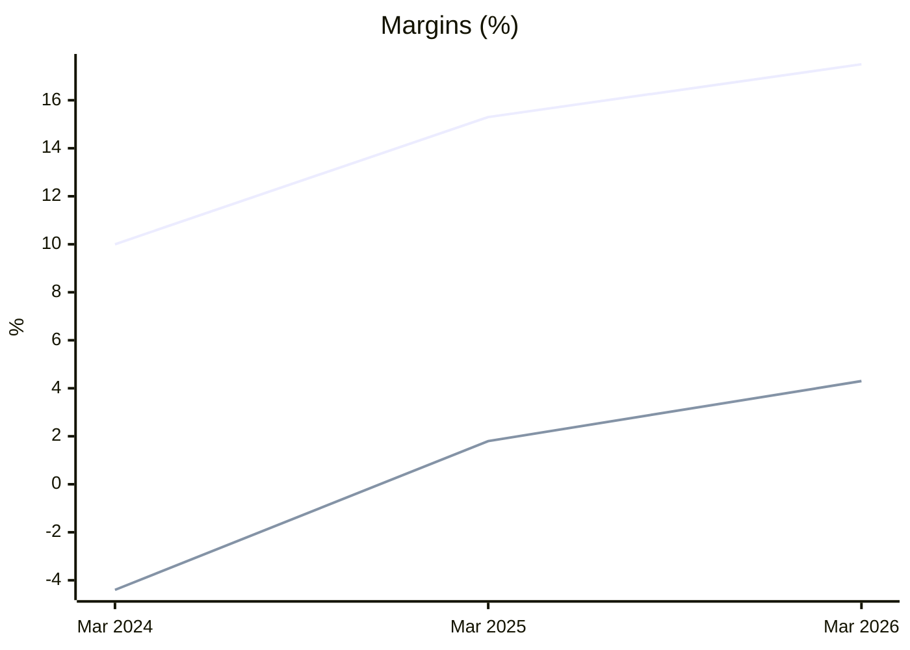

*Run 2026-11-24 · part of [SPINOFF_REPORT.md](../SPINOFF_REPORT.md) · the complete analysis of one company, with every management-call exchange in full.*

## UPL — UPL Ltd.

### 1. UPL Ltd. — CONFIRMED DEMERGER

**CONFIRMED** (a demerger scheme is on the exchange record) · **PRE-SPIN — study the parent; the pieces do not trade yet** · score 7.1/10 · spin-off · 9 filing(s) from CALLS, NSE · first 2026-01-19, latest 2026-08-01

**The separated entities — every one the documents name:**

| Entity | Scheme | Business | Listing | Who runs it |
|---|---|---|---|---|
| **UPL Global Sustainable Agri Solutions Limited** (earlier UPL Agri Science Limited) | 2026 Composite Scheme of Arrangement — Demerger of India Cr… | Dedicated pure-play crop protection platform housing UPL's India Crop Protection Business (ex UPL SAS) and th… | to be listed | Mike Frank, CEO of UPL Global ("Mike Frank, who h… |
| **Advanta Enterprises Limited** (earlier Advanta Enterprises Private Limited) | 2026 initial public offering of Advanta Enterprises Limited… | Seeds and post-harvest platform; seeds across 40 crops with 900+ hybrid varieties, plus the DECCO post-harves… | to be listed | Bhupen Dubey, Chief Executive Officer, Advanta |

**The other parties to the scheme(s)** — not separated entities: UPL Sustainable Agri Solutions Limited — merged in — no shares for the parent's holders; UPL Crop Protection Holdings Limited — merged in — no shares for the parent's holders

**What is being separated, as the documents put it:** India Crop Protection Business demerged into UPL 2, then combined with UPL's international (global) crop protection business — class `value_unlocking`.

### 2. Stages and dates

> **Listing:** NOT YET — scheme at 'exchange_noc' stage; UPL Global Sustainable Agri Solutions Limited will list only after NCLT sanction, effectiveness and a record date; indicated timeline: Not a stated listing date. Press release February 20, 2026: “The transaction is expected to be completed within 12–15 months”. NSE letter July 29, 2026: UPL Global “shall ensure that steps for listing of specified securities are completed and trading in securities commences within sixty days ___ of receipt of the order of the Hon'ble High Court/NCLT”. As of November 2, 2026 the Scheme remains subject to shareholder, regulator and NCLT approvals

| Date | Event | Source |
|---|---|---|
| 2026-01-19 | DRHP filed — Advanta Enterprises Limited — DRHP filed with SEBI, BSE and NSE | as stated: Updates – Filing of Draft Red Herring Prospectus (DRHP) by Advanta En… |
| 2026-02-20 | Board approval — UPL Limited (based on recommendations of the Audit Committee and Committee of Independent Directors); Board Meeting commenced at 02.30 p.m. and concluded at 03.30 p.m. | as stated: Intimation under Regulation 30 – Outcome of Board Meeting, February 2… |
| 2026-02-20 | Other — Joint valuation report by PwC Business Consulting Services LLP and Ernst & Young Merchant Banking Services LLP, and fairness opinion by J.P. Morgan India Private Limited | as stated: Intimation under Regulation 30 – Outcome of Board Meeting, February 2… |
| 2026-02-20 | Other — Shareholders agreement executed amongst UPL 2, Mr. Jai Shroff, Mr. Vikram Shroff, UPL Corporation Limited, Mauritius and The Upswing Trust | as stated: Intimation under Regulation 30 – Outcome of Board Meeting, February 2… |
| 2026-02-27 | Filed with exchanges — UPL Limited application to BSE and NSE under Regulation 37 of the Listing Regulations | as stated: Intimation regarding receipt of Observation Letters from BSE and NSE,… |
| 2026-03-04 | Other — Scheme of Arrangement, Joint Valuation Report, Fairness Opinion and FAQs uploaded on the Company's website | as stated: Updates – Uploading of 'Composite Scheme of Arrangement' and certain … |
| 2026-04-01 | Appointed date — Merger 1 (amalgamation of UPL SAS into UPL 1) — "opening of business hours on April 1, 2026"; the appointed date for the Demerger and Merger 2 will be the Effective Date of the Scheme | as stated: Intimation under Regulation 30 – Outcome of Board Meeting, February 2… |
| 2026-06-02 | Other — Competition Commission of India approval (as stated in the quarterly results notes) | as stated: Unaudited consolidated and standalone financial results note 7 / note… |
| 2026-06-03 | Other — CCI approval for the Scheme and the transactions contemplated thereunder (as stated in the restructuring intimation); NSE letter ref. NSE/LIST/53803 dated June 03, 2026 submitted to SEBI | as stated: Other Restructuring – Update regarding Scheme, August 1, 2026; NSE Ob… |
| 2026-07-29 | Stage reached: **exchange noc** | [Scheme of Arrangement](https://nsearchives.nseindia.com/corporate/UPL_29072026205347_Reg_30_Scheme_of_Arrangement.pdf) |
| 2026-07-29 | SEBI observations — SEBI comments on the draft scheme of arrangement conveyed via BSE and NSE | as stated: BSE letter DCS/AMAL/RD/R37/175/2026-27 and NSE letter NSE/LIST/53803,… |
| 2026-07-29 | Exchange no-objection — BSE "no adverse observations" and NSE "No Objection"; validity of the Observation Letters is six months from July 29, 2026 within which the scheme shall be submitted to the NCLT | as stated: Scheme of Arrangement intimation, July 29, 2026 (Observation Letters … |
| 2026-07-31 | Other — Swap Transaction (Clause 2.4.1) completed — UPL Cayman 1 shareholding changed to UPL Mauritius 76.42%, Upswing Trust 21.82%, others 0.01%, unvested ESOPs 1.76% | as stated: Other Restructuring – Update regarding Scheme, August 1, 2026 |
| 2026-07-31 | Other — ESOP Swap Transaction (Clause 2.4.2) completed — options under the Cayman 2 ESOP Scheme cancelled and options issued under UCPL LTI Plan 2026 | as stated: Other Restructuring – Update regarding Scheme, August 1, 2026 |
| 2026-11-02 | Other — UPL Limited — "The Scheme is subject to receipt of other approvals/ consents from the shareholders, regulators and NCLT. Accordingly, no effect has been given to the Scheme in these Unaudited Consolidated Statement of Financial Results" | as stated: Outcome of Board Meeting / unaudited results for the quarter and half… |

**The stages, as filed:** exchange noc (2026-07-29)

**Stated in the filings:** resulting company **UPL Global Sustainable Agri Solutions Limited**; entitlement **1 for every 1**.

**When it lists, in the documents' words:** Not a stated listing date. Press release February 20, 2026: “The transaction is expected to be completed within 12–15 months”. NSE letter July 29, 2026: UPL Global “shall ensure that steps for listing of specified securities are completed and trading in securities commences within sixty days ___ of receipt of the order of the Hon'ble High Court/NCLT”. As of November 2, 2026 the Scheme remains subject to shareholder, regulator and NCLT approvals

### 3. Size of the separated business beside the parent — is institutional selling likely?

**Reading: LESS LIKELY on size alone — the piece is the larger part of the business.**

| Entity | Stated turnover | Stated share of the whole | Market cap (₹ cr) | Share of the whole by market cap | Segment revenue share | Index member | Selling on size |
|---|---|---:|---:|---:|---:|---|---|
| UPL Global Sustainable Agri Solutions Limited | Nil turnover for the year ended March 31, 2025 (as per audi… | — | — | — | 80.0% (FY2026) | not listed | less likely |
| Advanta Enterprises Limited | Advanta revenue INR 6,837 crore for FY26, 23% growth (platf… | — | — | — | 87.0% (FY2026) | not listed | less likely |

*Stated figures are the documents' own (a turnover share, or the cost-of-acquisition split the company publishes for tax, which reflects relative value). The market-cap share is the entity's value over the whole — the parent plus every separated entity that trades (parent ₹47,223 cr, whole ₹47,223 cr, NSE bhavcopy of 2026-11-13); the segment share is the business's revenue over the parent's reported sales of that year. Both are computed here. The reading uses the market-cap share when the entity trades, else the stated share, else the segment share.*

**In the documents' words:** “"Turnover of the Demerged Undertaking (as defined in the Scheme) (INR Mn) 24,120 | % of Turnover of UPL 1* 31.15% *Calculated after adding the turnover of UPL SAS to UPL 1 as on March 31, 2025 as per the details provided in point 1 above"; entity sizes stated as: "UPL 1 INR 53,313 Mn / INR 120,210 Mn; UPL SAS INR 24,120 Mn / INR 22,016 Mn; UPL 2 Nil / INR 0.02 Mn; UPL Cayman USD 4,187 Mn / USD 1,599 Mn" (turnover for the year ended March 31, 2025 and net worth as on March 31, 2025)”

**The judge's read of selling pressure:** likely — 1 new UPL 2 share to every UPL 1 holder, a crop-protection-only line; promoters (71.56%) locked 18 months, so only public float trades

### 4. Insider ownership — share swap, promoters' holding, management incentives

**Share swap / entitlement, entity by entity:**

- **UPL Global Sustainable Agri Solutions Limited:** Demerger: "1 (One) equity share of UPL 2 of INR 2 each fully paid-up for every 1 (One) equity share of UPL 1 of INR 2 each fully paid-up."; Merger 2: "1,000 (One Thousand) equity shares of UPL 2 of INR 2 each fully paid-up, for every 213 (Two Hundred and Thirteen) equity shares of UPL Cayman of USD 1 each fully paid-up."
- **Advanta Enterprises Limited:** "The Offer comprises an offer for sale ("Offer for Sale") of up to 36,105,578 Equity Shares of face value ₹ 1 each, which is proposed to be undertaken by our Company and other eligible shareholders of Advanta. Our Company intends to offer up to 28,107,578 Equity Shares in the Offer." (KKR has indicated 2.2% and UPL Limited has indicated 7.8%)

**Promoters' holding, from the shareholding pattern:**

| Company | Promoters | FIIs | DIIs | Public | Quarter |
|---|---:|---:|---:|---:|---|
| UPL Ltd. (UPL) | 33.5% | 42.36% | 14.3% | 9.82% | Sep 2026 |

*Source: screener.in shareholding pattern, stored under `ShareholdingPattern/NiftyTotalMarket/`. In a mirror demerger each shareholder holds the same proportion of the new company as of the parent on the record date.*

- **Promoters in the parent, per the documents:** UPL 1 promoters 33.51% pre-Scheme as on Feb 20, 2026; post-Scheme (Indicative) 33.09% pursuant to Merger 1 (public 66.49% pre-Scheme, 66.91% post-Scheme); "There shall be no change in shareholding pattern of UPL 1 pursuant to Merger 2." and "UPL 1 : No change in shareholding pursuant to Demerger."
- **What the promoters will hold in the separated entity:** UPL 2: "Details as on Feb 20, 2026 Pre-Scheme Shareholding (%) / Post-Scheme (Indicative) Shareholding (%) — Promoters 100.00 / 71.56; Public - / 28.44; Total 100.00 / 100.00" (post the Demerger and Merger 2). Upswing Trust: "Upon allotment of shares by UPL 2 pursuant to the Scheme, Upswing Trust will hold 16.78% shareholding in UPL 2, as a public shareholder." UPL 2 Promoters "have agreed to voluntarily retain their entire shareholding respectively in UPL 2 and undertake to not transfer, directly or indirectly, their respective shareholding in UPL 2 (except for any inter se transfers amongst the UPL 2 Promoters) as existing on the Listing Date until eight een months from the Listing Date." For the Advanta IPO: "Our Company is the Promoter of Advanta." and the Offer for Sale is of up to 36,105,578 Equity Shares of which "Our Company intends to offer up to 28,107,578 Equity Shares in the Offer"; the resulting post-IPO promoter percentage is not stated.
- **What a public shareholder receives:** Demerger: "As consideration for Demerger, UPL 2 shall allot equity shares to the Eligible Shareholders 2 (as defined in the Scheme) of UPL 1 as per the share entitlement ratio below: 1 (One) equity share of UPL 2 of INR 2 each fully paid -up for every 1 (One) equity share of UPL 1 of INR 2 each fully paid -up." Merger 1: "As consideration for the Merger 1, UPL 1 shall issue equity shares to the Eligible Shareholders 1 (as defined the Scheme) as per following share exchange ratio: 1,000 (One Thousand) equity shares of UPL 1 of INR 2 each fully paid- up, for every 48 (Forty Eight) equity shares of UPL SAS of INR 10 each fully paid- up." Merger 2: "As consideration for the Merger 2, UPL 2 shall issue equity shares to the Eligible Shareholders 2 (as defined the Scheme) as per following share exchange ratio: 1,000 (One Thousand) equity shares of UPL 2 of INR 2 each fully paid- up, for every 213 (Two Hundred and Thirteen) equity shares of UPL Cayman of USD 1 each fully paid- up." "No cash consideration shall be payable under the Scheme." Advanta IPO: an offer for sale only, so UPL public shareholders receive no shares.
- **Management incentives:** "All holders of employee stock options in UPL Corporation Ltd ., Cayman ("UPL Cayman 2") under UPL Corporation Ltd LTI Plan 2022 ("Cayman 2 ESOP Scheme") have been issued stock options in UPL Cayman 1 under a new stock option scheme viz. UCPL LTI Plan 2026 ("UCPL ESOP Scheme") in lieu of cancellation of their respective stock options under the Cayman 2 ESOP Scheme"; "the ESOP Swap Transaction (as contemplated under Clause 2.4.2 of the Scheme) has also been completed on July 31, 2026"; "1.76 % of the shares of UPL Cayman 1 are held by holders of unvested employee stock options under UCPL ESOP Scheme, in each case on a fully diluted basis (including on the assumption that all employee stock options under the UCPL ESOP Scheme have been exercised)"; pre-Swap, UPL Cayman 2 was "1.76% held by holders of unvested employee stock options under the Cayman 2 ESOP Scheme". No exercise price or pricing date is stated. "No benefit accrues to the promoter, promoter group or group companies of the Company pursuant to the Swap Transaction and the ESOP Swap Transaction."
- **Insider actions around the separation:** "To demonstrate their continued commitment to the long- term success and growth of UPL 2 , on and from the date of listing and the commencement of trading of the equity shares of UPL 2 on the Stock Exchanges ("Listing Date"), following members of the promoter and promoter group of UPL 2 : Rajnikant Shroff, Sandra Shroff, Jaidev Shroff, Vikram Shroff, Tania Shroff, Varun Shroff, Mekhla Shroff, Nerka Chemicals Private Limited, Uniphos Enterprises Limited, Demuric Holdings Private Limited, R Shroff Consultants Private Limited, Harmonic Ventures Limited, Suresight Ventures Limited, Esthetic Finvest Private Limited and UPL Corporation Limited, Mauritius and Affiliates (as defined in the Scheme) of the above persons that hold equity shares of UPL 2 as on the Listing Date and are identified as members of the promoter and promoter group of UPL 2 (collectively, "UPL 2 Promoters"), have agreed to voluntarily retain their entire shareholding respectively in UPL 2 and undertake to not transfer, directly or indirectly, their respective shareholding in UPL 2 (except for any inter se transfers amongst the UPL 2 Promoters) as existing on the Listing Date until eight een months from the Listing Date." Also: The Upswing Trust swapped its 22.21% shareholding in UPL Corporation Ltd., Cayman Islands for shares in UPL Cayman 1 (completed July 31, 2026); UPL Limited intends to sell up to 28,107,578 Advanta shares in the Advanta offer for sale (7.8%, with KKR 2.2%); and "the Rights Issue Committee, forfeited and cancelled 2,64,278 partly paid-up equity shares of the face value of Rs. 2 each on which call money was unpaid" (February 19, 2026).
- **Insiders, per the checklist read:** Promoters hold 100% of UPL 2 pre-Scheme, 71.56% post (33.09% of UPL 1); UPL 2 Promoters voluntarily retain entire holding, no transfer for eighteen months from Listing Date; Mike Frank to be UPL Global CEO · *option pricing date:* July 31, 2026 — ESOP Swap Transaction completed; UPL Cayman 2 option holders issued new options in UPL Cayman 1 under UCPL LTI Plan 2026 (strike/pricing not stated)

### 5. Why the demerger — point by point

Management's stated reason is that UPL is a conglomerate whose crop protection business is trapped inside a diversified holding structure and is therefore mis-valued: Bikash Prasad said on the May 2026 Capital Markets Day that "even today market is valuing us using a single conglomerate multiple" and that UPL carries "a huge conglomerate discount," so separation would make "the sum of the parts... much, much clearer." The Scheme (board-approved 20 Feb 2026) is a three-step composite arrangement: amalgamate UPL Sustainable Agri Solutions (UPL SAS, India crop protection, 90.91% owned, FY25 turnover INR 24,120 Mn or 31.15% of UPL's turnover) into UPL Limited; demerge that India crop protection undertaking into UPL Global Sustainable Agri Solutions (UPL 2) on a 1:1 share entitlement; then amalgamate UPL Crop Protection Holdings Ltd., Cayman (UPL Cayman, the 77.78%-held international crop protection vehicle, FY25 turnover USD 4,187 Mn, net worth USD 1,599 Mn) into UPL 2 at 1,000 UPL 2 shares for every 213 UPL Cayman shares, with UPL SAS holders getting 1,000 UPL shares per 48 UPL SAS shares. The problems it is said to solve: a split holding structure created by the 2022 platform carve-out that left India and international crop protection in separate vehicles; a single conglomerate multiple and no value visibility per platform; crop protection's cash-flow and capital-allocation needs being, as COO Toshan Tamhane put it in Feb 2026, "very different from that of the seeds business" (he cited Corteva's own crop protection/seeds split); and inability to raise capital or set governance per platform — the filing says the Scheme lets UPL 1 and UPL 2 "raise capital independently" and "optimize its capital structure," and Prasad said platforms with "independent capital structure, independent governance structure... will grow much faster." The demand came from several directions: analysts and investors gave five pieces of feedback that Prasad catalogued (reporting consistency, the four below-EBITDA items worth ~INR 5,000 crore or 60% of FY25 EBITDA, and debt/liquidity), rating agencies and lenders drove the deleveraging that Jai Shroff said had removed the leverage drag on the multiple, and private investors needed exits — KKR (which wrote a "$300-plus million check" into Advanta) and Alpha Wave (USD 350 Mn for ~12.44%, of which USD 250 Mn secondary from UPL Limited), plus The Upswing Trust, the UPL SAS investor that swapped into UPL Cayman and ends with 16.78% of UPL 2 as a public shareholder with one board nomination right. The result is two listed entities: UPL Limited as a diversified agri and specialty-chemicals platform keeping SUPERFORM as its manufacturing arm and incubating new verticals, and UPL Global as what Mike Frank (its CEO-designate) called "the world's second largest listed pure-play crop protection platform" in 140+ countries with 9 R&D centres, 25 formulation facilities and a 14% innovation rate. Shroff framed it as each business needing "a kind of independent life" and said the plan went through advisors and "at least 10 different structures," expected to complete in 12-15 months.

**Point by point, with the source:**

1. Pre-history: value was being unlocked privately, not structurally — Alpha Wave bought ~12.44% of Advanta for USD 350 Mn, USD 250 Mn of it secondary from UPL Limited, the second global investor into Advanta in two years, with proceeds earmarked for debt repayment. “We have signed a definitive agreement with Alpha Wave Global under which they will invest US$350 million, US$100 million as primary investment in the company, and US$250 million as secondary through purchase of shares from UPL Limited for an approximate 12.44% stake in the company.” — *[Jan 2025](https://www.upl-ltd.com/financial_result_and_report_pdfs/9DyAsm9UB52Kn6Za4Ryuqpae2kOB58CLDfHR4eh4/UPL---Q3FY25---Concall-Transcript.pdf)*
2. First mention of structural work: advisors newly engaged to explore unlocking value across all platforms, with no decided structure and no timeline; Prasad tied it to a focus on significantly deleveraging the balance sheet over the next year or two. “The idea behind engaging advisors is to explore unlocking value across all platforms.” — *[Aug 2025](https://www.upl-ltd.com/financial_result_and_report_pdfs/r3nhTBqvvaJwil4Yfw2svFbm3ssp7pXGaXZJVwLM/UPL---Q1FY26---Earnings-call-transcript.pdf)*
3. The option set was named for the first time — restructuring, strategic fundraising or an IPO — after the DECCO post-harvest business was folded into Advanta in September 2025. “I think we had indicated in our Q1 press release and subsequently also during the earnings call that UPL continues to evaluate various strategic opportunities to unlock shareholders' value across platforms, including restructuring or strategic fundraising, potential liquidity events like IPO.” — *[Nov 2025](https://www.upl-ltd.com/financial_result_and_report_pdfs/UPL-Q2FY26-Earnings-call-transcript.pdf)*
4. Prasad linked the value-unlock options directly to the debt problem, in the context of USD 500 Mn due March 2026 and ~USD 900 Mn of Q3/Q4 FY27 maturities. “We had indicated during Q1 earnings call and press release that we are looking at various options to unlock shareholders' value. And if some of those we decide to take, that would also help in terms of deleveraging the balance sheet.” — *[Nov 2025](https://www.upl-ltd.com/financial_result_and_report_pdfs/UPL-Q2FY26-Earnings-call-transcript.pdf)*
5. Advanta's DRHP (filed 19 January 2026) was presented as the first concrete step, within a stated 1-to-3-year window of corporate actions covering every platform. “As we have communicated earlier, we remain focused in evaluating various corporate actions for all our platforms, including IPO and restructuring within a period of 1 to 3 years.” — *Feb 2026*
6. The Advanta IPO was an offer for sale, not a primary raise — KKR selling 2.2% and UPL Limited 7.8% — with proceeds going to the group, principally to cut debt rather than to fund Advanta. “This transaction is offer for sale. It's not a primary transaction. So the cash is not going to Advanta. It is coming to the selling shareholders, which are KKR and UPL Limited in this case.” — *Feb 2026*
7. The clearest business logic given for separating platforms: crop protection and seeds have fundamentally different cash-flow and capital-allocation profiles, with Corteva's own split cited as precedent and Advanta called the eighth-largest global seeds player. “As you would have seen globally, Corteva has also announced a split between crop protection and seeds because just those two businesses are fundamentally different, and we believe Advanta as the eighth largest seeds player globally has a journey and destiny of its own.” — *Feb 2026*
8. Tamhane conceded the trigger was partly that private-round valuations (KKR, then Alpha Wave) were not being reflected in UPL Limited's own price, so public-market separation was needed to capture it. “Because, if you look at the valuation that KKR and subsequently Alpha Wave came in at, at least we feel that the full value of that is not flowing through to UPL Limited.” — *Feb 2026*
9. The 20 Feb 2026 board-approved Composite Scheme consolidates UPL SAS (India crop protection) and UPL Cayman (global crop protection) into UPL Global, to be listed; UPL Limited stays listed as a diversified agri and specialty-chemicals platform. “The Scheme proposes to consolidate the India Crop Protection Business held in UPL SAS and Global Crop Protection Business held in UPL Cayman, under a single entity, creating a focused, pure-play crop protection platform.” — *Scheme*
10. Independent capital raising and capital-structure optimisation for each entity is given as a core benefit, alongside simplification of the group structure created by the 2022 platform carve-out and enhanced managerial and board focus. “The Scheme will allow UPL 1 and UPL 2 to raise capital independently, allowing each entity to optimize its capital structure and pursue business opportunities more efficiently and effectively.” — *Scheme*
11. Scale claim for the new entity, with Mike Frank named CEO of UPL Global; promoters hold 71.56% of UPL 2 post-Scheme versus 28.44% public (The Upswing Trust alone 16.78%), and UPL promoters agreed to an 18-month voluntary lock-in from listing. “Bringing our crop protection businesses under one platform creates the world's second largest listed pure-play crop protection platform.” — *Scheme*
12. The valuation argument stated most bluntly: a single conglomerate multiple is being applied to UPL, and separation is meant to make the sum of the parts visible once each platform has its own capital and governance structure. “You know that even today market is valuing us using a single conglomerate multiple, they are applying on us.” — *[May 2026](https://www.upl-ltd.com/financial_pdfs/cmd-2025-transcript.pdf)*
13. Shroff's framing: brand- and IP-led businesses growing 3x-4x peers need autonomy, and the structure was chosen after extensive tax and structuring advice ahead of the announcement; SUPERFORM stays inside UPL Limited as the manufacturing platform. “All these businesses need long-term need a kind of independent life, right?” — *[May 2026](https://www.upl-ltd.com/financial_pdfs/cmd-2025-transcript.pdf)*
14. Shroff said the historic leverage overhang that had suppressed UPL's multiple is gone — gross debt down 40% from USD 3.8 bn (FY24) to USD 2.3 bn and net debt down 48% to USD 1.6 bn, gearing from 4.6x to below 1.6x — clearing the way for the separation to be read as value unlock. “We've also made sure that the as in the past leverage was an issue for which kept the multiple of the company.” — *[May 2026](https://www.upl-ltd.com/financial_pdfs/cmd-2025-transcript.pdf)*
15. An existing shareholder (Old Bridge Asset Management) objected that the announced structure would trigger a HoldCo discount and dilute existing holders, and pressed management on alternate structures; Shroff offered a meeting. “But the challenge is that the manner in which that the current structure has been announced, it's likely to trigger a significant HoldCo discount.” — *[May 2026](https://www.upl-ltd.com/financial_pdfs/cmd-2025-transcript.pdf)*
16. Management said it had run a two-month investor consultation with a tracker of feedback that would go unfiltered to the board within a month or two, and that at least ten structures had been reviewed with advisors before this one was chosen. “And very shortly, we will be presenting that unfiltered to the board.” — *[May 2026](https://www.upl-ltd.com/financial_pdfs/cmd-2025-transcript.pdf)*

**How it evolved:** The idea surfaced as an unspecified value-unlock exercise on the 1 Aug 2025 Q1FY26 call, where Prasad said advisors had just been engaged to "explore unlocking value across all platforms" with "no firm decision on any structure," after Jai Shroff's press-release comment on restructuring; before that, on 31 Jan 2025, the only visible step was private monetization of Advanta (Alpha Wave's USD 350 Mn) and a net-debt/EBITDA target of ~2x. On 6 Nov 2025 it broadened to "restructuring or strategic fundraising, potential liquidity events like IPO," explicitly linked to deleveraging, alongside the DECCO-into-Advanta integration. By 2 Feb 2026 it had a timetable and a first concrete step — Advanta's DRHP filed 19 Jan 2026, described as "the first such step in this direction," with corporate actions for all platforms "within a period of 1 to 3 years" — and management argued seeds and crop protection are fundamentally different businesses. The crop protection scheme itself was announced 20 Feb 2026 (CCI clearance 2-3 Jun 2026, exchange observation letters and the Upswing swap completed 29-31 Jul 2026), and by the 11 May 2026 Capital Markets Day the debate had shifted to the structure's fairness, with Old Bridge calling it "fairly detrimental to the current shareholders," Shroff defending it and Prasad promising to take investor feedback "unfiltered to the board" within a month or two.

**What management expects from it:** UPL Global: pure-play crop protection across 140+ countries, independent capital structure and governance, faster growth, wider investor and lender base. UPL Limited: diversified agri and specialty-chemicals platform retaining SUPERFORM, incubating new ventures, deleveraged with net debt/EBITDA below 1.6x. Both: independent fundraising, clearer sum-of-parts valuation removing the conglomerate discount, sharper board and managerial focus.

*Not explained on the calls:* No debt split between UPL 1 and UPL 2, no UPL 2 standalone financials or guidance, no answer to the HoldCo-discount objection, no word on Advanta's IPO post-Scheme.

- *Stated reason, in one line:* Unlock shareholder value by consolidating India and international crop protection into one focused pure-play platform; simplify group structure, enable clearer value discovery, independent capital raising, sharper board/managerial focus, synergies
- *What it reveals:* Crop protection is the bulk of UPL: segment revenue Rs 42,399 cr of Rs 51,839 cr FY26. UPL Cayman alone: USD 4,187 Mn turnover, USD 1,599 Mn net worth; demerged India undertaking 31.15% of UPL 1 turnover. CFO frames it as deleveraging and balance-sheet strengthening
- *Parent or spin:* spin · *Read next:* The Composite Scheme of Arrangement with Joint Valuation Report and J.P. Morgan fairness opinion, on the company's scheme-of-arrangement webpage
- *In their words:* “UPL 2, which shall be listed pursuant to the Scheme would be a dedicated crop protection platform.”

### 6. On the calls, verbatim

11 call(s), oldest first: **21 question-and-answer exchange(s)** given in full — the question and every answer to it, nothing trimmed — and 35 passage(s) from management's prepared remarks (the complete sentences about it; the whole remarks are in the linked transcript). Text is as the transcript prints it.

#### Nov 2023 — [transcript](https://www.upl-ltd.com/financial_result_and_report_pdfs/0ussbQSi5IxleJvTMVGTsuI6rIRn4OmYGia3kAX4/UPL-Q2FY24-Earnings-Concall-Transcript--30Oct23.pdf)

**From the prepared remarks** *(the passage about it; the whole turn runs to 719 characters in the transcript)*

> **Radhika Arora:** Thank you. Good day, everyone. Thanks for joining us today for the Results for the Quarter and Half-Year Ended 30th September 2023. The “Presentation, Press Re lease and the Financial Statements ” has been made available on the website and we take as having read the Safe Harbor statement. From the Management Team , we have with us today, Vice Chairman -- Rajendra Dara k; CEO of Global Crop Protection business -- Mike Frank ; CFO -- Anand Vora ; Chief Supply Chain Officer -- Raj Tiwari ; Chief Commercial Officer -- Farokh Hilloo ; Mr. Bhupen Dubey and Ashish D hobal, the CEOs of our Advanta business and UPL S AS respectively, and other members of the leadership team. With that, let me now hand it over to Anand.

**From the prepared remarks** *(the passage about it; the whole turn runs to 7,603 characters in the transcript)*

> **Anand Vora:** Bulk of the saving for this year will be realized in H2. On the operating profitability front, we reported an EBITDA of INR 1,573 crores in Q2 , representing a decline of 43% for that of the previous year, largely on account of double -digit drop in contribution profits. However, adjusting for the transitory factors impacting the contribution margin, the drop in EBITDA for Q2 and H1 would have been significantly lower. Before we move on to the items below the EBITDA, I would like to briefly touch upon the performance of the two of our platforms UPL SAS, the India Crop Protection platform and Advanta Enterprises , the Global Seeds platform. Advanta continued to see healthy growth in Q2 as revenues grew by 10% to INR1 ,070 crores and the contribution profit grew by 13% over that of the last year. On the whole for H1 , Advanta delivered a strong performance with 17% growth in revenue and 25% growth in co ntribution profit and EBITDA. Looking ahead, Advanta remains on track to achieve its FY24 guidance. Performance of the India Crop protection business , UPL SAS, in Q2 was impacted by high channel inventory, erratic monsoon in August and September month s and higher than usual sales return and also due to the lower acreages for key crops such as cotton and pulses, which form a large part of the UPL SAS revenue . Given the above headwinds, revenue contracted by 36% in Q2 versus last year, while EBITDA declined by 88%. However, led by new launches, a strong product portfolio for the rabi crop s and lower sales return, the performance of UPL SAS in H2 will be much better than that of H1.

#### Feb 2024 — [transcript](https://www.upl-ltd.com/financial_result_and_report_pdfs/nAtDABPyh2l5KTic5YOGQZ7IuGb8PYHHg1G0hiab/UPL---Q3FY24---Concall-Transcript.pdf)

**From the prepared remarks** *(the passage about it; the whole turn runs to 728 characters in the transcript)*

> **Radhika Arora:** Thank you, Darwin. Good day, everyone. Thanks for joining us today for the results for the quarter and 9 months ended 31st December 2023. The presentation, press release and the financial statements have been made available on the website, and we take as having read the Safe Harbor statement. From the management team, we have with us today, Vice Chairman, Rajendra Darak; CEO of Global Crop Protection business, Mike Frank; CFO, Anand Vora; Chief Supply Chain Officer, Raj Tiwari; and Bhupen Dubey and Ashish Dobhal, the CEOs of the Advanta business and UPL SAS. We will start with Mike and Anand presenting the performance for the quarter, followed by the Q&A. With that, let me now hand it over to Anand. Over to you, Anand.

**From the prepared remarks** *(the passage about it; the whole turn runs to 6,913 characters in the transcript)*

> **Anand Vora:** And for the first 9 months, EBITDA was INR 3,583 crores, down by 56%. The decline in EBITDA was driven by the significant drop in contribution profit. Adjusting for the transitory factors impacting the contribution margin, however, the drop in EBITDA for Q3 and 9 months would be significantly lower. I would like to briefly touch upon the performance of 2 of our platforms, UPL Sustainable Agri Solutions, the India distribution business; and Advanta Enterprises, our seeds bu siness , before moving on to the items below the EBITDA. Performance of UPL SAS, the India crop protection platform in Q3 , was also impacted as revenues contracted by 34% while EBITDA declined by 47%. The key factors attributing to the revenue decline were po or Rabi season in Telangana and Karnataka , and low cotton acreage in North India, which led to high sales return. Secondly, the low glufosinate demand due to elevated channel stock and increased competition also impacted the results. […] Furthermore, we are also introducing new products to diversify our crop mix. To give some update on 'Nurture ’, our digital platform, it continues to see good traction on the back of launchi ng exclusive online brands for retailers and in -the-farm services for farmers. We have also brought in significant operating efficiency through cost savings. Moving to Advanta, our global seed platform. It delivered healthy growth for the first 9 months as revenues grew by 11%, driven by higher prices and volumes in sunflower, corn, canola, sorghum and vegetable portfolios. EBITDA grew faster at 16%, driven by improved contribution and controlled overheads. Coming back to the overall financial results.

#### May 2024 — [transcript](https://www.upl-ltd.com/financial_result_and_report_pdfs/zaxOgmebcdVCtsoXkSJyMhAZN2hMF3KlGyacJvlF/UPL-CMD-2024-Transcription.pdf)

**From the prepared remarks** *(the passage about it; the whole turn runs to 0 characters in the transcript)*

> **(speaker not labelled):** UPL Capital Markets Day 2024 May 13, 2024 Radhika Arora : Good evening, everyone. I am Radhika Arora, the Head of Investor Relations at UPL. On behalf of the management team at UPL, I would like to welcome you all to the FY24 Capital Markets Day. Whether you are in the room or joining us through the webcast, I do believe the hours spent with us today will be very valuable in understanding the strategic direction of the company. You will get a chance to hear from and interact with the business leaders of the platforms. So, with that in mind, I will get off the stage in just a bit, but just before that, a few logistical pointers. First ly, there is a lot of information in today's presentation, and we want to make sure that you hear it all before opening it up for the questions. The session will start with a presentation by –  Jai Shroff , Chairman and Group CEO  Anand Vo ra, Group CFO  Mike Frank , CEO of UPL Corporation, our Interna tional Crop Protection Platform  Ashish Dobhal , CEO of UPL SAS, our India Crop Protection Pla tform  Benjamin Marolda, Global CEO of Advanta Enterprises, our Global Seeds Platform  Raj Tiwari, CEO of UPL Specialty Chemicals Limited. Lastly, please make sure to check out the Safe Harbor Statement about the forw ard-looking statements. So, with that, please silence your phones, sit back, and we start the presentation. Let's welcome on stage our Chairman and Group CEO, Jai Shroff . Jai Shroff : Thank you, Radhika. Welcome, everyone. Pleasure to be here. For UPL, this has been a very difficult year. And for the industry, it's been a very difficult year, too. Particularly in the last 30 years or so of my very active involvement in the business, I haven't seen two major markets which have had a big slowdown like we had this time. And in the past, we've been able to anticipate them better and react better. We have had some setbacks in the past also. But anyway, hopefully this is behind us, and what doesn't kill you makes you stronger. And we look forward to th at. Just running through the numbers for the last year, we had revenues of around INR 43,000 crore , which is lower by 20 %; INR 5,500 crores of EBITDA, which is down 51 %. Debt is up by $600 million and working capital up by 22 days. So, focus for the coming year and coming years is really to focus on profitable business, which is focused on improving working capital. And I think the whole industry, as I talk to my colleagues around the world, is focused on that. And I believe that we will see a dramati c improvement. At UPL, we will focus on growing our platforms, whether it's Advanta, Specialty Chemicals, India Crop Protection, or the UPL Corporation as a global crop protection leader. Improving cash flows and deleveraging the business and unlocking as much value as we can over the next two or three years from the various platforms, which each individually are leaders in its own space. Looking at UPL Corporation, our global crop protection platform, w e expect the Brazilian market and the U.S. market to recover. And we will see some benefits there. At SAS, the team is completely focused on launching so many new technologies and really focusing on improving brand presence and cash flows.

**From the prepared remarks** *(the passage about it; the whole turn runs to 0 characters in the transcript)*

> **(speaker not labelled):** On the seed business, Advanta is leading its way on the corn seed platforms in India . Today there is a huge interest in different aspects of the seed business, which is biofuels, and we see Advanta continue to gain market share there. On Specialty Chemicals, we have the internal manufacturing platform and also the non- captive business . UPL plans to invest and continue to grow and retain its position as one of the largest Specialty Chemical companies in India. Reimagining sustainability, it is the theme of the future and UPL is actively involved in various platforms, whether it was COP28, or our NPP platform for agricultur e, which is growing, doing better, and part of so many v alue chains, whether it's sugarcane in India, cocoa, sustainable rice in UP, and there's a lot of interest from the food companies to transition to buying traceable food, which is more sustainable. So, when we talk about sustainabi lity, we are talking about our Ze ba platform, which is to reduce water, our P ronutiva platform, which is to really focus on soil health and crop productivity. On the sugarcane project, which we can talk a little bit about, is already engaged with a number of sugar mills in India to really improve the productivity of sugarcane production and reduce water and fertilizer usage . And we believe that the impact of this on the environment will be huge, but not only that, it will improve profitability for the farmers. And you can see the impact of that on a real -world basis in various places. Transitioning to green impact, today we have 62 megawatts of green power, and we intend to, in the next year, increase that significantly . We've already started pro duction of green hydrogen, and we continue to expand, growing our whole green chemistry platform . There is a huge transition in Europe and in the US towards companies demanding green chemistry. And we believe that UPL will lead the way in the specia lty chemical sector. Thank you very much, and I hand over to Anand. Anand Vora : Thanks, Jai. Good afternoon to you all, and a warm welcome for joining us today. All of you know that it's been a challenging year. Probably the most challenging year in recent times. But to the credit of the leadership team, we look at it as an opportunity to restructure the business and adapt to the market realities by right -sizing the organization and making it future -ready through innovation, impro ving share of differentiated and sustainable products, and moving our focus towards improving margins and operational cash flows. With that, I'll start with the results for Q4. Talking about the Q4 results, we saw a sequential improvement in performance versus Q3 led by recovery in volumes as well as in margins. Our revenue for the quarter stood at Rs 14,078 crores, reflecting a decline of 15% versus that of the last year. The decline was primarily due to lower prices, which fell by 15% year on year. Of the 15% decline in prices, approximately 5% was on account of one -time transitory impact of higher rates, excluding which the decline in price and revenue was about 10%. Having said that, volumes were in line with last year, which is quite positive and in dicates that demand is gradually improving. Recovery in volumes was largely led by continued growth in our differentiated and sustainable portfolio, the share of which expanded by 7% from 29% last year to 36% this year. Contribution margins continued to be impacted by the transitory impact of higher rebates to support the channel partners and liquidation of high - cost inventory. Adjusted for these impacts, both our contribution and EBITDA margins were in line with those of last year, as impact of lower realization was offset by improved product mix, lower cost of goods and rationalization of overheads. This is quite encouraging and lends confidence that our margin profile should improve in the coming financial year. The cost

**From the prepared remarks** *(the passage about it; the whole turn runs to 0 characters in the transcript)*

> **(speaker not labelled):** optimization initiatives which we undertook in the first half of the year has paid off as we were able to reduce our fixed overheads by 17% year on year in Q4. This helped us to improve our EBITDA margins to be in line with last year, adjusted for the twin transitory impact that we spoke about earlier. Our net finance costs declined by 4% versus that of last year on account of reduced factoring. While overall tax charge was lower, the effective tax rate looked significantly higher as we continued to pay taxes in some geographies a nd at our manufacturing plants and seed platforms as we continued to generate profits there . The PBT was lower in line with the drop in contribution margins. Exceptional costs for the quarter were higher at INR 106 crores versus INR 29 crores last year, m ainly due to the one - time severance cost as we restructured our business. Overall, we are pleased to say that the quarter ended in profits. Before moving on to the full year's performance, I would like to touch upon the continued strong performance by our global seed platform, Advanta Enterprises, which reported a robust 34% growth in revenue and 38% growth in EBITDA for Q4. Now for the full year's financial results. As Jai highlighted earlier, this has been very challenging and an unusual year for the i ndustry as a whole. The full year's revenue stood at Rs 43,098 crores, showing a 20% decline over that of the previous year, impacted by industry -wide channel destocking and excessive pricing pressure in the post -patent space, which was aggravated by the transitory high rebates extended in Brazil, US and India to support our channel partners. Excluding these transitory rebates, the decline in revenue was 15%, as against the reported 20%. While the destocking had a stark impact in North America and Braz il, the rest of the world region bucked the trend and grew 9% in FY24, which is quite noteworthy amidst the ongoing industry downturn. Adjusted for the transitory impact, our contribution margins were in line with last year . An improved product mix in the form of a higher share of differentiated and sustainable products, which stood at 35% this year versus 28% last year, coupled with higher contribution from our seeds platform and a lower cost of goods offset the impact of lower realization on an adjusted basis. Furthermore, through focus ed cost optimization measures, we were able to reduce our fixed overheads by $150 million versus last year. Most of the reduction in overheads, about $100 million, was structural in nature, and we should see the benefit of that come by in this financial year also. The balanced $50 million was on account of lower bonus payout this year due to the business underperformance, which we are confident will be normalized in the current financial year. As a result, the EBITDA margins adjusted for the transitory impact is lower by 2% in FY24 as against the reported 8% margin decline. Moving on to the items below the EBITDA, our net finance costs increased by 10% year -on- year, ma inly due to the rise in benchmark interest rates on borrowings and an increase in quantum of debt. Overall, the average cost of debt for the year stood at around 7% per annum. The exchange loss for the year stood at INR 1,290 crores versus INR 777 crores last year. This increase was due to devaluation in currency in certain markets, such as Argentina, Russia and Turkey, where hedging is either not possible or is economically unv iable. The steep devaluation in Argentine peso by almost 300% had an impact of about INR 471 crores, of which INR 256 crores was just an impact on a single day when the currency was devalued around 100%. Overall, we reported a net loss of INR 1,200 crores for the year. This was pretty much in line with what we had guided for at the end of Q3. Moving on to working capital, we saw an increase by 22 days for the year, from 64 days to 86 days. This was due to higher receivable days, which were up by 22 days, from 102 to 124 days. Of these 22 days increase , 7 days was attributed to reduced factoring. As far as our inventory and our payables are concerned, more or less that increase of about 13 days in inventory is offset by increase in payables by the same number of days. Moving on to our debt position, the net debt increased by $600 million to $2.66 b illion. Looking

**From the prepared remarks** *(the passage about it; the whole turn runs to 0 characters in the transcript)*

> **(speaker not labelled):** I think it's a continuous activity we're trying to see wherever we can improve the efficiencies in the business. Lowering working capital, of course, is our second pillar. The realignment of sales closer to the season is not just a Q4 phenomenon . We will keep doing it as we go forward. Additionally, rationalization of credit terms and, of course, scale up of channel financing is something that we are working very aggressively on. The key to our success we also feel in terms of ca sh generation would be tighter demand planning and inventory controls. The third thing, of course, is to address the white spaces. Like we discussed, we have a decent share in Paddy. We have a decent share in Maize, but the idea is to make the shares bigger. 2x increase in market share is what we are targeting in Maize and Sugarcane, and 1.5x market share in Rice by FY29. In t erms of areas , we are present across India , but two areas we have sort of identified where we need to get stronger are east and some of the souther n mark ets. Last thing, of course, is identifying the right channel partners, selling them a bet ter mix of products, and of course, putting up improved market share with them, and leveraging all of this through digital analytics to driv e operational excellence. I think that's going to be a key that this whole transformation is going to be data driven . With this we are pretty confident that next year we'll be standing here, with a much better performance with much improved numbers . And with that, in terms of improved numbers, I would like to call my colleague from Advanta, Benja, who will talk a little bit about their improved performance. Thank you. Benja min Marolda : Thank you, Ashish. Good afternoon, everyone. We're shifting a little bit on the markets, moving out of chemicals, moving into seeds. And I understand there's a pretty well -known audience on chemicals, so I was advised to give a little bit of a background of what are the differences and similarities between the seeds business and the chemical business. So, of course, we are operating in the same Ag sector, but I would like to share three main topics in order for us to understand why we saw the kind of performance that we were able to deliver, and how this compares with the situation that the chemical sector is going through. The first, of course, as I mentioned, we are serving, yes, the same market segment or the same sector. We are serving far mers. But, actually, not every farmer is purchasing seeds. In fact, a lot of the chemicals that are being sold are being sold on crops that are perennial. The dynamics are different, while the final use is the same. The dynamics that are being pushed or g enerate changes in the markets are similar, driven by fuel, by commodities, by weather. I guess COVID taught us logistics too. But the second point that I wanted to highlight are the differences. So , the first and most important difference between chemical s and seeds is on the supply side. While chemicals might have global supply facilities, that they can impact global markets ; in the seed business, supply is mostly driven by local production. So, the kind of challenges that we have seen in the chemicals a re very unlikely to happen in the seed business. The second would be the products and portfolios. In chemicals, we are dealing with molecules that are more than 40 years old. In the seed business, a given product should have or might have a life span o f five to seven years. Every five to seven years, we are changing that product. The industry is changing that product. That means that product is dead and most probably will not come back. Of course, we have longstanding products, but there's a natur al balance to come up with new products in order to be able to provide better performance to the farmers, to keep our market share and to continue providing more value to farmers.

**From the prepared remarks** *(the passage about it; the whole turn runs to 0 characters in the transcript)*

> **(speaker not labelled):** And the last point on the differences is the growth drivers. There's been little additional land for the seed markets to expand, so value of the seed market is driven by innovation mainly. Pulling in new products and new technologies that will add more value to farmers, out of which we will be able to share some of it and capture that as a price. The second one would be hybridization. You might be aware that in many regions, farmers are still open or using open pollinated varieties compared to hybrid seeds that are delivering higher performance. And the one last difference , of course, would be the crop or portfolio mix. When a more viable crop takes over a lesser valuable crop, then the market will be growing. The last point I wanted to share before I jump into the numbers is regarding how we create value as an organization. And that is mainly driven by IP intellectual property and value generation. And that happens through the development of different products, what we call genomics. And that is unique, and that is by region. There are very few examples of products that c an mov e around the globe. And that is why you will see that most of the seed companies have a lot of R&D facilities for the same given crop across different countries. Because every country has a particularity where that particular crop needs to receive products that have been developed for that particular region. The second one would be the level of investments that the company do, the germplasm diversity and the access in order to be able to generate different products and new and better performing prod ucts. And the n an other factor that sometimes gets undermined is time. Time is extremely important because you might be wondering why aren't there a lot of start -ups selling seeds. That’s because for developing seeds, it takes decades. It takes decades for you to be able to develop a product and for that product to be reliable enough for a farmer to walk away from a performing product into your own product. And those are some of the traits that we at Advanta have. We have more than 60 years of history and that brand helps us when we come with a new product for farmers to believe that that product will perform better than our own existing portfolio and better than competition . And of course, last but not the least, the people. Our sales team plays a big role to help position our port folio in the ground for farmers to actually believe and see with their own eyes what we say on our brochures, on our field days. With this being said, I'll go into the numbers. We had a fantastic quarter 4 where we were able to deliver, as Anand mentioned, a 34% revenue growth from INR 835 crores to INR 1,119 crores. Most of that revenue growth came from volume, accounting for 27%, where FX was 0.5% and price 6%. The growth was driven by through improved realizations in canola, in corn, in sorghum and vegetables, and we had a very healthy traction in volume in vegetables in India. When we go to the EBITDA, which is where we were able to grow 38%, the first line item would be contribution, where we dropped from 54.7% to 48%. Large part of that drop happened because we had higher production costs, and that was basically driven by weather, in seeds, whether we like it or not, we deal with Mother Nature, and we produce our inputs on open fields, so we have to deal with that. So , we had lower recoveries in India, in Australia, in Thail and, and Indonesia, and further we also had some change in the crop mix which impact ed the contribution margi ns too . When we look into the expenditure side, on the fixed overheads and the R&D expenditures, we spent higher than last year , in line with what we were expecting, but of course they got diluted on a very hig h revenue, and that helped us to deliver the 38% growth in the EBITDA side, moving from 15.2% of EBITDA margin to 15.6%.

**From the prepared remarks** *(the passage about it; the whole turn runs to 0 characters in the transcript)*

> **(speaker not labelled):** When we look into how the regions performed, we can see in the quarter 4, we had a lower growth in Asia and Americas , while Australia and Europe saw improved growth . When we go to the full year, we were able to deliver a growth of 17% in the top line. Now the growth parti cipation is more balanced between volume and value, where volume is participating with 9% and price is 6%, and we had a benefit of 2% in FX. We had a strong traction on all four of our pillars, be it field corn, sunflower, canola and sorghum . Advanta has been performing well in recent years , and when we look into the CAGR on the top line from fiscal year 2022 to 2024, we have been able to deliver 21% growth. The gross margin, for the full year , improve d from 56 % to 57 %, overheads were in line with the growth in contribution . The R&D expenditures is mainly driven by project wise, so we delivered what we were expecting to deliver, and that allowed us also to deliver a 19% EBITDA growth movi ng from INR 898 crores to INR 1,068 crores . Our EBITDA margins also improved from 25.2% to 25.7%. When we lo ok now into the regional pie, we can see that both our major regions, Africa and Asia, together with America, retain their positioning. We see a slight decline in Au stralia, mainly driven by naturalization of the grain soil acreage down there, and a good growth in Europe leading to increase in share from that region . When we look into the working capital, we had a slight increase from 85 to 91 working days, basically due to higher inventor y days . Going a little bit more into the details of the crops, the share of these crops in our revenue mix remain ed pretty stable, so that means that we have been able to grow in all these four verticals in a similar way for the past year . Of course, our biggest contributor is corn, and we continue to gain market share. We have very strong and established portfolios. We are also launchin g new products, and we keep renewing our portfolio, that will give us sustainability and further growth in different markets, and we consistently strengthen our youngest B2C endeavors in the field corn. Going to grain and forage sorghum, and you might remember that this is where we have been driving significant additional value for farmers, driven by the 'igrowth’ technology, and even by the ‘Aphix’ technology. I believe Bhupen shared about those in the past, but particularly in Brazil, it has been a major growth driver for us, the ‘igrow th’ technology, and the agility to overcome some shortages, that we had at the beginning of the year in Argentina, that is a very important region for us in grains and forages, a nd also in Australia , in order to capture every single opportunity that we were able to. When we go to vegetables and fresh corn, two other very strong crops in our portfolio , we bounced back in Okra by renewing our portfolio and delivering value to farmers, being able to capt ure that market share and value share back. We continue to expand our portfolio in other vegetable crops and expanding also geographically out of India. That is our center of excellence. And we continue also to build up the strength in our verticals for o ur go -to-market in vegetables. When we talk about seeds, when we are talking about the go -to-market between vegetables and what we call field crops, it's totally different domain knowledge that the people on the ground need to have in order to build the demand and generate the traction. And finally, sunflower and canola are our main oil crops. We have been able to grow. This percentage share last year was around 14 %, so the shar e of this portfolio has increase d by 2% to 16% in FY24 . And this was mainly driven b y a very strong Argentinian portfolio renewal. We have what we call a new generation of products that they are delivering higher dry matter , higher oil content, and we have been growing market share like nobody's business in Argentina. And also , we are str engthening very much our go -to-market and our portfolio in Central and Eastern Europe, the region that has not been heavily impacted by the Black Se a conflict, while it also was impacted . And finally, Australia growing significantly and very aggressively, p articularly in Quarter 4, you might have seen that, on canola. We are

**From the prepared remarks** *(the passage about it; the whole turn runs to 0 characters in the transcript)*

> **(speaker not labelled):** renewing our portfolio of canola and we are, again, also growing market share there pretty aggressively. So, this was a little bit of what I wanted to share on the Advanta side. So, with this b eing said, Raj, you can take over. Thank you. Raj Tiwari : Thank you, Benja. I'll be covering a lot of group’s performance on safety and especially on environmental sustainability. And also, I'll be covering the performance of the specialty chemical platform this year. Yeah. So , on safety, as a company, this year, we didn't have any process safety incident. And also, our TRFR, which is the Total Recordable Frequency Rate, has been 0.24 as compared to 0.29 last year. And basically , three themes. One is, you know, we continued our safety cultura l transformation, which entailed working at the grass root level , and a lso on the occupational health and safety capability building piece. And the last is on the warehouse management, where we did the safety assessment, the gap assessment piece of all our warehouses globally. And we have been able to, bridge 75 % of those gaps and 25 % will be bridged this year. So , our safety performance overall has been good last year. When it comes to the envi ronmental sustainability piece, in FY24 we reduce d our CO2 emissions by about 17% and our fresh water consumption by about 12 %. This is, despite our production volumes being flat. So, this has primarily been because of the use of greener energy and also by a lot of recirculation of fresh water and water discharges. And last is on waste generation, which was up by 17 %. That is on account of product mix. We continue to be number one on Dow Jones Sustainability Index. UPL has been included in the CDP suppli er engagement leader board. And as Jai alluded in the beginning, we have a 62 megawatt of hybrid green energy capacity , which we intend to double this year. And we are much ahead , and on track to achieve our five years commitment in terms of environm ental sustainability, what we promised four years back. On the specialty chemicals, our revenue for the year de -grew by 26 %, which is in line with our captive business de -growth, whereas on the non -captive business, our volumes, except for the key accounts, we were able to grow our volumes by 7%. Especially on pharma, on mining, on chemical intermediates front, we have been able to gain market share in our volumes. Our sodium cyanide volumes grew double this year, and this product for us has been doing extremely well. And on EBITDA, there has been a de -growth of 17 % which is lower as compared to revenue de-growth of 26 %.We have been able to achieve that largely on the back of better manufacturing efficiencies, and fixed cost management . Our EBITDA margins were 130 basis point s better as compared to last year. So, basically what we want to do is that we want to leverage on our scale. We have expertise in hazardous and complex chemistries, for example, cyanide , phosgenation, acrolein, CS2 chemistry, and H2S, which we can leverage at scale. And, as you know, we are very much vertically integrated, right from energy to feedstock, and which will give us differentiation in terms of o ur downstream applications. And, therefore, we would be able to grow our non -captive business aggressively over the next few years. I now hand over Anand to, to continue with the further presentation.

**From the prepared remarks** *(the passage about it; the whole turn runs to 0 characters in the transcript)*

> **(speaker not labelled):** Mike Frank : Yeah, so on rebates and high -cost inventory, as we discussed earlier, there will still be some liquidation of high -cost inventory coming into FY25. We believe most of that, or all of that, should really clear in the first half. And, again, I think from an overhead standpoint, you know, we made a commitment during FY24 that on a comparable basis, we would reduce our cost in FY25 by $100 million across the group, and we're on path to do that. Attendee : Yeah. Hi, sir . Rohan here from Nuvama Institutional Equities here tonight. Sir, first question is on the debt reduction, which you mentioned, with a roughly 50 percent kind of EBITDA growth, which you are looking for this year, almost at INR 8,000 crore kind of number. We are talking about almost INR 3,000 to INR 4,000 crore rupees kind of debt reduction. Are you assuming any further capital raise here, because only from the operations, probably this number doesn't justify that we can reduce the debt up to that extent, or it's only primarily coming from the working capital? Anand Vora : So, it's a mix of both working capital and through the EBITDA, but this $300 to $400 million does not include any proceeds from rights issue or any other capital raise . Attendee : Sorry, to raise this question on this forum, but in terms of capital al location, we have seen that two years back, almost we came with a buyback offering to the investors while we were still quite a leveraged company. Now, we have seen that last one and a half years have been troubled for the industry, and we are again here probably looking for the fundraising opportunity, contrary to what we have done two years back. Do we learn something from here that probably a strong balance sheet is always the need of the hour, and does it change the str ategy of the company, or the mindset of the board that we have been always looking for the acquisitions on the cost of the leveraging balance sheet and also, do we expect that going forward maybe over the next two to three years we can have a stronger balance sheet with less leverage going forward, or we still will have a focus on growth rather than balan ce sheet. Anand Vora : So, Rohan, I think we saw the presentation by all the four verticals, and you see all of them spoke about focus on improving the margins and reducing the working capital or generating free cash flow. So clearly this year the focus is going to be on generating free cash flow and the $300-$400 million of free cash flow which we expect to generate in FY25 will be used to reduce the debt. Also, as far as the rights issue proceeds are concerned, the objectiv e is to repay the debt. So clearly the focus is on debt reduction. I think I would just only say that while with whatever we did, the buyback and other things, nobody anticipated the markets to, you know, sort of drop s o rapidly and because as Mike , Jai mentioned, that this was an extremely unusual situation. We have not seen in the last 30 years such a scenario. So, I think clearly the entire m anagement is now focused on improving the mar gins and reducing the working capital and generating free cash flow to repay the debt. Jai Shroff : I think just to add to that, the focus is to, as you alluded in your question, is to make a strong balance sheet and really focus on our portfolio of companies , if you look at the whole portfolio, there are a lot of businesses, our d ifferentiated product business, our Advanta

#### Aug 2024 — [transcript](https://www.upl-ltd.com/financial_result_and_report_pdfs/A3dmKMDiVIcJ5zQibljMk2FspK1UnhPvBxhJHtNc/UPL---Q1FY25---Concall-Transcript.pdf)

**From the prepared remarks** *(the passage about it; the whole turn runs to 733 characters in the transcript)*

> **Sonalika Dhar:** Thanks, Sejal. Good afternoon, everyone. Thanks for joining us today for the results for Q1 ending June 30, '24. The presentation, press release and the financial statements have been made available on the website. And we take it that you have read the Safe H arbor statement. From our management team, we have with us today, Chairman and Group CEO, Jai Shroff; Vice Chairman, Rajendra Darak; CEO of our Global Crop Protection business, Mike Frank; CFO, Anand Vora; CEO of our India Crop Protection platform, Ashish Dobhal; CEO of our Seed Business Advanta, Bhupen Dubey; and CEO of our Specialty Chemicals business, Mr. Raj Tiwari and other members of the leadership team. With that, I now hand it over to Anand. Anand, over to you.

**From the prepared remarks** *(the passage about it; the whole turn runs to 4,678 characters in the transcript)*

> **Anand Vora:** However, our contribution margin improved. Working c apital was UPL Limited August 02, 202 4 reduced and cash flows improved, giving us confidence that this is the right structural move for us in India. Our focus on SG&A reduction continues, and we saw a drop of 5% year -on-year. Advanta, our seeds platform saw some headwinds in Q1 on account of weather challenges that impacted production, created inventory shortages and supply chain constraints leading to an impact on con tribution and EBITDA margin. Sales were lower by 7% and EBIT DA by 13%. Marginal price increase help to offset the high cost of goods in the seeds business. Moving on to working capital.

**Question and answer**

> **Abhijit Akella:** Understood. And on Advanta, the outlook for next year in terms of production and cost, given that the entire industry seems to be sort of short of inventories for this year, is it getting more competitive to sort of source seed for next season? And therefore, could there be some pressure on sourcing costs in the seed business?
>
> **Anand Vora:** Bhupen?
>
> **Bhupen Dubey:** Yes. Bhupen here from Dubai. You're right, some of the companies are facing this problem on supply constraint because of the primarily with the adverse weather condition. Going forward, normally in Asian continent, there are 2 seed planting windows. One is a wet season, which is a monsoon and another is a dry season. So ideally, the dry season is the best production in terms of productivity as well as cost structure. What we have done is that we have taken a call to significantly go for the production in wet season. As a result of that, the cost of production goes up because productivity is quite low relatively. But we continue to maintain our position in terms of market share. So that is one point. Second point, as you are aware, India biofuel driven price of the end product, the farmer level is quite good, probably highest in the world. The Indian farmers are getting INR 2,300 per quintal on an average. So they have a very good profitability profile. And the result of that they are comfortable in terms of price increases. So the product where we have a good differentiated positions, we are able to pass on the increased price there. So this is kind of a trend we look at in our scenario. But from Advanta perspective, we see this supply constraint to be continued in quarter 2 also. We will start getting the new arrival sometime in end of September or early October. So situation will change in October to December period. UPL Limited August 02, 202 4

#### Nov 2024 — [transcript](https://www.upl-ltd.com/financial_result_and_report_pdfs/EZtfZnMxwzcO9VFDQ6KwKcL5VH7GW6XH0TEYTtFW/UPL---Q2FY25---Concall-Transcript.pdf)

**From the prepared remarks** *(the passage about it; the whole turn runs to 695 characters in the transcript)*

> **Anurag Gupta:** Thank you, Rutuja. Good afternoon, everyone. Thanks for joining us today for the results for the second quarter and half year ending 30th September 2024. The presentation, press release and the financial statements have been made available on the website, and we take it that you have read the Safe Harbor statement. From our management team, we have with us today, Vice Chairman, Rajendra Darak; CEO of our Global Crop Protection business, Mike Frank; CFO, Anand Vora; CEO of our India Crop Protection platform , Ashish Dobhal; CEO of our Seed business, Advanta, Bhupen Dubey; and CEO of our Specialty Chemicals business, Raj Tiwari. With that, I now hand it over to Anand . Anand, over to you.

**From the prepared remarks** *(the passage about it; the whole turn runs to 2,894 characters in the transcript)*

> **Anand Vora:** Thanks, Mike. Before we get on to the Q&A, let me just provide a quick update on our other three platforms that is on our India Crop Protection business, which now runs under UPL Sustainable Agri Solutions Limited; on our Advanta our Seeds business platform, which is under the Advanta Seeds Limited; and the newly formed Superform platform, which currently for this quarter is a part of UPL Limited itself. Giving a quick business update here. On UPL SAS, the India crop protection chemical distribution platform, we saw a good rebound in our business in Q2 with revenues at INR1,013 crores, up by 20% year -on-year, led by increased volume, primarily in herbicides as well as overall normalized channel inventory, indicating improved ground consumption of our products. While sales related to cotton were impacted due to lower sprays in northern India, we had upsides through diversification in other crops such as rice, maize and sugarcane. […] For H1, revenues stood at INR2,016 crores, flat year -on-year. EBITDA at INR372 crores was up by 52% and EBITDA margins were at 18.5%. Overall, the team continued its focus on improving the margins with new launches and product mix and working capital reduction through strict credit control and improving collections. Moving on to our seed platform, Advanta Enterprises. After a challenging Q1, Advanta seeds platform saw a good improvement in Q2. Despite a flat volume, we had a quarterly revenue growth of 4% in Q2, driven equally by price and FX variance . Our revenues were driven by margin accretive growth in grain sorghum in Argentina and Australia as well as corn in India and Southeast Asian countries. Overall, contribution margins improved by 117 basis points versus last year.

**Question and answer**

> **Saurabh Jain:** Yes. Because even Advanta, if it would be attributed to Advanta, even Advanta has shown only a 4% increase Y -o-Y. So I was just wondering what am I missing over here? Maybe I can discuss it separately with the team.

**Question and answer**

> **Angel Sun:** I understand. Okay. And then moving on to my second question, in terms of the Advanta Seeds business, I think, also previously, there was some press release around a possible stake sale or monetization around it. Is there any further updates that you can p rovide that has happened over the last 1 or 2 months since the last update?
>
> **Anand Vora:** No, I think, it’s work in progress. We are getting our accounts and financial performance for 3 years and all those things worked out and audited and other details. And we are working on the draft red herring document. So it's work in progress. Again, we will certainly com e back to the investing community as and when we have things finalized.

**Question and answer**

> **Steve Byrne:** Ok, Thank you for that , and maybe a couple of outlook questions for you. One being in your - biologicals. You have some strong growth there. You commented on biostimulants, but what about anything in your pipeline you're particularly excited about in biologicals? Anything that you'd like to comment on there? And then the other one would be in Advanta Seeds, the European Union is certainly looking at more favourable regulatory scheme on using gene editing in seeds, is that a potential benefit to your seed business? UPL Limited November 11, 202 4
>
> **Mike Frank:** Great. So Steve, I'll let Bhupen answer the question with respect to the seed business. On biologicals, as you mentioned, we saw strong growth on a year -to-date basis and again, in our Q2. Biostimulants was a part of that, but as I mentioned, we also saw a significant growth in our biocontrols business, specifically in Europe, with that business up over 25% on the quarter. And so we have a very robust portfolio. We do have some very exciti ng new products that are coming through the pipeline, which include biostimula nts and biocontrol products. This year, of the $85 million of new product revenue that we're expecting, over 80% of that is in the categories of differentiated or sustainable products. And so again, as we look ahead in our pipeline, over 75% of our pipeline is differentiated like biosolutions or sustainable products or differentiated products. Our whole pipeline is really geared towards that segment. And so we do expect to outpace growth in our business in our biological and sustainable portfolio just as we have in the first half of this year. Bhupen, I'll turn it over to you on the gene editing question for Europe.
>
> **Bhupen Dubey:** Yes, Mike, thank you so much. Can you please repeat your question here on gene editing?

**Question and answer**

> **Steve Byrne:** Well, it's a broad question. Is it a technology that you see meaningful benefit to you in your seed business? And then more significantly, the regulatory outlook really varies geographically. It's quite streamlined in the U.S., but it's currently effectively blo cked in Europe, but that potentially is changing in another year. Any benefit to you on any of that?
>
> **Bhupen Dubey:** I think there's two aspects. From a technolog ical point of view , it is very beneficial . We are keep ing an eye on it. Last time when we reviewed globally, nearly 900 gene editing projects were going on. And a very important aspect is out of that, more than 509 are only in China, so this is a very exciting technology and is progressing very well. Your question is related to the regulatory aspect of it. We just participated in the European seed confere nce last week. And while for the regulatory, the pathway is clear, but still some of the industries are asking a lot of questions there. So pathway has to be evolved fully for further progress in gene editing in European countries. From Advanta ’s point of view, I can add one small piece. Actually, we are already working with some of the Australian universities to enhance the size of the sorghum grain and increase the protein content. And for that we are using the gene editing tool benefit in colla boration with an Australian University. And the project is in review and progressing quite well.

**Question and answer**

> **S. Ramesh:** Thank you very much, good evening, Anand and Mike . So, in the UPL Corp numbers you have shared for Q2 and first half, can you give us how much of Advanta Seeds international revenue is included there?
>
> **Anand Vora:** UPL Corp numbers don't include Advanta numbers. UPL Corp is our global crop protection business , ex India, .

**Question and answer**

> **S. Ramesh:** That's useful. One last thought on the balance sheet. If you exclude the rights issue proceeds and any monetization of Advanta, what is your internal marking on the net debt -to-EBITDA target for March '25? UPL Limited November 11, 202 4
>
> **Anand Vora:** It should be just around 2 - 2.2 level, net debt -to-EBITDA. And once the rights proceeds are in, maybe we should be below 2.

#### Jan 2025 — [transcript](https://www.upl-ltd.com/financial_result_and_report_pdfs/9DyAsm9UB52Kn6Za4Ryuqpae2kOB58CLDfHR4eh4/UPL---Q3FY25---Concall-Transcript.pdf)

**From the prepared remarks** *(the passage about it; the whole turn runs to 928 characters in the transcript)*

> **Anurag Gupta:** Thank you, Ryan. Good day, everyone. Thanks for joining us today for the results for the third quarter and 9 months ending 31st December 2024. The presentation, press release and the financial statements have been made available on the website and we take it that you have read the safe harbor statement. From the management team, we have with us today, Vice Chairman, Rajendra Darak; CEO of our Global Crop Protection business, Mike Frank; CFO, Anand Vora; CEO of our India Crop Protection Platform, Ashish Dobhal; CEO of our Seeds Business, Advanta , Bhupen Dubey , CFO of our Seeds Business, Advanta , Sujay Sarkar ; CEO of our Specialty Chemicals business or Superform, Raj Tiwari; Farokh Hilloo, Chief Commercial Officer , and other members of the leadership team. We will start with Anand and Mike presenting the performance for the quarter, followed by the Q&A. With that, I now hand it over to Anand. Anand, over to you.

**From the prepared remarks** *(the passage about it; the whole turn runs to 7,524 characters in the transcript)*

> **Anand Vora:** The first one is our rights issue, which was a success with issue being oversubscribed 2 times. The allotment of US $100 million or INR844 crores, representing 25% of the rights issue price , was received in December 2024. Additionally, the Rights Issue Committee met on 24th January and approved the first call on the partly paid equity shares for another INR844 crores, the record date for which it was fixed for 30th January 2025, we expect to receive the first call money by end of March 2025. The next update is on Advanta Enterprises Limited. We have signed a definitive agreement with Alpha Wave Global under which they will invest US$350 million, US$100 million as primary investment in the company , and US$250 million as secondary through purchase of shares from UPL Limited for an approximate 12.44% stake in the company. This marks second investment in the enterprise by a global investor in a span of two years. As an update, we are awaiting UPL Limited January 31, 202 5 Public clearance from the Competition Commission of India , or the CCI , for a final go -ahead.

**From the prepared remarks** *(the passage about it; the whole turn runs to 3,897 characters in the transcript)*

> **Anand Vora:** Thank you, Mike. Let me also provide a quick update on our other three platforms. That's the UPL Sustainable Agri Solutions, the India Crop Protection business ; Advanta Seeds, our seeds platform , and the newly formed specialty chemicals and manufacturing platform, Superform Chemistry Limited. I'll start with UPL SAS. We saw a recovery in Q3 with revenues at INR535 crores, up by 44% year-on-year, driven primarily by higher volumes. This has been achieved through high liquidation of sell -in, conscious placement closer to the season and lower Kharif returns. […] EBITDA at INR348 crores is over 100% higher than that of the previous year. EBITDA margins at 13.7% were 650 basis points higher than that of the previous year. We expect to sustain growth in fourth quarter with margins in line with year -to-date figures and overall better cash f low versus that of the last year. Moving on to our seeds platform, Advanta Enterprises , After a rather challenging H1, the seed platform saw a good improvement in the third quarter with a robust revenue growth of 11% versus that of the previous year. This was supported by a mix of higher volumes and better pricing, along with favorable FX impact. T he key growth drivers were grain sorghum in Argentina, sunflower in Argentin a and Europe and corn in India. Overall, despite a good growth in revenue, we maintained flat contributions with margins contracting by 615 basis points, primarily due to unfavorable crop mix as well as lower recoveries due to higher input costs. […] Our revenue growth at 7% in 9 months is on the higher side of our stated guidance. Further, our EBITDA growth in 9 months has been 36%, and we are on track to deliver 50% growth in EBITDA over that of the previous year, considering our forecast for Q4. With our success so far in reducing our gross and net debt ve rsus last year, we are co nfident of achieving the operating free cash flow guidance of US$300 million to US$400 million. Further, with the rights issue amount of US$200 million or roughly about INR1,600 crores and the Advanta Seed proceeds of US$350 million expected within this y ear, we expect the net debt -to-EBITDA ratio to be around 2 for the full financial year. UPL Limited January 31, 202 5 Public With this, I hand over back to the moderator and we are ready to take questions.

**Question and answer**

> **Abhiram Iyer:** Congratulations to the company on a strong set of numbers. I had two questions. One was, could you let us know what is your incremental cost of debt is at the moment? And the second question is pertaining to your upcoming perpetuals, has the company taken any plan of action to address these?
>
> **Anand Vora:** So, our cost of debt is roughly around 7%, that's the average across all the debt instruments. We have bonds and we have bank loans. On the perpetual, we keep a close watch and as you know, most of our cash flows come in Q4. We have raised the rights money and we are also expecting cash inflow on the Advanta monetization. So, we'll be taking a decision, in the next couple of months.

**Question and answer**

> **Bhavya Gandhi:** Sir, if you can just help me understand the cash flow that we are going to generate out of Advanta debt repayment ? Basically, I'm looking out for year 1, year 2, year 3 debt, gross debt and net debt if you can help me understand that.
>
> **Anand Vora:** I mean, let's go step by step. This year, we will have $200 million coming from rights issue, about $350 million coming from Advanta monetization, of which, as I mentioned earlier, $100 million will be primary issuance, which money will be used by Advanta for its capex or for its own growth initiatives and $250 million is going to be secondary sales by UPL Limited, which will entirel y go towards repayment of debt. So, we are talking about $450 million rights plus Advanta monetization plus another $300 million free cash flow coming from operations. So, all these three , that is $450 million plus $300 million, $750 million will go towards repayment of debt. As you know, we have one scheduled repayment of loan, which is expected in September of 2025 , of $250 million. We have the perpetuals which are up for repricing or repayment between February and May of this year, which we will decide later in February or so. We have, in next financial year, $200 million additional coming from the rights issue plus the free cash flow, which would be generated during that financial year. UPL Limited January 31, 202 5 Public And in FY '26, we have close to about $750 million and in FY'27, we have $900 million. So , I would say, immediately sometime in 2025 September, $250 million is what is payable. And against which, as I mentioned earlier this year, itself, we should have close to $750 million of free cash flow available.

#### May 2025 — [transcript](https://www.upl-ltd.com/financial_result_and_report_pdfs/7mkodaFuvV69UHvH2dd08jzTCjsin2KsSA8h0afY/UPL-CMD-2025-Transcription.pdf)

**From the prepared remarks** *(the passage about it; the whole turn runs to 1,140 characters in the transcript)*

> **Raj Tiwari:** No, I mean, sustainability for us has been a governance and an efficiency tool, I mean it is not that we have to do for the sake of it, and because of the work which we have done and the history behind it . I mean you asked about the traction with the customer, on the Spec Chem side, we do see interest in terms of attractiveness, not in terms of pricing, but in terms of better relationship and better share of business, I mean that's what I can say, but for us, without this we don't exist, so that 's the starting point, so both in governance as well as on environmental front. Tarang Ag rawal: Just one question on Advanta , during your address you did seem to hint that at some point of time Europe could be a sizeable market for you, would it be in the current suit of crops that you are operating, or you are looking at new crops, number one. Number two, in FY25 specifically, I think corn was flattish or slightly below FY24 , my sense is it has to do a lot with procurement which you spoke of in H1, but how should we look at, I mean in FY26, is corn going to be really the big driver for your business and also in Europe? Thanks.

**From the prepared remarks** *(the passage about it; the whole turn runs to 4,099 characters in the transcript)*

> **Bhupen Dubey:** Thank you and congratulations to you, you could really understand what I was speaking in my presentation, so two comments, on the Europe part I think it's a bit, we started R&D station in Ukraine in 2016, especially Europe, Central Europe and Eastern Euro pe, one of the important market is sunflower seed, nearly a billion dollar, normally before we identify targeted segment, we just look within our system, what are the competencies which we have, which can help us producing a seed, which has a unique proposition for the farmer, we just don't want to go for the sake of participating in a segment, that is not the philosophy we operate on . We believe that we have a unique germplasm in sunflower, we have nearly 35-38% market share in Argentina, same germplasm using in this market, we are just adapted for the local disease tolerance, so we started investing in 2016 and 2021, it's a long cycle, you know that, we started getting a me too product and we started advancin g in the marketplace commercially and now a couple of products are there which are differentiated, we have R&D in Ukraine, a production centre we decided to put in Romania and unfort unately first truck for the commercial sale moved from Romania into Ukraine and that was 22nd February 2022, Russia invaded, such a disappointing part, so we were at a crossroad, we thought it will go away six, eight, nine months, one year and still we mus t continue, so we continue that investment R&D, GTM etc. Now we're becoming too tough, be en nearly three years, so in fact before I came here, a week before we had a strategy meeting, what do we do, it's like a sunk cost because we have to deliver and we have more other segment available, should we stick with it, so our team will decided that no w, we will maintain our expenses under control, GTM under control, so we are moving this R&D activity towards Hungary which is a central part of it, I'm giving little more details to you , so you understand thought behind it, because we do believe that this a Public billion dollar market, this fragmentation is happening there, many of the European company who are very good in this products in France and all, they are not able to sell to Russia, Advanta is perceived globally as a Indian company and therefore friendly t owards that part of the world and therefore we have great opportunity, so we and therefore I still believe that should give us about 15 to 20 % on a realistic basis, could be more, part one, part two, in the geography where we build our position with the su nflower . We do believe that we have a genetics in temperate corn, all the corn story you have seen right now success coming out of the tropical corn, subtropical corn and we believe now we need to expand the addressable market and we have a small germplasm in Australia, in Argentina and we want to invest in germplasm also, in fact we also acquired some small germplasm company in Italy, very small one but from R&D perspective very important, so we are building a germplasm bank for the temperate corn and in a couple o f months we will decide on appointing a breeder etc. and set the breeding there . So, this two points put together we believe that we can really add tremendous value in this market, so that is part of the Europe story. In terms of India , you observed very rightly, last year we suffered quite a lot, demand was robust, demand is robust and likely to be robust because of the reason s I explained.

#### Aug 2025 — [transcript](https://www.upl-ltd.com/financial_result_and_report_pdfs/r3nhTBqvvaJwil4Yfw2svFbm3ssp7pXGaXZJVwLM/UPL---Q1FY26---Earnings-call-transcript.pdf)

**From the prepared remarks** *(the passage about it; the whole turn runs to 1,314 characters in the transcript)*

> **Anurag Gupta:** Thank you, Yusuf. Good evening, everyone. On behalf of the UPL Management Team, I thank you for joining us today for discussing the Financial Performance for Q1 FY '26. The Investor Presentation, Press Release, and the Financial Statements have been made available on our website, and we take it that you have read the Safe Harbor Statement. From the Management Team, we have with us today Chairman and Group CEO – Jai Shroff ; Group Chief Financial Officer – Bikash Prasad ; CEO of Global Crop Protection Business – Mike Frank ; CEO of India Crop Protection Platform – Ashish Dobhal ; CEO of Seeds Business Advanta – Bhupen Dubey ; CEO of Specialty Chemistries Platform (SUPERFORM ) – Raj Tiwari, and other members of the Leadership Team. Before we begin, I would like to introduce you all to Bikash – our new Group Chief Financial Officer. Bikash has joined UPL earlier this year in January, and officially took over on June 1, 2025 . Bikash will be taking us through the overall performance for UPL Limited for the quarter. This will be followed by Mike, who will share his detailed remarks on UPL Corporation, followed again by Bikash who will cover the other platforms in brief. We will have the Q&A session post that. With that, I now hand it over to Bikash. Bikash, over to you. UPL Limited August 01 , 2025

**From the prepared remarks** *(the passage about it; the whole turn runs to 8,880 characters in the transcript)*

> **Public Bikash Prasad:** Additionally, we also improved on our leverage ratios while lowering our working capital, underscoring our financial discipline and relentless execution towards operational excellence. In Q1 FY '26, we reported revenue of Rs. 9,216 crores, around 2% higher versus last year. This was driven by 1% increase in pricing and favorably supported by exchange impact. At the platform level, we reported double - digit growth in UPL SAS, our India crop protection business, which grew by 13% versus last year, and Advanta, which rose by 20%. I am pleased to share that the growth in both these platforms was driven by a mix of volume and pricing, indicating our strong market presence and good acceptability of our products. Supporting this growth was SUPERFORM , our newly rebranded super specialty chemicals platform, which rose by a robust 9% led by volume. Our global crop protection business , UPL Corp, had some seasonality - related challenges in Brazil, mainly in the insecticide volume, resulting in an overall decline in revenue by 3% versus last year.

**From the prepared remarks** *(the passage about it; the whole turn runs to 4,266 characters in the transcript)*

> **Public Bikash Prasad:** Thank you, Mike. Let me now also provide a quick update on our other three platforms, which are , first , our India crop protection business, or UPL SAS; second, Advanta, our seeds platform; and third, our specialty chemicals focused platform, SUPERFORM . At UPL SAS, we posted a strong quarter with revenue growing by a robust 13% versus last year, led by a strong 9% growth in volume, and supported by 4% improved pricing. This was driven by herbicides and supported by favorable season. Further, our successful new launches such as , Centurion ® EZ and Canora ® EZ, also supported improvement in product mix. Our contribution margin was 32.7%, up by around 450 basis points and led by a favorable mix. This also drove EBITDA margin to 22.3%, an improvement of 540 basis points. Advanta, our seeds platform, delivered double -digit revenue growth year - on-year, fueled by a robust volume expansion of 12%. Key contributors to this growth included corn in India and Thailand, as well as grain sorghum and sunflower in Argentina. A strong price increase helped mitigate the impact of higher production costs and lower recoveries in Thailand. Despite overall margin pressure and increased investments for new market entries and product launches, our platform EBITDA rose by 5%.

**Question and answer**

> **Saurabh Jain:** Understood. My second question is regarding your seed business. So, in the last transaction, the Advanta transaction, we had raised about $100 million which was supposed to be funding the future growth of Advanta. So, keeping that in mind, and also thinkin g about some of the recent news reports wherein one of the global ag major Nufarm, they have explicitly highlighted they are looking to divest their seed business, which is branded as Nuseed. So, can you give some color, because there was some chatter that UPL has shown interest in terms of looking to acquire the seed business of Nufarm? So, any clarity on that side would be very helpful.
>
> **Anurag Gupta:** Bhupen, would you want to answer that question?
>
> **Bhupen Dubey:** Sure. Thank you so much. Thank you for the question. We also heard the same, the chatter on the media. Advanta, very similar to our parent UPL, continues to explore inorganic options as part of our core strategy. You are very much aware about it. Hence, we diligently scout for assets that are a great fit for our portfolio as a routine part of our business. Now that you mention it, Nuseed is an interesting asset, given its geographic spread and portfolio offering. Moreover, it also fits well with Advanta in terms of revenue and cost synergies. However, there is significant litigation ongoing between two companies, which centers around the enforcement of the license agreement and some critical intellectual property. Advanta remains committed to protecting its IP and commercial rights and are pursuing all necessary legal avenues to protect its assets. The matter is ultimately set for trial, scheduled for next year in the Federal Court of Australia. Lastly, since the ma tter is currently sub judice, we are UPL Limited August 01 , 2025 Public restricted in terms of sharing our further information in this regard. What we can confirm is that we are – (Audio Disconnect)

**Question and answer**

> **Anurag Gupta:** Bikash, can you provide some color to that as Bhupen was mentioning. Could you conclude that with your thoughts?
>
> **Bikash Prasad:** Sure, Anurag. As Bhupen was saying , the matter is ultimately set for trial. It is scheduled for next year in the Federal Court of Australia. Since the matter is currently sub judice, we are restricted in terms of sharing any further information in this regard. What we can confirm is that we are unable to explore this specific opportunity until the litigation is finalized. Over to you, Anurag.
>
> **Anurag Gupta:** Next question please.
>
> **Saurabh Jain:** So, I had a follow up over here. So, what is the future growth track of Advanta? How should we see this business growing? And the $100 million, where you see an appropriate use of that money?
>
> **Bikash Prasad:** Bhupen, are you there?

**Question and answer**

> **Tarang Agrawal:** Sure. Just a couple of more on Advanta. Were there any exceptional spends done this year? Because the clip from the gross profit to EBITDA has been relatively narrow. So, just wanted to get a sense on that. And one on SUPERFORM , just wanted to understand what proportion of SUPERFORM revenues are within UPL and what proportion are outside of UPL? Thanks.
>
> **Anurag Gupta:** Bhupen, are you there?
>
> **Bhupen Dubey:** Very much her e.
>
> **Anurag Gupta:** Thanks, Bhupen. Could you take the first question, please?
>
> **Bhupen Dubey:** Yes, sure. Thank you for your question. There are two important elements that contributed to this phenomenon. First, the cost of procuring raw seed has increased . You may have noticed th is in a few countries, particularly in the non-GM tropical yellow corn segment , where corn prices have remained quite stable. Second, the recovery rate from raw corn to fresh packed corn has declined . During harvest , some countries experienced rainfall, which UPL Limited August 01 , 2025 Public impacted our yield recovery. This phenomenon is reflected in the difference. Going forward, I think things are likely to improve significantly in Q2.

#### Nov 2025 — [transcript](https://www.upl-ltd.com/financial_result_and_report_pdfs/UPL-Q2FY26-Earnings-call-transcript.pdf)

**From the prepared remarks** *(the passage about it; the whole turn runs to 1,662 characters in the transcript)*

> **Anurag Gupta:** Thank you, Renju. Good evening, everyone. I am Anurag Gupta, Head of Investor Relations at UPL. On behalf of the UPL management team, I thank you for joining us today for discussing the financial performance for Q2 and H1 FY26. The investor presentation, press release and the financial statements have been made available on our website, and we take it that you have read the Safe Harbor statement. From the management team, we have with us today, Group Chief Operating Officer, Toshan Tamhane; Group Chief Financial Officer, Bikash Prasad; CEO of Global Crop Protection Business , Mike Frank; CEO of India Crop Protection Platform, Ravi Cherukuri; CEO of Seeds Business Advanta, Bhupen Dubey; CEO of Specialty Chemicals Platform, SUPERFORM, Raj Tiwari; and other members of the leadership team. Before we begin, I would like to introduce you all to Ravi, our new CEO for the UPL SAS platform. Ravi joined UPL in February 2025 and has taken over this leadership role in October. His predecessor, Ashish Dobhal, has transitioned into his new role as the Global Sales Head for UPL Corp. We thank Ashish for his outstanding leadership at UPL SAS, where he has played a pivotal role in strengthening the business, building high -performing teams and positioning us for future growth. In this earnings call, Bikash will take us through the overall performance for UPL Limited for the quarter and half year. This will be followed by Mike, who will share his detailed remarks on UPL Corporation, followed again by Bikash, who will cover the other platforms in brief. We will have the Q&A session post that. With that, I now hand it over to Bikash. Bikash, over to you.

**From the prepared remarks** *(the passage about it; the whole turn runs to 10,595 characters in the transcript)*

> **Bikash Prasad:** On a positive side, reduction in SOFR rates have had a favorabl e impact on finance costs. Before delving deeper into the financial performance, I would like to share key corporate updates from Q2. The first one is related to our corporate realignment. In September, we integrated our post-harvest business DECCO with our seeds business, Advanta. Both businesses share a strong service - led culture and a commitment to delivering sustainable science -based solutions to farmers and food producers worldwide. The move is expected to bring potential upside driven by synergies in adjacent focus areas, guidance from experienced and proven Advanta leadership team, shared back -end infrastructure, overlapping presence in emerging markets and enhanced digitization. The second update is on rights issue. Our final call of ■ 180 per partly paid -up equity share aggregating to around ■ 1,685 crore or $200 million was called for in September. This amount was 50% of the total issue price of ■ 360 per share, comprising ■1 towards face value and ■ 179 towards share premium. […] We continued with our strong performance and improved further in this quarter. In Q2 FY26, we reported revenue of ■12,019 crore , a strong 8% growth versus last year. This was driven by 7% increase in volume and favorably supported by 3% exchange impact, partially offset by some pricing pressure. At the platform level, UPL Corp, our global crop protection business was up by 12%, su pported by an even stronger 26% increase in Advanta. I'm pleased to share that both these platforms were driven by volumes, indicating our strong market presence and good acceptability of our products. This also indicates a recovery in our global crop protection business from Q1. My colleague, Mike , will cover this at length in his remarks. […] Adjusted to perpetual bonds, this ratio last year March end would have stood at around 2.1x. Additionally, net debt to eq uity improved from 0.9x last year to 0.6x this year. On H1, let me summarize the highlights briefly. Our revenue is up by 5% versus last year, with growth led by all platforms, mainly Advanta and UPL Corp. The total contribution grew by 16% at over ■9,000 crore , driven by broad -based margin improvement of over 400 basis points versus last year. EBITDA is up by 29% at over ■ 3,500 crore with robust performance across all platforms and led by contribution margin improvement. PATMI improved by around ■ 1,300 crore , up from a negative ■ 827 crore last year to a positive ■ 465 crore in H1 this year.

**From the prepared remarks** *(the passage about it; the whole turn runs to 4,395 characters in the transcript)*

> **Bikash Prasad:** Thank you, Mike. Let me now also provide a quick update on our other three platforms, which are our India c rop protection business, or UPL SAS; Advanta, our seeds platform, and our specialty chemical s focused platform, SUPERFORM. UPL SAS revenue declined by around 10% due to lower volumes led by unfavorable weather conditions that prevailed in most parts of the country. Herbicides was the segment that was particularly impacted. However, despite the above challenges, we improved our contribution margin by approximately 500 basis points, driven mainly by improved product mix and recent launches such as Cent urion EZ ® and Canora EZ®. The EBITDA margin s improved from around 20% last year to UPL Limited November 06 , 202 5 Public 22.7%, an increase of nearly 270 basis points. This led to an absolute EBITDA growth of 2% despite revenue decline. Advanta, now integrated between our seed s and post -harvest platform delivered a strong 26% growth year -on-year, fuelled by a robust volume expansion of 14% in the seed s segment. Key contributors to this growth included corn in India, Latin American countries and Indonesia as well as sunflower in Argentina. Our platform EBITDA rose by a strong 57% driven by higher volumes. SUPERFORM had a steady revenue versus last year.

**Question and answer**

> **Siddharth Gadekar:** So my first question is on the strong performance on the EBITDA side in 2Q and the guidance increase. So, what do we attribute the guidance increase to? And also, for the 2Q, the beat on EBITDA, the strong growth that we have seen, is it largely driven by the differentiated products? Or there is something else also that is driving our EBITDA and the guidance for the full year?
>
> **Mike Frank:** Yes, Siddharth, maybe I'll take that first just from a Global Crop Protection standpoint. Look, so I would say the tailwinds that were experienced in the first hal f are going to persist, we believe, into the second half is, again, inventory levels are nor malized. And so, we're able to restock. Secondly, because we have such a broad portfolio of post -patent , differentiated and biological products, depending on the country and the farmer economics, we are seeing - while we're still seeing strong demand for our high- value differentiated and sustainable products, we're also seeing really UPL Limited November 06 , 202 5 Public strong demand and accelerated demand with low grower margins for our post -patent products. So, I would say that's giving us the opportunity to simultaneously grow market share and expand margins. Maybe lastly, our supply chain is really performing well. As we're running with lower levels of inventory as we manage working capital, we're also able to replace inventory with fresh inventory at the markets lowest cost. And we're seeing as the year plays out, because we're running the plants harder, we're absorbing fixed costs through a larger volume, and that is also helping our cost of goods, which is expanding our margins. So, there's - I'd say there's multiple pieces that are driving both our volume gains and our margin expansion.
>
> **Bikash Prasad:** And let me just add it from other three businesses also. Advanta also, we have a strong FY26 outlook, which will be volume -led growth with EBITDA accretion. SUPERFORM with continued with strong prospect for our Super Specialty Chemicals segment with margin expansion. And our India crop protection business with our improved product mix will also drive the outlook for the second half.

**Question and answer**

> **Public Naushad Chaudhary:** A few clarifications. Firstly, congrats on a very good set of numbers. On the seed business side, we have done wonderfully great if I look at the global peers versus us, I was just wondering if you can be very specific and share what great we have done in the past that is yielding this kind of growth to us? And what are we doing currently to keep that growth and market share momentum?
>
> **Anurag Gupta:** Thanks, Naushad. I'll request Bhupen to respond to that question.
>
> **Bhupen Dubey:** Thank you so much for this question and this observation. As you may know, seed business is a very long -term business. So normal really good product from our R&D takes 8 to 10 years to come out of it. So that is a long pipeline. So, your question is right, what good we did in the past is yielding results. We have done a very strategic identification of the segment and subsegment within the global seed market where we believe we have very strong germplasm. That is the starting point. So, wherever you have a strong germplasm, marry with the crop and the geography , and start investing in those areas, from R&D, technology development, marketing a nd testing , and then GTM. So that is how it goes. So , if you see in last one decade, year -on-year on quality and health of business, quality of the portfolio, the contribution of our innovation is going up. Of course, there are internal things which is under our control, but that has to marry with the market opportunities , which reflect s in QoQ, YoY, but broadly, it's a robust movement. Going forward, same will continue for us - the market which we need to enter in through in-house development, or acquir ing the germplasm. That is our first area - whichever segment we want to see ourselves growing in 8 to 10 years' time. We are strengthening our germplasm at this point in time, putting our R&D resources because that gives us the moat, seeking ability and sustainability.
>
> **Naushad Chaudhary:** But on a lower base when we started competing with the global giant who has this multibillion -dollar size in terms of the seed business, their germplasm inventory versus our germplasm how it got us differentiation that led to this market share gain. They would also be sitting on a similar kind of germplasm inventory.
>
> **Bhupen Dubey:** So, the beauty of our business is -- we have a lot of IP capability. G ermplasm is a unique proprietary asset of a company who are R&D -based. So for big organizations , they have 130 -140 years of history. Advanta is also more than 65 - 70-year -old. So that kind of big germplasm we have, which is our proprietary, and nobody has that in the marketplace. We keep innovating with facilities and branches, with unique combination of our genomics, marrying with the environment we want to target. So that is the beauty of the seed business based on the R&D compared to the rest of chemical business, which we see here.
>
> **Naushad Chaudhary:** Okay. And last, on this Super Specialty business, what exactly is this business? And how much -- in terms of value, do we do the business through external sales in this piece? And how much capital we have deployed so far here? And what is the capital deplo yment plan in this business?
>
> **Raj Tiwari:** This is basically the manufacturing part of the business, wherein we serve ag and we have t wo anchor customers, UPL Corporation and UPL SAS, that contributes almost like 75% of our revenue, wherein we manufacture active ingredients for these two anchor customers. UPL Limited November 06 , 202 5 Public Apart from that, we have the Super Specialty business, wherein we do contract manufacturing, but we also have products which goes into pharma intermediates, lubricant space, personal care, flame retardants and mainly five key technology platforms : phosgenation, cyanation, sulfur , Na 2S chemistry, phosphorus chemistries and others. We are backward integrated, and that's where we drive value for our customers, and that's where we are able to also drive growth. So that's the basic outlook, how the business is structured.
>
> **Naushad Chaudhary:** What is the size of this business in terms of absolute number through external sales only?
>
> **Raj Tiwari:** Last year , the number would be around ■ 10,000 crore . Out of that, last year, 80% of the revenue came from ag and about 20% came from super specialty. So that's the size of the company.
>
> **Naushad Chaudhary:** I'm asking external sales, sir. You eliminate the...
>
> **Bikash Prasad:** Rest is all -- so let's say, about ■ 2,500 crore of sales comes from external customers.
>
> **Naushad Chaudhary:** Okay. And any capital deployment plan, if you want to share here, how you want to take this forward?
>
> **Raj Tiwari:** It all depends on the opportunity what we see. Of course, we keep on investing. I mean, last year, if you see at UPL level on the tangible asset s, our investment would have been about $ 140 - 150 million. And that's the range which we keep on investing for growing the business.
>
> **Bikash Prasad:** I may also add here. Now if you look at the SUPERFORM business, fanta stic from a working capital deployment or productivity perspective. Whatever credit terms that SUPERFORM offers to its customer, whether it's a third party or our crop protection business, we get similar credit terms from our suppliers. So, largely, it is a working capital neutral business. On the fixed capital side, it will be between, say, $500 million to $600 million between specialty and ag. So, it's a very working capital efficient business and fixed capital will be in the range of $500 million to $600 million.

**Question and answer**

> **Mike Frank:** Yes. Thank you for that question. Look, at the start of the year, we probably had about a 20% lower tariff of India imports into the U.S. versus Chinese. A nd that now has turned around where there's a small disadvantage where there's a higher tariff on imports coming from India. Obviously, as you all know, the tariff rates for imports into the U.S. have been incredibly dynamic like since April. They've gone up 10%, then to 25% and now to 50% on India. And so, we're not going to give a specific dollar amount because it's still dynamic, and we do expect that the rates could still shift as the year plays out. But our supply chain, our global supply chain team and our local U.S. team have been playing thro ugh a lot of scenarios to really determine how do we best operate in this environment. So, the way I think about it in the first half of the year, most of our U.S. sales were made with inventory that was already in the country prior to the increase in tariff rates. So, there was a small impact from higher tariffs in H1, and that would be ap proximately a negative $3 million at the EBITDA line. UPL Limited November 06 , 202 5 Public But in H2, our imports into the U.S. since the higher tariff rates started, obviously, that will have some negative impact on H2 results, just as you said. That being said, all of that impact is figured into our increase in guidance that Bikash talked abo ut earlier on the call today. So maybe lastly, just on your point in terms of what are we doing with pricing and supply chain. So, I would say there's probably three areas that we're focused on. Firstly, we're holding inventory that we're currently shipping to the U.S. in bonded warehouses, and we're holding it there as long as we can until we have to release it and pay the tariffs. And so, for the most part, right now in the U.S., there's not a lot of products going on the ground. And so, we still have, I would say, a month to two months in most of the U.S. before we need to start shipping products to our retail and distribution channel. So, we're staging that product in bonded warehouses in anticipation that there could be a change in the tariff rate between now and when we need to ship it. So that would be number one. Secondly, our product prices for the new crop year do reflect some of the additional tariff costs. Obviously, this is unfortunate for farmers as they're going to be paying higher prices for inputs at the same time that their margins are being squeezed. But of course, it's on an active -by-active basis in terms of what our pricing approach has been. And then lastly, we are exploring all options to minimize the tariff impact through alternative supply options as well as formulating more products in the U.S. and adding more value there before we ship the products to our customers. So that's kind of the overall picture right now and the scenario that we're working through with tariffs in the U.S.
>
> **Anurag Gupta:** Thanks, Mike. Bikash, would you want to add some color with respect to other business es as well?
>
> **Bikash Prasad:** So, I think other businesses are not very material, whether it's Advanta or our post- harvest business from the U.S. tariff perspective, it's not material. Our Corp business is material, and Mike has given a detailed response on that. And from the finance a nd from the year -end guidance perspective, I will also say that the discussions are ongoing between U.S. and India. And some of those out comes are still uncertain, unclear. But as an organization, we are better prepared and plan for this scenario, including like onshore manufacturing, strategic partnership or supply chain optimization, pricing action that we can take. And therefore, I will say that this doesn't materially change our financial outcome expectation for the rest of the year. And I will say that as of now, as the duty stands, it doesn't change our financial outcome expectation s. And those things have been baked into our numbers and the plan. Somaiah V .: Just one small clarification, if I can. So, we did mention $3 million was the impact in H1, and we did also say that we have factored that into our full year number. Would it be possible to quantify this number, a very ballpark number what we have consider ed in the second half?

**Question and answer**

> **Bikash Prasad:** Yes. So, I think from the group perspective, if you look at it, usually our organic capex is in the range of say, $200 million to $225 million and which is largely split equally between our tangible capex and intangible capex, mainly the product registrati on. So that is our plan for this year. On the IP for Advanta, probably, I will request Bhupen to add further.

**Question and answer**

> **Bikash Prasad:** Okay. I think the question was on the IPO. I think we had indicated in our Q1 press release and subsequently also during the earnings call that UPL continues to evaluate various strategic opportunities to unlock shareholders' value across platforms, includ ing restructuring or strategic fundraising, potential liquidity events like IPO. And you have seen that recently, we have integrated our post -harvest business with Advanta. And if there is something material to share, we will do so in line with our disclosure obligations. But as of now, we don’t have anything to share .
>
> **Anurag Gupta:** I think Bikash has responded to the question which Imtiaz had on the potential liquidity event. So, I think this was the last query that we had. T hank you all. And on behalf of UPL Limited, that concludes this conference. Thank you for joining us, and now you can please disconnect.

#### Feb 2026

**From the prepared remarks** *(the passage about it; the whole turn runs to 1,123 characters in the transcript)*

> **Anurag Gupta:** Thank you, Renju. Good afternoon, everyone. I am Anurag Gupta, Head of Investor Relations at UPL. On behalf of the UPL management team, I thank you for joining us today for discussing the financial performance for Q3 and 9 months FY '26. The investor presentation, press rel ease and the financial statements have been made available on our website and we take it that you have read the safe harbor statement. From the management team today, we have with us Group Chief Financial Officer, Bikash Prasad; CEO of Global Crop Protection business, Mike Frank; CEO of India Crop Protection Platform, Ravi Cherukuri; CEO of Seed business, Advanta, Bhupen Dubey; CEO of Specialty Chemistries Platform, SUPERFORM , Raj Tiwari and other members of the leadership team. In this earnings call, Bikash will take us through the overall performance for UPL Limited for the third quarter and 9 months year -to-date FY '26. This will be followed by Mike, who will share his detailed remarks on UPL Corporation, followed again by Bika sh. We will have the Q&A session post that. With that, I now hand it over to Bikash. Bikash, over to you.

**From the prepared remarks** *(the passage about it; the whole turn runs to 12,676 characters in the transcript)*

> **Bikash Prasad:** However, t he global crop protection and seeds demand remains stable, supported by robust grower consumption. We continue to see a benign interest rate environment with a softened SOFR. Before delving deeper into financial performance, I would like to share some key corporate updates from the third quarter. The first one is related to recent filing of DRHP for our seeds bus iness, Advanta. As we have communicated earlier, we remain focused in evaluating various corporate actions for all our platforms, including IPO and restructuring within a period of 1 to 3 years. I'm happy to share that the aforementioned DRHP was filed on the 19th of January earlier this year and is the first such step in this direction. Given that the process is pending requisite regulatory approvals, we are constrained from sharing any further d etails at this stage. […] On a year -to-date basis, the region cont inues to perform strongly, driven by a strong first half. In Rest of World, we reported a very strong growth of 32% versus last year, driven by a robust performance in Crop Protection segment, mainly in Africa and China. Additionally, this was supported by seeds and other businesses. Let me now also provide a quick update on our platforms, which are our global Crop Protection business, UPL Corp; second, our India Crop Protection business or UPL SAS ; third is Advanta, our seeds and post -harvest platform; and fourth, our specialty chemicals focused platform, SUPERFORM . UPL Corp, our global crop protection business, grew by 8% in the third quarter versus last year. The contribution margin expanded by almost 200 basis points, leading to a robust 14% growth in contribution. The platform EBITDA grew by 6% over the last year, while maintaining the margin strongly at around 19%. […] We are confident that this will be sustainably maintained going forward. On a year -to-date basis, we continue to remain positive in our revenue growth despite a challenging second quarter. Further, our contribution and EBITDA margins have also improved significantly on a year -to-date basis. Advanta, our seeds and post -harvest platform delivered a strong 22% growth versus last year, fuelled by a robust volume expansion of 14% in the s eeds segment. Key contributors to this growth included field corn in India, Latin America and South East Asian countries, grain sorghum in Brazil and canola in Australia. The platform's contribution continued to remain strong at a healthy 55%. Our volume- led growth resulted in a robust EBITDA increase of 22% for the quarter versus last year.

**Question and answer**

> **Tarang:** Okay. Second question, while not getting into specifics on the Advanta IPO, just wanted to get a sense what's the thought process here? How are you looking at value creation for shareholders here? And what's really driving this decision to list the entity? Because as t hings stand today, it's a business which is cash surplus. It's doing exceedingly well. So if at all, there's value unlocking, how is value getting unlocked and for who is the value getting unlocked?
>
> **Bikash Prasad:** So I think as a first the valuation of Advanta is expected to be finalized based on a clearly defined price discovery or book building process as per the applicable law. The final...

**Question and answer**

> **Tarang:** I'm not lookin g at the pricing. I'm just trying to understand that it's a business which is cash surplus. It's a business that has been doing exceedingly well. The entity doesn't need cash. So what's the thought process behind listing the entity given the structure of the entity, given the structure of the holding, so to say?
>
> **Bikash Prasad:** So this transaction is offer for sale. I t's not a primary transaction. So the cash is not going to Advanta. It is coming to the sellin g shareholders, which are KKR and UPL Limited in this case. As included in the DRHP, KKR has indicated 2.2% and UPL Limited has indicated 7.8%. And there are certain rules and laws around that. So the cash is not coming to Advanta, if that was your questio n. But it will come to the group largely for deleveraging of the group balance sheet.

**Question and answer**

> **Tarang:** So it's essentially a deleveraging exercise. Would that be a fair way and giving some element of exit to external shareholders? Would that be the right way to look at it?
>
> **Bikash Prasad:** Obviously, it is also one of the considerations , but we'll look at the market conditions at that point in time. And the Board will take a final assessment on that. But yes, largely, we can say as we think now, it looks like more for deleveraging.
>
> **Toshan Tamhane:** Yes. This is Toshan. I think the Advanta IPO has, as Bikash said, three objectives. Th ere is, a ) deleve raging for UPL. UPL Limited February 02, 202 6 There is b ) value unlock for KKR. If you recollect KKR partnered with Advanta more than 3 years back when they put in a check of $300 -plus million into Advanta. By the way, the cash that Advanta generates cash, I think there is also an elaborate strategy of Advanta, both for organic and inorganic value creation, which we have embarked already and we'll continue to do that. And lastly, third, we believe that the needs of crop protection in terms of the cash flows, capital allocation are very different from that of the seeds business. As you would have seen globally, Corteva has also announced a split between crop protection and seeds because just those two businesses are fundamentally different, and we believe Advanta as the eighth largest seeds player globally has a journey and destiny of its own. Obviously, a lot of that value unlock finding the right price will happen through the IPO process. And that value does flow through to UPL, both as a shareholder and from a restructuring deleveraging standpoint.

**Question and answer**

> **Siddharth Gadekar:** Sir, the first question is again on Advanta. So given that now we have filed the DRHP and we would likely be going ahead IPO, could you just comment on the cash fungibility given that once Advanta is listed separately, will there be any cash fungibility between UPL and Advanta post that?
>
> **Bikash Prasad:** So, we have a dividend policy today at the group level and also at the platform level and each of the platform have their independent Board. So, the Board at that point in time will decide in the interest of the platform, what is the quantum and the size if any dividend upstreaming has to be done. But it will be purely the prerogative of the Board.
>
> **Siddharth Gadekar:** Okay. Sir, second question is on the...
>
> **Bikash Prasad:** Just to add on that, that there are Board members who are common between UPL Limited Board and Advanta Board. So , some of the interest will be quite aligned.

#### May 2026 — [transcript](https://www.upl-ltd.com/financial_pdfs/cmd-2025-transcript.pdf)

**From the prepared remarks** *(the passage about it; the whole turn runs to 3,500 characters in the transcript)*

> **Anurag Gupta:** This year’s theme, “ Accelerating Profitable Growth ”, is both intentional and reflective of where we are in our journey. Over the past year, we have focused on strengthening the fundamentals of the business, driving operational excellence, sharper capital allocation, and enhanced margin improvement. As we look ahead, acceleration for us is not just about growth at scale; it is about growth with discipline, visibility, and sustainability. Today, we bring together the full strength of the UPL ecosystem: UPL Limited and our platforms, that are UPL Corp, UPL SAS, Advanta and SUPERFORM. Each of these platforms plays a distinct role, but together they represent a more integrated, agile and future -ready business model, one that is designed to unlock value across cycles and geographies. Let me briefly walk you through the flow of the evening. We will begin with the investor presentation where our executive management team will share the highlights of our Q4 and full year FY26 performance, walk you through the key strategic developments ac ross platforms, and outline our outlook and priorities for sustained profitable growth. Our presenters for today are Ja i Shroff, Chairman and Group CEO, UPL Limited, who will set the strategic context and outline our path forward; Bikash Prasad, Group CFO , UPL Limited, who will take you through our financial performance; and our platform leaders: Mike Frank, CEO, UPL Corp; Ravi Cherukuri, CEO, UPL SAS; Bhupen, CEO, Advanta; and Raj Tiwari, CEO, SUPERFORM . This will be followed by an interactive Q&A session, and we encourage you to engage in it actively. Kindly ensure your mobile phones are on silent mode during the presentations. Following the formal session, we invite you to join us for the experience zone, high tea, and networking.

**From the prepared remarks** *(the passage about it; the whole turn runs to 22,437 characters in the transcript)*

> **Bikash Prasad:** This are just the more detail s about the different drivers or the different KPIs in the P&L. If you look at revenue, all the four platforms continue to grow. Only on the India SAS business, because of the monsoon effect, we have a flat revenue. But if you look at Advanta, which had a stellar growth rate over last many years, continued with this trajectory, and this year also t hey grew their top line by 23%. UPL Corp, which is our global crop protection business, grew their top line by 11% amidst all the global certainty and the macro impact. SUPERFORM, while you can see a small number in terms of the growth, but as you know that almost 80% of the business is the CMO, and on a CMO we have a cost -plus margin structure. So, while the margins are protected, but with the falling input prices that we have seen during the last year , the revenue also got reduced. […] But overall, I think all the platforms have done very well compared to the last year in terms of the top line. The UPL Corp growth has largely been led by volume. India SAS business, while we are not seeing it in the numbers, but the new product launches and the product mix has been exceptional during this year. Advanta continued this trajectory. They are expanding in the new geographies, expanding to new crops, and further consolidating their positions in the dominant countries where they have that presence. And SUPERFORM , a year ago, the mix between ag and specialty was about 70 -30. N ow this year it has moved to 28% specialty and 72% ag. […] If you look at the contribution margin, again it's si milar trajectory like turnover or revenue. We have seen that each platform has improved both in terms of absolute contribution, i n terms of contribution margin. All the four platforms have improved. Advanta is already at a very strong contribution margin at around 56%- 57%. They have been able to hold on to it and maintain the same margin. But all other platforms also you can see that have also improved compared to the previous year. Coming to EBITDA, story is again consistent.

**From the prepared remarks** *(the passage about it; the whole turn runs to 9,769 characters in the transcript)*

> **Public Bhupen:** Thank you, Ravi . Welcome to Advanta . Very, very happy to report to you this year again the Advanta journey of profitable growth continues year after year. The key contributors are leading crop portfolio. You know, you are aware Advanta's strategy has been diversified portfolio and diversified geographies. These are extremely important to protect our growth from the vagaries of nature, which is a common thing in agriculture. Another important point which last year I reported and want to continue to emphasize, now Advanta is one of top 10 seed company in the world. Like UPL is one of top four, top five, similarly Advanta is one of top 10 and our roadmap to really scale up the r anking from 10 to 9 and 8 going forward is already constructed, roadmap is ready. This is possible because of our R&D team who is working very hard day in day out. The innovation is our core of our strategy. We have now 900 plus hybrid varieties. […] Second important aspect about strategy is diversified global footprint. Like we have a relatively compared to UPL our parent group revenue is modest, but strategy is global. As a result of that our presence is in all four continents. Advanta is present in Australia, Asia, Africa, Europe, and Americas. So blueprint is ready and we are building up further is for the future growth. Our p resence i n multiple high growth geographies, extremely selective in identifying our growth trajectories which we try to link to our strength of germplasm and our people. What is our core is rather than having patchy growth scenario, we look for resilient and consist ent growth year after year, which you can see last 10 years track record of Advanta. Farmer First is a slogan almost all the organization talks about. We try to live in our DNA day in day out right from our Chairman Jai and all our team members, highly plugged in to key markets and key farmers all the time, which help us to get the right p ulse and take a right decision on time. Climate smart hybrid is in need of hour, it's no more a futuristic project now. […] Before I close this presentation, I would like to thank farmers who are continuing to express their support to us via regular purchase of the seed. Our own team, dedicated team of the employees who are working day in, day out with the farmers. Without the contribution by the farmers and our team, results are not possible. Last but not least, of course, the trust of the investors, promoters here towards Advanta. Advanta used to contribute about 5% or 6% of EBITDA few years ago. Right now, the contribution of Advanta is about 20%, and I believe that it will continue to grow. Thank you very much.

**From the prepared remarks** *(the passage about it; the whole turn runs to 1,306 characters in the transcript)*

> **Anurag Gupta:** Bikash , do you want to answer that? Bikas h Prasad: So Q1 guidance , obviously there are different platforms. We do see that the India SAS business will have a volume growth. The Advanta will continue to have the volume growth for Q1. Our SUPERFORM business also will have a volume growth. Probably UPL Corp will be more stable because it's not the main season for them, so in terms of the volume it will be largely flat. We will have positive price impact coming from most of the platforms. We will have FX positive impact, which will be say between 7% to 9%. So these are the different components of revenue and the guidance that we have given. In terms of EBITDA, if you look at it, our Q1 EBITDA margin is always lower, and as it progresses when the season starts in Q3 and Q4, then we see that EBITDA margin improvement. And on a full -year basis this year also, it's we're close to 19% after considering the one -off provision tha t we have taken this year. Otherwise, we are close to 20% EBITDA margin. It's seasonality , Q1 because the volume will be lower, the turnover number is lower, the SG&A will fully kick in, and that impact of the full operating leverage you will see it with each passing quarters. But for Q1, some aspect of these factors have been considered while g iving the guidance.

**From the prepared remarks** *(the passage about it; the whole turn runs to 2,714 characters in the transcript)*

> **Jaidev Shroff:** And separating the platforms, we've had a lot of discussions with the all the tax and structuring experts and had a lot of discussion for much more than what you see before the announcements. And we believe that this is going to create tremendous amount of unloc king of value for shareholders. Obviously, if there is some better ideas, but I'm sure that the team has looked at all different structures. The unlocking of value for SUPERFORM, for Advanta ; for I mean SUPERFORM stays with UPL as a manufacturing platform as Limited, and that's a very high -growth company, and you will see the road the plan roadmap whi ch we have which as it unfolds. UPL Limited May 11, 202 6 Public These companies are going to grow at least 3x -4x the other players you've ever seen in this space growing. So, when we have to have such high focus and attention for these companies to grow, we believe that having sort of structures which while we can capture the synergies and also the benefits of working together, but be autonomous to a certain extent will drive the right kind of value. We've also made sure that the as in the past leverage was an issue for which kept the multiple of the company.

**From the prepared remarks** *(the passage about it; the whole turn runs to 1,594 characters in the transcript)*

> **Ravishankar Cherukuri:** The dynamics which limit our guidance for the global business is exactly the same in India. So, I don't think we should be making promises, we should instead promise to drive the business with great agility through these turbulent times. Thank you. Bhupen: India Advanta guidance, I think the amount of petrol all of you are using and which is blended with bioethanol, more and more you do that, more and more business will grow. So, while before without putting any numbers.I think broadly in India seed drivers , if you look at it, almost all the crops are driving because hybridization is going up, seed replacement rate is going up, so India is a long-term sustainable growth story for seed. Any company putting in good amount of money in breeding good hybrids, they have a long- term future here. In terms of let's say this current year if you look at it, going forward corn is driving the business, seed business. Cotton is subdued, we are not int o the cotton. In corn, there are starch, poultry, bioethanol are the segments. All the three segments are pulling in demand, and therefore you must have seen last three-four years’ time, if you look at the data available, corn area has gone up from let's say 9 million h ectare to nearl y 12 million hectare. Productivity has gone up from 2.8 metric ton per hectare to about 3.5- 3.6 metric ton per hectare. Global average is about 6 to 7 metric ton per hectare. So, we have miles to go and all this delta is available for good seed companies to breed good hybrids and release to the marketplace. So very robust future ahead going forwa rd.

### 7. The parent's financial statements

**The parent, last three fiscal years (consolidated)**

| | Mar 2024 | Mar 2025 | Mar 2026 |
|---|---:|---:|---:|
| Sales (₹ cr) | 43,098 | 46,637 | 51,839 |
| Sales growth (%) | -19.6% | +8.2% | +11.2% |
| Operating profit (₹ cr) | 4,297 | 7,128 | 9,078 |
| Operating profit growth (%) | -57.9% | +65.9% | +27.4% |
| Operating margin (%) | 10.0 | 15.3 | 17.5 |
| PAT (₹ cr) | -1,878 | 820 | 2,220 |
| PAT growth (%) | -142.5% | +143.7% | +170.7% |
| PAT margin (%) | -4.4 | 1.8 | 4.3 |
| EPS (₹) | -14.2 | 10.6 | 22.8 |

*Source: ProfitStatement/NiftyTotalMarket/UPL.csv (consolidated, screener.in); growth and margins computed here.*

```mermaid
xychart-beta
    title "Sales, operating profit and PAT (₹ cr)"
    x-axis ["Mar 2024", "Mar 2025", "Mar 2026"]
    y-axis "₹ crore"
    bar [43098, 46637, 51839]
    bar [4297, 7128, 9078]
    bar [-1878, 820, 2220]
```

*Series in order: Sales, Operating profit, PAT.*

*Series in order: Operating margin, PAT margin.*

**P/E:** 28.3 — live market file (screener.in), trailing (price ₹604.00 as of 2026-08-02).

**Cash flows (₹ cr):**

| | Mar 2024 | Mar 2025 | Mar 2026 |
|---|---:|---:|---:|
| Cash from operations (₹ cr) | 2,321 | 10,151 | 7,855 |
| Cash from investing (₹ cr) | -2,509 | -1,823 | -1,475 |
| Cash from financing (₹ cr) | 164 | -4,793 | -9,883 |
| Net cash flow (₹ cr) | -24.0 | 3,535 | -3,503 |
| Free cash flow (₹ cr) | 367 | 8,896 | 5,502 |

*Source: CashFlow/NiftyTotalMarket/UPL.csv (consolidated, screener.in).*

### 8. The separated business's financial statements

**The business being separated — its own numbers**, entity by entity: its reported statements once it is listed and on file, and the segment numbers the annual reports and presentations carry for it before that.

**UPL Global — "pure-play" crop protection (pro-forma) → UPL Global (crop protection platform; pro-forma for the listed pure-play crop protection company)** · unit ₹ crore · Only a single pro-forma revenue datapoint is given in the strategic re-organization slide (FY25 pro-forma revenue of the to-be-listed UPL Global crop protection company, ₹38,500 cr). No profit line given. This figure overlaps the UPL Corp + UPL SAS platform entries below.

| | FY2025 |
|---|---:|
| Revenue (₹ crore) | 38,500 |
| Revenue growth (%) | — |
| Operating profit (₹ crore) | — |
| Operating profit growth (%) | — |
| Operating margin (%) | — |
| PAT (₹ crore) | — |
| PAT growth (%) | — |

*Sources:* Presentation Feb 2026 — page 26

*Not in the pages read:* No profit, assets, liabilities, capex, depreciation or quarterly figures for the combined UPL Global entity; only FY25 pro-forma revenue.

**UPL Corp (global crop protection platform) → UPL Global (via UPL Corp platform / UPL Global Limited; ex-India crop protection)** · unit ₹ crore · Platform P&L on pro-forma adjusted basis, without group elimination. Profit line is EBITDA (revenue less cost of goods = contribution, less SG&A); EBIT also given for Q2/H1 FY27 (Q2FY27 EBIT 542, H1FY27 EBIT 519). Revenue is platform revenue including sales to other UPL platforms (no group elimination).

| | FY2025 | FY2026 |
|---|---:|---:|
| Revenue (₹ crore) | 34,381 | 38,277 |
| Revenue growth (%) | — | +11.3% |
| Operating profit (₹ crore) | 5,026 | 6,008 |
| Operating profit growth (%) | — | +19.5% |
| Operating margin (%) | 14.6 | 15.7 |
| PAT (₹ crore) | — | — |
| PAT growth (%) | — | — |

*Sources:* Presentation May 2026 — page 36

*Latest quarter (Q2 FY27):* revenue 7972, operating profit 1083 — Presentation Nov 2026 — page 36

*Not in the pages read:* No PAT, segment assets, liabilities, capex or depreciation for the platform; no FY2024 platform figures.

**UPL SAS — India Crop Protection Business → UPL Sustainable Agri Solutions Limited (UPL SAS)** · unit ₹ crore · Pro-forma platform P&L for the India crop protection business only, excluding 'Nurture'. Profit line is EBITDA; EBIT also given for Q2/H1 FY27 (Q2FY27 EBIT 203, H1FY27 EBIT 532). Revenue is platform revenue without group elimination. Annual-report Schedule III gives only entity-level net assets and share in profit for UPL Sustainable Agri Solutions Limited (a wider entity), not this platform's PAT.

| | FY2025 | FY2026 |
|---|---:|---:|
| Revenue (₹ crore) | 3,229 | 3,212 |
| Revenue growth (%) | — | -0.5% |
| Operating profit (₹ crore) | 441 | 548 |
| Operating profit growth (%) | — | +24.3% |
| Operating margin (%) | 13.7 | 17.1 |
| PAT (₹ crore) | — | — |
| PAT growth (%) | — | — |

*Sources:* Presentation May 2026 — page 45

*Latest quarter (Q2 FY27):* revenue 921, operating profit 214 — Presentation Nov 2026 — page 40

*Not in the pages read:* No PAT, assets, liabilities, capex or depreciation for the platform; no FY2024 platform figures.

**Advanta — seeds and post-harvest (Decco included) → Advanta Enterprises Limited** · unit ₹ crore · Pro-forma platform P&L; Advanta figures for current and comparative periods reflect the acquisition of Decco under common control. Profit line is EBITDA; EBIT also given for Q2/H1 FY27 (Q2FY27 EBIT 429, H1FY27 EBIT 714). Revenue without group elimination. Schedule III of the annual reports gives entity-level net assets / share in profit for Advanta Enterprises Limited (March 31, 2026: net assets 10,530, share in profit 533; March 31, 2025: 5,704 and 18 as restated, 1,238 and 383 as first reported) — entity contributions to consolidation, not this platform's PAT.

| | FY2025 | FY2026 |
|---|---:|---:|
| Revenue (₹ crore) | 5,566 | 6,837 |
| Revenue growth (%) | — | +22.8% |
| Operating profit (₹ crore) | 1,325 | 1,725 |
| Operating profit growth (%) | — | +30.2% |
| Operating margin (%) | 23.8 | 25.2 |
| PAT (₹ crore) | — | — |
| PAT growth (%) | — | — |

*Sources:* Presentation May 2026 — page 50

*Latest quarter (Q2 FY27):* revenue 1875, operating profit 510 — Presentation Nov 2026 — page 45

*Not in the pages read:* No platform PAT, assets, liabilities, capex or depreciation; no FY2024 platform figures.

**Specialty Chemicals business (Discontinued Operations, UPL Limited standalone slump sale) → Superform Chemistries Limited (FKA UPL Speciality Chemicals Limited) — not one of the entities named in the question** · unit ₹ crore · UPL Limited standalone discontinued-operations disclosure under Ind AS 105 for the business transferred to Superform on December 1, 2024. Revenue is revenue from operations (gross, i.e. includes inter-segment: FY2024 inter-segment revenue of 1,456 is shown separately). Profit lines: profit before exceptional items and tax (FY2024 401; FY2023 615), profit before tax (FY2024 422; FY2023 603) and profit after tax, reported in pat. Assets/liabilities are assets held for sale and liabilities held for transfer at the year-end; depreciation is depreciation and amortisation expense.

| | FY2023 | FY2024 | n/a |
|---|---:|---:|---:|
| Revenue (₹ crore) | 11,852 | 8,821 | 7,008 |
| Revenue growth (%) | — | -25.6% | -20.6% |
| Operating profit (₹ crore) | — | — | — |
| Operating profit growth (%) | — | — | — |
| Operating margin (%) | — | — | — |
| PAT (₹ crore) | 402 | 317 | 296 |
| PAT growth (%) | — | -21.1% | -6.6% |
| Segment assets (₹ crore) | 9,334 | 8,861 | 9,534 |
| Segment liabilities (₹ crore) | 5,641 | 3,665 | 3,399 |
| Capital employed (₹ crore) | 3,693 | 5,196 | 6,135 |
| Return on capital employed (%) | — | — | — |
| Segment assets / revenue (x) | 0.8 | 1.0 | 1.4 |
| Capex (₹ crore) | — | — | — |

*Sources:* Annual Report 2024 — page 152 (assets/liabilities page 153); Annual Report 2026 — page 153 (also Annual Report 2025 — page 151)

*Not in the pages read:* Year left null for the stub period April 1 to November 30, 2024 (8 months to transfer date); assets/liabilities there are those transferred on December 1, 2024. No capex, no quarterly split.

*Businesses with no numbers in the pages read (3 annual report(s) and 12 presentation(s) on file):* No numbers at all for: 'Dedicated pure-play crop', 'Seeds and post-harvest' as a named entity, 'Demerged Undertaking', 'UPL 2', 'UPL Crop Protection Holdings Limited', 'UPL Cayman 1', and 'UPL Global Sustainable Agri Solutions Limited' beyond Schedule III net assets/profit.

*Documents on file:* [Annual Report 2026](https://www.bseindia.com/xml-data/corpfiling/AttachHis/eb12d677-50d7-4495-9f5f-1921ef482847.pdf); [Annual Report 2025](https://www.bseindia.com/xml-data/corpfiling/AttachHis/16ebc6c3-a363-4437-b10d-8e0dfedb9483.pdf); [Annual Report 2024](https://www.bseindia.com/xml-data/corpfiling/AttachHis/8ee29f18-2108-4736-a8f1-7e012f32ce56.pdf); [Presentation Nov 2026](https://www.bseindia.com/stockinfo/AnnPdfOpen.aspx?Pname=e2744e2f-a37b-4275-8a9c-599b8af670da.pdf); [Presentation Aug 2026](https://www.bseindia.com/stockinfo/AnnPdfOpen.aspx?Pname=2f0f3bf4-eb2a-4b8e-85a4-fa1b252aa4f1.pdf); [Presentation May 2026](https://www.bseindia.com/stockinfo/AnnPdfOpen.aspx?Pname=423093cb-ab1a-4288-abdc-894653fabf37.pdf); [Presentation Feb 2026](https://www.bseindia.com/stockinfo/AnnPdfOpen.aspx?Pname=6bcd0819-5ddb-4516-a762-f7a1141762db.pdf); [Presentation Nov 2025](https://www.bseindia.com/stockinfo/AnnPdfOpen.aspx?Pname=0f944762-33b2-41d9-9bc3-aab7d950cfc9.pdf); [Presentation Aug 2025](https://www.bseindia.com/stockinfo/AnnPdfOpen.aspx?Pname=199792f5-db4d-43f8-bca8-9fc46e15e9b3.pdf)

### 9. Other financial differences — working capital, margins, returns, debt

| Metric (latest year) | Parent (UPL) | UPL Global Sustainable Agri Solutions Limited | Advanta Enterprises Limited |
|---|---:|---:|---:|
| *Basis* | *reported, consolidated* | *segment numbers (UPL Global — "pure-play" cro…* | *segment numbers (UPL Corp (global crop protec…* |
| Sales (₹ cr) | 51,839 (Mar 2026) | — | — |
| Sales growth (%) | 11.2 (Mar 2026) | — | 11.3 (FY2026) |
| Operating margin (%) | 17.5 (Mar 2026) | — | 15.7 (FY2026) |
| Operating profit growth (%) | 27.4 (Mar 2026) | — | 19.5 (FY2026) |
| PAT margin (%) | 4.3 (Mar 2026) | — | — |
| ROCE % | 10 (Mar 2026) | — | — |
| Debtor Days | 126 (Mar 2026) | — | — |
| Inventory Days | 179 (Mar 2026) | — | — |
| Days Payable | 169 (Mar 2026) | — | — |
| Cash Conversion Cycle | 135 (Mar 2026) | — | — |
| Working Capital Days | 5 (Mar 2026) | — | — |
| Debt / equity (x) | 0.7 (Mar 2026) | — | — |
| Borrowings (₹ cr) | 23,576 (Mar 2026) | — | — |
| Sales (₹ crore) | — | 38,500 (FY2025) | 38,277 (FY2026) |
| Sales (₹ crore) | — | 38,500 (FY2025) | 38,277 (FY2026) |

*Each figure is the latest on file, with its year. Working-capital days and ROCE come from the stored working-capital file; segment figures from the pages cited in part 8. A dash means the documents do not carry it.*

**What stays with the parent — its segments, from the same pages:**

| Remaining segment | Revenue | Operating margin | ROCE | Segment assets / revenue | Unit | Year |
|---|---:|---:|---:|---:|---|---|
| Crop protection | 42,399 | 13.5% | 12.3% | 1.66x | ₹ crore | FY2026 |
| Seeds & Post-Harvest solutions (labelled 'Seeds business' in AR2024, 'Seeds' in AR2025) | 6,830 | 20.9% | 27.1% | 1.19x | ₹ crore | FY2026 |
| Non-Agro | 2,803 | 12.3% | 21.4% | 0.77x | ₹ crore | FY2026 |
| SUPERFORM (specialty chemicals platform: AI = active ingredients for UPL Corp and UPL SAS, plus SSC = super specialty chemicals sold externally) | 10,298 | 12.2% | — | — | ₹ crore | FY2026 |
| UPL Limited consolidated (all segments together) | 51,839 | 18.5% | 23.2% | 1.84x | ₹ crore | FY2026 |

**What the documents themselves say about the differences:**

- **other** — parent / remaining: UPL 1 remains an existing listed company operating as a diversified platform encompassing agriculture and specialty chemical businesses while incubating and developing new businesses and verticals; separated business: UPL 2 will be a dedicated pure-play crop protection platform consolidating the India Crop Protection Business (UPL SAS) and the Global Crop Protection Business (UPL Cayman), with independent management “The Scheme proposes to consolidate the India Crop Protection Business held in UPL SAS and Global Crop Protection Business held in UPL Cayman, under a single entity, creating a focused, pure- play crop protection platform. This integrated business will benefit from a strong manufacturing base, advanced research capabilities, a broad portfolio of registered products and brands across multiple geo graphies and independent management.”
- **other** — parent / remaining: Turnover of UPL 1 for the year ended March 31, 2025 was INR 53,313 Mn with net worth of INR 120,210 Mn (audited standalone); separated business: The Demerged Undertaking (India Crop Protection Business) had turnover of INR 24,120 Mn, being 31.15% of UPL 1's turnover; UPL Cayman had turnover of USD 4,187 Mn and net worth of USD 1,599 Mn “Turnover of the Demerged Undertaking (as defined in the Scheme) (INR Mn) % of Turnover of UPL 1* 24,120 31.15%”
- **capex and capital intensity** — parent / remaining: The Scheme will allow UPL 1 to raise capital independently and optimize its capital structure; separated business: The Scheme will allow UPL 2 to raise capital independently, build a wider capital and financial base and attract a different set of investors, strategic partners, lenders and stakeholders “The Scheme will allow UPL 1 and UPL 2 to raise capital independently, allowing each entity to optimize its capital structure and pursue business opportunities more efficiently and effectively.”
- **debt and leverage** — parent / remaining: Group CFO states the structural simplification drives deleveraging, reinforces balance sheet strength and improves return metrics; FY26 gross debt down $850 million to $2.3 billion, net debt $1.6 billion, net debt/EBITDA below 1.6x versus 4.6x in FY24; separated business: not stated “Bikash Prasad, Group CFO of UPL, said, "This structural simplification strengthens our financial foundation and accelerates our journey towards a more efficient an d resilient UPL. By driving deleveraging, reinforcing balance sheet strength, and improving return metrics, we are creating a sharper, more focused organization designed to deliver sustainable long- term value for all shareholders ."”
- **growth** — parent / remaining: UPL Limited consolidated revenue from operations of INR 51,839 crore and EBITDA growth of 18% in FY26; segment revenue FY26 — Crop protection INR 42,399 crore, Seeds & Post harvest INR 6,830 crore, Non agro INR 2,803 crore; separated business: UPL Corp (global crop protection) FY26 revenue growth 11% with contribution margin up more than 250 basis points to 31.5% and EBITDA growth of 20%; UPL SAS India crop protection revenue flat with contribution up 19% and EBITDA up 24% “For the full year, we delivered 11% revenue growth year -on-year, driven by industry-leading volume growth across herbicides and fungicides. Contribution margins grew by more than 250 basis points to 31.5% versus FY25.”
- **other** — parent / remaining: Separation is expected to enable clearer value discovery and give investors flexibility to choose between the diversified platform and the pure-play platform; separated business: UPL Global is described as creating the world's second largest listed pure-play crop protection platform with a presence in more than 140 countries “Mik e Fr ank, CE O of UPL Global, added , "Bringing our crop protection businesses under one platform creates the world's second largest listed pure- play crop protection platform.”
- **other** — parent / remaining: An investor at the Capital Markets Day objected that the announced reorganization is detrimental to existing UPL shareholders and could trigger a holding-company discount; management said feedback will be presented to the Board; separated business: Management stated at least 10 different structures were reviewed before arriving at this structure, and that the purpose is to unlock value at each platform level “By going to a structure, and before we come to conclusion on this structure, it has been discussed, reviewed by our advisors, and we have looked at least 10 different structures to come up to this structure.”

**The checklist:**

| Item | Status | Evidence |
|---|---|---|
| Why the spin-off | yes | value unlocking for shareholders; a weak or capital-heavy business carved away; unrelated businesses separated; regulatory / strategic knot; attracting different investors / capital — “…hings stand today, it's a business which is cash surplus. It's doing exceedingly well. So if at all, there's value unlocking, how is value getting unlocked and for who is the value getting unlocked? Bikash Prasad: So I ” |
| Institutional selling likely (small / different business) | partly | the businesses are described as distinct |
| Insider ownership and incentives aligned | partly | …as members of the promoter and promoter group of UPL 2 (collectively, “ UPL 2 Promoters ”), have agreed to voluntarily retain their entire shareholding respectively in UPL 2 and undertake to not transfer,… *(next: the date the management options are priced; promoter holding in the resulting company)* |
| A hidden value revealed (pro-forma, leverage, comparables) | yes | borrowings 23,576 cr (Mar 2026) = 0.46× market cap; P/E 23.0 on Mar 2026 profit vs industry median 36.0 (22 peers) |
| Parent before the spin (clean parent, takeover prelude) | partly | stage exchange_noc — the spin has not happened; the parent can still be bought whole |
| Timing (first year sells, second year gains) | partly | not yet listed — 309 days since the first filing, stage exchange_noc |
| Management discussing it on the calls | yes | 3 mention(s) in the last 12 months of calls — “…are fundamentally different, and we believe Advanta as the eighth largest seeds player globally has a journey and destiny of its own. Obviously, a lot of that value unlock finding the right price will happen through the” |

**On the calls (last 12 months):**

- *Feb 2026* (forward) — “…ing this decision to list the entity? Because as t hings stand today, it's a business which is cash surplus. It's doing exceedingly well. So if at all, there's value unlocking, how is value getting unlocked and for who is the value getting unlocked? Bikash Prasad: So I think as a first the valuation of Advanta is expected to be final…”
- *Feb 2026* (forward) — “…I think the Advanta IPO has, as Bikash said, three objectives. Th ere is, a ) deleve raging for UPL. UPL Limited February 02, 202 6 Page 14 of 17 There is b ) value unlock for KKR. If you recollect KKR partnered with Advanta more than 3 years back when they put in a check of $300 -plus million into Advanta. By the way, the cash t…”
- *Feb 2026* (forward) — “…are fundamentally different, and we believe Advanta as the eighth largest seeds player globally has a journey and destiny of its own. Obviously, a lot of that value unlock finding the right price will happen through the IPO process. And that value does flow through to UPL, both as a shareholder and from a restructuring deleveragi…”

The filings

| Date | Category | Headline | Attachment |
|---|---|---|---|
| 2026-01-19 | Updates | UPL Limited has informed the Exchange regarding 'Filing of Draft Red Herring Prospectus (DRHP) by Advanta Enterprises Limited, a Subsidiary of the Company.'. | [pdf](https://nsearchives.nseindia.com/corporate/UPL_19012026211323_UPL_Limited_SE_Intimation.pdf) |
| 2026-02-01 | Earnings call Feb 2026 | …ing this decision to list the entity? Because as t hings stand today, it's a business which is cash surplus. It's doing exceedingly well. So if at all, there's |  |
| 2026-02-01 | Earnings call Feb 2026 | …I think the Advanta IPO has, as Bikash said, three objectives. Th ere is, a ) deleve raging for UPL. UPL Limited February 02, 202 6 Page 14 of 17 There is b )  |  |
| 2026-02-01 | Earnings call Feb 2026 | …are fundamentally different, and we believe Advanta as the eighth largest seeds player globally has a journey and destiny of its own. Obviously, a lot of that  |  |
| 2026-02-20 | Scheme of Arrangement | UPL Limited has informed the Exchange about Scheme of Arrangement | [pdf](https://nsearchives.nseindia.com/corporate/UPL_20022026153902_Draft_Reg_30_Disclosure__Feb_19__Clean.pdf) |
| 2026-02-20 | Press Release | UPL Limited has informed the Exchange regarding a press release dated February 20, 2026, titled "UPL Announces the Creation of World s Second Largest Listed Pur | [pdf](https://nsearchives.nseindia.com/corporate/UPL_20022026154546_Draft_Reg_30_Disclosure__Feb_19__Clean.pdf) |
| 2026-03-04 | Updates | UPL Limited has informed the Exchange regarding 'Uploading of Composite Scheme of Arrangement and certain other documents on the website of the Company'. | [pdf](https://nsearchives.nseindia.com/corporate/UPL_04032026180016_FAQsintimation.pdf) |
| 2026-07-29 | Scheme of Arrangement | UPL Limited has informed the Exchange about receipt of Observation Letters from BSE Limited and National Stock Exchange of India Limited in relation to Composit | [pdf](https://nsearchives.nseindia.com/corporate/UPL_29072026205347_Reg_30_Scheme_of_Arrangement.pdf) |
| 2026-08-01 | Other Restructuring | UPL Limited has informed the Exchange about Restructuring | [pdf](https://nsearchives.nseindia.com/corporate/UPL_01082026111409_Reg30_Completion_of_Swap_transaction_Final.pdf) |

---

*UPL Ltd. also has a partial spin-off on file: Advanta Enterprises Limited — PARTIAL SPIN-OFF, IPO DRHP FILED — Advanta Enterprises Limited; date not fixed*
