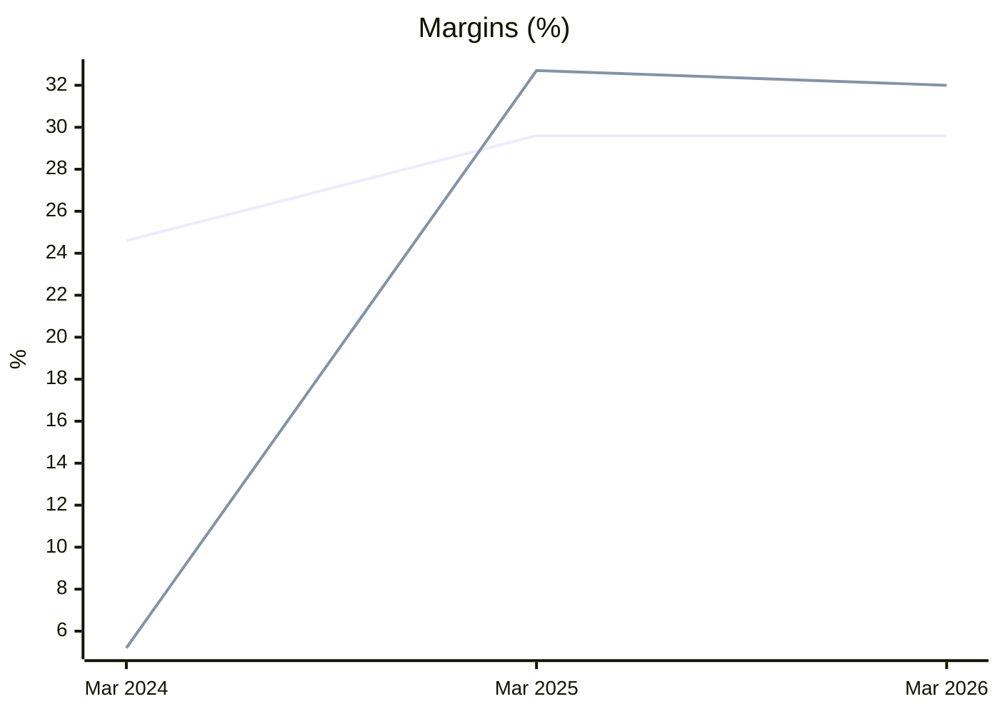

*Run 2026-11-24 · part of [SPINOFF_REPORT.md](../SPINOFF_REPORT.md) · the complete analysis of one company, with every management-call exchange in full.*

## VEDL — Vedanta Ltd.

### 1. Vedanta Ltd. — CONFIRMED DEMERGER

**CONFIRMED** (a demerger scheme is on the exchange record) · **LISTED <1Y — selling-pressure window; the bargain forms here** · score 6.4/10 · spin-off · 41 filing(s) from CALLS, NSE, NSE-register · first 2025-12-16, latest 2026-10-03

**The separated entities — every one the documents name:**

| Entity | Scheme | Business | Listing | Who runs it |
|---|---|---|---|---|
| **Vedanta Aluminium Metal Limited** | 2023 composite scheme of arrangement (Resulting Company 1),… | Aluminum Undertaking / Aluminium Business; also receives the Company's shareholding in Bharat Aluminium Compa… | listed 2026-06-15 as VAML (NSE) | not stated for the entity; Mr. Rajiv Kumar is nam… |
| **Vedanta Power Limited** (earlier Talwandi Sabo Power Limited) | 2023 composite scheme of arrangement (Resulting Company 2),… | Merchant Power Undertaking / Merchant Power Business — generation, transmission and distribution of power, in… | listed 2026-06-15 as VEDPOWER (NSE) | not stated for the entity; Mr. Rajinder Singh Ahu… |
| **Vedanta Oil and Gas Limited** (earlier Malco Energy Limited) | 2023 composite scheme of arrangement (Resulting Company 3),… | Oil and Gas Undertaking / Oil and Gas Business — India's largest private oil and gas exploration and producti… | listed 2026-06-15 as VOGL (NSE) | not stated for the entity; Mr. Jasmin Sahurity is… |
| **Vedanta Iron and Steel Limited** | 2023 composite scheme of arrangement (Resulting Company 4),… | Iron Ore Undertaking / Iron Ore Business; press release describes the entity as Vedanta Iron & Steel (iron or… | listed 2026-06-15 as VISL (NSE) | not stated |
| **Vedanta Property Platforms Limited** | 2026 demerger of the Real Estate Business (Resulting Compan… | Real Estate Business — development, construction, redevelopment, operation, management, leasing and licensing… | not stated | not stated |

**The other parties to the scheme(s)** — not separated entities: Vedanta Base Metals Limited — dropped / withdrawn; Bharat Aluminium Company Limited — merged in — no shares for the parent's holders

**What is being separated, as the documents put it:** Aluminium, Merchant Power (to Talwandi Sabo Power), Oil & Gas and Iron Ore undertakings demerged from Vedanta Limited — class `value_unlocking`.

### 2. Stages and dates

> **Listing:** LISTED — Vedanta Aluminium Metal Limited (VAML) since 2026-06-15; Vedanta Power Limited (VEDPOWER) since 2026-06-15; Vedanta Oil and Gas Limited (VOGL) since 2026-06-15; Vedanta Iron and Steel Limited (VISL) since 2026-06-15 (NSE equity list); record date 2026-05-01; not yet listed: Vedanta Property Platforms Limited

| Date | Event | Source |
|---|---|---|
| 2023-09-29 | Board approval — Vedanta Limited (Demerged Company) — Original Scheme | as stated: NCLT Mumbai order dated 17 October 2025 (filing 2025-10-18); intimati… |
| 2023-10-10 | Board approval — Talwandi Sabo Power Limited (Resulting Company 2) | as stated: NCLT Mumbai order dated 17 October 2025 (filing 2025-10-18) |
| 2023-10-13 | Board approval — Vedanta Aluminium Metal Limited, Malco Energy Limited, Vedanta Iron and Steel Limited and Vedanta Base Metals Limited | as stated: NCLT Mumbai order dated 17 October 2025 (filing 2025-10-18) |
| 2024-07-30 | Exchange no-objection — NSE — observation letter with no objection on the Original Scheme | as stated: Filing 2024-07-31 (intimation on BSE/NSE no-objection letters); NCLT … |
| 2024-07-31 | Stage reached: **exchange noc** | [Updates](https://nsearchives.nseindia.in/corporate/VEDL_31072024162532_VEDLSEIntimationNSEBSELetterforSchemeofDemergersigned.pdf) |
| 2024-07-31 | Exchange no-objection — BSE — observation letter with no adverse observations on the Original Scheme | as stated: Filing 2024-07-31 (intimation on BSE/NSE no-objection letters) |
| 2024-10-15 | Other — Talwandi Sabo Power Limited — first motion application filed with NCLT | as stated: NCLAT order dated 27 May 2025, para 4.4 (filing 2025-05-29) |
| 2024-11-21 | NCLT order — Vedanta Limited and Malco Energy Limited — order convening shareholders'/creditors' meetings and dispensing others | as stated: Filing 2024-11-22 (disclosure on NCLT order dated November 21, 2024) |
| 2024-12-20 | Board approval — Vedanta Limited — approval of modified Scheme, not implementing Part V (Base Metals) | as stated: Filing 2024-12-20 (Demerger — update on Scheme of Demerger) |
| 2024-12-23 | Board approval — Vedanta Base Metals Limited, Vedanta Aluminium Metal Limited, Talwandi Sabo Power Limited, Malco Energy Limited, Vedanta Iron and Steel Limited — modified Scheme | as stated: NCLT Mumbai order dated 17 October 2025 (filing 2025-10-18) |
| 2025-01-17 | Stage reached: **meetings** | [Shareholders meeting](https://nsearchives.nseindia.in/corporate/VEDL_17012025095705_VEDLSEIntimationCCMNotice17Jan2025signed.pdf) |
| 2025-01-17 | Other — Notices of meetings circulated to shareholders and creditors | as stated: Filing 2025-01-17 (Notice of Court Convened General Meeting) |
| 2025-02-18 | Shareholders / creditors meeting — Vedanta Limited — equity shareholders (10:00 a.m.), secured creditors (11:45 a.m.), unsecured creditors (1:30 p.m.); approved with 99.9987% of votes polled in favour by shareholders | as stated: Filings 2025-02-18 (summary of proceedings) and 2025-02-20 (e-voting … |
| 2025-03-04 | Other — Talwandi Sabo Power Limited — NCLT order rejecting the Scheme presented by TSPL in C.A./CAA/MB/220/2024 | as stated: Filing 2025-03-04 (update on company scheme application) |
| 2025-03-28 | Other — All parties — conditions precedent timeline extended from 31 March 2025 to 30 September 2025 | as stated: Filing 2025-03-28 (extension of timelines for fulfilment of condition… |
| 2025-05-27 | Other — Talwandi Sabo Power Limited — NCLAT interim stay on the rejection of the Scheme, against a Rs. 1245 crores bank guarantee | as stated: Filing 2025-05-29 (NCLAT order dated May 27, 2025) |
| 2025-06-03 | Exchange no-objection — BSE and NSE — revised observation letters with "no adverse observations" on the modified Scheme | as stated: NCLT Mumbai order dated 17 October 2025 (filing 2025-10-18) |
| 2025-09-15 | Other — Talwandi Sabo Power Limited — NCLAT order setting aside the NCLT rejection after settlement with SEPCO dated 11 September 2025 | as stated: Filing 2025-09-16 (NCLAT order dated September 15, 2025) |
| 2025-09-30 | Other — All parties — conditions precedent timeline extended from 30 September 2025 to 31 March 2026 | as stated: Filing 2025-09-30 (extension of timelines for fulfilment of condition… |
| 2025-10-17 | NCLT order — Talwandi Sabo Power Limited — first motion order dispensing the equity shareholders' meeting and directing meetings of secured and unsecured creditors within 90 days | as stated: Filing 2025-10-18 (NCLT order dated October 17, 2025) |
| 2025-12-16 | Stage reached: **nclt sanction** | [News Verification](-) |
| 2025-12-16 | NCLT order — Vedanta Limited, VAML, MEL, VISL — NCLT Mumbai order sanctioning the Scheme of Arrangement for the demerger | as stated: Filing 2025-12-16 (update on Scheme of Arrangement) and news clarific… |
| 2026-01-09 | NCLT order — Talwandi Sabo Power Limited — NCLT Mumbai order allowing TSPL's petition and sanctioning the Scheme | as stated: Filing 2026-01-09 (update on C.P./CAA/MB/254/2025) |
| 2026-01-21 | Other — Certified copy of the 16 December 2025 NCLT order received by the Company at around 4:30 p.m. IST | as stated: Filing 2026-01-21 (certified copy of NCLT order) |
| 2026-03-31 | Other — All parties — conditions precedent timeline extended from 31 March 2026 to 30 June 2026 under Clause 39.7 | as stated: Filing 2026-03-31 (extension of timelines for fulfilment of condition… |
| 2026-04-20 | Board approval — Board approved making the Scheme effective on 1 May 2026, fixed 1 May 2026 as record date, and approved transfer of the Company's BALCO shareholding to VAML | as stated: Filing 2026-04-20 (Record Date disclosure under Regulations 30 and 42) |
| 2026-04-30 | Other — Bharat Aluminium Company Limited — share sale agreement between the Company and VAML "likely to be signed on or before April 30, 2026"; expected date of completion "On or before April 30, 2026" | as stated: Filing 2026-04-20 (Annexure A) |
| 2026-05-01 | **Record date** | NSE corporate-actions register |
| 2026-05-01 | Stage reached: **record date** | Record Date (corporate-actions register) |
| 2026-05-01 | Appointed date — All parties — "the Effective Date will also be the Appointed Date i.e. May 01, 2026" | as stated: Filing 2026-05-16 (apportionment of cost of acquisition) |
| 2026-05-01 | Effective date — All parties — "The Scheme has come into effect on May 01, 2026, being the Effective Date" | as stated: Filing 2026-05-16 (apportionment of cost of acquisition); filing 2026… |
| 2026-05-01 | Record date — Vedanta Limited equity shareholders, and debenture holders of ISINs INE205A07196, INE205A07220, INE205A08038 and INE205A08020 whose NCDs transfer to VAML | as stated: Filing 2026-04-20 (Record date fixed as May 01, 2026) |
| 2026-06-15 | **Vedanta Aluminium Metal Limited** listed (VAML) | NSE equity list |
| 2026-06-15 | **Vedanta Power Limited** listed (VEDPOWER) | NSE equity list |
| 2026-06-15 | **Vedanta Oil and Gas Limited** listed (VOGL) | NSE equity list |
| 2026-06-15 | **Vedanta Iron and Steel Limited** listed (VISL) | NSE equity list |
| 2026-06-15 | Listing and trading — Vedanta Aluminium Metal Limited (VAML), Vedanta Power Limited (VEDPOWER), Vedanta Iron and Steel Limited (VISL), Vedanta Oil and Gas Limited (VOGL) — "4 new entities listed on NSE & BSE on 15th June" | as stated: Q1FY27 investor presentation, 30 July 2026; NSE equity list |
| 2026-07-30 | Stage reached: **announced** | [Press Release](https://nsearchives.nseindia.com/corporate/VEDL_30072026151113_VEDLSEIntimationPressReleaseIRPPTfinalsigned.pdf) |
| 2026-07-30 | Board approval — Vedanta Property Platforms Limited — Board approved the draft Scheme for demerger of the Real Estate Business; the Company "shall apply to the BSE Limited and National Stock Exchange of India Limited, in due course" for no-objection letters | as stated: Filing 2026-07-30 (Scheme of Arrangement — demerger of Real Estate Bu… |

**The stages, as filed:** exchange noc (2024-07-31) → meetings (2025-01-17) → nclt sanction (2025-12-16) → record date (2026-05-01) → announced (2026-07-30)

**Stated in the filings:** resulting company **Talwandi Sabo Power Limited**; record date 2026-05-01; pro-forma statements referenced; size hint: 11% of ebitda.

**When it lists, in the documents' words:** On 29 April 2026: 'The effective and record date is set for May 1st… The shares of the resulting companies are expected to list and commence trading by mid-June.' On 30 July 2026: '4 new entities listed on NSE & BSE on 15th June'; consolidated share value ₹932.05 'on listing date (15th June 2026)'.

### 3. Size of the separated business beside the parent — is institutional selling likely?

**Reading: BY ENTITY — Vedanta Aluminium Metal Limited: less likely on size alone (51.9% of the whole, by market value); Vedanta Power Limited: very likely (4.8% of the whole, by market value); Vedanta Oil and Gas Limited: very likely (4.2% of the whole, by market value); Vedanta Iron and Steel Limited: very likely (3.6% of the whole, by market value); Vedanta Property Platforms Limited: very likely (0.001% of the whole, share of turnover).**

| Entity | Stated turnover | Stated share of the whole | Market cap (₹ cr) | Share of the whole by market cap | Segment revenue share | Index member | Selling on size |
|---|---|---:|---:|---:|---:|---|---|
| Vedanta Aluminium Metal Limited | not stated for the undertaking (Aluminium segment FY26 EBIT… | 7.15% (cost-of-acquisition split) | 148,517 | 51.9% | 83.9% (FY2026) | no | less likely |
| Vedanta Power Limited | not stated for the undertaking (FY26 power sales grew 30% Y… | 12.23% (cost-of-acquisition split) | 13,655 | 4.8% | 11.3% (FY2026) | no | very likely |
| Vedanta Oil and Gas Limited | not stated for the undertaking (FY26 average gross operated… | 21.49% (cost-of-acquisition split) | 12,071 | 4.2% | 12.2% (FY2026) | no | very likely |
| Vedanta Iron and Steel Limited | not stated for the undertaking (FY26: iron ore production 6… | 6.79% (cost-of-acquisition split) | 10,300 | 3.6% | 17.5% (FY2026) | no | very likely |
| Vedanta Property Platforms Limited | INR 1.26 crore for the year ended March 31, 2026 (turnover … | 0.001% (share of turnover) | — | — | — | not listed | very likely |

*Stated figures are the documents' own (a turnover share, or the cost-of-acquisition split the company publishes for tax, which reflects relative value). The market-cap share is the entity's value over the whole — the parent plus every separated entity that trades (parent ₹101,545 cr, whole ₹286,088 cr, NSE bhavcopy of 2026-11-13); the segment share is the business's revenue over the parent's reported sales of that year. Both are computed here. The reading uses the market-cap share when the entity trades, else the stated share, else the segment share.*

**In the documents' words:** “2023/2026 composite demerger — "For the purpose of determining post-demerger cost of acquisition of the Equity Shares of the Company and the Resulting Companies, shareholders may apportion their total cost of acquisition of the Company in the following manner: 1 Vedanta Limited 52.34% | 2 Vedanta Aluminium Metal Limited 7.15% | 3 Talwandi Sabo Power Limited 12.23% | 4 Malco Energy Limited 21.49% | 5 Vedanta Iron and Steel Limited 6.79%" and "The aforesaid ratio has been determined based on the net worth of the Company and the net assets of the Aluminum Undertaking, Merchant Power Undertaking, Oil and Gas Undertaking, and Iron Ore Undertaking, in accordance with Sections 73 of the Income-tax, Act, 2025." Post-listing: "Combined market cap of all Demerger resulting companies grew by over ₹ 71k crore in Q1". 2026 real estate demerger — "The turnover (including other operating income) of the Demerged Undertaking for the year ended March 31, 2026 was INR 1.26 crore representing 0.001 % of the total standalone turnover of Vedanta Limited for the year ended March 31, 2026."”

**The judge's read of selling pressure:** likely — Power entity is small (12.23% cost apportionment, ~4.7x pro-forma leverage) and a different industry from the metals parent; shares pushed 1:1 to all holders.

### 4. Insider ownership — share swap, promoters' holding, management incentives

**Share swap / entitlement, entity by entity:**

- **Vedanta Aluminium Metal Limited:** 1 (One) fully paid-up equity share of VAML having a face value of INR 1 (Rupee One) each for every 1 (One) fully paid-up equity share of INR 1 (Rupees One) each of the Company.
- **Vedanta Power Limited:** 1 (One) fully paid-up equity share of TSPL having face value of INR 10 (Indian Rupees Ten) each for every 1 (one) fully paid-up equity share of INR 1 (Indian Rupee One) each of the Company.
- **Vedanta Oil and Gas Limited:** 1 (One) fully paid-up equity share of MEL having face value of INR 1 (Indian Rupee One) each for every 1 (one) fully paid-up equity share of INR 1 (Indian Rupee One) each of the Company.
- **Vedanta Iron and Steel Limited:** 1 (One) fully paid-up equity share of VISL having face value of INR 1 (Indian Rupee One) each for every 1 (one) fully paid-up equity share of INR 1 (Indian Rupee One) each of the Company.

**Promoters' holding, from the shareholding pattern:**

| Company | Promoters | FIIs | DIIs | Public | Quarter |
|---|---:|---:|---:|---:|---|
| Vedanta Ltd. (VEDL) | 54.72% | 15.78% | 10.69% | 18.58% | Sep 2026 |
| Vedanta Aluminium Metal Limited (VAML) | 56.38% | 11.04% | 15.35% | 17.0% | Sep 2026 |
| Vedanta Power Limited (VEDPOWER) | 56.38% | 6.8% | 10.71% | 25.88% | Sep 2026 |
| Vedanta Oil and Gas Limited (VOGL) | 56.38% | 5.45% | 5.93% | 32.01% | Sep 2026 |
| Vedanta Iron and Steel Limited (VISL) | 56.38% | 4.11% | 9.24% | 30.03% | Sep 2026 |

*Source: screener.in shareholding pattern, stored under `ShareholdingPattern/NiftyTotalMarket/`. In a mirror demerger each shareholder holds the same proportion of the new company as of the parent on the record date.*

- **Promoters in the parent, per the documents:** 54.72% — "Vedanta Resources Ltd (through its subsidiaries)" as on 30 June 2026 (Q1FY27 investor presentation entity structure). Per the 15 May 2026 Regulation 30A disclosure: Twin Star Holdings Ltd "holding 40.02% shares in Vedanta Limited", Vedanta Holdings Mauritius II Limited "holding 12.60% shares in Vedanta Limited", Welter Trading Limited "holding 0.98% shares in Vedanta Limited"; Vedanta Resources Limited is "classified as a member of the promoter group of Vedanta Limited, with no direct shareholding in Vedanta Limited". At the 18 February 2025 court-convened meeting the Promoter and Promoter Group held 2,204,867,749 of 3,910,388,057 shares (record date 11 February 2025).
- **What the promoters will hold in the separated entity:** 2023/2026 composite demerger: "Post demerger, every Vedanta shareholder - both retail and institutional - will receive one new share in each of the newly demerged companies. Other than this, there will be no change in the overall shareholding structure." And: "The shareholders will continue to enjoy value unlocking of the Vedanta Base Metals business as part of legacy residual Vedanta where they will remain shareholders in addition to receiving equivalent shares in other resulting companies which will mirror Vedanta shareholding." 2026 real estate demerger: not stated.
- **What a public shareholder receives:** 2023/2026 composite demerger: "In accordance with provisions of the Scheme, Resulting Companies issued and allotted 1 (One) fully paid-up equity share of each Resulting Companies for every 1 (One) fully paid-up equity share held in the Company, to the shareholders of the Company whose names are recorded in the register of members and / or records of the depository as on the Record Date (i.e., May 01, 2026)." Also: "Shareholders of Vedanta Limited will receive equity shares in each of the four resulting listed entities (in addition to their shareholding in Vedanta Limited) in proportion to their existing holdings, ensuring continuity of ownership while enabling direct participation in the growth trajectories of individual businesses." And: "Shareholders holding one share of Vedanta as on 29th April, today, will receive four additional shares of the resulting companies." 2026 real estate demerger: not stated (consideration is a "Share Entitlement Ratio" defined in the Scheme, value not disclosed).
- **Management incentives:** not stated in the documents on file.
- **Insider actions around the separation:** Promoter group borrowing secured on Vedanta Limited shares: Vedanta Resources Limited (borrower) with Twin Star Holdings Ltd, Vedanta Holdings Mauritius II Limited and Welter Trading Limited as guarantors entered a facility agreement dated 30 January 2026, amended and restated on 13 May 2026 and upsized "from up to US$ 350,000,000 to US$ 600,000,000"; "Encumbrances have been created over the shares of Vedanta Limited, in terms of the Amended Facility Agreement and related finance documents, and such encumbrance(s) have been disclosed in the form and manner specified under the Securities and Exchange Board of India (Substantial Acquisition of Shares and Takeovers) Regulations, 2011", with disclosures made under Regulations 29(1) and 31 of the Takeover Regulations. Company-level selling around the separation: on 18 June 2025 Vedanta sold 66.7 million Hindustan Zinc shares (c. 1.6%) for c. INR 3,028 Cr — "As we actively progress towards the demerger of Vedanta into sector focused entities across diverse verticals, this capital raise will help de-leverage the balance sheet and enhance financial flexibility"; a further Zinc India offer-for-sale was launched on 27 January 2026 (about 1.1%, c. Rs.3,000 crore) with "the entire amount will be used for de-leveraging", taking the holding to around 60.7% from 61.8%. Also disclosed: "As part of demerger proceedings, a full and final settlement of Rs. 660 Cr has been done with SEPCO"; and a corporate guarantee from Vedanta covering the MoPNG/DGH alleged claims so they do not sit on the demerged oil and gas entity.
- **Insiders, per the checklist read:** Shares issued 1:1 pro-rata, so promoter Vedanta Resources' 56.38% VEDL stake (54.72% at June 2026) is mirrored; promoter-group VEDL shares encumbered under VRL's amended facility agreement; later scheme states no special promoter benefit. · *option pricing date:* not stated

### 5. Why the demerger — point by point

Management presented the separation as the heart of "Vedanta 2.0": dismantling one diversified holding company into five sector-specific pure-play entities — Vedanta Aluminium Metal Ltd, Vedanta Power (renamed from Talwandi Sabo Power), Vedanta Oil & Gas (renamed from Malco Energy), Vedanta Iron & Steel Ltd, and a residual Vedanta Limited holding Zinc India (60.71% of HZL), Zinc International, Copper (Silvassa/Fujairah/KSA), FACOR ferrochrome and nickel/semiconductor assets — on the stated logic that each would "chart out their own growth trajectory and attract respective thematic investors," with sharper accountability and separate dividend policies set by five independent boards. The first problem they said it solves is valuation: one monolithic entity buried the parts, and after listing on 15 June 2026 the company itself claimed the combined value of VEDL plus the four new shares went from ₹225.50 at announcement (29 Sep 2023) to ₹932.05, ">300% upside". The second is capital structure: the ~$5.5bn group net debt (earlier quoted as $6.7bn) was re-architected "aligning debt with earning strength and growth stage of each resulting company" — ~$3.5bn to Aluminium (1.3x EBITDA), Power at 4.7x but on long-dated 7–10 year PFC/REC paper, residual Vedanta Ltd ~$1bn at 0.4x, and Oil & Gas nil / Iron & Steel ≤$0.2bn net debt — against group leverage of 0.95x. Third, it removed rigid cash rules: the prescriptive policy requiring at least 30% of profit as dividend and upstreaming of Hindustan Zinc dividends within six months became "principle-based," giving each board flexibility. Fourth, it repriced intra-group charges: copper's brand fee falls from 3% to 0.75% (~$65mn on $3.1–3.2bn revenue, +2.25% EBITDA), which management expects to lift that near-trading business from ~1% to at least 5% margin in FY27, while the blended group brand fee stays ~$400–450mn and the 3% rate stands to FY29. Fifth, it opens dedicated capital pools — "differentiated capital structure" means "many anchor investors domestically and globally are very keen to come in the cap table," an extra deleveraging avenue for Vedanta Resources' remaining ~$4.7bn debt serviced out of ~$400mn brand fee plus 4–5% dividend. Third parties shaped it: lenders made debt allocation "a precondition for granting NOC"; the Ministry of Petroleum and Natural Gas objected at NCLT over disputed Cairn arbitration dues (~$512mn) and was satisfied only by a Vedanta corporate guarantee ring-fencing the demerged oil & gas entity; and a ₹660 crore full-and-final SEPCO settlement was booked as an exceptional item "paving the way for a proposed demerger process." A second, separate demerger followed on 30 July 2026: ~2,264 acres and ~53,185 sq ft across 22 non-core real estate assets (FY26 turnover ₹1.26 crore, 0.001% of standalone revenue) go to Vedanta Property Platforms Ltd at 1 share per 20 VEDL shares, because the portfolio sat "embedded within the operating business" with "sub-optimal visibility" and a claimed ₹30,000 crore+ of latent value.

**Point by point, with the source:**

1. Ajay Goel positioned the demerger purely as value unlock while it was at the shareholder/creditor-approval stage, with the meeting scheduled for 18 February 2025. “This transformative step is poised to unlock significant value for our investors.” — *[Feb 2025](https://www.vedantalimited.com/uploads/investor-overview/financial-results/VedantaEarnings-transcript-Jan31-2025.pdf)*
2. Naidoo, in her first call as Group CEO, tied the demerger to the "Vedanta 2.0" ambition of a $100 billion critical minerals, energy and technology powerhouse, with completion then guided for September 2025. “We are making good progress with our demerger plan, aiming to create pure-play entities that will enhance strategic focus and operational flexibility.” — *[Apr 2025](https://www.vedantalimited.com/uploads/investor-overview/financial-results/Vedanta-CallTranscript-Apr30-2025_v2.pdf)*
3. An investor (Ashish Kejriwal) flagged that mining leases for the Sijimali bauxite and coal blocks had to be transferred to Vedanta Aluminium before the split could close; management confirmed a parallel approvals plan. “But the team has a detailed approvals plan, including all of the mining licenses that will start being approved, in fact, have already started the process.” — *[Apr 2025](https://www.vedantalimited.com/uploads/investor-overview/financial-results/Vedanta-CallTranscript-Apr30-2025_v2.pdf)*
4. Delays were attributed to two external forums — the NCLT second-motion hearing and an NCLAT stay on the TSPL power order — yet the split was named a top corporate priority. “The execution of the demerger remains a top priority for Vedanta.” — *[Aug 2025](https://www.vedantalimited.com/uploads/investor-overview/financial-results/2026/Vedanta_Transcript_Jul31_2025.pdf)*
5. The Ministry of Petroleum and Natural Gas, a key counterparty in the oil and gas business, objected at NCLT that the demerged Cairn entity might not be able to pay disputed arbitration dues. “And in the last NCLT hearing, they did express concern about the payments of any of the disputed dues that may become payable by Cairn in case the ongoing arbitration ruling, as we have all learned now, comes in their favor.” — *[Aug 2025](https://www.vedantalimited.com/uploads/investor-overview/financial-results/2026/Vedanta_Transcript_Jul31_2025.pdf)*
6. A long-standing creditor dispute was bought out with a ₹660 crore exceptional charge explicitly to clear the demerger path; MoPNG's objection was neutralised by a Vedanta corporate guarantee covering the full extent of the alleged claims (~$520mn). “As part of demerger proceedings, a full and final settlement of Rs. 660 Cr has been done with SEPCO, thereby resolving a long-standing dispute, paving the way for a proposed demerger process.” — *[Nov 2025](https://www.vedantalimited.com/uploads/investor-overview/financial-results/2026/VEDL_Q2FY26_Transcript.pdf)*
7. Goel framed the end state as five separately valued verticals and listed all five demerged entities for the end of FY26, ahead of the final NCLT hearing on 12 November. “On the demerger, we are at the final stage. We remain confident of completing our demerger by end of this fiscal, unlocking focused value across our five verticals.” — *[Nov 2025](https://www.vedantalimited.com/uploads/investor-overview/financial-results/2026/VEDL_Q2FY26_Transcript.pdf)*
8. With NCLT approval in hand (16 Dec 2025 for four businesses, 9 Jan 2026 for power), Naidoo gave the fullest statement of purpose — strategy focus, balance-sheet strength and growth — and targeted 1 April as effective date. “This marks a defining moment in our journey, one that empowers our businesses to sharpen the strategies, strengthen the balance sheets and accelerate growth with the aim of unlocking shareholder value.” — *[Jan 2026](https://www.vedantalimited.com/uploads/investor-overview/financial-results/2026/Transcript_29Jan2026.pdf)*
9. Lenders were an active party: debt allocation across entities had to be agreed with bankers before they would release no-objection certificates, with the $6.7bn consolidated net debt apportioned by assets and each entity's debt-servicing capability. “When we went to the banker seeking NOC, in that case, debt allocation was broadly aligned with the bankers as a precondition for granting NOC for demerger approval.” — *[Jan 2026](https://www.vedantalimited.com/uploads/investor-overview/financial-results/2026/Transcript_29Jan2026.pdf)*
10. Goel also framed the restructuring as a tax and structuring opportunity (accumulated losses, unabsorbed depreciation) and said it would be used to make oil and gas and iron and steel debt-free, part-funded by a 1.1% HZL OFS worth ~₹3,000 crore. “One thing I can confirm to the entire audience and to the stakeholders at large, that demerger in fact, becomes an opportunity across the areas.” — *[Jan 2026](https://www.vedantalimited.com/uploads/investor-overview/financial-results/2026/Transcript_29Jan2026.pdf)*
11. The power CEO used the demerger to justify a standalone growth mandate: from 4.2 GW today to ~4.8 GW by H1FY27 and a plan for an additional 10–12 GW over five to seven years. “And as we demerge, we really want to be a growth company and ride the India's growth story on energy.” — *[Jan 2026](https://www.vedantalimited.com/uploads/investor-overview/financial-results/2026/Transcript_29Jan2026.pdf)*
12. On the final pre-demerger call Goel set out the structural logic: five pure-plays, each attracting its own investor base, effective 1 May 2026 with one VEDL share earning four additional shares and trading expected by mid-June. “This will entail creation of five independent sector-specific pure-play companies, allowing each company to chart out their own growth trajectory and attract respective thematic investors.” — *[Apr 2026](https://www.vedantalimited.com/uploads/investor-overview/financial-results/2026/Vedanta-Transcript-Apr29-2026.pdf)*
13. Capital structure was deliberately engineered per entity — Oil & Gas nil debt, Iron & Steel ≤$0.2bn, Aluminium ~$3.5bn at 1.3x, Power 4.7x on 7–10 year PFC/REC maturities, Vedanta Ltd ~$1bn at 0.4x — against group leverage of 0.95x. “The de-merger has been architected with precision on capital structure, aligning debt with earning strength and growth stage of each resulting company.” — *[Apr 2026](https://www.vedantalimited.com/uploads/investor-overview/financial-results/2026/Vedanta-Transcript-Apr29-2026.pdf)*
14. The split removed prescriptive cash rules: the mandatory 30% profit payout and the six-month Hindustan Zinc dividend upstreaming requirement give way to board discretion at each of the five companies. “Currently, Vedanta's policy on dividend is more prescriptive; it will become more descriptive.” — *[Apr 2026](https://www.vedantalimited.com/uploads/investor-overview/financial-results/2026/Vedanta-Transcript-Apr29-2026.pdf)*
15. Unbundling also repriced the brand fee for the thin-margin copper business, which management expects to lift copper margins from ~1% to at least 5% in FY27 (~$65mn benefit), while blended group brand fee stays flat and the 3% rate holds to FY29. “So the brand fee for copper from the current 3% will go down to 0.75% and that alone from India's viewpoint means higher EBITDA by 2.25%.” — *[Apr 2026](https://www.vedantalimited.com/uploads/investor-overview/financial-results/2026/Vedanta-Transcript-Apr29-2026.pdf)*
16. Separate cap tables were pitched as a new deleveraging channel for Vedanta Resources, which still carries $4.7bn of debt against ~$400mn brand fee plus a 4–5% dividend. “Now as we de-merge all the five companies, additionally we'll have the optionality of a differentiated capital structure and in that case, many anchor investors domestically and globally are very keen to come in the cap table, and that will be additional avenue for de-leveraging.” — *[Apr 2026](https://www.vedantalimited.com/uploads/investor-overview/financial-results/2026/Vedanta-Transcript-Apr29-2026.pdf)*
17. Asked whether the entities could still acquire outside their sector, Naidoo said business CEOs are mandated to grow organically on their own 2x/3x plans while cross-sector M&A sits at a holdco with its own team and the Chairman. “Holdco will be set up to make sure there is some visibility of capital allocation across all 5 businesses, but also with its own M&A team to start looking at some of these opportunities.” — *[Apr 2026](https://www.vedantalimited.com/uploads/investor-overview/financial-results/2026/Vedanta-Transcript-Apr29-2026.pdf)*
18. The 30 July 2026 real-estate scheme (VEDL into Vedanta Property Platforms Ltd, 1 share for every 20) rests on the claim that ~2,264 acres and ~53,185 sq ft across 22 assets were trapped inside the operating business — FY26 turnover of just ₹1.26 crore, 0.001% of standalone revenue — with a claimed ₹30,000 crore+ of latent value. “The real estate business is currently embedded within the operating business and the real estate portfolio has been historically subject to limited focused utilisation, resulting in sub-optimal visibility of the real estate business segment and value realization.” — *Scheme*
19. The stated benefits mirror the five-way split — dedicated management and governance, sector-specific investors, lenders and strategic partners, and separate financial disclosure enabling clearer valuation; VPPL may also absorb real estate from Meenakshi Energy and Incab Industries. “enabling focused and sharper capital market access and thereby unlocking the value of the Demerged Undertaking and creating enhanced value for shareholders.” — *Scheme*

**How it evolved:** By the Feb 2025 (Q3FY25) call the scheme was already in execution with shareholder/creditor meetings set for 18 Feb 2025, and in Apr 2025 (Q4FY25) new Group CEO Deshnee Naidoo folded it into "Vedanta 2.0" with completion guided for September 2025. It then slipped repeatedly through regulatory friction: Aug 2025 (Q1FY26) disclosed the NCLT second-motion part-hearing of 2 July with the next date 20 August, an NCLAT interim stay on the TSPL power order (₹1,248 crore bank guarantee posted) and MoPNG objections; Nov 2025 (Q2FY26) set final hearing for 12 November, settled SEPCO for ₹660 crore and gave MoPNG a Vedanta corporate guarantee; Jan 2026 (Q3FY26) reported NCLT approval on 16 Dec 2025 for four businesses and 9 Jan 2026 for power, Ind AS 105 discontinued-operations accounting, and a 1 April effective-date target. Apr 2026 (Q4FY26) was the final pre-demerger call: effective and record date 1 May 2026, one VEDL share earning four additional shares, listing by mid-June, plus newly disclosed mechanics — the copper brand-fee cut, the principle-based dividend policy and holdco-level M&A. After listing, the 30 July 2026 board meeting opened a further leg by approving the real-estate demerger into VPPL, targeted for completion in FY28.

**What management expects from it:** Each pure-play sets its own strategy, dividend policy and capital structure: Aluminium 1.3x levered on strong cash flow, Power a 10–12 GW growth story, Oil & Gas and Iron & Steel debt-free, residual Vedanta Ltd 0.4x with HZL dividends optional and copper margins rising 1%-to-5% on a 0.75% brand fee. Thematic investors and anchor capital per cap table; simpler structures, sharper accountability, value unlock (claimed >300%).

*Not explained on the calls:* No explanation of why these five groupings, no SOTP targets, separation costs, dis-synergies, duplicated corporate overhead, or who originally proposed the split.

- *Stated reason, in one line:* Creation of five independent sector-specific pure-play companies, allowing each to chart its own growth trajectory and attract thematic investors; 'simpler structures, sharper accountability, and focused platforms to drive growth and value creation.'
- *What it reveals:* Separation exposes Zinc India's 56-57% margins and residual VEDL at 0.30x net debt/EBITDA with AA+ upgrade, versus Vedanta Power's 4.7x pro-forma leverage; combined market cap of resulting companies grew over ₹71,000 crore in Q1FY27.
- *Parent or spin:* parent · *Read next:* Vedanta Power Limited's own first standalone results/production release — TSPL plant availability, Athena restart and its 4.7x leverage
- *In their words:* “The Scheme has come into effect on May 01, 2026, being the Effective Date (as defined under the Scheme).”

### 6. On the calls, verbatim

10 call(s), oldest first: **24 question-and-answer exchange(s)** given in full — the question and every answer to it, nothing trimmed — and 29 passage(s) from management's prepared remarks (the complete sentences about it; the whole remarks are in the linked transcript). Text is as the transcript prints it.

#### Nov 2023 — [transcript](https://www.vedantalimited.com/uploads/investor-overview/financial-results/Transcript_VEDL_Earnings_Call_2QFY24.pdf)

**From the prepared remarks** *(the passage about it; the whole turn runs to 1,059 characters in the transcript)*

> **Arun Misra:** Thank you all for joining the call today. The second quarter was defining in terms of strategic direction for Vedanta and its subsidiaries. Vedanta's Board approved the proposal to demerge the business into six independent listed entities, each one capable of executing its individual business strategies. The decision is a significant step forward in its journey of sustainable growth and greater shareholder value. The demerger would create six incredibly competitive, nimble and focused enterprises. We have filed the scheme of demerger with the stock exchang e in October 2023 and are working on next steps as we speak. We exited the second quarter with strong financial results. We delivered the highest ever second quarter consolidated revenue of INR38,546 crores, up 16% quarter -on-quarter. We have also delivered highest ever second quarter EBITDA of INR11,834 crores, up 70% quarter -on-quarter and a strong margin of 35% and PAT before exceptional items of INR4,403 crores, up approximately 3x quarter -on-quarter. Vedanta Limited November 04, 2023

**From the prepared remarks** *(the passage about it; the whole turn runs to 2,217 characters in the transcript)*

> **Ajay Goel:** Thank you, Arun, and good evening, everyone. I'm very happy to come back to Vedanta. Such a critical time as we embark on our journey of demerger and unlock significant value for shareholders. At the same time, we also reorient ourselves towards next phase of organic growth. During second quarter, the commodity prices remain under pressure, mainly due to out -shipping of supply as compared to demand growth. The global economy has slowed down, compared to last year with growing regional divergences.

**From the prepared remarks** *(the passage about it; the whole turn runs to 1,759 characters in the transcript)*

> **Sensitivity:** Public (C4) Moving on to next page on balance sheet and debt. Net debt as on September 30 th, stands at INR57,771 crores as against INR59,192 crores as on last quarter. The net debt decreased overall majorly due to strong cash from operations and partly offset by working capital build -up and allocation of funds towards capex and returning money t o our shareholders. Our leverage ratio, which is net debt to EBITDA, stood at 1.64x, compared to 1.88x in the previous quarter. We finished the quarter with healthy cash and cash equivalents of INR1 6,702 crores. Our average maturity of debt is maintained at about three years with average cost of borrowings at about 9%. This quarter, we also transitioned to new tax regime for Vedanta Limited, a simpler tax structure starting FY '23, which is the last year. Adoption of new tax regime has resulted in onetime net MAT write -off of INR6,128 crores, but we had a net cash tax savings of INR2,040 crores for fiscal y ear 2022 and 23 from the same. The cash tax in future years will also be lower under new regime. The scheme allows companies to lower tax outgo and redeploy the same on operations, growth and shareholder value creation. A quick word on demerger. We have filed the scheme of demerger with the stock exchanges in October '23, and we are progressing well on our plan. Finally, in conclusion, the risk to the outlook are now far more balanced than they were six months ago, with the operating environment stabilizing. We remain committed to the cost and production guidance at the beginning of fiscal year 2024 and we're maki ng good progress towards our long -term goals of vertical integration, operational excellence and deleveraging. With this, I now hand over to operator for Q&A. Thank you.

#### Jan 2024

**From the prepared remarks** *(the passage about it; the whole turn runs to 2,261 characters in the transcript)*

> **Sensitivity:** On liability management, I'm very happy to inform you that our liability management exercise at HoldCo Vedanta resources has been successful, resulting in a structural improvement in the overall capital structure as a group. As a result, our liquidity posi tion has greatly strengthened. We are now in even more comfortable position to manage our existing debt and take long -term monetary decisions. A quick word on demerger. The stock exchange has given their NOC for the demerger scheme to SEBI. Currently, we are awaiting SEBI's NOC. Concurrently, we're in talks with creditors for debt allocations. Once SEBI's NOC is secured, the scheme will be submit ted to NCLT for an order to conduct members and creditors meeting. […] Additionally, we are steadi ly progressing toward achieving our long -term objectives of vertical integration, operational excellence and deleveraging. Vedanta remains a growth -focused company. And there are additional avenues around the electronics business. Further, with our ongoing value unlocking exerci se, that is demerger, it will have portfolio of 17 pure -play companies that will enable to create substantial value, not only in the present, but also in coming years. With this, I now hand over the mic to Mr. Akarsh Hebbar .

**From the prepared remarks** *(the passage about it; the whole turn runs to 1,607 characters in the transcript)*

> **Vibhav Agarwal:** Thanks, Chris. Good evening, ladies and gentlemen. I'm Vibhav Agarwal. Having spent more than 2 decades in power sector, now I'm spearheading Power Vertical of Vedanta Group as Chief Executive Officer. Vedanta is known to have world -class assets in its por tfolio and power is no exception. We follow industry's best practices, create benchmarks with utmost importance governance and nation building at our core. As you know, India's GDP and power demand are set to double by 2030 by government's estimates, creating a huge opportunity for Vedanta, a thermal power generator to fuel the Indian economy. While there is a strong focus on RE, that is renewable energy, it is crucial to acknowledge that thermal power generation will continue to remain an integral part of India in the energy mix. It is there where Vedanta's core business lies and where it aims to be. Vedanta's Power Vertical is going to operationalize 2 new thermal power plants, one in Athena, which is 1,200 MW in Chhattisgarh, and the other one is Meenakshi Energy, which is 1,000 MW in Andhra Pradesh totalling to 2,200 MW, which together with our existing capacity would take our overall portfolio to nearly 5 gigawatts. With a mixed bag of long -term power uptake contracts and open capacity for sale of power on short -term and medium -term contracts, Vedanta Power will have a stable cash flow with a heavy margin and a very strong balance sheet. Ultimately, we are committed to deliver value and returns to our investors, shareholders in a sustainable manner while continuing to fulfill the power security of our nation. Thank you.

#### Aug 2024 — [transcript](https://www.vedantalimited.com/uploads/investor-overview/financial-results/call-transcript-fy2025.pdf)

**From the prepared remarks** *(the passage about it; the whole turn runs to 3,161 characters in the transcript)*

> **Sensitivity:** Our leadership extends beyond operational excellence. We are also leading in sustainability. Our company was ranked third in the S&P Global Corporate Sustainability Assessment. Our subsidiary, Hindustan Zinc, ranked first in the metals and mining peer group, and Vedanta Aluminium ranked first among global aluminium peers. This is a true reflection of our commitment to building a stronger Vedanta together. Our assets are also quite unparalleled, right? And if you look at other assets or other large manufacturing businesses in the country, cement, steel, they can be invested and created, but most of our assets now cannot be replicated.

**From the prepared remarks** *(the passage about it; the whole turn runs to 1,590 characters in the transcript)*

> **Sensitivity:** Internal (C3) At FACOR ferro chrome , we have already doubled our production since acquisition and we are now on track to become India's largest ferro alloys producers with 500 KTPA capacity, a threefold increase in production from where we are now. Moving on to some strategic i nputs, demerger, you would have heard that our game changing, strategic demerger is now a reality. As you may be aware, we have already filed the demerger scheme application with NCLT. And therefore, we are in the final stage of creating industry - leading focused entities with sharper investment propositions. On management and leadership, we have a strong line of global leadership team who are ready to lead these large, high -quality businesses with 100 -plus expats and experienced specialists and of course, a very vibrant young leadership team, w e are ready to unlock the largest shareholder value. And in conclusion, finally, while we can look back with pride on our accomplishments and initiatives at Vedanta, we remain firmly focused on the exciting road ahead for us . FY'25 will be a transformative year for us on many fronts, as we prioritize disciplined growth, operational excellence and ex ploring opportunities along the value chain. Our strategy is clear, our foundation is solid and our team is energized to capitalize on the tremendous growth potential and prospects that lie before us. We thank you for your continued support and confidence in our journey and in our story. Thank you very much, and we look forward to engaging with you in the Q&A session. But for now, over to you, Arun.

**From the prepared remarks** *(the passage about it; the whole turn runs to 2,085 characters in the transcript)*

> **Sensitivity:** Across our portfolio, we'll also add about 10% additional capacity by aggressive debottlenecking efforts and asset optimization. These strategic initiatives, combined with our continued focus on cost reduction, that too very, very structural and operational excellence , will drive significant growth and value creation. In conclusion, FY'25 is going to be a landmark year for our company as we achieve new high steel production , revenue and profitability. The strategic demerger presents a unique opportunity and is on track to create industry -leading focus sed entities and sharper investment propositions. Vedanta is well positioned to capitalize on emerging opportunities and deliver sustained value to our shareholders and stakeholders. With this, I hand over to Ajay Goel.

**From the prepared remarks** *(the passage about it; the whole turn runs to 2,091 characters in the transcript)*

> **Sensitivity:** Against this, we have achieved a reduction of 650 million in the first quarter itself. The closing debt at VRL now stands at 5.5 billion. Also, S&P Global has augmented various rating to B-, citing improved capital structure and liquidity, while assigning a stable outlook. On demerger, we have filed the scheme with NCLT. This is a significant milestone towards unlocking the value for all our stakeholders. In conclusion, I reaffirm our commitment to full year guidance and will continue on our current momentum forward. Our transformative cost optimization across our portfolio will continue to deliver results.

**Question and answer**

> **Ashish Kejriwal:** Yes. So with that obviously how much weighted average cost of debt we think should come down from the current l evel of something like 10 plus. That's one. Second was because we have already filed with NCLT regarding this demerger. So are we seeing any bottlenecks from the regulatory side or is there any possibility that we can go back from this now or it will be definitely be a done deal? That's my second thing. And third was, is it possible to share what would be the global alumin ium cost curve for us so that we can get a sense on where we are in alumin ium prices? Vice -chairman : Thanks, Ashish. So we'll answer your question first on the NCLT demerger. In our mind, having been filed with NCLT which is the last process in a way we think that this is for us a final step. But Ajay Agarwal if you're on, do you want to respond in any other way to Ashish?
>
> **Ajay Agarwal:** Yes, Vice Chairman. And I think you have covered it. NCLT is the last process and we have successfully filed it and it's a matter of time that it will get done, Ashish. Vedanta Limited August 06, 202 4
>
> **Sensitivity:** Internal (C3) Vice -chairm an: Okay. Ajay Goel he had a question around liquidity and cost of debt. We know that we are now borrowing at single digits in India and also a sharp reduction in our borrowing cost at our parent . He also talked about further liquidity. Over to you, Ajay.
>
> **Ajay Goel:** Yes. Thank you, Vice Chairman. So Ashish you only have noted as on June 30, our net debt - to-EBITDA at about 1.5x. And all of us would agree 1.5 x is by far the industry best in the country. This position i s as on June end, post raising a billion in July. And July month also is good in terms of working capital. With that, our net debt to EBITDA as on July 31 is at about 1.2x. There's sufficient liquidity in the company, both for deleveraging at the same time funding for the growth . In Vedanta, our focus remains on the basics which is a cost reduction, volume augmentation and very important in terms of operating free cash flows. In the current fiscal with operating free cash flows w e’ll have sufficient liquidity. Any other option strategically is something that we keep internally evaluating. Nothing that, that we intend to share as of now. Our cost of funding as o n June 30 at about 10 .3% we believe all our recent borrowi ngs are at sub 10%, 9.7%, 9.8% a nd we intend to reach at about 9% very soon. Vice -chair man : Ashish, happy with that?

#### Nov 2024 — [transcript](https://www.vedantalimited.com/uploads/investor-overview/financial-results/Vedanta-Earnings-Nov08-2024.pdf)

**From the prepared remarks** *(the passage about it; the whole turn runs to 1,927 characters in the transcript)*

> **Sensitivity:** Our integration and growth projects are progressing smoothly, and we anticipate achieving these milestones with in the next 9 to 12 months. Our focus on cost reduction has been a cornerstone of our profitability. Through our structural interventions and initiatives, we have significantly reduced our cost of production over the past 12 to 15 months, and we are confident in our ability to continue this trend in the coming quarters. Our demerger process is also progressing well, with the first NCLT hearing successfully completed. In summary : We have continued our strong performance, building on the momentum from the first quarter. We are proud to report our highest -ever first -half EBITDA of Rs . 20,639 crores in this year. The second half of this year will be a transformative period, as our major projects come online and ramp up going by the historical trends, where the first half typically accounts for 40% of the total annual EBITDA.

**From the prepared remarks** *(the passage about it; the whole turn runs to 1,403 characters in the transcript)*

> **Sensitivity:** Internal (C3) through brand fees while the principal will be financed through a routine dividend. This will ensure that VRL in future is self -funded. On demerger, the demerger as you may have noted in its final stages with the shareholders and the cre ditors meeting planned in coming months , set to unlock significant value and enhance our leadership in critical minerals. In Summary: Our EBITDA for the first half at group level stands at about 2.6 billion. Historically, our second half has accounted for about 60% of our annual performance. So , we expect a similar trend in the current year. Besides the linearity between H1 and H2, there are other key businesses such as Zinc International, Iron Ore and Steel . They will see an improved momentum in the coming months. As you have noted, several major capital projects are set to reach completion across key business segments , and our growth momentum will further carry forward into next fiscal. We will have a monthly EBITDA run rate of more than 650 million as we close FY '25, the current year. Given these developments, one may expect an even stronger EBITDA in FY '26 next year. We will share further guidance on our FY '26 outlook later in the year. In Conclusion: I like to reaffirm our commitment to three key areas, which is business delivery, deleveraging, and demerger . Thank you. And with this, I hand over to the operator for Q&A.

**Question and answer**

> **Amit Dixit:** The second question is on oil and gas. So, is it possible to give some more detail about the progress of ASP injection in Mangala well pad? We have taken some write back of impairment that we took earlier. So, how much more impairment can we write back based on the current progress ? In particular ASP injection progress would be something that I am looking for. And also, whether we expect this decline in Mangala oil field, MBA oil field rather to be arrested in this year ?
>
> **Ajay Goel:** So, let me start with the first, the Cairn impairment part and request my colleague Hitesh Vaid, Oil and Gas, CFO, to comment on volume one. So, as you know , Amit, in terms of impairment exercise across the business verticals between the carrying value on the balance sheet and future cash flows , this exercise is quite routine and is semi -annual. We do it at least twice in a year. So, it is part of the same process, September and March end. Now for enhanced oil recovery Vedanta Oil and Gas has commenced injection of ASP in few select fields in Mangala field. Now this program of injection of ASP is working out well. It will also proliferate increase to other areas. This has led to accounting for higher resources in the entire valuation model. That is one part. Secondly , as we know , while looking at the valuation of an asset , there are dozen other factors. Example remains the cost of capital, tax rate, discount to Brent, gas prices, all of those. Looking Vedanta Limited November 08, 2024
>
> **Sensitivity:** Internal (C3) at all the factors , we have taken an impairment reversal in the current quarter . Now while making a provision , one has to be conservative and when we write back a provision , we are doubly conservative. So , the entire write back has a tinge of conservatism on write back. And in terms of the volume, I will request Hitesh Vaid, CFO, to comment.
>
> **Hitesh Vaid:** So, ASP has been one of our key projects which we have been trying to implement. What we have done is we have started injecting in a couple of well pads in Mangala . In parallel, we have also awarded a contract for large -scale execution across a cluster of Mang ala well pads. So, while the current injection has already started and we have started seeing some gains in the next 3 to 6 months, the larger project is also on where we will start injecting in around 15 to 18 months ' time across all the well pads. So, ASP is one project which we were talking about, now it is being executed on the ground. And of course, as we have said earlier, the ASP project is going to lead to an increased recovery of around 10% , which will translate across India , it leads to an increase d recovery of more than 200 to 250 million barrels. So, that project now is on the ground running , and we will start seeing some reversal of the decline which we have seen in the past. But this is one part of the story as far as oil and gas busines s is concerned. So, beyond the ASP as well as the in field wells which we are drilling to manage decline, what we are also doing is on the East Coast, we are working on a five-year exploration campaign and that we intend to start somewhere in March. On the West Coast, we are again starting a drilling campaign from December 2024 onwards. The rig is being mobilized , and that program targets five infill w ells. In addition, we have a DSF field in the West Coast , Cambay , which we ha d acquired some time back. So , we are trying to put that also into production, which will happen once we complete this 5 -year program, there will be a continuous drilling program to get that also in line. In parallel, what we are also trying to do, I mean one of the most exciting prospects which we have is our Deepwater East Coast prospect. We are looking for partners. It has material volume. We believe it is in excess of 5 TCM and that's why our plan is to spud the well in a year's time. We have 3-4 discoveries in that block. So , we are trying to monitor that discovery as well as bringing the new partners who can help us with further exploration. So , that's the whole story. But yes, the ASP injection , which is the key , we have already started , and we will start seeing gains from the project.

**Question and answer**

> **Ashish Kejriwal:** And sir, lastly, about our demerger, where we stand , do we think that we can still manage to complete the process by FY '25 and /or there could be some spillover? Or is there a possibility that we get approval for all the companies and not for all and then we can 't demerge all?
>
> **Ajay Agarwal:** So, thank you for your question. We are very confident that this whole demerger process is the last leg of completion. And we are very confident that this will get done on or before 31st of March 2025. Our scheme is extremely flexible , and it allows us as and when each of these companies gets approval from NCLT and along with creditors and shareholders ' approval , has the ability to get listed as and when we have the approval.

**Question and answer**

> **Ritesh Shah:** Sir, as a last question, Goel sir, how are you looking at the capital structure for both Vedanta and Hindustan Zinc? I am asking this question in conjunction with the reducing promoter holding at both Vedanta as well as Hindustan Zinc. The reason I asked is, I think the de -leveraging at VRL has progressed at a pretty good pace and still we are seeing some basically offloading from the promoters for both the entities. So, it gives a bit of a conflicting signal . So, how should one look at that particular variable?
>
> **Ajay Goel:** So, I will say it is a bifocal, Ritesh, at least two dimensions. Firstly, in terms of structuring, holding of VRL as in promoters into Vedanta Limited, and we believe as a group with a current holding of 56.4%, we are quite comfortable. I don't think there is an intention right now to dilute more or acquire more . So, the current stake should continue. One should also look at the current holding in the context of de -merger and as we all believe, there is a preponderance of opinion where everybody believes post -de-merger the value of the sums will be the parts will be more than the sum and hence maybe stake valuation post -de- merger perhaps will be more beneficial. So, we foresee the holding of VRL into VDL or VDL into Zinc in near future will not materially alter. Secondly, on the debt side, again I like to also comment, at Vedanta Resources , our intent is to go down to 3 billion over 3 years starting the current fiscal . So, from current 5.8 at the year beginning will go down to 3 billion by end of 2027. At Vedanta Limited , since it is an operating company , it will not be appropriate to ascribe an absolute value in the growth environment , and hence one should look at net debt to EBITDA at Vedanta Limited . Right now at 1.49x , it is s et to go down to less than 1x where EBITDA at Vedanta will be more than th e debt. So, in summary the holding structure will remain more the same in the near future , demerger being the context. Debt viewpoint , VR will be less than 3 billion debt . At Vedanta Limited . Net debt to Vedanta will be less than 1x.

#### Feb 2025 — [transcript](https://www.vedantalimited.com/uploads/investor-overview/financial-results/VedantaEarnings-transcript-Jan31-2025.pdf)

**From the prepared remarks** *(the passage about it; the whole turn runs to 2,677 characters in the transcript)*

> **Sensitivity:** Our strong business performance and improved liquidity have translated into significant rating upgrades. Both CRISIL and ICRA has augmented Vedanta's rating to Double A, while VRL has seen an impressive 6 notch improvement over the last 12 months reaching a B plus rating. These upgrades reaffirm the strength of our financial position both on the P&L and balance sheet and underscores the confidence the market places in our strategic direction. On the demerger front, we are in the important stage of execution , the shareholders and the creditors meeting scheduled on Feb 18th. This transformative step is poised to unlock significant value for our investors. In summary : Q3 has been a pivotal quarter marked by strong financial performance, enhanced rates quality, balance sheet strength and progress on the demerger. Looking ahead, we remain steadfast on our focus on robust cash generation further de leveraging and cost leadership. With a solid balance sheet, improved ratings and a clear strategic direction, Vedanta is very well positioned to capture opportunities in an evolving global landscape. Thank you .

#### Apr 2025 — [transcript](https://www.vedantalimited.com/uploads/investor-overview/financial-results/Vedanta-CallTranscript-Apr30-2025_v2.pdf)

**From the prepared remarks** *(the passage about it; the whole turn runs to 1,003 characters in the transcript)*

> **Sensitivity:** Internal (C3) with our demerger plan, aiming to create pure -play entities that will enhance strategic focus and operational flexibility. In FY '25, we delivered our highest annual revenue of Rs. 150,725 crores and its second highest EBITDA of Rs. 43,54 1 crores . We also made progress on our $9.5 billion capital expenditure program with $5.5 billion already spent, including $1.5 billion in FY '25. The remaining $4 billion will be invested within the next three years, supporting our strategic projects on volume expansion and backward integration. So in conclusion : “Vedanta 2.0” is about our new vision for growth, governance, and stakeholder interest. We are transforming the Company into a global leader in critical minerals, energy, and technology, and ensuring long -term value creation for all stakeholders. This exciting transformation will redefine Vedanta's position on the global stage and position us as a key player in the industr ies of the future. Thank you. I now hand over to Arun.

**From the prepared remarks** *(the passage about it; the whole turn runs to 2,744 characters in the transcript)*

> **Sensitivity:** Additionally, we also maintained our maturity of debt, which is more than three y ears. This quarter also witnessed significant improvement in our net debt-to-EBITDA ratio, which has improved to 1.2x as compared to 1.5x in FY '24, reflecting effective debt management and much more strengthened financial position. And finally, we ended the year with a strong liquidity position of Rs. 20,602 crores, representing a 34% increase Y-o-Y. On demerger, I would like to share that following a favorable voting from shareholders and the creditors in the meeting held on 18 Feb 2025, we have moved to second motion petition before NCLT , seeking Tribunal's approval to proceed on demerger. We anticipate completing the demerger by September 2025. Quickly in terms of corporate actions and deleveraging : Vedanta, you may have noted, last year has firmly established itself as one of the mos t proactive companies in terms of executing strategic corporate actions. This year we witnessed number of such actions, including Rs. 8,500 crores via QIP, Rs. 3,150 crores via OFS for Zinc shares, $0.5 billion through equity partnership at our parent Company Vedanta Resources, and also refinancing $3.1 billion bond portfolio for parent Company at lower cost, longer maturities and much congenial terms and conditions. All these actions have supported us in achieving a deleveraging of $1.2 billion at group level, out of which $0.7 billion at parent Company , VRL; and $0.5 billion at Vedanta India VEDL.

**From the prepared remarks** *(the passage about it; the whole turn runs to 1,129 characters in the transcript)*

> **Sensitivity:** Internal (C3) this progress, both Vedanta Limited and its parent entity now maintain a strong le verage position than most of our key global peers. Furthermore, the credit rating has also seen substantial improvement last year. Both CRISIL and ICRA ha ve augmented the VEDL rating to AA from AA -. And VRL, our parent Company , has seen an impressive three -notch improvement reaching B+, from CCC+, by S&P. In conclusion : FY '25 has been a landmark year for Vedanta, driven by operational excellence, disciplined capital management, and timely strategic initiatives. These actions yielded returns for shareholders and established Vedanta as a major wealth creator in India for F Y '25. As we usher into FY '26, we do so with renewed energy and strategic clarity. Our focus will remain sharp on scaling up volumes, unlocking further cost opportunities, fast -tracking high - impact growth projects, and executing the demerger to unlock long -term value. And with these changes, “Vedanta 2.0” is not just a new chapter, it is a fundamentally transformed enterprise. Thank you. And now, I will hand over to moderator for any Q&As.

**Question and answer**

> **Ashish Kejriwal:** Thank you. That's helpful. The second question is on our demerger only, because what we understand is that we need to transfer mining lease also to different companies, and then only we can have our demerger complete. Because we remember , in 2010 -2011 when Sesa Goa and Sterlite was there, we'd need to reverse merge with Sesa, because mining transfer was an issue. Vedanta Limited April 30, 2025
>
> **Sensitivity:** Internal (C3) Now here we are seeing that Sijimali mine, bauxite mine, as well as coal mines, that's under Vedanta Limited ’s label , and now we have to transfer it to Vedanta Aluminum . So do you think that first we have to transfer or sign the mining lease under Vedanta Limited, and then we have to transfer to Vedanta Aluminum ? And after that only we can complete our demerger plan? Or am I missing something?
>
> **Deshnee Naidoo:** Ashish, you are right. This is part of the overall approvals that we have in our sight. So, of course, the process that's happening right now in NCLT is to approve the overall scheme. But the team has a detailed approvals plan, including all of the mining licenses that will start being approved, in fact, have already started the process. We are still confident, with all of the processes that are happening in parallel, to complete the process by September '25.

#### Aug 2025 — [transcript](https://www.vedantalimited.com/uploads/investor-overview/financial-results/2026/Vedanta_Transcript_Jul31_2025.pdf)

**From the prepared remarks** *(the passage about it; the whole turn runs to 2,762 characters in the transcript)*

> **Sensitivity:** Internal (C3) The progress made on this front includes the NCLT initiated hearing on the second motion petition for demerger. The NCLT bench held their first hearing on July 2. Given the paucity of time, the process could not be completed, and the next hearing is scheduled for August 20 th. This will take us a step closer to the final order.

**From the prepared remarks** *(the passage about it; the whole turn runs to 2,097 characters in the transcript)*

> **Sensitivity:** We also raised Rs. 5,000 Cr via NCDs and other loans at more favorable terms, a testament to the market’s confidence in our great credit strength . These initiatives ha ve contributed to a 130-basis point improvement Y-o-Y in our borrowing costs, now reduced down to 9.2%. Together, these actions enhance financial agility, further our journey towards a leaner capital structure. Demerger update : Let me now update you on the progress of demerger : Deshnee though briefly covered that. The second motion petition has been formally submitted to NCLT, and the next hearing is scheduled on 20th August after part hearing on 2nd July. Separately, the NCL AT has granted an interim stay on TSPL, our power demerger order by NCLT, with the next hearing scheduled on 4th August. We remain confident of the positive outcome in both forums, and we continue to progress in line with our previously shared timelines. The execution of the demerger remains a top priority for Vedanta. On credit ratings, both CRISIL and ICRA have reaffirmed Vedanta’s ratings at AA, reflecting strong institutional confidence in our governance practices, financial strength, and the long -term strategic outlook. In conclusion, to sum up: Q1 has been a quarter of strength, discipline, and strategic delivery. We delivered a record 1st Quarter EBITDA, executed critical capital and deleveraging actions, sustained robust margins in the key businesses, announced much anticipated 2x growth project for Zinc India.

**Question and answer**

> **Sensitivity:** Internal (C3) Pallav Agarwal: So, my first question was on some of the media reports stating that the Ministry of Petroleum had objections to the demerger. So , what are the grounds in which the Ministry of Petroleum had certain objection s, if you could specify that ?
>
> **Deshnee Naidoo:** Thank you for that. I think , firstly, we did g ive quite a detailed account of where we are in the overall demerger approval . With reference to MOP NG, of course, they are key stakeholders for us in our oil and gas business. And in the last NCLT hearing, they did express concern about the payments of any of the disputed dues that may become payable by Cairn in case the ongoing arbitration ruling, as we have all learned now, comes in their favor. So , we are working with them as we do with all k ey stakeholders, and we are confident that we will come towards a solution at the earliest possible time.
>
> **Pallav Agarwal:** Also, you know, we had plans for expanding the aluminum capacity, I think, to about 3 .1 million tons, and even the alumin a debottlenecking, if I remember correctly, to 6 million tons. So , any timelines on that? What part of those projects w ould be commissioned in FY ’26 and ’27?
>
> **Deshnee Naidoo:** So, for now, these are debottlenecking exercises. As you know, the current capacity expansion volume -wise will take us to around the 2 .8 million mark. And then in terms of the overall expansion from 5 to 6 million tons per annum, I will let Rajiv talk us through it. In terms of when that capacity will likely be brought in line, we are forecasting maybe the back end of FY '27 . So, Rajiv, maybe you just want to add in terms of the work underway to reach those capacities.
>
> **Rajiv Kumar:** So, thank you, Deshnee. You have summed it up nicely. The timeline s would be 18 months that we are looking at. It is how do you increase the volume? It is done by improving the current carrying capacity of the parts, and we are looking at enhanced technology. It is called magnetic compensation loop. We are working on that technology to improve the capacity, but it will take about 18 months. First thing first, we have to achieve whatever we have planned for, and that is where the focus is to reach to 2 .8, 2. 85 million tons at both the places at Ba lco as well as at Jharsuguda . And then they can take it on as far as th e smelters are concerned. As far as Lanjigarh is concerned, we have a task cut out to reach 5 million. And once the 5 million tons is achieved, then we will look at debottlenecking the capacit ies, which we already have, right from logistics to evacuation to also talk about port infrastructure. So , it will be a through and through go, as well as what we are doing in Lanjigarh is to improve the , how to loo p the assets that we have . And I think that is the way to go about as far as we are concerned.
>
> **Deshnee Naidoo:** Thank you for that , Rajiv . And Pallav, just to be clear, you also asked for some of the other project expansions?
>
> **Pallav Agarwal:** Yes, I think some of them you… Vedanta Limited July 31, 2025

**Question and answer**

> **Vikash Singh:** My first question pertains to Slide 20. In the debt chart, there is an other debt of Rs. 2,958 crores. So, can we look at what is exactly this is?
>
> **Ajay Goel:** So, on the bridge, you are right, Vikash . It has a couple of comp onents . That’s right. So maybe almost Rs. 270 odd crores is the TDS receivable from zinc on the last payout to Vedanta Limited. It is only a timing difference. And as we pay our income tax next time, th is TDS will be adjusted. The significant portion is almost Rs. 1,250 crores is a bank guarantee that we have given to NCLAT as part of our TSPL demerger. So , as we earlier mentioned, for the power, TSPL demerger, while seeking the sta y from NCLAT from NCLT order, Vedanta on its SEPCO matter, the creditor matter, we gave to NCLAT a bank guarantee. It is a fully cash back ed. So, Rs. 1,248 crores is a bank guarantee and the remainder is a multiple bank guarantee given to the government in terms of Cairn blocks, which are cash margin back ed. So, in summary, they have cash in with Vedanta in terms of fixed deposits or cash which has been sub servient to the bank guarantees. As we augment , increase our limit for the bank guarantees, this cash will get released.

**Question and answer**

> **Rashi Chopra:** And is there in the demerger, any delay expected beyond September?
>
> **Deshnee Naidoo:** I think as we started, I mean, we are very confident that we have the next hearing coming up on the 20th, and we will see after that w hat happens in terms of the timeline. But we remain confident of a favorable outcome in both forum s that both Ajay and I have guided and continue to progress in line with our previously shared timeline. So , we are still targeting our September, October timeline. Thank you, Ra shi.

#### Nov 2025 — [transcript](https://www.vedantalimited.com/uploads/investor-overview/financial-results/2026/VEDL_Q2FY26_Transcript.pdf)

**From the prepared remarks** *(the passage about it; the whole turn runs to 2,842 characters in the transcript)*

> **Sensitivity:** Vedanta 2.0: Our Vedanta 2.0 transformation continues to gain momentum, positioning us to lead India's growth in critical minerals, energy transition and technology. During the first half of FY '26 , we secured three new strategic mineral blocks under India's Critical Minerals mission, expanding our portfolio across nickel, chromium , cobalt, vanadium, potash and manganese. This brings the total number of secured blocks to 11. We have also made substantial progress on the proposed demerger, which is a pivotal step towards unlocking further shareholder value. The final N CLT hearing is scheduled for November 12, and we expect approvals to follow. This will set the stage for the listing of all five demerge d entities by the end of FY '26, enabling greater strategic focus and enhanced value creation for all stakeholders. At the start of FY 2026, global markets faced pronounced uncertainty, including a sharp decline in commodity prices. Yet our resilience has stood out. Even with lower average prices of most of our key commodities compared to FY '25, we achieved an 8% year-on-year EBITDA growth in the first half of the year.

**From the prepared remarks** *(the passage about it; the whole turn runs to 2,567 characters in the transcript)*

> **Ajay Goel:** Now pursuant to Supreme Court's judgment, we have recognized the impact of Rs. 1,407 crores provision ed against accounts receivable in the matter of a dispute with the TSPL 's claim regarding benefit of cust om duty received in TSPL . A review petition has been filed against this order, but on accounting basis, we have taken the provision. The second matter is regarding SEPCO settlement. As part of demerger proceedings, a full and final settlement of Rs. 660 Cr has been done with SEPCO , thereby resolving a long -standing dispute, paving the way for a proposed demerger process. Similarly, in Q2 last year, we have recorded net exceptional income of Rs. 1,160 crores, mainly on account of oil and gas impairment reversal. Our EBITDA margin expanded to 34%, improving at about 70 basis points Y-o-Y, supported by favorable pricing, marketing premiums, exchange rate gains and continued cost efficiencies. Our large businesses, which together contribute over 90% of Vedanta’s EBITDA, continue to deliver strong earnings.

**From the prepared remarks** *(the passage about it; the whole turn runs to 2,481 characters in the transcript)*

> **Sensitivity:** At our parent company, Vedanta Resources, we have refinanced $5 50 million of last high cost debt, reducing the overall interest rate from 11.6% to about 10% and flattening the maturity curve to just $0.5 billion per year in the near future. Over the last two years, our average maturity profile at VRL has improved significantly from 1.3 years to now at 4.5 years. With most high cost debt now retired, VRL is positioned to operate on autopilot mode, supported by a dividend payout of 4% to 5% in future and routine brand fee. On the demerger, we are at the final stage. We remain confident of completing our demerger by end of this fiscal, unlocking focused value acros s our five verticals. In summary, we remain encouraged about our commodity macro fundamentals, operational momentum and strengthened balance sheet. With several growth projects coming online and a stronger expected run rate in H2, we are confident in achieving an annual EBITDA of more than $6 billion in FY '26 at Vedanta India consol level, surpassing previous records and supporting Vedanta's transformation into a global leader in critical minerals, energy transition and technology. Thank you , and over to operator for Q-and-A.

**Question and answer**

> **Sensitivity:** Public (C4) Ashish Kejriwal: Quickly, three questions from me. One, if you can help us understand about the situation of Jaiprakash Associates deal , which we have done. Is there a possibility of rebidding over there? Or it is just a COC giving the final verdict, and then one can go ahead with that? That is my first question. Second is on the demerger. We have seen multiple delays on account of it, especially in the second motion. So , do you think that 12 th November could be the final hearing, and after that, the things can be decided?
>
> **Deshnee Naidoo:** Thank you, Ashish. Before I answer the question on Jaiprakash, I just want to remind everyone about our interest in this. While Jaiprakash has five different segments, as you all know, the key catalyst for us is actually always going to be the power business, to b id Jaiprakash . JP Group has a power portfolio of 2,200 Megawatts , which is expandable to 4,000 Megawatts , given the availability of land that it has at these two power plants. So , this acquisition is an important milestone, as you all know, in our journey to increase our merchant power capacity by 20 Gigawatts as we have guided previously by 20 30. So, the current portfolio of 2,200 Megawatts includes 1,800 Megawatts of thermal capacity and 400 Megawatts of hydro. So, that generates an EBITDA of INR 2,100 crores to INR 2,600 crores. The replacement cost of this 2,200 Megawatts is around INR 24,000 crores, which translates into about, I think, INR 6,000 crores for the 24% stake which JAL holds in these assets. I just wanted to make that point because considering the cost and time that we know it takes to actually build a greenfield power plant or to restore one, that is the cost and time savings from that 1,800 Megawatt brownfield expansion at the existing plant site, the net replacement cost to JayPee power portfolio will work out to be maybe Rs. 8,000 crores to Rs. 9,000 crores at our estimate, which is about 70% of our bid NPV. I wanted to put that into context in terms of the rationale or as I put it, a key catalyst for the acquisition from our side. And I also want to make the point that this split doesn't impact our deleveraging plan or our demerger plan. And as you rightly said, it ’s now led to process. Currently, the COC is evaluating this and the resolution will be submitted or the resolution plan will be submitted by the bidders . We will share our way forward post the COC decision. A jay, would you like to supplement?
>
> **Ajay Goel:** Yes. Very specifically, Ashish, in terms of can this bid go for rebidding, you may recollect since IBC enactment in December 2016, it is less than a decade, and hence, the entire legal landscape is still stabilizing in the country. There are multiple rulin gs by the court, which speaks about eventually, it is the wisdom of the committee of the cre ditors that selects the eventual outcome in terms of who is the final bidder, and hence, it may or may not be the H1 bidder. Vedanta Limited October 31, 2025

**Question and answer**

> **Sensitivity:** Public (C4) Now having said that, on today’s rebidding news, you may have seen earli er the b id by the same group was rejected by COC. Now somebody may also look at how this Rs. 18,000 crores will be funded by the same group. So, in summary, we think it is highly unlikely that Jaiprakash will go for rebidding, and we feel quite confident that Jaiprakash is coming to Vedanta.
>
> **Deshnee Naidoo:** Maybe then again , Ashish, I will take the other question around demerger timel ine. The Mumbai Bench of the NC LT heard the petition on the 29th and that posted the matter for final hearing on the 12th of November. We are confident that the matter will be brought to resolution on the 12th, which will be in time then for what we have already guided the market in terms of getting this done by the end of FY '26 .
>
> **Ashish Kejriwal:** Understood, ma'am. Actually, why I am asking is because I think we have already submitted the written application, and we have given the response to Ministry of Petroleum and Natural Gas also. So , on that basis, do we think that we have given the reasonable satisfaction to those guys?
>
> **Deshnee Naidoo:** Yes, we did. And that is why we believe that that matter heard on the 12 th with the M oPNG should be sufficient.
>
> **Ashish Kejriwal:** That's great. And l astly, my question is on alumina price. When can we see the effect of lower alumina price in our numbers? And have we done any commodity hedges? If yes, how much it could be?
>
> **Deshnee Naidoo:** Thank y ou, Ashish. I think I am going to go straight to An up.
>
> **Anup Agarwal:** So, thank you, Ashish. Now coming to your question on alumina, Ashish, you can see in Quarter 2, our cost in alumina had come down by $50 . And as we ramp up Lanjigarh and we have the advantage of lower API, we expect in the next two quarters, the prices to go down further by $50 each. So, actually, exit this year, you will see, we will be closer to $7 00 to $ 710. So, that benefit is going to come from three counts. One, the higher captive mix coming from Lanjigarh, where we will ramp up our production to a run rate of, say, 4 million as we exit the year. The second from a lower cost at Lanjigarh and third, as you rightly said, from the lower buying . Now some difference is coming because last time also, I had said that some of our third party purchases are also linked to the LME . And because of the higher LME, it is taking this time to transit . But as we increase our captive mix, you will see that benefit coming. Ashish, hopefully, I have answered your question.
>
> **Ashish Kejriwal:** Yes. Sir, just to make it clear, you said $50 per ton fall in price in each of the quarter for next two quarters for alumina for us ?
>
> **Anup Agarwal:** Yes, from the Quarter 2 levels, $50 per ton in Quarter 3 and $50 per ton in Quarter 4. Vedanta Limited October 31, 2025

**Question and answer**

> **Ritesh Shah:** Fair. I will just take one last question. So, ma'am, we understand that we had settlements on SEPCO . Just wanted to understand that we have this thing with Ministry of Petroleum and Natural Gas and something with Department General of Hydrocarbons. Are we ready to furnish certain bank guarantees? If yes, so what is the quantum over there? What we pick up from the last reported numbers in the press was almost $520 million. So, I am just trying to understand, given there is a lot of confidence on the demerger timelines , are we Vedanta Limited October 31, 2025
>
> **Sensitivity:** Public (C4) ready to furnish a bank guarantee over here to the extent what I indicated so that the time lines, what we have indicated, probably, we have a far more confidence on that particular variable.
>
> **Deshnee Naidoo:** Yes, Ritesh. So , you remember, even at the last call, we had taken this question because the objection was raised then. I just want to confirm to everyone, MOP NG's concern is actually, as you rightly mentioned, the financial risk in recovering some of these at this point , alleged claims from the business and basically questioning whether the P &L of the demerged oil and gas business would actually be able to sustain these should they realize. Their concern has been taken care of by us providing a corporate guarantee from Vedanta. So, that is already in place.

**Question and answer**

> **Ritesh Shah:** Ma'am, would it be possible to quantify the amount over here?
>
> **Deshnee Naidoo:** I’d say it is a guarantee that does cover up , cover us for the full extent of the alleged claims at this point, Ritesh. Of course, all of these numbers will be finalized once the demerger is actually finalized.
>
> **Ritesh Shah:** Thank y ou for the answers. I will join back the queue.

#### Jan 2026 — [transcript](https://www.vedantalimited.com/uploads/investor-overview/financial-results/2026/Transcript_29Jan2026.pdf)

**From the prepared remarks** *(the passage about it; the whole turn runs to 2,494 characters in the transcript)*

> **Sensitivity:** We have made, as you would have seen, a gas discovery in the Ambe field awarded to us in September 2022 through the competitive bidding process. Evaluations are underway to assess the potential of the discovery. In the initial nine months, we invested around $1.3 billion in growth CAPEX in various projects across all five businesses and we are on track to achieve our full year guidance of around $1.7 billion. On the “Corporate Action Front ,” a significant milestone in this quarter has been the approval of our demerger scheme. This marks a defining moment in our journey, one that empowers our businesses to sharpen the strategies, strengthen the balance sheets and accelerate growth with the aim of unlocking shareholder value. On the 16th of December, the NCLT approved our demerger scheme , and on the 21st of January, we received the certified copy of NCLT's order. We are now progressing towards implementation and targeting 1st of April as the eff ective date with listings in the same quarter. Turning to “ESG and CSR ”: Vedanta Limite d January 29, 2026

**From the prepared remarks** *(the passage about it; the whole turn runs to 2,808 characters in the transcript)*

> **Sensitivity:** The company recorded its lifetime best Revenue, EBITDA , and PAT on the back of expanded volumes and sustained cost optimi zation across all businesses alongside improvement in metal prices. During the quarter, we also achieved commissioning of new aluminum smelter and a refinery train. These are the significant milestones that will drive business growth in the coming quarters. We received the NCLT's approval for a historic demerger and approval to acquire I ncab Industries, another strategic move aligned with our vision of unlocking downstream synergies and broadening our market presence to enhance profitability. Vedanta Limite d January 29, 2026

**From the prepared remarks** *(the passage about it; the whole turn runs to 1,635 characters in the transcript)*

> **Ajay Goel:** Thank you, Deshnee, and a very good evening, everyone. The Quarter bygone Q3FY26 has been a quarter of immense significance for Vedanta, marked by remarkable performance, both operationally and financially, and crucial progress made on demerger and capital structure. The macro environment is supportive with a strong demand and pricing being favorable, and we expect these conditions to sustain going forward. On results presentation, following NCLT order on December 16, '25, the demerger accounting under Indian accounting standards, IND AS 105 has been incorporated in Q3 results, filed with the regulators. These results show aluminum , oil and gas, and iron and steel businesses separately in a summary one -line form. For clarity and for like -to-like comparison, below results are for combined operations which is pre -demerger and for all Vedanta existing businesses. On “Performance ,” we delivered our highest ever quarterly revenue of Rs.45,899 crores , up 19% YoY, with our portfolio strength supported by pricing which is favorable and strong operational execution and sustained growth across our core businesses. We also this quarter delivered our best ever quarterly EBITDA of Rs.15,171 crores, growing 34% YoY with EBITDA margins expanding sharply by 629 basis points Y oY to 41%. Finally, the PAT grew 60% Y oY to Rs.7,807 crores, marking our highest ever quarterly PAT in Vedanta history. Overall, on a nine-monthly basis, the performance remains equally strong. We delivered our record best nine-months revenue of more than Rs.1.2 lakh crores up 10% Y oY and best ever nine-month s Vedanta Limite d January 29, 2026

**From the prepared remarks** *(the passage about it; the whole turn runs to 2,153 characters in the transcript)*

> **Sensitivity:** So, about 1.1% will be the stake dilution in Zinc as we close transaction over today and tomorrow. The transaction will further strengthen the balance sheet to fast -track de - leveraging and capital structure optimization al igned with company's long -term interest. On the “Credit Rating ”: The improving financial performance continued to get noticed and recognized by the rating companies. Following the demerger order, both C RISIL and ICRA have reaffirmed Vedanta's rating as “AA” with watch d evelop ing implications. In addition, we got upgrades from S&P, Moody and Fitch. For VRL rating, rating outlook changing from “stable -to-positive ” and that indicates there is room for rating augmentation in near future. This underscores confidence in our improved balance sheet, cash flow visibility and strategic direction clarity.

**From the prepared remarks** *(the passage about it; the whole turn runs to 1,201 characters in the transcript)*

> **Sensitivity:** Internal (C3) Moving on to “Demerger and Value Unlock ”: It is about time for Vedanta 2.0 as we advance on demerger execution. With the NC LT order in place and key regulatory and operational matters work ed through, we remain committed to completing demerger as earlier guided, targeting April 1st as effective date of demerger with listing of the demerged entities in the same quarter around mid -to-end of May. This structural transformation will unlock further value and improve capital efficiency across verticals. You also may have noted that Vedanta delivered a TSR of almost 30% in 3rd Quarter alone, representing 5 x of the index overall and 2.7 x of NIFTY Metal Ind ex. In conclusion : Q3FY26 marks a clear defining part of Vedanta with a strong performance and notable advancements across our strategic focus areas. With supporting macro environment and operating rigor, we are confident of delivering record EBITDA in F Y26, surpassing $6 billion at Vedanta India consol level. Finally, the demerger marks Vedanta's transition into a new phase of growth and value unlocking into a powerhouse of critical minerals, energy transition and technology. Thank you and back to operator for Q&A's.

**Question and answer**

> **Amit Lahoti:** Thanks for the opportunity and congratulations on a good set of numbers and I am really sorry for the loss of Mr. Agnivesh Agarwal. So, my first question is on demerger . As we have classified the businesses as discontinued operations in the financial statements , is it fair to say that all the approvals and name transfer on the assets are in place for demerger to go through?
>
> **Deshnee Naidoo:** Amit, thank you so much for the question and thank you so much for your condolences. Amit, now that we have the formal order in hand, we will start with the various CPs we have and then all of the necessary steps that actually give effect to the corporate restructuring will happen. But Ajay, do you want to add anything to that?
>
> **Ajay Goel:** Sure. So, Amit, the entire demerger accounting follows the Indian accounting regulation, specifically IND AS 103 and 105. And under that guidelines, in case the demerger is more likely over the next 12-months, then you have to account the way we have accounted. Obviously , we have to work through a couple of CPs and other statutory approvals. But , as we earlier mentioned, we are committed and confident making the 1st April as the date on which demerger becomes effective. Vedanta Limite d January 29, 2026
>
> **Sensitivity:** Internal (C3) Amit Lahoti: Okay. And then my second question is on aluminum hot metal cost , so, where we have alumina cost, which is still at $800 per ton, and the cost of alumina production is clearly higher than the market price, which is now close to $300 in the international markets. So, what would be the mix of captive production versus imports going ahead? So, basically, the question is, is there any incentive for increasing captive production at all, given that the market price is lower than what we are producing at?
>
> **Deshnee Naidoo:** Thank you so much for that question. I am actually going to shoot this straight to Anup and Rajiv. But Anup?
>
> **Anup Agarwal:** So, thank you, Amit, for that question. So, Amit, on your first question on the captive mix, see, as we are ramping up Lanjigarh and D eshnee covered it, we did about 800 KT in Q3, and we are expecting 900 KT plus in Q4. So, that means 60% in Q3 captive, 70% in Q4, and going forward, Q1, Q2, it should be 80%. Now, coming to your second question on the alumina cost being closer to $800 per ton , see, I will tell you. As I said, on the bought -out alumina, what happens is, on the pricing month, we actually lock in the LME. And as you are seeing, with the LME in surge, we are not getting the benefit that we had intended. Now, you will see, Q3, the LME was closer to 2 ,600, now 2,800, and as we speak, it is closer to 3 ,100, and that is the reason. Last time we said, you will see a $50 lower cost, quarter -on-quarter. What we are seeing is a $20 -$22 in Q3, and maybe a $25 in Q4 , probably, as we go into Q1, you will see a cost sub -$750. But the main driver remains the captive, and as I said, we will be clo ser to 80% as we go into Q1. Amit, hopefully I have answered your question.

**Question and answer**

> **Sensitivity:** Internal (C3) Deshnee Naidoo: Thank you for that. I am actually going to hand over to Rajiv, but just very quickly, the increase in aluminum production is coming from our BALCO project. So, let Rajiv update on the BALCO project and talk about the ramp up that we will see over the coming two quarters. Rajiv ?
>
> **Rajiv Kumar:** Thank you, Dhananja i. We are just now at 20 -pots in the new 435 KT smelter at BALCO . We intend to increase to about 1 lakh ton by this March end, and then next three to six months, we will ramp up the rest of the pots. There are 304 pots divided into four zones. So, the first set of 76 pots would be online by March and the rest of the numbers would be on in the next three to six months and we will ramp it up from there. We have taken the best benchmark number of ramping up of the pots anywhere in the world for this kind of smelter.
>
> **Deshnee Naidoo:** Thank you so much for that, Rajiv . Just to summarize on that, we will get to 2.8 million tons of aluminum post our BALCO project ramp up. The team is working on a set of debottlenecking exercises to close the gap from 2.8 to 3 million tons, which is what we ha ve guided in the market over the next 18 -months. But , in addition to that, our Lan jigarh refining will get up to 5 million tons. We are already close to those run rates. So, as An up just explained, that is what gives us the integrated or the captive benefits there. But the other opportunity right now on aluminum is actually our value - added. So, we have value -added projects, both at BALCO and J harsuguda. So, in addition to the volume uplift, which we will see in the next year, you are also going to see a margin increase from us in terms of VA P, which the team is working on how much more we can actually sell in the domestic market. So, I just wanted to give you the full aluminum growth and margin story to expect over the next one year. Remember, the BALCO project is 435.
>
> **Dhananjai Bagrodia:** Sure. And in power, where do we see a capacity, let us say a couple of years or three years, how do we see that ramping up our power capacities?
>
> **Deshnee Naidoo:** Certainly. So, in terms of current projects, we have another unit in Athena to go, which is another 600 megawatts , but I have Raj inder Ahuja, our Power CEO on the line. So, Raj inder, I think it would be good for you just to talk through where we are today, the current projects and of course, somewhat of the strategy around post the next three years.
>
> **Rajinder Singh Ahuja:** Thank you, Deshn ee, and hi, Mr. Bagrodia . Just wanted to tell you that as of now, this year we have commissioned around 1.6 gigawatt of capacity at Athena , Meenakshi. So, total capacity as of now up and running is 4.2 gigawatt. This is expected to go to around 4.8 gigawatt by end of H1 of the next year. And as we demerge, we really want to be a growth company and ride the India's growth story on energy. So, we are having a plan in place to put additional 10 to 12 gigawatt. That is a plan being made. And you will really see that, this company will be on continuous growth chart for the next five to seven years as India needs some more thermal power capacity. Vedanta Limite d January 29, 2026

**Question and answer**

> **Sensitivity:** Internal (C3) Dhananjai Bagrodia: But, sir for this , do we have tie -ups to reach from 5 to 10 gigawatt ? Are there even equipment available , everything is available , or how is that coming along on ground?
>
> **Rajinder Singh Ahuja:** So, we are keeping all options open. Yes, there is a definitely capacity constraint from Indian manufacturers. But we are exploring India as well as outside India, all who can supply us and we have a good discussion going on. Maybe at right time, we will come out with the concrete numbers on that.
>
> **Deshnee Naidoo:** But the focus right now is to get us to the 5 gigawatts as soon as possible. That is the focus. And the focus there is also to look at how we tie up most of that into contracts, as we saw with the current PPAs that we just landed for both At hena and Meenakshi. So, that is the focus. When we have the rest of the plans in terms of how to grow the power sector, especially now with the demerger, we will come back to the market.
>
> **Dhananjai Bagrodia:** Absolutely. Sure. And lastly, thank you to Charanj it and the IR team for such strong disclosures. It has been really, really helpful for us as investors. So, thank you to Charanj it and the team. Thank you, guys.

**Question and answer**

> **Pallav Agarwal:** Yes, good evening . So, the first question was on the timeline. So, we are still showing power business as under -continuing operations. So, are you confident that we should be able to get all requisite approvals before March or April if you want the full demerger to be effective? Vedanta Limite d January 29, 2026
>
> **Sensitivity:** Internal (C3) Deshnee Naidoo: Ajay, do you want to take that question in terms of just reiterating the timelines as we understand it for demerger?
>
> **Ajay Goel:** Yes, it is just the dates, Pallav. I mean, as we know, the overall, the bigger demerger, the four businesses, the NCLT order came on December 16th, which falls within the 3rd Quarter , October - December. The NCLT order for power, in fact, came on January 9th. So, it is an event post balance sheet date , and hence, power is part of operations in continuation. So, in terms of approvals, we intend to demerge all four companies on the same day and the target right now being the 1st April. So, they will be all co -terminus on the same day.

**Question and answer**

> **Pallav Agarwal:** Sure. From the perspective of valuing the individual businesses, so how do we apportion the portion of debt among the various businesses , so, probably a proper picture of the valuation of the different entities ?
>
> **Ajay Goel:** As we speak right now, the management is a focused s imila rly, in fact, carving out multiple balance sheets and debt allocation and many more statutory requirements. So, in terms of debt, I think that remains simpler part. When we went to the banker seeking NOC, in that case, debt allocation was broadly aligned with the bankers as a precondition for granting NOC for demerger approval. So, broadly, the net debt in Vedanta India consol at about 6.7 billion, we get apportioned in the ratio of assets that each entity will carry post demerger. One more dimension remains is each entity's cash generation and debt serving capability. So, in summary, a significant portion of debt out of 6.7 billion will go to aluminum, some portion to power and the remainder Vedanta. Oil and gas post demerger will practically be debt -free and a very small debt in iron and steel. So, it is all being worked out and by end of this March, be it recast ed balance sheets, P&L account or debt allocation will be all finalized.

**Question and answer**

> **Pallav Agarwal:** Sure. Thank you so much for the detailed answer. So , just finally, I think as part of the demerger, there is some guarantee to be provided for the arbitration dispute. So, would that be at the Vedanta Limited , the primary company level, or at the oil company level?
>
> **Deshnee Naidoo:** Yes, that has already been dealt with at the current structure. So , when we demerge that will be without the obligation sitting at the ent ity level.
>
> **Pallav Agarwal:** Sure. Ye s. Thank you so much.

**Question and answer**

> **Ritesh Shah:** Thanks for the detailed disclosures with respect to the different entities. But , if we had to understand the element of accumulated losses, unabsorbed depreciation, tax efficiency, is there a way in which you can help us we can appreciate these variables ?
>
> **Ajay Goel:** That work, Ritesh, right now is underway, as I mentioned. So , over the next eight weeks, two months or so, recasting multiple balance sheets for each of the resulting entities, get a location in terms of finalization, structure of the management in place, all will be worked out. Allow us maybe almost two months’ time , you will have all the numbers. One thing I can confirm to the entire audience and to the stakeholders at large, that demerger in fact, becomes an opportunity across the areas. Take an example, the OFS right now is in the play. The value is almost Rs.3,000 crore s. And that also gives the reason to fast track the entire de -leveraging. And as I earlier mentioned, our intent is to make oil and gas business debt -free, and also our iron steel business almost debt -free. So, many of this structuring will be an Vedanta opportunity from taxation viewpoint and otherwise.

**Question and answer**

> **Ritesh Shah:** So, if there is a windfall gain, where will it fall?
>
> **Ajay Goel:** It is arbitration is in the play. And the next date of hearing is sometimes in the middle of March. And that will determine any gain, if at all. Any accounting implications , gain or otherwise, w ill go in oil and gas business, post -demerge r.
>
> **Deshnee Naidoo:** It is ring fence d to oil and gas, whatever the decision.

#### Apr 2026 — [transcript](https://www.vedantalimited.com/uploads/investor-overview/financial-results/2026/Vedanta-Transcript-Apr29-2026.pdf)

**From the prepared remarks** *(the passage about it; the whole turn runs to 2,112 characters in the transcript)*

> **Sensitivity:** The de -merger is now at its final stage. The effective and record date is set for May 1st. In the next week, we will be filing with the exchanges for listing approval. The shares of the resulting companies are expected to list and commence trading by mid -June. This m arks a new chapter defined by simpler structures, sharper accountability, and focused platforms to drive growth and value creation. This foundational reset is aimed at sustainable growth over the coming decades. With that, I now hand over to Ajay to walk us through the financial performance for the year.

**From the prepared remarks** *(the passage about it; the whole turn runs to 1,209 characters in the transcript)*

> **Ajay Goel:** Thank you. Good evening , everyone. We ended the fiscal year FY26 on a high note, with Q4 marking a pivotal moment for Vedanta. We delivered record financials, our strongest ever, both for the quarter and for the full year. This also sets the stage for our next growth chapter through Vedanta's de -merger. On macro side, despite Middle East volatility, better pricing, currency depreciation, and supply dynamics played to our advantage. We moved quickly to protect supply chains, control cost, and reinforce our balance sheet, all that while staying focused on growth. Starting with de -merger, as earlier communicated last week, our Board approved Vedanta's de -merger effective from 1st May 202 6. This will entail creation of five independent sector -specific pure -play companies, allowing each company to chart out their own growth trajectory and attract respective thematic investors. We have set 1st May as a record date for de -merger. Shareholders holding one share of Vedanta as on 29th April, today, will receive four additional shares of the resulting companies. We are targeting listing and commencement of trading of these shares by Q 1 FY27 . The de -merger has Vedanta Limited April 29, 202 6

**From the prepared remarks** *(the passage about it; the whole turn runs to 3,184 characters in the transcript)*

> **Sensitivity:** Internal (C3) been architected with precision on capital structure, aligning debt with earning strength and growth stage of each resulting company. Vedanta Oil and Gas and Iron and Steel will be close to zero net debt businesses. Other three businesses' net debt to EBITDA ratios will be in line with their debt serving capabilities. At Vedanta group level pre -de-merger, our leverage stands at 0.95x, re flecting resilient EBITDA and disciplined financial structuring. For the Q4 and FY26 results, following NCLT approvals, we have followed the de -merger accounting as per Indian accounting regulations Ind AS 105. For clarity and like -to-like comparison, our results discussions are for the combined operations, which is pre -de-merger and includes all five businesses. Moving very briefly to performance, we recorded all -time highs in all three m etrices, they being revenue, EBITDA and PAT, both for Q4 as well as for the full fiscal. Our quarterly revenue grew 29% year -on-year to INR 51,524 crore s, supported by positive prices, exchange rate, and sustained growth across our core businesses. Our quarterly EBITDA grew 59% year -on-year to INR18,447 crore, with EBITDA margin expanding sharply up by 915 bps year -on-year to 44 %.

**From the prepared remarks** *(the passage about it; the whole turn runs to 1,406 characters in the transcript)*

> **Sensitivity:** Internal (C3) Vedanta has been amongst top three wealth creators in Nifty 100 companies, delivering a TSR of almost 50%, which is 2.1x over Nifty Metal Index. Notably, the FIIs' ownership of Vedanta has rose from around 11% to 14% last year, a clear vote of confidence from investors even in this current tumultuous market conditions. Balance sheet, our balance sheet continues to strengthen in a sustained and visible manner. As we have earlier guided, our leverage ratio has been brought down to under 1x, 0.95 from 1.22 last year same time. We have brought down VDL's borrowing cost belo w 9% at about 8.9 as we close the fiscal and 16% reduction in financi ng cost, which is more than INR1,563 odd crores with further reduction in the borrowing cost in sight in near future. On credit rating, both CRISIL and ICRA has reaffirmed Vedanta's rating as a AA with watch developing. In addition, Fitch rating has augmented VRL's rating to BB-, underscoring confidence in our improved balance sheet, cash flow visibility and strategi c direction. In conclusion, FY26 marked a clear defining year for Vedanta with a strong performance and notable advancements across strategic focus areas. The upcoming de -merger marks Vedanta's transition into a future new phase of growth and value unlocking in to a powerhouse of critical minerals, energy transition and technology. Thank you and over to operator for Q&As.

**Question and answer**

> **Indrajit Agarwal:** Yes. So after the demerger how would the dividend policies look like for each of the entities?
>
> **Ajay Goel:** So that is a one change that will entail post -de-merger. In that case, five companies' board, ran independently, will be free to design their own policies. In case of Vedanta Limited today, the board has approved its revised policy on dividend. Basically, there'll be two changes. Currently, Vedanta's policy on dividend is more prescriptive; it will become more descriptive. From rule -based, it becomes principle -based. For example, right now there is a requirement to pay at least 30% profit as dividend. Going forward, board will have the flexibility; they can pay 30% or the amount as they deem fit in future. Same way, the zinc divide nd we have to pass on within 6 months. Going forward, Vedanta board as in the new Vedanta, Vedanta continuing will have the flexibility of this money upstreaming in near future. So in summary, five companies will have different policies, but overall , they will be aligned with the current policy thematically overall.

**Question and answer**

> **Amit Lahoti:** Thanks for the opportunity. My questions are on Zinc International and Copper segments. So the first one on Zinc International, where are we on this capacity expansion at Hamsbu rg and by when do we expect to achieve full ramp -up? And then second on copper, it has not been a profitable unit for us so far and given the treatment charges continue to be negative, how are we thinking about this segment from here on?
>
> **Deshnee Naidoo:** Thank you, Amit. I'll take the VZI question and I'll give Ajay the question on copper. So on VZI, the current project, the Gamsb erg project is 94% complete and this is now the doubling of our run-of-mine from 4 million to 8 million tons and we're looking at a capacity from the current around 2,20,000 to 2,40,000 ton s, another 2,20,000. So all in all, about 4,50,000 tons. The team is anticipating to commission in the next quarter and to have the plant ramped up for the rest of the year, which is very typical if I look at other industry curves, McNulty curves. A ramp -up for a plant of this size should be anywhere between 12 to 18 months; 15 months would be a best -in-class ramp -up. So that's how we should look at it. Within the year, you'll see substantial ramp -up from Phase 2 because it's 94% complete, but the better part of this year will be to ramp up Phase 2 after the commissioning in this current quarter. I hope that explains it . So Ajay, maybe you want to take the Copper question in terms of profitability. Vedanta Limited April 29, 202 6
>
> **Sensitivity:** Internal (C3) Charanjit Singh: Before Ajay starts, Amit, you would have seen that we have released a presentation which is on the Vedanta's website and if you download that, you can see the trajectory for Gamsb erg Phase 3, including our proposal to build a smelter also. So we have given the full details in terms of the ramp -up beyond 500 also, which is the medium -term outlook spanning next 2 t o 3 years is completely detailed out. So handing over to Ajay for the copper.
>
> **Ajay Goel:** Copper, I mean, this copper within the Vedanta portfolio as we know is a trading business practically. And over the last couple of years, the margin has been wafer -thin. There is a one change if I may start with the brand fee. Right now, the entire brand fee is for the current Vedanta at about 3%. Now as we de -merge, we have also done a revised benchmarking in an unbundled fashion, so each of the new companies' benchmarking is different. In summary, the 3% rate continues and the only change that will be done post -de-merger is in the copper brand fee. So the brand fee for copper from the current 3% will go down to 0.75% and that alone from India's viewpoint means higher EBITDA by 2.25%. There are various activities looking at the pricing environment; we do foresee the margin in the Coppe r business goi ng from roughly 1%. right now, going to at least 5% in FY '2 7.
>
> **Amit Lahoti:** Sure, that helps. Thank you so much.

**Question and answer**

> **Sumangal Nevatia:** Okay, okay. So one is, I mean, the resultant entity has still a $1 billion of debt. So how are we going to service the debt? Will it be largely through the dividends from Hindustan Zinc and maybe the leftover is passed out as up streamed as dividends? And second, the aluminium entity is on the numbers throwing very strong cash flows. So generally what's the preference there, I mean, how in terms of de -leveraging and payouts? So if you could just share some thoughts on capital allocation at the aluminium entity.
>
> **Ajay Goel:** So maybe I'll start first with the five companies. And in fact, if you look at Sumangal in the IR pack, there is a page which covers all the five companies in unbundled form, what will be net debt to EBITDA, all of them. So if you look at overall Vedanta right now, $5.5 billion net debt and debt to EBITDA almost 0.95. Now pre -de-merger, we have made sure that each of the entities in terms of their debt and the cash flow, they are in harmony. So even before de -merger on 1st of May, Vedanta Oil and Gas will have nil debt, so it will be debt -free company. Vedanta Iron and Steel will be close to net debt; it will have no debt more than $ 0.2 billion. That leaves aluminium , debt of almost $3.5 billion, and in aluminium debt to EBITDA ratio almost 1.3. And as you rightly pointed out, given their cash flows, that will not be a challenge. That leaves Vedanta Power, there most of the debt in fact is structural and the long -term with the PFC and the RECs, and there the debt maturities are in fact truly long -term, 7 to 10 years. Vedanta Limited's debt will be almost a billion, and there debt to EBITDA will be 0.4 x. So a combination of profitability at Vedanta Limited through FACOR, through Zinc International, and the Copper debt can be serviced. Additionally, Zinc India dividend remains additional optionality. So in summary, we don't foresee a challenge looking at th e current pricing environment, our work on volume, cost, and NEP of serving debt of all the five companies. Vedanta Limited April 29, 202 6
>
> **Sensitivity:** Internal (C3) Sumangal Nevatia: Got it, thanks.

**Question and answer**

> **Pallav Agarwal:** Yes, so I get that . So, Bloom Fountain is a holding company of which particular company of the de-merged entity will this debt go to?
>
> **Ajay Goel:** Bloom Fountain is a part of Iron and Steel. So Pallav, if you look at the IR deck, there is a slide which is quite elaborate. It covers the current Vedanta where the net debt, net of cash, is about 5.5 billion and leverage 0.95. If you unbundle the curren t Vedanta monolithic into five companies, it talks about each of the five companies and there Iron and Steel and Oil and Gas are zero or almost net zero debt companies. Vedanta Power leverage will be 4.7 x. Vedanta Limited will have a $1 billion debt, and significant portion of debt goes to Vedanta Aluminum. So out of 5.5, 3.5 goes to Vedanta Aluminum, and looking at the EBITDA of that business, their leverage will be still 1.3. So in summary, even before de -merger, all the five companies' balance sheet are that way architected where their assets and the cash flow will be sufficient to service debt post -de-merger. Vedanta Limited April 29, 202 6
>
> **Sensitivity:** Internal (C3) Pallav Agarwal: Sure, okay. Yes, okay. Thank you. Just lastly on the guidance, FY27 guidance. So Athena PLF I think is there's nothing over there. So is it because of the accident that's happened?
>
> **Charanjit Singh:** Yes, Pallav, as Deshnee explained that we are taking a stock of the situation . And once we do that in the coming weeks, we'll come back to the market to disclose the start or the restart, and thereafter we'll be in position to give the details from a PLF perspective.

### 7. The parent's financial statements

**The parent, last three fiscal years (consolidated)**

| | Mar 2024 | Mar 2025 | Mar 2026 |
|---|---:|---:|---:|
| Sales (₹ cr) | 143,727 | 62,717 | 78,437 |
| Sales growth (%) | -2.4% | -56.4% | +25.1% |
| Operating profit (₹ cr) | 35,312 | 18,578 | 23,183 |
| Operating profit growth (%) | +2.6% | -47.4% | +24.8% |
| Operating margin (%) | 24.6 | 29.6 | 29.6 |
| PAT (₹ cr) | 7,539 | 20,535 | 25,096 |
| PAT growth (%) | -48.0% | +172.4% | +22.2% |
| PAT margin (%) | 5.2 | 32.7 | 32.0 |
| EPS (₹) | 11.4 | 38.3 | 44.5 |

*Source: ProfitStatement/NiftyTotalMarket/VEDL.csv (consolidated, screener.in); growth and margins computed here.*

```mermaid
xychart-beta
    title "Sales, operating profit and PAT (₹ cr)"
    x-axis ["Mar 2024", "Mar 2025", "Mar 2026"]
    y-axis "₹ crore"
    bar [143727, 62717, 78437]
    bar [35312, 18578, 23183]
    bar [7539, 20535, 25096]
```

*Series in order: Sales, Operating profit, PAT.*

*Series in order: Operating margin, PAT margin.*

**P/E:** 9.39 — live market file (screener.in), trailing (price ₹264.00 as of 2026-08-02).

**Cash flows (₹ cr):**

| | Mar 2024 | Mar 2025 | Mar 2026 |
|---|---:|---:|---:|
| Cash from operations (₹ cr) | 35,654 | 39,562 | 39,499 |
| Cash from investing (₹ cr) | -13,676 | -19,158 | -24,134 |
| Cash from financing (₹ cr) | -26,092 | -19,223 | -13,549 |
| Net cash flow (₹ cr) | -4,114 | 1,181 | 1,816 |
| Free cash flow (₹ cr) | 19,097 | 22,848 | 18,747 |

*Source: CashFlow/NiftyTotalMarket/VEDL.csv (consolidated, screener.in).*

### 8. The separated business's financial statements

**The business being separated — its own numbers**, entity by entity: its reported statements once it is listed and on file, and the segment numbers the annual reports and presentations carry for it before that.

**Vedanta Aluminium Metal Limited (VAML) — as reported since listing**

| | Mar 2026 |
|---|---:|
| Sales (₹ cr) | 66,891 |
| Sales growth (%) | — |
| Operating profit (₹ cr) | 25,163 |
| Operating profit growth (%) | — |
| Operating margin (%) | 37.6 |
| PAT (₹ cr) | 14,153 |
| PAT growth (%) | — |
| PAT margin (%) | 21.2 |
| EPS (₹) | 1,181,900 |

*Source: ProfitStatement/NiftyTotalMarket/VAML.csv (consolidated, screener.in); growth and margins computed here.*

**Vedanta Power Limited (VEDPOWER) — as reported since listing**

| | Mar 2026 |
|---|---:|
| Sales (₹ cr) | 8,799 |
| Sales growth (%) | — |
| Operating profit (₹ cr) | 1,558 |
| Operating profit growth (%) | — |
| Operating margin (%) | 17.7 |
| PAT (₹ cr) | -1,686 |
| PAT growth (%) | — |
| PAT margin (%) | -19.2 |
| EPS (₹) | -5.3 |

*Source: ProfitStatement/NiftyTotalMarket/VEDPOWER.csv (consolidated, screener.in); growth and margins computed here.*

**Vedanta Oil and Gas Limited (VOGL) — as reported since listing**

| | Mar 2026 |
|---|---:|
| Sales (₹ cr) | 9,606 |
| Sales growth (%) | — |
| Operating profit (₹ cr) | 2,941 |
| Operating profit growth (%) | — |
| Operating margin (%) | 30.6 |
| PAT (₹ cr) | -493 |
| PAT growth (%) | — |
| PAT margin (%) | -5.1 |
| EPS (₹) | -104 |

*Source: ProfitStatement/NiftyTotalMarket/VOGL.csv (consolidated, screener.in); growth and margins computed here.*

**Vedanta Iron and Steel Limited (VISL) — as reported since listing**

| | Mar 2026 |
|---|---:|
| Sales (₹ cr) | 0.0 |
| Sales growth (%) | — |
| Operating profit (₹ cr) | -0.0 |
| Operating profit growth (%) | — |
| Operating margin (%) | — |
| PAT (₹ cr) | -0.0 |
| PAT growth (%) | — |
| PAT margin (%) | — |
| EPS (₹) | -3.0 |

*Source: ProfitStatement/NiftyTotalMarket/VISL.csv (consolidated, screener.in); growth and margins computed here.*

**Aluminium (Aluminium Undertaking) — reported as a discontinued operation in FY2026 → Vedanta Aluminium Metal Limited** · unit ₹ crore · Consolidated segment disclosure. Revenue = segment revenue (external plus inter-segment); external revenue separately: FY2024 48,317; FY2025 58,446; FY2026 65,766. Operating profit = 'Segment results (EBITDA)' (non-GAAP, before depreciation, finance cost, exceptionals, tax). No segment-level PAT disclosed.

| | FY2024 | FY2025 | FY2026 |
|---|---:|---:|---:|
| Revenue (₹ crore) | 48,371 | 58,522 | 65,847 |
| Revenue growth (%) | — | +21.0% | +12.5% |
| Operating profit (₹ crore) | 9,657 | 17,798 | 25,502 |
| Operating profit growth (%) | — | +84.3% | +43.3% |
| Operating margin (%) | 20.0 | 30.4 | 38.7 |
| PAT (₹ crore) | — | — | — |
| PAT growth (%) | — | — | — |
| Segment assets (₹ crore) | 68,400 | 73,113 | 80,592 |
| Segment liabilities (₹ crore) | 25,322 | 22,036 | 20,926 |
| Capital employed (₹ crore) | 43,078 | 51,077 | 59,666 |
| Return on capital employed (%) | 22.4 | 34.8 | 42.7 |
| Segment assets / revenue (x) | 1.4 | 1.2 | 1.2 |
| Capex (₹ crore) | 7,773 | 7,527 | 7,700 |

*Sources:* Annual Report 2024 — page 234; Annual Report 2025 — page 252; Annual Report 2026 — pages 260-261

*Latest quarter (Q4 FY26):* revenue 18753, operating profit 8485 — Presentation Apr 2026 — page 40

*Not in the pages read:* No segment PAT. No post-demerger (FY27) quarterly figures; aluminium left VEDL with demerger effective 1 May 2026.

**Oil & Gas (Oil and Gas Undertaking) — discontinued operation in FY2026 → Vedanta Oil and Gas Limited** · unit ₹ crore · Consolidated segment disclosure. Revenue = segment revenue (no inter-segment revenue in this segment, so equals external revenue). Operating profit = 'Segment results (EBITDA)'. No segment PAT.

| | FY2024 | FY2025 | FY2026 |
|---|---:|---:|---:|
| Revenue (₹ crore) | 17,837 | 11,044 | 9,582 |
| Revenue growth (%) | — | -38.1% | -13.2% |
| Operating profit (₹ crore) | 9,777 | 4,664 | 4,350 |
| Operating profit growth (%) | — | -52.3% | -6.7% |
| Operating margin (%) | 54.8 | 42.2 | 45.4 |
| PAT (₹ crore) | — | — | — |
| PAT growth (%) | — | — | — |
| Segment assets (₹ crore) | 28,028 | 24,285 | 25,806 |
| Segment liabilities (₹ crore) | 14,671 | 12,185 | 11,438 |
| Capital employed (₹ crore) | 13,357 | 12,100 | 14,368 |
| Return on capital employed (%) | 73.2 | 38.5 | 30.3 |
| Segment assets / revenue (x) | 1.6 | 2.2 | 2.7 |
| Capex (₹ crore) | 3,217 | 3,005 | 3,728 |

*Sources:* Annual Report 2024 — page 234; Annual Report 2025 — page 252; Annual Report 2026 — pages 260-261

*Not in the pages read:* No segment PAT; no Oil & Gas quarterly segment summary page among those supplied.

**Iron Ore (Iron Ore Undertaking) — discontinued operation in FY2026 → Vedanta Iron and Steel Limited** · unit ₹ crore · Consolidated segment disclosure. Revenue = segment revenue incl. inter-segment; external revenue: FY2024 8,956; FY2025 5,972; FY2026 6,451. Operating profit = 'Segment results (EBITDA)'. No segment PAT.

| | FY2024 | FY2025 | FY2026 |
|---|---:|---:|---:|
| Revenue (₹ crore) | 9,069 | 6,086 | 6,457 |
| Revenue growth (%) | — | -32.9% | +6.1% |
| Operating profit (₹ crore) | 1,676 | 1,006 | 1,007 |
| Operating profit growth (%) | — | -40.0% | +0.1% |
| Operating margin (%) | 18.5 | 16.5 | 15.6 |
| PAT (₹ crore) | — | — | — |
| PAT growth (%) | — | — | — |
| Segment assets (₹ crore) | 5,716 | 6,181 | 5,408 |
| Segment liabilities (₹ crore) | 3,486 | 3,213 | 3,582 |
| Capital employed (₹ crore) | 2,230 | 2,968 | 1,826 |
| Return on capital employed (%) | 75.2 | 33.9 | 55.1 |
| Segment assets / revenue (x) | 0.6 | 1.0 | 0.8 |
| Capex (₹ crore) | 621 | 705 | 609 |

*Sources:* Annual Report 2024 — page 234; Annual Report 2025 — page 252; Annual Report 2026 — pages 260-261

*Not in the pages read:* No segment PAT; pages carry only iron ore / pig iron sales volumes by quarter, no quarterly iron ore revenue or EBITDA.

**Others — discontinued operations (comprises steel and cement; steel business forms part of the Iron Ore Undertaking) → Vedanta Iron and Steel Limited** · unit ₹ crore · Consolidated segment disclosure, FY2026 split of discontinued operations. Revenue = segment revenue incl. inter-segment; external revenue FY2026 7,306, FY2025 7,380. Operating profit = 'Segment results (EBITDA)'. No segment PAT.

| | FY2024 | FY2025 | FY2026 |
|---|---:|---:|---:|
| Revenue (₹ crore) | — | 7,936 | 7,306 |
| Revenue growth (%) | — | — | -7.9% |
| Operating profit (₹ crore) | — | 526 | 164 |
| Operating profit growth (%) | — | — | -68.8% |
| Operating margin (%) | — | 6.6 | 2.2 |
| PAT (₹ crore) | — | — | — |
| PAT growth (%) | — | — | — |
| Segment assets (₹ crore) | — | 7,413 | 7,996 |
| Segment liabilities (₹ crore) | — | 3,503 | 3,601 |
| Capital employed (₹ crore) | — | 3,910 | 4,395 |
| Return on capital employed (%) | — | 13.5 | 3.7 |
| Segment assets / revenue (x) | — | 0.9 | 1.1 |
| Capex (₹ crore) | — | — | 1,065 |

*Sources:* Annual Report 2024 — page 234 (Others not split into continuing/discontinued); Annual Report 2026 — page 261; Annual Report 2026 — pages 260-261

*Not in the pages read:* FY2024 split, FY2025 capex, segment PAT, quarterly figures.

**Power — discontinued operations (thermal power facilities generating and selling commercial power, excluding captive power) → Talwandi Sabo Power Limited (TSPL) / Resulting Company 2 — Merchant Power Undertaking (also referred to as Vedanta Power Limited)** · unit ₹ crore · Consolidated segment disclosure. FY2026 and restated FY2025 are the discontinued (merchant/thermal) part of the Power segment only; FY2024 is the whole Power segment, not split. Revenue = segment revenue incl. inter-segment (external FY2026 8,721; FY2025 6,022). Operating profit = 'Segment results (EBITDA)'. No segment PAT.

| | FY2024 | FY2025 | FY2026 |
|---|---:|---:|---:|
| Revenue (₹ crore) | 6,153 | 6,022 | 8,891 |
| Revenue growth (%) | — | -2.1% | +47.6% |
| Operating profit (₹ crore) | 971 | 650 | 1,534 |
| Operating profit growth (%) | — | -33.1% | +136.0% |
| Operating margin (%) | 15.8 | 10.8 | 17.3 |
| PAT (₹ crore) | — | — | — |
| PAT growth (%) | — | — | — |
| Segment assets (₹ crore) | 15,209 | 16,534 | 16,876 |
| Segment liabilities (₹ crore) | 837 | 1,317 | 1,868 |
| Capital employed (₹ crore) | 14,372 | 15,217 | 15,008 |
| Return on capital employed (%) | 6.8 | 4.3 | 10.2 |
| Segment assets / revenue (x) | 2.5 | 2.8 | 1.9 |
| Capex (₹ crore) | 1,364 | — | 1,871 |

*Sources:* Annual Report 2024 — page 234 (whole Power segment, incl. what later stays with parent); Annual Report 2026 — page 261 (restated, discontinued Power); Annual Report 2026 — pages 260-261

*Latest quarter (Q4 FY26):* revenue None, operating profit 566 — Presentation Apr 2026 — page 49

*Not in the pages read:* Segment PAT; FY2025 discontinued-power capex; quarterly revenue. Q4 FY26 EBITDA 566 is the whole Power segment (FY26 1,623 = 1,534 discontinued + 89 continuing), not merchant-only.

*Businesses with no numbers in the pages read (3 annual report(s) and 12 presentation(s) on file):* Vedanta Property Platforms Limited / Real Estate Business: the pages carry no figures at all — it is not a reported segment and is not named in the demerger notes supplied. Segment-level PAT is not disclosed for any business.

*Documents on file:* [Annual Report 2026](https://www.bseindia.com/xml-data/corpfiling/AttachHis/3725606c-05f5-40b2-b122-55c0a6e7bdd1.pdf); [Annual Report 2025](https://www.bseindia.com/xml-data/corpfiling/AttachHis/4f41b8d2-e8ed-4dad-b3fd-b9adca371fed.pdf); [Annual Report 2024](https://www.bseindia.com/xml-data/corpfiling/AttachHis/d4d3e3bc-fe5a-4184-b181-b5455d60f11a.pdf); [Presentation Oct 2026](https://www.bseindia.com/stockinfo/AnnPdfOpen.aspx?Pname=49dc0908-347a-4af4-ab1c-0d0cfac26c4b.pdf); [Presentation Jul 2026](https://www.bseindia.com/stockinfo/AnnPdfOpen.aspx?Pname=b8b95ea1-9d39-4176-9a1a-15f1a2c5c4bd.pdf); [Presentation Apr 2026](https://www.bseindia.com/stockinfo/AnnPdfOpen.aspx?Pname=918fc405-534d-492a-9def-a386f80ba291.pdf); [Presentation Jan 2026](https://www.bseindia.com/stockinfo/AnnPdfOpen.aspx?Pname=48883dba-0b14-4a5e-ad9c-b9e40292ee52.pdf); [Presentation Nov 2025](https://www.bseindia.com/stockinfo/AnnPdfOpen.aspx?Pname=614c7898-dc7a-4f07-bb16-036e9ef8303c.pdf); [Presentation Aug 2025](https://www.bseindia.com/stockinfo/AnnPdfOpen.aspx?Pname=2f4607c8-0394-46f5-a86c-0d36d15c6e74.pdf)

### 9. Other financial differences — working capital, margins, returns, debt

| Metric (latest year) | Parent (VEDL) | Vedanta Aluminium Metal Limited (VAML) | Vedanta Power Limited (VEDPOWER) | Vedanta Oil and Gas Limited (VOGL) | Vedanta Iron and Steel Limited (VISL) | Vedanta Property Platforms Limited |
|---|---:|---:|---:|---:|---:|---:|
| *Basis* | *reported, consolidated* | *its own reported statements* | *its own reported statements* | *its own reported statements* | *its own reported statements* | *no numbers on file* |
| Sales (₹ cr) | 78,437 (Mar 2026) | 66,891 (Mar 2026) | 8,799 (Mar 2026) | 9,606 (Mar 2026) | 0 (Mar 2026) | — |
| Sales growth (%) | 25.1 (Mar 2026) | — | — | — | — | — |
| Operating margin (%) | 29.6 (Mar 2026) | 37.6 (Mar 2026) | 17.7 (Mar 2026) | 30.6 (Mar 2026) | — | — |
| Operating profit growth (%) | 24.8 (Mar 2026) | — | — | — | — | — |
| PAT margin (%) | 32 (Mar 2026) | 21.2 (Mar 2026) | -19.2 (Mar 2026) | -5.1 (Mar 2026) | — | — |
| ROCE % | 16 (Mar 2026) | — | — | — | — | — |
| Debtor Days | 6 (Mar 2026) | — | — | 31 (Mar 2026) | — | — |
| Inventory Days | 66 (Mar 2026) | — | — | — | — | — |
| Days Payable | 88 (Mar 2026) | — | — | — | — | — |
| Cash Conversion Cycle | -16 (Mar 2026) | — | — | 31 (Mar 2026) | — | — |
| Working Capital Days | -121 (Mar 2026) | — | — | -208 (Mar 2026) | — | — |
| Debt / equity (x) | 0.7 (Mar 2026) | 1.4 (Sep 2026) | 1.7 (Mar 2025 (S)) | 0.1 (Sep 2026) | 0.8 (Sep 2026) | — |
| Borrowings (₹ cr) | 32,947 (Mar 2026) | 32,849 (Sep 2026) | 6,238 (Mar 2025 (S)) | 2,787 (Sep 2026) | 4,663 (Sep 2026) | — |

*Each figure is the latest on file, with its year. Working-capital days and ROCE come from the stored working-capital file; segment figures from the pages cited in part 8. A dash means the documents do not carry it.*

**What stays with the parent — its segments, from the same pages:**

| Remaining segment | Revenue | Operating margin | ROCE | Segment assets / revenue | Unit | Year |
|---|---:|---:|---:|---:|---|---|
| Zinc India (zinc, lead and silver — India) | 39,057 | 56.5% | 118.0% | 0.7x | ₹ crore | FY2026 |
| Zinc International | 4,860 | 27.2% | 12.2% | 2.78x | ₹ crore | FY2026 |
| Copper | 31,069 | -0.2% | — | 0.19x | ₹ crore | FY2026 |
| Power — continuing operations (wind power plants and the Mettur Dam power plant, excluding captive power) | 135 | 65.9% | 19.3% | 3.92x | ₹ crore | FY2026 |
| Others — continuing operations (port/berth, glass substrate, power cables, ferro alloys) | 2,165 | 0.0% | 0.1% | 1.61x | ₹ crore | FY2026 |

**What the documents themselves say about the differences:**

- **debt and leverage** — parent / remaining: Vedanta Limited (remaining) keeps about $1 billion of net debt at 0.4x net debt/EBITDA, serviceable "through FACOR, through Zinc International, and the Copper" plus Zinc India dividends; Q1FY27 net debt ₹8,299 crore and net debt/EBITDA 0.30x, gross debt ₹28,291 crore; separated business: Of $5.5 billion group net debt, Vedanta Aluminium takes $3.5 billion (1.3x); Vedanta Power's leverage 4.7x with mostly long-term PFC/REC debt of 7 to 10 years; Vedanta Oil and Gas debt-free; Vedanta Iron and Steel no more than $0.2 billion “So out of 5.5, 3.5 goes to Vedanta Aluminum, and looking at the EBITDA of that business, their leverage will be still 1.3.”
- **debt and leverage** — parent / remaining: Continuing operations carried ₹10,522 crore of net debt as on 31 March 2026, reduced to ₹8,299 crore by 30 June 2026; separated business: ₹42,732 crore of the ₹53,254 crore group net debt as on 31 March 2026 went out with the discontinued (demerged) operations “At Vedanta group level pre-de-merger, our leverage stands at 0.95x, reflecting resilient EBITDA and disciplined financial structuring.”
- **operating margin** — parent / remaining: Remaining Vedanta Limited: Q1FY27 EBITDA ₹8,469 crore on revenue ₹23,456 crore, EBITDA margin 57% (excludes copper business), up 985 bps YoY; separated business: Pre-demerger combined group: Q4FY26 EBITDA margin ~44% (record) and FY26 ~39%; Aluminium FY26 margin 38%, Zinc India 56%, Cairn Oil and Gas ~44% “EBITDA margin# of 57%, up by 985 bps YoY and 225 bps QoQ”
- **return on capital** — parent / remaining: Remaining Vedanta Limited: ROCE c.29% in Q1FY27 ("ROCE is EBIT net of tax outflow divided by average capital employed"); separated business: Pre-demerger combined group: "Record Return on Capital Employed at ~32%, improved by 539 bps YoY" in Q4FY26; 27% in Q3FY26 and ~26% in Q2FY26 “Strong Return on Capital Employed at 29%, reflecting disciplined capital allocation”
- **capex and capital intensity** — parent / remaining: Remaining Vedanta Limited: growth capex ₹1,148 crore in Q1FY27 (project capex ₹1,181 crore and sustaining capex ₹1,390 crore in the net debt walk); separated business: Pre-demerger combined group: "Total capital expenditure in the year stood at ₹ 14,918 crores" in FY26 (c.$1.7 billion), deployed across aluminium, zinc, oil and gas and power; Saudi rod mill and Gamsberg Phase 3 plans of $2 billion and $4 billion discussed for the separated/retained international businesses “Invested Growth Capex of ₹1,148 crore in Q1 FY27”
- **cash** — parent / remaining: Remaining Vedanta Limited: cash and cash equivalents ₹19,992 crore at 30 June 2026 (Zinc India ₹12,892 crore of it), FCF pre-capex ₹4,412 crore in Q1FY27; separated business: Pre-demerger combined group: "Cash and Cash Equivalent stood at ₹28,485, improving by 38% YoY on the back of Free cash flow (pre-capex) of ₹ 26,013 crore" in FY26 “Cash and cash equivalents position remains strong at ₹ 19,992 crore .”
- **growth** — parent / remaining: Remaining Vedanta Limited: Q1FY27 PAT ₹5,294 crore, up 152% YoY, on continuing operations; credit rating upgraded to AA+/Stable by both ICRA and CRISIL (highest since 2014); separated business: Market value created by the separated entities after listing: combined market capitalisation of the resulting companies up over ₹71,000 crore in Q1FY27 “Vedanta’s demerger is unlocking significant shareholder value, with combined market cap of resulting companies growing by over ₹71,000 crore in the 1st quarter .”
- **tax** — parent / remaining: Remaining Vedanta Limited: normalized effective tax rate 26% in Q1FY27 versus 28% in Q1FY26, with a tax charge of ₹1,895 crore; separated business: not stated; the cost-of-acquisition apportionment was made "in accordance with Sections 73 of the Income-tax, Act, 2025" and the resulting-company share issue was "in accordance with the provisions of Section 2(35) of the Income-tax Act, 2025" “Normalized ETR is 26% vs 28% in Q1’ FY26, lower due to reduced losses in subsidiaries wherein DTA is not recognized .”
- **other** — parent / remaining: Remaining Vedanta Limited revenue: ₹23,456 crore in Q1FY27 (continuing operations only); separated business: Pre-demerger combined group revenue: ₹51,524 crore in Q4FY26 and ₹1,74,075 crore in FY26 — i.e. the continuing business is well under half the former group's quarterly revenue “Achieved C onsolidated Revenue of ₹23,456 crore, up 51% YoY and down 1% QoQ”

**The checklist:**

| Item | Status | Evidence |
|---|---|---|
| Why the spin-off | yes | value unlocking for shareholders; a weak or capital-heavy business carved away; unrelated businesses separated; regulatory / strategic knot; attracting different investors / capital — “…he listing of all five demerge d entities by the end of FY '26, enabling greater strategic focus and enhanced value creation for all stakeholders. At the start of FY 2026, global markets fac…” |
| Institutional selling likely (small / different business) | yes | the demerged piece is 11% of ebitda; the businesses are described as distinct |
| Insider ownership and incentives aligned | unknown | no promoter-continuity or option-pricing language found *(next: the date the management options are priced; promoter holding in the resulting company)* |
| A hidden value revealed (pro-forma, leverage, comparables) | yes | pro-forma statements are referenced in the filings; borrowings 32,947 cr (Mar 2026) = 0.32× market cap; P/E 4.1 on Mar 2026 profit vs industry median 22.9 (16 peers) |
| Parent before the spin (clean parent, takeover prelude) | no | stage record_date — the pieces trade separately now |
| Timing (first year sells, second year gains) | partly | 207 days since listing/record date; first year since listing — the selling-pressure window; watch, size the entry |
| Management discussing it on the calls | yes | 18 mention(s) in the last 12 months of calls — “…in an unbundled fashion, so each of the new companies' benchmarking is different. In summary, the 3% rate continues and the only change that will be done post -de-merger is in the copper brand fee. So the brand fee for ” |

**On the calls (last 12 months):**

- *Nov 2025* (forward) — “…chromium , cobalt, vanadium, potash and manganese. This brings the total number of secured blocks to 11. We have also made substantial progress on the proposed demerger, which is a pivotal step towards unlocking further shareholder value. The final N CLT hearing is scheduled for November 12, and we expect approvals to follow.…”
- *Nov 2025* (forward) — “…shareholder value. The final N CLT hearing is scheduled for November 12, and we expect approvals to follow. This will set the stage for the listing of all five demerge d entities by the end of FY '26, enabling greater strategic focus and enhanced value creation for all stakeholders. At the start of FY 2026, global markets fac…”
- *Nov 2025* (forward) — “…w petition has been filed against this order, but on accounting basis, we have taken the provision. The second matter is regarding SEPCO settlement. As part of demerger proceedings, a full and final settlement of Rs. 660 Cr has been done with SEPCO , thereby resolving a long -standing dispute, paving the way for a proposed dem…”
- *Nov 2025* (neutral) — “…ger proceedings, a full and final settlement of Rs. 660 Cr has been done with SEPCO , thereby resolving a long -standing dispute, paving the way for a proposed demerger process. Similarly, in Q2 last year, we have recorded net exceptional income of Rs. 1,160 crores, mainly on account of oil and gas impairment reversal. Our EBI…”
- *Nov 2025* (neutral) — “…high cost debt now retired, VRL is positioned to operate on autopilot mode, supported by a dividend payout of 4% to 5% in future and routine brand fee. On the demerger, we are at the final stage. We remain confident of completing our demerger by end of this fiscal, unlocking focused value acros s our five verticals. In summar…”

The filings

| Date | Category | Headline | Attachment |
|---|---|---|---|
| 2025-11-01 | Earnings call Nov 2025 | …chromium , cobalt, vanadium, potash and manganese. This brings the total number of secured blocks to 11. We have also made substantial progress on the proposed | [pdf](https://www.vedantalimited.com/uploads/investor-overview/financial-results/2026/VEDL_Q2FY26_Transcript.pdf) |
| 2025-11-01 | Earnings call Nov 2025 | …shareholder value. The final N CLT hearing is scheduled for November 12, and we expect approvals to follow. This will set the stage for the listing of all five | [pdf](https://www.vedantalimited.com/uploads/investor-overview/financial-results/2026/VEDL_Q2FY26_Transcript.pdf) |
| 2025-11-01 | Earnings call Nov 2025 | …w petition has been filed against this order, but on accounting basis, we have taken the provision. The second matter is regarding SEPCO settlement. As part of | [pdf](https://www.vedantalimited.com/uploads/investor-overview/financial-results/2026/VEDL_Q2FY26_Transcript.pdf) |
| 2025-11-01 | Earnings call Nov 2025 | …or as I put it, a key catalyst for the acquisition from our side. And I also want to make the point that this split doesn't impact our deleveraging plan or our | [pdf](https://www.vedantalimited.com/uploads/investor-overview/financial-results/2026/VEDL_Q2FY26_Transcript.pdf) |
| 2025-11-01 | Earnings call Nov 2025 | …r rebidding, and we feel quite confident that Jaiprakash is coming to Vedanta. Deshnee Naidoo: Maybe then again , Ashish, I will take the other question around | [pdf](https://www.vedantalimited.com/uploads/investor-overview/financial-results/2026/VEDL_Q2FY26_Transcript.pdf) |
| 2025-11-01 | Earnings call Nov 2025 | …ly mentioned, the financial risk in recovering some of these at this point , alleged claims from the business and basically questioning whether the P &L of the | [pdf](https://www.vedantalimited.com/uploads/investor-overview/financial-results/2026/VEDL_Q2FY26_Transcript.pdf) |
| 2025-11-01 | Earnings call Nov 2025 | …antee that does cover up , cover us for the full extent of the alleged claims at this point, Ritesh. Of course, all of these numbers will be finalized once the | [pdf](https://www.vedantalimited.com/uploads/investor-overview/financial-results/2026/VEDL_Q2FY26_Transcript.pdf) |
| 2025-12-16 | News Verification | The Exchange has sought clarification from Vedanta Limited with respect to recent news item captioned Vedanta demerger decks cleared after Mumbai NCLT approves  | [pdf](-) |
| 2025-12-16 | News Verification | The Exchange has sought clarification from Vedanta Limited with respect to recent news item captioned Vedanta demerger decks cleared after Mumbai NCLT approves  | [pdf](https://nsearchives.nseindia.com/corporate/VEDL_16122025163405_VEDLSEIntimationClarification16122025.pdf) |
| 2025-12-16 | Updates | Vedanta Limited has informed the Exchange regarding 'Update on Scheme of Arrangement for Demerger of Vedanta Limited'. | [pdf](https://nsearchives.nseindia.com/corporate/VEDL_16122025225750_VEDLSEIntimationNCLTOrder16Dec_2025signed.pdf) |
| 2026-01-01 | Earnings call Jan 2026 | …the strategies, strengthen the balance sheets and accelerate growth with the aim of unlocking shareholder value. On the 16th of December, the NCLT approved our | [pdf](https://www.vedantalimited.com/uploads/investor-overview/financial-results/2026/Transcript_29Jan2026.pdf) |
| 2026-01-01 | Earnings call Jan 2026 | …FY26 has been a quarter of immense significance for Vedanta, marked by remarkable performance, both operationally and financially, and crucial progress made on | [pdf](https://www.vedantalimited.com/uploads/investor-overview/financial-results/2026/Transcript_29Jan2026.pdf) |
| 2026-01-01 | Earnings call Jan 2026 | …nd and pricing being favorable, and we expect these conditions to sustain going forward. On results presentation, following NCLT order on December 16, '25, the | [pdf](https://www.vedantalimited.com/uploads/investor-overview/financial-results/2026/Transcript_29Jan2026.pdf) |
| 2026-01-01 | Earnings call Jan 2026 | …in our improved balance sheet, cash flow visibility and strategic direction clarity. Vedanta Limite d January 29, 2026 Sensitivity: Internal (C3) Moving on to  | [pdf](https://www.vedantalimited.com/uploads/investor-overview/financial-results/2026/Transcript_29Jan2026.pdf) |
| 2026-01-01 | Earnings call Jan 2026 | …ed balance sheet, cash flow visibility and strategic direction clarity. Vedanta Limite d January 29, 2026 Sensitivity: Internal (C3) Moving on to “Demerger and | [pdf](https://www.vedantalimited.com/uploads/investor-overview/financial-results/2026/Transcript_29Jan2026.pdf) |
| 2026-01-01 | Earnings call Jan 2026 | …key regulatory and operational matters work ed through, we remain committed to completing demerger as earlier guided, targeting April 1st as effective date of  | [pdf](https://www.vedantalimited.com/uploads/investor-overview/financial-results/2026/Transcript_29Jan2026.pdf) |
| 2026-01-09 | Updates | Vedanta Limited has informed the Exchange regarding 'Disclosure under Regulation 30 of SEBI (Listing Obligations and Disclosure Requirements) Regulations, 2015  | [pdf](https://nsearchives.nseindia.com/corporate/VEDL_09012026200947_SEIntimationNCLTOrder09Jan2026signed.pdf) |
| 2026-01-21 | Updates | Vedanta Limited has informed the Exchange regarding 'Disclosure under Regulation 30 of the Securities and Exchange Board of India (Listing Obligations and Discl | [pdf](https://nsearchives.nseindia.com/corporate/VEDL_21012026212023_VEDLSEIntimationNCLTOrderCertifiedCopyfinalsigned.pdf) |
| 2026-01-29 | Press Release | Vedanta Limited has announced the press release titled "Vedanta Ltd. reports record-breaking Q3: Profit surges 60% to &#8377;7,807 crore, Revenue up 19% YoY" | [pdf](https://nsearchives.nseindia.com/corporate/VEDL_29012026155958_VEDLSEIntimationOutcomeofBM29Jan2026PRandIRPPTsigned.pdf) |
| 2026-03-23 | News Verification | The Exchange has sought clarification from Vedanta Limited with respect to recent news item captioned Vedanta moves NCLAT, challenges NCLT nod to Adani's bid fo | [pdf](-) |
| 2026-03-31 | Updates | Vedanta Limited has informed the Exchange regarding 'Extension of timelines for fulfilment of the conditions precedent under the Composite Scheme of Arrangement | [pdf](https://nsearchives.nseindia.com/corporate/VEDL_31032026171850_VEDLSEIntimation31March2026Outcomesigned.pdf) |
| 2026-04-01 | Earnings call Apr 2026 | …o zero net debt businesses. Other three businesses' net debt to EBITDA ratios will be in line with their debt serving capabilities. At Vedanta group level pre  | [pdf](https://www.vedantalimited.com/uploads/investor-overview/financial-results/2026/Vedanta-Transcript-Apr29-2026.pdf) |
| 2026-04-01 | Earnings call Apr 2026 | …ong performance and notable advancements across strategic focus areas. The upcoming de -merger marks Vedanta's transition into a future new phase of growth and | [pdf](https://www.vedantalimited.com/uploads/investor-overview/financial-results/2026/Vedanta-Transcript-Apr29-2026.pdf) |
| 2026-04-01 | Earnings call Apr 2026 | …arwal: Yes. So after the demerger how would the dividend policies look like for each of the entities? Ajay Goel: So that is a one change that will entail post  | [pdf](https://www.vedantalimited.com/uploads/investor-overview/financial-results/2026/Vedanta-Transcript-Apr29-2026.pdf) |
| 2026-04-01 | Earnings call Apr 2026 | …in an unbundled fashion, so each of the new companies' benchmarking is different. In summary, the 3% rate continues and the only change that will be done post  | [pdf](https://www.vedantalimited.com/uploads/investor-overview/financial-results/2026/Vedanta-Transcript-Apr29-2026.pdf) |
| 2026-04-01 | Earnings call Apr 2026 | …form, what will be net debt to EBITDA, all of them. So if you look at overall Vedanta right now, $5.5 billion net debt and debt to EBITDA almost 0.95. Now pre  | [pdf](https://www.vedantalimited.com/uploads/investor-overview/financial-results/2026/Vedanta-Transcript-Apr29-2026.pdf) |
| 2026-04-01 | Earnings call Apr 2026 | …respective entity. So it's already factored in. Pallav Agarwal: Yes, so I get that . So, Bloom Fountain is a holding company of which particular company of the | [pdf](https://www.vedantalimited.com/uploads/investor-overview/financial-results/2026/Vedanta-Transcript-Apr29-2026.pdf) |
| 2026-04-20 | Record Date | Vedanta Limited has informed the Exchange that Record date for the purpose of Scheme of Arrangement has been fixed as May 01, 2026 | [pdf](https://nsearchives.nseindia.com/corporate/VEDL_20042026170932_VEDLSEIntimationRecordDate20April2026signed.pdf) |
| 2026-04-20 | Sale or disposal | Vedanta Limited has informed the Exchange about the Board approval for transfer of VEDL shareholding in Bharat Aluminium Company Limited to Vedanta Aluminium Me | [pdf](https://nsearchives.nseindia.com/corporate/VEDL_20042026171108_VEDLSEIntimationRecordDate20April2026signed.pdf) |
| 2026-04-29 | Press Release | Vedanta Limited has informed the Exchange regarding a press release dated April 29, 2026, titled "Vedanta Delivers its Best-Ever Financial Performance -PAT jump | [pdf](https://nsearchives.nseindia.com/corporate/VEDL_29042026144722_2VEDLSEIntimationOutcomeofBM29April2026PressReleaseandIRPPTsigned.pdf) |
| 2026-04-29 | Updates | Vedanta Limited has informed the Exchange that pursuant to the scheme of demerger being implemented, the Board of Directors has approved the revision of the Com | [pdf](https://nsearchives.nseindia.com/corporate/VEDL_29042026145441_3VEDSIntimationOutcomeofBM29April2026OtherMatterssigned.pdf) |
| 2026-04-29 | Updates | Vedanta Limited has informed the Exchange regarding 'Disclosure under Regulation 30 of Securities and Exchange Board of India (Listing Obligations and Disclosur | [pdf](https://nsearchives.nseindia.com/corporate/VEDL_29042026170031_VEDLSEIntimationDemergerApr2026signed.pdf) |
| 2026-05-01 | Record Date (corporate-actions register) | Record date 2026-05-01 for Demerger — NSE corporate-actions register |  |
| 2026-05-15 | Amendment(s) | Intimation under Regulations 30 and 30A of Securities and Exchange Board of India ( SEBI ) (Listing Obligations and Disclosure Requirements) Regulations, 2015,  | [pdf](https://nsearchives.nseindia.com/corporate/VEDL_15052026174133_VEDLDisclosureApexARReg305AIntimationsigned.pdf) |
| 2026-05-16 | Updates | Vedanta Limited has informed the Exchange regarding 'Apportionment of cost of acquisition of Equity Shares of Vedanta Limited, Vedanta Aluminium Metal Limited,  | [pdf](https://nsearchives.nseindia.com/corporate/VEDL_16052026123241_VEDLSEIntimationCostofApportionmentsigned.pdf) |
| 2026-07-03 | Updates | Vedanta Limited has informed the Exchange regarding 'Production Release '. | [pdf](https://nsearchives.nseindia.com/corporate/VEDL_03072026161913_SE_Intimation-Production_Release-July_2026_signed.pdf) |
| 2026-07-30 | Press Release | Vedanta Limited has informed the Exchange regarding a press release dated July 30, 2026, titled "Vedanta Limited Q1-FY27 Profit surges 152% YoY on Record Operat | [pdf](https://nsearchives.nseindia.com/corporate/VEDL_30072026151113_VEDLSEIntimationPressReleaseIRPPTfinalsigned.pdf) |
| 2026-07-30 | Scheme of Arrangement | Vedanta Limited has informed the Exchange about Scheme of Arrangement | [pdf](https://nsearchives.nseindia.com/corporate/VEDL_30072026152112_VEDLSEIntimationDemergerofSurplusAssetsfinalsigned.pdf) |
| 2026-07-30 | Press Release | Vedanta Limited has informed the Exchange regarding a press release dated July 30, 2026, titled "Vedanta Announces Demerger of Surplus Real Estate Assets to Unl | [pdf](https://nsearchives.nseindia.com/corporate/VEDL_30072026152326_VEDLSEIntimationDemergerofSurplusAssetsfinalsigned.pdf) |
| 2026-07-30 | Updates | Vedanta Limited has informed the Exchange regarding ' Intimation under Regulations 30 and 51 of the Securities and Exchange Board of India (Listing Obligations  | [pdf](https://nsearchives.nseindia.com/corporate/VEDL_30072026152434_VEDLSEIntimationDemergerofSurplusAssetsfinalsigned.pdf) |
| 2026-10-03 | Updates | Vedanta Limited has informed the Exchange regarding ' Production Release of the Company for quarter ended September 30, 2026'. | [pdf](https://nsearchives.nseindia.com/corporate/VEDL_03102026180708_SEIntimationProductionReleasefinalsigned.pdf) |

