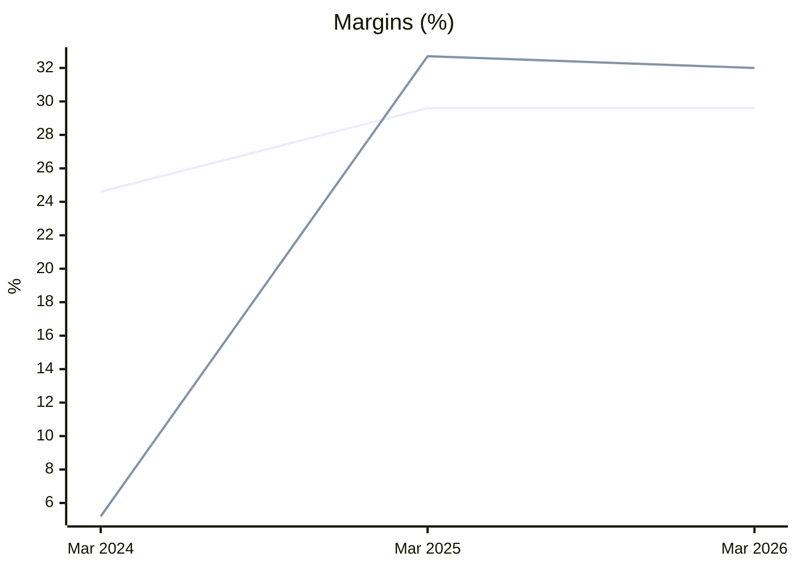

*Run 2026-11-24 · part of [SPINOFF_REPORT.md](../SPINOFF_REPORT.md) · the complete analysis of one company, with every management-call exchange in full.*

## VEDL — Vedanta Ltd.

### 1. Vedanta Ltd. — CONFIRMED DEMERGER

**CONFIRMED** (a demerger scheme is on the exchange record) · **LISTED <1Y — selling-pressure window; the bargain forms here** · score 6.4/10 · spin-off · 41 filing(s) from CALLS, NSE, NSE-register · first 2025-12-16, latest 2026-10-03

**The separated entities — every one the documents name:**

| Entity | Scheme | Business | Listing | Who runs it |
|---|---|---|---|---|
| **Vedanta Aluminium Metal Limited** | 2023 composite scheme of arrangement (Resulting Company 1),… | Aluminum Undertaking / Aluminium Business; also receives the Company's shareholding in Bharat Aluminium Compa… | listed 2026-06-15 as VAML (NSE) | not stated for the entity; Mr. Rajiv Kumar is nam… |
| **Vedanta Power Limited** (earlier Talwandi Sabo Power Limited) | 2023 composite scheme of arrangement (Resulting Company 2),… | Merchant Power Undertaking / Merchant Power Business — generation, transmission and distribution of power, in… | listed 2026-06-15 as VEDPOWER (NSE) | not stated for the entity; Mr. Rajinder Singh Ahu… |
| **Vedanta Oil and Gas Limited** (earlier Malco Energy Limited) | 2023 composite scheme of arrangement (Resulting Company 3),… | Oil and Gas Undertaking / Oil and Gas Business — India's largest private oil and gas exploration and producti… | listed 2026-06-15 as VOGL (NSE) | not stated for the entity; Mr. Jasmin Sahurity is… |
| **Vedanta Iron and Steel Limited** | 2023 composite scheme of arrangement (Resulting Company 4),… | Iron Ore Undertaking / Iron Ore Business; press release describes the entity as Vedanta Iron & Steel (iron or… | listed 2026-06-15 as VISL (NSE) | not stated |
| **Vedanta Property Platforms Limited** | 2026 demerger of the Real Estate Business (Resulting Compan… | Real Estate Business — development, construction, redevelopment, operation, management, leasing and licensing… | not stated | not stated |

**The other parties to the scheme(s)** — not separated entities: Vedanta Base Metals Limited — dropped / withdrawn; Bharat Aluminium Company Limited — merged in — no shares for the parent's holders

**What is being separated, as the documents put it:** Aluminium, Merchant Power (to Talwandi Sabo Power), Oil & Gas and Iron Ore undertakings demerged from Vedanta Limited — class `value_unlocking`.

### 2. Stages and dates

> **Listing:** LISTED — Vedanta Aluminium Metal Limited (VAML) since 2026-06-15; Vedanta Power Limited (VEDPOWER) since 2026-06-15; Vedanta Oil and Gas Limited (VOGL) since 2026-06-15; Vedanta Iron and Steel Limited (VISL) since 2026-06-15 (NSE equity list); record date 2026-05-01; not yet listed: Vedanta Property Platforms Limited

| Date | Event | Source |
|---|---|---|
| 2023-09-29 | Board approval — Vedanta Limited (Demerged Company) — Original Scheme | as stated: NCLT Mumbai order dated 17 October 2025 (filing 2025-10-18); intimati… |
| 2023-10-10 | Board approval — Talwandi Sabo Power Limited (Resulting Company 2) | as stated: NCLT Mumbai order dated 17 October 2025 (filing 2025-10-18) |
| 2023-10-13 | Board approval — Vedanta Aluminium Metal Limited, Malco Energy Limited, Vedanta Iron and Steel Limited and Vedanta Base Metals Limited | as stated: NCLT Mumbai order dated 17 October 2025 (filing 2025-10-18) |
| 2024-07-30 | Exchange no-objection — NSE — observation letter with no objection on the Original Scheme | as stated: Filing 2024-07-31 (intimation on BSE/NSE no-objection letters); NCLT … |
| 2024-07-31 | Stage reached: **exchange noc** | [Updates](https://nsearchives.nseindia.in/corporate/VEDL_31072024162532_VEDLSEIntimationNSEBSELetterforSchemeofDemergersigned.pdf) |
| 2024-07-31 | Exchange no-objection — BSE — observation letter with no adverse observations on the Original Scheme | as stated: Filing 2024-07-31 (intimation on BSE/NSE no-objection letters) |
| 2024-10-15 | Other — Talwandi Sabo Power Limited — first motion application filed with NCLT | as stated: NCLAT order dated 27 May 2025, para 4.4 (filing 2025-05-29) |
| 2024-11-21 | NCLT order — Vedanta Limited and Malco Energy Limited — order convening shareholders'/creditors' meetings and dispensing others | as stated: Filing 2024-11-22 (disclosure on NCLT order dated November 21, 2024) |
| 2024-12-20 | Board approval — Vedanta Limited — approval of modified Scheme, not implementing Part V (Base Metals) | as stated: Filing 2024-12-20 (Demerger — update on Scheme of Demerger) |
| 2024-12-23 | Board approval — Vedanta Base Metals Limited, Vedanta Aluminium Metal Limited, Talwandi Sabo Power Limited, Malco Energy Limited, Vedanta Iron and Steel Limited — modified Scheme | as stated: NCLT Mumbai order dated 17 October 2025 (filing 2025-10-18) |
| 2025-01-17 | Stage reached: **meetings** | [Shareholders meeting](https://nsearchives.nseindia.in/corporate/VEDL_17012025095705_VEDLSEIntimationCCMNotice17Jan2025signed.pdf) |
| 2025-01-17 | Other — Notices of meetings circulated to shareholders and creditors | as stated: Filing 2025-01-17 (Notice of Court Convened General Meeting) |
| 2025-02-18 | Shareholders / creditors meeting — Vedanta Limited — equity shareholders (10:00 a.m.), secured creditors (11:45 a.m.), unsecured creditors (1:30 p.m.); approved with 99.9987% of votes polled in favour by shareholders | as stated: Filings 2025-02-18 (summary of proceedings) and 2025-02-20 (e-voting … |
| 2025-03-04 | Other — Talwandi Sabo Power Limited — NCLT order rejecting the Scheme presented by TSPL in C.A./CAA/MB/220/2024 | as stated: Filing 2025-03-04 (update on company scheme application) |
| 2025-03-28 | Other — All parties — conditions precedent timeline extended from 31 March 2025 to 30 September 2025 | as stated: Filing 2025-03-28 (extension of timelines for fulfilment of condition… |
| 2025-05-27 | Other — Talwandi Sabo Power Limited — NCLAT interim stay on the rejection of the Scheme, against a Rs. 1245 crores bank guarantee | as stated: Filing 2025-05-29 (NCLAT order dated May 27, 2025) |
| 2025-06-03 | Exchange no-objection — BSE and NSE — revised observation letters with "no adverse observations" on the modified Scheme | as stated: NCLT Mumbai order dated 17 October 2025 (filing 2025-10-18) |
| 2025-09-15 | Other — Talwandi Sabo Power Limited — NCLAT order setting aside the NCLT rejection after settlement with SEPCO dated 11 September 2025 | as stated: Filing 2025-09-16 (NCLAT order dated September 15, 2025) |
| 2025-09-30 | Other — All parties — conditions precedent timeline extended from 30 September 2025 to 31 March 2026 | as stated: Filing 2025-09-30 (extension of timelines for fulfilment of condition… |
| 2025-10-17 | NCLT order — Talwandi Sabo Power Limited — first motion order dispensing the equity shareholders' meeting and directing meetings of secured and unsecured creditors within 90 days | as stated: Filing 2025-10-18 (NCLT order dated October 17, 2025) |
| 2025-12-16 | Stage reached: **nclt sanction** | [News Verification](-) |
| 2025-12-16 | NCLT order — Vedanta Limited, VAML, MEL, VISL — NCLT Mumbai order sanctioning the Scheme of Arrangement for the demerger | as stated: Filing 2025-12-16 (update on Scheme of Arrangement) and news clarific… |
| 2026-01-09 | NCLT order — Talwandi Sabo Power Limited — NCLT Mumbai order allowing TSPL's petition and sanctioning the Scheme | as stated: Filing 2026-01-09 (update on C.P./CAA/MB/254/2025) |
| 2026-01-21 | Other — Certified copy of the 16 December 2025 NCLT order received by the Company at around 4:30 p.m. IST | as stated: Filing 2026-01-21 (certified copy of NCLT order) |
| 2026-03-31 | Other — All parties — conditions precedent timeline extended from 31 March 2026 to 30 June 2026 under Clause 39.7 | as stated: Filing 2026-03-31 (extension of timelines for fulfilment of condition… |
| 2026-04-20 | Board approval — Board approved making the Scheme effective on 1 May 2026, fixed 1 May 2026 as record date, and approved transfer of the Company's BALCO shareholding to VAML | as stated: Filing 2026-04-20 (Record Date disclosure under Regulations 30 and 42) |
| 2026-04-30 | Other — Bharat Aluminium Company Limited — share sale agreement between the Company and VAML "likely to be signed on or before April 30, 2026"; expected date of completion "On or before April 30, 2026" | as stated: Filing 2026-04-20 (Annexure A) |
| 2026-05-01 | **Record date** | NSE corporate-actions register |
| 2026-05-01 | Stage reached: **record date** | Record Date (corporate-actions register) |
| 2026-05-01 | Appointed date — All parties — "the Effective Date will also be the Appointed Date i.e. May 01, 2026" | as stated: Filing 2026-05-16 (apportionment of cost of acquisition) |
| 2026-05-01 | Effective date — All parties — "The Scheme has come into effect on May 01, 2026, being the Effective Date" | as stated: Filing 2026-05-16 (apportionment of cost of acquisition); filing 2026… |
| 2026-05-01 | Record date — Vedanta Limited equity shareholders, and debenture holders of ISINs INE205A07196, INE205A07220, INE205A08038 and INE205A08020 whose NCDs transfer to VAML | as stated: Filing 2026-04-20 (Record date fixed as May 01, 2026) |
| 2026-06-15 | **Vedanta Aluminium Metal Limited** listed (VAML) | NSE equity list |
| 2026-06-15 | **Vedanta Power Limited** listed (VEDPOWER) | NSE equity list |
| 2026-06-15 | **Vedanta Oil and Gas Limited** listed (VOGL) | NSE equity list |
| 2026-06-15 | **Vedanta Iron and Steel Limited** listed (VISL) | NSE equity list |
| 2026-06-15 | Listing and trading — Vedanta Aluminium Metal Limited (VAML), Vedanta Power Limited (VEDPOWER), Vedanta Iron and Steel Limited (VISL), Vedanta Oil and Gas Limited (VOGL) — "4 new entities listed on NSE & BSE on 15th June" | as stated: Q1FY27 investor presentation, 30 July 2026; NSE equity list |
| 2026-07-30 | Stage reached: **announced** | [Press Release](https://nsearchives.nseindia.com/corporate/VEDL_30072026151113_VEDLSEIntimationPressReleaseIRPPTfinalsigned.pdf) |
| 2026-07-30 | Board approval — Vedanta Property Platforms Limited — Board approved the draft Scheme for demerger of the Real Estate Business; the Company "shall apply to the BSE Limited and National Stock Exchange of India Limited, in due course" for no-objection letters | as stated: Filing 2026-07-30 (Scheme of Arrangement — demerger of Real Estate Bu… |

**The stages, as filed:** exchange noc (2024-07-31) → meetings (2025-01-17) → nclt sanction (2025-12-16) → record date (2026-05-01) → announced (2026-07-30)

**Stated in the filings:** resulting company **Talwandi Sabo Power Limited**; record date 2026-05-01; pro-forma statements referenced; size hint: 11% of ebitda.

**When it lists, in the documents' words:** On 29 April 2026: 'The effective and record date is set for May 1st… The shares of the resulting companies are expected to list and commence trading by mid-June.' On 30 July 2026: '4 new entities listed on NSE & BSE on 15th June'; consolidated share value ₹932.05 'on listing date (15th June 2026)'.

### 3. Size of the separated business beside the parent — is institutional selling likely?

**Reading: VERY LIKELY — the piece is under a tenth of the whole; index funds and large holders who receive it without choosing it tend to sell.**

| Entity | Stated turnover | Stated share of the whole | Segment revenue share | Market cap (₹ cr) | Share of combined market cap | Index member |
|---|---|---:|---:|---:|---:|---|
| Vedanta Aluminium Metal Limited | not stated for the undertaking (Aluminium segment FY26 EBIT… | — | 83.9% (FY2026) | 148,517 | 59.4% | no |
| Vedanta Power Limited | not stated for the undertaking (FY26 power sales grew 30% Y… | — | 83.9% (FY2026) | 13,655 | 11.9% | no |
| Vedanta Oil and Gas Limited | not stated for the undertaking (FY26 average gross operated… | — | 83.9% (FY2026) | 12,071 | 10.6% | no |
| Vedanta Iron and Steel Limited | not stated for the undertaking (FY26: iron ore production 6… | — | 83.9% (FY2026) | 10,300 | 9.2% | no |
| Vedanta Property Platforms Limited | INR 1.26 crore for the year ended March 31, 2026 (turnover … | 0.001% | 83.9% (FY2026) | — | — | not listed |

*Stated figures are the documents' own (a turnover share, or the cost-of-acquisition split the company publishes for tax, which reflects relative value); the segment share is this business's revenue over the parent's sales, and the market-cap share is the entity's value over the entity plus the parent (parent ₹101,545 cr, NSE bhavcopy of 2026-11-13), both computed here.*

**In the documents' words:** “2023/2026 composite demerger — "For the purpose of determining post-demerger cost of acquisition of the Equity Shares of the Company and the Resulting Companies, shareholders may apportion their total cost of acquisition of the Company in the following manner: 1 Vedanta Limited 52.34% | 2 Vedanta Aluminium Metal Limited 7.15% | 3 Talwandi Sabo Power Limited 12.23% | 4 Malco Energy Limited 21.49% | 5 Vedanta Iron and Steel Limited 6.79%" and "The aforesaid ratio has been determined based on the net worth of the Company and the net assets of the Aluminum Undertaking, Merchant Power Undertaking, Oil and Gas Undertaking, and Iron Ore Undertaking, in accordance with Sections 73 of the Income-tax, Act, 2025." Post-listing: "Combined market cap of all Demerger resulting companies grew by over ₹ 71k crore in Q1". 2026 real estate demerger — "The turnover (including other operating income) of the Demerged Undertaking for the year ended March 31, 2026 was INR 1.26 crore representing 0.001 % of the total standalone turnover of Vedanta Limited for the year ended March 31, 2026."”

**The judge's read of selling pressure:** likely — Power entity is small (12.23% cost apportionment, ~4.7x pro-forma leverage) and a different industry from the metals parent; shares pushed 1:1 to all holders.

### 4. Insider ownership — share swap, promoters' holding, management incentives

**Share swap / entitlement, entity by entity:**

- **Vedanta Aluminium Metal Limited:** 1 (One) fully paid-up equity share of VAML having a face value of INR 1 (Rupee One) each for every 1 (One) fully paid-up equity share of INR 1 (Rupees One) each of the Company.
- **Vedanta Power Limited:** 1 (One) fully paid-up equity share of TSPL having face value of INR 10 (Indian Rupees Ten) each for every 1 (one) fully paid-up equity share of INR 1 (Indian Rupee One) each of the Company.
- **Vedanta Oil and Gas Limited:** 1 (One) fully paid-up equity share of MEL having face value of INR 1 (Indian Rupee One) each for every 1 (one) fully paid-up equity share of INR 1 (Indian Rupee One) each of the Company.
- **Vedanta Iron and Steel Limited:** 1 (One) fully paid-up equity share of VISL having face value of INR 1 (Indian Rupee One) each for every 1 (one) fully paid-up equity share of INR 1 (Indian Rupee One) each of the Company.

**Promoters' holding, from the shareholding pattern:**

| Company | Promoters | FIIs | DIIs | Public | Quarter |
|---|---:|---:|---:|---:|---|
| Vedanta Ltd. (VEDL) | 54.72% | 15.78% | 10.69% | 18.58% | Sep 2026 |
| Vedanta Aluminium Metal Limited (VAML) | 56.38% | 11.04% | 15.35% | 17.0% | Sep 2026 |
| Vedanta Power Limited (VEDPOWER) | 56.38% | 6.8% | 10.71% | 25.88% | Sep 2026 |
| Vedanta Oil and Gas Limited (VOGL) | 56.38% | 5.45% | 5.93% | 32.01% | Sep 2026 |
| Vedanta Iron and Steel Limited (VISL) | 56.38% | 4.11% | 9.24% | 30.03% | Sep 2026 |

*Source: screener.in shareholding pattern, stored under `ShareholdingPattern/NiftyTotalMarket/`. In a mirror demerger each shareholder holds the same proportion of the new company as of the parent on the record date.*

- **Promoters in the parent, per the documents:** 54.72% — "Vedanta Resources Ltd (through its subsidiaries)" as on 30 June 2026 (Q1FY27 investor presentation entity structure). Per the 15 May 2026 Regulation 30A disclosure: Twin Star Holdings Ltd "holding 40.02% shares in Vedanta Limited", Vedanta Holdings Mauritius II Limited "holding 12.60% shares in Vedanta Limited", Welter Trading Limited "holding 0.98% shares in Vedanta Limited"; Vedanta Resources Limited is "classified as a member of the promoter group of Vedanta Limited, with no direct shareholding in Vedanta Limited". At the 18 February 2025 court-convened meeting the Promoter and Promoter Group held 2,204,867,749 of 3,910,388,057 shares (record date 11 February 2025).
- **What the promoters will hold in the separated entity:** 2023/2026 composite demerger: "Post demerger, every Vedanta shareholder - both retail and institutional - will receive one new share in each of the newly demerged companies. Other than this, there will be no change in the overall shareholding structure." And: "The shareholders will continue to enjoy value unlocking of the Vedanta Base Metals business as part of legacy residual Vedanta where they will remain shareholders in addition to receiving equivalent shares in other resulting companies which will mirror Vedanta shareholding." 2026 real estate demerger: not stated.
- **What a public shareholder receives:** 2023/2026 composite demerger: "In accordance with provisions of the Scheme, Resulting Companies issued and allotted 1 (One) fully paid-up equity share of each Resulting Companies for every 1 (One) fully paid-up equity share held in the Company, to the shareholders of the Company whose names are recorded in the register of members and / or records of the depository as on the Record Date (i.e., May 01, 2026)." Also: "Shareholders of Vedanta Limited will receive equity shares in each of the four resulting listed entities (in addition to their shareholding in Vedanta Limited) in proportion to their existing holdings, ensuring continuity of ownership while enabling direct participation in the growth trajectories of individual businesses." And: "Shareholders holding one share of Vedanta as on 29th April, today, will receive four additional shares of the resulting companies." 2026 real estate demerger: not stated (consideration is a "Share Entitlement Ratio" defined in the Scheme, value not disclosed).
- **Management incentives:** not stated in the documents on file.
- **Insider actions around the separation:** Promoter group borrowing secured on Vedanta Limited shares: Vedanta Resources Limited (borrower) with Twin Star Holdings Ltd, Vedanta Holdings Mauritius II Limited and Welter Trading Limited as guarantors entered a facility agreement dated 30 January 2026, amended and restated on 13 May 2026 and upsized "from up to US$ 350,000,000 to US$ 600,000,000"; "Encumbrances have been created over the shares of Vedanta Limited, in terms of the Amended Facility Agreement and related finance documents, and such encumbrance(s) have been disclosed in the form and manner specified under the Securities and Exchange Board of India (Substantial Acquisition of Shares and Takeovers) Regulations, 2011", with disclosures made under Regulations 29(1) and 31 of the Takeover Regulations. Company-level selling around the separation: on 18 June 2025 Vedanta sold 66.7 million Hindustan Zinc shares (c. 1.6%) for c. INR 3,028 Cr — "As we actively progress towards the demerger of Vedanta into sector focused entities across diverse verticals, this capital raise will help de-leverage the balance sheet and enhance financial flexibility"; a further Zinc India offer-for-sale was launched on 27 January 2026 (about 1.1%, c. Rs.3,000 crore) with "the entire amount will be used for de-leveraging", taking the holding to around 60.7% from 61.8%. Also disclosed: "As part of demerger proceedings, a full and final settlement of Rs. 660 Cr has been done with SEPCO"; and a corporate guarantee from Vedanta covering the MoPNG/DGH alleged claims so they do not sit on the demerged oil and gas entity.
- **Insiders, per the checklist read:** Shares issued 1:1 pro-rata, so promoter Vedanta Resources' 56.38% VEDL stake (54.72% at June 2026) is mirrored; promoter-group VEDL shares encumbered under VRL's amended facility agreement; later scheme states no special promoter benefit. · *option pricing date:* not stated

### 5. Why the demerger — point by point

Management presented the separation as the heart of "Vedanta 2.0": dismantling one diversified holding company into five sector-specific pure-play entities — Vedanta Aluminium Metal Ltd, Vedanta Power (renamed from Talwandi Sabo Power), Vedanta Oil & Gas (renamed from Malco Energy), Vedanta Iron & Steel Ltd, and a residual Vedanta Limited holding Zinc India (60.71% of HZL), Zinc International, Copper (Silvassa/Fujairah/KSA), FACOR ferrochrome and nickel/semiconductor assets — on the stated logic that each would "chart out their own growth trajectory and attract respective thematic investors," with sharper accountability and separate dividend policies set by five independent boards. The first problem they said it solves is valuation: one monolithic entity buried the parts, and after listing on 15 June 2026 the company itself claimed the combined value of VEDL plus the four new shares went from ₹225.50 at announcement (29 Sep 2023) to ₹932.05, ">300% upside". The second is capital structure: the ~$5.5bn group net debt (earlier quoted as $6.7bn) was re-architected "aligning debt with earning strength and growth stage of each resulting company" — ~$3.5bn to Aluminium (1.3x EBITDA), Power at 4.7x but on long-dated 7–10 year PFC/REC paper, residual Vedanta Ltd ~$1bn at 0.4x, and Oil & Gas nil / Iron & Steel ≤$0.2bn net debt — against group leverage of 0.95x. Third, it removed rigid cash rules: the prescriptive policy requiring at least 30% of profit as dividend and upstreaming of Hindustan Zinc dividends within six months became "principle-based," giving each board flexibility. Fourth, it repriced intra-group charges: copper's brand fee falls from 3% to 0.75% (~$65mn on $3.1–3.2bn revenue, +2.25% EBITDA), which management expects to lift that near-trading business from ~1% to at least 5% margin in FY27, while the blended group brand fee stays ~$400–450mn and the 3% rate stands to FY29. Fifth, it opens dedicated capital pools — "differentiated capital structure" means "many anchor investors domestically and globally are very keen to come in the cap table," an extra deleveraging avenue for Vedanta Resources' remaining ~$4.7bn debt serviced out of ~$400mn brand fee plus 4–5% dividend. Third parties shaped it: lenders made debt allocation "a precondition for granting NOC"; the Ministry of Petroleum and Natural Gas objected at NCLT over disputed Cairn arbitration dues (~$512mn) and was satisfied only by a Vedanta corporate guarantee ring-fencing the demerged oil & gas entity; and a ₹660 crore full-and-final SEPCO settlement was booked as an exceptional item "paving the way for a proposed demerger process." A second, separate demerger followed on 30 July 2026: ~2,264 acres and ~53,185 sq ft across 22 non-core real estate assets (FY26 turnover ₹1.26 crore, 0.001% of standalone revenue) go to Vedanta Property Platforms Ltd at 1 share per 20 VEDL shares, because the portfolio sat "embedded within the operating business" with "sub-optimal visibility" and a claimed ₹30,000 crore+ of latent value.

**Point by point, with the source:**

1. Ajay Goel positioned the demerger purely as value unlock while it was at the shareholder/creditor-approval stage, with the meeting scheduled for 18 February 2025. “This transformative step is poised to unlock significant value for our investors.” — *[Feb 2025](https://www.vedantalimited.com/uploads/investor-overview/financial-results/VedantaEarnings-transcript-Jan31-2025.pdf)*
2. Naidoo, in her first call as Group CEO, tied the demerger to the "Vedanta 2.0" ambition of a $100 billion critical minerals, energy and technology powerhouse, with completion then guided for September 2025. “We are making good progress with our demerger plan, aiming to create pure-play entities that will enhance strategic focus and operational flexibility.” — *[Apr 2025](https://www.vedantalimited.com/uploads/investor-overview/financial-results/Vedanta-CallTranscript-Apr30-2025_v2.pdf)*
3. An investor (Ashish Kejriwal) flagged that mining leases for the Sijimali bauxite and coal blocks had to be transferred to Vedanta Aluminium before the split could close; management confirmed a parallel approvals plan. “But the team has a detailed approvals plan, including all of the mining licenses that will start being approved, in fact, have already started the process.” — *[Apr 2025](https://www.vedantalimited.com/uploads/investor-overview/financial-results/Vedanta-CallTranscript-Apr30-2025_v2.pdf)*
4. Delays were attributed to two external forums — the NCLT second-motion hearing and an NCLAT stay on the TSPL power order — yet the split was named a top corporate priority. “The execution of the demerger remains a top priority for Vedanta.” — *[Aug 2025](https://www.vedantalimited.com/uploads/investor-overview/financial-results/2026/Vedanta_Transcript_Jul31_2025.pdf)*
5. The Ministry of Petroleum and Natural Gas, a key counterparty in the oil and gas business, objected at NCLT that the demerged Cairn entity might not be able to pay disputed arbitration dues. “And in the last NCLT hearing, they did express concern about the payments of any of the disputed dues that may become payable by Cairn in case the ongoing arbitration ruling, as we have all learned now, comes in their favor.” — *[Aug 2025](https://www.vedantalimited.com/uploads/investor-overview/financial-results/2026/Vedanta_Transcript_Jul31_2025.pdf)*
6. A long-standing creditor dispute was bought out with a ₹660 crore exceptional charge explicitly to clear the demerger path; MoPNG's objection was neutralised by a Vedanta corporate guarantee covering the full extent of the alleged claims (~$520mn). “As part of demerger proceedings, a full and final settlement of Rs. 660 Cr has been done with SEPCO, thereby resolving a long-standing dispute, paving the way for a proposed demerger process.” — *[Nov 2025](https://www.vedantalimited.com/uploads/investor-overview/financial-results/2026/VEDL_Q2FY26_Transcript.pdf)*
7. Goel framed the end state as five separately valued verticals and listed all five demerged entities for the end of FY26, ahead of the final NCLT hearing on 12 November. “On the demerger, we are at the final stage. We remain confident of completing our demerger by end of this fiscal, unlocking focused value across our five verticals.” — *[Nov 2025](https://www.vedantalimited.com/uploads/investor-overview/financial-results/2026/VEDL_Q2FY26_Transcript.pdf)*
8. With NCLT approval in hand (16 Dec 2025 for four businesses, 9 Jan 2026 for power), Naidoo gave the fullest statement of purpose — strategy focus, balance-sheet strength and growth — and targeted 1 April as effective date. “This marks a defining moment in our journey, one that empowers our businesses to sharpen the strategies, strengthen the balance sheets and accelerate growth with the aim of unlocking shareholder value.” — *[Jan 2026](https://www.vedantalimited.com/uploads/investor-overview/financial-results/2026/Transcript_29Jan2026.pdf)*
9. Lenders were an active party: debt allocation across entities had to be agreed with bankers before they would release no-objection certificates, with the $6.7bn consolidated net debt apportioned by assets and each entity's debt-servicing capability. “When we went to the banker seeking NOC, in that case, debt allocation was broadly aligned with the bankers as a precondition for granting NOC for demerger approval.” — *[Jan 2026](https://www.vedantalimited.com/uploads/investor-overview/financial-results/2026/Transcript_29Jan2026.pdf)*
10. Goel also framed the restructuring as a tax and structuring opportunity (accumulated losses, unabsorbed depreciation) and said it would be used to make oil and gas and iron and steel debt-free, part-funded by a 1.1% HZL OFS worth ~₹3,000 crore. “One thing I can confirm to the entire audience and to the stakeholders at large, that demerger in fact, becomes an opportunity across the areas.” — *[Jan 2026](https://www.vedantalimited.com/uploads/investor-overview/financial-results/2026/Transcript_29Jan2026.pdf)*
11. The power CEO used the demerger to justify a standalone growth mandate: from 4.2 GW today to ~4.8 GW by H1FY27 and a plan for an additional 10–12 GW over five to seven years. “And as we demerge, we really want to be a growth company and ride the India's growth story on energy.” — *[Jan 2026](https://www.vedantalimited.com/uploads/investor-overview/financial-results/2026/Transcript_29Jan2026.pdf)*
12. On the final pre-demerger call Goel set out the structural logic: five pure-plays, each attracting its own investor base, effective 1 May 2026 with one VEDL share earning four additional shares and trading expected by mid-June. “This will entail creation of five independent sector-specific pure-play companies, allowing each company to chart out their own growth trajectory and attract respective thematic investors.” — *[Apr 2026](https://www.vedantalimited.com/uploads/investor-overview/financial-results/2026/Vedanta-Transcript-Apr29-2026.pdf)*
13. Capital structure was deliberately engineered per entity — Oil & Gas nil debt, Iron & Steel ≤$0.2bn, Aluminium ~$3.5bn at 1.3x, Power 4.7x on 7–10 year PFC/REC maturities, Vedanta Ltd ~$1bn at 0.4x — against group leverage of 0.95x. “The de-merger has been architected with precision on capital structure, aligning debt with earning strength and growth stage of each resulting company.” — *[Apr 2026](https://www.vedantalimited.com/uploads/investor-overview/financial-results/2026/Vedanta-Transcript-Apr29-2026.pdf)*
14. The split removed prescriptive cash rules: the mandatory 30% profit payout and the six-month Hindustan Zinc dividend upstreaming requirement give way to board discretion at each of the five companies. “Currently, Vedanta's policy on dividend is more prescriptive; it will become more descriptive.” — *[Apr 2026](https://www.vedantalimited.com/uploads/investor-overview/financial-results/2026/Vedanta-Transcript-Apr29-2026.pdf)*
15. Unbundling also repriced the brand fee for the thin-margin copper business, which management expects to lift copper margins from ~1% to at least 5% in FY27 (~$65mn benefit), while blended group brand fee stays flat and the 3% rate holds to FY29. “So the brand fee for copper from the current 3% will go down to 0.75% and that alone from India's viewpoint means higher EBITDA by 2.25%.” — *[Apr 2026](https://www.vedantalimited.com/uploads/investor-overview/financial-results/2026/Vedanta-Transcript-Apr29-2026.pdf)*
16. Separate cap tables were pitched as a new deleveraging channel for Vedanta Resources, which still carries $4.7bn of debt against ~$400mn brand fee plus a 4–5% dividend. “Now as we de-merge all the five companies, additionally we'll have the optionality of a differentiated capital structure and in that case, many anchor investors domestically and globally are very keen to come in the cap table, and that will be additional avenue for de-leveraging.” — *[Apr 2026](https://www.vedantalimited.com/uploads/investor-overview/financial-results/2026/Vedanta-Transcript-Apr29-2026.pdf)*
17. Asked whether the entities could still acquire outside their sector, Naidoo said business CEOs are mandated to grow organically on their own 2x/3x plans while cross-sector M&A sits at a holdco with its own team and the Chairman. “Holdco will be set up to make sure there is some visibility of capital allocation across all 5 businesses, but also with its own M&A team to start looking at some of these opportunities.” — *[Apr 2026](https://www.vedantalimited.com/uploads/investor-overview/financial-results/2026/Vedanta-Transcript-Apr29-2026.pdf)*
18. The 30 July 2026 real-estate scheme (VEDL into Vedanta Property Platforms Ltd, 1 share for every 20) rests on the claim that ~2,264 acres and ~53,185 sq ft across 22 assets were trapped inside the operating business — FY26 turnover of just ₹1.26 crore, 0.001% of standalone revenue — with a claimed ₹30,000 crore+ of latent value. “The real estate business is currently embedded within the operating business and the real estate portfolio has been historically subject to limited focused utilisation, resulting in sub-optimal visibility of the real estate business segment and value realization.” — *Scheme*
19. The stated benefits mirror the five-way split — dedicated management and governance, sector-specific investors, lenders and strategic partners, and separate financial disclosure enabling clearer valuation; VPPL may also absorb real estate from Meenakshi Energy and Incab Industries. “enabling focused and sharper capital market access and thereby unlocking the value of the Demerged Undertaking and creating enhanced value for shareholders.” — *Scheme*

**How it evolved:** By the Feb 2025 (Q3FY25) call the scheme was already in execution with shareholder/creditor meetings set for 18 Feb 2025, and in Apr 2025 (Q4FY25) new Group CEO Deshnee Naidoo folded it into "Vedanta 2.0" with completion guided for September 2025. It then slipped repeatedly through regulatory friction: Aug 2025 (Q1FY26) disclosed the NCLT second-motion part-hearing of 2 July with the next date 20 August, an NCLAT interim stay on the TSPL power order (₹1,248 crore bank guarantee posted) and MoPNG objections; Nov 2025 (Q2FY26) set final hearing for 12 November, settled SEPCO for ₹660 crore and gave MoPNG a Vedanta corporate guarantee; Jan 2026 (Q3FY26) reported NCLT approval on 16 Dec 2025 for four businesses and 9 Jan 2026 for power, Ind AS 105 discontinued-operations accounting, and a 1 April effective-date target. Apr 2026 (Q4FY26) was the final pre-demerger call: effective and record date 1 May 2026, one VEDL share earning four additional shares, listing by mid-June, plus newly disclosed mechanics — the copper brand-fee cut, the principle-based dividend policy and holdco-level M&A. After listing, the 30 July 2026 board meeting opened a further leg by approving the real-estate demerger into VPPL, targeted for completion in FY28.

**What management expects from it:** Each pure-play sets its own strategy, dividend policy and capital structure: Aluminium 1.3x levered on strong cash flow, Power a 10–12 GW growth story, Oil & Gas and Iron & Steel debt-free, residual Vedanta Ltd 0.4x with HZL dividends optional and copper margins rising 1%-to-5% on a 0.75% brand fee. Thematic investors and anchor capital per cap table; simpler structures, sharper accountability, value unlock (claimed >300%).

*Not explained on the calls:* No explanation of why these five groupings, no SOTP targets, separation costs, dis-synergies, duplicated corporate overhead, or who originally proposed the split.

- *Stated reason, in one line:* Creation of five independent sector-specific pure-play companies, allowing each to chart its own growth trajectory and attract thematic investors; 'simpler structures, sharper accountability, and focused platforms to drive growth and value creation.'
- *What it reveals:* Separation exposes Zinc India's 56-57% margins and residual VEDL at 0.30x net debt/EBITDA with AA+ upgrade, versus Vedanta Power's 4.7x pro-forma leverage; combined market cap of resulting companies grew over ₹71,000 crore in Q1FY27.
- *Parent or spin:* parent · *Read next:* Vedanta Power Limited's own first standalone results/production release — TSPL plant availability, Athena restart and its 4.7x leverage
- *In their words:* “The Scheme has come into effect on May 01, 2026, being the Effective Date (as defined under the Scheme).”

### 6. On the calls, verbatim

10 call(s), oldest first: **71 question-and-answer exchange(s)** given in full — the question and every answer to it, nothing trimmed — and 59 passage(s) from management's prepared remarks (the complete sentences about it; the whole remarks are in the linked transcript). Text is as the transcript prints it.

#### Nov 2023 — [transcript](https://www.vedantalimited.com/uploads/investor-overview/financial-results/Transcript_VEDL_Earnings_Call_2QFY24.pdf)

**From the prepared remarks** *(the passage about it; the whole turn runs to 1,059 characters in the transcript)*

> **Arun Misra:** Thank you all for joining the call today. The second quarter was defining in terms of strategic direction for Vedanta and its subsidiaries. Vedanta's Board approved the proposal to demerge the business into six independent listed entities, each one capable of executing its individual business strategies. The decision is a significant step forward in its journey of sustainable growth and greater shareholder value. The demerger would create six incredibly competitive, nimble and focused enterprises. We have filed the scheme of demerger with the stock exchang e in October 2023 and are working on next steps as we speak. We exited the second quarter with strong financial results. We delivered the highest ever second quarter consolidated revenue of INR38,546 crores, up 16% quarter -on-quarter. We have also delivered highest ever second quarter EBITDA of INR11,834 crores, up 70% quarter -on-quarter and a strong margin of 35% and PAT before exceptional items of INR4,403 crores, up approximately 3x quarter -on-quarter. Vedanta Limited November 04, 2023

**From the prepared remarks** *(the passage about it; the whole turn runs to 2,217 characters in the transcript)*

> **Ajay Goel:** Thank you, Arun, and good evening, everyone. I'm very happy to come back to Vedanta. Such a critical time as we embark on our journey of demerger and unlock significant value for shareholders. At the same time, we also reorient ourselves towards next phase of organic growth. During second quarter, the commodity prices remain under pressure, mainly due to out -shipping of supply as compared to demand growth. The global economy has slowed down, compared to last year with growing regional divergences.

**From the prepared remarks** *(the passage about it; the whole turn runs to 1,759 characters in the transcript)*

> **Sensitivity:** Public (C4) Moving on to next page on balance sheet and debt. Net debt as on September 30 th, stands at INR57,771 crores as against INR59,192 crores as on last quarter. The net debt decreased overall majorly due to strong cash from operations and partly offset by working capital build -up and allocation of funds towards capex and returning money t o our shareholders. Our leverage ratio, which is net debt to EBITDA, stood at 1.64x, compared to 1.88x in the previous quarter. We finished the quarter with healthy cash and cash equivalents of INR1 6,702 crores. Our average maturity of debt is maintained at about three years with average cost of borrowings at about 9%. This quarter, we also transitioned to new tax regime for Vedanta Limited, a simpler tax structure starting FY '23, which is the last year. Adoption of new tax regime has resulted in onetime net MAT write -off of INR6,128 crores, but we had a net cash tax savings of INR2,040 crores for fiscal y ear 2022 and 23 from the same. The cash tax in future years will also be lower under new regime. The scheme allows companies to lower tax outgo and redeploy the same on operations, growth and shareholder value creation. A quick word on demerger. We have filed the scheme of demerger with the stock exchanges in October '23, and we are progressing well on our plan. Finally, in conclusion, the risk to the outlook are now far more balanced than they were six months ago, with the operating environment stabilizing. We remain committed to the cost and production guidance at the beginning of fiscal year 2024 and we're maki ng good progress towards our long -term goals of vertical integration, operational excellence and deleveraging. With this, I now hand over to operator for Q&A. Thank you.

**Question and answer**

> **Amit Dixit:** Okay. The second question is on ferrochrome. Now here, our capacity expansion plans are quite, I would say, aggressive by 300 ktpa and ferrochrome, as we all know, is a power guzzler. And our larger goal is to reduce the emission. So how do we tie the powe r -- our goal of reducing emissions and enhancing ferrochrome capacity? That is one. And secondly, where do we expect to ship this ferrochrome? I mean as far as I understand, ferrochrome capacity is -- I mean, there is like, the market is quite balanced today. So why is the sudden plan of expanding in this ferrochrome? Or whether we want t o expand in stainless steel at a later stage as well?
>
> **Arun Misra:** So as is the nature the way our group operates, we have always been in business where we are the number one, number two or number three. We would not like to become a small player in a big market and continue in that status. So our ambitions are always to be in the number one, number two and ferrochrome expansion plan is no exception. That is to begin with our intention on a visionary level. Vedanta Limited November 04, 2023
>
> **Sensitivity:** Public (C4) Second, when we talk of ferrochrome, it's a key ingredient for stainless steel making. And in Indian steel production growth, if you see last 10 years, which have mostly been in the auto sectors or on the building sector, which are lon g products that peopl e have expanded. We firmly believe as GDP per capita grows, as the country grows, you will see expansion in consumption of aluminium, expansion in consumption of stainless steel. And it's not only India, entire Southeast Asia, this is going to be the situation in next five years to 10 years. And keeping that strong growth in mind, we feel that Vedanta will play a key role in that development part of India and hence the nature of th is expansion. As far as your question on ferrochrome production being power guzzler and it's been dependent on thermal pool, we need to appreciate that our own group company, Serentica is already putting up thousands of megawatts capacity of hybrid power of solar, wind, followed up by -- backup by pump hydro storage. Almost all Vedanta units are signing up with them for power supply. So most of the power supply currently signed up would land anywhere between 2024 to 2026. And I'm sure ferrochrome projects will take another three years to come up. And by that time, we will have round -the-clock renewable power agreements and the lines be ing drawn or the capacities being put up. So there would be time that we will stick to our emission reduction targets that we have set for ourselves by 2050, net zero and as well as looking at the numbers of 2040, 2030 internal targets are there. We have got our actions completely lined up as far as emissions are concerned.

**Question and answer**

> **Amit Dixit:** So, what you're confirming is that ferrochrome plant would be fed from round -the-clock renewable power capacity?
>
> **Arun Misra:** As in future, obviously, yes.
>
> **Amit Dixit:** Okay, sir. Thank you and all the best.

**Question and answer**

> **Pallav Agarwal:** Sure, sir. Sir, finally, if I can just, on the aluminium CoP, we have been seeing reductions. So can we expect a further reduction in 3Q, a significant reduction apart from coal and other input costs?
>
> **Arun Misra:** If you see quarter -on-quarter . They have a steady decrease in CoP. And that trend will continue as long as their own Jamkhani productions, own coal productions have gone up and new coal mines, which is Radhikapur and Kurloi as they come into operations, we can only expect and Lanjigarh capacity expanding bauxite mine coming into play. We have a clear road map to reducing to immediate terms about $1,800 per ton and in future maybe another $200 or so, we should be able to reduce.
>
> **Pallav Agarwal:** Sure, sir. Thank you so much.

**Question and answer**

> **Sensitivity:** Public (C4) Imtiaz: Thank you. Thank you for the opportunity and congrats on the second quarter performance. And Mr. Goel, great to have you back. I have two questions. The first one, can you just let us know where you are now in your attempts to sell your steel and iron ore mines?
>
> **Arun Misra:** Look, so we had -- to let the world know that we have a strategic interest in looking for strategic investors in our steel and iron ore mine business. But we are, at the same time, investing in growing the business. We are investing in debottlenecking the operations. We are investing in getting the best people to run the shops there. So these two are t wo independent activities. As of now, I won't be able to put a finger on when and to whom the final decision will go to. As and when it happens, we will let it be known.
>
> **Imtiaz:** Okay. The second question is with regards to your dividends. You received a dividend from Hindustan Zinc back in July. Any plans to pay that dividend out?
>
> **Ajay Goel:** See if you look at our allocation of capital policy, Imtiaz, on the website, which is sometimes in 8th Feb, 2022, the time frame that we have committed for pass on is six months. In that case, July, we have time until January. Now you also appreciate that any dividend declaration is a board matter, and it will be, I think, a tad, I think, early in terms of comme nting what is the plan now. Overall, if you see Vedanta's current year dividend, which is about INR39 per share is far higher than what Vedanta got from the Zinc as well. So from taxation viewpoint, which is our 80M deduction, we are anyways fully covered.
>
> **Imtiaz:** Okay. Great. And my last one is just a clarification of something you just said earlier with regards to maturities at Vedanta Limited. Could you just repeat what you said? Do you -- did I hear correctly, you have about $1 billion at Vedanta Limited maturin g over the next couple of quarters?
>
> **Ajay Goel:** That's correct. S o between Q3 and the Q4, the year second half, almost $1.2 billion are the maturities. And what I also say if you look at our cash flow plan for the second half, it will be more than $1.2 billion. And also our deep engagement with the capi tal markets, be it a PSU bankers, multinational bankers, FIIs, we feel, in fact, quite comfortable in terms of refinancing or repaying, both are the options.
>
> **Imtiaz:** Okay. So this is at a limited level, yes?
>
> **Ajay Goel:** That's correct.
>
> **Imtiaz:** Great. Okay, thank you. That's all I had. Thank you very much.

**Question and answer**

> **Ritesh Shah:** So should one presume around $2 billion as bonds, around $0.5 billion for Oaktree and the balance is outstanding loans?
>
> **Ajay Goel:** That's correct. Vedanta Limited November 04, 2023
>
> **Sensitivity:** Public (C4) Ritesh Shah: Okay. That helps. Sir, I think you did clarify on the steel assets. I understand you are not giving any time lines over here. Just trying to have your thoughts. Has the company thought of securitizing the brand fee, given that's captive? And secondly, has the company even exercised advance pay and supply agreements for any of the commodities that we operate in?
>
> **Arun Misra:** Advance, I didn't get you the last one.

**Question and answer**

> **Ritesh Shah:** Sorry, advance pay and supply agreement. So this is a trade finance agreement. Typically, if you want to bolster your cash flows at this point in time... Arun M isra: So that's also a strategic initiative that we have launched on our marketing front, maybe with a few of the customers as and when we are able to secure such agreement with an advanced payment, not so much in steel. It happens mostly on our base metal side. We do have advanced payment agreement with long -term commitments with key international buyers, not so much to do with steel. But as and when it happens, we'll let you look.

**Question and answer**

> **Ritesh Shah:** Okay. But sir, my question is do we have anything of that sort right now on the balance sheet where we are already seeing the benefits? Arun M isra: No, I don't think on the steel side we have.

#### Jan 2024

**From the prepared remarks** *(the passage about it; the whole turn runs to 745 characters in the transcript)*

> **Sensitivity:** Internal (C3) “Vedanta Limited Q3 FY '24 Earnings Conference Call ” January 25, 202 4 MANAGEMENT : MR. ARUN MISRA – EXECUTIVE DIRECTOR – VEDANTA LIMITED MR. AJAY GOEL – CHIEF FINANCIAL OFFICER – VEDANTA LIMITED MR. AKARSH HEBBAR – GLOBAL MD AND - SEMICONDUCTORS AND DISPLAY BUSINESSES MR. AJAY AGARWAL – PRESIDENT , FINANCE – VEDANTA LIMITED MR. JOHN SLAVEN –CHIEF EXECUTIVE OFFICER – VEDANTA ALUMINUM MR. STEVE MOORE – DEPUTY CHIEF EXECUTIVE OFFICER , OIL & GAS – VEDANTA LIMITED MR. VIBHAV AGARWAL -- CHIEF EXECUTIVE OFFICER , POWER VERTICAL --VEDANTA LIMITED MR. CHRIS GRIFFITH -- CHIEF EXECUTIVE OFFICER , BASE METAL --VEDANTA LIMITED MS. PRERNA HALWASIYA – DEPUTY HEAD, INVESTOR RELATIONS – VEDANTA LIMITED Vedanta Limited January 25, 202 4

**From the prepared remarks** *(the passage about it; the whole turn runs to 1,207 characters in the transcript)*

> **Prerna Halwasiya:** Thank you, N eerav. Hello, everyone, and welcome to our third quarter of financial year '24 Earnings Conference Call. I'm Prerna Halwasiya. On behalf of the entire team of Vedanta, I would like to thank you for joining us today to discuss our financial results and busine ss performance. Today, from our leadership team, we have with us Mr. Arun Misra, our Executive Director; Mr. Ajay Goel, our Chief Financial Officer. Then, we additionally have Mr Akarsh Hebbar - Global Managing Director - Semiconductors and Display Businesses , Mr. Ajay Agarwal, President, Finance . Our business CEOs ; Mr. John Slaven - CEO , Aluminum business; Mr. Steve Moore - Deputy CEO, Oil & Gas. Along with him, we also have Mr. Vibhav Agarwal - CEO, Power Vertical; Mr. Chris Griffith - CEO of Base Metals Please note that today's entire discussion will be covered by the cautionary statement on Slide number 2 of the presentation. We will start with the update on our operational and financial performance, and then our leadership team will briefly speak about themselves and their vision for the individual businesses. And lastly, we'll open the floor for the Q&A . Now I would like to hand over the call to Mr. Arun Misra.

**From the prepared remarks** *(the passage about it; the whole turn runs to 2,986 characters in the transcript)*

> **Sensitivity:** The business consumed highest -ever captive iron ore from its fully ramped up iron ore mines acquired last year. Quarterly saleable production stands at 341,000 tons, up 11% year -on-year with an EBITDA margin of $38 per ton. The business has a promising future of producing 2.4 million tons per annum with a cost of production of $546 per ton, deliveri ng an EBITDA of $301 million annually. Our Power plants cannot be forgotten when it comes to Business Delivery. Power Sector has delivered 9M EBITDA of around 90 Mn$ and has a huge potential to deliver 206 Mn$ annually with new power plants in line. FACOR recorded 53 KT as 9M production 10% up y -o-y with EBITDA margin of 140 $/T. Quarterly Ferrochrome production is 22KT up 15% y -o-y with EBITDA margin of 146 $/T. With an already approved capex of 2650 Cr, the business has outlook to produce 200 KT annually to deliver 100 Mn$ EBITDA.

**From the prepared remarks** *(the passage about it; the whole turn runs to 2,909 characters in the transcript)*

> **Sensitivity:** With this, our Revenue will go up by 4Bn$ and EBITDA by 1Bn$ . These already approved projects are designed to unlock significant value for our key business segments, ensuring sustained growth and long -term success. It is to be noted that almost all the projects will be funded by the Businesses themselves with their own cashflows. In Aluminium segment, a significant portion of our capital investment is directed towards upgrading production facilities, structurally reducing cost of production to 1st qu artile, and expanding capacity. Balco expansion to 1MTPA will take total capacity t o 3MTPA and place us in the top 3 producers globally ex -China. Operationalisation of captive coal and bauxite mines and Lanjigarh alumina refinery expansion to 6MTPA will make the business 100% integrated. This strategic focus aims to increase our market s hare, improve operational excellence, and ultimately boost profitability within the Aluminium segment. Zinc India, after successful commissioning of Fumer and Mill revamping, is geared to commission 160 KTPA Roaster plant at Debari and 5.1 LTPA Fertilizer plant at Chanderiya, to boost its production capacity in near future. Zinc International, with one of the world’s largest zinc deposits, is poised to deliver significant value. Phase 2 expansion at Gamsberg with a capex of ~466mn dollars is in full swing.

**From the prepared remarks** *(the passage about it; the whole turn runs to 2,261 characters in the transcript)*

> **Sensitivity:** On liability management, I'm very happy to inform you that our liability management exercise at HoldCo Vedanta resources has been successful, resulting in a structural improvement in the overall capital structure as a group. As a result, our liquidity posi tion has greatly strengthened. We are now in even more comfortable position to manage our existing debt and take long -term monetary decisions. A quick word on demerger. The stock exchange has given their NOC for the demerger scheme to SEBI. Currently, we are awaiting SEBI's NOC. Concurrently, we're in talks with creditors for debt allocations. Once SEBI's NOC is secured, the scheme will be submit ted to NCLT for an order to conduct members and creditors meeting. […] Additionally, we are steadi ly progressing toward achieving our long -term objectives of vertical integration, operational excellence and deleveraging. Vedanta remains a growth -focused company. And there are additional avenues around the electronics business. Further, with our ongoing value unlocking exerci se, that is demerger, it will have portfolio of 17 pure -play companies that will enable to create substantial value, not only in the present, but also in coming years. With this, I now hand over the mic to Mr. Akarsh Hebbar .

**From the prepared remarks** *(the passage about it; the whole turn runs to 1,453 characters in the transcript)*

> **John Slaven:** Thank you, Akarsh. And hello, everyone. I'm John Slaven, I'm the CEO of Vedanta's aluminium business. I joined Vedanta about 4 months ago after many decades in the industry. And I'm incredibly proud and excited to be leading the world's leading aluminum co mpany, the lowest cost, the most sustainable and among the largest globally. At Vedanta Aluminum, our singular focus remains on safe completion of our growth and integration projects on schedule and on budget to deliver higher volumes with structurally lower costs. Following completion of these projects, we will further reduce the cost of production by at least $200 per ton from current levels and increase product premiums by over 30%. We're targeting an EBITDA margin of $1,000 per ton on 3 million tons of annual production, creating a very strong cash flow engine. The key initiatives to increase hot -metal capacity to over 3 million tons per annum are the completion of the 414,000 tons smelter expansion of BALCO, completion of a 100,000 -ton volume creep project at Jharsuguda, optimizing operational parameters. We're evaluating a further 200,000 -ton smelter expansion at Jharsuguda, and we are progressing further volume creep projects at b oth smelter sites. We're also gearing up to become fully self -sufficient for alumina supply to our expanded smelters. This quarter, we will start production at Lanjigarh's 1.5 million ton Train -I with full Vedanta Limited January 25, 202 4

**From the prepared remarks** *(the passage about it; the whole turn runs to 1,448 characters in the transcript)*

> **Sensitivity:** Internal (C3) ramp -up of both trains to be completed by the end of financial year '25. We're also debottlenecking the plant to deliver capacity of 6 million tons per annum by the end of FY '26. In addition, we're building a mining business to secure low -cost self -supply of our key raw materials. For bauxite, development of the Sijimali Mine is progressing well with the initial production expected in Q2 of FY '25. This will be ramped up to 9 a nd 12 million tons per annum. For coal, Jamkhani is already producing at 150% of weighted capacity. Commencement of Kurloi, Ghogharpalli and Radhikap ur are on track, and we expect first production within 9 to 18 months for these mines. In the downstream, we are growing our value -added products or VAP through expanding capacity from 1.4 to 2.6 million tons per annum, which increases the share of VAP from 60% to 90%. We're increasing rolled products capacity from 44,000 to 100,000 tons pe r annum, and we're increasing sales in the more profitable domestic market from 43% to 55%. I'm also delighted to share that Vedanta Aluminum is now ranked first in the S&P Global Corporate Sustainability Assessment for 2023 in the Aluminum Industry Group. This is a really exciting phase of growth, improved profitability and enhanced sustainability for the aluminium business. And we look forward to sharing more as we deliver on this agenda over the coming quarters. I'll now hand over to Steve Moore.

**From the prepared remarks** *(the passage about it; the whole turn runs to 1,607 characters in the transcript)*

> **Vibhav Agarwal:** Thanks, Chris. Good evening, ladies and gentlemen. I'm Vibhav Agarwal. Having spent more than 2 decades in power sector, now I'm spearheading Power Vertical of Vedanta Group as Chief Executive Officer. Vedanta is known to have world -class assets in its por tfolio and power is no exception. We follow industry's best practices, create benchmarks with utmost importance governance and nation building at our core. As you know, India's GDP and power demand are set to double by 2030 by government's estimates, creating a huge opportunity for Vedanta, a thermal power generator to fuel the Indian economy. While there is a strong focus on RE, that is renewable energy, it is crucial to acknowledge that thermal power generation will continue to remain an integral part of India in the energy mix. It is there where Vedanta's core business lies and where it aims to be. Vedanta's Power Vertical is going to operationalize 2 new thermal power plants, one in Athena, which is 1,200 MW in Chhattisgarh, and the other one is Meenakshi Energy, which is 1,000 MW in Andhra Pradesh totalling to 2,200 MW, which together with our existing capacity would take our overall portfolio to nearly 5 gigawatts. With a mixed bag of long -term power uptake contracts and open capacity for sale of power on short -term and medium -term contracts, Vedanta Power will have a stable cash flow with a heavy margin and a very strong balance sheet. Ultimately, we are committed to deliver value and returns to our investors, shareholders in a sustainable manner while continuing to fulfill the power security of our nation. Thank you.

**Question and answer**

> **Ashish Kejriwal:** Sir, a couple of questions. One, amid this restructuring of current debt, how serious we are in terms of our monetization of steel and iron ore assets? And is it possible to guide where we are in that direction? That's my first question.
>
> **Ajay Goel:** Sure, Ashish. First of all, thanks for the recent report on Vedanta and your recommendation and also in terms of target price. I'll start first by saying if you look at last couple of years at the Hold co, Vedanta Resources, debt has gone down from $9.5 billion down to sub $6 billion, so $3.5 billion deleveraging at Vedanta Resources. Of course, overall debt for the group remained same. But right now, in terms of assets and liabilities being at the same place, in that case our balance sheet and the structure for the capital is far more harmonious. Secondly, coming to the point specifically, yes, with the debt restructuring at Vedanta resources is successful and the 3.1bn bonds maturities have been pushed forward by 3 years. With this our debt at Hold Co is more balanced, evenly spread and easy to manage. Vedanta Limited January 25, 202 4
>
> **Sensitivity:** Internal (C3) Ajay Goel : And so our publicly announced intent of noncore assets disposition remains intact. Right now, we have witnessed interest both from domestic and international players. The process in terms of due diligence, data rooms, Q&As, site visits is ongoing. We are h opeful to get some offers by this quarter end, and sometime, early next quarter, we see the deal going through. So net -net, our interest in disposition of noncore assets remains intact, de -leveraging both for V EDL and we, as a group, remains abs olut ely our single biggest priority.

**Question and answer**

> **Ashish Kejriwal:** Sure. Sir, next thing is on operations. We are having power sector or power subsidiary separately where we have Athena and Meenakshi. So is it possible to share the capex plan for that, when that's going to be commissioned? And similarly for coal block also because now we have been seeing continuous delays in coal block , coal block start-up for the other mines. So where we are in that status of that coal block, especially Kur aloi and Radhikapur, means whether we have received forest clearance, the environmental clearance or land acquisition, where we are so that we can be comfortable that now we can start the mine from second quarter FY25?
>
> **Ajay Goel:** Sure. So on the first part, I'll request Vibhav Agarwal , our Power CEO to comment on plans for capex for Athena and Meenakshi.
>
> **Vaibhav Agarwal:** Yes. So, Ashish, when we are actually building up these capacities to start generating, obviously, we require a bit of capex because these plants are half built. So we estimate close to INR6,000 crores would go into these plants to make them completely operational. And we -- I have already discussed about making them operational by FY26 completely. So this entire capacity woul d be up and running by then.
>
> **Ashish Kejriwal:** Sure.
>
> **Arun Misra:** So, on the coal block, if you look at Kur aloi, it is in the Stage 1 clearance level, and once the Stage 1 clearance is done, it will go to then forest clearance of Stage 2. Total 966 hectares of land is involved, out of which forest land is 214 hectares, so absolutely on track. And we can surely -- mining plan is approved, so it's just in next stage of projects. Radhikapur, it's -- Stage 1 is already clear. And Stage 2 is continuing. So there is absolutely no apprehension as far as productions are concerned. If we look at Radhikapur coal block, then FY25 by second quarter it will come to a capacity of 6 million ton s per annum. And Kur aloi by that time will be 8 million tons per annum in FY25 and in FY26. Vedanta Limited January 25, 202 4
>
> **Sensitivity:** Internal (C3) And Ghogharpalli by FY26 will be 20 million ton s per annum. So if you look at the -- Radhikapur 6, Kur aloi 8 and Ghogharpalli 20, and if you see the timeline, it is -- final operations, they wil l come by second quarter of FY 25.
>
> **Ashish Kejriwal:** So we are con fident about second quarter FY 25 because...
>
> **Arun Misra:** Because if you see once S tage 1 is clear. Other one, Stage 1 is absolute on the verge of clearance, then the Stage 2, and the business starts.

**Question and answer**

> **Amit Dixit:** Yes. Hi. Good evening, everyone. And thanks for taking my question. My first question is on the Alumin ium division where that waterfall chart, where we find that the other expenses part, if you look at it, which has gone down materially , conversion as the cost essentially from $142 per ton to $56 per ton. So just wanted to understand the key drivers behind it and whether it is sustainable? Vedanta Limited January 25, 202 4
>
> **Sensitivity:** Internal (C3) Amit Dixit: No. This waterfall chart, it is conversion and others, which is like $56 per ton in this quarter. Last quarter, it was $142. So I wanted to understand why it has gone down so substantially and whether this is sustainable.
>
> **Arun Misra:** So there may be some one -time cost involved last time, so because of that only there is a reduction.
>
> **Ajay Goel:** So maybe, Amit, the way to look at the overall aluminum CoP is total number. And you may have seen a Y -o-Y between the last year Q2 and the current year, 18% reduction in CoP coming across three large buckets, be it aluminum, power or the conversion costs. And across the verticals, be it aluminum or zinc or in terms of oil and gas, our CoP has been our single biggest highlight of the last quarter. So journey will continue. In terms of overall target, we closed aluminum at almost $1,840, the finished goods CoP as on Q3. And the numbers in December is even lower than the Q3 average. The journey continues. And toward March end, our target is about $1,700 per ton as CoP of alumi num.

**Question and answer**

> **Ritesh Shah:** At Vedanta Limited. Okay. And sir, I think in one of the prior questions, you did indicate that we would be looking at divestments. In fact, you said that it could be probably next quarter or after that. Given the way which we have done the debt maturity p rofile, honestly, there is no Vedanta Limited January 25, 202 4
>
> **Sensitivity:** Internal (C3) need for any divestments. Is it because the capex ask is high, and hence, we are looking at divestments? How should we look at it from a cash flow standpoint? And if you can give some numbers around capex at Vedanta console level, I think that would be gre at.
>
> **Ajay Goel:** Yes, sure. So you're right. I just pr oposed the debt raising at Vedanta Resources, our overall debt position as a group is far more comfortable. And at the cost of repetition, Ritesh, now, given there is no looming large maturity at Vedanta Resources, our ability of taking slightly longer - term calls at VRL on refinancing has enhanced significantly. Having said that, the ESL or steel disposition has been independent, and that continues. As I mentioned initially, right now the process in terms of due diligence, data room, Q&As, site visits is ongoing. And we're hopeful to get firm pricing by this quart er end if that continues. In terms of deal culmination, sometimes in Q1. So that remains on track. It is fast for the course.

#### Aug 2024 — [transcript](https://www.vedantalimited.com/uploads/investor-overview/financial-results/call-transcript-fy2025.pdf)

**From the prepared remarks** *(the passage about it; the whole turn runs to 2,451 characters in the transcript)*

> **Prerna Halwasiya:** Ajay Goel, our CFO; Mr. Ajay Agarwal, our President, Finance. Also joining with us are a couple of leaders from our key businesses, Mr. John Slaven, CEO, Aluminium business; Mr. Steve, Deputy CEO, Cairn Oil & Gas; Hitesh Vaid, CFO, Oil and Gas; and Mr. Chris Griffith, CEO, Base Metals. Please note today's entire discussion will be covered by cautionary statement on slide number 2 of the presentation.

**From the prepared remarks** *(the passage about it; the whole turn runs to 3,161 characters in the transcript)*

> **Sensitivity:** More notably or as notably, our profit after tax increased sharply to 54% Y -o-Y and to INR 5,095 crores. Continuing on cost, our cost performance is a cornerstone of our success. We are proud to be among th e global leaders in cost efficiency, a critical factor, we think, in ensuring long-term competitiveness. Our aluminium and zinc operations consistently outperformed industry benchmarks, ra nking in the top quartile and top decile respectively of the global cost curve. Sustainability leadership also as important, extremely important. Our leadership extends beyond operational excellence. We are also leading in sustainability. Our company was ranked third in the S&P Global Corporate Sustainability Assessment. Our subsidiary, Hindustan Zinc, ranked first in the metals and mining peer group, and Vedanta Aluminium ranked first among global aluminium peers. This is a true reflection of our commitment to building a stronger Vedanta together. Our assets are also quite unparalleled, right? And if you look at other assets or other large manufacturing businesses in the country, cement, steel, they can be invested and created, but most of our assets now cannot be replicated. And we guess that the replacement cost of our assets today across aluminium , zinc, oil, gas, iron ore, steel, et cetera, is the replacement cost is in excess of $50 billion. On growth, we have had an unparalleled growth story. We have expanded our capacity rapidly, achieving tenfold growth since our IPO in 2004. We are still a young and dynamic organization with the agility of a startup. […] Our large -scale growth projects are in advanced stages of development with majority of them ready to commission in the upcoming quarters. We are in a sweet spot at the right time, and our focused growth approach is reflected through our commitment to execute about $ 8 billion of growth capex in the next few years. Some more color specifically on some of the businesses. Aluminium , of course, John will cover this and so will Arun. But with our expansion and integration projects, we will be a fully integrated 3.1 million tons per year producer, while maintaining global lowe st cost positioning. With our value -added product capacity expansion, 90% of our products are value -added products and alloys. We are already the global leader in wire rod production.

**From the prepared remarks** *(the passage about it; the whole turn runs to 3,221 characters in the transcript)*

> **Sensitivity:** Internal (C3) expansion will further cement our position by making us the second largest producer of billets in the world. As we complete our full backward integration to ensure 100% self -efficiency in bauxite, alumina and coal, we are well positioned to deliver EBITDA in the region of about $4 billion from our aluminium business at LME of about $2,600. Just to highlight, with completion of our ongoing integration, we believe we will be the most integrated large aluminium producers in the world. Similarly, in Zinc India, with defined metal capacity of 1.2 million tons and 800 tons of silver production as HZL is poised to generate annual EBITDA of $2.7 billion. So in the story on Zinc International, less understood by most investors, and we will get Chris to talk about this. Our Zinc International business with substantial zinc ore reserves , has the potential to mirror ou r Zinc India business with an impressive zinc ore reserve and resources of 662 million tons and 35 million tons of metal reserve, we are committed to deliver 1 million ton of zinc production from Zinc International. […] Our Liberia asset ha s over 3,000 million tons of established R&R and best -in-class ore grades. Our near -term projections at Liberia indicate an annual production of approximately 30 million tons of iron ore. And similarly, we have opportunities to grow our output in Karnataka and in Goa. ESL, one of our trophy asset s, the steel asset, it is the only steel asset in India that can be ramped up to 15 million tons a year at a single location. It is strategically located , fully integrated, highly scalable steel platform and enjoy s an added benefit of green steel potential, given proximity to the gas pipeline it has spread across , gas pipeline. This asset is spread across the contiguous land of 2,300 acres. At this point of time, we are completing the expansion to 3.5 million tons to be commissioned by end of this year. And we believe at 3.5 MTPA , this business will deliver $500 million in bottom line. On power, we are one of the largest power producers in India, of course, with 11 gigawatts of total capacity. In merchant power, we have 5 gigawatts of total capacity spread between TSPL in Punjab, Athena in Chhattisgarh and Meenakshi in Andhra. Vedanta Limited August 06, 202 4

**From the prepared remarks** *(the passage about it; the whole turn runs to 1,590 characters in the transcript)*

> **Sensitivity:** Internal (C3) At FACOR ferro chrome , we have already doubled our production since acquisition and we are now on track to become India's largest ferro alloys producers with 500 KTPA capacity, a threefold increase in production from where we are now. Moving on to some strategic i nputs, demerger, you would have heard that our game changing, strategic demerger is now a reality. As you may be aware, we have already filed the demerger scheme application with NCLT. And therefore, we are in the final stage of creating industry - leading focused entities with sharper investment propositions. On management and leadership, we have a strong line of global leadership team who are ready to lead these large, high -quality businesses with 100 -plus expats and experienced specialists and of course, a very vibrant young leadership team, w e are ready to unlock the largest shareholder value. And in conclusion, finally, while we can look back with pride on our accomplishments and initiatives at Vedanta, we remain firmly focused on the exciting road ahead for us . FY'25 will be a transformative year for us on many fronts, as we prioritize disciplined growth, operational excellence and ex ploring opportunities along the value chain. Our strategy is clear, our foundation is solid and our team is energized to capitalize on the tremendous growth potential and prospects that lie before us. We thank you for your continued support and confidence in our journey and in our story. Thank you very much, and we look forward to engaging with you in the Q&A session. But for now, over to you, Arun.

**From the prepared remarks** *(the passage about it; the whole turn runs to 1,489 characters in the transcript)*

> **Arun Misra:** Thank you, Vice Chairman. I'm pleased to address all of you today to share Vedanta's exceptional performance in quarter 1 of this current fiscal, a quarter marked by robust growth, operational excellence and a strong commitment to sustainability. Our journey has been defined by strategic delivery and operational excellence with a strong pursuit of value creation for all stakeholders. As a global industry leader in ESG practices, our dedication to ESG is reflected in our operational strategy. Our group has already secured a total of 1,826 megawatts of renewable energy, power delivery agreements. I'm thrilled to share with you that our Zinc India business has started receiving the renewable energy in line with these agreements. This initiative will be progressively adopted by our other businesses in the upcoming quarters. In the first quarter of FY'25, Hindustan Zinc successfully sourced approximately 8.5% of its total power consumption from renewable energy. This has helped Hindustan Zinc to launch EcoZen , Asia's first low -carbon zinc product. This is a significant milestone in our sustainability journey with a carbon footprint of 75% lower than the global average because it reflects our dedication to reducing environmental impact of our product. Today , Vedanta proudly has a portfolio of three low-carbon products, two in alumin ium named Restora and Restora Ultra, and now one in zinc named EcoZen . It reflects our strategic intent Vedanta Limited August 06, 202 4

**From the prepared remarks** *(the passage about it; the whole turn runs to 2,873 characters in the transcript)*

> **Sensitivity:** Our EBITDA margin increased by 10%. Our profit after tax increased by 54% year -on-year. Moving on operational performance. Our aluminium and zinc operations continue to set industry benchmarks consistently , ranking in the top quartile and decile in the global cost curve on the back of very structural initiatives, which helped in reduction of costs year -on- year. Aluminium business achieved a strong quarterly production of 596 kilo tons coupled with an 11% reduction in cost year -on-year. Despite rising alumina market prices globally, we maintained a flat hot metal cost, demonstrating the strength of our assets and our operational excellence and our ability to sustain and increase the margins. Hindustan Zinc has achieved its highest ever first quarter mined metal and refined metal production at 263 KT and 262 KT , respectively. We are on a clear trajectory to achieve the lowest cost production in our last four years of operations, with a Q1 cost of $1,107 per ton. In Gamsberg mine, we witnessed a 19% increase in ore mine d and a 25% increase in MIC production quarter -on-quarter, strongly reflecting our progress towards operational stability and efficiency. ESL Steel also delivered a robust performance with crude steel production increasing by 10% year-on-year to 356 KT, driven by strategic debottlenecking and enhanced operational efficiency. On growth projects, we estimate our remarkable growth across entire portfolio and we remain committed to our near -term $10 billion EBITDA target that has to be achieved through operationalizing all these growth projects. Aluminium ramp -up of Lanjigarh refinery's Train 1 is progressing smoothly, and we are on track to commission Train 2 in quarter 3 of current FY'25 with a full ramp up expected by quarter 1 of FY'26. BALCO smelter expansion is advancing steadily with all equipment orders fulfilled and installations underway. These developments along with some volume debottlenecking projects will enable us to reach the production capacity of 3.1 million tons per annum of aluminium , with 90% comprising of value -added products and alloys. Zinc India, 160,000 tons per annum roaster at Debari and 510,000 tons of fertilizer plants are progressing smoothly. Additionally, we are exploring avenues to expand our metal production to 2 million ton per annum in near future. Vedanta Limited August 06, 202 4

**From the prepared remarks** *(the passage about it; the whole turn runs to 2,085 characters in the transcript)*

> **Sensitivity:** In iron ore, we remain on track in our FY'25 production target of 12 million ton per annum with an additional 1 million to n from our value -added business. To realize the full potential of our assets in Liberia and align with our growth objective, we are initiating construction of our first 3 million ton per annum concentrated plant in that region. In ESL, the expansion to 3.5 million tons per annum is estimated to be completed by FY'25. In power, we are well placed to generate 5 gigawatts of commercial power over the next two years. The fiscal year will see the full commissioning of Meenakshi power of 1,000 megawatt. In FACOR, after concluding the last fiscal year, with a production rate of 110,000 tons per annum, we are gearing up to increase our capacity to 150,000 tons per annum in FY'25. In summary, our exceptional Q1 performance has set the stage for a transformative financial year 2025. We are on track to complete several landmark projects, including one of the world's largest single -location alumina refinery at Lanjigarh and the expansion of our aluminium and steel capacities. Across our portfolio, we'll also add about 10% additional capacity by aggressive debottlenecking efforts and asset optimization. These strategic initiatives, combined with our continued focus on cost reduction, that too very, very structural and operational excellence , will drive significant growth and value creation. In conclusion, FY'25 is going to be a landmark year for our company as we achieve new high steel production , revenue and profitability. The strategic demerger presents a unique opportunity and is on track to create industry -leading focus sed entities and sharper investment propositions. Vedanta is well positioned to capitalize on emerging opportunities and deliver sustained value to our shareholders and stakeholders. With this, I hand over to Ajay Goel.

**From the prepared remarks** *(the passage about it; the whole turn runs to 2,091 characters in the transcript)*

> **Sensitivity:** Against this, we have achieved a reduction of 650 million in the first quarter itself. The closing debt at VRL now stands at 5.5 billion. Also, S&P Global has augmented various rating to B-, citing improved capital structure and liquidity, while assigning a stable outlook. On demerger, we have filed the scheme with NCLT. This is a significant milestone towards unlocking the value for all our stakeholders. In conclusion, I reaffirm our commitment to full year guidance and will continue on our current momentum forward. Our transformative cost optimization across our portfolio will continue to deliver results.

**Question and answer**

> **Amit Dixit:** Congratulations for a great set of numbers. I have two questions. The first one is on aluminium division. I understand that there are quite a few milestones in Q2 FY '25, including commencement of mining in Radhikapur and Kurloi blocks plus the second train of alumina refinery being launched. So just wanted to understand your update on each of these, plus BALCO expansion aspect? Vice -chairm an: Yes. Go ahead, Amit. What else?

**Question and answer**

> **Amit Dixit:** The second question is on oil and gas, essentially. So while in the PPT, it was mentioned that we have initiated the ASP injection at Mangala, and we saw that the preparation was going on when we visited the site as well. So , I just wanted to understand whether in Q2, we will finally see that the production from oil and gas would increase because we have drilled infill wells. Vedanta Limited August 06, 202 4
>
> **Sensitivity:** Internal (C3) So, because as a combination this infill strategy plus your ASP, could we see production creeping up finally in Q2 of FY '25? These are my two questions. Vice -chairman : Thanks, Amit. I will, of course, ask first John or maybe Steve first to address the oil and gas, and John in aluminium . But a broader comment, Amit, that while your question around in which month or which period will the refineries start this month, which period will the coal mining start. While relevant, but the way we look at this is that structurally, we have addressed this, and now it's a matter of execution. It may take a month here or quarter here. But from our point of view, the refinery has been in its last stages of commissioning, both Train 1 and Train 2. It may happen 1 -month earlier, 1 - month later, but we don't st ress over that. So that is going to happen in any case. As far as coal mining is concerned, similarly, we have started to work on the coal mine. It may happen 1 month early, 1 month delayed. But we know that all this integration of coal, alumina bauxite is in the execution space and will start commencing. But let me get Steve on , Steve are you on?
>
> **Stephen Moore:** Yes, I'm here.
>
> **Ajay Goel:** So you heard the question Amit had?
>
> **Stephen Moore:** Yes, I got it. Yes, let me give the answer. Yes. Thank you, Amit, for the question. So yes, you're right, obviously, our production have been declining. We are obviously producing mos t of our oil and gas from very mature fields, 15 to 25 years old. We have a natural decline of about 20% per year with no infill drilling. We are infill drilling modestly at the moment in Rajasthan and maintaining the decline at about 15%. Obviously, that isn't acceptable. We want to bring the production up. We've got a huge reserve base and resource base to draw upon. And phenomenal exp loration portfolio that's going to add to the reserve and resources. So ASP, you mentioned, is one of the key technologies. We've kicked off the first stage finally after many years delay in Mangala. ASP been injected into the ground. And we should see over the next few months because we're putting it into a pattern, which should respond quite quickly. The gradual increase. But remember, this is the first part of a very large project. The second stage will kick off early next year. My expectation for second quarter is we're going to be quite flat. So we did 112 in the first quarter. We're going to be sitting at 112, 113 in the second quarter. Third and fourth, we'll start to see the gains, not just from the ASP, but also from the additional infill drilling because we're mobilizing rigs to both the East and the West Coast. Our biggest infill opportunities are actually offshore rather than onshore, but that production should start to come in during the year. We've also got 5 more wells scheduled in the gas plant. It should start to coming towards the end of the year. So we're looking at an end rate leaving the financial year, 130,000 to 140,000 barrels a day. And that's all of that work coming in. Vedanta Limited August 06, 202 4
>
> **Sensitivity:** Internal (C3) Beyond that, obviously, we've got a lot of exploration ongoing. We've got the rigs that are coming on the East and West Coast, not just doing infill, but doing exploration, which will hopefully produce more satellite fields. We've got five satellite fields already discovered. Field development plan is sanctioned, both onshore and offshore. They will start to produce oil and gas . We've got the ongoing exploration in the North east, where we've got two rigs drilling. We've got a rig in Rajasthan drilling. We're bringing a second rig right into Rajasthan, heavy -duty rig to focus on our deeper prospectivity, particularly gas prospectivity around the RDG plant, which as you know, has a lot of spare capacity at the moment. Our aimed to fill that up, get it back to doing 35,000, 40,000 barrels a day oil equivalent as soon as possible. We've got an ambitious program on the unconventional in Rajasthan. And as Navin said, we're aggressively looking at our deepwater and we're negotiating to bring a rig in to drill some deepwater appraisal wells and doing development studies at the moment. So I think a modest target of 300,000 is quite modest. I think the portfolio we've got; it was in another company. We would be looking at a target of 500 to 600. But in the short -term, by the end of this year, we should leave the year 130,000 to 140,000. Vice -chairman : Amit, that answers your question on oil and gas?

**Question and answer**

> **Ashish Kejriwal:** Yes. So with that obviously how much weighted average cost of debt we think should come down from the current l evel of something like 10 plus. That's one. Second was because we have already filed with NCLT regarding this demerger. So are we seeing any bottlenecks from the regulatory side or is there any possibility that we can go back from this now or it will be definitely be a done deal? That's my second thing. And third was, is it possible to share what would be the global alumin ium cost curve for us so that we can get a sense on where we are in alumin ium prices? Vice -chairman : Thanks, Ashish. So we'll answer your question first on the NCLT demerger. In our mind, having been filed with NCLT which is the last process in a way we think that this is for us a final step. But Ajay Agarwal if you're on, do you want to respond in any other way to Ashish?
>
> **Ajay Agarwal:** Yes, Vice Chairman. And I think you have covered it. NCLT is the last process and we have successfully filed it and it's a matter of time that it will get done, Ashish. Vedanta Limited August 06, 202 4
>
> **Sensitivity:** Internal (C3) Vice -chairm an: Okay. Ajay Goel he had a question around liquidity and cost of debt. We know that we are now borrowing at single digits in India and also a sharp reduction in our borrowing cost at our parent . He also talked about further liquidity. Over to you, Ajay.
>
> **Ajay Goel:** Yes. Thank you, Vice Chairman. So Ashish you only have noted as on June 30, our net debt - to-EBITDA at about 1.5x. And all of us would agree 1.5 x is by far the industry best in the country. This position i s as on June end, post raising a billion in July. And July month also is good in terms of working capital. With that, our net debt to EBITDA as on July 31 is at about 1.2x. There's sufficient liquidity in the company, both for deleveraging at the same time funding for the growth . In Vedanta, our focus remains on the basics which is a cost reduction, volume augmentation and very important in terms of operating free cash flows. In the current fiscal with operating free cash flows w e’ll have sufficient liquidity. Any other option strategically is something that we keep internally evaluating. Nothing that, that we intend to share as of now. Our cost of funding as o n June 30 at about 10 .3% we believe all our recent borrowi ngs are at sub 10%, 9.7%, 9.8% a nd we intend to reach at about 9% very soon. Vice -chair man : Ashish, happy with that?

**Question and answer**

> **Sumangal Nevatia:** Yes, a couple of them. One is we have an outstandi ng intercompany loan of around USD 400 million. When is it due? And I mean if you remember correctly this December we are supposed to reverse the entry. Are we on track for that. A nd the last one is I just want to know what's the latest on to significant mines w hich are coming up Ghogharpalli and Sijimali one in the coal and the second for bauxite which is a very significant contributor to our entire journey of cost reduction. So what's the latest timeline as far as commissioning is concerned for these 2 mines in particular? These are my questions. Vice -chairman : Thanks, Sumangal. So Ajay, quick one on the outstanding loan, $400 million.
>
> **Ajay Goel:** Yes, sir. So the USD 417 million, Sumangal, is due in December and we intend to pay it. So it will get squared off as scheduled. Vice -chairman : Perfect. On the hedging, Sumangal, as you know, typically, hedging would be done by company who are in the higher decile of the global cost curve. We look at hedging from an opportunity point of view. My recollection is that we have done about 10% hedging for both zinc and aluminium for the year. And at this point of time, we think that at these prices, we would wait and watch and at the right opportunity whether we want to do more hedging, we will take a call but not at these prices. And your third question was on Ghogharpalli and Sijimali. I think John addressed that quite comprehensively unless you want him to repeat what he said.

**Question and answer**

> **Vikash Singh:** Congratulations on good set of numbers. Sir, my first question pertains to the aluminium division. The LME has fallen sharply while the cost hit of the alumina is there probably would come in 2Q. So in light of the current situation, do we still feel that we would be able to hold our COP guidance annual basis? And how does the 2Q lo oks like in terms of cost of production in aluminium division, specifically? Vice -chairman : Any other question?

**Question and answer**

> **Vikash Singh:** Yes, sir. And second question pertains to just r econcile. One more question. Second question pertains to our $10 billion EBITDA projections. Basically, just to reconciling, we are expecting roughly about 4 billion from aluminium and roughly about 3.5 billion from Zinc India. Is that the number reconcile d? Or we have different projections? So these two only. Vice -chairman : Yes. So Vikash, the very broad breakup of 10 billion is as follows. On the aluminium , think of 3.1 million ton, think of a cost of $1,600, think of LME of $2,600, think of a premium of about $350. And on that basis, think of an EBITDA margin of $1,300 into 3.1 is how you get to $4 billion. Clear, Vikash?

**Question and answer**

> **Vikash Singh:** Understood, sir. Yes. Vice -chairman : Similarly for zinc, think of 1.2 million ton, think of 800 ton silver, think of a cost of $1,000, think of LME of $2,800, think of premium of $300 and you will get to that number of $2.7 billion there. Besides that, we talked about at a 150,000 barrels with $1 billion from oil and gas and the remaining will come from our businesses of iron ore, steel, value -added products at Sesa Goa, FACOR and Power. So that's the broad breakup. Vedanta Limited August 06, 202 4
>
> **Sensitivity:** Internal (C3) Vikash Singh: Understood, sir. Sir, just one further clarification. Any reason why we are taking premium much higher? Vice -chairman : The higher premiums Vikash comes from the higher premium comes from the fact that everywhere, we are investing in value -added products. Be it in zinc, be it in aluminium . For example, in aluminium in a year ’s time entire portfolio of 3 million tons will be only value - added products. So the higher premium comes from that .

**Question and answer**

> **Vikash Singh:** Understood, sir. Vice -chairman : As far as your question around LME and cost in aluminium is concerned , of course, we have seen some reduction in LME. We have seen some increase in alumina costs but we continue to focus on our cost. Our current costs are around $1,800, as you know in quarter 1. We think we have an opportunity to reduce that by about $100 sometime at the end of quarter 2. And considering LME of about 2,400 plus a premium of about 250, so we will yet have a margin of about $800, $900 even in quarter 2.

**Question and answer**

> **Vikash Singh:** Yes. Sir, last thing on the alumina side. So considering we are the large importer, how do we see this higher alumina prices in the context of current LME aluminium ? So if you could give us your thought process on that, it would be very helpful. Vice -chairman : Yes. Vikash, we don't look at it like a short -term, too short -term because we know that in a couple of quarters, we will not be buying any alumina externally. So maybe in the short term for a quarter or 2 there will be some higher costs on account of buying of alumina but that ’s just a matter of one or two quarters for us.
>
> **John Slaven:** I'll just add to that.
>
> **Vikash Singh:** Got it. Point taken, sir.
>
> **John Slaven:** The alumina price is going to impact all of the other producers out there where we are going to be fully vertically integrated and effectively insulated from a high API price. So as we complete the Lanjigarh expansion, we actually want a high traded alumina price because it hurts everybody else and we get the benefit of a fully integrated value chain.

**Question and answer**

> **Raashi Chopra:** On this 10 billion EBITDA for aluminium , what is the cost that you are building and what is the premium that you are building in? And outside of $ 4.1 Bn for aluminium and 2.7 for zinc, what is the remaining? Thank you. Vice -chairman : Raashi, in case of aluminium , we are building a cost of between $1,600 to $1,700 and a premium of $300, and LME of $2,500, $2,600. That will take you to $4 billion. Zinc you know, the rest, as I mentioned, oil and gas about $1 billion, and the remaining $2 billion or $2.5 billion will come from a combination of iron ore, pig iron, Zinc International, Electrosteel, FACOR and Power.

#### Nov 2024 — [transcript](https://www.vedantalimited.com/uploads/investor-overview/financial-results/Vedanta-Earnings-Nov08-2024.pdf)

**From the prepared remarks** *(the passage about it; the whole turn runs to 722 characters in the transcript)*

> **Sensitivity:** Internal (C3) “Vedanta Limited Q2 FY25 Earnings Conference Call” November 08, 2024 MANAGEMENT : MR. ARUN MISRA – EXECUTIVE DIRECTOR , VEDANTA LIMITED MR. AJAY GOEL – CHIEF FINANCIAL OFFICER , VEDANTA LIMITED MR. AJAY AGARWAL – PRESIDENT , FINANCE , VEDANTA LIMITED MR. HITESH VAID – CHIEF FINANCIAL OFFICER , CAIRN OIL & GAS – VEDANTA LIMITED MR. CHRIS GRIFFITH – CHIEF EXECUTIVE OFFICER , BASE METALS , VEDANTA LIMITED MR. SUNIL GUPTA – CEO, JHARSUGUDA AND COO, ALUMINUM BUSINESS MR. ANUP AGARWAL – CFO, ALUMINIUM BUSINESS MS. PRERNA HALWASIYA – DEPUTY HEAD, INVESTOR RELATIONS AND COMPANY SECRETARY , VEDANTA LIMITED MR. CHARANJIT SINGH – GROUP HEAD INVESTOR RELATIONS – VEDANTA LIMITED Vedanta Limited November 08, 2024

**From the prepared remarks** *(the passage about it; the whole turn runs to 1,271 characters in the transcript)*

> **Prerna Halwasiya:** Thank you, Yash ashree. Good evening everyone , and welcome to Vedanta Limited 's Q2 FY '25 Earnings Conference Call. I am Prerna. I am the Deputy Head , Investor Relations and Company Secretary for Vedanta. On behalf of the entire team, I would like to thank you for joining us today to discuss our financial results and business performance. The transcript of this call will be made available on Vedanta Limited's website. The press release and presentation are already available on our website. Today, from our leadership team, we have with us , Mr. Arun Misra – our Executive Director; Mr. Ajay Goel – our CFO; Mr. Ajay Agarwal – President (Finance ). We have Charanjit Singh who joins us as our Group Head Investor Relations. We have also leaders from some of our key businesses . Mr. Sunil Gupta – CEO, Jharsuguda and COO, Aluminum business; Mr. Anup Agarwal – CFO, Aluminium Business; Mr. Chris Griffith – CEO, Base Metals business; Mr. Hitesh Vaid – CFO, Cairn Oil and Gas . Please note today's entire discussion will be covered by the cautionary statement slide on the Presentation Slide # 42. We will start with the update on our “Operational ” and “Financial Performance ” followed by the Q&A session. Now I would like to hand over the call to Mr. Arun Misra .

**From the prepared remarks** *(the passage about it; the whole turn runs to 544 characters in the transcript)*

> **Arun Misra:** Good evening, everyone. Thank you for joining today's “Quarterly Business Performance Update ”. I am pleased to address you today to share Vedanta's 2nd Quarter and First Half of FY '2 5 performance. The first two quarters of FY '2 5 were marked by growth and operational excellence with a strong commitment to sustainability. As a global industry leader, ESG is at the core of our operation. And as you are aware, we have partnered with Serentica Renewables to secure 1,826 Megawatts of renewable energy power Vedanta Limited November 08, 2024

**From the prepared remarks** *(the passage about it; the whole turn runs to 1,927 characters in the transcript)*

> **Sensitivity:** Internal (C3) In power, this fiscal year will mark the full commissioning of Meenakshi Power Plant 1,000 Megawatts . Our Board has also approved the project CAPEX of 5,209 crores for 1 ,200 Megawatts Athena Power Plant . As you are aware, we have already secured Rs. 3,900 crore in project financing in this project. With this, we are well positioned to generate 5 Gigawatts of commercial power within the next 18 to 20 months. Looking ahead, we remain committed to delivering an outstanding performance in FY '2 5 driven by our robust project pipeline and strategic investments. Our integration and growth projects are progressing smoothly, and we anticipate achieving these milestones with in the next 9 to 12 months. Our focus on cost reduction has been a cornerstone of our profitability. Through our structural interventions and initiatives, we have significantly reduced our cost of production over the past 12 to 15 months, and we are confident in our ability to continue this trend in the coming quarters. Our demerger process is also progressing well, with the first NCLT hearing successfully completed. In summary : We have continued our strong performance, building on the momentum from the first quarter. We are proud to report our highest -ever first -half EBITDA of Rs . 20,639 crores in this year. The second half of this year will be a transformative period, as our major projects come online and ramp up going by the historical trends, where the first half typically accounts for 40% of the total annual EBITDA.

**From the prepared remarks** *(the passage about it; the whole turn runs to 1,403 characters in the transcript)*

> **Sensitivity:** Internal (C3) through brand fees while the principal will be financed through a routine dividend. This will ensure that VRL in future is self -funded. On demerger, the demerger as you may have noted in its final stages with the shareholders and the cre ditors meeting planned in coming months , set to unlock significant value and enhance our leadership in critical minerals. In Summary: Our EBITDA for the first half at group level stands at about 2.6 billion. Historically, our second half has accounted for about 60% of our annual performance. So , we expect a similar trend in the current year. Besides the linearity between H1 and H2, there are other key businesses such as Zinc International, Iron Ore and Steel . They will see an improved momentum in the coming months. As you have noted, several major capital projects are set to reach completion across key business segments , and our growth momentum will further carry forward into next fiscal. We will have a monthly EBITDA run rate of more than 650 million as we close FY '25, the current year. Given these developments, one may expect an even stronger EBITDA in FY '26 next year. We will share further guidance on our FY '26 outlook later in the year. In Conclusion: I like to reaffirm our commitment to three key areas, which is business delivery, deleveraging, and demerger . Thank you. And with this, I hand over to the operator for Q&A.

**Question and answer**

> **Amit Dixit:** Congratulations for a good set of numbers in a very trying quarter, I would say. Couple of questions from my side. The first one is essentially on aluminum cost. So, if I look in this quarter, the hot metal cost is $1,734 per ton. Our guidance for the year is lower, but alumina cost has surged. So, what confidence we have in meeting the aluminum cost guidance in this backdrop?
>
> **Ajay Goel:** Our Aluminum CFO, Anup Agarwal to respond.
>
> **Anup Agarwal:** So, thank you, Ajay. So, Amit, to your question now , so you would have seen even in this quarter now wh ile the aluminum cost has been higher, you will see that on the power and the other costs, we have shown a lower number. Going forward, the near -term opportunity lies in Lanjigarh expansion. The work that we have done on our assets, that will give us further reduction in terms of the power costs and the operational efficiencies. Vedanta Limited November 08, 2024
>
> **Sensitivity:** Internal (C3) So, Amit, what we have done is we have kept the target the same, $1625 to 1725. In H1, we have done 1725, and we believe that in Quarter 3 and Quarter 4 , we will be back to the lower cost levels, which will main tain our cost guidance at the same levels .

**Question and answer**

> **Amit Dixit:** No, the question was more in the line because alumina prices have surged in the recent times. So, maybe the inventory that you might have had for imported alumina would have kept the cost a little bit lower in Q2. But going ahead in Q3, when that complete impact will hit us and coal mines are still some way away. So, that's what I was wondering that how can you maintain the alumina cost at the similar level as Q2?
>
> **Anup Agarwal:** So, Amit, let me reiterate . You are right. See, the alumina prices have increased, bought out alumina. Let me reiterate that as we go into Q3 and Q4, Lanjigarh ramp up is coming into the field. Arun ji mentioned that our present run rate is somewhere around 3 million tons, almost 30%, 35% higher than what we have done in the first two quarters. So, the cost opportunity lies in Lanjigarh ramp up. As I mentioned on the power side, the first two quarters we have done major repairs and maintenance. We will now have the benefit of it where you will see almost $40, $50 lo wer. So, Amit, basically we will see bought out alumina prices - this will be higher, which will be to an extent or mostly offsetted by power costs and the other costs. And of course, on the alumina, let me also tell you that not all our contracts, bought out contracts are market linked or the API current cost linked . There are also some contracts which are linked to Alumin ium and that will give us the benefit.

**Question and answer**

> **Ashish Kejriwal:** Sir, again my question is also on aluminum. You said that we can overpower the rising alumina price by reducing power cost or increasing our aluminum volume. But even after that, one thing is how our power cost will reduce $40 -$50 when either you are saying that FSA power will increase or e -auction prices are on a higher side ? Vedanta Limited November 08, 2024
>
> **Sensitivity:** Internal (C3) And secondly, in terms of alumina, when you are talking that we have delivered around $813 per ton cost in this quarter , so do you think that we can manage going forward also with the help of captive alumina as well as you mentioned that we have a contract also in alumina ? So, this mathch, if you can explain in detail which can give us a comfort or confidence on maintaining our guidance of overall 17 25$/t, that will be great , sir.
>
> **Anup Agarwal:** Hi, Ashish . Anup on this side. So, Ashish, first let me come to the power cost. As I said in the first two quarters, we have done major repair and maintenance in our assets and when you will look at it, there will be a cost to the tune of $40-$50 which has gone in the cost. And to your question on the co al, both the linkages and our captive co al constitutes around 85% of our total coal consumption and in MCL, e -auction premiums are nil. So, you will see that is what gives us the confidence that once the monsoon is also over, we will get the better co al grade and the coal cost will be $50-$60 lower. So, that is one point. The s econd point on your question on the alumina, so I agree that maybe a month or two we may see a higher alumina cost, but as I said that as we go forward in the Q3 and Q4, the Lanjigarh expansion, I will reiterate that we are running at a capacity of 3 million tons, that is a run rate of 3 million tons , and we will also start commissioning the Train 2 in the month of December. So, as we exit the year now, we will almost be at a run rate of you can say 4 million tons with our coal, alumina , and of course some long -term contract at a lower price , as I said, we believe that Quarter 4 cost would offset if at all some cost inflation is there in the Quarter 3 . So, that is what gives us confidence that we should be able to meet the 17 25-1750 guidance , what we have given .

**Question and answer**

> **Ashish Kejriwal:** And sir, lastly, about our demerger, where we stand , do we think that we can still manage to complete the process by FY '25 and /or there could be some spillover? Or is there a possibility that we get approval for all the companies and not for all and then we can 't demerge all?
>
> **Ajay Agarwal:** So, thank you for your question. We are very confident that this whole demerger process is the last leg of completion. And we are very confident that this will get done on or before 31st of March 2025. Our scheme is extremely flexible , and it allows us as and when each of these companies gets approval from NCLT and along with creditors and shareholders ' approval , has the ability to get listed as and when we have the approval.

**Question and answer**

> **Ritesh Shah:** This is useful . So, that was the first part of the question. Secondly, would it be possible for you to indicate broadly on what's happening on bauxite globally, specifically touching upon Guinea and why there is so much of hue and cry in the global bauxite market? How do you see this playing out over the next six to nine months? That's one. And the second is very encouraging to see that our alumina refinery is ramping up well. But just wanted to understand what is the sort of comfort that we have on sourcing. Earlier we had indicated OMC can go from three to six. Where are we on that? And if possible, if you could quantify something on the pricing for OMC , imports and Sijimali whenever it comes ? Vedanta Limited November 08, 2024
>
> **Sensitivity:** Internal (C3) Anup Agarwal: . So, Ritesh , first on the alumina , okay . So, as I said that we will be probably a 5 million run rate refinery as we end quarter 1 beginning of Quarter 2 . Now , what you rightly said is around the bauxite, bauxite also I will reiterate that Sijimali will be started in say Q1 . So, we plan to get whatever 4, 5 million or 3 to 4 million next year from there . You know that the peak capacity there is around 9 million . OMC , if you would have picked it up know , they are already into the expansion mode. 3 to 4.2 they are already doing expansion , and from there , they will go to 6 million ton. So, between these two , we believe it's mostly , say, 85%-90% it should cater to our next year requirement . We also have some other domestic as well as some small ti e-up with the Guinea which should cater the balance . And coming to your issues what we have recently picked up in Guinea, so we are in touch with EGA who is our long -term supplier . We believe that it's a routine custom matter . Nothing to worry . In any case , we have a very small contract, say , around 10 %-15% of our requirement , and they should be able to supply us. And Ritesh, on a bigger picture, since everyone was talking about the alumin a, let me reiterate, okay, a little bit on the aluminum picture. Now coming to the volume, we sa id that we will start commissioning BALCO end of this quarter . Probably by the middle of the next year we should be around 3 -3.1 million tons with some debottlenecking done. In the near term , as I said , the cost opportunity lies in alumina ramp -up at Lanjigarh , the power only from the assets and the efficiency part of it, the materialisation and whatever operational excellence we bring into it. With that, we believe the LME where it is , NEPs you have seen that quarter -on-quarter , we are growing in high teens , and we believe that with the increased VAP and the domestic sales, we should be doing closer to 300, 320 in Q1. If we do the math, at 2 ,600 LME, 300, 320 of NEP cost is 17 - 1,800. We should be at $1 ,200 and multiplied by 3.1, a 4 billion business, maybe in the Quarter 2 .

**Question and answer**

> **Ritesh Shah:** Sir, as a last question, Goel sir, how are you looking at the capital structure for both Vedanta and Hindustan Zinc? I am asking this question in conjunction with the reducing promoter holding at both Vedanta as well as Hindustan Zinc. The reason I asked is, I think the de -leveraging at VRL has progressed at a pretty good pace and still we are seeing some basically offloading from the promoters for both the entities. So, it gives a bit of a conflicting signal . So, how should one look at that particular variable?
>
> **Ajay Goel:** So, I will say it is a bifocal, Ritesh, at least two dimensions. Firstly, in terms of structuring, holding of VRL as in promoters into Vedanta Limited, and we believe as a group with a current holding of 56.4%, we are quite comfortable. I don't think there is an intention right now to dilute more or acquire more . So, the current stake should continue. One should also look at the current holding in the context of de -merger and as we all believe, there is a preponderance of opinion where everybody believes post -de-merger the value of the sums will be the parts will be more than the sum and hence maybe stake valuation post -de- merger perhaps will be more beneficial. So, we foresee the holding of VRL into VDL or VDL into Zinc in near future will not materially alter. Secondly, on the debt side, again I like to also comment, at Vedanta Resources , our intent is to go down to 3 billion over 3 years starting the current fiscal . So, from current 5.8 at the year beginning will go down to 3 billion by end of 2027. At Vedanta Limited , since it is an operating company , it will not be appropriate to ascribe an absolute value in the growth environment , and hence one should look at net debt to EBITDA at Vedanta Limited . Right now at 1.49x , it is s et to go down to less than 1x where EBITDA at Vedanta will be more than th e debt. So, in summary the holding structure will remain more the same in the near future , demerger being the context. Debt viewpoint , VR will be less than 3 billion debt . At Vedanta Limited . Net debt to Vedanta will be less than 1x.

#### Feb 2025 — [transcript](https://www.vedantalimited.com/uploads/investor-overview/financial-results/VedantaEarnings-transcript-Jan31-2025.pdf)

**From the prepared remarks** *(the passage about it; the whole turn runs to 1,389 characters in the transcript)*

> **Sensitivity:** Internal (C3) Our alloy plant is ramping up as per the plan and have achieved the run rate of generating annual EBITDA of 150 to 160 crores. In our journey for 2 million tons smelter expansion, we are targeting to commission the next phase of 250,000 tons per annum of s melter by FY '2 7/'28. At Zinc International, which is one of the largest Zinc deposits globally, our Phase -2 expansion project is in full swing with commissioning targeted in FY '2 6. In our merchant power business, Meenakshi and Athena Power Plants are scheduled to be operating at full capacity in FY '2 6. With this, our merchant power operating capacity will increase to 5 Gigawatt within the next 12 to 15 months. In summary : We have delivered our strongest ever Quarter 3 performance. Building on this momentum, we are confident of delivering the highest ever yearly EBITDA in FY '2 5. Looking ahead, FY '2 6 will be transformational year for Vedanta. We are confident of successful completion of our key growth and integration projects in the coming month that will place our key businesses in the top decile of the global cost curve , while also driving the volume growth. We remain dedicated to creating long -term value for our stakeholders through operational excellence, strategic growth, and unwavering commitment to sustainability. I will now hand over to Ajay for an update on financial performance .

**From the prepared remarks** *(the passage about it; the whole turn runs to 2,677 characters in the transcript)*

> **Sensitivity:** Our strong business performance and improved liquidity have translated into significant rating upgrades. Both CRISIL and ICRA has augmented Vedanta's rating to Double A, while VRL has seen an impressive 6 notch improvement over the last 12 months reaching a B plus rating. These upgrades reaffirm the strength of our financial position both on the P&L and balance sheet and underscores the confidence the market places in our strategic direction. On the demerger front, we are in the important stage of execution , the shareholders and the creditors meeting scheduled on Feb 18th. This transformative step is poised to unlock significant value for our investors. In summary : Q3 has been a pivotal quarter marked by strong financial performance, enhanced rates quality, balance sheet strength and progress on the demerger. Looking ahead, we remain steadfast on our focus on robust cash generation further de leveraging and cost leadership. With a solid balance sheet, improved ratings and a clear strategic direction, Vedanta is very well positioned to capture opportunities in an evolving global landscape. Thank you .

**From the prepared remarks** *(the passage about it; the whole turn runs to 646 characters in the transcript)*

> **Anup Agarwal:** Yes, thanks , Ajay. So, Amit , to your question, if you recall last time also I had covered that in power due to increased materialization, better GCV and the better plant PL F, the cost will progressively come down in the next two quarters and we had also indicated a number of $40- $50. And you can see that of it , $25 has come down in Quarter 3 . Another $20-$25 we believe will come down in quarter 4. And to your question whether we have a further lever, I can say that the lever maybe to an extent of $100. Maybe $30-$40 will come out of the operating efficiencies and the balance will come as and when we ramp up our captive co al blocks.

**Question and answer**

> **Ritesh Shah:** No, Vedanta Copper basically we have signed a M oU with Saudi Arabia to invest $2 billion. It's for an integrated smelter refinery. So , wanted to understand what the status of this particular project is and whether it will fall at Vedanta India or at VRL level.
>
> **Arun Misra:** Project with the Saudi Arabia, only let the concepts be fully even frozen, then we decide the structure and the investment strategy around it.
>
> **Ritesh Shah:** Right. But do we have clarity that we may add …
>
> **Ajay Goel:** Yes, from a structuring viewpoint, it is a part of Vedanta India console. So , it is a part of VDL and not VRL. Now, in terms of project status, yes, it is progressing quite well on schedule. And from allocation of capital viewpoint, the number that you heard is 2 billion. That is over the time frame multiple years. But in the near future, over the next couple of qu arters, it is very, very small. If you also look at the multiple priorities that the government of Saudi Arabia has proposed, they want to also look at areas beyond oil and gas. And metals and mining has been identified as one of the important areas for development. So, any project in Saudi Arabia around metals and mining also will see multiple government partnerships. Now that can be around a significant subsidy on CAPEX . It also means multiple benefits in terms of cost. Example remains the power cost. At the same time, the lower cost of funding. So , net-net, it will lead to partnership between the government and Vedanta . Project progressing well. Right now, in the nascent stages. And the cost of funding and CAPEX will be quite minimal over the next couple of quarters.

**Question and answer**

> **Ritesh Shah:** Sure. So , a few bookkeeping questions. We have not touched upon Athena and Meenakshi. I think Arunji in h is initial remarks indicated that we expect that commissioning in FY '2 6, please correct me if I am wrong, wanted to understand the commissioning schedule over here. Are we looking at short -term, long -term PPAs , what the status is? And do we have any linkages or are we looking at imported coal? Just trying to understand the economics and the cash flow from the power assets which are quite si gnificant. Vedanta Limited January 31 , 202 5
>
> **Sensitivity:** Internal (C3) Arun Misra: So, both Meenakshi and Athena, yes, you are correct. Sometimes it is supposed to come to full capacity in FY '2 6. Of course, coal always will look at as much as domestic coal linkage wise possible running through auctions. Also, we will look at synergy with our coal mines allocated to other units , how do we synergize that? That could be another option. And yes, we will have a final capacity of 5 G igawatt maybe in the next 12 to 15 months once they are commissioned.

**Question and answer**

> **Indrajit Agarwal:** Sure. Thank you. That's very helpful. That's all from my side. I appreciate it.
>
> **Ajay Goel:** Thank you. Vedanta Limited January 31 , 202 5
>
> **Sensitivity:** Internal (C3) Moderator: Thank you. The next question is from the line of Pallav Agarwal from Anti que Stock Broking. Please go ahead.
>
> **Pallav Agarwal:** Yes, good evening, sir. Sir, just a clarification . KCM is still part of Vedanta Resources , right? Or is there any plan of shifting that to the base metal business during the restructuring?
>
> **Ajay Goel:** Yes, you are right. It is a part of Vedanta Resources . And right now , there are no plans to be discussed actively. So, it remains part of Vedanta Resources in the near future.
>
> **Pallav Agarwal:** Sure. So , just a couple of , you know, clarifications. So , if I look at the Zinc International business, we have had higher production and lower cost, right ? And even zinc prices, zinc has been sequentially higher. So , why have we seen a small, you know, decline in EBITDA on a sequential basis?
>
> **Ajay Goel:** Chris, would you want to address that?
>
> **Chris Griffith:** Pallav , we actually are increasing. As the costs are reducing and the volumes are increasing, we are increasing EBITDA. And that will continue again for this 4th Quarter . As we once again increase production, you will see an increase d EBITDA for Q4. And of course, likewise, that will continue into '26.
>
> **Pallav Agarwal:** So, Chris, I was actually referring to the sequen tial...
>
> **Ajay Goel:** There is a small…
>
> **Pallav Agarwal:** Yes, please go ahead.
>
> **Ajay Goel:** You are right . Maybe there is a small impact.
>
> **Pallav Agarwal:** Yes, sir.
>
> **Ajay Goel:** So, yes, there is a higher volume s, the lower cost as well. And if it gets sequentially, maybe the EBITDA in the 2nd Quarter 378 and the 3rd Quarter is 64. Small difference and that is mostly one can attribute towards pricing.
>
> **Pallav Agarwal:** Sorry, sir, could you repeat that, which pricing ?
>
> **Ajay Goel:** Overall the pricing is the reason, but overall, the volumes are better and so is the cost. The small impact on th e EBITDA is a function of mostly pricing. So , if you see the Zinc pricing in the 2nd Quarter was a bit different than the 2nd Quarter .
>
> **Pallav Agarwal:** Sure, okay , because the average was higher in the 3rd Quarter , but ye s, maybe the timing difference could lead to that. So , you know , similarly on the oil and gas business , the crude prices were down sequentially and our OpEx also as per the presentation went up sequentially. Even Vedanta Limited January 31 , 202 5
>
> **Sensitivity:** Internal (C3) the production, there was a decline. But we have had sequentially higher EBITDA. So , any particular reason for that?
>
> **Ajay Goel:** Hitesh?
>
> **Hitesh Vaid:** Yes, hi. See, in the oil and gas business, beyond the oil price, volume and cost, one of the factors is our recovery from the revenue of the spend which we do on CAPEX . And as I said, we have started investing money in new infill wells, which will help us to gain volume in the near term, as well as the ASP project where the work is happening on the ground. Since I am spending a bit more in in fill wells and development, my profit sharing goes down and that's why my EBITDA goes up even though there is a marginal change in the volume as well as a bit uptick in costs.
>
> **Pallav Agarwal:** So, basically , you know , CAPEX affects the profit sharing with the government and so that is leading to this increase. Is the understanding correct?
>
> **Hitesh Vaid:** Yes, correct. Correct. Because now I am putting more money to bring volume in the near term. So that helps me to generate additional revenue and EBITDA, which I am investing in the business.
>
> **Pallav Agarwal:** Finally, just on the power business, we have seen a pretty sharp decline in EBITDA on a sequential basis. So, is this because of higher cost over there or does something change in the TSPL profitability ?
>
> **Charanjit Singh:** It's primarily because of the shutdown in one of the IPPs , and which was also scheduled shutdown . You will see a further improvement in the Q4.
>
> **Pallav Agarwal:** Okay, yes, thank you so much.

#### Apr 2025 — [transcript](https://www.vedantalimited.com/uploads/investor-overview/financial-results/Vedanta-CallTranscript-Apr30-2025_v2.pdf)

**From the prepared remarks** *(the passage about it; the whole turn runs to 3,147 characters in the transcript)*

> **Sensitivity:** Safety is a core value for us in the Company . We are dedicated to learning from our safety incidents and are committed to our zero fatality goal. Every leader at Vedanta is expected to challenge unsafe practices and uphold our safety standards, ensuring that our workforce returns home safely every d ay. In FY '25, we secured power delivery agreements of over 1 gigawatt of renewable energy, and we will enable significant reduction in emissions from our operations in the coming years. We are proud to have directly benefited 26 million women and children and empowered 1.46 million families through skills training. Our efforts have been validated by third -party agencies. Vedanta Aluminum ranked second while Hindustan Zinc secured first place in their respective peer groups in the S&P Global Corporate Sustaina bility Assessment.

**From the prepared remarks** *(the passage about it; the whole turn runs to 1,003 characters in the transcript)*

> **Sensitivity:** Internal (C3) with our demerger plan, aiming to create pure -play entities that will enhance strategic focus and operational flexibility. In FY '25, we delivered our highest annual revenue of Rs. 150,725 crores and its second highest EBITDA of Rs. 43,54 1 crores . We also made progress on our $9.5 billion capital expenditure program with $5.5 billion already spent, including $1.5 billion in FY '25. The remaining $4 billion will be invested within the next three years, supporting our strategic projects on volume expansion and backward integration. So in conclusion : “Vedanta 2.0” is about our new vision for growth, governance, and stakeholder interest. We are transforming the Company into a global leader in critical minerals, energy, and technology, and ensuring long -term value creation for all stakeholders. This exciting transformation will redefine Vedanta's position on the global stage and position us as a key player in the industr ies of the future. Thank you. I now hand over to Arun.

**From the prepared remarks** *(the passage about it; the whole turn runs to 1,428 characters in the transcript)*

> **Sensitivity:** Internal (C3) Zinc International, our Phase -2 expansion project is targeting commissioning in the second half of the current fiscal year. In our merchant power business : 300-megawatt of Meenakshi power plant is now commissioned. The remaining 700 -megawatt capacity is targeted for commissioning in the first half of this current fisca l year. The Unit-1 of Athena power plant is also scheduled for commissioning in first half of this fiscal year, while Unit-2 is expected to start operation in March '26. Speaking about our ESL facility : We are expecting total hot metal capacity to increase from 1.7 million tons to 3.2 million tons per annum by FY '26 end, with plans to further debottlenecking to 3.5 million tons per annum in FY '27. In conclusion : We have delivered an outstanding Quarter 4 performance and ended the year on a high note where we not only delivered the highest ever annual volumes for aluminum and zinc but also dropped down the cost of production significantly, reaching a four -year low cost in Zinc India and ex -alumina cost of production at our aluminum business. Looking ahead, we believe that FY '26 holds tremendous potential for Vedanta. The completion of key growth and integration projects will continue to drive our volumes and margins. We are confident of continuing to create long -term value for all our stakeho lders. I will now hand over to Ajay for an update on financial performance.

**From the prepared remarks** *(the passage about it; the whole turn runs to 2,744 characters in the transcript)*

> **Sensitivity:** Additionally, we also maintained our maturity of debt, which is more than three y ears. This quarter also witnessed significant improvement in our net debt-to-EBITDA ratio, which has improved to 1.2x as compared to 1.5x in FY '24, reflecting effective debt management and much more strengthened financial position. And finally, we ended the year with a strong liquidity position of Rs. 20,602 crores, representing a 34% increase Y-o-Y. On demerger, I would like to share that following a favorable voting from shareholders and the creditors in the meeting held on 18 Feb 2025, we have moved to second motion petition before NCLT , seeking Tribunal's approval to proceed on demerger. We anticipate completing the demerger by September 2025. Quickly in terms of corporate actions and deleveraging : Vedanta, you may have noted, last year has firmly established itself as one of the mos t proactive companies in terms of executing strategic corporate actions. This year we witnessed number of such actions, including Rs. 8,500 crores via QIP, Rs. 3,150 crores via OFS for Zinc shares, $0.5 billion through equity partnership at our parent Company Vedanta Resources, and also refinancing $3.1 billion bond portfolio for parent Company at lower cost, longer maturities and much congenial terms and conditions. All these actions have supported us in achieving a deleveraging of $1.2 billion at group level, out of which $0.7 billion at parent Company , VRL; and $0.5 billion at Vedanta India VEDL.

**From the prepared remarks** *(the passage about it; the whole turn runs to 1,129 characters in the transcript)*

> **Sensitivity:** Internal (C3) this progress, both Vedanta Limited and its parent entity now maintain a strong le verage position than most of our key global peers. Furthermore, the credit rating has also seen substantial improvement last year. Both CRISIL and ICRA ha ve augmented the VEDL rating to AA from AA -. And VRL, our parent Company , has seen an impressive three -notch improvement reaching B+, from CCC+, by S&P. In conclusion : FY '25 has been a landmark year for Vedanta, driven by operational excellence, disciplined capital management, and timely strategic initiatives. These actions yielded returns for shareholders and established Vedanta as a major wealth creator in India for F Y '25. As we usher into FY '26, we do so with renewed energy and strategic clarity. Our focus will remain sharp on scaling up volumes, unlocking further cost opportunities, fast -tracking high - impact growth projects, and executing the demerger to unlock long -term value. And with these changes, “Vedanta 2.0” is not just a new chapter, it is a fundamentally transformed enterprise. Thank you. And now, I will hand over to moderator for any Q&As.

**Question and answer**

> **Ashish Kejriwal:** Thank you. That's helpful. The second question is on our demerger only, because what we understand is that we need to transfer mining lease also to different companies, and then only we can have our demerger complete. Because we remember , in 2010 -2011 when Sesa Goa and Sterlite was there, we'd need to reverse merge with Sesa, because mining transfer was an issue. Vedanta Limited April 30, 2025
>
> **Sensitivity:** Internal (C3) Now here we are seeing that Sijimali mine, bauxite mine, as well as coal mines, that's under Vedanta Limited ’s label , and now we have to transfer it to Vedanta Aluminum . So do you think that first we have to transfer or sign the mining lease under Vedanta Limited, and then we have to transfer to Vedanta Aluminum ? And after that only we can complete our demerger plan? Or am I missing something?
>
> **Deshnee Naidoo:** Ashish, you are right. This is part of the overall approvals that we have in our sight. So, of course, the process that's happening right now in NCLT is to approve the overall scheme. But the team has a detailed approvals plan, including all of the mining licenses that will start being approved, in fact, have already started the process. We are still confident, with all of the processes that are happening in parallel, to complete the process by September '25.

**Question and answer**

> **Amit Lahoti:** Thanks for the opportunity. Given that bauxite and alumina prices have come down significantly, how do we think about the benefit in terms of cost of production in FY '26 from the current cost of $2,000 per ton? I have seen the guidance, but if you can basically walk me down to how do we reach there. So that's my first question.
>
> **Deshnee Naidoo:** Thank you, Amit. I am going to hand over to Anup.
>
> **Anup Agarwal:** Thank you, Deshnee. And Amit, to your question, Quarter 4 , we did a cost of $2,000 . And you can see , alumina was somewhere around closer to $1,100. This is already covered and also mentioned by Sunil ji, that given that we are targeting Lanjigarh at 3 million tons annual production, and in the 1st Quarter itself we are looking at doin g around 55% of our alumina requirement from our captive sources. So this is one. And second, with the imported prices coming down from the levels that we saw clo ser to $800 to where we are now $400 - $350, you will see that around $225 to $250 cost we see optimization in Quarter 1 itself. Now coming to the power cost, if you would have observed the last few quarters, okay, we have done substantial improvement, both in terms of coal prices, coal materialization, logistics, in terms of improving the rake coefficient, and improving our power plant PLF. So we expect another $40, $45 coming from the power cost. We are seeing a small headwind in terms of carbon. But net -net, we see very clearly the cost coming down, closer to maybe the guidance that we have given, maybe Amit the upper side even in Quarter 1 . So Amit, hopefully, I have answered your question.

**Question and answer**

> **Sensitivity:** Internal (C3) Charanjit Singh: Sorry, Ritesh, I will take it offline with you after the call, Charanjit here.
>
> **Ritesh Shah:** Sure, sure. And just the last two questions, specifically on Meenakshi and Athena. Possible to highlight what the coal sourcing is ? And if at all we have signed any PPAs for both the assets separately? And the last one was on bauxite , what is the rate at which we are procuring bauxite from OMC? I read the annual report, I find the rate of almost Rs. 1,000 per ton, which looks too low. Is there anything I miss over here, if you could just clarify on that? Thank you.
>
> **Charanjit Singh:** So, Ritesh, I will take the power, and we will let Anup take the bauxite query. See, we haven't signed any PPA as of now for the first year. It'll be all merchant power, short -term contracts. So, I think we will sign for both the FSA first, and then we will go for the PPA, more of a medium term PPA. But if you look to the rates in the merchant power market today, you will get very good rates. So at least for one year our model will be more like go ing for the merchant power contracts.
>
> **Ritesh Shah:** Sure. And bauxite costing specifically from OMC ?
>
> **Anup Agarwal:** So Ritesh, so to your question on the bauxite OMC, the cost that you mentioned, that's only the basic cost. And then the taxes, duties and the logistic costs are all extra.
>
> **Ritesh Shah:** Right. But still Rs. 1,000 is way too low because if you look at the e -auction prices so the numbers are significantly higher. So I understand it will be e x-mine and everything else will be extra. So, is there anything which is baked in contingent liability that we should be aware of? Or is this the pricing that we have that Vedanta as a group has from OMC?
>
> **Anup Agarwal:** See, this is the price which is there today. Of course, there is a small litigation going around it, but this is the price which is there today.
>
> **Ritesh Shah:** Okay. So there's no risk of contingent liability over here ? Just a clarification. Anup Aga rwal: Not as of now. There's nothing as of now.
>
> **Ritesh Shah:** Sure. Thank you so much for the answers. Thank you.

**Question and answer**

> **Pallav Agarwal:** Sure. The other question is, again, on the Athena power plant. So when you look at the CAPEX slide, so there's still a significant amount of unspent CAPEX over there. So, how confident are we of really starting that asset during this year and achieving the targeted PLF?
>
> **Arun Misra:** No. So do not equate between the CAPEX spend and actual commissioning of the power plant. Meenakshi , first unit is commissioned, and next 700-megawatt will be commissioned this year. So absolutely, there is no concern on that ground.
>
> **Deshnee Naidoo:** So just to confirm, Athena Unit-1, 600 megawatts it's being scheduled for commissioning right now, Quarter 1 . And the second unit is another 600 megawatts , that's being scheduled for commissioning in Quarter 4 of this financial year.

**Question and answer**

> **Pallav Agarwal:** No, any broad guidance on what profitability we can expect from the Athena power plant?
>
> **Charanjit Singh:** So we are targeting roughly around Rs. 2 a unit in terms of the EBITDA level. Our generation cost is likely to be closer to Rs. 3.5, which will be, let's say, a Rs. 3 for the variable cost of coal, and Rs. 0.50 on the fixed side. And with respect to what we are likely to get in the merchant power market is a minimum of Rs. 5.5 to Rs. 6. So if you look at the current prices in the merchant power market for the contracts what we have for Meenakshi, we are in position to generate per unit more than Rs. 6.5 at this moment. And for the deficit period, when the power p eaks up in the summer, we also have some contracts, though for a small quantity, from Meenakshi, signed for Rs. 10 a unit. So the current profitability in the merchant power market is very good. And also the reason that we, at least for 12 months, Vedanta Limited April 30, 2025
>
> **Sensitivity:** Internal (C3) will take this route versus going for a long -term or medium -term PPA. Does that answer your question?
>
> **Pallav Agarwal:** Yes, yes. Thank you. That's it from my side.

**Question and answer**

> **Amit Dixit:** Hi. Thanks for the opportunity. Congratulations for a good performance. A couple of questions from my side. The first one is essentially on value -added products in aluminium. Now, if I look at this year, it works to around 14%. Now given our production is going to increase to roughly 3 million tons at the lower end of the guidance, what kind of value -added proportion in terms of percentage can we expect for FY '26?
>
> **Anup Agarwal:** Deshnee, shall I take that?
>
> **Deshnee Naidoo:** Yes, Anup, please.
>
> **Anup Agarwal:** So, Amit, so this year, if you'll see, we have done closer to 50%. And next year we expect it to be somewhere around 70% as we ramp up the VAP facilities , both at BALCO and Jharsuguda.

**Question and answer**

> **Amit Dixit:** 70%. So that means the premium that we have in this quarter, I mean, which is quite impressive at 301, that premium number should actually go up as we go ahead for aluminium ?
>
> **Anup Agarwal:** Yes. So, Amit, so there are two positives. One, as you rightly picked up, is on the value -added percentage. The second is on domestic share, both of which we are seeing a rise quarter -on- quarter. But there are some small headwinds also, which we should keep in mind. RoDTEP on SEZ has gone away, while that's an advocacy topic and we are taking it up with the government , that's gone away , it takes away around $20. And this lower LME and some lower indices that we are seeing in the market, that t akes away another $30. So net -net, if you look at FY '25, we are seeing an increase of $25 to $30. It could have been more, but for the RoDTEP and the lower LME of the indices that I mentioned.

**Question and answer**

> **Sensitivity:** Internal (C3) Rashi Chopra: Thank you. Sorry, these questions might be a bit repetitive because I got my call dropped. But just on the aluminum side, again, just to clarify . So BALCO has gotten delayed to the first half, the BALCO expansion. Is that correct , from the 1st Quarter ?
>
> **Ajay Goel:** Anup, you want to take it?
>
> **Anup Agarwal:** So Rashi, we are still maintaining the guidance of the first metal at end of the Quarter 1 . So to that extent, while we said that the first half, but we are still maintaining the guidance that by quarter end, June end, we should have the first metal from BALCO.
>
> **Rashi Chopra:** Okay. And then the alumina 3.5 million ton to 5 million ton, that is in progress already?
>
> **Deshnee Naidoo:** That is correct. Yes, that is correct, Rashi. That is in progress. So the team is currently , they have commissioned the one and the first 1.5-million -ton train. And on the second train we started to commission. In fact, we have had metal from Calciner -4 already. And by the end of this year, we are targeting to be at a run rate closer to 4 million tons. And by next year, we will hit our 5 million ton run rate. So, that's how we are looking at our Lanjigarh Refinery. I think just to also add to the BALCO expansion, I also want to give the team credit here . Because when we started the project, the team has since actually done continuous improvement on a project model, which, again, I think is great, given all of the expertise that we uniquely have in this field. And we have actually added to the capacity. And we have reduced, I think, the specific power consumption by about 2.5% to 3%. And they have also made some changes to the cathode block. So that has caused some de lay upfront in terms of order placement. And the team is now catching up on that. So that is why we are still holding to the overall timelines. But the comfort for everyone is that we are building a far more improved project in BALCO.
>
> **Rashi Chopra:** Okay. And then just on the coal blocks , again, if you could just kind of give the timeline for all three again, please.
>
> **Deshnee Naidoo:** You can take it.
>
> **Charanjit Singh:** Rashi, I think we have answered this. Good if we connect offline. In the interest of the time, we are already 8 minutes behind the scheduled time. So I think this will be the last question, but I am happy to connect with you because this was already answered on the call while your call dropped.
>
> **Rashi Chopra:** Okay. No problem. Then just one, I do not know if this has been answered, but what is the debt repayment at VRL for FY '27?
>
> **Charanjit Singh:** Suggest that you look into the slide. We have given the full details in the deck year -on-year.
>
> **Ajay Goel:** Maybe I will take it summarily, Charanjit. So first with '26, current fiscal. So $920 million is a debt repayment to do in the current year. Next year, FY '27, it's about $675 million. Very clearly, Vedanta Limited April 30, 2025

#### Aug 2025 — [transcript](https://www.vedantalimited.com/uploads/investor-overview/financial-results/2026/Vedanta_Transcript_Jul31_2025.pdf)

**From the prepared remarks** *(the passage about it; the whole turn runs to 615 characters in the transcript)*

> **Sensitivity:** Internal (C3) “Vedanta Limited Q1 FY '26 Earnings Conference Call” July 31, 2025 MANAGEMENT : MS. DESHNEE NAIDOO – CHIEF EXECUTIVE OFFICER , VEDANTA GROUP MR. ARUN MISRA – EXECUTIVE DIRECTOR , VEDANTA LIMITED MR. AJAY GOEL – GROUP CHIEF FINANCIAL OFFICER , VEDANTA LIMITED MR. RAJIV KUMAR – CHIEF EXECUTIVE OFFICER , ALUMINIUM BUSINESS , VEDANTA LIMITED MR. ANUP AGARWAL – CHIEF FINANCIAL OFFICER , ALUMINUM BUSINESS , VEDANTA LIMITED MR. HITESH VAID – CHIEF FINANCIAL OFFICER , OIL AND GAS BUSINESS , VEDANTA LIMITED MR. CHARANJIT SINGH–GROUP HEAD INVESTOR RELATIONS , VEDANTA LIMITED Vedanta Limited July 31, 2025

**From the prepared remarks** *(the passage about it; the whole turn runs to 868 characters in the transcript)*

> **Deshnee Naidoo:** Thank you so much, Charanjit . Good evening, everyone. It is a pleasure to address you all as we mark the close of the 1st Quarter FY '26 . We began the financial year amidst global uncertainty resulting from the implementation of the U.S. announced tariff. Early April, we witnessed a sharp decline in the prices of key commodities, particularly the one relevant to us, aluminum, zinc, iron and steel, and oil and gas. Despite this backdrop, we delivered our strongest 1st Quarter performance ever, setting a strong foundation for the year. During our last interaction in April, I spoke about a new chapter in Vedanta’s journey, Vedanta 2.0, a forward -looking value driven road map designed to reinforce our leadership across critical minerals, energy, and technology , while ensuring sustainable long -term growth for all stakeholders. Vedanta Limited July 31, 2025

**From the prepared remarks** *(the passage about it; the whole turn runs to 2,762 characters in the transcript)*

> **Sensitivity:** Internal (C3) The progress made on this front includes the NCLT initiated hearing on the second motion petition for demerger. The NCLT bench held their first hearing on July 2. Given the paucity of time, the process could not be completed, and the next hearing is scheduled for August 20 th. This will take us a step closer to the final order.

**From the prepared remarks** *(the passage about it; the whole turn runs to 2,576 characters in the transcript)*

> **Sensitivity:** Internal (C3) Our metal production reached 605,000 tons, and we recorded the lowest hot metal cost ex - alumina in the last 16 quarters at $888 per ton. This is driven by the lowest ever power cost at $491 per ton, supported by a record PLF of 89% at our captive facilities. These costs are sustainable over the coming quarters, except Quarter 2 given the planned maintenance of power generation facilities during the quarter. Our Zinc India operations delivered its highest ever quarter mined metal production of 265,000 tons and the lowest ever 1st Quarter cost at $1,010 per ton. The share of value -added products reached 24%, demonstrating progress towards our strategic value -added plan. Shifting focus to our international operations, Zinc International delivered a strong performance as Gamsberg ’s production surge 74% year-on-year, backed by strong oil availability and mining ramp up. Our oil and gas business faced a natural decline in the MBA fields. However, this was partially offset by the infill wells in Aishwarya, ABH and Satellite fields , particularly in the last two months of the quarter. Over the quarter, we reported an average daily volume of 9 3,200 kboepd and managed to reduce the OPEX by 11% quarter -on-quarter through optimize d polymer and chemical use. Our power business recorded a robust 30.8% quarter -on-quarter volume growth supported by the start of the 300-Megawatt capacity at Meenakshi Power Plant and 90% availability at TSPL . In iron ore, we scaled up volumes at our Karnataka mine to the highest ever 1.7 wet metric ton , while our value -added business in Goa delivered its highest ever 1st Quarter pig iron production of 213,000 tons. Operational enhancements like the new PCI Mill and the Coke Drying System are setting us up for sustained efficiency. At ESL, we saw a marginal drop in production due to the furnace maintenance , which was offset by the increase in our iron ore output to 0.94 million tons. […] Finally, our FACOR business delivered an exceptional growth with all production rising by 66% quarter -on-quarter and Ferro Chrome output by 150% quarter -on-quarter with the restart of the second furnace. At Vedanta , we are proud of delivering responsible grow th with focus on all our stakeholders. In the 1st Quarter , we reported zero workplace fatalities. We are making steady progress towards our climate goals and have already signed a total renewable power delivery agreement of 1,900 Megawatts . Vedanta Limited July 31, 2025

**From the prepared remarks** *(the passage about it; the whole turn runs to 2,223 characters in the transcript)*

> **Sensitivity:** In oil and gas, the current quarter is going to be action driven. We are set to begin ASP injection, commence drilling on the West Coast, and launch exploration in the unconventional block s. Additionally, we are evaluating drilling plans for deepwater exploration in KG Basin. Our power business is set to add another 1,300 Megawatts of new capacity in the second quarter. In July, we commissioned the 350 Megawatts at Meenakshi , that’s Unit 3, and the 600 Megawatts at Athena, Unit 1. An additional 3 50 Megawatts at Meenakshi , Unit 4, is planned for commissioning in August, while Athena, Unit 2, with a capacity of 600 Megawatts , is scheduled for commissioning in Quarter 4 in the current financial year. I would like to conclude by stating that despite the uncertain macro environment, our 1st Quarter performance has set us intact to achieve our FY ‘26 guidance.

**From the prepared remarks** *(the passage about it; the whole turn runs to 2,097 characters in the transcript)*

> **Sensitivity:** We also raised Rs. 5,000 Cr via NCDs and other loans at more favorable terms, a testament to the market’s confidence in our great credit strength . These initiatives ha ve contributed to a 130-basis point improvement Y-o-Y in our borrowing costs, now reduced down to 9.2%. Together, these actions enhance financial agility, further our journey towards a leaner capital structure. Demerger update : Let me now update you on the progress of demerger : Deshnee though briefly covered that. The second motion petition has been formally submitted to NCLT, and the next hearing is scheduled on 20th August after part hearing on 2nd July. Separately, the NCL AT has granted an interim stay on TSPL, our power demerger order by NCLT, with the next hearing scheduled on 4th August. We remain confident of the positive outcome in both forums, and we continue to progress in line with our previously shared timelines. The execution of the demerger remains a top priority for Vedanta. On credit ratings, both CRISIL and ICRA have reaffirmed Vedanta’s ratings at AA, reflecting strong institutional confidence in our governance practices, financial strength, and the long -term strategic outlook. In conclusion, to sum up: Q1 has been a quarter of strength, discipline, and strategic delivery. We delivered a record 1st Quarter EBITDA, executed critical capital and deleveraging actions, sustained robust margins in the key businesses, announced much anticipated 2x growth project for Zinc India. And in July, we commissioned 950 megawatts of merchant power facility at Meenakshi and Athena , both of which are now fully operational. As we look ahead, we continue to operate with clarity and conviction, undeterred by external attempt to shift the narrative. Together, we are building a stronger , future -ready Vedanta. Vedanta 2.0.

**Question and answer**

> **Amit Lahoti:** My first questi on is on aluminum hot metal cost, which has declined in Q1. So, what are the driver s here in terms of power and other stuff? And can we expect more savings in coming quarters? Vedanta Limited July 31, 2025
>
> **Sensitivity:** Internal (C3) Deshnee Naidoo: Thank you, Amit. I will start and then hand over to Anup. So , we delivered, as you mentioned, a COP of $1 ,765 per ton in Quarter 1, and that was a reduction of $24 6 per ton. So , that is a 12% quarter -on-quarter . This is largely on account of the softened alumin a market prices as well as the increase in captive mix as we indicated with the Lanjigarh increased volume. So, in Quarter 2, we are likely to see a marginal cost reduction that have also indicated , you know, a lthough we have better reception of the lower alumi na prices, it will be balanced by higher power cost due to the planned maintenance activities we have at our power plants in Jharsuguda in particular. In the second half of the year, we do expect cost to be around the lower end of the already guided range. I will hand over to you, An up, to talk about some of the specifics we are doing in terms of cost reduction and containment across aluminum .
>
> **Anup Agarwal:** Thank you, Deshnee . And, Amit, see, in H2 with the Train II Lanjigarh commissioning, we will have improved captive mix . So, that will take our mix which is at presently 50% to somewhere around 65 % to 70%, point number one. Point number two, you have seen last few quarters, the work that has happened on the power and the coal. And Deshnee covered it, but for some plan ned maintenance, which was by design , planned to set up for the H2, we are now close below $500. So , with the improved Lanjigarh mix, the alumina cost below 800, the power cost somewhere around 500, you can see we are now set for the hot metal cost sub 1,700 as we go into the H2. And you will recall in our guidance also, in the year beginning, we had said that the hot metal cost for the year will be in the range of 1,700 to 1 ,750. Q 1, we have done closer to 1 ,765. Quarter 2, Deshnee already included that because of the planned shutdown , we will be slightly higher or margin al or flattish. But for H2, we expect a very, very strong cost. And if you look at the LME today, and given the NEP s that we are having, you can see that today, probably we will have a margin of $1,100 or so as we go into the H2. So, Amit, hopefully, I have answered your question. Thank you.

**Question and answer**

> **Aditya Welekar:** Yes. Thanks for that detailed explanation. My second question is on power division. So , we have seen a good jump in this quarter. And I if I can see for Meenakshi , the power realizations have stood at a very high level of Rs. 7.2 per kilowatt hour. So, just wanted to understand on Meenakshi and Athena, what is the split between power purchase agreements and spot merchant sales? Because in Q1, we have seen that merchant tariffs have come down in the range of Rs. 3 to Rs. 4 per kilowatt hour. And in that context, Meenakshi’s realization is quite high. So , if you can throw some light on that.
>
> **Deshnee Naidoo:** Thank you, Aditya. Maybe just to recap , right? So, Aditya, on Meenakshi, present, we have the 300 Megawatts . And as we said that we have added another 350 Megawatts . So, Meenakshi, by the end of this quarter or the end of Quarter 2, will have the full 1,000 Megawatts power there. And then Athena, as we ha ve guided, we have only commissioned the 600 Megawatts . The remaining 600 Megawatts will come at the end. So, back to maybe performance and your point, Quarter 1 performance, 300 Megawatts of Meenakshi capacity was operating, and the average generation cost was around Rs. 6 per unit, and selling price was around Rs. 7 per unit. So, from Quarter 2 onwards, right, Meenakshi operating capacity, as I said, 1,000 Megawatt s, estimated PLF around 50% , cost is Rs. 5 per unit, and selling price will be between Rs. 5.50 to Rs. 5.70 per unit. On Athena’s 600 Megawatt , PLF will ramp up from 60% to around 80% in the year, and the cost per unit is about Rs. 3.6 per unit, and selling price at Rs. 5 per unit. So , short -term PPAs are in place for the power sale.

**Question and answer**

> **Sensitivity:** Internal (C3) Pallav Agarwal: So, my first question was on some of the media reports stating that the Ministry of Petroleum had objections to the demerger. So , what are the grounds in which the Ministry of Petroleum had certain objection s, if you could specify that ?
>
> **Deshnee Naidoo:** Thank you for that. I think , firstly, we did g ive quite a detailed account of where we are in the overall demerger approval . With reference to MOP NG, of course, they are key stakeholders for us in our oil and gas business. And in the last NCLT hearing, they did express concern about the payments of any of the disputed dues that may become payable by Cairn in case the ongoing arbitration ruling, as we have all learned now, comes in their favor. So , we are working with them as we do with all k ey stakeholders, and we are confident that we will come towards a solution at the earliest possible time.
>
> **Pallav Agarwal:** Also, you know, we had plans for expanding the aluminum capacity, I think, to about 3 .1 million tons, and even the alumin a debottlenecking, if I remember correctly, to 6 million tons. So , any timelines on that? What part of those projects w ould be commissioned in FY ’26 and ’27?
>
> **Deshnee Naidoo:** So, for now, these are debottlenecking exercises. As you know, the current capacity expansion volume -wise will take us to around the 2 .8 million mark. And then in terms of the overall expansion from 5 to 6 million tons per annum, I will let Rajiv talk us through it. In terms of when that capacity will likely be brought in line, we are forecasting maybe the back end of FY '27 . So, Rajiv, maybe you just want to add in terms of the work underway to reach those capacities.
>
> **Rajiv Kumar:** So, thank you, Deshnee. You have summed it up nicely. The timeline s would be 18 months that we are looking at. It is how do you increase the volume? It is done by improving the current carrying capacity of the parts, and we are looking at enhanced technology. It is called magnetic compensation loop. We are working on that technology to improve the capacity, but it will take about 18 months. First thing first, we have to achieve whatever we have planned for, and that is where the focus is to reach to 2 .8, 2. 85 million tons at both the places at Ba lco as well as at Jharsuguda . And then they can take it on as far as th e smelters are concerned. As far as Lanjigarh is concerned, we have a task cut out to reach 5 million. And once the 5 million tons is achieved, then we will look at debottlenecking the capacit ies, which we already have, right from logistics to evacuation to also talk about port infrastructure. So , it will be a through and through go, as well as what we are doing in Lanjigarh is to improve the , how to loo p the assets that we have . And I think that is the way to go about as far as we are concerned.
>
> **Deshnee Naidoo:** Thank you for that , Rajiv . And Pallav, just to be clear, you also asked for some of the other project expansions?
>
> **Pallav Agarwal:** Yes, I think some of them you… Vedanta Limited July 31, 2025

**Question and answer**

> **Sensitivity:** Internal (C3) Deshnee Naidoo: For this aluminum?
>
> **Pallav Agarwal:** Yes. I think some of the mining project that you have outlined.
>
> **Deshnee Naidoo:** And so I think what I will do there is actually ask Arun Misra to talk about the Hindustan Zinc expansion.
>
> **Arun Misra:** Zinc, we are going for a 2-million -ton expansion , of which as we have reported after the last Board meeting, 12,000 c rore Board approval that we have announced, which will add a capacity of 0.25 million tons. And now it will be followed up by further announcement till about September so that we do the entire project approval for 2-million -ton metal production. Of course, we did sufficient expansion of the mine, which are currently at 17-million -ton ore production to go up to 35-million -ton ore production. This is also seen jump in silver production from currently 700 to 800 tons to about 1,500 tons.
>
> **Deshnee Naidoo:** Arun, t hank you. And, of course, we are also quite excited about the Gamsberg Phase -2 project in Zinc International , and that project is almost 80% complete. We are targeting mechanical completion by December as we previously guided and hoping to ramp up thereafter in the last quarter of FY '26 s o that that will add another 4 million tons run of mine, and currently, we are looking at just under 200,000 tons of zinc MI C every year. Thank you, Pallav .
>
> **Pallav Agarwal:** Yes, thank you so much. And then lastly, could be the potential impact of the U.S. tariffs on exports from India? What is the level of exposure that we have to the U.S. market?
>
> **Deshnee Naidoo:** Yes, absolutely. Even in the last quarter, right, because in the last quarter, it was just after the announcement , and we basically said that, you know, as a business, given our majority commodity exposure in both zinc and aluminum, we are in a very fortunate business in terms of more than 75% of our zinc goes into India domestic market and 65% of aluminum goes into domestic market as well. And as it stands, we only have a 3% exposure in terms of our aluminum business into the U.S. So, we still maintain position of limited expos ure even with the current announced 50% steel and aluminum tariffs.

**Question and answer**

> **Vikash Singh:** My first question pertains to Slide 20. In the debt chart, there is an other debt of Rs. 2,958 crores. So, can we look at what is exactly this is?
>
> **Ajay Goel:** So, on the bridge, you are right, Vikash . It has a couple of comp onents . That’s right. So maybe almost Rs. 270 odd crores is the TDS receivable from zinc on the last payout to Vedanta Limited. It is only a timing difference. And as we pay our income tax next time, th is TDS will be adjusted. The significant portion is almost Rs. 1,250 crores is a bank guarantee that we have given to NCLAT as part of our TSPL demerger. So , as we earlier mentioned, for the power, TSPL demerger, while seeking the sta y from NCLAT from NCLT order, Vedanta on its SEPCO matter, the creditor matter, we gave to NCLAT a bank guarantee. It is a fully cash back ed. So, Rs. 1,248 crores is a bank guarantee and the remainder is a multiple bank guarantee given to the government in terms of Cairn blocks, which are cash margin back ed. So, in summary, they have cash in with Vedanta in terms of fixed deposits or cash which has been sub servient to the bank guarantees. As we augment , increase our limit for the bank guarantees, this cash will get released.

**Question and answer**

> **Rashi Chopra:** And is there in the demerger, any delay expected beyond September?
>
> **Deshnee Naidoo:** I think as we started, I mean, we are very confident that we have the next hearing coming up on the 20th, and we will see after that w hat happens in terms of the timeline. But we remain confident of a favorable outcome in both forum s that both Ajay and I have guided and continue to progress in line with our previously shared timeline. So , we are still targeting our September, October timeline. Thank you, Ra shi.

#### Nov 2025 — [transcript](https://www.vedantalimited.com/uploads/investor-overview/financial-results/2026/VEDL_Q2FY26_Transcript.pdf)

**From the prepared remarks** *(the passage about it; the whole turn runs to 617 characters in the transcript)*

> **Sensitivity:** Public (C4) MANAGEMENT : MS. DESHNEE NAIDOO – CHIEF EXECUTIVE OFFICER , VEDANTA GROUP MR. ARUN MISRA – EXECUTIVE DIRECTOR , VEDANTA LIMITED MR. AJAY GOEL – GROUP CHIEF FINANCIAL OFFICER , VEDANTA LIMITED MR. RAJIV KUMAR – CHIEF EXECUTIVE OFFICER , ALUMINIUM BUSINESS , VEDANTA LIMITED MR. ANUP AGARWAL – CHIEF FINANCIAL OFFICER , ALUMINUM BUSINESS , VEDANTA LIMITED MR. JASMIN SAHURITY – COO, OIL AND GAS BUSINESS , VEDANTA LIMITED MR. HITESH VAID – CHIEF FINANCIAL OFFICER , OIL AND GAS BUSINESS , VEDANTA LIMITED MR. CHARANJIT SINGH – GROUP HEAD INVESTOR RELATIONS , VEDANTA LIMITED Vedanta Limited October 31, 2025

**From the prepared remarks** *(the passage about it; the whole turn runs to 2,962 characters in the transcript)*

> **Sensitivity:** Our aluminum business achieved its highest ever quarterly and half year production. Metal output reached 617,000 tons in Quarter 2 and 1.22 million tons for H1. Alumina production also set new record at 653,000 tons for the quarter and 1,240,000 tons ; 1.2 million tons for the half year, growth of 31 % and 19% year-on-year respectively. While planned maintenance led to an uptick in power cost versus Quarter 1 , we achieved a margin of $943 per ton, the highest in the last 14 quarters. On a half -year basis, power costs were reduced to $529 per ton, the lowest level post COVID, demonstrating our continued progress towards cost optimization and full -year guidance on past metal cost. Hindustan Zinc delivered a record 2nd Quarter mined metal production of 258,000 tons and a half year total of 523,000 . Silver production was at 144 metric tons for Q2 and 293 metric tons for H1, in line with our lower lead volume. Yet silver contributed over 40% of total segment earnings. […] These were partially offset by new wells at Aishwariya and ABH field. OPEX decreased 4% quarter - on-quarter due to the optimization of polymer injection and reduced plant maintenance activity. We expect ASP injection to stabilize production volumes from Quarter 3 onwards. In power, the early monsoon moderate d power demand in some regions impacting operations at Meenakshi . Nevertheless, the business achieved record high quarterly generation of 3 .9 billion units. That's up 8% year-on-year and 4.4% quarter -on-quarter . Quarter 2 EBITDA stood at INR 228 crores , lower than Quarter 1 , which had included a onetime gain of about INR 160 crores awarded by the Appellant Tribunal for electricity for the prior - period charges, that's between 2016 and 2018.

**From the prepared remarks** *(the passage about it; the whole turn runs to 2,465 characters in the transcript)*

> **Sensitivity:** Hindustan Zinc commissioned 160,000 ton per annum Debari roaster, completed debottlenecking at Dariba and secured Board approval for India's first Zinc tailings reprocessing plant at Rampura Agucha. That's at a 10 million ton per annum capacity, reinforcing both our commitment to capital and our sustainability focus. Internationally, the Gamsberg Phase -II expansion, targeting 220,000 tons per annum incremental capacity, is now at 80% completion and is on track for commissioning by the end of FY '26 . In power, the Meenakshi and Athena plant added a combined 1.3 GW in the first half of the year, bringing our total merchant power capacity to 4.2 GW. These additions underscore our progress towards energy security and portfolio diversification. ESG and Community Impact: At Vedanta , responsible growth remains central to our purpose. The safety of our workforce remains our highest priority and a non -negotiable aspect of our business.

**From the prepared remarks** *(the passage about it; the whole turn runs to 2,842 characters in the transcript)*

> **Sensitivity:** Vedanta 2.0: Our Vedanta 2.0 transformation continues to gain momentum, positioning us to lead India's growth in critical minerals, energy transition and technology. During the first half of FY '26 , we secured three new strategic mineral blocks under India's Critical Minerals mission, expanding our portfolio across nickel, chromium , cobalt, vanadium, potash and manganese. This brings the total number of secured blocks to 11. We have also made substantial progress on the proposed demerger, which is a pivotal step towards unlocking further shareholder value. The final N CLT hearing is scheduled for November 12, and we expect approvals to follow. This will set the stage for the listing of all five demerge d entities by the end of FY '26, enabling greater strategic focus and enhanced value creation for all stakeholders. At the start of FY 2026, global markets faced pronounced uncertainty, including a sharp decline in commodity prices. Yet our resilience has stood out. Even with lower average prices of most of our key commodities compared to FY '25, we achieved an 8% year-on-year EBITDA growth in the first half of the year. Looking ahead, I am confident that FY '26 will mark Vedanta's strongest year ever, surpassing our previous record EBITDA of $6 billion in FY' 22. This performance will be powered by capacity expansion, production growth across aluminum, power, Zinc International , iron and steel and supported by recovering commodity prices. Thank you for your continued confidence and partnerships as we advance towards another year of record for Vedanta . Vedanta Limited October 31, 2025

**From the prepared remarks** *(the passage about it; the whole turn runs to 2,567 characters in the transcript)*

> **Ajay Goel:** Now pursuant to Supreme Court's judgment, we have recognized the impact of Rs. 1,407 crores provision ed against accounts receivable in the matter of a dispute with the TSPL 's claim regarding benefit of cust om duty received in TSPL . A review petition has been filed against this order, but on accounting basis, we have taken the provision. The second matter is regarding SEPCO settlement. As part of demerger proceedings, a full and final settlement of Rs. 660 Cr has been done with SEPCO , thereby resolving a long -standing dispute, paving the way for a proposed demerger process. Similarly, in Q2 last year, we have recorded net exceptional income of Rs. 1,160 crores, mainly on account of oil and gas impairment reversal. Our EBITDA margin expanded to 34%, improving at about 70 basis points Y-o-Y, supported by favorable pricing, marketing premiums, exchange rate gains and continued cost efficiencies. Our large businesses, which together contribute over 90% of Vedanta’s EBITDA, continue to deliver strong earnings.

**From the prepared remarks** *(the passage about it; the whole turn runs to 2,481 characters in the transcript)*

> **Sensitivity:** Public (C4) including Power and Iron and Steel, are progressing well to accelerate on its strong growth trajectory. Our ROCE improved sharply by 347 basis points Y-o-Y to at about 26%, reinforcing our disciplined allocation of capital and focus on value creation. We remain focused on disciplined growth. In H1, we invested a bout $0.9 billion in growth CAPEX . Multiple growth projects such as new smelter commissioning at zinc and power expansions are progressing collectively to drive future earnings across pricing cycles. On balance sheet side, we have further strengthened our leverage. Our net debt to EBITDA ratio stands at 1.37x, improving from 1.49x last year. Both CRISIL and ICRA has reaffirmed Vedanta's rating at AA. […] At our parent company, Vedanta Resources, we have refinanced $5 50 million of last high cost debt, reducing the overall interest rate from 11.6% to about 10% and flattening the maturity curve to just $0.5 billion per year in the near future. Over the last two years, our average maturity profile at VRL has improved significantly from 1.3 years to now at 4.5 years. With most high cost debt now retired, VRL is positioned to operate on autopilot mode, supported by a dividend payout of 4% to 5% in future and routine brand fee. On the demerger, we are at the final stage. We remain confident of completing our demerger by end of this fiscal, unlocking focused value acros s our five verticals. In summary, we remain encouraged about our commodity macro fundamentals, operational momentum and strengthened balance sheet. With several growth projects coming online and a stronger expected run rate in H2, we are confident in achieving an annual EBITDA of more than $6 billion in FY '26 at Vedanta India consol level, surpassing previous records and supporting Vedanta's transformation into a global leader in critical minerals, energy transition and technology. Thank you , and over to operator for Q-and-A.

**Question and answer**

> **Sensitivity:** Public (C4) Ashish Kejriwal: Quickly, three questions from me. One, if you can help us understand about the situation of Jaiprakash Associates deal , which we have done. Is there a possibility of rebidding over there? Or it is just a COC giving the final verdict, and then one can go ahead with that? That is my first question. Second is on the demerger. We have seen multiple delays on account of it, especially in the second motion. So , do you think that 12 th November could be the final hearing, and after that, the things can be decided?
>
> **Deshnee Naidoo:** Thank you, Ashish. Before I answer the question on Jaiprakash, I just want to remind everyone about our interest in this. While Jaiprakash has five different segments, as you all know, the key catalyst for us is actually always going to be the power business, to b id Jaiprakash . JP Group has a power portfolio of 2,200 Megawatts , which is expandable to 4,000 Megawatts , given the availability of land that it has at these two power plants. So , this acquisition is an important milestone, as you all know, in our journey to increase our merchant power capacity by 20 Gigawatts as we have guided previously by 20 30. So, the current portfolio of 2,200 Megawatts includes 1,800 Megawatts of thermal capacity and 400 Megawatts of hydro. So, that generates an EBITDA of INR 2,100 crores to INR 2,600 crores. The replacement cost of this 2,200 Megawatts is around INR 24,000 crores, which translates into about, I think, INR 6,000 crores for the 24% stake which JAL holds in these assets. I just wanted to make that point because considering the cost and time that we know it takes to actually build a greenfield power plant or to restore one, that is the cost and time savings from that 1,800 Megawatt brownfield expansion at the existing plant site, the net replacement cost to JayPee power portfolio will work out to be maybe Rs. 8,000 crores to Rs. 9,000 crores at our estimate, which is about 70% of our bid NPV. I wanted to put that into context in terms of the rationale or as I put it, a key catalyst for the acquisition from our side. And I also want to make the point that this split doesn't impact our deleveraging plan or our demerger plan. And as you rightly said, it ’s now led to process. Currently, the COC is evaluating this and the resolution will be submitted or the resolution plan will be submitted by the bidders . We will share our way forward post the COC decision. A jay, would you like to supplement?
>
> **Ajay Goel:** Yes. Very specifically, Ashish, in terms of can this bid go for rebidding, you may recollect since IBC enactment in December 2016, it is less than a decade, and hence, the entire legal landscape is still stabilizing in the country. There are multiple rulin gs by the court, which speaks about eventually, it is the wisdom of the committee of the cre ditors that selects the eventual outcome in terms of who is the final bidder, and hence, it may or may not be the H1 bidder. Vedanta Limited October 31, 2025

**Question and answer**

> **Sensitivity:** Public (C4) Now having said that, on today’s rebidding news, you may have seen earli er the b id by the same group was rejected by COC. Now somebody may also look at how this Rs. 18,000 crores will be funded by the same group. So, in summary, we think it is highly unlikely that Jaiprakash will go for rebidding, and we feel quite confident that Jaiprakash is coming to Vedanta.
>
> **Deshnee Naidoo:** Maybe then again , Ashish, I will take the other question around demerger timel ine. The Mumbai Bench of the NC LT heard the petition on the 29th and that posted the matter for final hearing on the 12th of November. We are confident that the matter will be brought to resolution on the 12th, which will be in time then for what we have already guided the market in terms of getting this done by the end of FY '26 .
>
> **Ashish Kejriwal:** Understood, ma'am. Actually, why I am asking is because I think we have already submitted the written application, and we have given the response to Ministry of Petroleum and Natural Gas also. So , on that basis, do we think that we have given the reasonable satisfaction to those guys?
>
> **Deshnee Naidoo:** Yes, we did. And that is why we believe that that matter heard on the 12 th with the M oPNG should be sufficient.
>
> **Ashish Kejriwal:** That's great. And l astly, my question is on alumina price. When can we see the effect of lower alumina price in our numbers? And have we done any commodity hedges? If yes, how much it could be?
>
> **Deshnee Naidoo:** Thank y ou, Ashish. I think I am going to go straight to An up.
>
> **Anup Agarwal:** So, thank you, Ashish. Now coming to your question on alumina, Ashish, you can see in Quarter 2, our cost in alumina had come down by $50 . And as we ramp up Lanjigarh and we have the advantage of lower API, we expect in the next two quarters, the prices to go down further by $50 each. So, actually, exit this year, you will see, we will be closer to $7 00 to $ 710. So, that benefit is going to come from three counts. One, the higher captive mix coming from Lanjigarh, where we will ramp up our production to a run rate of, say, 4 million as we exit the year. The second from a lower cost at Lanjigarh and third, as you rightly said, from the lower buying . Now some difference is coming because last time also, I had said that some of our third party purchases are also linked to the LME . And because of the higher LME, it is taking this time to transit . But as we increase our captive mix, you will see that benefit coming. Ashish, hopefully, I have answered your question.
>
> **Ashish Kejriwal:** Yes. Sir, just to make it clear, you said $50 per ton fall in price in each of the quarter for next two quarters for alumina for us ?
>
> **Anup Agarwal:** Yes, from the Quarter 2 levels, $50 per ton in Quarter 3 and $50 per ton in Quarter 4. Vedanta Limited October 31, 2025

**Question and answer**

> **Indrajit Agarwal:** I have a couple of questions. First, on aluminum, can you help us understand the other costs, the power cost, conversion costs, et cetera, how those will trend in the next couple of quarters? So, the point is, would the entire $50 reduction in alumina flow to cash cost or that could be offset by the other cost? Second is on the other assets of JPA, what kind of roadmap, what kind of plan do you have? Do you have a timeline in mind whether do you want to divest or do you actually want to operate those assets for some time? Third, a bookkeeping question, what is the current debt at VRL level?
>
> **Deshnee Naidoo:** Let's start first , Indrajit, with the aluminum cost. I am going to hand over to Anup, but maybe before I do, we delivered a COP, hot metal COP of $1 ,826 per ton in the quarter versus the $1,765 that we did in Quarter 1 . And just to reconcile the numbers quickly, the power cost increased of $75 per ton, as I mentioned as well in my opening remarks. We offset that with and carbon increases as well and other costs have increased around $40 per ton. Vedanta Limited October 31, 2025
>
> **Sensitivity:** Public (C4) And then our alumina cost, as Anup just mentioned, it was reduced to offset some of that by $53 per ton quarter -on-quarter . So, I think, An up, when you speak, let's go in terms of Quarter 3, just high level what the production numbers will look like and where do we see the cost improvements coming. And then the one area I do want us to focus on is on power cost. So , let's start there, and we will come back to you on the JayPee question . Anup?
>
> **Anup Agarwal:** Thank you, Indrajit . Thank you, Deshnee. So, Indrajit, okay, before I come to your question, so let me reiterate that we are on the track for full -year guidance with H2 hot metal cost being sub $1,650. Now I cover your power cost. See, we guided last time also in Quarter 1 , if you recall, that we had taken some major power shutdown. Now the timely power plant shutdown will enable us to achieve sub 500 per ton power cost in H2 FY '26 . We expect average alumina cost, as I said, to be lower $50 each in Quarter 3 and Quarter 4. Okay. Carbon has been slightly rising, around $15 increase from Quarter 1 to Quarter 2. But on the other operating efficiency, we believe that we should have an advantage of, say, $20, $25 . Out and out from Quarter 2, as Deshnee said, from a COP of $1,826 per ton, H2, we expect it to be sub $1 ,650. Indrajit?
>
> **Indrajit Agarwal:** Yes. That is helpful.
>
> **Deshnee Naidoo:** Thank you so much , Anup . I think, Indrajit , just on the JAL acquisition, we know the process is still, there is still a process underway. And only once the COC process has been finally resolved, will we come back to the market with the details and t here is a lot of options within the five different business segments. But I tr ied to upfront explain what the primary catalyst was. And the rest of it, following the COC, we will definitely come back to the market. I don't want to be preemptive at this point. Ajay, you take the next one.
>
> **Ajay Goel:** Yes. The third part that you asked, Indrajit, debt at Vedanta Resources. So, as on September end, it's the actual debt at about $4.4 billion. And plus, as you know from Vedanta, there is an ICL, which is, again , 400. So, overall debt, internal and external, is $4.8 billion . Maybe I will also take this opportunity covering how do we want to look at financing in second half at VRL and a next couple of years. So , for the current year, between Q3 and Q4, we have no impending maturities. And what remains to be cas h out at VR L in second half is the interest cost at about $270 million - $280 million and one of the options remain to fund that using dividend. Now over the next couple of years, for example, the next year, the actual maturity is about 300 plus 200 is ICL, the last tranche. Total need for maturity at VRL next year is about $ 0.5 billion. This number in FY ' 28, second year , is about $450 million. So, over the next three years, the Vedanta Limited October 31, 2025
>
> **Sensitivity:** Public (C4) maturity at VRL will be about $0 .5 billion and that can be easily managed by paying 4% to 5% dividend yield. Secondly, the interest cost at VRL, given both deleveraging and lower cost of funding, will be almost $400 million or thereabouts, and that will be equal to the routine brand fee even at the current levels. So, in summary, over the next three years, both the maturities and the interest cost at VRL, as I earlier mentioned, will be practically on autopilot mode.

**Question and answer**

> **Sumangal Nevatia:** And just one last question on the Power division. Now next year, FY '27 , Athena, Meenakshi, both would be fully commissioned. So, on a steady -state basis, what is our expectation for the PLF? And in terms of EBITDA per unit, if you can guide what is the ballpark range when that we should bake in?
>
> **Deshnee Naidoo:** Thank you , Sumangal . Maybe I will break it down a little , make it a little easier. So , maybe by the end of Quarter 4 for both Meenakshi and Athena, I will just talk about capacity PLF, maybe cost and realization. I mean , that will give you a better sense. So, by Quarter 4 , Meenakshi capacity will be at 1 gigawatt. PLF will be around 65%. Cost of generation in rupees per unit, 4.7, and the realization will be around 5.7. At Athena , we woul d have hopefully both units commissioned then. P LF about 87%. Cost of generation, Rs. 2.8 per unit and realization at 5.7. That should give you a sense of what the profitability would look like by the time both units are ramped up.

**Question and answer**

> **Ritesh Shah:** Charanjit , what I am trying to understand is the rationale for bi dding the asset, which has several subsets, and there is several contingent liability on each of the assets. Vedanta is going full throttl e on the right direction right now . Then why are we going for JAL only for power assets, wherein the other assets, there are significant issues which are there? So , I am just trying to gauge the risk, and, obviously, there would be some quantification of the risk. I am trying to understand that.
>
> **Charanjit Singh:** See, I think that is what we have been trying to explain even in the one -to-one meetings and all , also on this call , that we are in position to provide a detailed explanation and our reason once the COC decision is made. Until then, I think you need to understand that we have our hands tied up with respect to explaining the detail.

**Question and answer**

> **Ritesh Shah:** Fair. I will just take one last question. So, ma'am, we understand that we had settlements on SEPCO . Just wanted to understand that we have this thing with Ministry of Petroleum and Natural Gas and something with Department General of Hydrocarbons. Are we ready to furnish certain bank guarantees? If yes, so what is the quantum over there? What we pick up from the last reported numbers in the press was almost $520 million. So, I am just trying to understand, given there is a lot of confidence on the demerger timelines , are we Vedanta Limited October 31, 2025
>
> **Sensitivity:** Public (C4) ready to furnish a bank guarantee over here to the extent what I indicated so that the time lines, what we have indicated, probably, we have a far more confidence on that particular variable.
>
> **Deshnee Naidoo:** Yes, Ritesh. So , you remember, even at the last call, we had taken this question because the objection was raised then. I just want to confirm to everyone, MOP NG's concern is actually, as you rightly mentioned, the financial risk in recovering some of these at this point , alleged claims from the business and basically questioning whether the P &L of the demerged oil and gas business would actually be able to sustain these should they realize. Their concern has been taken care of by us providing a corporate guarantee from Vedanta. So, that is already in place.

**Question and answer**

> **Ritesh Shah:** Ma'am, would it be possible to quantify the amount over here?
>
> **Deshnee Naidoo:** I’d say it is a guarantee that does cover up , cover us for the full extent of the alleged claims at this point, Ritesh. Of course, all of these numbers will be finalized once the demerger is actually finalized.
>
> **Ritesh Shah:** Thank y ou for the answers. I will join back the queue.

#### Jan 2026 — [transcript](https://www.vedantalimited.com/uploads/investor-overview/financial-results/2026/Transcript_29Jan2026.pdf)

**From the prepared remarks** *(the passage about it; the whole turn runs to 731 characters in the transcript)*

> **Sensitivity:** Internal (C3) “Vedanta Limited's Q3 Financial Year '25 -26 Earnings Conference Call ” January 29, 2026 MANAGEMENT : MS. DESHNEE NAIDOO – GROUP CHIEF EXECUTIVE OFFICER , VEDANTA LIMITED MR. ARUN MISRA – EXECUTIVE DIRECTOR , VEDANTA LIMITED MR. AJAY GOEL – GROUP CHIEF FINANCIAL OFFICER , VEDANTA LIMITED MR. RAJIV KUMAR – CHIEF EXECUTIVE OFFICER , ALUMINUM BUSINESS , VEDANTA LIMITED MR. ANUP AGARWAL – CHIEF FINANCIAL OFFICER , ALUMINUM BUSINESS , VEDANTA LIMITED MR. JASMIN SAHURITY – CHIEF OPERATI NG OFFICER , OIL & GAS, VEDANTA LIMITED MR. RAJINDER SINGH AHUJA – CHIEF EXECUTIVE OFFICER , POWER BUSINESS , VEDANTA LIMITED MR. CHARANJIT SINGH – GROUP HEAD (INVESTOR RELATIONS ), VEDANTA LIMITED Vedanta Limite d January 29, 2026

**From the prepared remarks** *(the passage about it; the whole turn runs to 868 characters in the transcript)*

> **Charanjit Singh:** Thank you, Yash. Good Evening, Everyone and Welcome to Vedanta Limited Q3FY26 Earnings Call. On behalf of team Vedanta, I thank you all for joining us today. I hope you had the chance to look at a “Press Release, ” “Earning Presentation ” and the “Detailed Financial Statements .” On this call from Vedanta ’s side, we have with us Ms. Deshnee Naid oo – Group CEO, Mr. Arun Misra – Executive Director, Mr. Ajay Go el – Group CFO, Mr. Rajiv Kumar – CEO, Aluminum Business, Mr. An up Agarwal – CFO, Aluminum Business, Mr. Jasmin Sahur ity – COO, Oil & Gas and Mr. Rajinder Singh Ahuja – CEO, Power Business. We will begin with the Business and Operational Update from Ms. Naid oo, followed by an Update on the Financial Highlights by Mr. Ajay Go el and thereafter, we will open the lines for Q&A. With this, I now hand over the call to Ms. Naid oo. Over to you, Deshnee.

**From the prepared remarks** *(the passage about it; the whole turn runs to 2,454 characters in the transcript)*

> **Sensitivity:** Firstly, the “Key Operational Milestones ”: We delivered our highest ever quarterly and nine -month s alumina and aluminum production, with quarterly alumina output rising 57% year -on-year to around 0.8 million tons. We are well on track to deliver our full -year volume guidance of around 3 million tons, a new record in Vedanta's history. Our Aluminum business recorded its lowest hot metal cost of the last 17 -quarters at $1,674 per ton, better than our full -year guidance of $1,700 per ton to $1,750 per ton. This improvement is primarily driven by the $110 per ton quarter -on-quarter decline in power cost after the maintenance of our captive power plant in Quarter 2. HZL recorded its highest ever mined metal and refined metal output, with both items registering a 7 to 9% increase quarter -on-quarter and 4% year -on-year. Like our Aluminum business , Hindustan Zinc also delivered its five -year lowest production cost at $940 /MT, 6% better than our cost guidance for FY26. At our Zinc International business, the Gamsberg mine delivered its best ever recovery at around 85% in December, with the 3rd Quarter production surging 28% year -on-year and nine -month s volumes increasing 38% year -on-year, in line with our full -year guidance. Our Power business is on track to deliver an outperformance against our annual guidance, with Athena recording a PLF of 72% in Quarter 3, which is a 11% increase over guidance. Our Iron and Steel businesses delivered a record nine -month pig iron production of 680,000 tons, that is an 11% increase year -on-year, and billet production of 775,000 tons, 13% increase year -on- year. In Oil & Gas, our average gross production stood at 85,000 barrels of oil equivalent per day. Owing to various interventions across our wells, the decline in the rate of base volume at our existing oil fields has dropped from 18% to 13% over the first nine months. These achievements were aided by strategic capacity additions and the completion of de - bottlenecking initiatives, reflecting our strong commitment towards achieving the guidance given at the beginning of the year.

**From the prepared remarks** *(the passage about it; the whole turn runs to 2,494 characters in the transcript)*

> **Sensitivity:** Third, is the commissioning of the first 125,000 ton s per annum billet line as part of the 250,000 ton s per annum project at the J harsuguda plant. Zinc India business commissioned its 160,000 ton per annum Debari roaster and completed the de - bottlenecking projects at Chanderia and Dariba smelters, which added 21,000 tons per annum to our refined zinc capacity. The Gamsberg Phase -II project at our Zinc International business is almost 90% complete, with commissioning being targeted in the next quarter. The Power business added 1.3 GW of new capacity at Meenakshi and Athena power plants. Currently, Meenakshi has entered into a short and medium -term supply contract for 750 MW capacity, while Athena has signed supply contracts for its entire first unit of 600 MW. Our Ferrochrome business reported the start of Kalarangiatta mines and the approval for the enhanced production from Ostapal Mine up to 530,000 tons. At our Mang ala oil field, one of the large ASP implementations globally on a single field is reaching its final stage of commissioning and is expected to open up additional reserves of 50 million barrels for the company. We have made, as you would have seen, a gas discovery in the Ambe field awarded to us in September 2022 through the competitive bidding process. Evaluations are underway to assess the potential of the discovery. In the initial nine months, we invested around $1.3 billion in growth CAPEX in various projects across all five businesses and we are on track to achieve our full year guidance of around $1.7 billion. On the “Corporate Action Front ,” a significant milestone in this quarter has been the approval of our demerger scheme. This marks a defining moment in our journey, one that empowers our businesses to sharpen the strategies, strengthen the balance sheets and accelerate growth with the aim of unlocking shareholder value. On the 16th of December, the NCLT approved our demerger scheme , and on the 21st of January, we received the certified copy of NCLT's order. We are now progressing towards implementation and targeting 1st of April as the eff ective date with listings in the same quarter. Turning to “ESG and CSR ”: Vedanta Limite d January 29, 2026

**From the prepared remarks** *(the passage about it; the whole turn runs to 2,808 characters in the transcript)*

> **Sensitivity:** The company recorded its lifetime best Revenue, EBITDA , and PAT on the back of expanded volumes and sustained cost optimi zation across all businesses alongside improvement in metal prices. During the quarter, we also achieved commissioning of new aluminum smelter and a refinery train. These are the significant milestones that will drive business growth in the coming quarters. We received the NCLT's approval for a historic demerger and approval to acquire I ncab Industries, another strategic move aligned with our vision of unlocking downstream synergies and broadening our market presence to enhance profitability. Vedanta Limite d January 29, 2026

**From the prepared remarks** *(the passage about it; the whole turn runs to 1,635 characters in the transcript)*

> **Ajay Goel:** Thank you, Deshnee, and a very good evening, everyone. The Quarter bygone Q3FY26 has been a quarter of immense significance for Vedanta, marked by remarkable performance, both operationally and financially, and crucial progress made on demerger and capital structure. The macro environment is supportive with a strong demand and pricing being favorable, and we expect these conditions to sustain going forward. On results presentation, following NCLT order on December 16, '25, the demerger accounting under Indian accounting standards, IND AS 105 has been incorporated in Q3 results, filed with the regulators. These results show aluminum , oil and gas, and iron and steel businesses separately in a summary one -line form. For clarity and for like -to-like comparison, below results are for combined operations which is pre -demerger and for all Vedanta existing businesses. On “Performance ,” we delivered our highest ever quarterly revenue of Rs.45,899 crores , up 19% YoY, with our portfolio strength supported by pricing which is favorable and strong operational execution and sustained growth across our core businesses. We also this quarter delivered our best ever quarterly EBITDA of Rs.15,171 crores, growing 34% YoY with EBITDA margins expanding sharply by 629 basis points Y oY to 41%. Finally, the PAT grew 60% Y oY to Rs.7,807 crores, marking our highest ever quarterly PAT in Vedanta history. Overall, on a nine-monthly basis, the performance remains equally strong. We delivered our record best nine-months revenue of more than Rs.1.2 lakh crores up 10% Y oY and best ever nine-month s Vedanta Limite d January 29, 2026

**From the prepared remarks** *(the passage about it; the whole turn runs to 2,153 characters in the transcript)*

> **Sensitivity:** Internal (C3) EBITDA of Rs.37,529 crores , up 18% Y oY. Nine -months PAT stood at about Rs.15,744 crores, our second best ever. On growth CAPEX , we remain focused on disciplined and value -accretive growth. Over the first nine months, we invested about 1.3 billion in the strategic projects across aluminum , zinc, oil and gas and power , and remain on track to invest about 1.7 billion for the full year as we have earlier guided. As these projects come on -stream, they will drive higher volumes, margins and earnings visibility across pricing cycles. Briefly, moving on to the “Balance Sheet ”: Our balance sheet continues to strengthen in a sustained and visible manner. Net debt stood at about Rs.60,624 crores with cash and cash equivalents Rs.20,085 crores. […] So, about 1.1% will be the stake dilution in Zinc as we close transaction over today and tomorrow. The transaction will further strengthen the balance sheet to fast -track de - leveraging and capital structure optimization al igned with company's long -term interest. On the “Credit Rating ”: The improving financial performance continued to get noticed and recognized by the rating companies. Following the demerger order, both C RISIL and ICRA have reaffirmed Vedanta's rating as “AA” with watch d evelop ing implications. In addition, we got upgrades from S&P, Moody and Fitch. For VRL rating, rating outlook changing from “stable -to-positive ” and that indicates there is room for rating augmentation in near future. This underscores confidence in our improved balance sheet, cash flow visibility and strategic direction clarity.

**From the prepared remarks** *(the passage about it; the whole turn runs to 1,201 characters in the transcript)*

> **Sensitivity:** Internal (C3) Moving on to “Demerger and Value Unlock ”: It is about time for Vedanta 2.0 as we advance on demerger execution. With the NC LT order in place and key regulatory and operational matters work ed through, we remain committed to completing demerger as earlier guided, targeting April 1st as effective date of demerger with listing of the demerged entities in the same quarter around mid -to-end of May. This structural transformation will unlock further value and improve capital efficiency across verticals. You also may have noted that Vedanta delivered a TSR of almost 30% in 3rd Quarter alone, representing 5 x of the index overall and 2.7 x of NIFTY Metal Ind ex. In conclusion : Q3FY26 marks a clear defining part of Vedanta with a strong performance and notable advancements across our strategic focus areas. With supporting macro environment and operating rigor, we are confident of delivering record EBITDA in F Y26, surpassing $6 billion at Vedanta India consol level. Finally, the demerger marks Vedanta's transition into a new phase of growth and value unlocking into a powerhouse of critical minerals, energy transition and technology. Thank you and back to operator for Q&A's.

**Question and answer**

> **Amit Lahoti:** Thanks for the opportunity and congratulations on a good set of numbers and I am really sorry for the loss of Mr. Agnivesh Agarwal. So, my first question is on demerger . As we have classified the businesses as discontinued operations in the financial statements , is it fair to say that all the approvals and name transfer on the assets are in place for demerger to go through?
>
> **Deshnee Naidoo:** Amit, thank you so much for the question and thank you so much for your condolences. Amit, now that we have the formal order in hand, we will start with the various CPs we have and then all of the necessary steps that actually give effect to the corporate restructuring will happen. But Ajay, do you want to add anything to that?
>
> **Ajay Goel:** Sure. So, Amit, the entire demerger accounting follows the Indian accounting regulation, specifically IND AS 103 and 105. And under that guidelines, in case the demerger is more likely over the next 12-months, then you have to account the way we have accounted. Obviously , we have to work through a couple of CPs and other statutory approvals. But , as we earlier mentioned, we are committed and confident making the 1st April as the date on which demerger becomes effective. Vedanta Limite d January 29, 2026
>
> **Sensitivity:** Internal (C3) Amit Lahoti: Okay. And then my second question is on aluminum hot metal cost , so, where we have alumina cost, which is still at $800 per ton, and the cost of alumina production is clearly higher than the market price, which is now close to $300 in the international markets. So, what would be the mix of captive production versus imports going ahead? So, basically, the question is, is there any incentive for increasing captive production at all, given that the market price is lower than what we are producing at?
>
> **Deshnee Naidoo:** Thank you so much for that question. I am actually going to shoot this straight to Anup and Rajiv. But Anup?
>
> **Anup Agarwal:** So, thank you, Amit, for that question. So, Amit, on your first question on the captive mix, see, as we are ramping up Lanjigarh and D eshnee covered it, we did about 800 KT in Q3, and we are expecting 900 KT plus in Q4. So, that means 60% in Q3 captive, 70% in Q4, and going forward, Q1, Q2, it should be 80%. Now, coming to your second question on the alumina cost being closer to $800 per ton , see, I will tell you. As I said, on the bought -out alumina, what happens is, on the pricing month, we actually lock in the LME. And as you are seeing, with the LME in surge, we are not getting the benefit that we had intended. Now, you will see, Q3, the LME was closer to 2 ,600, now 2,800, and as we speak, it is closer to 3 ,100, and that is the reason. Last time we said, you will see a $50 lower cost, quarter -on-quarter. What we are seeing is a $20 -$22 in Q3, and maybe a $25 in Q4 , probably, as we go into Q1, you will see a cost sub -$750. But the main driver remains the captive, and as I said, we will be clo ser to 80% as we go into Q1. Amit, hopefully I have answered your question.

**Question and answer**

> **Sensitivity:** Internal (C3) Deshnee Naidoo: Thank you for that. I am actually going to hand over to Rajiv, but just very quickly, the increase in aluminum production is coming from our BALCO project. So, let Rajiv update on the BALCO project and talk about the ramp up that we will see over the coming two quarters. Rajiv ?
>
> **Rajiv Kumar:** Thank you, Dhananja i. We are just now at 20 -pots in the new 435 KT smelter at BALCO . We intend to increase to about 1 lakh ton by this March end, and then next three to six months, we will ramp up the rest of the pots. There are 304 pots divided into four zones. So, the first set of 76 pots would be online by March and the rest of the numbers would be on in the next three to six months and we will ramp it up from there. We have taken the best benchmark number of ramping up of the pots anywhere in the world for this kind of smelter.
>
> **Deshnee Naidoo:** Thank you so much for that, Rajiv . Just to summarize on that, we will get to 2.8 million tons of aluminum post our BALCO project ramp up. The team is working on a set of debottlenecking exercises to close the gap from 2.8 to 3 million tons, which is what we ha ve guided in the market over the next 18 -months. But , in addition to that, our Lan jigarh refining will get up to 5 million tons. We are already close to those run rates. So, as An up just explained, that is what gives us the integrated or the captive benefits there. But the other opportunity right now on aluminum is actually our value - added. So, we have value -added projects, both at BALCO and J harsuguda. So, in addition to the volume uplift, which we will see in the next year, you are also going to see a margin increase from us in terms of VA P, which the team is working on how much more we can actually sell in the domestic market. So, I just wanted to give you the full aluminum growth and margin story to expect over the next one year. Remember, the BALCO project is 435.
>
> **Dhananjai Bagrodia:** Sure. And in power, where do we see a capacity, let us say a couple of years or three years, how do we see that ramping up our power capacities?
>
> **Deshnee Naidoo:** Certainly. So, in terms of current projects, we have another unit in Athena to go, which is another 600 megawatts , but I have Raj inder Ahuja, our Power CEO on the line. So, Raj inder, I think it would be good for you just to talk through where we are today, the current projects and of course, somewhat of the strategy around post the next three years.
>
> **Rajinder Singh Ahuja:** Thank you, Deshn ee, and hi, Mr. Bagrodia . Just wanted to tell you that as of now, this year we have commissioned around 1.6 gigawatt of capacity at Athena , Meenakshi. So, total capacity as of now up and running is 4.2 gigawatt. This is expected to go to around 4.8 gigawatt by end of H1 of the next year. And as we demerge, we really want to be a growth company and ride the India's growth story on energy. So, we are having a plan in place to put additional 10 to 12 gigawatt. That is a plan being made. And you will really see that, this company will be on continuous growth chart for the next five to seven years as India needs some more thermal power capacity. Vedanta Limite d January 29, 2026

**Question and answer**

> **Sensitivity:** Internal (C3) Dhananjai Bagrodia: But, sir for this , do we have tie -ups to reach from 5 to 10 gigawatt ? Are there even equipment available , everything is available , or how is that coming along on ground?
>
> **Rajinder Singh Ahuja:** So, we are keeping all options open. Yes, there is a definitely capacity constraint from Indian manufacturers. But we are exploring India as well as outside India, all who can supply us and we have a good discussion going on. Maybe at right time, we will come out with the concrete numbers on that.
>
> **Deshnee Naidoo:** But the focus right now is to get us to the 5 gigawatts as soon as possible. That is the focus. And the focus there is also to look at how we tie up most of that into contracts, as we saw with the current PPAs that we just landed for both At hena and Meenakshi. So, that is the focus. When we have the rest of the plans in terms of how to grow the power sector, especially now with the demerger, we will come back to the market.
>
> **Dhananjai Bagrodia:** Absolutely. Sure. And lastly, thank you to Charanj it and the IR team for such strong disclosures. It has been really, really helpful for us as investors. So, thank you to Charanj it and the team. Thank you, guys.

**Question and answer**

> **Sumangal Nevatia:** Understood. That is very clear. Second question is on the aluminum cost. I just wanted to understand what sort of cost changes are we expecting over the next one or two quarters? And from BALCO smelter, what sort of ramp -up schedule can we expect over FY27 , what utilization could we achieve in FY27 on an average? Deshnee Naidoo: Thank you, Sumang al. We did already answer the BALCO ramp -up, but we can certainly re - summarize for you. So, maybe Anup, you can start with the cost over the next two quarters.
>
> **Anup Agarwal:** So, Sumang al, so as you would have seen now in Quarter 3, our hot metal cost reduced by 8% compared to last quarter. While answering the alumina cost now, I had guided that next quarter alumina cost will be lower $25 almost. We have planned maintenance of one of our bigger power plant units and there you will see a higher cost. So, both will tend to offset each other. So, next quarter, broadly we are saying costs will remain flat at the constant LME , maybe half a percent here and there because of the inflationary pressure that we are seeing on the carbon commodity. Coming to Quarter 1, with the ramp -up in Lan jigarh and the bauxite that we are expecting from Sijim ali, we believe we should have a $50 -$60 cost reduction compared to where we are today.

**Question and answer**

> **Sensitivity:** Internal (C3) block for K uraloi? And as well as S ijimali, we have received stage -I forest clearance. But even after that, we need to do some clearance in other local bodies' clearances. How comfortable we are saying that S ijimali, we can start before monsoon this year?
>
> **Deshnee Naidoo:** Rajiv, I think you can give a full update on both the coal as well as all our bauxite blocks.
>
> **Rajiv Kumar:** So, thank you for the question, Ashish. On K uraloi, as you rightly said, we got the FC stage -I on 12th of May 2025 and FC stage -II clearance we got on 12th of January this month, 2026 , and the CTO and some approvals, mine lease opening as well as escrow account opening, all that is running in parallel , and we are quite hopeful , we have already put in the MDO and the team is on ground and we are ready , we have already shifted our offices in that area on K uraloi, and we are very hopeful of commissioning the K uraloi mine by Quarter 4 of FY26, which has be en the guidance. As far as Sijimali is concerned, FC stage -I was obtained on 31 -12-2025, EC, we are expecting by February '26, and we are quite hopeful of operationalising the mine, as you rightly said, in the monsoon month. So, we are quite there and we are very hopeful of doing both. As far as G hogharpalli is concerned, we have also made headway and mine plan is already approved , and public hearing, we got it in January '26, done, completed , EC, we are expecting by May '26 and FC by July '26. Again, commissioning as we have guided, we will stick to that commissioning. So, we are in contr ol and last leg of approvals as far as K uraloi and operationalising S ijimali by Quarter 1 FY27. Thank you.
>
> **Ashish Kejriwal:** That is great. And lastly, on steel, we have not heard anything on the g etting clearances for our expansion from 1.5 to 3 tons. And obviously, every quarter or half yearly, we keep on postponing that final date. So, do we think that 1.5 to 3 million ton s approval from the government or the regulatory authorities we are going to get in this year or actually where we are on that process?
>
> **Deshnee Naidoo:** Thank you so much for the question. So, we have completed the acquisition of our 913 hectares of forest land that we have already handed over to the forest department. The team on the ground has been engaging with the M oEFCC in terms of what else we would need to comply with. Ashish, I do not want to preempt, but we are most hopeful that this would happen soon . And then in terms of progress on the ground, once we get the approvals, we will start to accelerate the project completion.
>
> **Ashish Kejriwal:** Tha nk you so much, team. And I must congratulate for the team for effective debt management as well as project execution. Thanks and hats off to you guys.

**Question and answer**

> **Pallav Agarwal:** Yes, good evening . So, the first question was on the timeline. So, we are still showing power business as under -continuing operations. So, are you confident that we should be able to get all requisite approvals before March or April if you want the full demerger to be effective? Vedanta Limite d January 29, 2026
>
> **Sensitivity:** Internal (C3) Deshnee Naidoo: Ajay, do you want to take that question in terms of just reiterating the timelines as we understand it for demerger?
>
> **Ajay Goel:** Yes, it is just the dates, Pallav. I mean, as we know, the overall, the bigger demerger, the four businesses, the NCLT order came on December 16th, which falls within the 3rd Quarter , October - December. The NCLT order for power, in fact, came on January 9th. So, it is an event post balance sheet date , and hence, power is part of operations in continuation. So, in terms of approvals, we intend to demerge all four companies on the same day and the target right now being the 1st April. So, they will be all co -terminus on the same day.

**Question and answer**

> **Pallav Agarwal:** Sure. From the perspective of valuing the individual businesses, so how do we apportion the portion of debt among the various businesses , so, probably a proper picture of the valuation of the different entities ?
>
> **Ajay Goel:** As we speak right now, the management is a focused s imila rly, in fact, carving out multiple balance sheets and debt allocation and many more statutory requirements. So, in terms of debt, I think that remains simpler part. When we went to the banker seeking NOC, in that case, debt allocation was broadly aligned with the bankers as a precondition for granting NOC for demerger approval. So, broadly, the net debt in Vedanta India consol at about 6.7 billion, we get apportioned in the ratio of assets that each entity will carry post demerger. One more dimension remains is each entity's cash generation and debt serving capability. So, in summary, a significant portion of debt out of 6.7 billion will go to aluminum, some portion to power and the remainder Vedanta. Oil and gas post demerger will practically be debt -free and a very small debt in iron and steel. So, it is all being worked out and by end of this March, be it recast ed balance sheets, P&L account or debt allocation will be all finalized.

**Question and answer**

> **Pallav Agarwal:** Sure. Thank you so much for the detailed answer. So , just finally, I think as part of the demerger, there is some guarantee to be provided for the arbitration dispute. So, would that be at the Vedanta Limited , the primary company level, or at the oil company level?
>
> **Deshnee Naidoo:** Yes, that has already been dealt with at the current structure. So , when we demerge that will be without the obligation sitting at the ent ity level.
>
> **Pallav Agarwal:** Sure. Ye s. Thank you so much.

**Question and answer**

> **Ritesh Shah:** Thanks for the detailed disclosures with respect to the different entities. But , if we had to understand the element of accumulated losses, unabsorbed depreciation, tax efficiency, is there a way in which you can help us we can appreciate these variables ?
>
> **Ajay Goel:** That work, Ritesh, right now is underway, as I mentioned. So , over the next eight weeks, two months or so, recasting multiple balance sheets for each of the resulting entities, get a location in terms of finalization, structure of the management in place, all will be worked out. Allow us maybe almost two months’ time , you will have all the numbers. One thing I can confirm to the entire audience and to the stakeholders at large, that demerger in fact, becomes an opportunity across the areas. Take an example, the OFS right now is in the play. The value is almost Rs.3,000 crore s. And that also gives the reason to fast track the entire de -leveraging. And as I earlier mentioned, our intent is to make oil and gas business debt -free, and also our iron steel business almost debt -free. So, many of this structuring will be an Vedanta opportunity from taxation viewpoint and otherwise.

**Question and answer**

> **Ritesh Shah:** So, if there is a windfall gain, where will it fall?
>
> **Ajay Goel:** It is arbitration is in the play. And the next date of hearing is sometimes in the middle of March. And that will determine any gain, if at all. Any accounting implications , gain or otherwise, w ill go in oil and gas business, post -demerge r.
>
> **Deshnee Naidoo:** It is ring fence d to oil and gas, whatever the decision.

#### Apr 2026 — [transcript](https://www.vedantalimited.com/uploads/investor-overview/financial-results/2026/Vedanta-Transcript-Apr29-2026.pdf)

**From the prepared remarks** *(the passage about it; the whole turn runs to 1,064 characters in the transcript)*

> **Charanjit Singh:** Thank you, Yash. Good evening everyone and welcome to Vedanta Limited Q4 and full year FY '2 6 earnings call. On behalf of Team Vedanta, I thank you all for joining us today. I hope you had an opportunity to look at the results releases that we have made. Also, we have uploaded a presentation on our website , under the Investor Presentations tab outlining the medium -term outlook for the de -merged Vedanta, covering all business segments, which is primarily Zinc India, Zinc International, Coppe r, Ferrochrome, and Nickel. Kindly take a look at it if you haven't had the time to already see it. On the call today, we have with us Ms. Deshnee Naidoo, our Group CEO; Mr. Arun Misra, our Executive Director; Mr. Ajay Goel, our Group CFO; Mr. Anup Agarwal, CFO Aluminium ; and Mr. Jasmin Sahurity , COO Oil and Gas. We will begin the call with a business update from Ms. Naidoo, followed by an update on financial highlights by Mr. Ajay Goel, and after that, we will open the lines for Q&A. With that, I now hand over the call to Ms. Naidoo. Over to you, Deshnee.

**From the prepared remarks** *(the passage about it; the whole turn runs to 1,249 characters in the transcript)*

> **Deshnee Naidoo:** Thank you, Charanjit. Good evening, good day everyone, and thank you for joining us today. This will be our final results call , ahead of de -merger. Starting next quarter, each of the de - merged entities will conduct its own earnings call , as separate companies. But before I reflect on the year's performance, I want to take a moment to speak about the tragic incident that unfolded at our Athena power plant in Chhattisgarh on the 14th of April. I want to begin by expressing my deepest condolences to the families of those who lost their lives in the tragic incident. Across Vedanta, there has been an outpouring of grief and solidarity. I want to acknowledge the efforts by the teams on the ground. Our thoughts remain firmly with the families who are grieving and with those who continue to receive medical care. The plant is run by our O&M contractor, NGSL. The incident occurred in Unit 1 of the plant involving the boiler, which resulted in the release of pressurized hot water and steam, exposing various people working in that area. These workers were primarily f rom our contractor and sub - contractor organizations , who were present in the area carrying out operations and maintenance - related work. Vedanta Limited April 29, 202 6

**From the prepared remarks** *(the passage about it; the whole turn runs to 3,198 characters in the transcript)*

> **Sensitivity:** The year represented a clear inflection point for Vedanta as strategy and execution converged to deliver the best ever financial performance in the company's history. We delivered record high annual revenue of INR1 .74 lac crores, EBITDA of INR56,000 crore, PAT of over INR 25,000 crore, and our free cash flow pre -capex of INR 26,013 crore. Our return on capital employed stood for the year at 32% , all of this on the back of volume growth across various businesses and reduced costs driven through structural initiatives. Our efforts on operational excellence transformed FY2 6 into a year of new milestones where our aluminium business delivered its record alumina production of 2.9 million tons, up 48% year-on-year, and highest ever aluminium production of 2.46 million to ns, while also achieving its lowest annual hot metal cost in the last five years of $1,752 per ton. Our exit run rate of alumina production at Lanjigarh refinery was close to 4 million tons per annum. Zinc India recorded its highest ever annual mined metal production of 1.1 million tons, with silver production of 62 7 metric tons, while simultaneously achieving the lowest cost of $959 per ton in the last five years. At Zinc International, mined metal production increased 27% year -on-year to 2,25,000 tons, led by the Gamsberg volumes rising 39% year -on-year, driven by higher throughput, stable ore delivery, and improved feed grade. Power sales grew 30% year -on-year to 16.4 billion units, with the start of operations at Athena and Meenakshi, alongside a 11% increase in our average NSR. The steel unit in Bokaro delivered 1.3 million tons of production, achieving its highest ever annual billet, TMT, wire rod output of 1,062,000 tons, 5,25,000 tons, and 4,4 5,000 tons respectively. Through improvements in fuel mix and better raw material utilization, the business achieved an overall cost reduction of 10%. Our pig iron unit in Goa achieved its highest ever pig iron production of 8,95,000 tons, representing a 10% increase year -on-year. Vedanta Limited April 29, 202 6

**From the prepared remarks** *(the passage about it; the whole turn runs to 2,112 characters in the transcript)*

> **Sensitivity:** The de -merger is now at its final stage. The effective and record date is set for May 1st. In the next week, we will be filing with the exchanges for listing approval. The shares of the resulting companies are expected to list and commence trading by mid -June. This m arks a new chapter defined by simpler structures, sharper accountability, and focused platforms to drive growth and value creation. This foundational reset is aimed at sustainable growth over the coming decades. With that, I now hand over to Ajay to walk us through the financial performance for the year.

**From the prepared remarks** *(the passage about it; the whole turn runs to 1,209 characters in the transcript)*

> **Ajay Goel:** Thank you. Good evening , everyone. We ended the fiscal year FY26 on a high note, with Q4 marking a pivotal moment for Vedanta. We delivered record financials, our strongest ever, both for the quarter and for the full year. This also sets the stage for our next growth chapter through Vedanta's de -merger. On macro side, despite Middle East volatility, better pricing, currency depreciation, and supply dynamics played to our advantage. We moved quickly to protect supply chains, control cost, and reinforce our balance sheet, all that while staying focused on growth. Starting with de -merger, as earlier communicated last week, our Board approved Vedanta's de -merger effective from 1st May 202 6. This will entail creation of five independent sector -specific pure -play companies, allowing each company to chart out their own growth trajectory and attract respective thematic investors. We have set 1st May as a record date for de -merger. Shareholders holding one share of Vedanta as on 29th April, today, will receive four additional shares of the resulting companies. We are targeting listing and commencement of trading of these shares by Q 1 FY27 . The de -merger has Vedanta Limited April 29, 202 6

**From the prepared remarks** *(the passage about it; the whole turn runs to 3,184 characters in the transcript)*

> **Sensitivity:** Internal (C3) been architected with precision on capital structure, aligning debt with earning strength and growth stage of each resulting company. Vedanta Oil and Gas and Iron and Steel will be close to zero net debt businesses. Other three businesses' net debt to EBITDA ratios will be in line with their debt serving capabilities. At Vedanta group level pre -de-merger, our leverage stands at 0.95x, re flecting resilient EBITDA and disciplined financial structuring. For the Q4 and FY26 results, following NCLT approvals, we have followed the de -merger accounting as per Indian accounting regulations Ind AS 105. For clarity and like -to-like comparison, our results discussions are for the combined operations, which is pre -de-merger and includes all five businesses. Moving very briefly to performance, we recorded all -time highs in all three m etrices, they being revenue, EBITDA and PAT, both for Q4 as well as for the full fiscal. Our quarterly revenue grew 29% year -on-year to INR 51,524 crore s, supported by positive prices, exchange rate, and sustained growth across our core businesses. Our quarterly EBITDA grew 59% year -on-year to INR18,447 crore, with EBITDA margin expanding sharply up by 915 bps year -on-year to 44 %. […] Revenue growing 15% year-on-year to INR1.74 lakh crore s, EBITDA up 29% to INR55,976 crore, and finally PAT at INR25, 096 crore s, marking a jump of 22% Y-o-Y. Let us take a brief look on Vedanta as a portfolio. Key businesses continue to deliver strong annual performance. Aluminium EBITDA for the year INR25,502 crore s, up 43% Y-o-Y with a 38% margin, driven again by positive prices, record production, and lower COP, achieving a five-year low of $1,752 per ton, down 5% Y-o-Y. Zinc India EBITDA INR22,056 crore s, up 27% Y-o-Y with best -in-class margin of 56%, driven by record mined metal, positive pricing, and COP dropping to $959 per ton . Again lowest since five y ears, down 9% Y-o-Y. The strength of our diversified business portfolio, coupled with momentum in our growth businesses across power, oil and gas, and iron and steel, continued to drive Vedanta on a strong upward trajectory. These businesses are the growth engines and will dec isively shape Vedanta's next phase of value creation. I'll move on briefly to allocation of capital and investors' returns. We remained focused on disciplined, value -accretive growth. In FY26 , we invested INR14,918 crore s on growth capex in strategic projects across aluminium , zinc, oil and gas and power. As these projects come on stream, they will drive higher volumes, margins and earning visi bility across cycles. In Q4 FY 26, we de -leveraged Vedan ta India's balance sheet by INR 7,370 crore s. For the full year, at VRL group level in dollar terms, we have de -leveraged about USD 1.5 billion, including reduction of short -term facilities such as buyers and suppliers credit and export advances.

**From the prepared remarks** *(the passage about it; the whole turn runs to 1,406 characters in the transcript)*

> **Sensitivity:** Internal (C3) Vedanta has been amongst top three wealth creators in Nifty 100 companies, delivering a TSR of almost 50%, which is 2.1x over Nifty Metal Index. Notably, the FIIs' ownership of Vedanta has rose from around 11% to 14% last year, a clear vote of confidence from investors even in this current tumultuous market conditions. Balance sheet, our balance sheet continues to strengthen in a sustained and visible manner. As we have earlier guided, our leverage ratio has been brought down to under 1x, 0.95 from 1.22 last year same time. We have brought down VDL's borrowing cost belo w 9% at about 8.9 as we close the fiscal and 16% reduction in financi ng cost, which is more than INR1,563 odd crores with further reduction in the borrowing cost in sight in near future. On credit rating, both CRISIL and ICRA has reaffirmed Vedanta's rating as a AA with watch developing. In addition, Fitch rating has augmented VRL's rating to BB-, underscoring confidence in our improved balance sheet, cash flow visibility and strategi c direction. In conclusion, FY26 marked a clear defining year for Vedanta with a strong performance and notable advancements across strategic focus areas. The upcoming de -merger marks Vedanta's transition into a future new phase of growth and value unlocking in to a powerhouse of critical minerals, energy transition and technology. Thank you and over to operator for Q&As.

**Question and answer**

> **Indrajit Agarwal:** Yes. So after the demerger how would the dividend policies look like for each of the entities?
>
> **Ajay Goel:** So that is a one change that will entail post -de-merger. In that case, five companies' board, ran independently, will be free to design their own policies. In case of Vedanta Limited today, the board has approved its revised policy on dividend. Basically, there'll be two changes. Currently, Vedanta's policy on dividend is more prescriptive; it will become more descriptive. From rule -based, it becomes principle -based. For example, right now there is a requirement to pay at least 30% profit as dividend. Going forward, board will have the flexibility; they can pay 30% or the amount as they deem fit in future. Same way, the zinc divide nd we have to pass on within 6 months. Going forward, Vedanta board as in the new Vedanta, Vedanta continuing will have the flexibility of this money upstreaming in near future. So in summary, five companies will have different policies, but overall , they will be aligned with the current policy thematically overall.

**Question and answer**

> **Amit Lahoti:** Thanks for the opportunity. My questions are on Zinc International and Copper segments. So the first one on Zinc International, where are we on this capacity expansion at Hamsbu rg and by when do we expect to achieve full ramp -up? And then second on copper, it has not been a profitable unit for us so far and given the treatment charges continue to be negative, how are we thinking about this segment from here on?
>
> **Deshnee Naidoo:** Thank you, Amit. I'll take the VZI question and I'll give Ajay the question on copper. So on VZI, the current project, the Gamsb erg project is 94% complete and this is now the doubling of our run-of-mine from 4 million to 8 million tons and we're looking at a capacity from the current around 2,20,000 to 2,40,000 ton s, another 2,20,000. So all in all, about 4,50,000 tons. The team is anticipating to commission in the next quarter and to have the plant ramped up for the rest of the year, which is very typical if I look at other industry curves, McNulty curves. A ramp -up for a plant of this size should be anywhere between 12 to 18 months; 15 months would be a best -in-class ramp -up. So that's how we should look at it. Within the year, you'll see substantial ramp -up from Phase 2 because it's 94% complete, but the better part of this year will be to ramp up Phase 2 after the commissioning in this current quarter. I hope that explains it . So Ajay, maybe you want to take the Copper question in terms of profitability. Vedanta Limited April 29, 202 6
>
> **Sensitivity:** Internal (C3) Charanjit Singh: Before Ajay starts, Amit, you would have seen that we have released a presentation which is on the Vedanta's website and if you download that, you can see the trajectory for Gamsb erg Phase 3, including our proposal to build a smelter also. So we have given the full details in terms of the ramp -up beyond 500 also, which is the medium -term outlook spanning next 2 t o 3 years is completely detailed out. So handing over to Ajay for the copper.
>
> **Ajay Goel:** Copper, I mean, this copper within the Vedanta portfolio as we know is a trading business practically. And over the last couple of years, the margin has been wafer -thin. There is a one change if I may start with the brand fee. Right now, the entire brand fee is for the current Vedanta at about 3%. Now as we de -merge, we have also done a revised benchmarking in an unbundled fashion, so each of the new companies' benchmarking is different. In summary, the 3% rate continues and the only change that will be done post -de-merger is in the copper brand fee. So the brand fee for copper from the current 3% will go down to 0.75% and that alone from India's viewpoint means higher EBITDA by 2.25%. There are various activities looking at the pricing environment; we do foresee the margin in the Coppe r business goi ng from roughly 1%. right now, going to at least 5% in FY '2 7.
>
> **Amit Lahoti:** Sure, that helps. Thank you so much.

**Question and answer**

> **Sumangal Nevatia:** Okay, okay. So one is, I mean, the resultant entity has still a $1 billion of debt. So how are we going to service the debt? Will it be largely through the dividends from Hindustan Zinc and maybe the leftover is passed out as up streamed as dividends? And second, the aluminium entity is on the numbers throwing very strong cash flows. So generally what's the preference there, I mean, how in terms of de -leveraging and payouts? So if you could just share some thoughts on capital allocation at the aluminium entity.
>
> **Ajay Goel:** So maybe I'll start first with the five companies. And in fact, if you look at Sumangal in the IR pack, there is a page which covers all the five companies in unbundled form, what will be net debt to EBITDA, all of them. So if you look at overall Vedanta right now, $5.5 billion net debt and debt to EBITDA almost 0.95. Now pre -de-merger, we have made sure that each of the entities in terms of their debt and the cash flow, they are in harmony. So even before de -merger on 1st of May, Vedanta Oil and Gas will have nil debt, so it will be debt -free company. Vedanta Iron and Steel will be close to net debt; it will have no debt more than $ 0.2 billion. That leaves aluminium , debt of almost $3.5 billion, and in aluminium debt to EBITDA ratio almost 1.3. And as you rightly pointed out, given their cash flows, that will not be a challenge. That leaves Vedanta Power, there most of the debt in fact is structural and the long -term with the PFC and the RECs, and there the debt maturities are in fact truly long -term, 7 to 10 years. Vedanta Limited's debt will be almost a billion, and there debt to EBITDA will be 0.4 x. So a combination of profitability at Vedanta Limited through FACOR, through Zinc International, and the Copper debt can be serviced. Additionally, Zinc India dividend remains additional optionality. So in summary, we don't foresee a challenge looking at th e current pricing environment, our work on volume, cost, and NEP of serving debt of all the five companies. Vedanta Limited April 29, 202 6
>
> **Sensitivity:** Internal (C3) Sumangal Nevatia: Got it, thanks.

**Question and answer**

> **Ritesh Shah:** Yes, hi sir, congratulations for good set of numbers and the de -merger steering through, wonderful job. I have like five bucket of questions. First is starting with Saudi Arabia. I see there's a $2 billion of capex indicated over there. I also see there's a EBITDA profile broadly from $90 million FY '27 to around $200 million FY '29. Just wanted to understand how this would be funded, that's one, if you can provide a split year - wise that would be great. And the funding of this capex and basically how should we read into the economics of I see there's a rod mill, I see there's a smelter , commissioning timelines are not very far, and there's an excitin g prospect of the mine as well. I think mine -related capex has not been mentioned over here. So if you could just help us understand the economics of how to fund this $2 billion, the timeline, and the underlying economics, that's the first buc ket of questions?
>
> **Deshnee Naidoo:** Maybe I'll give an overview of what we are doing in the kingdom and then Ajay we can talk high level about the funding as it relates to Vedanta go-forward. So, as you rightly mentioned, Ritesh, we have the rod mill plant. I mean, this this is a $30 million plant, capacity of about 2,00,000 tons, and this is something that we were contemplating for a while. Good on Puneet and the team to actually putting this on, I think they started last year, broke ground in October last year, and that plan t will be ready in September this year. From an economics point of view, right, it's all about supply -demand as we just discussed on the Copper business side, but this plant will have an EBITDA margin of 5%. Then you touched on the mining, the mining blocks that we recently acquired and that's i n Jabal Sayid . Those are still very nascent stages, we're still doing the exploration there. Just given some of the early indications of the grades, etc., that we see both on copper as well as in gold, relatively attractive grades for both 1.5% I think on copper side, which should be maybe north of maybe 2% which makes it more exciting, and gold o f about 3 grams per ton. So can just update on the on the grades, the exploration is being supported by Hind Metal. So maybe Arun can also help us with the update. The copper smelter project is still the project that we indicated almost 18 months ago now in terms of the M oU we have with the Kingdom. We continue to work with them. The package of incentives that we wanted to make the project work is still under discussions in the Kingdom, so we haven't actually taken a project decision as of now. Okay? And given what I just said on some of the incentivization, of course the $31 million is largely funded from cas h that the copper business including Fujairah Gold is generating will actually be funded at that level. The bigger project will actually be funded by some of the incentives that we likely to get from the government as w e continue these discussions. Ajay, anything to add? Vedanta Limited April 29, 202 6
>
> **Sensitivity:** Internal (C3) Ajay Goel: Yes, briefly Ritesh. I mean, if you look at the Kingdom has released document a couple of years ago, and they want to diversify beyond traditional hydrocarbon oil and gas. In that case, metals and mining is a big priority. It also entails that the Kingdom , KSA, will also provide land, power, and multiple subsidies, including in terms of funding and lower cost of funding. What we have agreed with the local government, it is still being frozen, the entire funding will be happening in the ratio of 75:25 debt to equity. So, 25% will be Vedanta contribution as equity, 75% will be the funding locally at about 2% to 2.5% cost of funding. This 25% funding of the amount you mentioned will be over several years and that will be managed through Vedanta Limited free cash flows.

**Question and answer**

> **Ritesh Shah:** This helps. My second question was on Zinc International again, a very big capex number of $4 billion. The EBITDA is moving from $300 million indicated FY '27 to around $500 million. How should we read into the funding of the capex? Again, it's not an asset which is at least I understand or appreciate it well, how should we look at the underlying economics of the mine, concentrator, and the smelter over here? That's the second bucket of questions. The third and fourth will be quick.
>
> **Deshnee Naidoo:** Yes, so the good news about Zinc International after this year, it'll be a self -generating cash unit, right? Although it does have some debt now on the on the current project that is executed. The next phase of growth, which is not approved, right, which is b asically the we've given you guidelines of how to look at the growth, comes from the Gamsberg underground. Gamsberg underground, I think we have given you some updates on the R&R right now . It's almost and I think Arun can elaborate, if he knows the asset well, almost as large from an R&R point of view as Hindustan Zinc , so almost 16 million tons of metal there. The underground material always had a higher grade than actually the open pit, today is about 7%, and the reason for that and the reason why we took the decision to go open pit initially all those five, six years ago is because it was lower capital intensi ty to go open pit then start small, increase the mine, and then consider the underground opportunities. So, the capital that you saw will be slightly more because of the underground, but the opportunity we have is to phase this out well is to actually use the current cash that will be generated by the business to support the next phase of growth. As we have the 2 million ton target, as you're calling it, Arun calls it the 2x project , we do have a 1 million ton goal to take the current will be around 4,50,000 tons, 5,00,000 . If you consider some of the other projects that we are considering as part of the debt that you're looking at in Namibia, gets us to another 5,00,000 ton expansion in the Gamsberg, which we're calling Phase 3, because Phase 1 and 2 is currently in execution, Phase 3 will be the new project. So, I think that's how you should look at it. This becomes a very different business, right? You no longer should be looking to fund all of the capital; it'll self -generate a lot of this cash going forward. And in these kinds of zinc prices, over $3,000 per ton, it could be quite exciting about what that geography can unlock for us. Vedanta Limited April 29, 202 6
>
> **Sensitivity:** Internal (C3) And as Charanjit mentioned earlier, when you start getting into these kinds of capacities, right, you cannot be shipping concentrate o f this kind of volume because you almost double the volume you would need to ship. So, we are looking at putting in a smel ter. It's a project I looked at way back then when I was in South Africa for the business. But what makes it more attractive today is South Africa has some 5 gigawatts of power that's surplus today versus five years ago, and the government is very keen to support businesses like us that continue to spend money or spend capital in the country to incentivize us to make a smelter complex work together with an SEZ. That's what the team is looking at as part of that conceptual study that you saw in the deck.

**Question and answer**

> **Ritesh Shah:** Sure. Quickly, third question, power assets we had an unfortunate incident. A re there any timelines on the resumption of that particular unit, are we looking at three months, six months, any particular timeline? And fourth is critical minerals, you've given a beautiful slide, there are multiple assets over here. How should we understand the op tion value over here? Thank you so much.
>
> **Deshnee Naidoo:** Yes, I think I'll start with the question on power and then hand over to Arun for the critical minerals. So yes, we are incredibly saddened by our incident at Athena and I gave you a very elaborate update on everything that we're doing on the ground. I really want to recognize again the efforts by the teams there. In terms of restart, I think we cannot commit to any timeline at this stage. What we can tell you is that we've only just recently, a couple of days ago, been actually given access back into the site to commence our full assessment work to look at, the act ivities, the rectification, restoration activities on the site. Once our team is on the ground for another few weeks and we have an expert team that supports their recommendations, we will then come back to the market in terms of the likely timelines for re-commencement both on the on Unit 1, which is the unit in quest ion, as well as on the Unit 2 project that was ongoing as well.
>
> **Arun Misra:** Thanks, Deshnee. Let me add on the critical mineral. Out of the seven critical mineral blocks with Vedanta, if you look at the timeline of exploration, three blocks we hope to finish exploration by 2028. And normally we do mine planning one year ahead of finishing of exploration, somewhere in 2027. That means if we add 36 months of putting up projects of mining and smelting, we should look at somewhere around 2030 adding three more metals to the bottom line of Vedanta. Vedanta Limited April 29, 202 6
>
> **Sensitivity:** Internal (C3) Ritesh Shah: Thank you so much, all the very best.

**Question and answer**

> **Pallav Agarwal:** Yes, so I get that . So, Bloom Fountain is a holding company of which particular company of the de-merged entity will this debt go to?
>
> **Ajay Goel:** Bloom Fountain is a part of Iron and Steel. So Pallav, if you look at the IR deck, there is a slide which is quite elaborate. It covers the current Vedanta where the net debt, net of cash, is about 5.5 billion and leverage 0.95. If you unbundle the curren t Vedanta monolithic into five companies, it talks about each of the five companies and there Iron and Steel and Oil and Gas are zero or almost net zero debt companies. Vedanta Power leverage will be 4.7 x. Vedanta Limited will have a $1 billion debt, and significant portion of debt goes to Vedanta Aluminum. So out of 5.5, 3.5 goes to Vedanta Aluminum, and looking at the EBITDA of that business, their leverage will be still 1.3. So in summary, even before de -merger, all the five companies' balance sheet are that way architected where their assets and the cash flow will be sufficient to service debt post -de-merger. Vedanta Limited April 29, 202 6
>
> **Sensitivity:** Internal (C3) Pallav Agarwal: Sure, okay. Yes, okay. Thank you. Just lastly on the guidance, FY27 guidance. So Athena PLF I think is there's nothing over there. So is it because of the accident that's happened?
>
> **Charanjit Singh:** Yes, Pallav, as Deshnee explained that we are taking a stock of the situation . And once we do that in the coming weeks, we'll come back to the market to disclose the start or the restart, and thereafter we'll be in position to give the details from a PLF perspective.

**Question and answer**

> **Ashish:** Thanks, thanks, that is very clear thanks. Second is on aluminium operations only.
>
> **Deshnee Naidoo:** Ashish. Because we initially had the call from Kunal and then you came on. So just tell us where you are from please?

**Question and answer**

> **Ashish:** Yes, I am from Nuvama only. So on aluminium operations, now we have seen consistent delay in mines like bauxite, coal mines, and you know, every time we get a new deadline on that. So just wondering where we are on that process in terms of approval? And s econdly, in terms of aluminium smelter also when you are going to fully commission it? And lastly, when can we start seeing lower alumina cost of production, which will ultimately lead to lower aluminium production? Thank you.
>
> **Deshnee Naidoo:** Yes thank you. I'm going to hand over to Anup.
>
> **Anup Agarwal:** So Ashish, first, let me answer the Al umina piece, what you said. So Ashish if you recall no even in the last earnings call, I have said that probably we will see a $5 0 reduction as we go into the quarter 1. Okay? But the other thing that I had mentioned was a t constant LME, so if you ask me probably by quarter 2, we should see alumina cost hovering around $750. It has 2 parts to it. One, we should also appreciate the Middle East impact that we've had on some of the raw materials like furnace oil and caustic. Had it not been there, probably we would have seen a cost of around 710, 715. As of now, based on whatever cost we are seeing, we expect the cost to be around broadly 740, 750 in the quarter 2 of financial year '27. Probably at $25, $20 to $25 reduction from what is the quarter 4 cost. That is where we are as of now. And if we were to remove the Middle East cost implications, probably 700, 710 with probably 80%, 85% of the captive alumina. So Ashish that is where we are, so as we go into quarter 2, quarter 3, we expect the cost to be closer to 710, 720, 725. So Ashish hopefully I've answered that question, shall I move to the.

**Question and answer**

> **Ashish:** So Aluminium cost of production, then?
>
> **Anup Agarwal:** See aluminium cost of production no, again, if you have seen the guidance, we're guiding 1650 to 1700, okay? Now if I were to just bifurcate it, into say H1, what the H1 cost will be. Maybe compared to quarter 4, you can expect flattish to 1% lower because of the, some of the impac t of the raw material that we have seen, I mentioned some of the raw material on the aluminium side some the carbon cost. So for that, the yearly guidance remains 1650 to 1700, but H1 should be probably flat to 1% lo wer compared to quarter 4.
>
> **Ashish:** Okay, Okay. Great.
>
> **Anup Agarwal:** Now coming to B ALCO expansion, see 70 of the total 304 po ts that we are putting in, we commissioned by March . The delay was basically through partner substitution and resource augmentation, we've covered in the last couple of calls. Now if I were to give you a way forward Vedanta Limited April 29, 202 6
>
> **Sensitivity:** Internal (C3) as we go along, Q1, Q2, Q3, Q4, on a run rate basis, broadly we will be doing around 105 KT a quarter. So Q1 should be 25 %, Q2 ramped up to 50 %, Q3 75 %, and as we go into the Q4, it will be 100%. Ashish.
>
> **Deshnee Naidoo:** I think Anup, if I'm not mistaken, Ashish asked about the refinery, I think linked to alumina question. So Lanjigarh refinery for the year .
>
> **Anup Agarwal:** So, Ashish, if you were asking about the refinery. See, as we exited this FY26, no, we exited at a run rate of close to 4 million tons. Now if you look at our guidance, we're talking about 4 - 4.1. Now Q4 broadly, January, February, we should be closer to the rated capacity that we put in. Now why the delay? Because the calciners and the boiler that we put in, they are slightly running at a lower capacity of say 75% to 80%, and as we ramp up, so we w ill probably achieve the rated capacity in Q1, there we will achieve the rated capacity.

### 7. The parent's financial statements

**The parent, last three fiscal years (consolidated)**

| | Mar 2024 | Mar 2025 | Mar 2026 |
|---|---:|---:|---:|
| Sales (₹ cr) | 143,727 | 62,717 | 78,437 |
| Sales growth (%) | -2.4% | -56.4% | +25.1% |
| Operating profit (₹ cr) | 35,312 | 18,578 | 23,183 |
| Operating profit growth (%) | +2.6% | -47.4% | +24.8% |
| Operating margin (%) | 24.6 | 29.6 | 29.6 |
| PAT (₹ cr) | 7,539 | 20,535 | 25,096 |
| PAT growth (%) | -48.0% | +172.4% | +22.2% |
| PAT margin (%) | 5.2 | 32.7 | 32.0 |
| EPS (₹) | 11.4 | 38.3 | 44.5 |

*Source: ProfitStatement/NiftyTotalMarket/VEDL.csv (consolidated, screener.in); growth and margins computed here.*

```mermaid
xychart-beta
    title "Sales, operating profit and PAT (₹ cr)"
    x-axis ["Mar 2024", "Mar 2025", "Mar 2026"]
    y-axis "₹ crore"
    bar [143727, 62717, 78437]
    bar [35312, 18578, 23183]
    bar [7539, 20535, 25096]
```

*Series in order: Sales, Operating profit, PAT.*

*Series in order: Operating margin, PAT margin.*

**P/E:** 9.39 — live market file (screener.in), trailing (price ₹264.00 as of 2026-08-02).

**Cash flows (₹ cr):**

| | Mar 2024 | Mar 2025 | Mar 2026 |
|---|---:|---:|---:|
| Cash from operations (₹ cr) | 35,654 | 39,562 | 39,499 |
| Cash from investing (₹ cr) | -13,676 | -19,158 | -24,134 |
| Cash from financing (₹ cr) | -26,092 | -19,223 | -13,549 |
| Net cash flow (₹ cr) | -4,114 | 1,181 | 1,816 |
| Free cash flow (₹ cr) | 19,097 | 22,848 | 18,747 |

*Source: CashFlow/NiftyTotalMarket/VEDL.csv (consolidated, screener.in).*

### 8. The separated business's financial statements

**The business being separated — its own numbers**, entity by entity: its reported statements once it is listed and on file, and the segment numbers the annual reports and presentations carry for it before that.

**Vedanta Aluminium Metal Limited (VAML) — as reported since listing**

| | Mar 2026 |
|---|---:|
| Sales (₹ cr) | 66,891 |
| Sales growth (%) | — |
| Operating profit (₹ cr) | 25,163 |
| Operating profit growth (%) | — |
| Operating margin (%) | 37.6 |
| PAT (₹ cr) | 14,153 |
| PAT growth (%) | — |
| PAT margin (%) | 21.2 |
| EPS (₹) | 1,181,900 |

*Source: ProfitStatement/NiftyTotalMarket/VAML.csv (consolidated, screener.in); growth and margins computed here.*

**Vedanta Power Limited (VEDPOWER) — as reported since listing**

| | Mar 2026 |
|---|---:|
| Sales (₹ cr) | 8,799 |
| Sales growth (%) | — |
| Operating profit (₹ cr) | 1,558 |
| Operating profit growth (%) | — |
| Operating margin (%) | 17.7 |
| PAT (₹ cr) | -1,686 |
| PAT growth (%) | — |
| PAT margin (%) | -19.2 |
| EPS (₹) | -5.3 |

*Source: ProfitStatement/NiftyTotalMarket/VEDPOWER.csv (consolidated, screener.in); growth and margins computed here.*

**Vedanta Oil and Gas Limited (VOGL) — as reported since listing**

| | Mar 2026 |
|---|---:|
| Sales (₹ cr) | 9,606 |
| Sales growth (%) | — |
| Operating profit (₹ cr) | 2,941 |
| Operating profit growth (%) | — |
| Operating margin (%) | 30.6 |
| PAT (₹ cr) | -493 |
| PAT growth (%) | — |
| PAT margin (%) | -5.1 |
| EPS (₹) | -104 |

*Source: ProfitStatement/NiftyTotalMarket/VOGL.csv (consolidated, screener.in); growth and margins computed here.*

**Vedanta Iron and Steel Limited (VISL) — as reported since listing**

| | Mar 2026 |
|---|---:|
| Sales (₹ cr) | 0.0 |
| Sales growth (%) | — |
| Operating profit (₹ cr) | -0.0 |
| Operating profit growth (%) | — |
| Operating margin (%) | — |
| PAT (₹ cr) | -0.0 |
| PAT growth (%) | — |
| PAT margin (%) | — |
| EPS (₹) | -3.0 |

*Source: ProfitStatement/NiftyTotalMarket/VISL.csv (consolidated, screener.in); growth and margins computed here.*

**Aluminium (Aluminium Undertaking) — reported as a discontinued operation in FY2026 → Vedanta Aluminium Metal Limited** · unit ₹ crore · Consolidated segment disclosure. Revenue = segment revenue (external plus inter-segment); external revenue separately: FY2024 48,317; FY2025 58,446; FY2026 65,766. Operating profit = 'Segment results (EBITDA)' (non-GAAP, before depreciation, finance cost, exceptionals, tax). No segment-level PAT disclosed.

| | FY2024 | FY2025 | FY2026 |
|---|---:|---:|---:|
| Revenue (₹ crore) | 48,371 | 58,522 | 65,847 |
| Revenue growth (%) | — | +21.0% | +12.5% |
| Operating profit (₹ crore) | 9,657 | 17,798 | 25,502 |
| Operating profit growth (%) | — | +84.3% | +43.3% |
| Operating margin (%) | 20.0 | 30.4 | 38.7 |
| PAT (₹ crore) | — | — | — |
| PAT growth (%) | — | — | — |
| Segment assets (₹ crore) | 68,400 | 73,113 | 80,592 |
| Segment liabilities (₹ crore) | 25,322 | 22,036 | 20,926 |
| Capital employed (₹ crore) | 43,078 | 51,077 | 59,666 |
| Return on capital employed (%) | 22.4 | 34.8 | 42.7 |
| Segment assets / revenue (x) | 1.4 | 1.2 | 1.2 |
| Capex (₹ crore) | 7,773 | 7,527 | 7,700 |

*Sources:* Annual Report 2024 — page 234; Annual Report 2025 — page 252; Annual Report 2026 — pages 260-261

*Latest quarter (Q4 FY26):* revenue 18753, operating profit 8485 — Presentation Apr 2026 — page 40

*Not in the pages read:* No segment PAT. No post-demerger (FY27) quarterly figures; aluminium left VEDL with demerger effective 1 May 2026.

**Oil & Gas (Oil and Gas Undertaking) — discontinued operation in FY2026 → Vedanta Oil and Gas Limited** · unit ₹ crore · Consolidated segment disclosure. Revenue = segment revenue (no inter-segment revenue in this segment, so equals external revenue). Operating profit = 'Segment results (EBITDA)'. No segment PAT.

| | FY2024 | FY2025 | FY2026 |
|---|---:|---:|---:|
| Revenue (₹ crore) | 17,837 | 11,044 | 9,582 |
| Revenue growth (%) | — | -38.1% | -13.2% |
| Operating profit (₹ crore) | 9,777 | 4,664 | 4,350 |
| Operating profit growth (%) | — | -52.3% | -6.7% |
| Operating margin (%) | 54.8 | 42.2 | 45.4 |
| PAT (₹ crore) | — | — | — |
| PAT growth (%) | — | — | — |
| Segment assets (₹ crore) | 28,028 | 24,285 | 25,806 |
| Segment liabilities (₹ crore) | 14,671 | 12,185 | 11,438 |
| Capital employed (₹ crore) | 13,357 | 12,100 | 14,368 |
| Return on capital employed (%) | 73.2 | 38.5 | 30.3 |
| Segment assets / revenue (x) | 1.6 | 2.2 | 2.7 |
| Capex (₹ crore) | 3,217 | 3,005 | 3,728 |

*Sources:* Annual Report 2024 — page 234; Annual Report 2025 — page 252; Annual Report 2026 — pages 260-261

*Not in the pages read:* No segment PAT; no Oil & Gas quarterly segment summary page among those supplied.

**Iron Ore (Iron Ore Undertaking) — discontinued operation in FY2026 → Vedanta Iron and Steel Limited** · unit ₹ crore · Consolidated segment disclosure. Revenue = segment revenue incl. inter-segment; external revenue: FY2024 8,956; FY2025 5,972; FY2026 6,451. Operating profit = 'Segment results (EBITDA)'. No segment PAT.

| | FY2024 | FY2025 | FY2026 |
|---|---:|---:|---:|
| Revenue (₹ crore) | 9,069 | 6,086 | 6,457 |
| Revenue growth (%) | — | -32.9% | +6.1% |
| Operating profit (₹ crore) | 1,676 | 1,006 | 1,007 |
| Operating profit growth (%) | — | -40.0% | +0.1% |
| Operating margin (%) | 18.5 | 16.5 | 15.6 |
| PAT (₹ crore) | — | — | — |
| PAT growth (%) | — | — | — |
| Segment assets (₹ crore) | 5,716 | 6,181 | 5,408 |
| Segment liabilities (₹ crore) | 3,486 | 3,213 | 3,582 |
| Capital employed (₹ crore) | 2,230 | 2,968 | 1,826 |
| Return on capital employed (%) | 75.2 | 33.9 | 55.1 |
| Segment assets / revenue (x) | 0.6 | 1.0 | 0.8 |
| Capex (₹ crore) | 621 | 705 | 609 |

*Sources:* Annual Report 2024 — page 234; Annual Report 2025 — page 252; Annual Report 2026 — pages 260-261

*Not in the pages read:* No segment PAT; pages carry only iron ore / pig iron sales volumes by quarter, no quarterly iron ore revenue or EBITDA.

**Others — discontinued operations (comprises steel and cement; steel business forms part of the Iron Ore Undertaking) → Vedanta Iron and Steel Limited** · unit ₹ crore · Consolidated segment disclosure, FY2026 split of discontinued operations. Revenue = segment revenue incl. inter-segment; external revenue FY2026 7,306, FY2025 7,380. Operating profit = 'Segment results (EBITDA)'. No segment PAT.

| | FY2024 | FY2025 | FY2026 |
|---|---:|---:|---:|
| Revenue (₹ crore) | — | 7,936 | 7,306 |
| Revenue growth (%) | — | — | -7.9% |
| Operating profit (₹ crore) | — | 526 | 164 |
| Operating profit growth (%) | — | — | -68.8% |
| Operating margin (%) | — | 6.6 | 2.2 |
| PAT (₹ crore) | — | — | — |
| PAT growth (%) | — | — | — |
| Segment assets (₹ crore) | — | 7,413 | 7,996 |
| Segment liabilities (₹ crore) | — | 3,503 | 3,601 |
| Capital employed (₹ crore) | — | 3,910 | 4,395 |
| Return on capital employed (%) | — | 13.5 | 3.7 |
| Segment assets / revenue (x) | — | 0.9 | 1.1 |
| Capex (₹ crore) | — | — | 1,065 |

*Sources:* Annual Report 2024 — page 234 (Others not split into continuing/discontinued); Annual Report 2026 — page 261; Annual Report 2026 — pages 260-261

*Not in the pages read:* FY2024 split, FY2025 capex, segment PAT, quarterly figures.

**Power — discontinued operations (thermal power facilities generating and selling commercial power, excluding captive power) → Talwandi Sabo Power Limited (TSPL) / Resulting Company 2 — Merchant Power Undertaking (also referred to as Vedanta Power Limited)** · unit ₹ crore · Consolidated segment disclosure. FY2026 and restated FY2025 are the discontinued (merchant/thermal) part of the Power segment only; FY2024 is the whole Power segment, not split. Revenue = segment revenue incl. inter-segment (external FY2026 8,721; FY2025 6,022). Operating profit = 'Segment results (EBITDA)'. No segment PAT.

| | FY2024 | FY2025 | FY2026 |
|---|---:|---:|---:|
| Revenue (₹ crore) | 6,153 | 6,022 | 8,891 |
| Revenue growth (%) | — | -2.1% | +47.6% |
| Operating profit (₹ crore) | 971 | 650 | 1,534 |
| Operating profit growth (%) | — | -33.1% | +136.0% |
| Operating margin (%) | 15.8 | 10.8 | 17.3 |
| PAT (₹ crore) | — | — | — |
| PAT growth (%) | — | — | — |
| Segment assets (₹ crore) | 15,209 | 16,534 | 16,876 |
| Segment liabilities (₹ crore) | 837 | 1,317 | 1,868 |
| Capital employed (₹ crore) | 14,372 | 15,217 | 15,008 |
| Return on capital employed (%) | 6.8 | 4.3 | 10.2 |
| Segment assets / revenue (x) | 2.5 | 2.8 | 1.9 |
| Capex (₹ crore) | 1,364 | — | 1,871 |

*Sources:* Annual Report 2024 — page 234 (whole Power segment, incl. what later stays with parent); Annual Report 2026 — page 261 (restated, discontinued Power); Annual Report 2026 — pages 260-261

*Latest quarter (Q4 FY26):* revenue None, operating profit 566 — Presentation Apr 2026 — page 49

*Not in the pages read:* Segment PAT; FY2025 discontinued-power capex; quarterly revenue. Q4 FY26 EBITDA 566 is the whole Power segment (FY26 1,623 = 1,534 discontinued + 89 continuing), not merchant-only.

*Businesses with no numbers in the pages read (3 annual report(s) and 12 presentation(s) on file):* Vedanta Property Platforms Limited / Real Estate Business: the pages carry no figures at all — it is not a reported segment and is not named in the demerger notes supplied. Segment-level PAT is not disclosed for any business.

*Documents on file:* [Annual Report 2026](https://www.bseindia.com/xml-data/corpfiling/AttachHis/3725606c-05f5-40b2-b122-55c0a6e7bdd1.pdf); [Annual Report 2025](https://www.bseindia.com/xml-data/corpfiling/AttachHis/4f41b8d2-e8ed-4dad-b3fd-b9adca371fed.pdf); [Annual Report 2024](https://www.bseindia.com/xml-data/corpfiling/AttachHis/d4d3e3bc-fe5a-4184-b181-b5455d60f11a.pdf); [Presentation Oct 2026](https://www.bseindia.com/stockinfo/AnnPdfOpen.aspx?Pname=49dc0908-347a-4af4-ab1c-0d0cfac26c4b.pdf); [Presentation Jul 2026](https://www.bseindia.com/stockinfo/AnnPdfOpen.aspx?Pname=b8b95ea1-9d39-4176-9a1a-15f1a2c5c4bd.pdf); [Presentation Apr 2026](https://www.bseindia.com/stockinfo/AnnPdfOpen.aspx?Pname=918fc405-534d-492a-9def-a386f80ba291.pdf); [Presentation Jan 2026](https://www.bseindia.com/stockinfo/AnnPdfOpen.aspx?Pname=48883dba-0b14-4a5e-ad9c-b9e40292ee52.pdf); [Presentation Nov 2025](https://www.bseindia.com/stockinfo/AnnPdfOpen.aspx?Pname=614c7898-dc7a-4f07-bb16-036e9ef8303c.pdf); [Presentation Aug 2025](https://www.bseindia.com/stockinfo/AnnPdfOpen.aspx?Pname=2f4607c8-0394-46f5-a86c-0d36d15c6e74.pdf)

### 9. Other financial differences — working capital, margins, returns, debt

| Metric (latest year) | Parent (VEDL) | Vedanta Aluminium Metal Limited (VAML) | Vedanta Power Limited (VEDPOWER) | Vedanta Oil and Gas Limited (VOGL) | Vedanta Iron and Steel Limited (VISL) | Vedanta Property Platforms Limited |
|---|---:|---:|---:|---:|---:|---:|
| *Basis* | *reported, consolidated* | *its own reported statements* | *its own reported statements* | *its own reported statements* | *its own reported statements* | *segment numbers (Aluminium (Aluminium Underta…* |
| Sales (₹ cr) | 78,437 (Mar 2026) | 66,891 (Mar 2026) | 8,799 (Mar 2026) | 9,606 (Mar 2026) | 0 (Mar 2026) | — |
| Sales growth (%) | 25.1 (Mar 2026) | — | — | — | — | 12.5 (FY2026) |
| Operating margin (%) | 29.6 (Mar 2026) | 37.6 (Mar 2026) | 17.7 (Mar 2026) | 30.6 (Mar 2026) | — | 38.7 (FY2026) |
| Operating profit growth (%) | 24.8 (Mar 2026) | — | — | — | — | 43.3 (FY2026) |
| PAT margin (%) | 32 (Mar 2026) | 21.2 (Mar 2026) | -19.2 (Mar 2026) | -5.1 (Mar 2026) | — | — |
| ROCE % | 16 (Mar 2026) | — | — | — | — | 42.7 (FY2026) |
| Debtor Days | 6 (Mar 2026) | — | — | 31 (Mar 2026) | — | — |
| Inventory Days | 66 (Mar 2026) | — | — | — | — | — |
| Days Payable | 88 (Mar 2026) | — | — | — | — | — |
| Cash Conversion Cycle | -16 (Mar 2026) | — | — | 31 (Mar 2026) | — | — |
| Working Capital Days | -121 (Mar 2026) | — | — | -208 (Mar 2026) | — | — |
| Debt / equity (x) | 0.7 (Mar 2026) | 1.4 (Sep 2026) | 1.7 (Mar 2025
            
            (S)) | 0.1 (Sep 2026) | 0.8 (Sep 2026) | — |
| Borrowings (₹ cr) | 32,947 (Mar 2026) | 32,849 (Sep 2026) | 6,238 (Mar 2025
            
            (S)) | 2,787 (Sep 2026) | 4,663 (Sep 2026) | — |
| Segment assets / revenue (x) | — | — | — | — | — | 1.2 (FY2026) |
| Sales (₹ crore) | — | — | — | — | — | 65,847 (FY2026) |

*Each figure is the latest on file, with its year. Working-capital days and ROCE come from the stored working-capital file; segment figures from the pages cited in part 8. A dash means the documents do not carry it.*

**What stays with the parent — its segments, from the same pages:**

| Remaining segment | Revenue | Operating margin | ROCE | Segment assets / revenue | Unit | Year |
|---|---:|---:|---:|---:|---|---|
| Zinc India (zinc, lead and silver — India) | 39,057 | 56.5% | 118.0% | 0.7x | ₹ crore | FY2026 |
| Zinc International | 4,860 | 27.2% | 12.2% | 2.78x | ₹ crore | FY2026 |
| Copper | 31,069 | -0.2% | — | 0.19x | ₹ crore | FY2026 |
| Power — continuing operations (wind power plants and the Mettur Dam power plant, excluding captive power) | 135 | 65.9% | 19.3% | 3.92x | ₹ crore | FY2026 |
| Others — continuing operations (port/berth, glass substrate, power cables, ferro alloys) | 2,165 | 0.0% | 0.1% | 1.61x | ₹ crore | FY2026 |

**What the documents themselves say about the differences:**

- **debt and leverage** — parent / remaining: Vedanta Limited (remaining) keeps about $1 billion of net debt at 0.4x net debt/EBITDA, serviceable "through FACOR, through Zinc International, and the Copper" plus Zinc India dividends; Q1FY27 net debt ₹8,299 crore and net debt/EBITDA 0.30x, gross debt ₹28,291 crore; separated business: Of $5.5 billion group net debt, Vedanta Aluminium takes $3.5 billion (1.3x); Vedanta Power's leverage 4.7x with mostly long-term PFC/REC debt of 7 to 10 years; Vedanta Oil and Gas debt-free; Vedanta Iron and Steel no more than $0.2 billion “So out of 5.5, 3.5 goes to Vedanta Aluminum, and looking at the EBITDA of that business, their leverage will be still 1.3.”
- **debt and leverage** — parent / remaining: Continuing operations carried ₹10,522 crore of net debt as on 31 March 2026, reduced to ₹8,299 crore by 30 June 2026; separated business: ₹42,732 crore of the ₹53,254 crore group net debt as on 31 March 2026 went out with the discontinued (demerged) operations “At Vedanta group level pre-de-merger, our leverage stands at 0.95x, reflecting resilient EBITDA and disciplined financial structuring.”
- **operating margin** — parent / remaining: Remaining Vedanta Limited: Q1FY27 EBITDA ₹8,469 crore on revenue ₹23,456 crore, EBITDA margin 57% (excludes copper business), up 985 bps YoY; separated business: Pre-demerger combined group: Q4FY26 EBITDA margin ~44% (record) and FY26 ~39%; Aluminium FY26 margin 38%, Zinc India 56%, Cairn Oil and Gas ~44% “EBITDA margin# of 57%, up by 985 bps YoY and 225 bps QoQ”
- **return on capital** — parent / remaining: Remaining Vedanta Limited: ROCE c.29% in Q1FY27 ("ROCE is EBIT net of tax outflow divided by average capital employed"); separated business: Pre-demerger combined group: "Record Return on Capital Employed at ~32%, improved by 539 bps YoY" in Q4FY26; 27% in Q3FY26 and ~26% in Q2FY26 “Strong Return on Capital Employed at 29%, reflecting disciplined capital allocation”
- **capex and capital intensity** — parent / remaining: Remaining Vedanta Limited: growth capex ₹1,148 crore in Q1FY27 (project capex ₹1,181 crore and sustaining capex ₹1,390 crore in the net debt walk); separated business: Pre-demerger combined group: "Total capital expenditure in the year stood at ₹ 14,918 crores" in FY26 (c.$1.7 billion), deployed across aluminium, zinc, oil and gas and power; Saudi rod mill and Gamsberg Phase 3 plans of $2 billion and $4 billion discussed for the separated/retained international businesses “Invested Growth Capex of ₹1,148 crore in Q1 FY27”
- **cash** — parent / remaining: Remaining Vedanta Limited: cash and cash equivalents ₹19,992 crore at 30 June 2026 (Zinc India ₹12,892 crore of it), FCF pre-capex ₹4,412 crore in Q1FY27; separated business: Pre-demerger combined group: "Cash and Cash Equivalent stood at ₹28,485, improving by 38% YoY on the back of Free cash flow (pre-capex) of ₹ 26,013 crore" in FY26 “Cash and cash equivalents position remains strong at ₹ 19,992 crore .”
- **growth** — parent / remaining: Remaining Vedanta Limited: Q1FY27 PAT ₹5,294 crore, up 152% YoY, on continuing operations; credit rating upgraded to AA+/Stable by both ICRA and CRISIL (highest since 2014); separated business: Market value created by the separated entities after listing: combined market capitalisation of the resulting companies up over ₹71,000 crore in Q1FY27 “Vedanta’s demerger is unlocking significant shareholder value, with combined market cap of resulting companies growing by over ₹71,000 crore in the 1st quarter .”
- **tax** — parent / remaining: Remaining Vedanta Limited: normalized effective tax rate 26% in Q1FY27 versus 28% in Q1FY26, with a tax charge of ₹1,895 crore; separated business: not stated; the cost-of-acquisition apportionment was made "in accordance with Sections 73 of the Income-tax, Act, 2025" and the resulting-company share issue was "in accordance with the provisions of Section 2(35) of the Income-tax Act, 2025" “Normalized ETR is 26% vs 28% in Q1’ FY26, lower due to reduced losses in subsidiaries wherein DTA is not recognized .”
- **other** — parent / remaining: Remaining Vedanta Limited revenue: ₹23,456 crore in Q1FY27 (continuing operations only); separated business: Pre-demerger combined group revenue: ₹51,524 crore in Q4FY26 and ₹1,74,075 crore in FY26 — i.e. the continuing business is well under half the former group's quarterly revenue “Achieved C onsolidated Revenue of ₹23,456 crore, up 51% YoY and down 1% QoQ”

**The checklist:**

| Item | Status | Evidence |
|---|---|---|
| Why the spin-off | yes | value unlocking for shareholders; a weak or capital-heavy business carved away; unrelated businesses separated; regulatory / strategic knot; attracting different investors / capital — “…he listing of all five demerge d entities by the end of FY '26, enabling greater strategic focus and enhanced value creation for all stakeholders. At the start of FY 2026, global markets fac…” |
| Institutional selling likely (small / different business) | yes | the demerged piece is 11% of ebitda; the businesses are described as distinct |
| Insider ownership and incentives aligned | unknown | no promoter-continuity or option-pricing language found *(next: the date the management options are priced; promoter holding in the resulting company)* |
| A hidden value revealed (pro-forma, leverage, comparables) | yes | pro-forma statements are referenced in the filings; borrowings 32,947 cr (Mar 2026) = 0.32× market cap; P/E 4.1 on Mar 2026 profit vs industry median 22.9 (16 peers) |
| Parent before the spin (clean parent, takeover prelude) | no | stage record_date — the pieces trade separately now |
| Timing (first year sells, second year gains) | partly | 207 days since listing/record date; first year since listing — the selling-pressure window; watch, size the entry |
| Management discussing it on the calls | yes | 18 mention(s) in the last 12 months of calls — “…in an unbundled fashion, so each of the new companies' benchmarking is different. In summary, the 3% rate continues and the only change that will be done post -de-merger is in the copper brand fee. So the brand fee for ” |

**On the calls (last 12 months):**

- *Nov 2025* (forward) — “…chromium , cobalt, vanadium, potash and manganese. This brings the total number of secured blocks to 11. We have also made substantial progress on the proposed demerger, which is a pivotal step towards unlocking further shareholder value. The final N CLT hearing is scheduled for November 12, and we expect approvals to follow.…”
- *Nov 2025* (forward) — “…shareholder value. The final N CLT hearing is scheduled for November 12, and we expect approvals to follow. This will set the stage for the listing of all five demerge d entities by the end of FY '26, enabling greater strategic focus and enhanced value creation for all stakeholders. At the start of FY 2026, global markets fac…”
- *Nov 2025* (forward) — “…w petition has been filed against this order, but on accounting basis, we have taken the provision. The second matter is regarding SEPCO settlement. As part of demerger proceedings, a full and final settlement of Rs. 660 Cr has been done with SEPCO , thereby resolving a long -standing dispute, paving the way for a proposed dem…”
- *Nov 2025* (neutral) — “…ger proceedings, a full and final settlement of Rs. 660 Cr has been done with SEPCO , thereby resolving a long -standing dispute, paving the way for a proposed demerger process. Similarly, in Q2 last year, we have recorded net exceptional income of Rs. 1,160 crores, mainly on account of oil and gas impairment reversal. Our EBI…”
- *Nov 2025* (neutral) — “…high cost debt now retired, VRL is positioned to operate on autopilot mode, supported by a dividend payout of 4% to 5% in future and routine brand fee. On the demerger, we are at the final stage. We remain confident of completing our demerger by end of this fiscal, unlocking focused value acros s our five verticals. In summar…”

The filings

| Date | Category | Headline | Attachment |
|---|---|---|---|
| 2025-11-01 | Earnings call Nov 2025 | …chromium , cobalt, vanadium, potash and manganese. This brings the total number of secured blocks to 11. We have also made substantial progress on the proposed | [pdf](https://www.vedantalimited.com/uploads/investor-overview/financial-results/2026/VEDL_Q2FY26_Transcript.pdf) |
| 2025-11-01 | Earnings call Nov 2025 | …shareholder value. The final N CLT hearing is scheduled for November 12, and we expect approvals to follow. This will set the stage for the listing of all five | [pdf](https://www.vedantalimited.com/uploads/investor-overview/financial-results/2026/VEDL_Q2FY26_Transcript.pdf) |
| 2025-11-01 | Earnings call Nov 2025 | …w petition has been filed against this order, but on accounting basis, we have taken the provision. The second matter is regarding SEPCO settlement. As part of | [pdf](https://www.vedantalimited.com/uploads/investor-overview/financial-results/2026/VEDL_Q2FY26_Transcript.pdf) |
| 2025-11-01 | Earnings call Nov 2025 | …or as I put it, a key catalyst for the acquisition from our side. And I also want to make the point that this split doesn't impact our deleveraging plan or our | [pdf](https://www.vedantalimited.com/uploads/investor-overview/financial-results/2026/VEDL_Q2FY26_Transcript.pdf) |
| 2025-11-01 | Earnings call Nov 2025 | …r rebidding, and we feel quite confident that Jaiprakash is coming to Vedanta. Deshnee Naidoo: Maybe then again , Ashish, I will take the other question around | [pdf](https://www.vedantalimited.com/uploads/investor-overview/financial-results/2026/VEDL_Q2FY26_Transcript.pdf) |
| 2025-11-01 | Earnings call Nov 2025 | …ly mentioned, the financial risk in recovering some of these at this point , alleged claims from the business and basically questioning whether the P &L of the | [pdf](https://www.vedantalimited.com/uploads/investor-overview/financial-results/2026/VEDL_Q2FY26_Transcript.pdf) |
| 2025-11-01 | Earnings call Nov 2025 | …antee that does cover up , cover us for the full extent of the alleged claims at this point, Ritesh. Of course, all of these numbers will be finalized once the | [pdf](https://www.vedantalimited.com/uploads/investor-overview/financial-results/2026/VEDL_Q2FY26_Transcript.pdf) |
| 2025-12-16 | News Verification | The Exchange has sought clarification from Vedanta Limited with respect to recent news item captioned Vedanta demerger decks cleared after Mumbai NCLT approves  | [pdf](-) |
| 2025-12-16 | News Verification | The Exchange has sought clarification from Vedanta Limited with respect to recent news item captioned Vedanta demerger decks cleared after Mumbai NCLT approves  | [pdf](https://nsearchives.nseindia.com/corporate/VEDL_16122025163405_VEDLSEIntimationClarification16122025.pdf) |
| 2025-12-16 | Updates | Vedanta Limited has informed the Exchange regarding 'Update on Scheme of Arrangement for Demerger of Vedanta Limited'. | [pdf](https://nsearchives.nseindia.com/corporate/VEDL_16122025225750_VEDLSEIntimationNCLTOrder16Dec_2025signed.pdf) |
| 2026-01-01 | Earnings call Jan 2026 | …the strategies, strengthen the balance sheets and accelerate growth with the aim of unlocking shareholder value. On the 16th of December, the NCLT approved our | [pdf](https://www.vedantalimited.com/uploads/investor-overview/financial-results/2026/Transcript_29Jan2026.pdf) |
| 2026-01-01 | Earnings call Jan 2026 | …FY26 has been a quarter of immense significance for Vedanta, marked by remarkable performance, both operationally and financially, and crucial progress made on | [pdf](https://www.vedantalimited.com/uploads/investor-overview/financial-results/2026/Transcript_29Jan2026.pdf) |
| 2026-01-01 | Earnings call Jan 2026 | …nd and pricing being favorable, and we expect these conditions to sustain going forward. On results presentation, following NCLT order on December 16, '25, the | [pdf](https://www.vedantalimited.com/uploads/investor-overview/financial-results/2026/Transcript_29Jan2026.pdf) |
| 2026-01-01 | Earnings call Jan 2026 | …in our improved balance sheet, cash flow visibility and strategic direction clarity. Vedanta Limite d January 29, 2026 Sensitivity: Internal (C3) Moving on to  | [pdf](https://www.vedantalimited.com/uploads/investor-overview/financial-results/2026/Transcript_29Jan2026.pdf) |
| 2026-01-01 | Earnings call Jan 2026 | …ed balance sheet, cash flow visibility and strategic direction clarity. Vedanta Limite d January 29, 2026 Sensitivity: Internal (C3) Moving on to “Demerger and | [pdf](https://www.vedantalimited.com/uploads/investor-overview/financial-results/2026/Transcript_29Jan2026.pdf) |
| 2026-01-01 | Earnings call Jan 2026 | …key regulatory and operational matters work ed through, we remain committed to completing demerger as earlier guided, targeting April 1st as effective date of  | [pdf](https://www.vedantalimited.com/uploads/investor-overview/financial-results/2026/Transcript_29Jan2026.pdf) |
| 2026-01-09 | Updates | Vedanta Limited has informed the Exchange regarding 'Disclosure under Regulation 30 of SEBI (Listing Obligations and Disclosure Requirements) Regulations, 2015  | [pdf](https://nsearchives.nseindia.com/corporate/VEDL_09012026200947_SEIntimationNCLTOrder09Jan2026signed.pdf) |
| 2026-01-21 | Updates | Vedanta Limited has informed the Exchange regarding 'Disclosure under Regulation 30 of the Securities and Exchange Board of India (Listing Obligations and Discl | [pdf](https://nsearchives.nseindia.com/corporate/VEDL_21012026212023_VEDLSEIntimationNCLTOrderCertifiedCopyfinalsigned.pdf) |
| 2026-01-29 | Press Release | Vedanta Limited has announced the press release titled "Vedanta Ltd. reports record-breaking Q3: Profit surges 60% to &#8377;7,807 crore, Revenue up 19% YoY" | [pdf](https://nsearchives.nseindia.com/corporate/VEDL_29012026155958_VEDLSEIntimationOutcomeofBM29Jan2026PRandIRPPTsigned.pdf) |
| 2026-03-23 | News Verification | The Exchange has sought clarification from Vedanta Limited with respect to recent news item captioned Vedanta moves NCLAT, challenges NCLT nod to Adani's bid fo | [pdf](-) |
| 2026-03-31 | Updates | Vedanta Limited has informed the Exchange regarding 'Extension of timelines for fulfilment of the conditions precedent under the Composite Scheme of Arrangement | [pdf](https://nsearchives.nseindia.com/corporate/VEDL_31032026171850_VEDLSEIntimation31March2026Outcomesigned.pdf) |
| 2026-04-01 | Earnings call Apr 2026 | …o zero net debt businesses. Other three businesses' net debt to EBITDA ratios will be in line with their debt serving capabilities. At Vedanta group level pre  | [pdf](https://www.vedantalimited.com/uploads/investor-overview/financial-results/2026/Vedanta-Transcript-Apr29-2026.pdf) |
| 2026-04-01 | Earnings call Apr 2026 | …ong performance and notable advancements across strategic focus areas. The upcoming de -merger marks Vedanta's transition into a future new phase of growth and | [pdf](https://www.vedantalimited.com/uploads/investor-overview/financial-results/2026/Vedanta-Transcript-Apr29-2026.pdf) |
| 2026-04-01 | Earnings call Apr 2026 | …arwal: Yes. So after the demerger how would the dividend policies look like for each of the entities? Ajay Goel: So that is a one change that will entail post  | [pdf](https://www.vedantalimited.com/uploads/investor-overview/financial-results/2026/Vedanta-Transcript-Apr29-2026.pdf) |
| 2026-04-01 | Earnings call Apr 2026 | …in an unbundled fashion, so each of the new companies' benchmarking is different. In summary, the 3% rate continues and the only change that will be done post  | [pdf](https://www.vedantalimited.com/uploads/investor-overview/financial-results/2026/Vedanta-Transcript-Apr29-2026.pdf) |
| 2026-04-01 | Earnings call Apr 2026 | …form, what will be net debt to EBITDA, all of them. So if you look at overall Vedanta right now, $5.5 billion net debt and debt to EBITDA almost 0.95. Now pre  | [pdf](https://www.vedantalimited.com/uploads/investor-overview/financial-results/2026/Vedanta-Transcript-Apr29-2026.pdf) |
| 2026-04-01 | Earnings call Apr 2026 | …respective entity. So it's already factored in. Pallav Agarwal: Yes, so I get that . So, Bloom Fountain is a holding company of which particular company of the | [pdf](https://www.vedantalimited.com/uploads/investor-overview/financial-results/2026/Vedanta-Transcript-Apr29-2026.pdf) |
| 2026-04-20 | Record Date | Vedanta Limited has informed the Exchange that Record date for the purpose of Scheme of Arrangement has been fixed as May 01, 2026 | [pdf](https://nsearchives.nseindia.com/corporate/VEDL_20042026170932_VEDLSEIntimationRecordDate20April2026signed.pdf) |
| 2026-04-20 | Sale or disposal | Vedanta Limited has informed the Exchange about the Board approval for transfer of VEDL shareholding in Bharat Aluminium Company Limited to Vedanta Aluminium Me | [pdf](https://nsearchives.nseindia.com/corporate/VEDL_20042026171108_VEDLSEIntimationRecordDate20April2026signed.pdf) |
| 2026-04-29 | Press Release | Vedanta Limited has informed the Exchange regarding a press release dated April 29, 2026, titled "Vedanta Delivers its Best-Ever Financial Performance -PAT jump | [pdf](https://nsearchives.nseindia.com/corporate/VEDL_29042026144722_2VEDLSEIntimationOutcomeofBM29April2026PressReleaseandIRPPTsigned.pdf) |
| 2026-04-29 | Updates | Vedanta Limited has informed the Exchange that pursuant to the scheme of demerger being implemented, the Board of Directors has approved the revision of the Com | [pdf](https://nsearchives.nseindia.com/corporate/VEDL_29042026145441_3VEDSIntimationOutcomeofBM29April2026OtherMatterssigned.pdf) |
| 2026-04-29 | Updates | Vedanta Limited has informed the Exchange regarding 'Disclosure under Regulation 30 of Securities and Exchange Board of India (Listing Obligations and Disclosur | [pdf](https://nsearchives.nseindia.com/corporate/VEDL_29042026170031_VEDLSEIntimationDemergerApr2026signed.pdf) |
| 2026-05-01 | Record Date (corporate-actions register) | Record date 2026-05-01 for Demerger — NSE corporate-actions register |  |
| 2026-05-15 | Amendment(s) | Intimation under Regulations 30 and 30A of Securities and Exchange Board of India ( SEBI ) (Listing Obligations and Disclosure Requirements) Regulations, 2015,  | [pdf](https://nsearchives.nseindia.com/corporate/VEDL_15052026174133_VEDLDisclosureApexARReg305AIntimationsigned.pdf) |
| 2026-05-16 | Updates | Vedanta Limited has informed the Exchange regarding 'Apportionment of cost of acquisition of Equity Shares of Vedanta Limited, Vedanta Aluminium Metal Limited,  | [pdf](https://nsearchives.nseindia.com/corporate/VEDL_16052026123241_VEDLSEIntimationCostofApportionmentsigned.pdf) |
| 2026-07-03 | Updates | Vedanta Limited has informed the Exchange regarding 'Production Release '. | [pdf](https://nsearchives.nseindia.com/corporate/VEDL_03072026161913_SE_Intimation-Production_Release-July_2026_signed.pdf) |
| 2026-07-30 | Press Release | Vedanta Limited has informed the Exchange regarding a press release dated July 30, 2026, titled "Vedanta Limited Q1-FY27 Profit surges 152% YoY on Record Operat | [pdf](https://nsearchives.nseindia.com/corporate/VEDL_30072026151113_VEDLSEIntimationPressReleaseIRPPTfinalsigned.pdf) |
| 2026-07-30 | Scheme of Arrangement | Vedanta Limited has informed the Exchange about Scheme of Arrangement | [pdf](https://nsearchives.nseindia.com/corporate/VEDL_30072026152112_VEDLSEIntimationDemergerofSurplusAssetsfinalsigned.pdf) |
| 2026-07-30 | Press Release | Vedanta Limited has informed the Exchange regarding a press release dated July 30, 2026, titled "Vedanta Announces Demerger of Surplus Real Estate Assets to Unl | [pdf](https://nsearchives.nseindia.com/corporate/VEDL_30072026152326_VEDLSEIntimationDemergerofSurplusAssetsfinalsigned.pdf) |
| 2026-07-30 | Updates | Vedanta Limited has informed the Exchange regarding ' Intimation under Regulations 30 and 51 of the Securities and Exchange Board of India (Listing Obligations  | [pdf](https://nsearchives.nseindia.com/corporate/VEDL_30072026152434_VEDLSEIntimationDemergerofSurplusAssetsfinalsigned.pdf) |
| 2026-10-03 | Updates | Vedanta Limited has informed the Exchange regarding ' Production Release of the Company for quarter ended September 30, 2026'. | [pdf](https://nsearchives.nseindia.com/corporate/VEDL_03102026180708_SEIntimationProductionReleasefinalsigned.pdf) |

